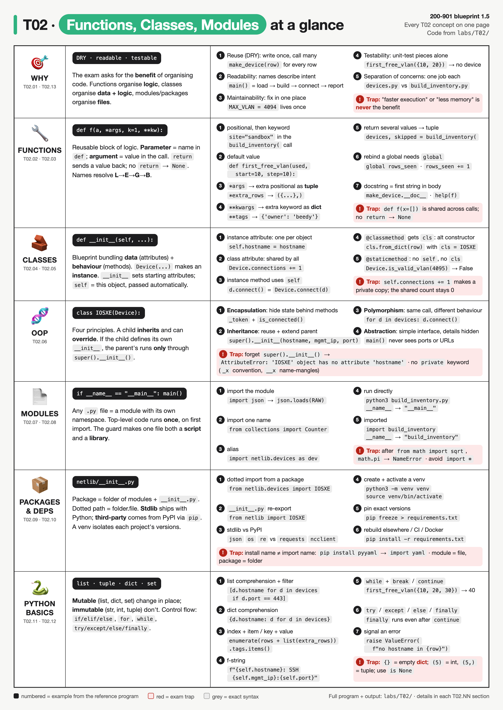
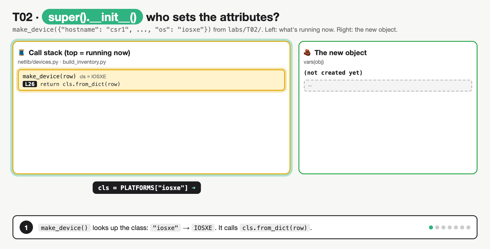

# T02 · Functions, classes, modules: essentials

> Blueprint 1.5: benefits of methods/functions, classes, modules · Full note: [bee/T02-functions-classes-modules.md](../bee/T02-functions-classes-modules.md) · Teach-back 2026-10-11



*Read it top to bottom: each row is one concept area, the numbered examples come from the reference program in `labs/T02/`, and the red boxes are exam traps.*

## The big idea
- This topic answers one question: **why split code into functions, classes and modules, and how does each one behave?**
  - The blueprint verb is about **benefits** (reuse, readability, maintainability, testability), not syntax.
  - The rest of the marks come from short Python snippets: predict the output, or spot the error.
- **Analogy: organising a toolbox.**
  - A **function** is **one tool**: it does one job, and you pick it up whenever you need that job done.
  - A **class** is a **kit**: it keeps related tools and their parts (data) together.
  - A **module** is the **drawer** the kit lives in; a **package** is the **cabinet** of drawers.
- **Analogy for classes: a house blueprint.** The class (`Device`) is the blueprint; each instance (`csr1`, `n9k1`) is one house built from it. Every house has its own furniture (instance attributes), but they all share the same street name (class attribute).
- **What the exam asks:** pick the benefits of organising code (and reject "faster" or "less memory"), read a snippet and predict what it prints or which error it raises, and use the right vocabulary (function vs method, class vs instance, module vs package).

## 🟥 Must know

### 1. Why organise code at all (the 1.5 answer)
- Organising code is about **people working on code**, not about the computer running it faster.
- The five benefits, each with where it shows in the reference program (`labs/T02/`):

| Benefit | Plain meaning | In the program |
|---|---|---|
| **Reuse** (DRY, "Don't Repeat Yourself") | write the logic once, call it many times | `make_device()` is written once and called for every row |
| **Readability** | small named units read like a list of steps | `main()` reads: load rows → build inventory → connect → summarise |
| **Maintainability** | the logic lives in one place, so you fix a bug in one place | the VLAN limit lives in one constant, `MAX_VLAN` |
| **Testability** (T32) | a unit with plain inputs and a return value can be tested without a real device | `make_device()` and `first_free_vlan()` |
| **Separation of concerns** (modularity) | each unit does one job, so two people can own one file each | `devices.py` knows devices; `build_inventory.py` knows input and reporting |

- **Who organises what:** functions organise **logic**, classes organise **data + logic together**, modules and packages organise **files**.
- **Wrong answers** on the exam: "faster execution", "less memory". Organising code does not make it faster.

### 2. Functions: parameters, arguments and return
- A **function** is a named, reusable block of logic: define it once with `def`, call it by name.
- **Parameter** = the name in the `def` line. **Argument** = the value you pass in the call.
- One signature from the reference program uses every kind of parameter:

```python
def build_inventory(rows, *extra_rows, site="lab", **tags):
    ...

build_inventory(rows,                                    # positional → rows
                {"hostname": "box1", "mgmt_ip": "10.10.20.99"},  # extra positional → *extra_rows
                site="sandbox",                          # keyword → overrides the default "lab"
                owner="beedy", env="dev")                # extra keywords → **tags
```

  - `rows`: positional, matched by order.
  - `*extra_rows`: collects extra positional arguments as a **tuple**: `({"hostname": "box1", ...},)`.
  - `site="lab"`: keyword with a **default value**; gets `"sandbox"` here, `"lab"` if left out. Any parameter written after `*extra_rows` can only be passed by keyword.
  - `**tags`: collects extra keyword arguments as a **dict**: `{"owner": "beedy", "env": "dev"}`.
- Positional arguments must come **first**: `f(site="x", rows)` is a `SyntaxError`.
- **`return`** sends a value back:
  - `return devices, skipped` sends back a **tuple**, unpacked with `devices, skipped = build_inventory(...)`.
  - A function with **no `return`** returns **`None`**. In the program, `summary()` only prints, so `result = summary(devices)` leaves `result` as `None`.
- **Mutable default trap:** defaults are worked out **once**, when `def` runs, not on every call:

```python
def add(v, l=[]):            # one list, created when def runs
    l.append(v)
    return l
print(add(1), add(2))        # [1, 2] [1, 2]  (same list both times)
```

  - Fix: `def add(v, l=None):` then `if l is None: l = []`.
- **Why it matters:** "what does this print?" questions hinge on a missing `return` (→ `None`) or a shared default list.

### 3. Classes, objects and `__init__`
- A **class** is the blueprint (`class Device:`). An **instance** (object) is one thing built from it. An object bundles **data** (attributes) and **behaviour** (methods).

```python
class Device:
    vendor = "Cisco"                   # class attribute: one value shared by every instance
    connections = 0                    # class attribute used as a shared counter

    def __init__(self, hostname, mgmt_ip, port=22):   # runs automatically when an object is created
        self.hostname = hostname       # instance attributes: one set per object
        self.mgmt_ip = mgmt_ip
        self.port = port
        self._token = None             # leading _ = "internal" by convention

    def connect(self):                 # instance method: works on one object through self
        Device.connections += 1        # update the shared counter THROUGH THE CLASS
        self._token = f"tok-{self.hostname}"
        return f"{self.hostname}: SSH {self.mgmt_ip}:{self.port}"
```

- `__init__` sets the starting attributes. Strictly it is the **initialiser** (`__new__` creates the object), but the exam calls `__init__` the **constructor**.
- **Instance attributes** (`self.hostname`) are separate per object. **Class attributes** (`vendor`, `connections`) are written in the class body and shared by all instances.
- **Counter trap:** `Device.connections += 1` updates the shared value (the program prints `3` after three connects). `self.connections += 1` instead creates a new attribute on that one object, hiding the class value, so `Device.connections` stays `0`.
- **`self`** = the object the method was called on (the "this one" in "connect *this* device"). Python passes it automatically: `d.connect()` runs as `Device.connect(d)`. It's a naming convention, not a keyword, but it must be the **first parameter**.
  - Forget it (`def show():`) and `obj.show()` fails with `TypeError: ... takes 0 positional arguments but 1 was given`, because Python still passes the object.
- A **method** is a function defined inside a class and called on an object: `router.get_interfaces()`, not `get_interfaces(router)`.

### 4. The three method kinds
- What decides the kind is **what Python passes in automatically** as the first argument.

```python
class Device:
    def connect(self):                 # instance method: gets the object
        ...

    @classmethod
    def from_dict(cls, data):          # class method: gets the class as cls
        return cls(data["hostname"], data["mgmt_ip"])

    @staticmethod
    def is_valid_vlan(vlan_id):        # static method: gets nothing automatically
        return 1 <= vlan_id <= MAX_VLAN
```

  - `from_dict` uses `cls(...)`, not a hard-coded `Device(...)`, so `IOSXE.from_dict(row)` builds an **IOSXE**. That is why classmethods are the usual **alternative constructor**.
  - `is_valid_vlan` is a helper that belongs with the class but needs no object or class: `Device.is_valid_vlan(4095)` → `False`.

| Kind | First parameter | Called as | Used for |
|---|---|---|---|
| Instance method | `self` (the object) | `d.connect()` | read or change one object |
| `@classmethod` | `cls` (the class) | `IOSXE.from_dict(row)` | alternative constructor |
| `@staticmethod` | none | `Device.is_valid_vlan(4095)` | helper that needs no object or class |

### 5. OOP principles and `super().__init__()`
- The four principles, each in the reference program:

| Principle | Plain meaning | In the program |
|---|---|---|
| **Encapsulation** | keep internal state inside the object; expose it through methods | `_token` is internal; callers use `is_connected()` |
| **Inheritance** | a child class reuses and extends a parent | `class IOSXE(Device)` |
| **Polymorphism** | same method name, different behaviour per class | `d.connect()` gives RESTCONF, NX-API or SSH |
| **Abstraction** | simple interface, details hidden | `main()` calls `connect()` without knowing ports or URLs |

- **Inheritance analogy:** the child class is a new edition of the parent's blueprint. If the child writes its **own** `__init__`, it replaces the parent's, so the parent's setup only happens if the child explicitly asks for it with `super()`.

```python
class IOSXE(Device):                              # an IOSXE is a Device
    def __init__(self, hostname, mgmt_ip, port=443):
        super().__init__(hostname, mgmt_ip, port)  # run Device.__init__ first: sets hostname, mgmt_ip, port, _token
        self.api = "RESTCONF"                      # then add what is specific to IOS XE

    def connect(self):                             # override: same name, new behaviour (polymorphism)
        super().connect()                          # reuse the parent's counter and token logic
        return f"{self.hostname}: {self.api} https://{self.mgmt_ip}:{self.port}/restconf"

class NXOS(Device):                                # no __init__ here, so Device.__init__ is inherited automatically
    ...
```

- Delete the `super().__init__(...)` line and `self.hostname` is never set → `AttributeError: 'IOSXE' object has no attribute 'hostname'` later, in `connect()`.
- **Overriding** = the child defines a method with the same name. It can still call `super().connect()` to reuse the parent's logic.



*Watch the order: the child's `__init__` runs first, `super()` jumps to the parent to set the shared attributes, then control returns to the child; the last frame shows what breaks when the `super()` line is deleted.*

### 6. Modules and import forms
- A **module** is any `.py` file. Each module has its own **namespace**, so names in different files don't clash (`dev.MAX_VLAN` can't collide with a `MAX_VLAN` elsewhere).
- **The import form decides which name you get:**

```python
import json                          # binds json            → use json.loads(...)
from collections import Counter      # binds Counter ONLY    → Counter(...); the name collections does not exist
import netlib.devices as dev         # binds the alias dev   → dev.MAX_VLAN
from netlib import IOSXE, NXOS       # binds those two names → IOSXE(...)
```

  - So after `from math import sqrt`, `sqrt(16)` works but `math.pi` raises **`NameError`**.
  - `from x import *` binds every public name: avoid it, because it pollutes the namespace, can overwrite your own names and hides where names came from.
- A module's top-level code runs **once**, on the first import; later imports reuse the cached copy.

| Statement | Names it creates | How you use it |
|---|---|---|
| `import json` | `json` | `json.loads(...)` |
| `from collections import Counter` | `Counter` only | `Counter(...)` |
| `import netlib.devices as dev` | the alias `dev` | `dev.MAX_VLAN` |
| `from x import *` | every public name | avoid it |

### 7. Packages and the `__name__` guard
- A **package** is a folder of modules, traditionally with an `__init__.py`. A **dotted path** maps to folders: `netlib.devices` is `netlib/devices.py`.

```
labs/T02/
├── build_inventory.py      script AND importable module
└── netlib/                 package (folder of modules)
    ├── __init__.py         runs on first import; re-exports names
    └── devices.py          module: Device, IOSXE, NXOS classes
```

  - `netlib/__init__.py` contains `from netlib.devices import Device, IOSXE, NXOS`, which lets callers write `from netlib import IOSXE` instead of `from netlib.devices import IOSXE`.
- **The `__name__` guard** makes one file both a **script** and a **library**. Analogy: a "run only if opened directly" sticker on the code below it.

```python
if __name__ == "__main__":     # True only when this file is run directly
    main()
```

  - `python3 build_inventory.py` → `__name__ == "__main__"` → `main()` runs.
  - `import build_inventory` → `__name__ == "build_inventory"` → `main()` is **skipped**, but the functions are now available to another script or a unit test.
  - Code **outside** the guard runs on every import.
- **Standard library** ships with Python: `json`, `os`, `sys`, `re`, `unittest`, `xml.etree.ElementTree`, `csv`, `logging`. **Third-party** packages come from PyPI via `pip`: `requests`, `ncclient`, `xmltodict`, `pyyaml`, `netmiko`, `pyats`.
- The install name can differ from the import name: `pip install pyyaml`, then `import yaml`.

## Exam traps
- **No `return` → `None`.** `x = print("hi")` leaves `x` as `None`.
- **Mutable default is shared:** `def add(v, l=[])` reuses one list across calls. Fix with `l=None`, then `if l is None: l = []`.
- **Child `__init__` without `super().__init__()`:** the parent's attributes are never set → `AttributeError` later.
- **`from math import sqrt` doesn't bind `math`**, so `math.pi` → `NameError`.
- **`*args` is a tuple and `**kwargs` is a dict**, not lists.
- **Benefit ≠ performance.** Pick reuse, readability, maintainability or testability.

<details><summary><b>🟨 Should know (second pass)</b></summary>

- **Scope: where Python looks for a name.**
  - A variable created inside a function is **local** and disappears when the function ends. A variable at the top of the file is **global** (module level).
  - Lookup order is **LEGB**: **L**ocal, then **E**nclosing (an outer function), then **G**lobal (the module), then **B**uilt-in (like `len`).
  - **Reading** a global needs nothing special. **Assigning** to one needs `global name`:

```python
count = 0
def bump():
    count += 1     # UnboundLocalError: the assignment makes count local for the WHOLE function
```

  - `nonlocal name` is the same idea for a variable in an enclosing function.
  - A **docstring** is the first string inside a function, class or module. `help(f)` or `f.__doc__` reads it.
- **Encapsulation detail:** Python has no `private` keyword. A leading `_name` means "internal" by convention; `__name` triggers **name mangling** to `_Device__name`.
- **Dependencies and venvs:**
  - `python3 -m venv venv` creates an isolated environment, `source venv/bin/activate` uses it, `deactivate` leaves it.
  - `pip freeze > requirements.txt` pins exact versions; `pip install -r requirements.txt` rebuilds the same set on another machine, in CI or in a Docker image.
  - Why: project A needs `ncclient` 0.6 while project B needs 0.7. Separate venvs keep them apart and leave the system Python clean.
- **Python basics that show up in snippets:**
  - `list` = ordered, mutable · `tuple` = ordered, **immutable** · `dict` = key/value · `set` = unique items, no order. Strings are immutable too.
  - `{}` is an empty **dict**; an empty set is `set()`. `(5)` is an int; `(5,)` is a one-item tuple.
  - `b = a` copies the reference, not the data, so changing a shared dict changes it everywhere. `dict(tags)` makes a real copy.
  - `try / except / else / finally`: `except` runs only on that error, `else` only when there was **no** error, and `finally` **always** runs, even after `continue`.
  - `enumerate()` counts from 0; `for k, v in d.items()` gives key/value pairs; `break` leaves a loop, `continue` skips to the next pass.
  - Use `is` only for `None` checks; `==` compares values.
  - Comprehensions: `[d.hostname for d in devices if d.port == 443]` (list with a filter), `{d.hostname: d for d in devices}` (dict).

</details>

> **Recognise only, details in the full note:** `__new__` vs `__init__`, `__all__` with `import *`, the `sys.modules` cache, namespace packages without `__init__.py` (PEP 420), generator expressions, `resp.raise_for_status()` raising `HTTPError`, the four "break it on purpose" edits in the full note's Examples.

## Quick self-check
<details><summary>Q1. What does a function with no <code>return</code> statement give back?</summary><code>None</code>, because Python adds an implicit return of None.</details>
<details><summary>Q2. In <code>def f(*args, **kwargs)</code>, what types are <code>args</code> and <code>kwargs</code>?</summary>A tuple and a dict: extra positionals go in the tuple, extra keywords in the dict.</details>
<details><summary>Q3. Which method kind receives the class as <code>cls</code> and is often an alternative constructor?</summary><code>@classmethod</code>. A staticmethod receives nothing automatically.</details>
<details><summary>Q4. A file ends with <code>if __name__ == "__main__": run_all()</code>. Does <code>run_all()</code> run when another script imports it?</summary>No. On import, <code>__name__</code> is the module name, so the guarded block is skipped.</details>
<details><summary>Q5. What is the correct order to copy a dependency set to a new machine?</summary><code>pip freeze &gt; requirements.txt</code> on the old machine, then <code>python3 -m venv venv</code>, <code>source venv/bin/activate</code>, <code>pip install -r requirements.txt</code> on the new one.</details>
<details><summary>Q6. A child class defines its own <code>__init__</code> but never calls <code>super().__init__()</code>. What happens?</summary>The parent's <code>__init__</code> doesn't run, so its attributes (e.g. <code>hostname</code>) are never set, giving an <code>AttributeError</code> later.</details>
<details><summary>Q7. Moving a copied 40-line login routine into one shared function mainly improves which two things?</summary>Reuse and maintainability: written once, fixed in one place. Not execution speed or memory.</details>

## Say it out loud
- "Function organises logic, class organises data plus logic, module organises files, package is a folder of modules."
- "No return means None, and a mutable default is shared forever."
- "Child has its own init? Then call super, or the parent never runs."
- "Self is the object, cls is the class, static gets nothing."
- "The main guard makes one file both a script and a library."
