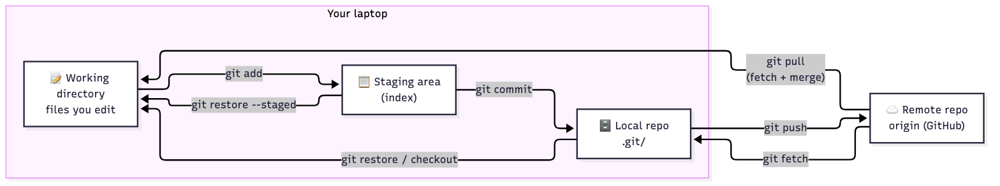
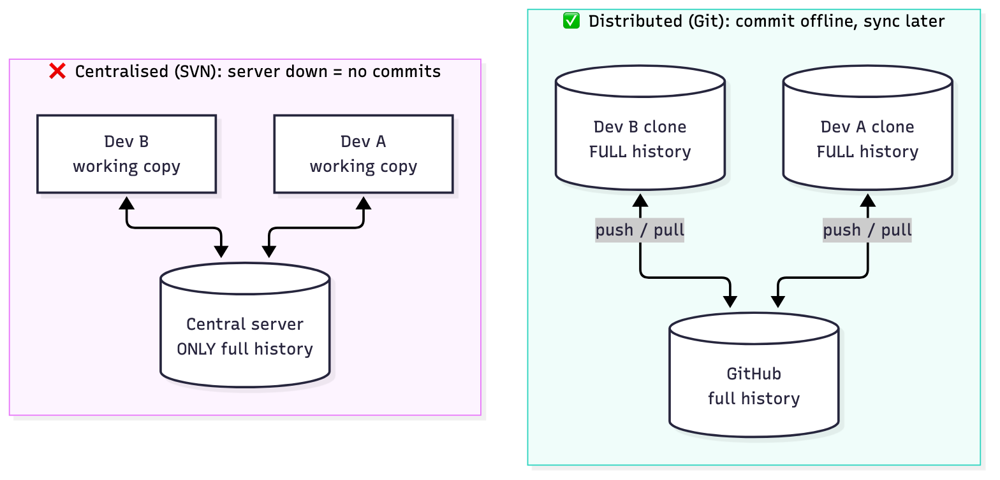
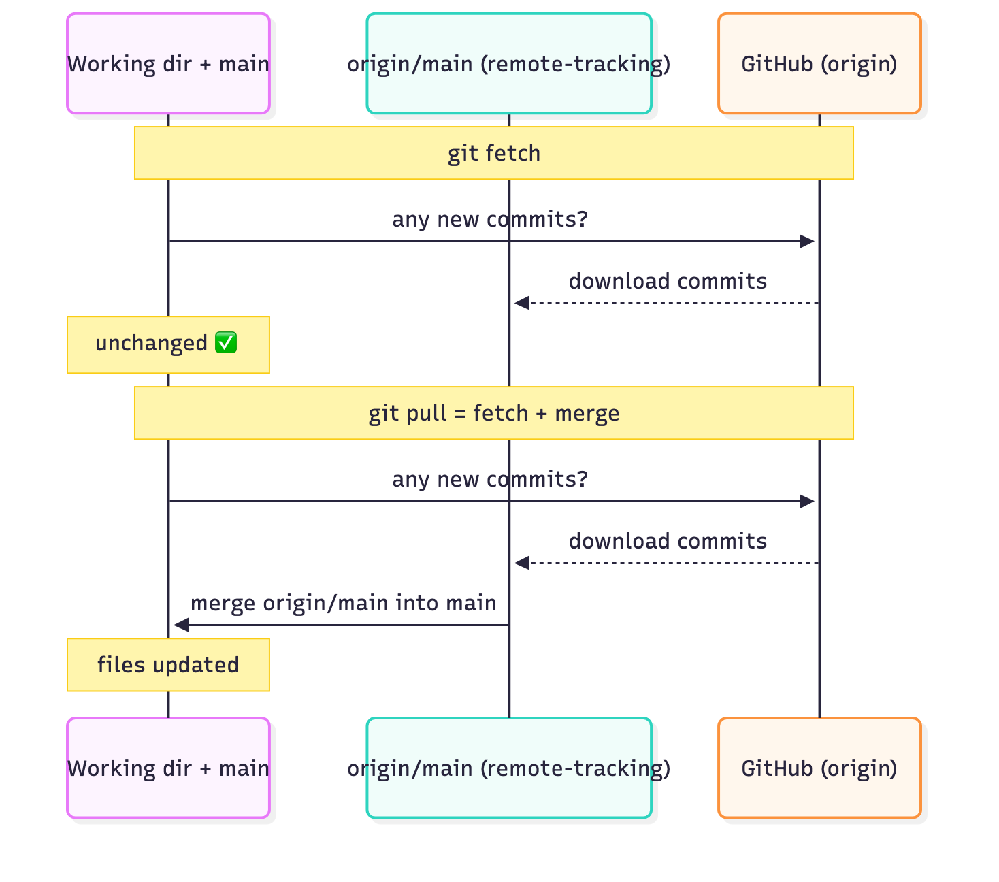
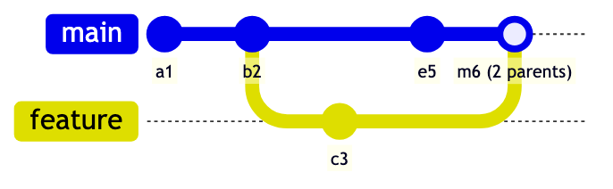
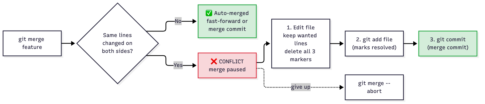
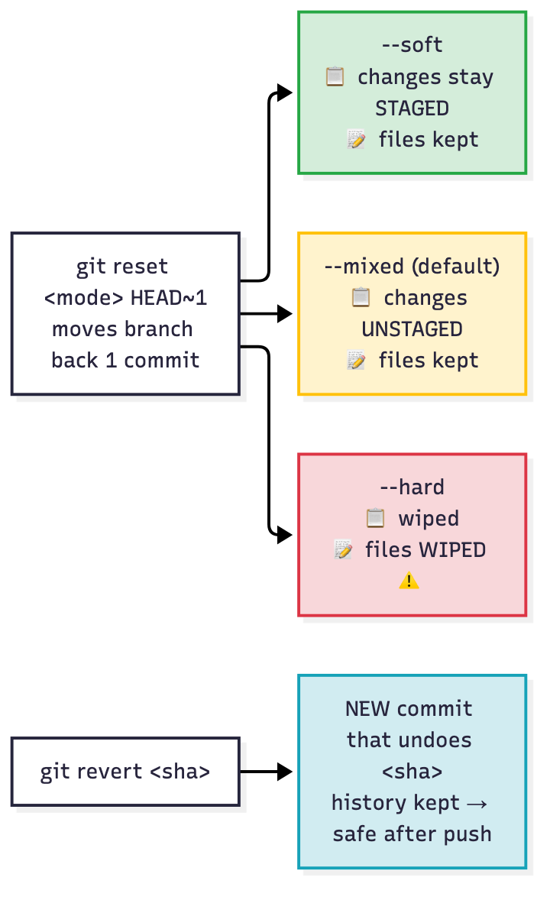
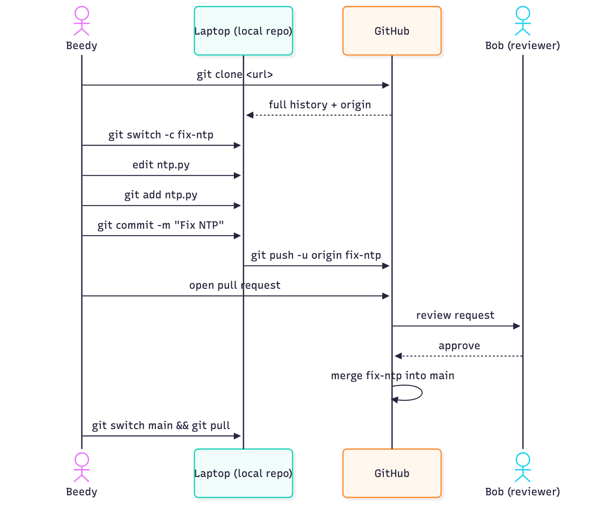
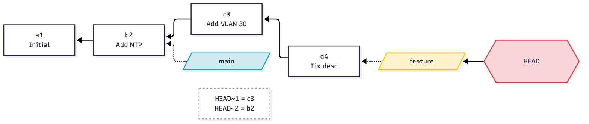

# T04 · Git + version control: essentials

> Blueprint 1.7, 1.8: advantages of version control; Git operations (clone, add/rm, commit, push/pull, branch, merge/conflicts, diff) · Full note: [bee/T04-git-version-control.md](../bee/T04-git-version-control.md)



*Read left to right to save work (`add`, `commit`, `push`) and right to left to get work back (`fetch`, `pull`, `restore`). There is no separate overview image for T04, so this diagram stands in for it.*

## 🧭 The big idea

This topic answers two questions:

| | Question | Answer options | Analogy |
|---|---|---|---|
| 📜 | **Why use version control at all?** (blueprint 1.7, the "advantages" question) | history · rollback · parallel work · collaboration · automation trigger | **a full, signed logbook of every change.** You can see who changed what and why, roll back to any page, and work in parallel without overwriting each other. Git is **distributed**: every clone carries the **whole** logbook, so you can commit on a plane and sync later. |
| 🛠️ | **Which Git command does which job?** (blueprint 1.8: clone, add/rm, commit, push/pull, branch, merge, conflicts, diff) | 🧺 staging · 🌿 branches · the rest of Must know | 🧺 **staging = a shopping basket.** `git add` puts changes in the basket; `git commit` pays for only what is in the basket. Anything still on the shelf (unstaged) isn't bought. 🌿 **branches = sticky notes on a page.** A branch is just a label on a commit, so making one is instant; the label moves forward as you commit. |

- 🎯 **What the exam asks:** "which command…" for a scenario, the confusable pairs (`rm` vs `rm --cached`, `reset` vs `revert`, `fetch` vs `pull`, `diff` vs `diff --staged`), reading conflict markers, and putting a team workflow in the right order. You use Git daily, so the marks are in those pairs.

## 🟥 Must know

### 1. 📜 Why version control, and centralised vs distributed (1.7)

> 💡 **The exam answer to "advantages of version control":**

| | Advantage | What it means |
|---|---|---|
| 🕰️ | **History / audit trail** | every commit records the **author, timestamp, message, parent and a snapshot**, which answers who, what, when and why |
| ⏪ | **Rollback** | check out, `revert` or `reset` to any earlier commit |
| 🌿 | **Parallel work** | branches let two people edit the same repo without overwriting each other |
| 👥 | **Collaboration and review** | a shared remote (GitHub, GitLab) enables pull requests and code review (T46) |
| ⚙️ | **Automation trigger** | CI/CD pipelines (T28) run on push or merge, which makes version control the foundation of NetDevOps |

- ❌ **Wrong answers** say version control makes code run faster, encrypts the code, or removes the need for testing.

**🏢 Centralised vs 🌐 distributed:**

| | 🏢 Centralised (SVN, CVS) | 🌐 Distributed (Git, Mercurial) |
|---|---|---|
| In one line | one central server holds the history; you need it to commit | every clone has the full history; commit offline, push later |
| Where full history lives | only on the central server | in **every** clone |
| Commit offline | ❌ no | ✅ yes, commit locally and push later |
| Single point of failure | the server | none; any clone can restore it |
| Speed of log, diff, branch | network-bound | local and fast |
| Cost | simpler model | you must push and pull to share |

> 🎯 Exam cue: "a developer on a plane commits changes" means **distributed**.



*Centralised: only the server holds history. Distributed: every clone is a full backup.*

### 2. 🗂️ The Git model: four areas

> 💡 Every command moves changes between four places (see the image at the top).

| # | Area | What it is |
|---|---|---|
| 1 | 📝 **Working directory** | the files you edit |
| 2 | 🧺 **Staging area** (the **index**, stored in `.git/index`) | the basket of changes picked for the next commit, so you can commit some changes and not others |
| 3 | 💾 **Local repository** | the `.git/` folder of committed snapshots. Delete it and the folder stops being a repo. |
| 4 | ☁️ **Remote** | the shared copy. `origin` is just the default **name** `git clone` gives it. |

- A file moves through the states **untracked** → (`add`) **staged** → (`commit`) **committed** → (edit) **modified** → (`add`) staged again.

```
working dir ──add──▶ staging ──commit──▶ local repo ──push──▶ remote
```

### 3. 🧺 Start, stage, remove and commit

**🆕 Start a repo:**

```bash
git init                                  # creates .git/ here; NO remote yet
git remote add origin <url>               # needed after init, before the first push
git clone <url>                           # downloads full history AND adds origin automatically
git remote -v                             # list remotes with their fetch/push URLs
```

**➕ Stage:** `git add <file>` or `git add .` stages new, modified and deleted files from the current folder down; `git add -A` covers the whole repo.

**🗑️ Remove:** the two `rm` forms differ in what happens on disk:

```bash
git rm config.txt                         # deletes the file from disk AND stages the deletion
git rm --cached .env                      # stops tracking .env but KEEPS it on disk
```

| ❌ Problem | ✅ Fix |
|---|---|
| a secret was committed | classic fix: `git rm --cached .env`, add `.env` to `.gitignore`, commit. The secret is still in history, so rotate it. |
| `.gitignore` doesn't hide a file | `.gitignore` only affects **untracked** files. An already-committed file needs `git rm --cached` first. |

**💾 Commit:**

| Command | Commits |
|---|---|
| `git commit -m "msg"` | **only what is staged** |
| `git commit -a -m "msg"` | auto-stages **tracked** modified/deleted files, but **does not add untracked files**. A new file still needs `git add`. |

**🔎 Inspect:**

| Command | Shows |
|---|---|
| `git status` | each file's state |
| `git log --oneline --graph` | compact history with a branch graph |
| `git show <commit>` | one commit's details plus its diff |

### 4. 🔍 `git diff`: which two areas it compares

> 💡 `git diff` always compares two places. The flag decides which two.

| Command | Compares | So it shows |
|---|---|---|
| `git diff` | working directory vs staging | unstaged changes |
| `git diff --staged` (same as `--cached`) | staging vs last commit | what the next commit will contain |
| `git diff HEAD` | working directory vs last commit | all uncommitted changes |
| `git diff a b` | two commits or branches | changes between them |

- 🪤 **Trap:** after `git add`, plain `git diff` prints **nothing**, because the changes moved into staging. Use `git diff --staged`.
- Reading the diff output itself (`---`, `+++`, `@@`) is T05.

### 5. 🔄 Syncing with a remote: push, fetch, pull

| | Command | What it does | Touches your branch/files? |
|---|---|---|---|
| ⬆️ | `git push origin <branch>` | uploads local commits. The first time, `git push -u origin <branch>` also sets the upstream. | |
| 👀 | **`git fetch`** | downloads remote commits into the **remote-tracking branch** `origin/<branch>`. It's the safe "look before you merge". | ❌ **untouched** |
| ⬇️ | **`git pull`** | `git fetch` **plus integrate**: a merge, or a rebase if `--rebase` or `pull.rebase=true` is set | ✅ yes |

- ⚠ verify: current git-pull docs say the default with no config is **fast-forward only**, so `pull` fails with a "divergent branches" hint when both sides have new commits (confirmed on Git 2.54). The exam still expects **pull = fetch + merge**.

| ❌ Problem | ✅ Fix |
|---|---|
| a push rejected as "non-fast-forward" means someone pushed first | `pull`, then `push` |



*`fetch` stops at `origin/main`; `pull` goes one step further and merges into your branch.*

### 6. 🌿 Branching and 🔀 merging

> 💡 A **branch** is a lightweight, movable pointer (the sticky note) to a commit, so creating one is instant.

```bash
git branch                                # list branches (* = current)
git branch feature                        # create, but DON'T switch
git switch -c feature                     # create AND switch (old form: git checkout -b feature)
git switch main                           # move to main (old form: git checkout main)
git merge feature                         # merge feature INTO the branch you are on (main)
git branch -d feature                     # delete a merged branch (refuses if unmerged; -D forces)
```

- `git merge <branch>` merges that branch **into the current branch**, so switch to `main` first.

**Two merge outcomes:**

| | ⏩ Fast-forward | 🔀 Merge commit |
|---|---|---|
| When | `main` has no new commits since the branch split | both sides moved |
| What happens | the `main` label just slides forward | Git makes a new commit with **two parents** |
| Merge commit? | ❌ **No merge commit** | ✅ yes |
| Output says | `Fast-forward` | `Merge made by the 'ort' strategy.` (older Git says `'recursive'`, same meaning) |



*Both branches moved (`c3` and `e5`), so Git creates `m6` with two parents.*

### 7. 💥 Merge conflicts

> 💡 A **conflict** happens when both branches changed **the same lines** (or one edited and one deleted). Different lines or different files merge automatically.

Git stops with `CONFLICT (content): Merge conflict in config.txt` and writes markers into the file:

```
<<<<<<< HEAD
hostname R1-CORE        <- current branch (the one you are merging INTO)
=======
hostname R1-EDGE        <- incoming branch
>>>>>>> feature
```

| ⬆️ Top half: `<<<<<<< HEAD` to `=======` | ⬇️ Bottom half: `=======` to `>>>>>>> feature` |
|---|---|
| **your current branch** | the **incoming** branch |

**Resolve in three steps:**

1. Edit the file: keep the lines you want and **delete all three marker lines**.
2. `git add <file>` to mark it resolved. Committing without the `add` doesn't work.
3. `git commit`.

- 🚪 Bail out instead: `git merge --abort`.



*Resolve in three steps (edit → add → commit), or abort.*

### 8. ⏪ Undo: reset vs revert

> 💡 **Analogy:** `reset` tears pages out of the logbook; `revert` writes a new page saying "undo page 12". If others have already copied the logbook, tearing pages out breaks their copy.

| | ✂️ `git reset` | 📝 `git revert <sha>` |
|---|---|---|
| What it does | moves the branch pointer back, which **rewrites history** | makes a **new commit** that undoes the old one, leaving history intact |
| Use it for | **local** work | **safe on shared, pushed branches** |

**✂️ The reset mode decides what happens to the undone changes:**

| `git reset` mode | HEAD moves | Staging | Working files |
|---|---|---|---|
| `--soft` | ✅ yes | changes **stay staged** | kept |
| `--mixed` (the default) | ✅ yes | changes **unstaged** | kept |
| `--hard` | ✅ yes | wiped | **wiped (lost)** |

| Scenario | | Answer |
|---|---|---|
| "Undo a bad commit already pushed to main" | 📝 | `git revert <sha>` |
| "Undo my last local commit but keep the work staged" | ✂️ | `git reset --soft HEAD~1` |



*Green to red shows how much you lose; blue is revert, the only one safe after a push.*

### 9. 👥 The team workflow (ordering questions)

> 🎯 The canonical order for drag-and-drop questions:
> **clone → branch (`switch -c`) → edit → add → commit → push → open pull request → review → merge**.

- A **pull request** asks the upstream owner to merge your branch. It's a platform feature (GitHub/GitLab), not a Git command.



*The full team flow, which is also the answer to the ordering questions.*

## ⚠️ Exam traps

| ❌ Looks like… | ✅ Actually… |
|---|---|
| `git rm` just stops tracking | **`git rm` deletes the file from disk**; `git rm --cached` stops tracking and keeps it. |
| `reset` is fine to undo a pushed commit | **Pushed already? Use `revert`, not `reset`.** Reset rewrites history others already have. |
| `fetch` updates your branch | **`fetch` doesn't touch your branch**; it only updates `origin/<branch>`. `pull` is the one that merges. |
| Plain `git diff` shows what you just staged | **After `git add`, plain `git diff` is empty.** Use `git diff --staged` (= `--cached`). |
| `git commit -a` commits everything; `git branch x` moves you to `x` | **`git commit -a` skips untracked files**, and **`git branch x` creates but doesn't switch** (use `git switch -c x`). |
| The top half of a conflict is the incoming change | **Conflict top half (`HEAD`) is your current branch**, the bottom half is incoming; resolve with edit → `git add` → `git commit`. |

<details><summary><b>🟨 Should know (second pass)</b></summary>

### 🏷️ `git status --short` codes

| Code | Means |
|---|---|
| `??` | untracked |
| ` M` | modified but not staged |
| `M ` | staged |
| `A ` | new file staged |
| `D ` | deletion staged |

### 🔑 Commit IDs and HEAD

| | |
|---|---|
| 🔑 **Commit IDs** | a **SHA-1 hash** (40 hex characters; `--oneline` shows the first 7). Any change to content, metadata or parent gives a new hash. ⚠ verify: Git also supports SHA-256 repos; SHA-1 remains the default, so use SHA-1 for the exam. |
| 📍 **HEAD** | a pointer to your current branch, which points to its latest commit. `HEAD~1` is the parent. A **detached HEAD** means HEAD points straight at a commit (for example after `git checkout <sha>`). |



*HEAD points to a branch, the branch points to a commit, and each commit points back to its parent. Branches are just labels.*

### 🧰 More commands

| Command | What it does |
|---|---|
| `git config --global user.name "Beedy"` | writes to `~/.gitconfig`; without `--global` it applies to this repo only (`.git/config`) |
| `git mv old new` | renames and stages in one step |
| `git restore <file>` (old form `git checkout -- <file>`) | throws away working-directory edits |
| `git restore --staged <file>` (or `git reset <file>`) | unstages but keeps the edits |
| `--no-ff` | forces a merge commit even when a fast-forward is possible |
| `git stash` | shelves uncommitted changes and leaves a clean working directory |
| `git stash pop` | applies and drops the stash |
| `git stash apply` | applies and keeps it |
| `git tag v1.0` | lightweight tag on HEAD |
| `git tag -a v1.0 -m "msg"` | annotated tag |
| `git push origin v1.0` | pushes a tag (plain `git push` doesn't push tags) |

- 🔀 **`switch` and `restore`** (Git 2.23) split up the overloaded `checkout`; the exam may show either.
- 🧱 **Rebase** (awareness): replays your commits on top of another branch for a straight-line history. It **rewrites hashes**, so don't rebase shared branches.

| 🍴 Fork | 📥 Clone |
|---|---|
| a server-side copy of someone else's repo under your account (a GitHub/GitLab feature) | a local copy |

</details>

> 📚 **Recognise only, details in the full note:** `ort` vs `recursive` strategy names, the `pull.rebase` / `pull.ff` config and Git 2.54 ff-only default, `git init --object-format=sha256`, `git stash list`, `git diff --stat` in the drills, `commit.gpgsign` in the drill scripts.

## ✍️ Quick self-check
<details><summary>Q1. Which command shows what will go into the next commit after <code>git add</code>?</summary><code>git diff --staged</code>. It compares the staging area with the last commit.</details>
<details><summary>Q2. Which reset mode undoes the last commit but keeps its changes staged?</summary><code>--soft</code>. <code>--mixed</code> unstages them and <code>--hard</code> deletes them.</details>
<details><summary>Q3. Which command downloads new commits without touching your branch or files?</summary><code>git fetch</code>. It only updates the remote-tracking branches.</details>
<details><summary>Q4. You ran <code>git init</code>. What must you do before your first <code>git push</code>?</summary><code>git remote add origin &lt;url&gt;</code>. Only <code>clone</code> sets up <code>origin</code> for you.</details>
<details><summary>Q5. Name two advantages of distributed over centralised version control.</summary>You can commit offline, and every clone holds full history, so there is no single point of failure.</details>
<details><summary>Q6. You committed <code>credentials.yml</code> by mistake. How do you stop tracking it but keep it on your laptop?</summary><code>git rm --cached credentials.yml</code>, add it to <code>.gitignore</code>, commit. Plain <code>git rm</code> would delete it too.</details>
<details><summary>Q7. A conflict shows <code>&lt;&lt;&lt;&lt;&lt;&lt;&lt; HEAD</code> / <code>vlan 10</code> / <code>=======</code> / <code>vlan 20</code> / <code>&gt;&gt;&gt;&gt;&gt;&gt;&gt; feature</code> after merging on <code>main</code>. Which line came from <code>feature</code>?</summary><code>vlan 20</code>. The <code>HEAD</code> half is the current branch (<code>main</code>). Edit, remove the markers, <code>git add</code>, then <code>git commit</code>.</details>

## 🗣️ Say it out loud
- 🗂️ "Working dir, add, staging, commit, local repo, push, remote."
- ⏪ "Reset rewrites, revert records: revert for anything already pushed."
- 🗑️ "rm deletes, rm --cached keeps the file and just stops tracking."
- 🔄 "Fetch looks, pull looks and merges."
- 💥 "HEAD on top is mine, the bottom half is theirs; edit, add, commit."
