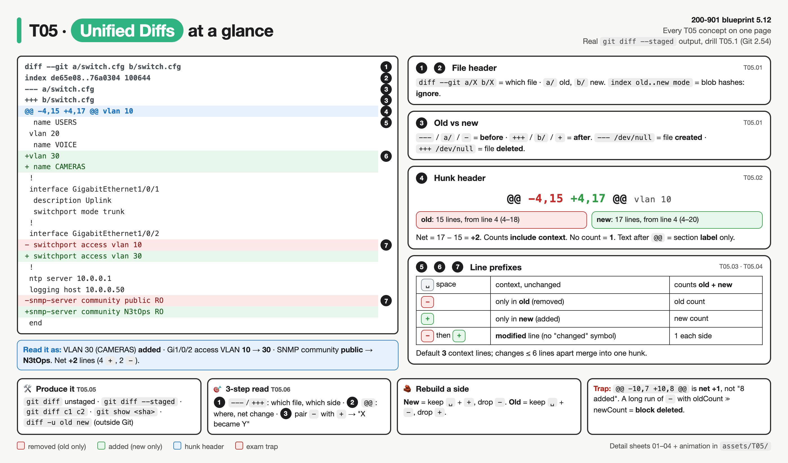
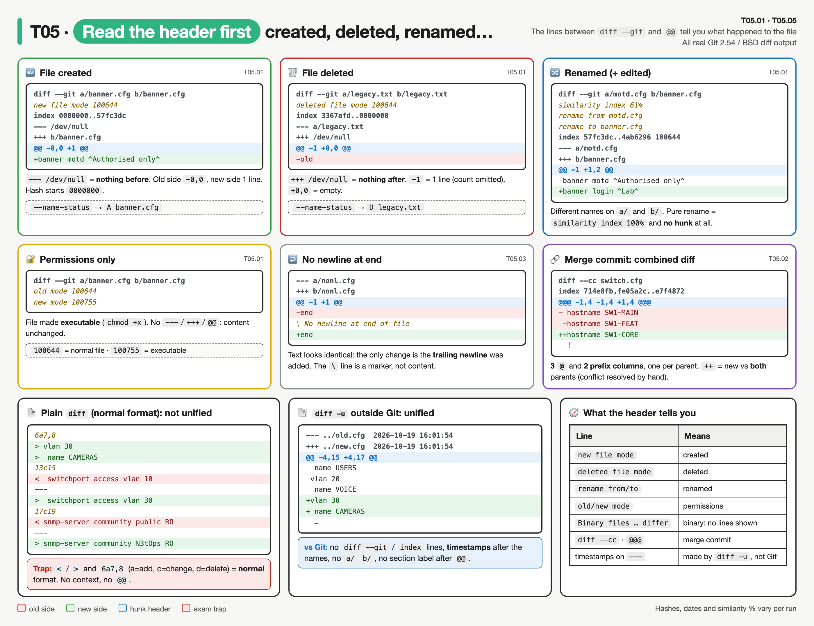
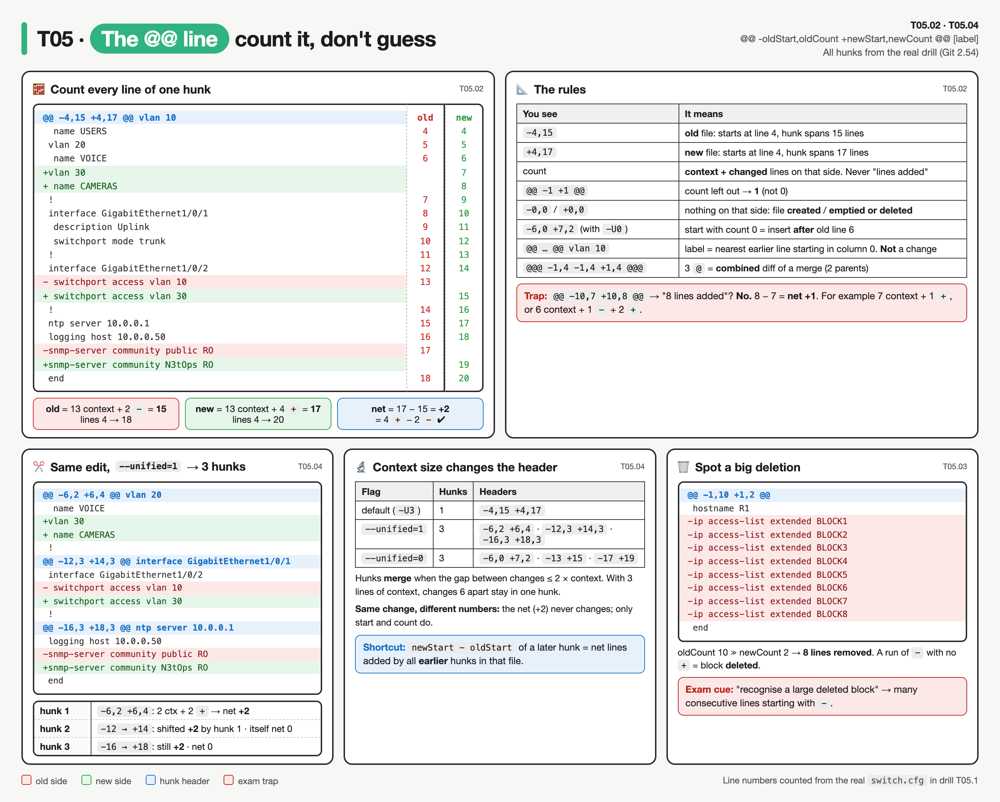
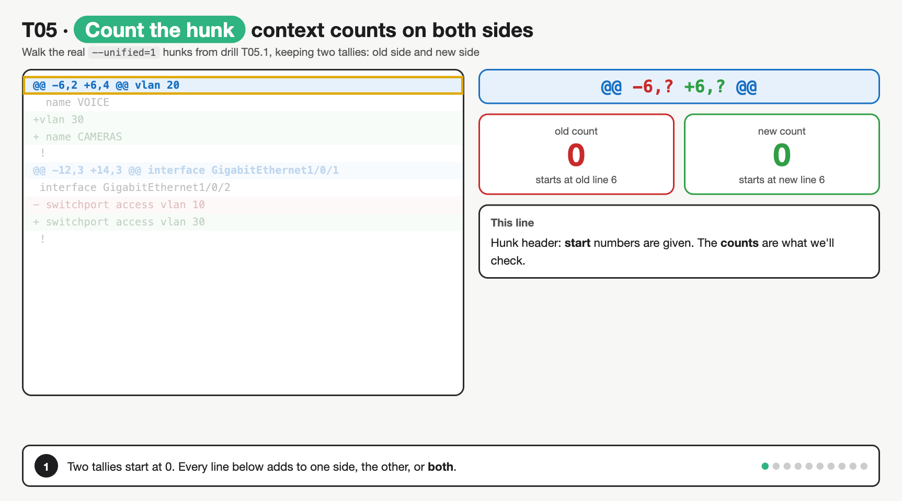
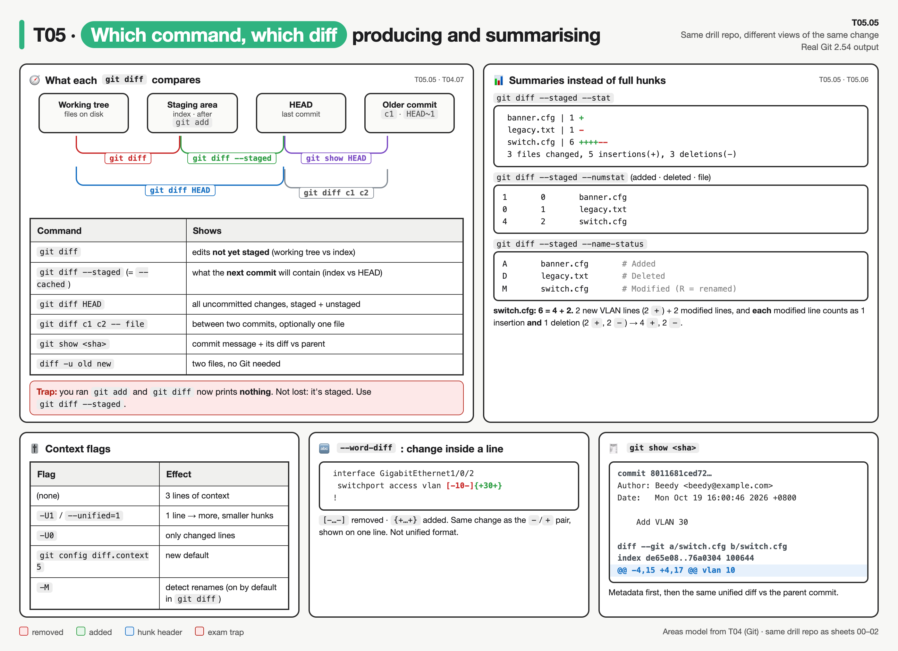
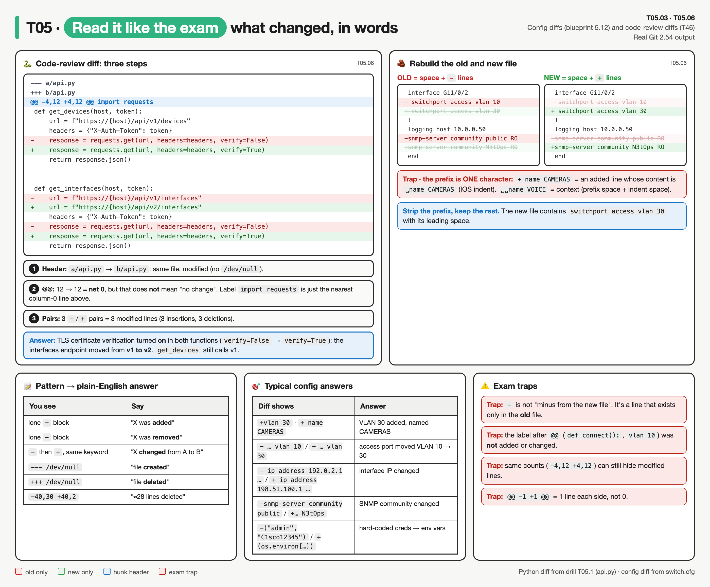

# T05 · Unified diffs: essentials

> Blueprint 5.12 · Full note: [bee/T05-unified-diffs.md](../bee/T05-unified-diffs.md) · Teach-back 2026-10-11 · **[Syntax drill](#syntax-drill)** at the end

## In one picture



*Every T05 concept on one page. Left: a real `git diff --staged` with numbered parts; right: what each part means. Bottom: how to produce diffs, the 3-step read, rebuilding a side, and the main trap.*

## The big idea
A unified diff is like a "track changes" view printed as plain text. Instead of colours, it uses one symbol at the start of each line: a minus for deleted, a plus for added, and a space for "unchanged, shown so you can find your place". Blueprint 5.12 asks you to read one and say what changed, for example "VLAN 30 was added" or "the IP address changed". Once you can read the `@@` line and the first character of each line, these questions become free marks.

## What you need to know

### 1. The file header: which file, and which side is old
- A Git diff has two parts: a **file header** that names the file, and one or more **hunks** (the changed regions of that file).
- `diff --git a/switch.cfg b/switch.cfg` says which file is being compared. `a/` is the old version and `b/` is the new version.
- The `index de65e08..76a0304 100644` line holds the old and new **blob hashes** and the file mode. You can ignore it.
- `--- a/file` is the **old** version (the "from" file), and `+++ b/file` is the **new** version (the "to" file).
- Memory hook: minus and `a` mean **before**; plus and `b` mean **after**. These are the same symbols used on the lines below.
- `/dev/null` means "nothing on this side":

| You see | Meaning | Matching hunk header |
|---|---|---|
| `new file mode 100644`, `--- /dev/null`, `+++ b/banner.cfg` | the file was **created** | `@@ -0,0 +1 @@` |
| `deleted file mode 100644`, `--- a/legacy.txt`, `+++ /dev/null` | the file was **deleted** | `@@ -1 +0,0 @@` |

- `/dev/null` appears only on the `---` and `+++` lines; the `diff --git a/x b/x` line keeps the real file name.
- A plain `diff -u` made outside Git has no `diff --git` or `index` lines, and its `---`/`+++` lines show the filename **plus a timestamp**.



*Read the lines between `diff --git` and `@@` first: they say whether the file was created, deleted, renamed or only had its mode changed. Bottom: plain `diff` (normal format) vs `diff -u`, so you can tell them apart.*

### 2. The hunk header: the `@@` line
- The format is `@@ -oldStart,oldCount +newStart,newCount @@ [section]`.
- The minus part describes the region in the **old** file, and the plus part describes it in the **new** file.
- The **start** is the first line number shown in the hunk, context included. The **count** is how many lines the hunk covers on that side, counting both context and changed lines.
- Worked example, `@@ -4,15 +4,17 @@ vlan 10`:
  - In the old file, the hunk covers 15 lines starting at line 4 (lines 4 to 18).
  - In the new file, it covers 17 lines starting at line 4 (lines 4 to 20).
  - The net change is 17 minus 15, which is **+2 lines** for this hunk. Check: it has 4 plus lines and 2 minus lines, and 4 minus 2 is 2.
- When a count is **left out, it means 1**: `@@ -1 +1 @@` is one line on each side, not zero.
- A **count of 0** means no lines on that side: `-0,0` is a new file and `+0,0` is a file that was emptied or deleted.
- The text after the second `@@` (like `vlan 10`) is the **enclosing function or section**, there only to help you find your place. It is not part of the change.
  - Git finds that label by searching upwards from the hunk for the nearest line starting in column 0. In a config file that is usually a `vlan` or `interface` line. In Python without a language diff driver it may show `import requests` rather than the function name. ⚠ verify per language driver.
- Shortcut: if a later hunk's new start is different from its old start, the **earlier** hunks added or removed lines. The difference is the net shift.



*Top left: every line of the real hunk numbered on both sides, so you can see why it's -4,15 +4,17. Top right: every header shape and what it means. Bottom: the same edit split into 3 hunks, how context size changes the numbers, and how to spot a deleted block.*



*Steps: walk each line of two real hunks keeping an old and a new tally; context adds to both, `+` to new only, `-` to old only. The second hunk starts 2 lower because the first one added 2. Fixes the misconception that the count after `+` is the number of added lines.*

### 3. Line prefixes: the first character tells the story
| First character | Meaning | Counts toward |
|---|---|---|
| a space | unchanged **context** line | both old and new counts |
| `-` | line exists only in the **old** file (removed) | old count only |
| `+` | line exists only in the **new** file (added) | new count only |

- There is no special "changed" symbol. A **modified line** appears as a `-` line followed by a `+` line:

```
- switchport access vlan 10
+ switchport access vlan 30
```

- Read that pair as "the access VLAN changed from 10 to 30".
- `\ No newline at end of file` is a marker, not content. It just says the last line has no trailing newline.
- Only the **first character** is the prefix; the rest is the actual line. Cisco configs indent sub-commands with a space, so an added ` name CAMERAS` shows as `+ name CAMERAS`, and an unchanged ` name VOICE` shows with two leading spaces.
- **Exam-sim gap (from practice test review):**
  - A long **run of consecutive `-` lines** with few or no `+` lines means a block was deleted. A run of `+` lines means a block was added.
  - In `@@ -40,30 +40,2 @@`, the old side has 30 lines and the new side has 2, so about **28 lines were deleted** in that hunk.
  - Exam cue: "how do you recognise a large deleted block in unified diff output?" The answer is **many consecutive lines starting with `-`**.

### 4. Context lines and multiple hunks
- By default Git shows **3 lines of context** before and after each change. `-U<n>` or `--unified=<n>` changes that, and so does the `diff.context` setting.
- Changes that sit close together (within twice the context size) **merge into one hunk**. Changes further apart get separate hunks, each with its own `@@` header.
- The same edit shown with `git diff --unified=1` splits into three hunks:

```
@@ -6,2 +6,4 @@ vlan 20
@@ -12,3 +14,3 @@ interface GigabitEthernet1/0/1
@@ -16,3 +18,3 @@ ntp server 10.0.0.1
```

- The first hunk adds 2 lines, so every later hunk's new start is shifted by +2 (12 became 14, and 16 became 18).
- Context lines count on **both** sides. In `-6,2 +6,4`, there are 2 context lines plus 2 added lines, giving 4 on the new side and 2 on the old side. That is **+2**, not "4 added".

### 5. Producing diffs
- `git diff` shows unstaged changes, `git diff --staged` shows staged changes, and `git diff <c1> <c2>` compares two commits. The full matrix is in T04.
- `git show <commit>` prints a commit's metadata plus its diff against its parent.
- `git diff --stat` gives a summary only, for example `switch.cfg | 6 ++++--` meaning 4 insertions and 2 deletions.
- `git diff --unified=0` shows no context, only the changes.
- Outside Git, `diff -u old.cfg new.cfg` produces the same unified format. Plain `diff` without `-u` gives the older **normal** format with `<` and `>` lines and commands like `4a5`, which is not unified.



*Top left: what each `git diff` variant compares (working tree, staging area, HEAD, older commit). Top right: the three summary formats for the same change. Bottom: context flags, `--word-diff` and `git show`.*

### 6. How to answer a diff question in three steps
1. Look at `---` and `+++` to find the file and which side is old or new. `/dev/null` means created or deleted.
2. Look at `@@` to find where the change is and the net line change (newCount minus oldCount).
3. Pair each `-` with the `+` that follows it to say "X changed to Y". A lone `+` is an addition and a lone `-` is a removal.

- To rebuild the **new** file, keep the space and `+` lines and drop the `-` lines. To rebuild the **old** file, keep the space and `-` lines and drop the `+` lines.
- `+` lines are **insertions** and `-` lines are **deletions**, which is what `--stat` reports. One modified line counts as 1 insertion and 1 deletion.
- Typical answers: "VLAN 30 added", "access port moved from VLAN 10 to 30", "SNMP community changed", "TLS verification turned on (`verify=False` became `verify=True`)", "API path moved from v1 to v2".
- A hunk like `@@ -4,12 +4,12 @@` can have net 0 lines yet still contain 3 modified lines, so don't assume "same count" means "no change".



*Left: the real `api.py` code-review diff read in three steps, with the answer in words. Right: rebuilding the old and new file by keeping or dropping lines. Bottom: diff patterns mapped to plain-English answers, and the traps.*

## Exam traps (the ones that catch people)
- Looks like `-` means "take a line away from the new file", but it actually marks a line that exists only in the **old** file.
- Looks like `@@ -10,7 +10,8 @@` means 8 lines were added, but the counts include context, so it is a **net +1**.
- Looks like `@@ -1 +1 @@` has no lines, but a missing count means **1**.
- Looks like `--- /dev/null` means deleted, but a null **old** side means the file was **created**; `+++ /dev/null` is the deleted case.
- Looks like the text after `@@` (such as `vlan 10` or `def connect():`) was changed or added, but it is only an orientation label.
- Looks like a later hunk is misnumbered when new start differs from old start, but earlier hunks shifted the lines (for example `-12` becoming `+14` after a +2 hunk).
- Looks like any `diff` output is unified, but only `diff -u` gives `---`, `+++` and `@@`; plain `diff` uses `<` and `>`.
- Looks like `@@@` is a typo, but three `@` signs mark a **combined diff** of a merge commit with two parents.

## Quick self-check
<details><summary>Q1. What does `@@ -22,6 +22,9 @@` mean?</summary>A 6-line region from old line 22 is now a 9-line region from new line 22, so net +3 for this hunk; counts include context.</details>
<details><summary>Q2. `--- /dev/null` and `+++ b/playbook.yml`: what happened to the file?</summary>It was created, because there was nothing on the old side.</details>
<details><summary>Q3. A hunk header is `@@ -5,7 +5,6 @@` with 5 context lines. How many `-` and `+` lines?</summary>2 minus and 1 plus: old is 5 + 2 = 7, new is 5 + 1 = 6.</details>
<details><summary>Q4. Which flag makes the `diff` command produce unified format outside Git?</summary>`-u`; without it you get the normal `<`/`>` format.</details>
<details><summary>Q5. Hunks `@@ -2,6 +2,9 @@` then `@@ -20,4 +23,4 @@`: why does the second start at 23?</summary>The first hunk added a net 3 lines (9 minus 6), which pushes later lines down by 3.</details>
<details><summary>Q6. `@@ -10,7 +10,8 @@`: how many lines were added?</summary>The header alone doesn't tell you. The **net** change is +1: it could be 1 `+` and 0 `-`, or 2 `+` and 1 `-`. Count the `+` lines in the body.</details>
<details><summary>Q7. `@@ -1 +1 @@`: how many lines on each side?</summary>1 each. A missing count means 1.</details>
<details><summary>Q8. What is the content of the diff line `+ name CAMERAS` in the new file?</summary>` name CAMERAS`, with one leading space. Only the first character is the prefix.</details>
<details><summary>Q9. Which command shows changes you have already `git add`-ed?</summary>`git diff --staged` (or `--cached`). Plain `git diff` shows nothing for them.</details>
<details><summary>Q10. `@@ -2,3 +2,3 @@ def connect():`: was `connect()` added?</summary>No. `def connect():` is the section label, the nearest enclosing line above the hunk. It is not part of the change.</details>

## Cheat lines to say out loud
- "Minus, a, three dashes: before. Plus, b, three pluses: after."
- "The @@ counts include context, so subtract to get the net change."
- "No count means one; zero count means nothing on that side."
- "A change is a minus followed by a plus; there is no change symbol."
- "Text after the @@ is a signpost, not a change."

## Syntax drill

- Every diff is real output from drill T05.1 (Git 2.54). Your hashes and timestamps will differ.
- **How to use:** open one section, cover the explanation under each diff and say out loud what changed.

<details><summary><b>1. Anatomy of one diff</b></summary>

```diff
diff --git a/switch.cfg b/switch.cfg      ← 1 which file: a/ = old, b/ = new
index de65e08..76a0304 100644            ← 2 old..new blob hash, file mode (ignore)
--- a/switch.cfg                         ← 3 OLD version
+++ b/switch.cfg                         ← 3 NEW version
@@ -4,15 +4,17 @@ vlan 10                  ← 4 hunk header (+ section label)
  name USERS                             ← 5 space = context (in both files)
 vlan 20
  name VOICE
+vlan 30                                  ← 6 + = added (new file only)
+ name CAMERAS
 !
 interface GigabitEthernet1/0/1
  description Uplink
  switchport mode trunk
 !
 interface GigabitEthernet1/0/2
- switchport access vlan 10              ← 7 - then + = one modified line
+ switchport access vlan 30
 !
 ntp server 10.0.0.1
 logging host 10.0.0.50
-snmp-server community public RO
+snmp-server community N3tOps RO
 end
```

- **In words:** VLAN 30 (CAMERAS) added · Gi1/0/2 access VLAN 10 → 30 · SNMP community public → N3tOps.
- **Memory hook:** `-` · `---` · `a/` = **before**. `+` · `+++` · `b/` = **after**.

</details>

<details><summary><b>2. The @@ hunk header</b></summary>

```
@@ -oldStart,oldCount +newStart,newCount @@ optional label
```

#### Worked example: `@@ -4,15 +4,17 @@ vlan 10`

| Part | Means |
|---|---|
| `-4,15` | **old** file: hunk starts at line 4 and spans 15 lines (4–18) |
| `+4,17` | **new** file: hunk starts at line 4 and spans 17 lines (4–20) |
| `vlan 10` | label: nearest earlier line in column 0. **Not** part of the change |
| net | 17 − 15 = **+2** |

- **Check it:** 13 context + 2 `-` = 15 old · 13 context + 4 `+` = 17 new · 4 `+` − 2 `-` = +2 ✔.
- **Count = context + changed lines on that side.** It is never "lines added".

#### Every header shape you can meet

| Header | Read as |
|---|---|
| `@@ -10,7 +10,8 @@` | 7 old lines → 8 new lines: **net +1** (not "8 added") |
| `@@ -22,6 +22,9 @@` | net **+3** |
| `@@ -5,7 +5,6 @@` | net **−1** |
| `@@ -4,12 +4,12 @@` | net **0**, but lines may still be **modified** |
| `@@ -1 +1 @@` | count omitted = **1** line each side |
| `@@ -0,0 +1 @@` | nothing old, 1 new line: **file created** |
| `@@ -1 +0,0 @@` | 1 old line, nothing new: **file deleted** |
| `@@ -6,0 +7,2 @@` | (with `-U0`) count 0 on old side: **insert after** old line 6 |
| `@@ -1,10 +1,2 @@` | 10 → 2: about **8 lines deleted** |
| `@@@ -1,4 -1,4 +1,4 @@@` | three `@` = **combined diff** of a merge commit |

#### Solve-for-the-unknown questions

| Given | Work it out |
|---|---|
| `@@ -5,7 +5,6 @@` and 5 context lines | old 7 = 5 + **2 `-`** · new 6 = 5 + **1 `+`** |
| `@@ -10,4 +10,6 @@` and 4 context lines | 0 `-`, **2 `+`** |
| `@@ -2,6 +2,9 @@` then `@@ -20,4 +23,4 @@` | hunk 1 net +3 → old line 20 is now line **23** |

</details>

<details><summary><b>3. Line prefixes</b></summary>

| First character | Meaning | Counts toward |
|---|---|---|
| ` ` (space) | context: unchanged | **old and new** |
| `-` | only in the **old** file (removed) | old only |
| `+` | only in the **new** file (added) | new only |
| `\` | `\ No newline at end of file`: a marker, not content | neither |

#### Added / removed / modified (illustration)

```diff
+vlan 30                         ← added (lone +)
+ name CAMERAS

-snmp-server location LAB        ← removed (lone -)

- switchport access vlan 10      ← modified: - then +
+ switchport access vlan 30
```

- There is **no "changed" symbol**. A modification is always a `-` line followed by a `+` line.

#### The prefix is only ONE character

| Diff line | Prefix | Actual content |
|---|---|---|
| `+vlan 30` | `+` | `vlan 30` |
| `+ name CAMERAS` | `+` | ` name CAMERAS` (IOS indent space kept) |
| `  name VOICE` | ` ` | ` name VOICE` |
| `-    url = f"…/v1/…"` | `-` | `    url = f"…/v1/…"` |

#### Big deletion

```diff
@@ -1,10 +1,2 @@
 hostname R1
-ip access-list extended BLOCK1
-ip access-list extended BLOCK2
-ip access-list extended BLOCK3
-ip access-list extended BLOCK4
-ip access-list extended BLOCK5
-ip access-list extended BLOCK6
-ip access-list extended BLOCK7
-ip access-list extended BLOCK8
 end
```

- A **run of consecutive `-` lines**, few or no `+`, and oldCount ≫ newCount = a **block was deleted**.

#### No newline at end of file

```diff
@@ -1 +1 @@
-end
\ No newline at end of file
+end
```

- The text is identical. The only change is that a trailing newline was **added**.

</details>

<details><summary><b>4. File header cases</b></summary>

**Read the lines between `diff --git` and `@@` first.** They tell you what happened to the file.

#### Created

```diff
diff --git a/banner.cfg b/banner.cfg
new file mode 100644
index 0000000..57fc3dc
--- /dev/null
+++ b/banner.cfg
@@ -0,0 +1 @@
+banner motd ^Authorised only^
```

#### Deleted

```diff
diff --git a/legacy.txt b/legacy.txt
deleted file mode 100644
index 3367afd..0000000
--- a/legacy.txt
+++ /dev/null
@@ -1 +0,0 @@
-old
```

- **`/dev/null` = nothing on that side.** `--- /dev/null` → there was no old file → **created**. `+++ /dev/null` → there is no new file → **deleted**.
- `/dev/null` only appears on the `---`/`+++` lines. `diff --git a/x b/x` keeps the real name.

#### Renamed (and edited)

```diff
diff --git a/motd.cfg b/banner.cfg
similarity index 61%
rename from motd.cfg
rename to banner.cfg
index 57fc3dc..4ab6296 100644
--- a/motd.cfg
+++ b/banner.cfg
@@ -1 +1,2 @@
 banner motd ^Authorised only^
+banner login ^Lab^
```

- A pure rename shows `similarity index 100%` plus `rename from` / `rename to`, and **no hunk**.

#### Permissions only

```diff
diff --git a/banner.cfg b/banner.cfg
old mode 100644
new mode 100755
```

- `100644` = normal file, `100755` = executable. No `---`/`+++`/`@@` means the content didn't change.

#### Binary

```diff
diff --git a/blob.bin b/blob.bin
index 8352675..1592e5c 100644
Binary files a/blob.bin and b/blob.bin differ
```

#### Merge commit (combined diff)

```diff
diff --cc switch.cfg
index 714e8fb,fe05a2c..e7f4872
@@@ -1,4 -1,4 +1,4 @@@
- hostname SW1-MAIN
 -hostname SW1-FEAT
++hostname SW1-CORE
  !
```

- `@@@` and **two** prefix columns, one per parent. `++` = new compared with **both** parents (here the conflict was resolved by hand).

| Header line | Means |
|---|---|
| `new file mode` + `--- /dev/null` | created |
| `deleted file mode` + `+++ /dev/null` | deleted |
| `rename from` / `rename to` | renamed |
| `old mode` / `new mode` | permissions changed |
| `Binary files … differ` | binary, no lines shown |
| `diff --cc` + `@@@` | merge commit |
| timestamps after `---`/`+++` | made by `diff -u`, not Git |

</details>

<details><summary><b>5. Context and multiple hunks</b></summary>

- Default **3** lines of context before and after each change.
- Changes within **2 × context** lines of each other **merge** into one hunk.
- Change the context: `git diff --unified=1` (or `-U1`), `-U0`, or `git config diff.context 5`.

#### The same change with `--unified=1` → 3 hunks

```diff
@@ -6,2 +6,4 @@ vlan 20
  name VOICE
+vlan 30
+ name CAMERAS
 !
@@ -12,3 +14,3 @@ interface GigabitEthernet1/0/1
 interface GigabitEthernet1/0/2
- switchport access vlan 10
+ switchport access vlan 30
 !
@@ -16,3 +18,3 @@ ntp server 10.0.0.1
 logging host 10.0.0.50
-snmp-server community public RO
+snmp-server community N3tOps RO
 end
```

| Hunk | Header | What it tells you |
|---|---|---|
| 1 | `-6,2 +6,4` | 2 context + 2 `+` → net **+2** |
| 2 | `-12,3 +14,3` | starts 2 lower in new (14 − 12) because of hunk 1 · itself net 0 |
| 3 | `-16,3 +18,3` | still shifted +2 · net 0 |

- **Shortcut:** `newStart − oldStart` of a later hunk = net lines added by all **earlier** hunks.

#### And with `--unified=0` (changes only)

```diff
@@ -6,0 +7,2 @@ vlan 20
+vlan 30
+ name CAMERAS
@@ -13 +15 @@ interface GigabitEthernet1/0/2
- switchport access vlan 10
+ switchport access vlan 30
@@ -17 +19 @@ logging host 10.0.0.50
-snmp-server community public RO
+snmp-server community N3tOps RO
```

- Count 0 (`-6,0`) means an insertion after old line 6. A missing count (`-13`) means 1.

</details>

<details><summary><b>6. Commands that produce diffs</b></summary>

| Command | Compares |
|---|---|
| `git diff` | working tree vs staging area (edits **not yet staged**) |
| `git diff --staged` (= `--cached`) | staging area vs last commit (what the **next commit** will contain) |
| `git diff HEAD` | working tree vs last commit (all uncommitted changes) |
| `git diff <c1> <c2>` | two commits |
| `git diff <c1> <c2> -- switch.cfg` | two commits, one file |
| `git show <sha>` | one commit's message + its diff against its parent |
| `diff -u old.cfg new.cfg` | two files, no Git |

- **Trap:** after `git add`, `git diff` prints **nothing**. The change isn't lost; it's staged. Use `git diff --staged`.

#### Summary flags (real output, same drill)

```
$ git diff --staged --stat
 banner.cfg | 1 +
 legacy.txt | 1 -
 switch.cfg | 6 ++++--
 3 files changed, 5 insertions(+), 3 deletions(-)

$ git diff --staged --numstat
1	0	banner.cfg
0	1	legacy.txt
4	2	switch.cfg

$ git diff --staged --name-status
A	banner.cfg
D	legacy.txt
M	switch.cfg
```

- `switch.cfg | 6 ++++--` = 4 insertions + 2 deletions = 6 changed lines.
  - 2 lines added (VLAN 30) + 2 modified lines.
  - **Each modified line counts as 1 insertion AND 1 deletion.**
- `--name-status` letters: `A` added · `D` deleted · `M` modified · `R` renamed.

#### Word diff

```
$ git diff --staged --word-diff
 switchport access vlan [-10-]{+30+}
```

- `[-…-]` removed, `{+…+}` added, both on one line. Useful for spotting the exact change, but it is **not** unified format.

#### `git show`

```
$ git show 8011681
commit 8011681ced7275469c842daab10a1950e8495a1e
Author: Beedy <beedy@example.com>
Date:   Mon Oct 19 16:00:46 2026 +0800

    Add VLAN 30

diff --git a/switch.cfg b/switch.cfg
index de65e08..76a0304 100644
--- a/switch.cfg
+++ b/switch.cfg
@@ -4,15 +4,17 @@ vlan 10
...
```

</details>

<details><summary><b>7. Not unified: formats to recognise</b></summary>

#### Plain `diff` (normal format)

```
$ diff old.cfg new.cfg
6a7,8
> vlan 30
>  name CAMERAS
13c15
<  switchport access vlan 10
---
>  switchport access vlan 30
17c19
< snmp-server community public RO
---
> snmp-server community N3tOps RO
```

- `<` = old, `>` = new. `6a7,8` = after old line 6, **add** new lines 7–8; `c` = change; `d` = delete.
- No context lines, no `@@`. **Only `diff -u` gives unified format.**

#### `diff -u` (unified, outside Git)

```
$ diff -u old.cfg new.cfg
--- old.cfg	2026-10-19 16:01:54
+++ new.cfg	2026-10-19 16:01:54
@@ -4,15 +4,17 @@
  name USERS
 vlan 20
...
```

| | `git diff` | `diff -u` |
|---|---|---|
| `diff --git` / `index` lines | yes | no |
| `a/` / `b/` prefixes | yes | no |
| timestamps on `---`/`+++` | no | **yes** |
| label after `@@` | yes | no |
| hunk body | same | same |

</details>

<details><summary><b>8. Reading a diff in three steps</b></summary>

1. **Header:** look at `---` / `+++`. Which file? Which side is old? `/dev/null` means created or deleted.
2. **@@:** where is it, and what's the net change (newCount − oldCount)?
3. **Lines:** pair each `-` with the `+` after it → "X changed from A to B". A lone `+` = added, a lone `-` = removed.

#### Rebuild either version

- **New file** = keep the space and `+` lines, drop the `-` lines, strip the one-character prefix.
- **Old file** = keep the space and `-` lines, drop the `+` lines, strip the prefix.

Example, rebuilding the new side of hunk 2:

```diff
 interface GigabitEthernet1/0/2      →  interface GigabitEthernet1/0/2
- switchport access vlan 10          →  (dropped)
+ switchport access vlan 30          →   switchport access vlan 30
 !                                   →  !
```

#### Worked code-review diff

```diff
--- a/api.py
+++ b/api.py
@@ -4,12 +4,12 @@ import requests
 def get_devices(host, token):
     url = f"https://{host}/api/v1/devices"
     headers = {"X-Auth-Token": token}
-    response = requests.get(url, headers=headers, verify=False)
+    response = requests.get(url, headers=headers, verify=True)
     return response.json()
 
 
 def get_interfaces(host, token):
-    url = f"https://{host}/api/v1/interfaces"
+    url = f"https://{host}/api/v2/interfaces"
     headers = {"X-Auth-Token": token}
-    response = requests.get(url, headers=headers, verify=False)
+    response = requests.get(url, headers=headers, verify=True)
     return response.json()
```

1. Same file, modified.
2. 12 → 12, so net 0, but there are 3 `-`/`+` pairs. `import requests` is only the label, because Git picks the nearest column-0 line.
3. **Answer:** TLS verification turned **on** in both functions; the interfaces endpoint moved **v1 → v2**; `get_devices` still uses v1.

</details>
