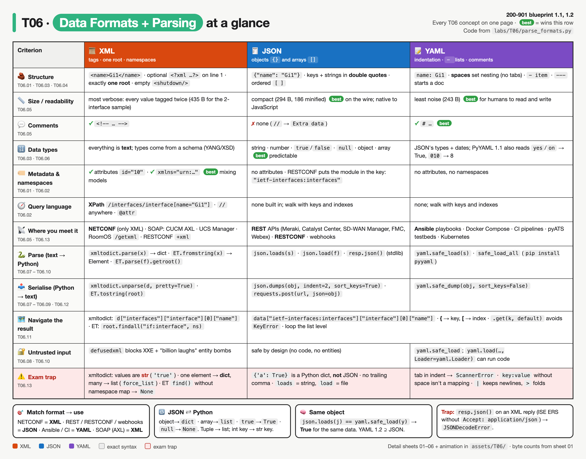
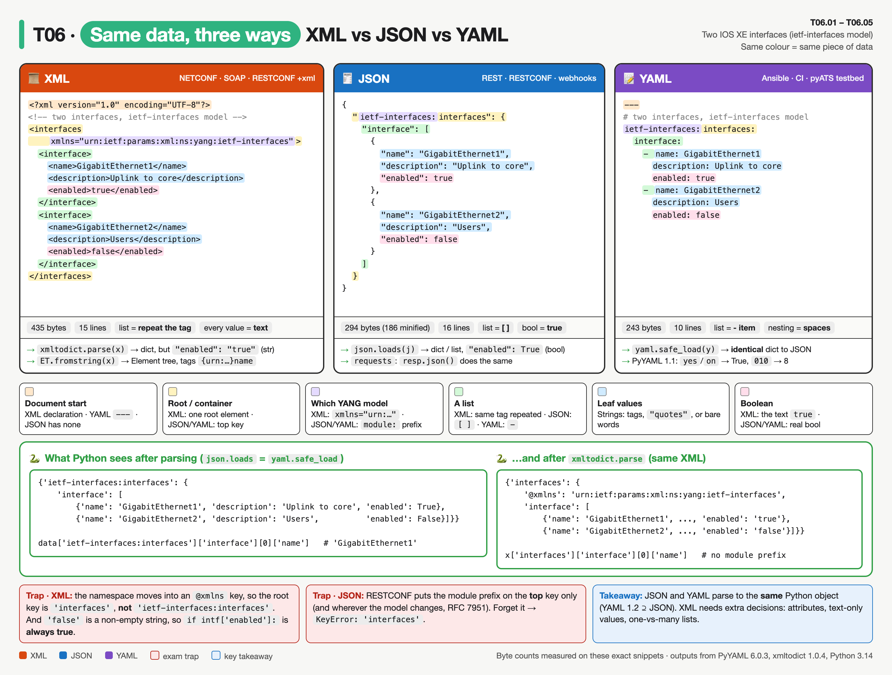
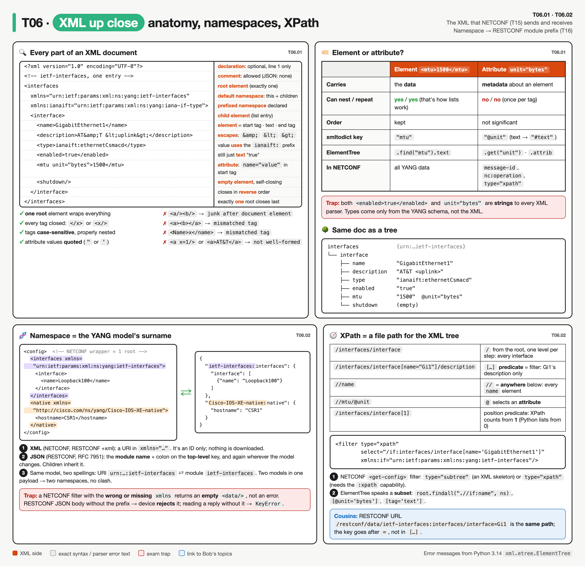
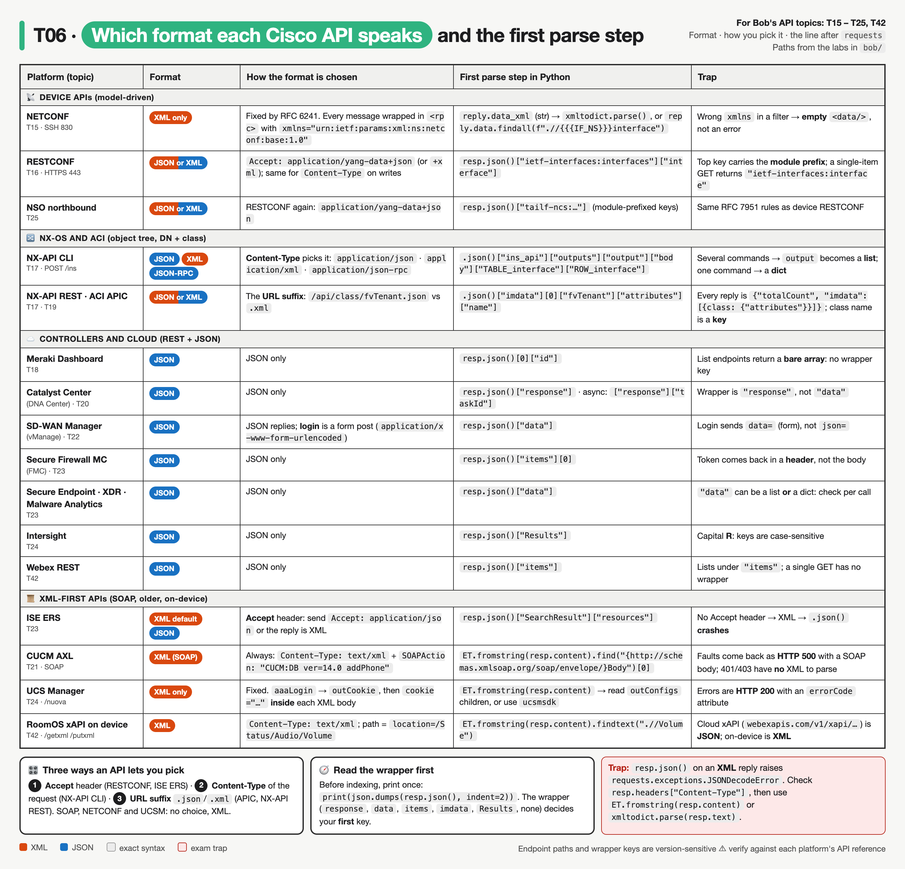
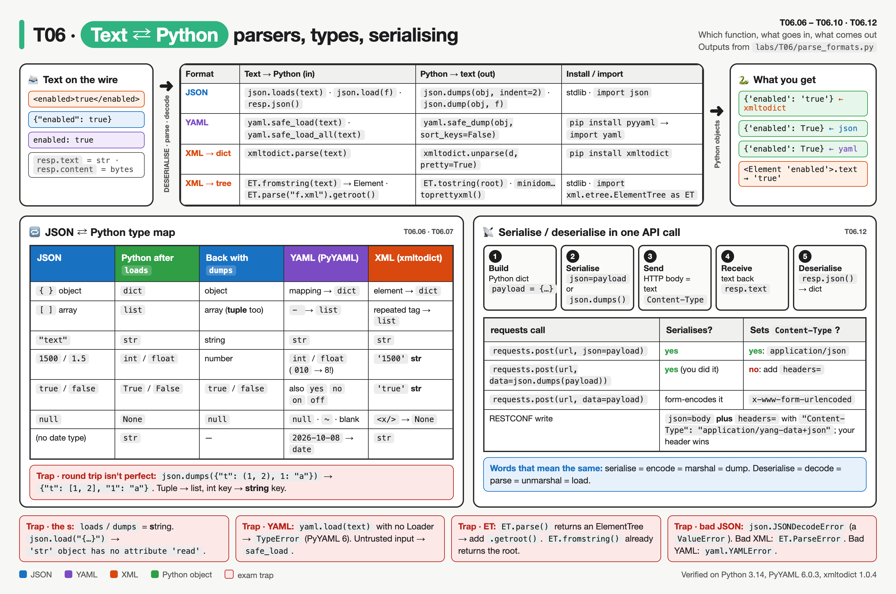
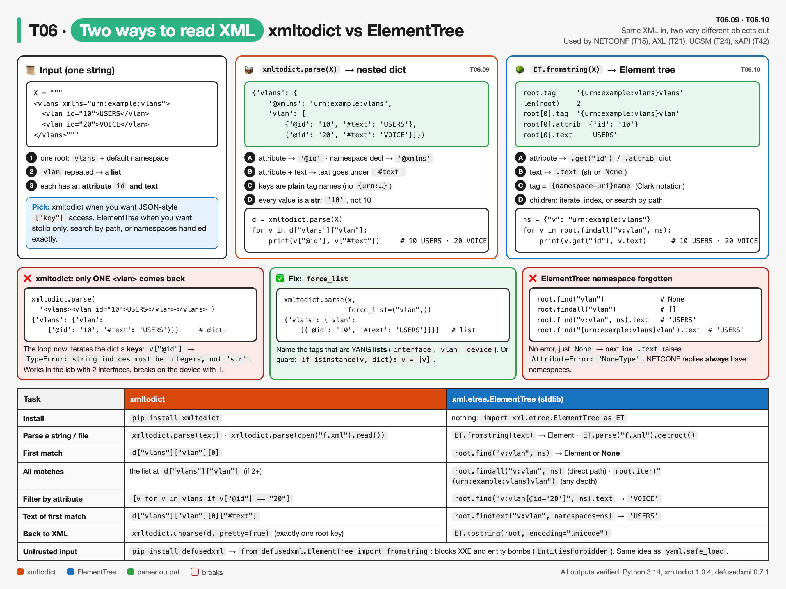
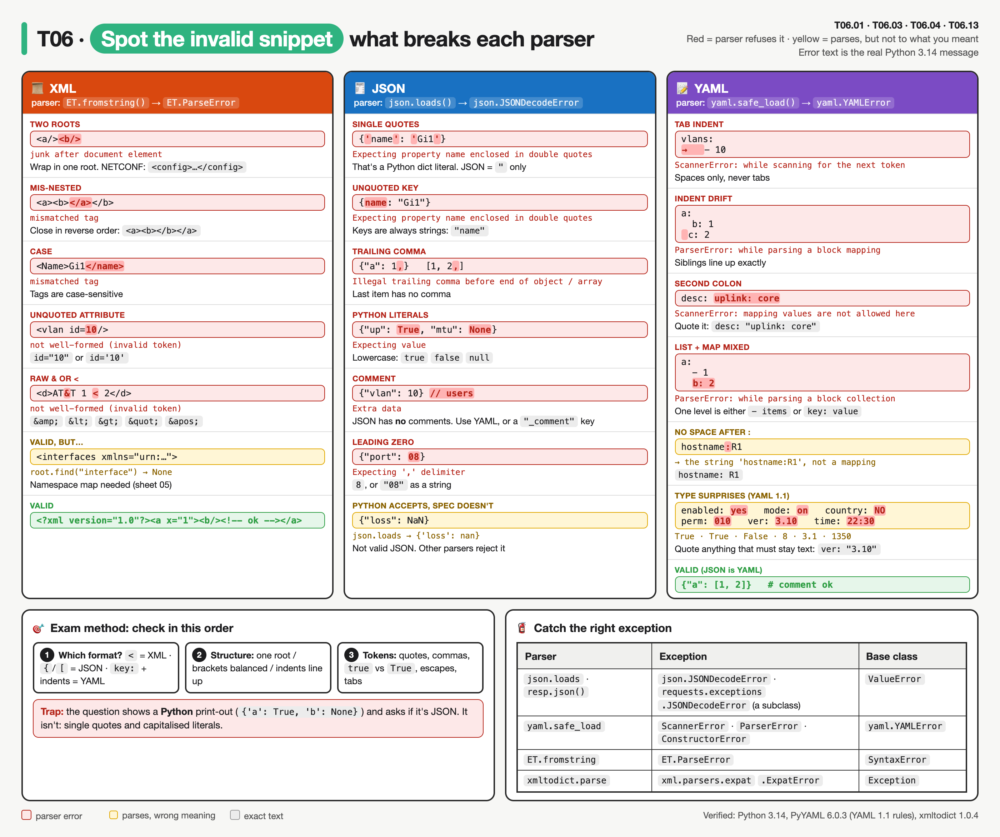

# T06 · Data formats + parsing: essentials

> Blueprint 1.1, 1.2 · Full note: [bee/T06-data-formats-parsing.md](../bee/T06-data-formats-parsing.md) · Teach-back 2026-10-11 · **[Syntax drill](#syntax-drill)** at the end

## In one picture



*Every T06 concept on one page. One row per criterion (IDs under the name), one column per format; green "best" marks the winner of each row, the red row is the exam traps.*



*Same colour = same piece of data. Read across to see how each format writes the root, the model name, a list and a boolean; read the green panel to see that JSON and YAML parse to the identical dict while xmltodict gives strings and drops the module prefix.*

## The big idea
- XML, JSON and YAML are three ways to write the same nested data, like the same shopping list written as a formal form (XML), a compact note (JSON) or an indented bullet list (YAML). 
- Network APIs send you one of these, and your script turns it into Python dicts and lists so it can pull values out. 
- On the exam you will be asked to spot an invalid snippet, match a format to its protocol, pick the right parser, and write the expression that extracts a value. 
- JSON and YAML are home turf, so those sections are traps only; XML gets a gentler walk-through because NETCONF depends on it.

## What you need to know

### 1. XML basics: tags, one root, and "well-formed"
- XML is a **tree of tags**. Every value sits between a start tag and an end tag, like `<name>GigabitEthernet1</name>`. Each tagged item is called an **element**.

```xml
<?xml version="1.0" encoding="UTF-8"?>        <!-- declaration: optional, must be line 1 if present -->
<interfaces>                                   <!-- exactly ONE root element wraps everything -->
  <interface type="ethernet">                  <!-- attribute: name="value" inside the start tag -->
    <name>GigabitEthernet1</name>              <!-- element: <tag>text</tag> -->
    <shutdown/>                                <!-- empty element, closes itself -->
  </interface>
</interfaces>
```

- The first line, `<?xml version="1.0" encoding="UTF-8"?>`, is the **declaration**. It is optional, but if present it must be the first line.
- An **attribute** is a small `name="value"` label inside the start tag. Think of attributes as metadata: they can't nest and can't repeat. Elements can nest and repeat.
- `<shutdown/>` is an **empty (self-closing) element**: a tag with no content.
- Comments look like `<!-- ... -->`.
- A parser only accepts XML that is **well-formed**, which means all of these hold:
  - There is exactly one root element.
  - Every tag is closed, either with `</x>` or as `<x/>`.
  - Tags are properly nested: `<a><b></b></a>` is fine, `<a><b></a></b>` is not.
  - Tags are **case-sensitive**: `<Name>…</name>` is an error.
  - Attribute values are in quotes, single or double.
  - Special characters in text are escaped: `&lt;` for `<`, `&gt;` for `>`, `&amp;` for `&`, plus `&quot;` and `&apos;`. A raw `1 < 2` gives `not well-formed (invalid token)`.

### 2. XML namespaces and XPath (why NETCONF looks so busy)
- A **namespace** is a unique ID (a URI) attached to tag names, so that an `<interface>` from one data model doesn't clash with an `<interface>` from another. It works like a surname: two people called "interface" are told apart by their family.
- A **default namespace** applies to an element and all its children: `<interfaces xmlns="urn:ietf:params:xml:ns:yang:ietf-interfaces">`.
- A **prefixed namespace** gives the URI a short nickname: `xmlns:ianaift="urn:...:iana-if-type"`, then you write `ianaift:ethernetCsmacd`.
- The URI is just a unique label; nothing is downloaded from it.
- One NETCONF payload can mix the standard `ietf-interfaces` model with Cisco's `Cisco-IOS-XE-native` model, and the namespace tells the device which YANG model each part belongs to (T14/T15).
- NETCONF messages **always** carry namespaces, for example `<rpc xmlns="urn:ietf:params:xml:ns:netconf:base:1.0">` plus a model namespace in the filter or config.
- In RESTCONF JSON, the namespace becomes a **module prefix in the key** instead: `"ietf-interfaces:interfaces"` (RFC 7951).
- **XPath** is a path language for picking parts of an XML tree, much like a file path:
  - `/interfaces/interface[name="Gi1"]/description` selects the description of interface Gi1.
  - `/` starts from the root, `//` means "anywhere below", `[...]` is a filter (a **predicate**), and `@type` selects an attribute.
  - NETCONF uses it in `<filter type="xpath" select="...">`, and ElementTree supports a limited subset.




*Top: every part of an XML document labelled, plus the well-formed rules with their real parser errors. Bottom: how an XML namespace becomes a RESTCONF JSON module prefix, and how XPath selects nodes (the NETCONF filter link).*

### 3. JSON and YAML rules (home turf, traps only)
- **JSON:** an **object** `{"k": v}` holds key/value pairs and an **array** `[...]` is an ordered list.
  - Keys and strings must use **double quotes**. Single quotes give `Expecting property name enclosed in double quotes`.
  - Literals are **lowercase**: `true`, `false`, `null`. Writing `True` gives `Expecting value`.
  - **No comments and no trailing comma.** `{"a": 1,}` gives `Illegal trailing comma`.
  - There is no date or binary type, so those are sent as strings. Duplicate keys are legal but undefined, and Python keeps the **last** one.
  - Media types: plain REST uses `application/json`; RESTCONF uses `application/yang-data+json` or `application/yang-data+xml`.
- **YAML:**
  - Indentation must be **spaces**; a tab in indentation is a parse error. `key: value` needs the space after the colon, and list items start with `- `.
  - `---` starts a document (a file can hold several), `...` ends one, and `#` starts a comment.
  - `|` (**literal**) keeps newlines, giving `"line1\nline2\n"`. `>` (**folded**) turns newlines into spaces, giving `"line1 line2\n"`.
  - YAML 1.2 is a **superset of JSON**, so any valid JSON is valid YAML.
  - Used by Ansible playbooks, Docker Compose, pyATS testbeds, GitHub Actions and GitLab CI, and Kubernetes.
  - **PyYAML follows YAML 1.1** (verified on 6.0.3): `yes`, `no`, `on`, `off` become booleans, `010` becomes 8 (octal), `1.10` becomes `1.1`, `~` becomes None, and `2026-10-08` becomes a date. Quote the value (`'on'`) to keep it a string. ⚠ verify: other YAML 1.2 parsers such as ruamel.yaml behave differently.

### 4. Comparing the three formats
| | XML | JSON | YAML |
|---|---|---|---|
| Structure shown by | opening and closing tags | `{}` and `[]` | indentation |
| Verbosity | highest | medium | lowest |
| Comments | `<!-- -->` | **none** | `#` |
| Attributes / namespaces | yes / yes | no / module prefix in key | no / no |
| Data types | everything is text (a schema adds types) | string, number, bool, null | JSON's types plus dates and more |
| Whitespace matters | no | no | **yes** |
| Typical use | NETCONF, SOAP (CUCM AXL), RESTCONF option | REST APIs, RESTCONF, webhooks | Ansible, Compose, CI, pyATS testbeds |
| Python parser | `xmltodict`, `xml.etree.ElementTree`, `minidom` | `json` (standard library) | `yaml` (PyYAML, third-party) |

- Quick matches: "most human-readable and supports comments" is YAML; "required by NETCONF" is XML; "smallest and native to JavaScript" is JSON.
- NETCONF is XML only, while RESTCONF can use XML **or** JSON.




*The bridge into Bob's platform topics (T15–T25, T42). Columns: the format, the header/suffix that picks it, the first line of Python after `requests`, and the trap. Paths come from the labs in `bob/`.*

### 5. Parsing into Python: JSON and YAML
- Turning text into Python objects is **deserialising** (also decoding or parsing). Turning Python objects into text is **serialising** (encoding). In an API call you serialise the request body and deserialise the response body.

| JSON | Python after `loads` | Back to JSON with `dumps` |
|---|---|---|
| object `{}` | `dict` | object |
| array `[]` | `list` | array (a tuple also becomes an array) |
| string | `str` | string |
| number | `int` or `float` | number |
| `true` / `false` | `True` / `False` | `true` / `false` |
| `null` | `None` | `null` |

- The round trip is not perfect: a tuple comes back as a list, and integer dict keys like `{1: "a"}` come back as the string `"1"`.




*Read left to right: wire text → the function that parses it → the Python object you get. Bottom left: the type map across all three parsers. Bottom right: the five steps of one API call and which `requests` argument sets `Content-Type`.*
- **The `s` means string:** `json.loads(text)` and `json.dumps(obj)` work with strings; `json.load(f)` and `json.dump(obj, f)` work with an open file object.
- `json.dumps(obj, indent=2, sort_keys=True)` pretty-prints with sorted keys. Bad input raises `json.JSONDecodeError`, a subclass of `ValueError`.
- With `requests`, `response.json()` is the same as `json.loads(response.text)`. `requests.post(url, json=payload)` serialises **and** sets `Content-Type: application/json`; `data=json.dumps(payload)` serialises but leaves the header to you.
- **YAML:** `pip install pyyaml`, then `import yaml` (the install name differs from the import name).
  - `yaml.safe_load(text)` builds only standard types (dict, list, str and so on), so it is the safe choice.
  - In PyYAML 6 and later, `yaml.load(text)` with no Loader raises `TypeError: load() missing 1 required positional argument: 'Loader'`. With `Loader=yaml.Loader` or `UnsafeLoader` it can build arbitrary Python objects, which means **code execution** on untrusted input. `safe_load` rejects `!!python/object/apply:os.system`.
  - `yaml.safe_dump(obj)` writes YAML and sorts keys by default; add `sort_keys=False` to keep order. `yaml.safe_load_all(text)` reads several documents.

### 6. Parsing XML in Python: xmltodict and ElementTree
- **xmltodict** (`pip install xmltodict`) turns XML into a nested dict, so you can treat it like JSON. It returns a plain `dict` in current versions; older versions returned `OrderedDict`, and access works the same. ⚠ verify: exam answers may still say OrderedDict.
  - Each element becomes a key, and its text is always a **string**: `<enabled>true</enabled>` gives `'true'`, not `True`.
  - An attribute becomes a key starting with **`@`**: `vlan["@id"]` gives `"10"`. A namespace declaration becomes an `@xmlns` key.
  - If an element has attributes **and** text, the text goes under **`#text`**: `<vlan id="10">USERS</vlan>` gives `{"@id": "10", "#text": "USERS"}`.
  - A **repeated** element becomes a **list**, but a **single** element becomes a **dict**. A loop over `["interface"]` breaks when the device returns just one interface. The fix is `xmltodict.parse(x, force_list=("interface",))`.
  - `xmltodict.unparse(d, pretty=True)` goes back to XML; the dict must have exactly one root key.
- **ElementTree** is in the standard library: `import xml.etree.ElementTree as ET`.
  - `ET.fromstring(text)` returns the root **Element**. `ET.parse("file.xml")` returns an **ElementTree**, so you add `.getroot()`.
  - `root.find("tag")` returns the first match or **`None`**; `root.findall("tag")` returns a list (possibly empty); `root.iter("tag")` walks every matching descendant at any depth; `root.findtext("tag")` returns the text of the first match.
  - Each element has `.tag` (its name), `.text` (string or None), `.attrib` (a dict of attributes) and `.get("id")` for one attribute.
  - **Namespaces trap:** with a namespace, the tag is stored as `{urn:…}name`, so `root.find("interface")` returns **None** even though interfaces exist. Pass a map instead:

```python
ns = {"if": "urn:ietf:params:xml:ns:yang:ietf-interfaces"}
root.findall("if:interface", ns)
```

- `xml.dom.minidom` is an older DOM API, mostly used as `minidom.parseString(x).toprettyxml()` to pretty-print NETCONF replies.
- **Exam-sim gap (from practice test review):** untrusted XML is risky to parse.
  - XML allows **external entities** (XXE), where the file asks the parser to read something like `/etc/passwd` or a URL, and **entity expansion bombs** ("billion laughs"), where a tiny file expands to gigabytes.
  - Python's answer is **`defusedxml`**, a drop-in replacement that refuses those features: `from defusedxml.ElementTree import fromstring`. Recent Python docs say modern Expat blocks some of these, but `defusedxml` is still the exam answer. ⚠ verify
  - Exam cue: "safely parse XML from an untrusted source" means **defusedxml**, just as untrusted YAML means `yaml.safe_load`.




*Same input, two objects: a nested dict (`@` attributes, `#text`) vs an Element tree (`{uri}tag`, `.attrib`, `.text`). Middle row: the two bugs that pass in the lab and fail on a device, with the fix. Bottom: the same task in both libraries.*

### 7. Navigating parsed data
- Read a path left to right, one level per bracket. If the level is a `{`, use a **key**; if it is a `[`, use an **index**.

```python
data["ietf-interfaces:interfaces"]["interface"][0]["name"]    # -> "GigabitEthernet1"
```

- Loop over the list level: `for intf in data["ietf-interfaces:interfaces"]["interface"]: print(intf["name"])`.
- `intf.get("speed", "unknown")` returns a default instead of raising `KeyError`.
- If you are unsure what a level is, check `type(x)` or print it with `json.dumps(x, indent=2)`.
- Common errors: `KeyError` means a wrong key or a missing module prefix; `TypeError: list indices must be integers or slices, not str` means you forgot the `[0]`; `IndexError` means the list was empty.


![Animated: walking data["ietf-interfaces:interfaces"]["interface"][0]["name"] one bracket at a time, then the missing-[0] TypeError, then the loop](../assets/T06/10-navigate-path.gif)

*Steps: dict → key with module prefix → list → index `[0]` → key → leaf; then the classic `TypeError` from skipping `[0]`, then the `for` loop over the list level. Fixes the misconception that you can key straight into a list.*

## Exam traps (the ones that catch people)
- Looks like `{'name': 'Gi1'}` is JSON, but it is a Python dict literal; JSON needs double quotes.
- Looks like `json.load(text)` should parse a string, but without the `s` it expects a file and fails with `'str' object has no attribute 'read'`.
- Looks like `yaml.load` is the normal call, but for untrusted input the answer is `yaml.safe_load`, and in PyYAML 6 plain `load` without a Loader raises `TypeError`.
- Looks like `enabled: yes` stays a string, but PyYAML turns it into `True` (and `010` into 8); quote it to keep it as text.
- Looks like xmltodict gives you booleans and numbers, but every value is a **string**, such as `'true'`.
- Looks like xmltodict always returns a list of interfaces, but one interface comes back as a **dict**; use `force_list`.
- Looks like `root.find("interface")` should work on a NETCONF reply, but namespaced tags need a namespace map, or you get `None`.
- Looks like `ET.parse` returns the root, but it returns an ElementTree; call `.getroot()`, whereas `ET.fromstring` already returns an Element.



*Red = the parser refuses it (real Python error text underneath); yellow = it parses but means something else (PyYAML's `yes`/`010`/`22:30` surprises). Bottom: the three-step exam method and which exception to catch.*

## Quick self-check
<details><summary>Q1. Is `{"vlan": 10, "active": true, "desc": null}` valid JSON?</summary>Yes; double quotes, lowercase literals, no trailing comma and no comments.</details>
<details><summary>Q2. Which expression returns the second device's IP from `{"response": [{...}, {"hostname": "leaf2", "ip": "10.1.1.2"}]}`?</summary>`data["response"][1]["ip"]`; `response` is a list, so it needs an index before the key.</details>
<details><summary>Q3. After `xmltodict.parse('<vlan id="10"><name>USERS</name></vlan>')`, how do you get "10"?</summary>`d["vlan"]["@id"]`; xmltodict prefixes attributes with `@`.</details>
<details><summary>Q4. Which data format does NETCONF require?</summary>XML only; RESTCONF can use XML or JSON.</details>
<details><summary>Q5. Which XML snippet is well-formed: `<intf><name>Gi1</Name></intf>` or `<intf><name>Gi1</name><shutdown/></intf>`?</summary>The second; the first has a case mismatch between `<name>` and `</Name>`.</details>
<details><summary>Q6. What does `yaml.safe_load("x: 010\ny: '010'")` return?</summary>`{'x': 8, 'y': '010'}`: unquoted `010` is octal in YAML 1.1.</details>
<details><summary>Q7. What does `json.dumps({"up": True, "ids": (1, 2)})` return?</summary>`'{"up": true, "ids": [1, 2]}'`: `True` becomes `true`, and the tuple becomes an array.</details>
<details><summary>Q8. `msg: |` followed by indented lines `a` and `b`: what string do you get?</summary>`'a\nb\n'`: `|` keeps the newlines (`>` would fold them into `'a b\n'`).</details>
<details><summary>Q9. `data = {"items": [{"id": 7}]}`: what does `data["items"]["id"]` raise?</summary>`TypeError: list indices must be integers or slices, not str`. You need `data["items"][0]["id"]`.</details>
<details><summary>Q10. A NETCONF reply has `xmlns="urn:ietf:params:xml:ns:yang:ietf-interfaces"`. Why does `root.find("interface")` return None?</summary>The real tag is `{urn:…ietf-interfaces}interface`. Pass a map: `root.find("if:interface", {"if": "urn:ietf:params:xml:ns:yang:ietf-interfaces"})`.</details>

## Cheat lines to say out loud
- "NETCONF speaks XML, REST speaks JSON, Ansible speaks YAML."
- "The s in loads means string; no s means file."
- "Safe load for YAML, defusedxml for XML: never trust strangers' data."
- "xmltodict: at-sign for attributes, hash-text for text, one item is a dict, many is a list."
- "Curly brace means key, square bracket means index."

## Syntax drill

- Every example was run (Python 3.14, PyYAML 6.0.3, xmltodict 1.0.4); the output shown is real.
- **How to use:** open one section, cover the output and predict it. Can you predict every line? Then the syntax questions are covered.

<details><summary><b>1. One device, three formats</b></summary>

- Same data each time: a switch with a hostname, two VLANs, a boolean and a null.
- Learn this table first. Every rule below is a detail of one of these columns.

<table>
<tr><th>JSON</th><th>YAML</th><th>XML</th></tr>
<tr><td>

```json
{
  "hostname": "sw1",
  "vlans": [10, 20],
  "up": true,
  "mgmt": null
}
```

</td><td>

```yaml
---
hostname: sw1
vlans:
  - 10
  - 20
up: true
mgmt: null
```

</td><td>

```xml
<device>
  <hostname>sw1</hostname>
  <vlan>10</vlan>
  <vlan>20</vlan>
  <up>true</up>
  <mgmt/>
</device>
```

</td></tr>
</table>

| | JSON | YAML | XML |
|---|---|---|---|
| Key / value | `"hostname": "sw1"` | `hostname: sw1` | `<hostname>sw1</hostname>` |
| List | `[10, 20]` | `- 10` on each line, or `[10, 20]` | repeat the tag |
| Nesting | `{ }` inside `{ }` | 2 more **spaces** | tag inside tag |
| Boolean | `true` / `false` | `true` / `false` (also `yes`, `on`…) | text `true` (no real type) |
| Null | `null` | `null`, `~` or empty | empty element `<mgmt/>` |
| Comment | ✗ none | `# …` | `<!-- … -->` |
| Wrapper | outer `{ }` or `[ ]` | none (optional `---`) | exactly **one root** element |

</details>

<details><summary><b>2. JSON syntax</b></summary>

**Rule in one line:** double quotes, lowercase literals, commas *between* items only, no comments.

#### Valid building blocks

```json
{
  "string":  "Gi1/0/1",
  "integer": 1500,
  "float":   1.5,
  "exp":     1e3,
  "negative": -5,
  "bool":    true,
  "nothing": null,
  "list":    [10, "mixed", false, null],
  "object":  {"nested": {"deeper": 1}},
  "empty":   {"list": [], "object": {}},
  "escapes": "say \"hi\"\nnew line, C:\\path"
}
```

- Top level may be **any** value: `[1, 2]`, `"text"` and `null` are all valid JSON documents.
- Escapes inside strings: `\"` quote · `\\` backslash · `\n` newline · `\t` tab · `\u00e9` unicode.

#### Invalid: the exam's favourite distractors

| Snippet | Why it's wrong | Python error |
|---|---|---|
| `{'name': 'Gi1'}` | single quotes (this is a Python dict) | `Expecting property name enclosed in double quotes` |
| `{name: "Gi1"}` | key not quoted | `Expecting property name enclosed in double quotes` |
| `{"a": 1,}` | trailing comma | `Illegal trailing comma before end of object` |
| `[1, 2,]` | trailing comma in array | `Illegal trailing comma before end of array` |
| `{"up": True}` | Python literal; JSON is `true` | `Expecting value` |
| `{"mtu": None}` | Python literal; JSON is `null` | `Expecting value` |
| `{"a": 1} // note` | no comments in JSON | `Extra data` |
| `{"port": 08}` | no leading zeros | `Expecting ',' delimiter` |
| `{"a": 1 "b": 2}` | missing comma | `Expecting ',' delimiter` |

- **Spot it fast:** look for `'` · `True`/`False`/`None` · a comma before `}` or `]` · `//` or `#`.

#### RESTCONF JSON (Bob's T16): module prefix on the top key

```json
{
  "ietf-interfaces:interfaces": {
    "interface": [
      {"name": "GigabitEthernet1", "enabled": true}
    ]
  }
}
```

- Prefix `module:` appears on the **top** key, and again only where the YANG model changes (RFC 7951).
- Media type: `application/yang-data+json`. Plain REST: `application/json`.

</details>

<details><summary><b>3. YAML syntax</b></summary>

**Rule in one line:** indentation with spaces is the structure; `key: value` needs the space; `- ` starts a list item.

#### Mappings, lists and nesting

```yaml
---                          # optional document start
hostname: sw1                # key: value   (space after the colon)
vlans:                       # key whose value is a list
  - 10                       # "- " starts each list item
  - 20
interfaces:                  # list of mappings (the RESTCONF/Ansible shape)
  - name: Gi1                # first key of the item sits on the dash line
    enabled: true            # following keys line up under "name"
  - name: Gi2
    enabled: false
inline_list: [10, 20]        # flow style = JSON-like, also valid
inline_map: {name: sw1, port: 22}
```

→ `yaml.safe_load` gives:

```python
{'hostname': 'sw1', 'vlans': [10, 20],
 'interfaces': [{'name': 'Gi1', 'enabled': True}, {'name': 'Gi2', 'enabled': False}],
 'inline_list': [10, 20], 'inline_map': {'name': 'sw1', 'port': 22}}
```

- Each `- ` at the same indent = one more list item. Keys under it at the **same** column = same dict.
- A top-level list is just dashes: `- a` / `- b` → `['a', 'b']`.
- An empty file or a comment-only file → `None`.

#### Strings and quoting

```yaml
plain:   value # comment          # -> 'value'   (comment stripped)
hash:    '#not comment'           # -> '#not comment'
colon:   "url: http://x"          # -> 'url: http://x'   (quote anything with ": ")
single:  'it''s'                  # -> "it's"    (double the ' to escape it)
double:  "tab\tend"               # -> 'tab\tend' with a real tab (escapes work in "…")
nolit:   'no \t escape'           # -> 'no \\t escape' (no escapes in '…')
empty:   ''                       # -> ''
```

#### Multi-line strings

```yaml
literal: |        # keeps newlines         -> 'line1\nline2\n'
  line1
  line2
folded: >         # newlines become spaces -> 'line1 line2\n'
  line1
  line2
strip: |-         # literal, no final \n    -> 'line1\nline2'
  line1
  line2
```

- Memory hook: `|` is a **pipe**, it keeps the lines standing up. `>` **folds** them over into one line.

#### Type surprises (PyYAML follows YAML 1.1)

| You write | You get | Fix |
|---|---|---|
| `enabled: yes` · `mode: on` | `True` | `'yes'` |
| `country: NO` | `False` | `'NO'` |
| `perm: 010` | `8` (octal) | `'010'` |
| `ver: 3.10` | `3.1` (float) | `"3.10"` |
| `time: 22:30` | `1350` (base 60) | `"22:30"` |
| `hex: 0x1F` | `31` | `"0x1F"` |
| `date: 2026-10-08` | `datetime.date(2026, 10, 8)` | `'2026-10-08'` |
| `n: 1e3` | `'1e3'` (string! 1.1 needs `1.0e3`) | `1000` |
| `x: ~` or `x:` | `None` | |

#### Anchors and merge keys (show up in CI/Compose files)

```yaml
base: &creds {user: admin, port: 22}   # & defines an anchor
sw1:
  <<: *creds                           # * reuses it; << merges keys in
  port: 830                            # local key overrides
```

→ `{'base': {'user': 'admin', 'port': 22}, 'sw1': {'user': 'admin', 'port': 830}}`

#### Invalid YAML

| Snippet | Problem | Error |
|---|---|---|
| `vlans:` then a **tab** before `- 10` | tabs never allowed for indent | `ScannerError: while scanning for the next token` |
| `a:` / `␣␣b: 1` / `␣c: 2` | siblings not aligned | `ParserError: while parsing a block mapping` |
| `desc: uplink: core` | second `: ` unquoted | `ScannerError: mapping values are not allowed here` |
| `a:` / `␣␣- 1` / `␣␣b: 2` | list item and key at the same level | `ParserError: while parsing a block collection` |
| `hostname:R1` | **no error**, but it's the string `'hostname:R1'`, not a mapping | |

- **JSON is valid YAML:** `yaml.safe_load('{"a": [1, 2]}')` → `{'a': [1, 2]}`.

</details>

<details><summary><b>4. XML syntax</b></summary>

**Rule in one line:** one root, every tag closed in reverse order, case-sensitive, quoted attributes, escape `&` and `<`.

#### Every piece in one document

```xml
<?xml version="1.0" encoding="UTF-8"?>          <!-- declaration: optional, line 1 only -->
<!-- a comment -->
<interfaces xmlns="urn:ietf:params:xml:ns:yang:ietf-interfaces">  <!-- root + default namespace -->
  <interface>                                   <!-- child element -->
    <name>GigabitEthernet1</name>               <!-- element with text -->
    <description>AT&amp;T &lt;uplink&gt;</description>   <!-- escaped & < > -->
    <mtu unit="bytes">1500</mtu>                <!-- attribute in the start tag -->
    <shutdown/>                                 <!-- empty element, self-closing -->
    <note><![CDATA[1 < 2 & 3]]></note>          <!-- CDATA: raw text, no escaping -->
  </interface>
</interfaces>
```

#### The 5 escapes

| Write | Means |
|---|---|
| `&lt;` | `<` |
| `&gt;` | `>` |
| `&amp;` | `&` |
| `&quot;` | `"` |
| `&apos;` | `'` |

#### Well-formed rules with the error you get

| Broken | Rule | `ET.fromstring` error |
|---|---|---|
| `<a/><b/>` | one root only | `junk after document element` |
| `<a><b></a></b>` | close in reverse order | `mismatched tag` |
| `<Name>x</name>` | case-sensitive | `mismatched tag` |
| `<vlan id=10/>` | quote attribute values | `not well-formed (invalid token)` |
| `<d>AT&T</d>` | escape `&` | `not well-formed (invalid token)` |
| `<a>1 < 2</a>` | escape `<` | `not well-formed (invalid token)` |
| `<a><b></a>` | close every tag | `mismatched tag` |

#### Namespaces (Bob's T15 NETCONF)

```xml
<config>
  <interfaces xmlns="urn:ietf:params:xml:ns:yang:ietf-interfaces">      <!-- default ns -->
    <interface>
      <name>Loopback100</name>
      <type xmlns:ianaift="urn:ietf:params:xml:ns:yang:iana-if-type">ianaift:softwareLoopback</type>
    </interface>                                                         <!-- prefixed ns -->
  </interfaces>
</config>
```

- `xmlns="…"` = default namespace for this element and its children.
- `xmlns:ianaift="…"` declares a prefix; `ianaift:softwareLoopback` uses it.
- The URI is an ID only; nothing is downloaded.

#### XPath in 5 lines

| XPath | Selects |
|---|---|
| `/interfaces/interface` | every `interface` directly under the root |
| `/interfaces/interface[name="Gi1"]/description` | Gi1's description (`[…]` = filter) |
| `//name` | every `name` anywhere |
| `//mtu/@unit` | the `unit` attribute |
| `/interfaces/interface[1]` | the **first** one (XPath counts from **1**) |

</details>

<details><summary><b>5. Python: json module</b></summary>

**The `s` means string.** `loads`/`dumps` work on strings; `load`/`dump` work on open files.

```python
import json

text = '{"hostname": "sw1", "vlans": [10, 20], "up": true, "mgmt": null}'
data = json.loads(text)
print(data)
# {'hostname': 'sw1', 'vlans': [10, 20], 'up': True, 'mgmt': None}

print(json.dumps(data))
# {"hostname": "sw1", "vlans": [10, 20], "up": true, "mgmt": null}

print(json.dumps(data, indent=2, sort_keys=True))
# {
#   "hostname": "sw1",
#   "mgmt": null,
#   "up": true,
#   "vlans": [
#     10,
#     20
#   ]
# }

with open("device.json") as f:          # file object in
    data = json.load(f)
with open("out.json", "w") as f:        # file object out
    json.dump(data, f, indent=2)
```

| Call | Takes | Returns |
|---|---|---|
| `json.loads(s)` | str (or bytes) | Python object |
| `json.load(f)` | open file | Python object |
| `json.dumps(obj)` | Python object | str |
| `json.dump(obj, f)` | Python object + open file | `None` (writes the file) |
| `resp.json()` | (requests response) | same as `json.loads(resp.text)` |

#### Gotchas, with real output

```python
json.dumps({"name": "Gi1", "up": True, "mtu": None})   # '{"name": "Gi1", "up": true, "mtu": null}'
json.dumps({"vlans": (10, 20), 1: "a"})                # '{"vlans": [10, 20], "1": "a"}'   tuple→list, int key→str
json.dumps({"desc": "café"})                           # '{"desc": "caf\\u00e9"}'
json.dumps({"desc": "café"}, ensure_ascii=False)       # '{"desc": "café"}'
json.loads('[1, "two", 3.0, false]')                   # [1, 'two', 3.0, False]

json.load('{"a": 1}')      # AttributeError: 'str' object has no attribute 'read'
json.loads({"a": 1})       # TypeError: the JSON object must be str, bytes or bytearray, not dict
json.dumps({"v": {10, 20}})  # TypeError: Object of type set is not JSON serializable
```

#### Sending JSON with requests (link to T11)

```python
requests.post(url, json=payload)                         # serialises + sets Content-Type: application/json
requests.post(url, data=json.dumps(payload),
              headers={"Content-Type": "application/json"})   # same result, done by hand
requests.post(url, data=payload)                         # form-encoded! Content-Type: application/x-www-form-urlencoded
```

</details>

<details><summary><b>6. Python: yaml module</b></summary>

```python
import yaml                 # pip install pyyaml  (install name ≠ import name)

text = """
hostname: sw1
vlans: [10, 20]
up: true
"""
cfg = yaml.safe_load(text)
print(cfg)                  # {'hostname': 'sw1', 'vlans': [10, 20], 'up': True}

with open("testbed.yaml") as f:
    cfg = yaml.safe_load(f)                   # accepts a file object too

docs = list(yaml.safe_load_all("---\na: 1\n---\na: 2\n"))
print(docs)                                   # [{'a': 1}, {'a': 2}]
```

#### Writing YAML

```python
d = {"hostname": "sw1", "vlans": [10, 20], "up": True, "mgmt": None}

print(yaml.safe_dump(d))                       # keys SORTED by default
# hostname: sw1
# mgmt: null
# up: true
# vlans:
# - 10
# - 20

print(yaml.safe_dump(d, sort_keys=False))      # keeps your order
# hostname: sw1
# vlans:
# - 10
# - 20
# up: true
# mgmt: null

print(yaml.safe_dump({"vlans": [10, 20]}, default_flow_style=True))
# {vlans: [10, 20]}
```

#### Safe vs unsafe

```python
yaml.load("a: 1")
# TypeError: load() missing 1 required positional argument: 'Loader'   (PyYAML 6+)

yaml.safe_load("!!python/object/apply:os.system ['id']")
# ConstructorError: could not determine a constructor for the tag
#   'tag:yaml.org,2002:python/object/apply:os.system'
```

- `yaml.load(text, Loader=yaml.Loader)` / `UnsafeLoader` **would** build that object, which means running `os.system`. Exam answer for untrusted input: **`yaml.safe_load`**.

</details>

<details><summary><b>7. Python: xmltodict</b></summary>

**XML → nested dict, so you can use `["key"]` like JSON.** Four mapping rules: `@` attributes · `#text` text · repeated tag → list · everything is a string.

```python
import xmltodict            # pip install xmltodict

x = """<device type="switch">
  <hostname>sw1</hostname>
  <vlan id="10">USERS</vlan>
  <vlan id="20">VOICE</vlan>
  <up>true</up>
  <mgmt/>
</device>"""

d = xmltodict.parse(x)
```

→ `d` is:

```python
{'device': {
    '@type': 'switch',                              # attribute  -> '@' + name
    'hostname': 'sw1',                              # element    -> key
    'vlan': [                                       # repeated   -> list
        {'@id': '10', '#text': 'USERS'},            # attr + text -> text under '#text'
        {'@id': '20', '#text': 'VOICE'}],
    'up': 'true',                                   # always a STRING, not True
    'mgmt': None}}                                  # empty element -> None
```

```python
d["device"]["@type"]               # 'switch'
d["device"]["hostname"]            # 'sw1'
d["device"]["vlan"][1]["#text"]    # 'VOICE'
d["device"]["vlan"][0]["@id"]      # '10'   (a string)
d["device"]["up"] == "true"        # True   (compare to the string)
```

#### The one-vs-many trap

```python
xmltodict.parse('<device><vlan id="10">USERS</vlan></device>')
# {'device': {'vlan': {'@id': '10', '#text': 'USERS'}}}        <- ONE vlan = dict, not list

xmltodict.parse('<device><vlan id="10">USERS</vlan></device>', force_list=("vlan",))
# {'device': {'vlan': [{'@id': '10', '#text': 'USERS'}]}}      <- always a list
```

#### Namespaces with xmltodict

```python
xmltodict.parse('<interfaces xmlns="urn:ietf:params:xml:ns:yang:ietf-interfaces">'
                '<interface><name>Gi1</name></interface></interfaces>')
# {'interfaces': {'@xmlns': 'urn:ietf:params:xml:ns:yang:ietf-interfaces',
#                 'interface': {'name': 'Gi1'}}}
```

- Namespace becomes an `@xmlns` key; the tag names stay plain. So the key is `'interfaces'`, **not** `'ietf-interfaces:interfaces'` (that's RESTCONF JSON).

#### dict → XML

```python
print(xmltodict.unparse({"vlan": {"@id": "30", "name": "CAMERAS"}}, pretty=True))
# <?xml version="1.0" encoding="utf-8"?>
# <vlan id="30">
# 	<name>CAMERAS</name>
# </vlan>

xmltodict.unparse({"vlan": {"@id": "30", "#text": "CAMERAS"}})
# '<?xml version="1.0" encoding="utf-8"?>\n<vlan id="30">CAMERAS</vlan>'

xmltodict.unparse({"a": 1, "b": 2})
# ValueError: Document must have exactly one root.
```

</details>

<details><summary><b>8. Python: ElementTree</b></summary>

**Stdlib. XML → tree of Element objects.** Each Element has `.tag`, `.text`, `.attrib`, `.get()`, and children.

```python
import xml.etree.ElementTree as ET

root = ET.fromstring(x)                # x = the <device> XML from section 7 above
# or from a file:  root = ET.parse("device.xml").getroot()

root.tag                    # 'device'
root.attrib                 # {'type': 'switch'}
root.get("type")            # 'switch'
len(root)                   # 5   (direct children)
[e.tag for e in root]       # ['hostname', 'vlan', 'vlan', 'up', 'mgmt']
```

#### find / findall / findtext / iter

```python
root.find("hostname").text                       # 'sw1'        first match, or None
root.findtext("hostname")                        # 'sw1'        text of first match
[v.get("id") for v in root.findall("vlan")]      # ['10', '20'] all matches (a list)
[v.text for v in root.findall("vlan")]           # ['USERS', 'VOICE']
root.find("vlan[@id='20']").text                 # 'VOICE'      filter on attribute
root.find("up").text                             # 'true'       string again
repr(root.find("mgmt").text)                     # 'None'       empty element

root.find("missing")                             # None
root.findall("missing")                          # []
root.findtext("missing", default="n/a")          # 'n/a'
root.find("missing").text                        # AttributeError: 'NoneType' object has no attribute 'text'
```

| Method | Searches | Returns when nothing found |
|---|---|---|
| `find("x")` | direct children (or the path you give) | `None` |
| `findall("x")` | direct children (or path) | `[]` |
| `findtext("x")` | same as `find` | `None` (or `default=`) |
| `findall(".//x")` | **any depth** | `[]` |
| `iter("x")` | **any depth**, includes root | empty iterator |

```python
n = ET.fromstring("<a><b><name>x</name></b><name>y</name></a>")
[e.text for e in n.findall("name")]       # ['y']        direct children only
[e.text for e in n.findall(".//name")]    # ['x', 'y']   any depth
[e.text for e in n.iter("name")]          # ['x', 'y']   any depth

i = ET.fromstring("<ifs><if><name>Gi1</name><d>up</d></if><if><name>Gi2</name><d>down</d></if></ifs>")
i.find("if[name='Gi2']/d").text           # 'down'   filter on a child's text
i.find("if[2]/name").text                 # 'Gi2'    position counts from 1
```

#### Namespaces (the NETCONF trap)

```python
nx = ET.fromstring('<interfaces xmlns="urn:ietf:params:xml:ns:yang:ietf-interfaces">'
                   '<interface><name>Gi1</name><enabled>true</enabled></interface></interfaces>')

nx.tag                       # '{urn:ietf:params:xml:ns:yang:ietf-interfaces}interfaces'
nx.find("interface")         # None   <- the trap: no error, just None

NS = {"if": "urn:ietf:params:xml:ns:yang:ietf-interfaces"}
nx.find("if:interface/if:name", NS).text                  # 'Gi1'   prefix map
nx.findtext("if:interface/if:enabled", namespaces=NS)     # 'true'
nx.find("{urn:ietf:params:xml:ns:yang:ietf-interfaces}interface")[0].text   # 'Gi1'   full {uri}tag
[e.text for e in nx.iter("{urn:ietf:params:xml:ns:yang:ietf-interfaces}name")]  # ['Gi1']
```

- The prefix in your map (`"if"`) is **your** choice; only the URI has to match.
- `iter()` does not take a namespace map, so use the full `{uri}tag` form.

#### Building XML (e.g. a NETCONF payload)

```python
cfg = ET.Element("interfaces", xmlns="urn:ietf:params:xml:ns:yang:ietf-interfaces")
intf = ET.SubElement(cfg, "interface")
ET.SubElement(intf, "name").text = "Loopback100"
ET.SubElement(intf, "description").text = "built by ET"
ET.indent(cfg)
print(ET.tostring(cfg, encoding="unicode"))
# <interfaces xmlns="urn:ietf:params:xml:ns:yang:ietf-interfaces">
#   <interface>
#     <name>Loopback100</name>
#     <description>built by ET</description>
#   </interface>
# </interfaces>
```

- `ET.tostring(root)` without `encoding="unicode"` returns **bytes**.
- Pretty-print someone else's XML: `minidom.parseString(xml_text).toprettyxml(indent="  ")` (`from xml.dom import minidom`).

#### Untrusted XML

```python
from defusedxml.ElementTree import fromstring     # pip install defusedxml
root = fromstring(untrusted_text)                  # raises EntitiesForbidden on XXE / entity bombs
```

</details>

<details><summary><b>9. Navigating parsed data</b></summary>

**Rule:** read the path left to right. At a `{` use a **key**. At a `[` use an **index** (from 0) or loop.

```python
r = {"response": [
        {"hostname": "sw1", "ip": "10.0.0.1", "tags": ["core", "lab"]},
        {"hostname": "sw2", "ip": "10.0.0.2", "tags": []}]}
```

| Expression | Result |
|---|---|
| `r["response"][1]["ip"]` | `'10.0.0.2'` |
| `r["response"][0]["tags"][-1]` | `'lab'` (`-1` = last) |
| `len(r["response"])` | `2` |
| `[d["hostname"] for d in r["response"]]` | `['sw1', 'sw2']` |
| `[d["ip"] for d in r["response"] if "core" in d["tags"]]` | `['10.0.0.1']` |
| `{d["hostname"]: d["ip"] for d in r["response"]}` | `{'sw1': '10.0.0.1', 'sw2': '10.0.0.2'}` |
| `r["response"][0].get("serial", "n/a")` | `'n/a'` |
| `r["response"][0].get("serial")` | `None` |
| `"ip" in r["response"][0]` | `True` |
| `list(r["response"][0].keys())` | `['hostname', 'ip', 'tags']` |

#### The four errors and what they mean

| Expression | Error | Meaning |
|---|---|---|
| `r["response"]["hostname"]` | `TypeError: list indices must be integers or slices, not str` | forgot the `[0]` |
| `r["Response"]` | `KeyError: 'Response'` | wrong key (case, or missing `module:` prefix) |
| `r["response"][2]` | `IndexError: list index out of range` | only 2 items: indexes 0 and 1 |
| `r["response"][1]["tags"][0]` | `IndexError: list index out of range` | that list is empty |

#### Worked example: a real-shaped RESTCONF reply

```python
data = {"ietf-interfaces:interfaces": {"interface": [
          {"name": "GigabitEthernet1", "enabled": True},
          {"name": "GigabitEthernet2", "enabled": False}]}}

#  {  → key       [  → index      {  → key
data["ietf-interfaces:interfaces"]["interface"][1]["name"]     # 'GigabitEthernet2'

for intf in data["ietf-interfaces:interfaces"]["interface"]:
    if not intf["enabled"]:
        print(intf["name"])                                    # GigabitEthernet2
```

</details>
