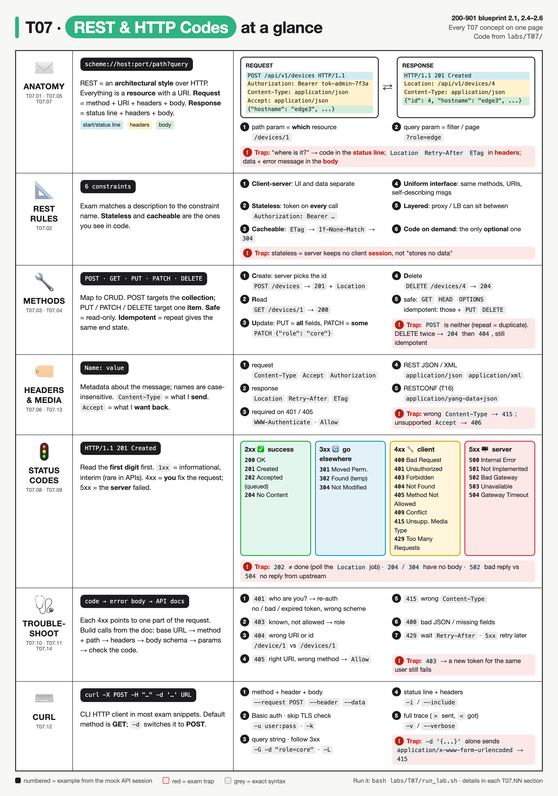
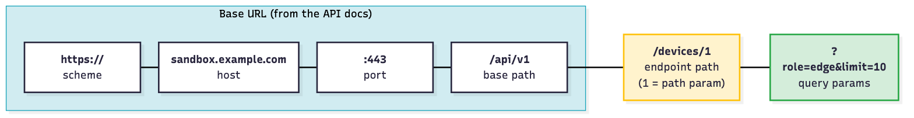
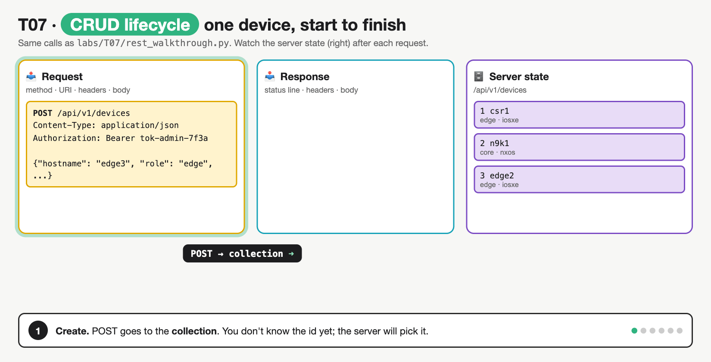
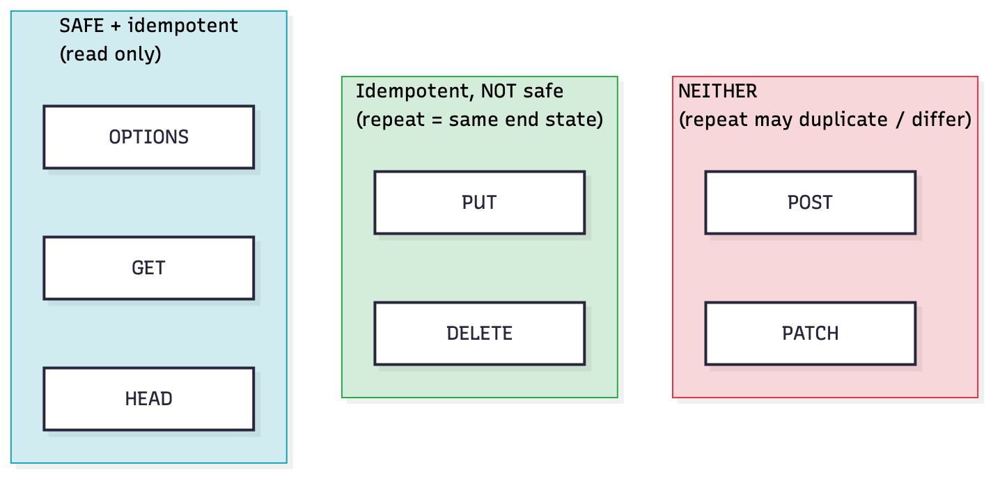
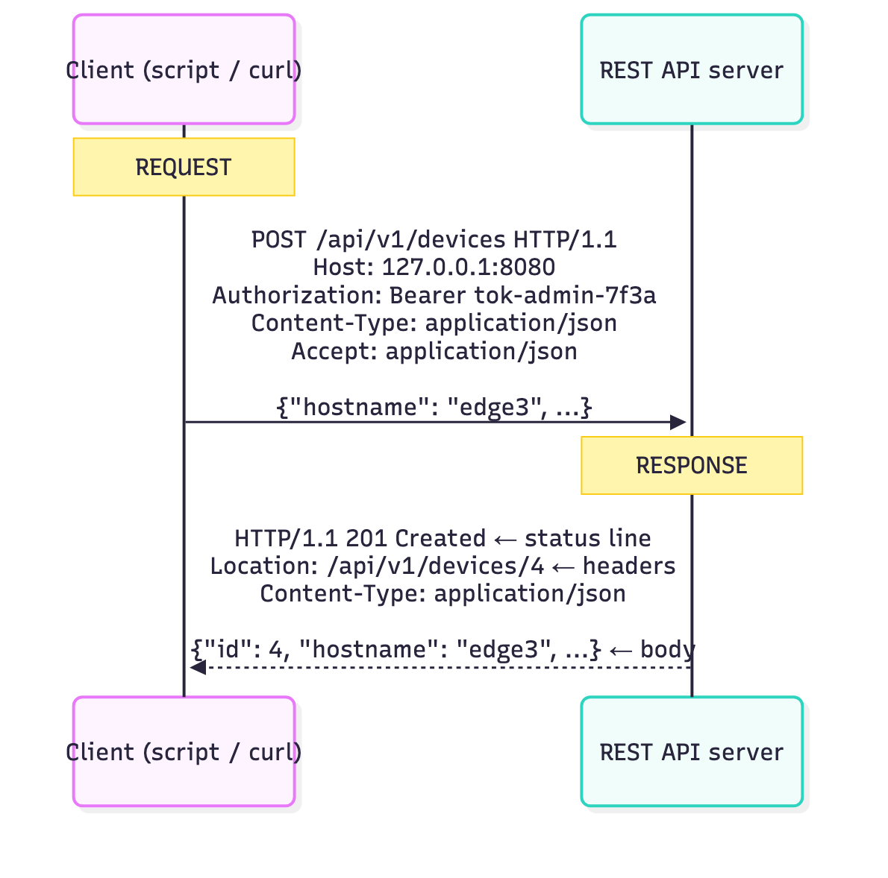
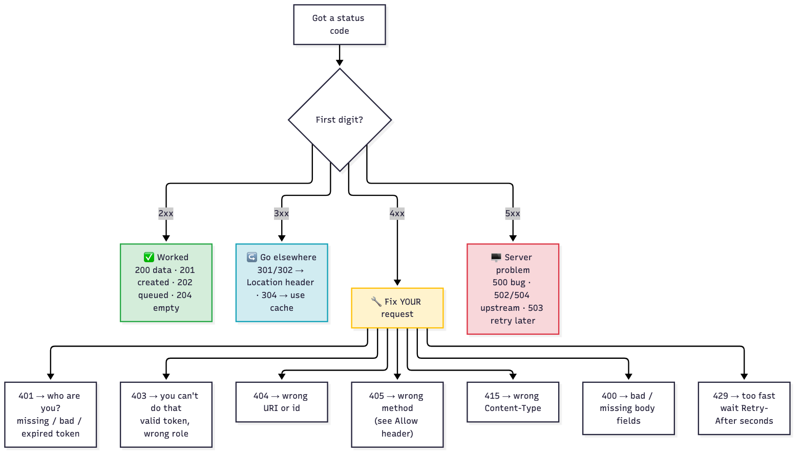
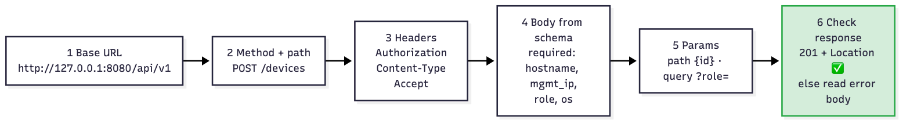

# T07 · REST fundamentals, HTTP codes: essentials

> Blueprint 2.1, 2.4-2.6: construct a REST request from API docs, common HTTP response codes, troubleshoot using the code, request and docs, interpret the parts of an HTTP response · Full note: [bee/T07-rest-fundamentals-http-codes.md](../bee/T07-rest-fundamentals-http-codes.md) · Teach-back 2026-10-18



*Each row is one concept group; read across from what the client sends to what the server answers, and treat the red boxes as exam traps.*

## The big idea
- This topic answers **two questions** about any REST call:
  - **How do I build the request?** Pick the method, the URL, the headers and the body from the API docs.
  - **What did the server say back?** Read the status code first, then the headers, then the body, and work out who has to fix what.
- **Analogy: a warehouse counter.**
  - Every item on the shelves has its own **address** (the URI, e.g. `/api/v1/devices/1`).
  - You say what you want done with it using a **small set of standard verbs** (GET, POST, PUT, PATCH, DELETE).
  - The clerk answers with a **numbered slip** (the status code): it tells you whether it worked and, if not, whose fault it was (4xx = yours, 5xx = theirs).
- **What the exam asks:** given an API doc snippet, a request or a response, name the missing method, URL part or header, say why a call failed, or point to where a value lives (status line, header or body). Read a request and a status code fluently and much of Domain 2 becomes pattern matching.

## 🟥 Must know

### 1. Resources and the URL
- **REST** (Representational State Transfer) is an **architectural style**: a set of design rules for APIs, not a protocol and not a standard. It almost always runs over HTTP.
- Every "thing" the API exposes (a device, an interface, a user) is a **resource**, and each resource has its own address, the **URI**.
  - **Collection** = plural noun, the whole shelf: `/api/v1/devices`.
  - **Item** = collection plus an id, one box on the shelf: `/api/v1/devices/1`.
- **URIs are nouns.** The HTTP method is the verb. `/getDevices` or `/deleteDevice?id=1` are not RESTful.
- **Analogy: a postal address.** The base URL is the building, the path is the floor and room, the query string is "only the red parcels, please".
- A URL reads left to right:

```
scheme://host:port/path?query#fragment            ← the general shape
http://127.0.0.1:8080/api/v1/devices?role=edge    ← a real call
```

  - **Base URL** (`http://127.0.0.1:8080/api/v1`) comes from the API docs and never changes between calls.
  - **Endpoint path** (`/devices`) picks the resource. **Base URL + endpoint path = full request URL.**
  - **Query string** (`?role=edge`) filters or pages.
  - A `#fragment` stays in the browser and is never sent to the server, so APIs don't use it.



*Blue is the base URL that never changes, yellow is the endpoint path that picks the resource, green is the query string that filters or pages.*

### 2. The request: method, URI, headers, body
- **A request has four parts:** **method** + **URI** + **headers** + optional **body**.
- **Analogy: posting a parcel.** The method is the instruction on the form ("deliver", "collect", "destroy"), the URI is the address, the headers are the labels on the outside ("fragile", "contents: JSON"), the body is what's inside the box.
- A real create request, line by line:

```http
POST /api/v1/devices HTTP/1.1                     ← method + path + HTTP version
Host: 127.0.0.1:8080                              ← header
Authorization: Bearer tok-admin-7f3a              ← header: who I am (sent on every call)
Content-Type: application/json                    ← header: the body I'm sending is JSON
Accept: application/json                          ← header: send me JSON back
                                                  ← blank line: headers end here
{"hostname": "edge3", "mgmt_ip": "10.10.20.50", "role": "edge", "os": "iosxe"}   ← body (payload)
```

- **Path parameter vs query parameter:**
  - **Path parameter** = part of the path that names **which** resource: `/devices/{id}` → `/devices/1`. **Required**; a wrong value → `404`.
  - **Query parameter** = after `?`, as `key=value` pairs joined by `&`: `/devices?role=edge&os=iosxe`. **Optional**; used to filter, sort or page.
- **Body (payload):** the data, sent with `POST`, `PUT` and `PATCH`. `GET` and `DELETE` normally have **no body**.
- **Stateless:** the server keeps **no session** between calls, so the token goes on **every** request. Drop it once → `401`. (The server still stores devices; it just doesn't remember *you*.)
- **The request headers to know:**
  - `Content-Type` = the format of **this message's** body (what I'm **sending**).
  - `Accept` = the format I **want back**.
  - `Authorization` = credentials: `Basic <base64 user:pass>` to log in, then `Bearer <token>` (T10).
  - `If-None-Match` = "only send it if it changed", plus the ETag you saved earlier.
  - Header names are **case-insensitive**.

### 3. The methods: CRUD, safe and idempotent
- **The five methods map onto CRUD** (create, read, update, delete).
- **Analogy: a filing cabinet.** POST = drop a new file into the drawer and let the clerk number it. GET = look at a file. PUT = swap the whole file for a new one. PATCH = cross out one line and write the change. DELETE = shred it.
- One device through its whole life (from the full note's mock API):

```
POST   /api/v1/devices      {all 4 fields}       → 201 Created, Location: /api/v1/devices/4
GET    /api/v1/devices/4                         → 200 OK + the device
PATCH  /api/v1/devices/4    {"role": "core"}     → 200 OK, only role changed
PUT    /api/v1/devices/4    {"hostname": "edge3"}→ 400 "PUT replaces the whole resource; missing: mgmt_ip, role, os"
DELETE /api/v1/devices/4                         → 204 No Content (empty body)
DELETE /api/v1/devices/4                         → 404 Not Found (already gone)
```

- **POST vs PUT:**
  - **POST** goes to the **collection** (`/devices`). The server picks the id, so you don't know the URI yet. Success = `201 Created` + a `Location` header with the new URI.
  - **PUT** goes to a **known item URI** (`/devices/4`). It creates the resource if missing or **replaces it completely**.
- **PUT vs PATCH:** PUT sends **every** field (missing ones → `400`, or they get wiped). PATCH sends only the fields that change.
- **Safe** = doesn't change anything on the server: `GET`, `HEAD`, `OPTIONS`.
- **Idempotent** = sending it once or ten times leaves the server in the **same end state**. The response code is allowed to differ.
  - Idempotent: `GET`, `HEAD`, `OPTIONS`, `PUT`, `DELETE`.
  - DELETE twice → `204` then `404`, but the device is gone either way, so **DELETE is idempotent**.
  - `POST` is **neither** safe nor idempotent: repeating it can create a duplicate.
  - `PATCH` is **not guaranteed** idempotent (RFC 5789). `{"role": "core"}` is repeatable; an "increment" operation is not.
- **Why it matters:** idempotent calls are safe to **retry** after a timeout. Retrying a POST can create duplicates.



*One device through its whole life: POST → 201 + Location → GET → PATCH → DELETE → 204 → DELETE again → 404. Watch the server-state column: same end state, which is why DELETE counts as idempotent.*

- **Summary:**

| Action | Method | Sent to | Body | Success code |
|---|---|---|---|---|
| Create | `POST` | the collection `/devices` | full object | `201 Created` + `Location` |
| Read | `GET` | collection or item | none | `200 OK` |
| Replace | `PUT` | the item `/devices/4` | **every** field | `200` (or `201` if PUT created it) |
| Update some | `PATCH` | the item | only changed fields | `200` |
| Delete | `DELETE` | the item | none | `204 No Content` (or `200`) |



*Every safe method is also idempotent; PUT and DELETE are idempotent but not safe; POST and PATCH are neither.*

### 4. The response: status line, headers, body
- **A response has three parts:**
  1. **Status line:** `HTTP/1.1 201 Created` = HTTP version + **code** + reason phrase.
  2. **Headers:** metadata about the response.
  3. **Body:** the data, usually JSON. It can be **empty**: `204`, `304`, `301` and `HEAD` responses have none.
- **Analogy: a delivery receipt.** The stamp at the top says delivered / refused (status line), the small print says where the parcel went and when to try again (headers), the attached sheet is the actual content or the reason for refusal (body).
- A real create response:

```http
HTTP/1.1 201 Created                              ← status line: version, code, reason
Content-Type: application/json                    ← header: how to read the body
Location: /api/v1/devices/4                       ← header: URI of the new resource
                                                  ← blank line
{"id": 4, "hostname": "edge3", "mgmt_ip": "10.10.20.50", "role": "edge", "os": "iosxe"}   ← body
```

- **Same shape both ways:** start line, headers, a blank line, then the body.



*Same layout both ways: start line, headers, blank line, body.*

- **Response headers to know:**
  - `Location` = URI of a new resource (`201`), a redirect target (`3xx`) or a job to poll (`202`).
  - `Retry-After` = seconds to wait (on `429` or `503`).
  - `WWW-Authenticate` = how to authenticate (sent with `401`).
  - `Allow` = which methods this URI accepts (sent with `405`), e.g. `Allow: GET, POST`.
  - `ETag` = a version tag for the resource, e.g. `"dev-1-v1"`. Send it back as `If-None-Match` → `304 Not Modified` if unchanged.
  - `Content-Type`, `Content-Length` = format and size of the body.
- **"Where is it?" answers:**
  - The **code** → status line.
  - `Location`, `Retry-After`, `ETag`, `Content-Type`, `Allow` → **headers**.
  - The data and the **error message** → **body**. A new device's id is in **both** the body (`"id": 4`) and the `Location` header.
  - The code says **what kind** of failure; the body says **why**.

### 5. Status codes: read the first digit first
- **The first digit gives the class.** Learn the class, then the exact code.
- **Analogy: whose fault is it?** 2xx = all good. 3xx = "not here, try over there". 4xx = **you** filled in the form wrong. 5xx = **the office** broke, try later.
- **Key codes** (each one was produced by the full note's lab):
  - **2xx success:**
    - `200 OK` = worked (GET, PUT, PATCH).
    - `201 Created` = a new resource exists now; see `Location`.
    - `202 Accepted` = **queued, not done yet** (async, T09). Poll the job URI in `Location`.
    - `204 No Content` = worked, **empty body** (typical DELETE).
  - **3xx look elsewhere:**
    - `301 Moved Permanently` / `302 Found` (temporary) = follow `Location`.
    - `304 Not Modified` = use your cached copy. Only comes back if you sent `If-None-Match`.
  - **4xx your request is wrong:**
    - `400 Bad Request` = the body content is wrong (broken JSON, missing fields).
    - `401 Unauthorized` = **who are you?** Credentials missing, wrong or expired.
    - `403 Forbidden` = **I know you, but no.** Your role isn't allowed.
    - `404 Not Found` = the URI or id doesn't exist.
    - `405 Method Not Allowed` = the URI exists but not with that method; read `Allow`.
    - `409 Conflict` = duplicate or state clash (e.g. hostname already exists).
    - `415 Unsupported Media Type` = the `Content-Type` header is missing or wrong.
    - `429 Too Many Requests` = slow down; wait `Retry-After` seconds (T08).
  - **5xx the server failed:**
    - `500 Internal Server Error` = a server bug.
    - `502 Bad Gateway` = a proxy got a **bad** reply from the server behind it.
    - `503 Service Unavailable` = the service is down or in maintenance (often with `Retry-After`).
    - `504 Gateway Timeout` = a proxy got **no** reply in time.
- **Summary:**

| Class | Meaning | Who fixes it |
|---|---|---|
| `1xx` | informational, interim; rare in APIs | nobody |
| `2xx` | it worked | nothing to fix |
| `3xx` | look elsewhere (`Location`) or use your cache (`304`) | the client follows or reuses |
| `4xx` | **your** request is wrong | you, the caller |
| `5xx` | a valid request failed on the **server** | the API owner; you retry later |

### 6. Troubleshooting a failed call
- **Read the code, then the error body, then the docs.** Each 4xx code points at **one part** of the request to fix.
- **Analogy: a car dashboard.** Each warning light points at one system. You don't strip the engine for a low-fuel light.
- Real failure from the lab, and how to read it:

```http
HTTP/1.1 415 Unsupported Media Type               ← 4xx: my fault; 415 = the Content-Type header
Content-Type: application/json

{"error": "Content-Type must be application/json, got 'text/plain'"}   ← body says exactly why
```

  - Fix: send `Content-Type: application/json`. The body is fine; only its label was wrong.



*Branch on the first digit, then on the exact 4xx code; each one maps to a specific part of the request.*

- **Summary (code → part of the request → fix):**

| Code | Most likely cause | Fix |
|---|---|---|
| `401` | missing, wrong or **expired** token, or `Basic` used where `Bearer` is expected | log in again; check the `Authorization` format |
| `403` | logged in, but the role lacks permission | use an account with the right role; a new token won't help |
| `404` | wrong path (`/device/1` vs `/devices/1`) or wrong id | compare the URL with the docs |
| `405` | right URL, wrong method (DELETE on a collection) | read the `Allow` header |
| `415` | `Content-Type` missing or wrong | send `Content-Type: application/json` |
| `400` | broken JSON or missing fields | check the body against the doc schema |
| `409` | duplicate or state conflict | change the value, or GET the current state first |
| `429` | too many calls | wait `Retry-After` seconds (T08) |
| `5xx` | server side | retry later; report a `500` with the request details |

### 7. Building a call from the docs, and sending it with curl
- **Six steps from a doc table to a working call:**
  1. **Base URL:** `http://127.0.0.1:8080/api/v1`
  2. **Method + path:** `POST /devices`
  3. **Headers:** `Authorization: Bearer <token>`, `Content-Type: application/json`, `Accept: application/json`
  4. **Body** from the documented **required** fields: `{"hostname": "edge3", "mgmt_ip": "10.10.20.50", "role": "edge", "os": "iosxe"}`
  5. **Path or query parameters:** none for a create (`{id}` and `?role=` are for reads)
  6. **Compare the response** with the documented codes: expect `201` + `Location`; anything else → read the error body.
- **Analogy: a recipe card.** The doc table lists the ingredients (required fields) and the oven setting (method); skip one and the dish fails in a predictable way (`400`, `405`, `415`).



*Steps 1 to 5 build the request; step 6 checks the answer against the documented codes.*

- **The same call with curl, every part annotated:**

```bash
curl --silent --show-error --include --request POST \
  --header "Authorization: Bearer $TOKEN" \
  --header "Content-Type: application/json" \
  --data '{"hostname":"edge9","mgmt_ip":"10.10.20.59","role":"edge","os":"iosxe"}' \
  "http://127.0.0.1:8080/api/v1/devices"
```

  - `--include` (`-i`) = print the status line and response headers, not just the body.
  - `--request POST` (`-X`) = the method. curl's **default is GET**.
  - `--header` (`-H`) = one header per flag.
  - `--data` (`-d`) = the body. On its own it **switches the method to POST** and labels the body `application/x-www-form-urlencoded`.
  - Output: `HTTP/1.1 201 Created` + `Location: /api/v1/devices/4`.
- **The classic curl trap:** `--data '{"json":...}'` **without** `--header "Content-Type: application/json"` → curl sends it as a **form** → a JSON API answers `415`.
- **Other curl flags the exam shows:**

| Flag | What it does |
|---|---|
| `-u user:pass` / `--user` | Basic auth (builds `Authorization: Basic …`) |
| `-k` / `--insecure` | skip TLS certificate checks (self-signed sandbox certs) |
| `-v` / `--verbose` | full trace: `>` lines sent, `<` lines received |
| `-L` / `--location` | follow 3xx redirects |
| `-G` / `--get` | with `-d`, turn the data into a query string on a GET |

- **Media types (the values for `Content-Type` and `Accept`):**
  - `application/json` = most REST APIs (Meraki, Webex, Catalyst Center (DNA Center)).
  - `application/xml` = XML bodies.
  - `application/yang-data+json` / `application/yang-data+xml` = **RESTCONF** (RFC 8040, T16).
  - `application/x-www-form-urlencoded` = form data `a=1&b=2`; curl `-d`'s default.
  - Mismatch → `415` on the way in, `406 Not Acceptable` on the way out.

## Exam traps
- **401 ≠ 403.** 401 = not logged in (missing, wrong or expired credentials): log in again. 403 = logged in but your role isn't allowed: a fresh token won't help.
- **404 vs 405, 400 vs 415.** 404 = the URI doesn't exist; 405 = it exists but not with that method (check `Allow`). 400 = the body **content** is wrong; 415 = the body **format** label (`Content-Type`) is wrong.
- **curl `-d` alone sends a form, not JSON** → `415`. Add `-H "Content-Type: application/json"`.
- **`202` is not done; `201` is created now.** Poll the `Location` job URI after a 202. `204` and `304` have **no body**, so `.json()` on them fails.
- **Idempotent ≠ same response code.** DELETE twice → `204` then `404`, still idempotent. POST is not idempotent; PATCH isn't guaranteed to be.
- **502 vs 504 vs 503.** A proxy got a **bad** reply (502) or **no** reply (504); 503 = the service itself is down or overloaded.

<details><summary><b>🟨 Should know (second pass)</b></summary>

- **The six REST constraints** (Roy Fielding, 2000). Exam questions describe one and ask for its name:
  - **Client-server:** the client (script or UI) and the server (data) are separate and can change independently.
  - **Stateless:** every request carries everything needed, including the token; the server keeps no client session. (Most tested, with cacheable.)
  - **Cacheable:** responses say whether and for how long they can be reused. Example: `ETag: "dev-1-v1"` → resend as `If-None-Match` → `304 Not Modified`, no body.
  - **Uniform interface:** the same standard methods, resource URIs and self-describing messages (`Content-Type` says how to read the body) work on every resource.
  - **Layered system:** the client can't tell whether it's talking to the real server or a proxy, load balancer or cache in between.
  - **Code on demand:** the server may send runnable code such as JavaScript. It's the **only optional** constraint.
- **Tools to try a request before coding it:** **Postman** (GUI: method, URL, headers, body, auth; can export the request as Python or curl code), curl on the CLI, or an API's built-in "Try it" docs page. Exam cue: "which tool constructs and sends an API request?" → **Postman**.
- **Catalyst Center (DNA Center)** follows the same pattern but sends the token in a custom `X-Auth-Token` header instead of `Authorization: Bearer` (⚠ verify the exact paths against the Catalyst Center docs):

```bash
curl --silent --insecure --include \
  --header "X-Auth-Token: $TOKEN" \
  --header "Accept: application/json" \
  "https://$DNAC_HOST/dna/intent/api/v1/network-device?family=Switches%20and%20Hubs"
```

  - Same shape as any REST call: token in a header on every call (stateless), a query parameter filters the results.
- **Other headers:** `User-Agent` (the client software, e.g. `curl/8.7.1`), `Cache-Control` (caching rules such as `max-age=60`), `Set-Cookie` (session-based APIs). curl fills in `Host`, `User-Agent` and `Accept: */*` by itself (visible with `--verbose`).
- **Redirects:** `301` = moved permanently, `302` = temporary. curl shows the raw `301` unless you add `--location`; Python's `urllib` follows it silently and shows the final `200`.

</details>

> **Recognise only, details in the full note:** `1xx` / `100 Continue`, `501 Not Implemented`, `406 Not Acceptable`, `text/plain` bodies, curl `--json` (curl ≥ 7.82) and `-s`, `If-Modified-Since`, `HEAD` and `OPTIONS` beyond "safe".

## Quick self-check
<details><summary>Q1. A body sent to <code>/api/v1/vlans</code> returns <code>201 Created</code>. Which method was it?</summary><code>POST</code>, because a create on the collection returns 201; PUT would target an item like <code>/vlans/30</code>.</details>
<details><summary>Q2. Which two methods are idempotent but not safe?</summary><code>PUT</code> and <code>DELETE</code>: they change state, but repeating them leaves the same end state.</details>
<details><summary>Q3. A read-only user gets <code>403</code> on a DELETE. Will a fresh token fix it?</summary>No. 403 means authenticated but not allowed; use an account whose role permits deletes.</details>
<details><summary>Q4. Which REST constraint is the only optional one?</summary>Code on demand.</details>
<details><summary>Q5. Where do you find how long to wait after a <code>429</code>?</summary>In the <code>Retry-After</code> response header, not the body.</details>
<details><summary>Q6. <code>curl --request POST --data '{"hostname":"edge5"}' https://host/api/v1/devices</code> returns <code>415</code>. What's missing?</summary><code>--header "Content-Type: application/json"</code>. Without it, <code>--data</code> labels the body as <code>application/x-www-form-urlencoded</code>.</details>
<details><summary>Q7. <code>DELETE /api/v1/devices</code> returns <code>405</code> with <code>Allow: GET, POST</code>. What's wrong?</summary>The URI exists but doesn't accept DELETE. Delete one item (<code>/devices/{id}</code>) instead; the <code>Allow</code> header lists what the collection accepts.</details>

## Say it out loud
- "Request equals method, URI, headers, body; response equals status line, headers, body."
- "POST to the list, PUT to the item; PUT is everything, PATCH is just the change."
- "Four-hundreds are my fault, five-hundreds are theirs."
- "401 is who are you, 403 is I know you and no."
- "Content-Type is what I send, Accept is what I want back."
