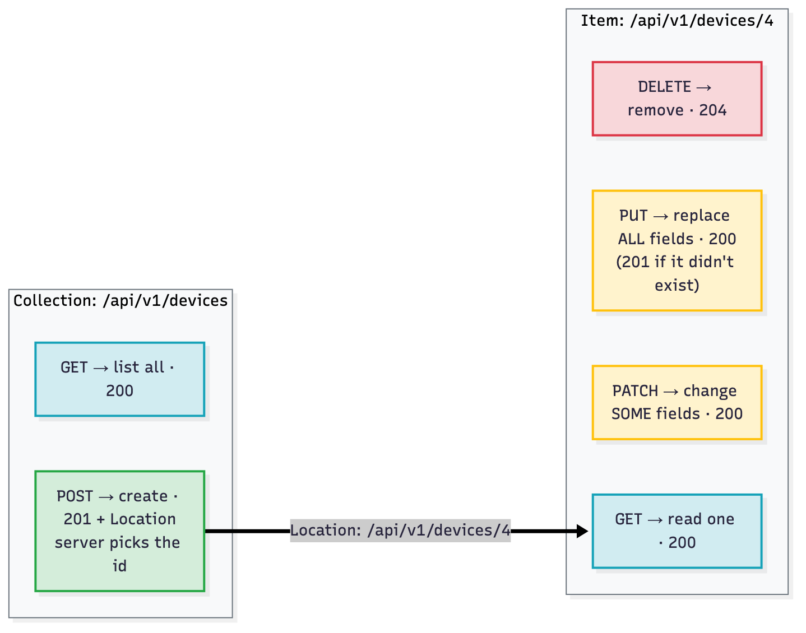

# T07 · REST fundamentals, HTTP codes: essentials

> Blueprint 2.1, 2.4-2.6 · Full note: [bee/T07-rest-fundamentals-http-codes.md](../bee/T07-rest-fundamentals-http-codes.md) · Teach-back 2026-10-18

## In one picture


*Each row is one concept group; read across from what the client sends to what the server answers, and treat the red boxes as exam traps.*

## The big idea

- A REST API is like a well-run warehouse counter. Every item on the shelves has its own address, you say what you want done with it using a small set of standard verbs, and the clerk answers with a numbered slip that tells you whether it worked and, if not, whose fault it was.
- On the exam you are handed an API doc snippet, a request or a response, and asked which method, URL part or header is missing, or why a call failed. If you can read a request and a status code fluently, a large share of Domain 2 becomes pattern matching.

## What you need to know

### 1. What REST is, and how a URL is built

- REST is a set of design rules for APIs, not a protocol or a standard. It stands for **Representational State Transfer**, it is an **architectural style**, and it almost always runs over HTTP.
- Every "thing" the API exposes (a device, an interface, a user) is a **resource**, and each resource has its own address, the **URI**.
  - A list of things uses a plural noun, which is a **collection**: `/api/v1/devices`.
  - One thing is the collection plus an id, which is an **item**: `/api/v1/devices/1`.
- URIs should be nouns. The HTTP method says what to do with the noun, so names like `/getDevices` or `/deleteDevice?id=1` are not RESTful.
- A URL reads left to right as `scheme://host:port/path?query#fragment`.
- The fixed front part comes from the API docs and is the **base URL**. You add an **endpoint path** to it for each call: **base URL + endpoint path = full request URL**.
- The `#fragment` stays in the browser and is never sent to the server, so APIs don't use it.


*Blue is the base URL that never changes, yellow is the endpoint path that picks the resource, green is the query string that filters or pages.*

### 2. The six rules that make an API "RESTful"

- Six rules, from Roy Fielding (2000), define REST. Exam questions describe one and ask for its name.

| Constraint | In plain words |
|---|---|
| **Client-server** | The client (script or UI) and the server (data) are separate and can change independently. |
| **Stateless** | Every request carries everything needed, including the token. The server keeps **no session** between requests. |
| **Cacheable** | Responses say whether and for how long they can be reused (for example `ETag`, then `304`). |
| **Uniform interface** | The same standard methods, resource URIs and self-describing messages (`Content-Type` says how to read the body) work everywhere. |
| **Layered system** | The client can't tell whether it is talking to the real server or to a proxy, load balancer or cache in between. |
| **Code on demand** | The server may send runnable code such as JavaScript. This is the **only optional** rule. |

- Stateless does not mean the server stores nothing. It still stores devices; it just doesn't remember *you* between calls, which is why the token goes on every request. Drop it once and you get `401`.
- Stateless and cacheable are the two most tested.

### 3. The verbs: CRUD, safe and idempotent

- The five methods map onto the four basic data actions, **CRUD** (create, read, update, delete).

| Action | Method | Sent to | Body | Success code |
|---|---|---|---|---|
| Create | `POST` | the collection `/devices` | full object | `201 Created` + `Location` header |
| Read | `GET` | collection or item | none | `200 OK` |
| Update everything | `PUT` | the item `/devices/4` | **every** field | `200` (or `201` if PUT created it) |
| Update some fields | `PATCH` | the item | only the changed fields | `200` |
| Delete | `DELETE` | the item | none | `204 No Content` (or `200`) |



*POST goes to the collection and the server picks the id; PUT, PATCH and DELETE go to one known item.*

- Use **POST** when the server picks the id and you don't know the URI yet. Use **PUT** when you already know the URI; it creates the resource if missing or replaces it completely.
- PUT replaces the whole resource, so a PUT that sends only some fields fails with `400` (or wipes the missing ones). PATCH sends only what changes.
- A method is **safe** if it doesn't change anything on the server. Safe methods are `GET`, `HEAD` and `OPTIONS`.
- A method is **idempotent** if sending it once or ten times leaves the server in the **same end state**. The response code is allowed to differ.
  - Idempotent: `GET`, `HEAD`, `OPTIONS`, `PUT`, `DELETE`.
  - Deleting twice gives `204` then `404`, but the device is gone either way, so DELETE is still idempotent.
  - `POST` is neither safe nor idempotent, because repeating it can create a duplicate.
  - `PATCH` is not guaranteed to be idempotent (RFC 5789). Setting `{"role": "core"}` is repeatable; an "increment" operation would not be.
- This matters because idempotent calls are safe to **retry** after a timeout, while retrying a POST can create duplicates.


*Every safe method is also idempotent; PUT and DELETE are idempotent but not safe; POST and PATCH are neither.*

### 4. What's inside a request and a response

- A **request** has four parts: the **method**, the **URI**, the **headers**, and an optional **body**.
  - A **path parameter** is the part of the path that names *which* resource, such as `/devices/{id}` becoming `/devices/1`. It is required, and a wrong value gives `404`.
  - A **query parameter** comes after `?` as `key=value` pairs joined with `&`. It is optional and is used to filter, sort or page, for example `?role=edge`.
  - The **body** (also called the **payload**) carries data with `POST`, `PUT` and `PATCH`. `GET` and `DELETE` normally have no body.
- A **response** has three parts:
  1. The **status line**, such as `HTTP/1.1 201 Created`: version, code, and a short reason phrase.
  2. The **headers**, which are metadata such as `Location`, `Content-Type`, `Retry-After` and `ETag`.
  3. The **body**, usually JSON. It can be empty: `204`, `304`, `301` and `HEAD` responses have none.
- Both directions share one shape: start line, headers, a blank line, then the body.


*Same layout both ways: start line, headers, blank line, body.*

- Headers are `Name: value` lines, and the names are case-insensitive. The ones to know:

| Header | Who sends it | What it says |
|---|---|---|
| `Content-Type` | both | the format of **this message's** body |
| `Accept` | client | the format I **want back** |
| `Authorization` | client | credentials: `Basic <base64>` to log in, then `Bearer <token>` |
| `User-Agent`, `Cache-Control` | client / both | the client software; caching rules such as `max-age=60` |
| `If-None-Match` | client | "only send it if it changed", plus the ETag |
| `Location` | server | the URI of a new resource (201), a redirect target (3xx) or a job (202) |
| `Retry-After` | server | seconds to wait (on 429 or 503) |
| `WWW-Authenticate` | server | how to authenticate (required on 401) |
| `Allow` | server | which methods are allowed (required on 405) |
| `ETag`, `Set-Cookie`, `Content-Length` | server / both | resource version tag; a cookie; body size in bytes |

- "Where is it?" questions: the status code is in the **status line**; `Location`, `Retry-After`, `ETag`, `Content-Type` and `Allow` are **headers**; the data and the error message are in the **body**. A new device's id appears in both the body and the `Location` header.
- The code tells you *what kind* of failure; the body tells you *why*.

### 5. Status codes: read the first digit first

| Class | Meaning | Who fixes it |
|---|---|---|
| `1xx` | informational, interim (`100 Continue`); rare in APIs | nobody |
| `2xx` | it worked | nothing to fix |
| `3xx` | look elsewhere (`Location`) or use your cache (`304`) | the client follows or reuses |
| `4xx` | **your** request is wrong | you, the caller |
| `5xx` | a valid request failed on the **server** | the API owner; you retry later |

- Key codes, each produced by the note's lab:
  - **2xx:** `200 OK`, `201 Created` (plus `Location`), `202 Accepted` (queued, **not done yet**), `204 No Content` (empty body).
  - **3xx:** `301 Moved Permanently`, `302 Found` (temporary redirect), `304 Not Modified` (only after you sent `If-None-Match`).
  - **4xx:** `400` bad body, `401` who are you, `403` not allowed, `404` wrong URI or id, `405` wrong method (see `Allow`), `409` conflict such as a duplicate hostname, `415` wrong `Content-Type`, `429` slow down (see `Retry-After`).
  - **5xx:** `500` server bug, `501` method not supported at all, `502` a proxy got a **bad** reply from upstream, `503` service down or in maintenance (often with `Retry-After`), `504` a proxy got **no** reply in time.

### 6. Troubleshooting a failed call

- Read the code, then the error body, then the docs. Each 4xx code points at one part of the request to fix.


*Branch on the first digit, then on the exact 4xx code; each one maps to a specific part of the request.*

| Code | Most likely cause | Fix |
|---|---|---|
| `401` | missing, wrong or **expired** token, or `Basic` used where `Bearer` is expected | log in again; check the `Authorization` format |
| `403` | logged in, but the role lacks permission | use an account with the right role; a new token won't help |
| `404` | wrong path (`/device/1` vs `/devices/1`) or wrong id | compare the URL with the docs |
| `405` | right URL, wrong method | read the `Allow` header |
| `415` | `Content-Type` missing or wrong | send `Content-Type: application/json` |
| `400` | broken JSON or missing fields | check the body against the doc schema |
| `409` | duplicate or state conflict | change the value or GET the current state first |
| `429` | too many calls | wait `Retry-After` seconds (T08) |
| `5xx` | server side | retry later; report a `500` with details |

### 7. Building a call from the docs, and doing it with curl

- Turning a doc table into a working call takes six steps: base URL, method plus path, headers (`Authorization`, `Content-Type`, `Accept`), body built from the required fields, any path or query parameters, then compare the response with the documented codes.


*Steps 1 to 5 build the request; step 6 checks the answer against the documented codes.*

- To try a request before coding it, use **Postman** (a GUI that can also export the request as Python or curl code), **curl** on the command line, or an API's built-in "Try it" page. If a question asks "which tool constructs and sends an API request", the answer is Postman.
- Body formats are named by **media type**: `application/json` for most REST APIs, `application/xml` for XML, `application/yang-data+json` or `+xml` for **RESTCONF**, and `application/x-www-form-urlencoded` for form data (`a=1&b=2`).
- `Content-Type` must match what you send, and `Accept` must be something the API can return. A mismatch gives `415` on the way in or `406 Not Acceptable` on the way out.
- curl flags the exam shows:

```bash
curl --request POST --header "Content-Type: application/json" --data '{"name":"x"}' https://host/api
```

*Sets the method, declares the body as JSON, and sends it.*

| Flag | What it does |
|---|---|
| `-X` / `--request` | sets the method; the default is **GET** |
| `-H` / `--header` | adds a header |
| `-d` / `--data` | sends a body, **switches to POST** and sets a **form** content type |
| `-u user:pass` | Basic auth |
| `-k` / `--insecure` | skips TLS certificate checks (self-signed sandbox certs) |
| `-i` / `--include` | shows status line and response headers plus body |
| `-v` / `--verbose` | full trace: `>` lines sent, `<` lines received |
| `-L` / `--location` | follows 3xx redirects |
| `-G` / `--get` | with `-d`, turns the data into a query string on a GET |

- Catalyst Center (DNA Center) follows the same pattern but uses a custom `X-Auth-Token` header instead of `Authorization: Bearer` (⚠ verify the exact paths against the Catalyst Center docs).

## Exam traps (the ones that catch people)

- `401` looks like "permission denied", but it actually means "not logged in": the credentials are missing, wrong or expired. `403` means you are logged in but your role isn't allowed, so logging in again won't help.
- `404` and `405` look alike, but `404` means the URI doesn't exist, while `405` means the URI exists and simply doesn't accept that method. Check the `Allow` header.
- `400` and `415` both look like "bad body", but `400` is about the content (broken JSON, missing fields) and `415` is about the declared format (the `Content-Type` header).
- `curl -d '{"json":...}'` looks like it sends JSON, but without `-H "Content-Type: application/json"` curl labels it as form data, so a JSON API answers `415`.
- DELETE twice returning `204` then `404` looks non-idempotent, but it is idempotent because the end state is the same.
- `202` looks like success, but it only means "accepted and queued". Poll the job URI in `Location`; `201` is the code that means "created now".
- `204` and `304` have no body, so calling `.json()` on them fails.
- `502` and `504` both come from a proxy, but `502` means it got a **bad** reply and `504` means it got **no** reply in time. `503` means the service itself is down or overloaded.

## Quick self-check

<details><summary>Q1. A body sent to <code>/api/v1/vlans</code> returns <code>201 Created</code>. Which method was it?</summary><code>POST</code>, because a create on the collection returns 201; PUT would target an item like <code>/vlans/30</code>.</details>

<details><summary>Q2. Which two methods are idempotent but not safe?</summary><code>PUT</code> and <code>DELETE</code>: they change state, but repeating them leaves the same end state.</details>

<details><summary>Q3. A read-only user gets <code>403</code> on a DELETE. Will a fresh token fix it?</summary>No. 403 means authenticated but not allowed; use an account whose role permits deletes.</details>

<details><summary>Q4. Which REST constraint is the only optional one?</summary>Code on demand.</details>

<details><summary>Q5. Where do you find how long to wait after a <code>429</code>?</summary>In the <code>Retry-After</code> response header, not the body.</details>

## Cheat lines to say out loud

- "Request equals method, URI, headers, body; response equals status line, headers, body."
- "POST to the list, PUT to the item; PUT is everything, PATCH is just the change."
- "Four-hundreds are my fault, five-hundreds are theirs."
- "401 is who are you, 403 is I know you and no."
- "Content-Type is what I send, Accept is what I want back."
