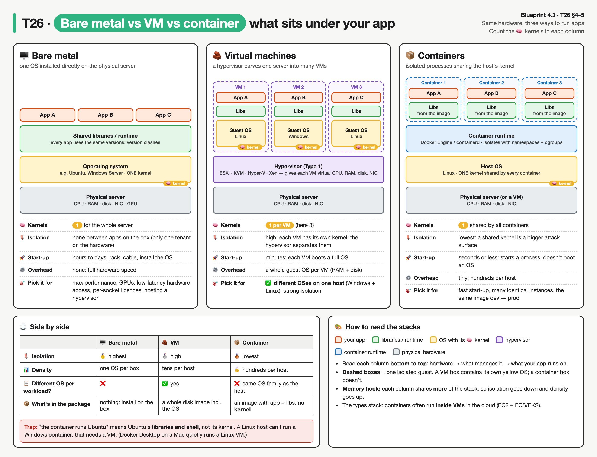

# T26 · Deployment models + edge computing: essentials

> Blueprint 4.1-4.3: benefits of edge computing; deployment models (private, public, hybrid, edge); deployment types (VMs, bare metal, containers) · Full note: [bee/T26-deployment-models-edge-computing.md](../bee/T26-deployment-models-edge-computing.md)


*Each row is one concept group; blue cells mark the winner on that criterion, and the red boxes are the exam traps.*

## 🧭 The big idea

This topic asks **three separate questions** about any workload. Each has its own answer, so keep them apart.

| | Question | Answer options | Analogy |
|---|---|---|---|
| 🏘️ | **Who is the infrastructure for?** (deployment model) | private · public · community · hybrid · multi-cloud | places to live: your own house, a hotel, staff housing, house + hotel |
| 📍 | **Where does the processing happen?** | far-away cloud region · **edge** next to the data · fog in between | a factory foreman who decides on the floor instead of phoning head office |
| 📦 | **What wraps the app?** (deployment type) | bare metal · VM · container | a detached house · flats in one building · rooms in one shared flat |

- A fourth, secondary question, 🛎️ **how much does the provider run for you** (IaaS / PaaS / SaaS), is in Should know.
- 🎯 **What the exam asks:** short scenarios. Spot the **one constraint** (latency, data location, isolation, start-up speed, different OS) and map it to the answer.

## 🟥 Must know

### 1. 🏘️ Deployment models: who the infrastructure is for

> 💡 The test is **who uses it**, not **where the rack is**. The definitions follow **NIST SP 800-145**, which is the vocabulary the exam wording matches.

| | Model | Who uses it | Where it sits | Analogy | Exam cue |
|---|---|---|---|---|---|
| 🏠 | **Private** | **one organisation only** (can have many business units) | on premises **or** hosted by a third party | a house only your family lives in, owned or rented | "regulated data", "full control", "own hardware" |
| 🏨 | **Public** | the **general public** | the provider's premises (AWS, Azure, GCP) | a hotel: anyone books, pay per night | "no capex", "pay-as-you-go", "global", "elastic" |
| 🏢 | **Community** | **several organisations with the same concerns** (mission, security, compliance) | on or off premises | shared staff housing for several agencies | "several government agencies", "same compliance regime" |
| 🔗 | **Hybrid** | **2+ distinct clouds** that stay separate but are **bound together** | a mix | your house + hotel rooms on busy weekends, with a car linking them | "burst to cloud at peak", "DB on-prem by regulation, front end in AWS" |
| ☁️☁️ | **Multi-cloud** (not a NIST model) | workloads across **2+ public** providers | several providers | booking rooms in two hotel chains | "avoid vendor lock-in", "best service from each provider" |

**🔍 The two that get confused:**

| | 🔗 Hybrid | ☁️☁️ Multi-cloud |
|---|---|---|
| Mix | **different types**: private + public (or community) | **same type**: public + public |
| Must they be linked? | **yes**: site-to-site VPN, Direct Connect / ExpressRoute, or a shared management layer. No link, no hybrid. | no |
| Classic example | **cloud bursting**: run on private capacity, overflow to public at peak | AWS + Azure to avoid lock-in |

- 🔀 They can overlap: on-prem **plus** AWS **plus** Azure is both hybrid and multi-cloud.
- 🧩 **Cisco context:** the Meraki dashboard is SaaS in the public cloud; Catalyst Center (DNA Center) is an appliance you run on-prem.


*The three base models on top define who uses the infrastructure; hybrid binds distinct clouds together, and multi-cloud is several public providers.*

### 2. 📍 Edge computing: process the data where it is produced

| ❌ The problem with cloud-only | ✅ The edge fix |
|---|---|
| 🐢 A cloud region is far away. Every request pays a **WAN round trip**: light in fibre covers about **200 km per ms** each way, plus queuing and processing. | Move processing **onto the device, or a box next to it** (router, switch, gateway, local server). |
| 💸 Every byte sent uses **WAN bandwidth**, which costs money and may be thin at a factory, ship or store. | Send only **results, summaries or alerts** up to the cloud. |

> 🏭 **Foreman analogy:** the sensor reading goes to the foreman (the edge box), who decides "stop the motor" in milliseconds. Head office (the cloud) gets the daily summary.

**📊 The numbers, from the edge drill in the full note** (200 sensors, 10 readings/s, 64-byte readings, one 512-byte summary per sensor per minute):

```
Cloud-only WAN upload:  11.06 GB/day     ← every raw reading crosses the WAN
Edge (summaries only):   0.15 GB/day     ← only per-minute summaries cross it
WAN traffic saved:      98.67 %
edge app on the factory router     min RTT   0.001 ms (propagation only)
regional cloud region              min RTT   8.000 ms (propagation only)   ← 800 km away
cloud region on another continent  min RTT 100.000 ms (propagation only)   ← 10,000 km away
```

- ⏱️ These RTTs are **lower bounds**: real WAN round trips add queuing, routing and TLS handshakes.
- 🚫 So a "stop within 10 ms" deadline can't be met reliably from a distant region. **No amount of cloud auto scaling fixes distance.**

**🏆 The four benefits (blueprint 4.1):**

| | Benefit | Why it happens | Scenario cue |
|---|---|---|---|
| ⚡ | **Lower latency** | the decision is made locally in milliseconds, no WAN round trip | "robot arm must stop within 10 ms", "real-time video analytics" |
| 📉 | **Less WAN bandwidth** | filter and aggregate locally, send summaries (about 99% less in the drill) | "thousands of sensors", "HD cameras at every branch" |
| 🛟 | **Resilience** | keeps working when the WAN fails, queues results until it returns | "remote oil rig", "ship", "intermittent satellite link" |
| 🔒 | **Data locality** | raw data never leaves the site (privacy, sovereignty, compliance) | "patient video must not leave the hospital" |

| ✅ Edge complements the cloud | ⚠️ The cost of edge |
|---|---|
| Fleet-wide analytics, long-term storage and ML training **stay central**. The cloud pushes models and app updates back **down**. Edge doesn't replace the cloud. | Many distributed boxes to **patch and secure**, each with limited CPU and RAM, and **physically exposed**. |


*Read it bottom to top: raw data stops at the edge, filtered results reach the fog nodes, and only summaries cross the WAN, while the cloud pushes models and updates back down.*


*Same sensor, two designs. Cloud-only pays a WAN round trip for every decision; edge decides locally and keeps working through a WAN outage.*

### 3. 🌫️ Fog computing and 🧩 Cisco IOx

**Edge vs fog**, for when the answer options split them:

| | 📍 Edge | 🌫️ Fog |
|---|---|---|
| Where | **at or on the device** producing the data (sensor, meter) | a layer of **fog nodes in the network between** the devices and the cloud |
| What runs there | the device itself, or a box right next to it | physical nodes (**gateways, switches, routers**, servers) or virtual ones (VMs, virtual switches), which also do storage and control |
| Foreman analogy | the worker's own judgement at the machine | the floor supervisor's office, between the floor and head office |
| Origin | | Cisco coined the term; **NIST SP 500-325** defines it |

**🧩 Cisco IOx = Cisco's application-hosting framework.**

| | |
|---|---|
| 🎯 What it is | lets you run **your own apps on Cisco routers and switches**: industrial routers such as the IR1101, Catalyst switches, IOS XE routers ⚠ verify the supported-platform list and app types |
| 💡 Why it matters | the branch router already sits next to the sensors, so it **becomes the edge/fog compute box**: no extra server on site |
| 🏷️ Exam role | the textbook "**Cisco edge computing**" answer |
| 🔄 App lifecycle on IOS XE | **install → activate → start**; removal is **stop → deactivate → uninstall** ⚠ verify the CLI syntax |

```
configure terminal
 iox                                              ! enable the app-hosting framework
 end
app-hosting install appid sensorapp package flash:sensorapp.tar   ! 1. install the package from flash
app-hosting activate appid sensorapp              ! 2. activate it
app-hosting start appid sensorapp                 ! 3. run it
show app-hosting list                             ! check the app's state
```

- 📝 Reference only: syntax from the full note, not run on a device. ⚠ verify.

> 🔐 **Exam-sim gap: IOx only runs trusted apps.** IOx supports **application signing**: the app package is signed, and the device verifies the signature before running it, so only approved code executes on a router or switch. ⚠ verify the exact signing workflow.
>
> 🎯 Cue: "Cisco framework that hosts only signed, verified apps on network devices" → **IOx**. Not Intersight, not the Meraki dashboard, not IOS XE itself.

### 4. 📦 Deployment types: bare metal, VM, container

> 💡 Deployment type = **what sits between your app and the hardware**. The question to ask: **how many kernels are there, and who shares them?**

| | 🖥️ Bare metal | 🧱 Virtual machine (VM) | 📦 Container |
|---|---|---|---|
| **Housing analogy** | a detached house: one family, nothing shared | flats in one building: each has its own front door, kitchen and plumbing (its own kernel) on a shared plot (the hypervisor) | rooms in one shared flat: everyone shares the kitchen and plumbing (the host kernel) |
| **What it is** | one OS directly on the physical server | a **hypervisor** carves one server into many VMs, each with virtual hardware and a **complete guest OS with its own kernel** | an isolated process (host-kernel namespaces and cgroups), packaged with its libraries in an **image** |
| **Kernels** | 1 per server | 1 **per VM** | 1, **shared by all containers** |
| **Start-up** | hours to days (rack, cable, install the OS) | minutes (boots a full OS) | **seconds or less** (starts a process, doesn't boot an OS) |
| **Different OS per workload?** | no | ✅ **yes**: Windows and Linux VMs can share one host | ❌ no: **OS-family specific** (NIST SP 800-190), a Linux host runs only Linux containers |
| **Pick it for** | ⚡ maximum performance, GPUs or low-latency hardware access, software licensed per physical CPU, or as the host for a hypervisor | 🪟 a different OS per workload, strong isolation | 🚀 fast start-up, many identical instances, the same image from dev to prod |
| **Downside** | nothing separates apps: one app hogs the box, or you buy a server per app | a guest OS per VM costs RAM and disk | least isolated: a shared kernel is a larger attack surface |

- 🍎 Docker Desktop on a Mac quietly runs a Linux VM to host its Linux containers.

**🧪 Proof that a container has no kernel of its own** (the image brings userland, i.e. libraries and a shell, not a kernel), on a Linux host:

```bash
uname -r                                   # host kernel version
docker run --rm alpine:3.20 uname -r       # Alpine container: same kernel version as the host
docker run --rm ubuntu:24.04 uname -r      # Ubuntu container: same again, a different distro but no kernel of its own
```

- All three print the same kernel version. A VM would print its own guest kernel. (Not run in the full note: expected result from documented behaviour.)



*Read each column bottom to top and count the 🧠 kernels: one on bare metal, one per VM, one shared by all containers. Dashed boxes are one isolated guest: a VM carries its own OS, a container only its app and libraries. The panel below each stack and the table underneath compare isolation, start-up, overhead, density and when to pick each.*

**🧱 Hypervisor types:**

| | Type 1 (bare-metal / native) | Type 2 (hosted) |
|---|---|---|
| Runs on | ⬇️ **the hardware directly** | ⬆️ **top of a host OS** (Windows, macOS, Linux) |
| Examples | VMware ESXi, KVM, Microsoft Hyper-V, Xen | Oracle VirtualBox, VMware Workstation / Fusion |
| Used for | 🏢 data centres and cloud (EC2 runs on a Type 1 hypervisor) | 💻 laptops and labs |
| Why | less overhead, no host OS to attack | convenient on a desktop |

- 🐧 KVM is a Linux kernel module that turns Linux itself into a hypervisor; it is usually classed as **Type 1**. ⚠ verify if exam options treat it differently.
- 🏷️ "Hosted" in a question = **Type 2**.


*Type 2 has an extra host-OS layer under the hypervisor. That's why it suits laptops, not data centres.*

### 5. ⚖️ How the deployment types compare

> 🧠 **Memory hook: isolation goes down as density goes up.** Each step shares more of the stack: VMs share the hardware; containers share the hardware **and the kernel**.

| Criterion | 🖥️ Bare metal | 🧱 VM | 📦 Container |
|---|---|---|---|
| 🛡️ **Isolation** | 🥇 **highest** | 🥈 high (separate kernels) | 🥉 lowest (shared kernel) |
| 🚀 **Start-up** | hours to days | minutes | 🥇 **seconds or less** |
| ⚙️ **Overhead** | none | a guest OS per VM | tiny |
| 📊 **Density per host** | one OS per box | tens | 🥇 **hundreds** |
| 🚚 **Portability** | tied to that hardware | tied to a hypervisor image format | same image on any host with a runtime (same OS family and CPU arch) |
| 🪟 **Different OS per workload** | ❌ | ✅ **yes** | ❌ |

- 🧩 **The types stack, they don't exclude each other:** containers often run inside VMs in the cloud (EC2 plus ECS/EKS).
- ⚠️ **"Runs the same anywhere" has limits:** an `amd64` image won't run natively on `arm64`, and a Linux image won't run on a Windows kernel.

### 6. 🎯 Reading the scenario

> 🔎 Find the **one constraint** in the question, then walk the tree: **latency and IoT** override everything, **data location** comes next, then the **workload wrapper**.


*Latency and IoT are checked first because they override everything; data location comes next, then the workload wrapper.*

| Scenario cue | | Answer |
|---|---|---|
| IoT sensors, ms latency, unreliable WAN | 📍 | **Edge** (fog if "in the network between") |
| Docker app on a Cisco router at the branch | 🧩 | **Edge via IOx** |
| All data must stay on-prem, full control of hardware | 🏠 | **Private** |
| DB on-prem by regulation, web tier bursts to AWS | 🔗 | **Hybrid** |
| AWS and Azure to avoid lock-in | ☁️☁️ | **Multi-cloud** |
| Several agencies share infrastructure under one compliance regime | 🏢 | **Community** |
| No upfront cost, scale globally, pay as you go | 🏨 | **Public** |
| Fast start-up, many identical instances, same image dev → prod | 📦 | **Containers** |
| Windows and Linux on one host, strongest isolation short of hardware | 🧱 | **VMs** |
| Max performance, GPU, licence per physical socket | 🖥️ | **Bare metal** |

## ⚠️ Exam traps

| ❌ Looks like… | ✅ Actually… |
|---|---|
| "Private" means on-prem | **Private = exclusive use by one organisation.** A dedicated cloud hosted by a third party is still private. |
| AWS + Azure is hybrid | **Multi-cloud.** Hybrid needs two **distinct cloud types bound together** (VPN, Direct Connect). |
| Edge and fog are the same | **Edge** is at or on the device; **fog** is the network layer (routers, switches, gateways) **between** devices and the cloud. And edge doesn't remove the cloud. |
| Containers can run any OS | **They share the host kernel**, so the OS family must match. "Different OS" or "strongest isolation" → **VM**. "Hosted hypervisor" → **Type 2** (VirtualBox). |
| Cisco on-box app hosting is IOS XE / Intersight / Meraki | **IOx**, including signed, verified apps. |

<details><summary><b>🟨 Should know (second pass)</b></summary>

### 🛎️ Service models: how much of the stack the provider runs

- This is **independent** of the deployment model: you can run private IaaS (OpenStack in your own DC) or consume public SaaS.

| | 🧰 IaaS | 🛠️ PaaS | 🛎️ SaaS |
|---|---|---|---|
| Provider runs | hardware + virtualisation | + the **OS** and runtime | **everything**, including the app |
| You control | the OS, storage, your apps, maybe host firewalls | only your deployed app and some hosting config | at most a few user settings |
| Examples | EC2, Azure VMs, DevNet Sandbox VMs | Elastic Beanstalk, Google App Engine, Heroku | Webex, Microsoft 365, Meraki dashboard |
| Flat analogy | renting an **empty flat**: you furnish and fix it | a **serviced flat**: you bring your clothes | a **hotel room**: you just sleep there |

- 🔑 One-question test: **"who patches the OS?"** You → IaaS. The provider, and you still write code → PaaS. You only log in → SaaS.


*Yellow is what you manage and blue is what the provider manages; each step right hands one more layer to the provider.*

### ✅ NIST's five essential characteristics

If any one is missing, it is hosting or virtualisation, not cloud.

| | Characteristic | Means | Fails it if… |
|---|---|---|---|
| 🙋 | **On-demand self-service** | you provision without talking to a human at the provider | "raise a ticket and wait three days for a VM" (so a ticket-driven VMware farm is not a private cloud) |
| 🌐 | **Broad network access** | reachable over standard network mechanisms from any client (API and web console from anywhere) | |
| 🏊 | **Resource pooling** | resources serve many tenants (**multi-tenant**), assigned dynamically; you choose a region, not a rack | a private cloud still pools, but only across one org's business units |
| 📈 | **Rapid elasticity** | capacity grows **and shrinks** quickly, ideally automatically | elasticity ≠ scalability: scalability only means it can grow |
| 🧾 | **Measured service** | usage is metered and reported, usually pay per use | |

### ⚡ Serverless / FaaS (Function as a Service)

- You upload a **function**; the provider runs it only when an event fires (HTTP request, file upload, queue message, schedule), then tears it down.
- The provider handles servers, OS, runtime and scaling, including **scale to zero**. You pay **per invocation and duration**, not for idle time. AWS Lambda, Azure Functions, Google Cloud Functions.
- ❌ Wrong answer for long-running jobs (Lambda's max run time is 15 min ⚠ verify), anything sensitive to **cold-start** delay, or stateful work. It still runs on servers; you just don't manage them.
- 🌐 Network example: a Meraki or Webex webhook hits an API gateway, and a Lambda opens a ticket. Nothing runs between events.

### 🧱 Monolith vs microservices (app shape, not deployment type)

| | Monolith | Microservices |
|---|---|---|
| Shape | one codebase, one deployable unit | many small services talking over APIs (REST, message queues) |
| Scaling one busy part | copy the **whole** app | scale **only that service** |
| Failure | one bug can take everything down | a failure can be contained to one service |
| Cost | simple to build at first | network latency between services, distributed tracing, versioned APIs, more ops work |
| Pairs with | | containers (one service per image) |
| Exam cue | "small team, simple app" | "scale one component independently / teams deploy separately" |


*To add capacity for one busy part, the monolith copies the whole app, while microservices scale only the busy service.*

</details>

> 📚 **Recognise only, details in the full note:** NIST SP numbers (800-145, 500-325, 800-190), `ioxclient` and IOx Local Manager, the `app-vnic` sub-mode, VM image formats (VMDK, QCOW2), `systemd-detect-virt` output, CaaS/NaaS labels, Lambda's 15-min limit (⚠ verify).

## ✍️ Quick self-check
<details><summary>Q1. A motor must stop within 10 ms of a bad sensor reading over a thin WAN. Which model?</summary>Edge computing, because a cloud round trip can't meet the deadline. Auto scaling fixes capacity, not distance.</details>
<details><summary>Q2. Customer DB on-prem for regulation, web front end in AWS, linked by a site-to-site VPN: which model?</summary>Hybrid. Two distinct cloud types (private + public) bound together. Multi-cloud would mean 2+ public providers.</details>
<details><summary>Q3. Is VirtualBox a Type 1 or Type 2 hypervisor?</summary>Type 2, because it runs on top of a host OS.</details>
<details><summary>Q4. Order bare metal, VM and container from strongest isolation to highest density.</summary>Bare metal → VM → container, because more of the stack is shared at each step.</details>
<details><summary>Q5. Which Cisco capability runs a containerised data-collection app directly on a branch industrial router?</summary>Cisco IOx, the application-hosting framework on routers and switches. Not Intersight or Catalyst Center.</details>
<details><summary>Q6. Can a Linux host run a Windows container natively? Why?</summary>No. Containers share the host kernel, so the OS family must match. Use a VM for a different OS.</details>
<details><summary>Q7. Who patches the OS in PaaS?</summary>The provider. You only push code; if you patch the OS, it's IaaS.</details>

## 🗣️ Say it out loud
- 🏘️📍📦 "Who's it for, where does it run, and what wraps it."
- 🔗 "Two public clouds is multi-cloud; private bound to public is hybrid."
- 🏭 "Edge decides on the floor; only summaries cross the WAN; IOx is Cisco's edge."
- 📉 "Isolation down, density up: bare metal, VM, container."
- 🛎️ "Who patches the OS? Me = IaaS, them plus my code = PaaS, I just log in = SaaS."
