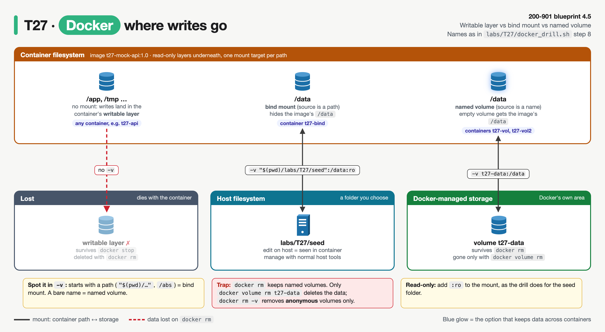

# T27 · Docker: essentials

> Blueprint 4.3, 4.6, 4.7: deployment types (containers); interpret a Dockerfile; use Docker images in a local dev environment · Full note: [bee/T27-docker.md](../bee/T27-docker.md) · Teach-back 2026-10-25


*Read it left to right: Dockerfile → image → container → host and registry; the red boxes are the exam traps.*

## The big idea
- This is home turf. The job is not to learn Docker but to answer Docker questions **the exact way the exam words them**: it shows a Dockerfile or a task and asks what happens, or which command to use.
- The topic answers three questions:
  - **What is in the image, and what runs when it starts?** (read a Dockerfile)
  - **Which command does this task?** (build, run, exec, logs, inspect)
  - **Where does the traffic and the data go?** (`-p`, `-v`)
- **Analogy: a recipe card and a dish.** An **image** is a sealed recipe card. A **container** is a dish cooked from it, with your own scribbles on a sticky note (the writable layer). Throw the dish away (`docker rm`) and the sticky note goes in the bin; the recipe card never changes.
- **Analogy for ports: a hotel switchboard.** `-p 8127:8080` = "outside callers dial extension 8127 at reception (the host) and get put through to room 8080 (the container)". Reception's number comes first. `EXPOSE` is just the room number printed on the door: it doesn't connect any calls.
- **What the exam asks:** most marks are lost on order and wording: host-first port mapping, `EXPOSE` not publishing, `RUN` vs `CMD`, and how run arguments interact with `CMD` and `ENTRYPOINT`.

## 🟥 Must know

### 1. Image, container, registry, engine: the exam wording
- **Image** = a **read-only** stack of filesystem layers plus config (env, user, entrypoint, cmd, exposed ports). Built once, run many times.
- **Container** = one running (or stopped) **instance** of an image, plus a thin **writable layer** on top. Everything the process writes goes there.
  - `docker rm` deletes that writable layer. The image never changes.
  - Many containers from one image share the read-only layers; each gets its own writable layer.
  - A container is an isolated **process** on the host kernel, not a VM (T26).
- **Registry** = a server that stores images in **repositories**. Docker Hub is the default; private ones include Harbor, GitLab registry, AWS ECR.
- **Image names:** `[HOST[:PORT]/]NAMESPACE/REPOSITORY[:TAG]`.

```
python:3.12-slim
= docker.io / library / python : 3.12-slim
  │           │         │        └─ tag (omit it → latest)
  │           │         └─ repository
  │           └─ namespace (omit it on Docker Hub → library, the official images)
  └─ registry host (omit it → docker.io)
```

  - `latest` is only the **default tag name**. It does not mean "newest".
- **Docker Engine:** the daemon `dockerd` does the real work (build, pull, run, networks, volumes). The `docker` CLI is only a client. "Cannot connect to the Docker daemon" = the CLI is fine, the daemon isn't running.


*Follow ① to ④: pull the base, build your image, push it, run it; the CLI only ever talks to the Engine.*


*FROM, RUN and COPY/ADD add filesystem layers; two containers share the image layers and each gets its own writable layer.*

### 2. Read a Dockerfile line by line (blueprint 4.6)
- The exam's four questions about any Dockerfile: **base image? what's installed? which port? what runs at start?** Plus the trap options: "EXPOSE publishes", "RUN runs at start", "ARG is available at run time".
- **The reference Dockerfile from the full note**, annotated:

```dockerfile
ARG PYTHON_VERSION=3.12                    # build-time variable only; override with --build-arg; gone at run time
FROM python:${PYTHON_VERSION}-slim         # base image; the first real instruction (only ARG/comments/directives before it)

LABEL org.opencontainers.image.title="t27-mock-api"   # metadata only, visible in docker inspect

ENV API_PORT=8080 \
    ACCESS_LOG=1                           # persists into the running container; docker run -e overrides it

WORKDIR /app                               # cwd for later RUN/COPY/CMD and for docker exec; use instead of RUN cd

RUN apt-get update \
    && apt-get install --yes --no-install-recommends curl \
    && rm -rf /var/lib/apt/lists/* \
    && useradd --create-home --uid 10001 apiuser \
    && mkdir /data \
    && chown apiuser /data                 # BUILD time: runs once, result saved as one new layer

COPY mock_api.py .                         # from the build context into /app; can't reach outside the context

EXPOSE 8080                                # DOCUMENTS the port; publishes nothing

USER apiuser                               # the process runs as apiuser, not root (root is the default)

ENTRYPOINT ["python3", "mock_api.py"]      # the fixed executable; change only with --entrypoint
CMD ["--host", "0.0.0.0"]                  # default ARGUMENTS; replaced by anything after the image name
```

- **Read it like the exam does:**
  - Base: `python:3.12-slim`. Installed: `curl`, a user `apiuser`, a folder `/data`. Code: `mock_api.py` into `/app`.
  - Port: `8080`, documented only. To reach it you still need `docker run --publish 8127:8080 …`.
  - Runs as `apiuser`. At start: `python3 mock_api.py --host 0.0.0.0` (ENTRYPOINT + CMD).
- **The pairs the exam confuses:**
  - **`COPY` vs `ADD`:** both copy from the build context. Only `ADD` can also fetch a **URL or Git repo**, and it **auto-extracts a local tar**. Prefer `COPY` unless you need those.
  - **`ARG` vs `ENV`:** `ARG` = build-time only (`--build-arg`). `ENV` = also at run time (`-e` overrides). Same name → `ENV` wins. Neither is safe for secrets: both show in the image history or config (T29).
- **Why `--host 0.0.0.0`?** Inside a container, `127.0.0.1` is the container's **own** loopback. An app bound there can't be reached through `-p`, so it must listen on **`0.0.0.0`**. This is the classic "container is Up but curl gets connection reset" bug.

| Instruction | Exam point |
|---|---|
| `FROM` | base image, first real instruction; several = multi-stage build |
| `RUN` | **build time**, new layer: installs go here, never in CMD |
| `COPY` / `ADD` | prefer COPY; ADD adds URL/Git fetch and local-tar extraction |
| `WORKDIR` | working folder for later steps and `docker exec` |
| `ENV` / `ARG` | ENV persists to run time; ARG is build only |
| `EXPOSE` | **documents** only; publishes nothing |
| `USER` / `LABEL` | run-as user (default root) / metadata |
| `ENTRYPOINT` / `CMD` | fixed executable / default command or args |

### 3. Build time vs start time: RUN, CMD, ENTRYPOINT and the layer cache
- **`RUN`** executes **during `docker build`** and never again. **`CMD` and `ENTRYPOINT`** execute nothing at build time: they're stored in the image config and run **every time a container starts**.
  - Recipe analogy: `RUN` is the prep done before the card is sealed; `CMD` is "serve it like this" each time someone cooks it.
- Several `CMD` lines (or several `ENTRYPOINT` lines) → **only the last** counts.
- **The rule:** args after the image name **replace CMD** and are **appended to ENTRYPOINT**. Only `--entrypoint` changes ENTRYPOINT.
- With `ENTRYPOINT ["python3", "mock_api.py"]` and `CMD ["--host", "0.0.0.0"]`:

```bash
docker run t27-mock-api:1.0                                  # → python3 mock_api.py --host 0.0.0.0   (ENTRYPOINT + CMD)
docker run t27-mock-api:1.0 --help                           # → python3 mock_api.py --help           (args replace CMD, appended to ENTRYPOINT)
docker run --entrypoint python3 t27-mock-api:1.0 --version   # → python3 --version                    (new ENTRYPOINT, CMD dropped)
docker run python:3.12-slim python3 --version                # → python3 --version                    (no ENTRYPOINT: args replace CMD entirely)
```

- **Exec form vs shell form:**
  - Exec form `["python3", "app.py"]` runs the program directly as **PID 1**, so it gets signals (`docker stop` → SIGTERM) and can take CMD arguments.
  - Shell form `python3 app.py` runs under `/bin/sh -c`. A **shell-form ENTRYPOINT ignores CMD and run arguments**.
- **Layer cache:** a layer is reused on rebuild if its instruction and inputs haven't changed. Once one layer changes, **every layer after it is rebuilt**.
  - So order from least to most often changed: base → system packages → dependencies → **app code last**.
  - Put `apt-get update && apt-get install` in **one** `RUN`: a separately cached `update` layer goes stale. `docker build --no-cache` ignores the cache.
  - `.dockerignore` keeps unneeded files out of the build context, so unrelated edits don't bust the `COPY` cache.


*Blue is the case the exam likes: args after the image name are appended to ENTRYPOINT, and CMD is dropped.*


*Same edit to the app code, two orders. Red = rebuilt, green = from cache.*

### 4. Commands: pick the right one for the task (blueprint 4.7)
- **Build:** `docker build -t myapp:1.0 .`
  - The last argument (`.`) is the **build context** (the folder `COPY` can see), **not** the Dockerfile path. Use `-f` to pick a different Dockerfile.
- **Images:** `docker images` lists local images · `docker pull nginx` downloads `docker.io/library/nginx:latest` · `docker push` uploads after `docker login`.
  - To push, **tag first** so the name includes the registry host and namespace:

```bash
docker tag myapp:1.0 registry.example.com/team/myapp:1.0     # a second name for the SAME image ID; copies nothing
docker push registry.example.com/team/myapp:1.0             # upload (after docker login registry.example.com)
```

  - `docker rmi` removes a tag; it refuses while any container (even a stopped one) uses the image, unless forced.
- **Run:** `docker run [OPTIONS] IMAGE [ARGS]`. **Options go before the image name**; anything after it is passed to the app.

```bash
docker run -d --name web -p 8080:80 nginx       # -d background · --name fixed name · -p host 8080 → container 80
docker run -it --rm python:3.12-slim bash       # -it interactive terminal · --rm delete the container on exit
docker run -d -e API_PORT=9000 t27-mock-api:1.0 # -e set or override an ENV variable
```

| Flag | Meaning |
|---|---|
| `-d` | run in the background (detached) |
| `-it` | interactive terminal, for a shell |
| `--name web` | fixed name |
| `--rm` | delete the container when it exits |
| `-p 8080:80` | host 8080 → container 80 |
| `-P` | publish every EXPOSEd port to a random host port |
| `-e KEY=value` | set or override an env var |
| `-v src:/path[:ro]` | mount a host path or a named volume |

- **Inspect and debug:**
  - `docker ps` shows **running** containers only; `docker ps -a` adds stopped ones. A crashed container "disappeared" → `docker ps -a`.
  - `docker exec -it web /bin/bash` runs an **extra** process in an **already running** container (Alpine images only have `sh`). It fails on a stopped container. `docker run` always creates a **new** container.
  - `docker logs web` prints what PID 1 wrote to **stdout and stderr**; `-f` follows live. Logs written to a file inside the container don't show here.
  - `docker inspect web` dumps the full JSON config and state; `--format` with a Go template pulls out one field.
- **Lifecycle:**
  - `docker stop` sends SIGTERM, then SIGKILL after **10 s** by default. The container and its writable layer are **kept**.
  - `docker start` brings back the **same** container. `docker rm` deletes a stopped one; a name stays taken until it's removed.
  - `docker run` = `docker create` + `docker start`.


*Stop keeps the container and its writable layer; rm deletes it.*

### 5. Ports and storage: where traffic and data go
- **`-p HOST:CONTAINER`, host side first** (same order as `-v host:container`). Switchboard analogy: reception's extension first, then the room.
  - `-p 8127:8080` → `http://127.0.0.1:8127` on the laptop reaches port 8080 inside the container.
  - Without an IP, Docker publishes on **all** host interfaces; `-p 127.0.0.1:8127:8080` binds only the loopback. TCP is the default; `/udp` changes it.
  - Two containers can both use container port 8080, but each needs its **own host port**.
  - `EXPOSE` alone publishes nothing: with no `-p`, `docker ps` shows `8080/tcp` with no `->` mapping.
- **Bind mount vs named volume** (both survive `docker rm`):
  - **Bind mount** = the source is a **path**: `-v "$(pwd)":/work`. It shows your host folder (hiding the image's files at that path). Best for local dev and live code editing.
  - **Named volume** = the source is a **name**: `-v mydata:/data`. Docker stores and manages it; an empty volume gets the image's content copied in. Kept until `docker volume rm`. Best for app or database data.
  - `:ro` makes a mount read-only. `docker rm -v` and `--rm` remove only **anonymous** volumes, never named ones.
- Recipe analogy: the writable layer is the sticky note (binned with the dish); a named volume is a notebook kept in the kitchen drawer, which the next dish can use.


*Host port first, container port second; EXPOSE alone opens nothing, and a second container needs its own host port.*



*Writable layer = lost on docker rm. Bind mount = your host folder. Named volume = kept by Docker until docker volume rm.*


*Data in a named volume survives stop and rm and reappears in a new container; only `docker volume rm` deletes it.*

| | Bind mount | Named volume |
|---|---|---|
| `-v` source looks like | a path: `"$(pwd)":/work` | a name: `mydata:/data` |
| Lives | where you said on the host | in Docker's own storage area |
| Empty at first? | shows the host folder (hides the image's files) | Docker copies the image's content in |
| Survives `docker rm`? | yes | yes, until `docker volume rm` |
| Best for | local dev, live code editing | app or database data |

## Exam traps
- **`-p 8127:8080` = host 8127 → container 8080.** Host first. And `EXPOSE 8080` only documents; nothing is reachable without `-p` or `-P`.
- **"Install curl" is `RUN`, never `CMD`.** RUN is build time; CMD/ENTRYPOINT run at container start. `ARG` is build-time only; `ENV` persists.
- **Run args replace CMD and are appended to ENTRYPOINT.** Only the last CMD counts; only `--entrypoint` changes ENTRYPOINT.
- **Options go before the image name.** `docker run myimg -p 80:80` passes `-p` to the app. The last argument of `docker build` is the **build context**, not the Dockerfile.
- **`docker stop` keeps the container; `docker rm` deletes the writable layer; named volumes survive both.** `docker ps` hides stopped containers (`-a`); `docker exec` needs a running one.
- **App bound to `127.0.0.1` inside a container** is unreachable through `-p`; it must listen on `0.0.0.0`.

<details><summary><b>🟨 Should know (second pass)</b></summary>

- **Networks:**
  - **Default `bridge`:** every container without `--network` joins it. Private IPs with NAT, reachable from the host only through `-p`. Containers find each other **by IP only**.
  - **User-defined bridge** (`docker network create t27-net`, then `--network t27-net`): adds **DNS by container name** and isolation from unrelated containers.
  - **`--network host`:** shares the host's network stack. No NAT, no separate IP, and **`-p` is ignored**.
  - **`--network none`:** loopback only.
- **Local development (blueprint 4.7 context):**
  - An image pins the OS, language version and packages, so everyone gets the same environment and "works on my machine" goes away. The same image goes through CI (T28) and into prod.
  - Run dependencies (a database, a mock API, test tools) as throwaway containers instead of installing them on the laptop:

```bash
docker run -d --name t27-db -e POSTGRES_PASSWORD=devonly -p 5432:5432 postgres:16   # a local Postgres for dev
docker rm --force t27-db                                                           # gone when you're done
```

  - **Bind-mount** source code for live editing in dev; **bake the code in with `COPY`** for anything you ship.
- **Docker Compose (awareness):** one `compose.yaml` declares several services (ports, env, volumes, networks); `docker compose up` starts them all.
  - Services share a project network and are reachable **by service name**, so a client can call `http://api:8080`.
  - `docker compose down` removes containers and the network; `--volumes` also removes named volumes.
  - `docker compose` (space) is v2; `docker-compose` (hyphen) is the old v1 tool.

</details>

> **Recognise only, details in the full note:** the full CMD × ENTRYPOINT interaction table, `--mount` vs `-v` (missing host path), `--env-file`, `docker kill` / `restart`, `docker image prune` / `system df`, `docker port` / `top` / `stats`, `logs --tail/--since/-t`, Go-template fields for `inspect`, `--rmi local`, `--network host` on Docker Desktop.

## Quick self-check
<details><summary>Q1. Which instruction should install packages: RUN or CMD?</summary>RUN, because it executes at build time and saves a layer.</details>
<details><summary>Q2. With <code>ENTRYPOINT ["python3","app.py"]</code> and <code>CMD ["--debug"]</code>, what does <code>docker run img --help</code> start?</summary><code>python3 app.py --help</code>, because args replace CMD and append to ENTRYPOINT.</details>
<details><summary>Q3. Your crashed container isn't in <code>docker ps</code>. What do you run?</summary><code>docker ps -a</code>, then <code>docker logs &lt;name&gt;</code>, because <code>ps</code> hides stopped containers.</details>
<details><summary>Q4. Which <code>-v</code> form keeps data after <code>docker rm</code> and is managed by Docker?</summary>A named volume, <code>-v mydata:/data</code>.</details>
<details><summary>Q5. You edit app code and the whole dependency install reruns. Why?</summary>The app code was copied before the dependency step, and a changed layer rebuilds everything after it.</details>
<details><summary>Q6. <code>docker run -d --name t27-api t27-mock-api:1.0</code>, then <code>curl http://127.0.0.1:8080</code> on the host is refused. Fix?</summary>Publish the port: <code>docker run -d --name t27-api -p 8127:8080 t27-mock-api:1.0</code> (then curl 8127). <code>EXPOSE 8080</code> alone publishes nothing.</details>
<details><summary>Q7. Dockerfile has <code>CMD ["flask", "--app", "app", "run", "--host", "0.0.0.0"]</code> and no ENTRYPOINT. What does <code>docker run img --debug</code> do?</summary><code>--debug</code> replaces the whole CMD, so Docker tries to run a program called <code>--debug</code> and the container fails to start.</details>

## Say it out loud
- "Host first, container second."
- "EXPOSE documents, `-p` publishes."
- "RUN builds, CMD starts; args replace CMD and append to ENTRYPOINT."
- "Stop keeps it, rm kills the writable layer, named volumes outlive both."
- "Copy dependencies first, app code last."
