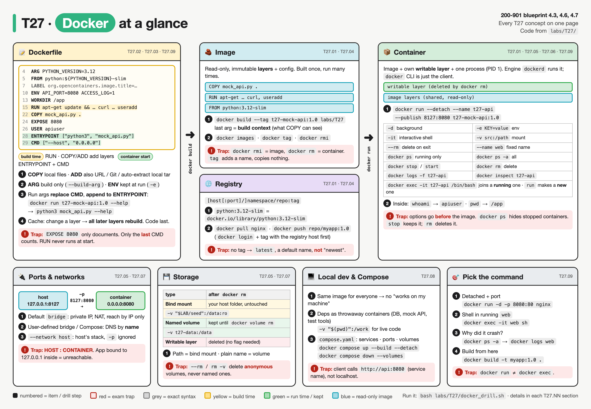
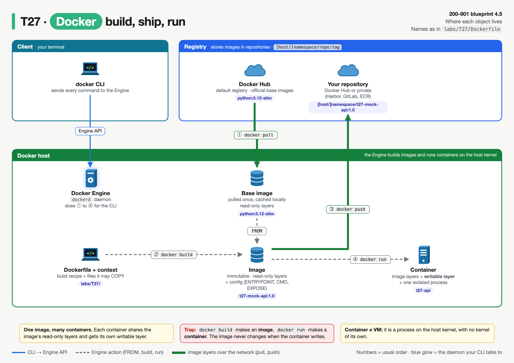
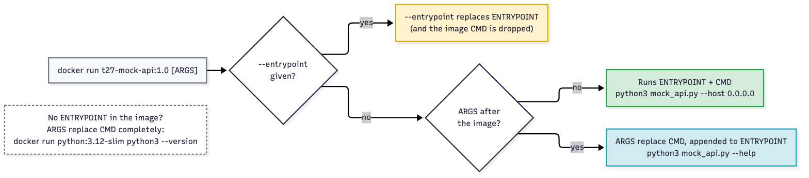
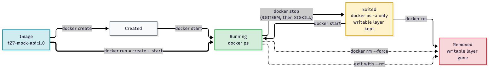
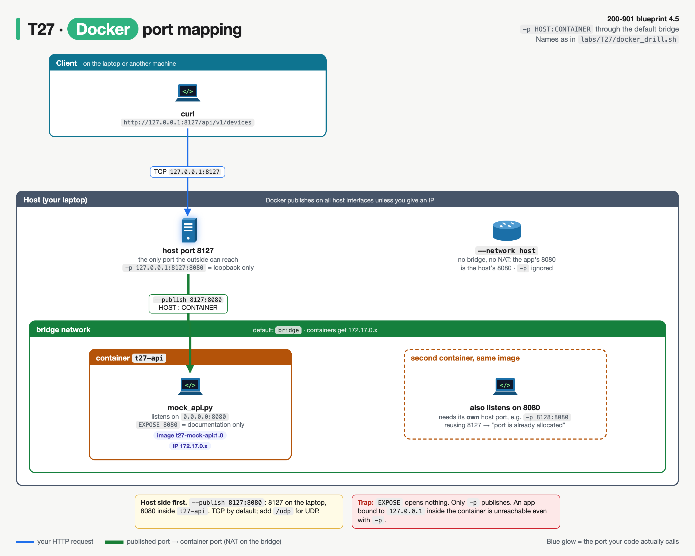
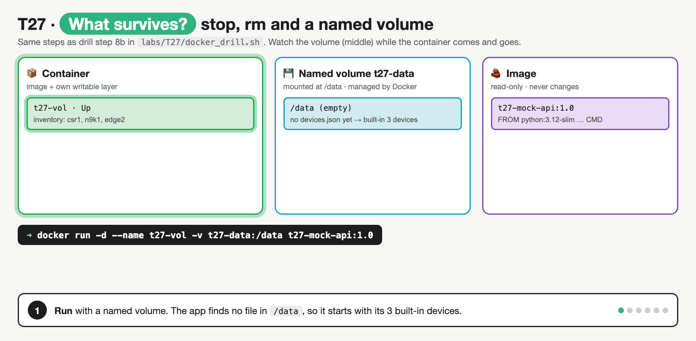

# T27 · Docker: essentials

> Blueprint 4.3, 4.6, 4.7 · Full note: [bee/T27-docker.md](../bee/T27-docker.md) · Teach-back 2026-10-25

## In one picture

*Read it left to right: Dockerfile → image → container → host and registry; the red boxes are the exam traps.*

## The big idea
- This is home turf, so the job is not to learn Docker but to answer Docker questions the exact way the exam words them. The exam gives you a Dockerfile or a task and asks what happens or which command to use.
- An image is like a sealed recipe card; a container is a dish cooked from it, with its own scribbles on a sticky note (the writable layer) that go in the bin when you throw the dish away.
- Most marks are lost on order and wording: host-first port mapping, EXPOSE not publishing, and how run arguments interact with CMD and ENTRYPOINT.

## What you need to know

### 1. Images, containers, registries and the engine


*Follow ① to ④: pull the base, build your image, push it, run it; the CLI only ever talks to the Engine.*

- An **image** is a read-only stack of filesystem layers plus config (env, user, entrypoint, cmd, exposed ports). You build it once and run it many times.
- A **container** is one running (or stopped) instance of an image. Docker adds a thin **writable layer** on top, and everything the process writes goes there. That layer is deleted by `docker rm`, and the image never changes.
- Many containers from one image share the read-only layers, and each gets its own writable layer.
- A **registry** stores images in repositories. Docker Hub is the default; private ones include Harbor, GitLab registry and AWS ECR.
- The full image name is `[HOST[:PORT]/]NAMESPACE/REPOSITORY[:TAG]`. Leave out the host and you get `docker.io`; leave out the namespace on Docker Hub and you get `library`; leave out the tag and you get `latest`. So `python:3.12-slim` really means `docker.io/library/python:3.12-slim`.
- The tag `latest` is only a default name. It does not mean "newest".
- The **Docker Engine** daemon `dockerd` does the real work. The `docker` CLI is just a client, so "Cannot connect to the Docker daemon" means the CLI is fine but the daemon isn't running.

### 2. Reading a Dockerfile line by line
- A valid Dockerfile starts with `FROM` (only `ARG`, comments and parser directives may come before it). Several `FROM` lines mean a multi-stage build.

| Instruction | What it does | Exam point |
|---|---|---|
| `FROM` | Sets the base image | First real instruction |
| `RUN` | Runs a command **at build time** and saves the result as a new layer | Installs go here, never in CMD |
| `COPY` | Copies files from the build context into the image | Can't reach outside the context (`COPY ../x` fails) |
| `ADD` | Like COPY, but can also fetch a URL or Git repo and auto-extracts a **local** tar | Prefer COPY unless you need those features |
| `WORKDIR` | Sets the working folder for later steps and for `docker exec` | Use it instead of `RUN cd` |
| `ENV` | Sets a variable that **persists** into the running container | `docker run -e` overrides it |
| `ARG` | Sets a **build-time only** variable (`--build-arg`) | Gone at run time |
| `EXPOSE` | **Documents** the listening port | Publishes nothing |
| `USER` | Sets who the process runs as (default is root) | |
| `LABEL` | Adds metadata, visible in `docker inspect` | |
| `ENTRYPOINT` | The fixed executable | Change only with `--entrypoint` |
| `CMD` | Default command or default arguments | Replaced by args after the image name |

- If `ARG` and `ENV` share a name, `ENV` wins. Neither is safe for secrets, because both are visible in the image history or config (see T29).
- Inside a container, `127.0.0.1` is the container's own loopback. An app bound there can't be reached through `-p`, so it must listen on **`0.0.0.0`**. This is the classic "container runs but curl gets connection reset" bug.
- **Exec form** `["python3", "app.py"]` runs the program directly as PID 1, so it receives signals and can take CMD arguments. **Shell form** `python3 app.py` runs under `/bin/sh -c`, and a shell-form ENTRYPOINT ignores CMD and run arguments.

### 3. What actually runs: build time, start time, and CMD vs ENTRYPOINT
- `RUN` executes during `docker build` and never runs again. `CMD` and `ENTRYPOINT` execute nothing at build time; they are stored and run every time a container **starts**.
- If a Dockerfile has several `CMD` lines (or several `ENTRYPOINT` lines), only the **last** one counts.


*Blue is the case the exam likes: args after the image name are appended to ENTRYPOINT, and CMD is dropped.*

With `ENTRYPOINT ["python3", "mock_api.py"]` and `CMD ["--host", "0.0.0.0"]`:

| You run | What starts |
|---|---|
| `docker run t27-mock-api:1.0` | `python3 mock_api.py --host 0.0.0.0` (ENTRYPOINT + CMD) |
| `docker run t27-mock-api:1.0 --help` | `python3 mock_api.py --help` (args replace CMD, appended to ENTRYPOINT) |
| `docker run --entrypoint python3 t27-mock-api:1.0 --version` | `python3 --version` (new ENTRYPOINT, CMD dropped) |
| `docker run python:3.12-slim python3 --version` | `python3 --version` (no ENTRYPOINT, so args replace CMD entirely) |

- **Layer cache:** a layer is reused on rebuild if its instruction and inputs haven't changed. Once one layer changes, **every layer after it** is rebuilt.
- So order instructions from least to most often changed: base → system packages → dependencies → app code last. Put `apt-get update && apt-get install` in **one** `RUN`, because a separately cached update goes stale. `docker build --no-cache` ignores the cache.
- A `.dockerignore` file keeps unneeded files out of the build context, so unrelated edits don't bust the `COPY` cache.

### 4. Commands you must recognise
- `docker build -t myapp:1.0 .` builds an image. The last argument (`.`) is the **build context**, not the Dockerfile path; use `-f` to pick a different Dockerfile.
- `docker images` lists local images, `docker pull nginx` downloads one, and `docker push` uploads one after `docker login`. To push you must **tag first** so the name includes the registry host and namespace:

```bash
docker tag myapp:1.0 registry.example.com/team/myapp:1.0
docker push registry.example.com/team/myapp:1.0
```

- `docker tag` adds a second name to the **same image ID** and copies nothing. `docker rmi` removes a tag and refuses while any container (even a stopped one) uses the image, unless you force it.
- `docker run [OPTIONS] IMAGE [ARGS]`: **options go before the image name**. Anything after the image is passed to the app.

| Flag | Meaning |
|---|---|
| `-d` | Run in the background (detached) |
| `-it` | Interactive terminal, for a shell |
| `--name web` | Give it a fixed name |
| `--rm` | Delete the container when it exits |
| `-p 8080:80` | Host port 8080 → container port 80 |
| `-P` | Publish every EXPOSEd port to a random host port |
| `-e KEY=value` | Set or override an env var |
| `-v src:/path[:ro]` | Mount a host path or a named volume |

- `docker ps` shows **running** containers only, and `docker ps -a` adds stopped ones. If a crashed container "disappeared", use `-a`.
- `docker exec -it web /bin/bash` runs an **extra** process in an **already running** container (Alpine images only have `sh`). It fails on a stopped container. `docker run` always creates a new container.
- `docker logs web` prints what PID 1 wrote to stdout and stderr; `-f` follows live. Logs written to a file inside the container don't show up here.
- `docker inspect web` dumps the full JSON config and state; `--format` with a Go template pulls out one field.


*Stop keeps the container and its writable layer; rm deletes it.*

- `docker stop` sends SIGTERM, then SIGKILL after 10 seconds by default. `docker start` brings back the **same** container. `docker rm` deletes a stopped one, and a name stays taken until the container is removed. `docker run` is `docker create` plus `docker start`.

### 5. Ports, storage and networks


*Host port first, container port second; EXPOSE alone opens nothing, and a second container needs its own host port.*

- `-p HOST:CONTAINER` always puts the **host side first**, the same order as `-v host:container`. Without an IP, Docker publishes on all host interfaces; `-p 127.0.0.1:8127:8080` binds only the loopback. TCP is the default, and `/udp` changes it.

| | Bind mount | Named volume |
|---|---|---|
| `-v` source looks like | A path: `"$(pwd)":/work` | A name: `mydata:/data` |
| Lives | Where you said on the host | In Docker's own storage area |
| Empty at first? | Shows the host folder (hides the image's files) | Docker copies the image's content in |
| Survives `docker rm`? | Yes | Yes, until `docker volume rm` |
| Best for | Local dev, live code editing | App or database data Docker should own |


*Data in a named volume survives stop and rm and reappears in a new container; only `docker volume rm` deletes it.*

- `:ro` makes a mount read-only. `docker rm -v` and `--rm` remove only **anonymous** volumes, never named ones.
- The default **bridge** network gives containers private IPs with NAT, reachable from the host only through `-p`, and containers find each other by IP only.
- A **user-defined bridge** (`docker network create`) adds DNS by container name.
- `--network host` shares the host's network stack, so there is no NAT and `-p` is ignored. `--network none` gives loopback only.

### 6. Local development and Compose
- An image pins the OS, language version and packages, so everyone gets the same environment and "works on my machine" goes away. The same image goes through CI and into prod.
- Run dependencies like a database or test tools as throwaway containers instead of installing them on the laptop.
- Bind-mount source code for live editing in dev; bake the code in with `COPY` for anything you ship.
- **Docker Compose** (awareness level) declares several services in one `compose.yaml`, and `docker compose up` starts them all. Each service is reachable **by its service name** on the project network, so a client can call `http://api:8080`.
- `docker compose down` removes containers and the network, and `--volumes` also removes named volumes. `docker compose` (space) is v2; `docker-compose` (hyphen) is the old v1 tool.

## Exam traps (the ones that catch people)
- Looks like `-p 8127:8080` means container 8127, but it's actually **host 8127 → container 8080**, because the host side always comes first.
- Looks like `EXPOSE 8080` opens the port, but it actually only documents it; nothing is reachable without `-p` or `-P`.
- Looks like "install curl" could be CMD, but it's actually **RUN**, because RUN is build time and CMD runs at container start.
- Looks like run arguments replace the whole command, but they actually **replace CMD and are appended to ENTRYPOINT**.
- Looks like `ARG` is available in the running container, but it's actually build-time only; `ENV` persists.
- Looks like `docker stop` loses data, but it actually keeps the container and its writable layer; `docker rm` deletes the layer, and named volumes survive both.
- Looks like the Dockerfile path is the last argument of `docker build`, but it's actually the **build context**.
- Looks like `docker run myimg -p 80:80` publishes a port, but options after the image name are actually passed to the app.

## Quick self-check
<details><summary>Q1. Which instruction should install packages: RUN or CMD?</summary>RUN, because it executes at build time and saves a layer.</details>
<details><summary>Q2. With ENTRYPOINT ["python3","app.py"] and CMD ["--debug"], what does `docker run img --help` start?</summary>`python3 app.py --help`, because args replace CMD and append to ENTRYPOINT.</details>
<details><summary>Q3. Your crashed container isn't in `docker ps`. What do you run?</summary>`docker ps -a`, then `docker logs <name>`, because `ps` hides stopped containers.</details>
<details><summary>Q4. Which `-v` form keeps data after `docker rm` and is managed by Docker?</summary>A named volume, `-v mydata:/data`.</details>
<details><summary>Q5. You edit app code and the whole dependency install reruns. Why?</summary>The app code was copied before the dependency step, and a changed layer rebuilds everything after it.</details>

## Cheat lines to say out loud
- "Host first, container second."
- "EXPOSE documents, `-p` publishes."
- "RUN builds, CMD starts; args replace CMD and append to ENTRYPOINT."
- "Stop keeps it, rm kills the writable layer, named volumes outlive both."
- "Copy dependencies first, app code last."
