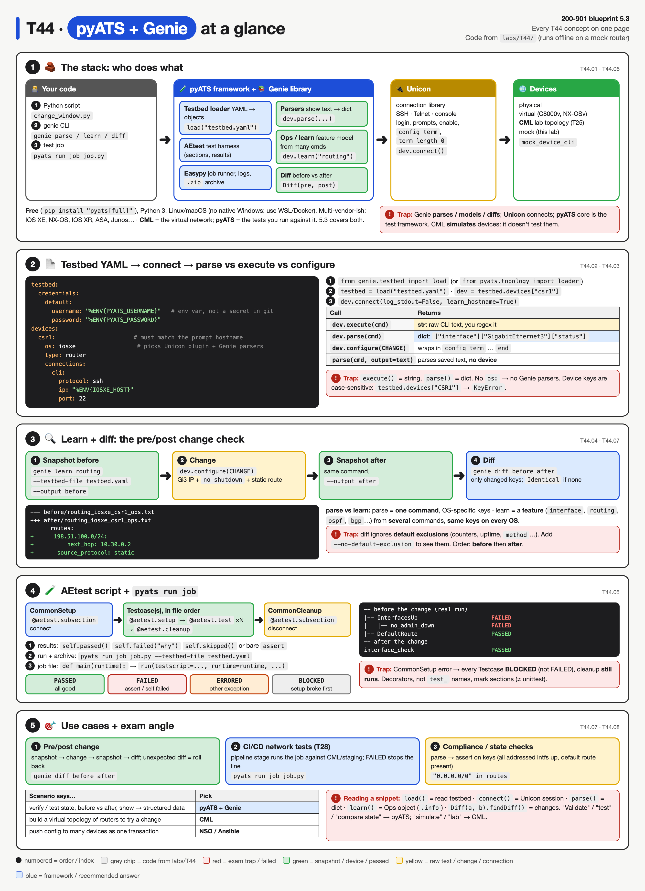
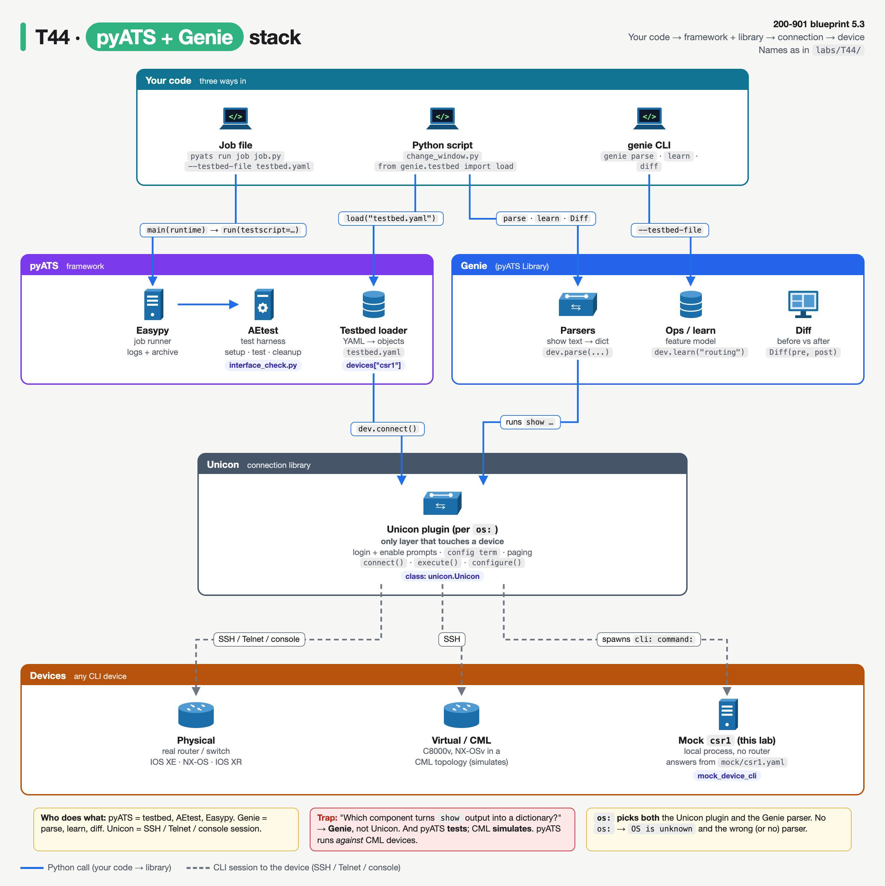
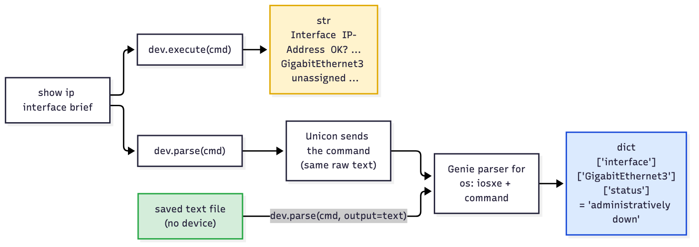
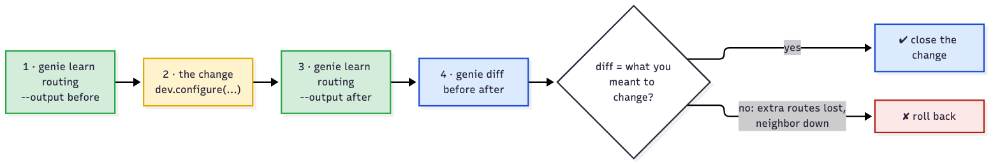
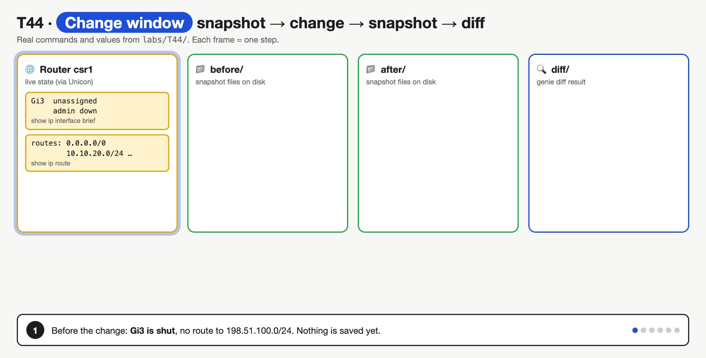
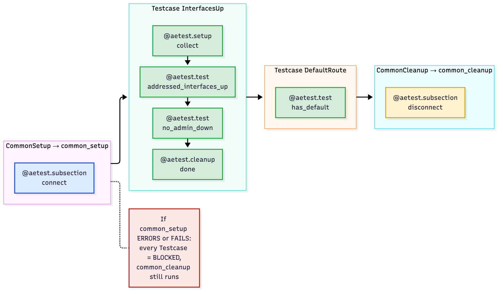
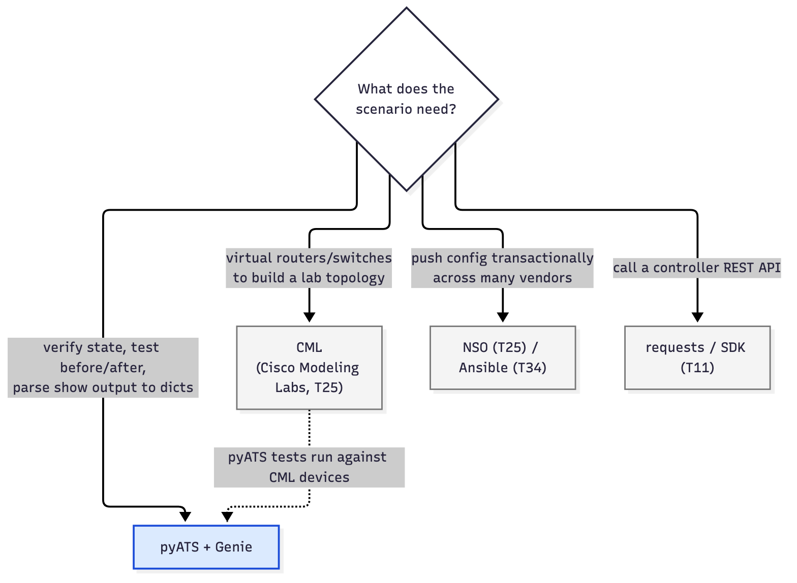
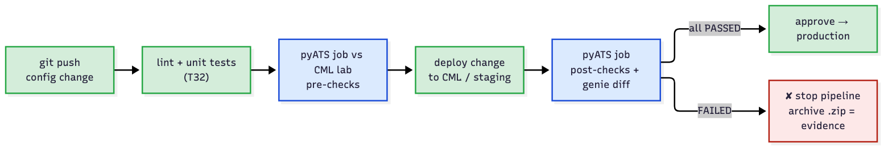

# T44 · pyATS + Genie: essentials

> Blueprint 5.3: simulation and testing tools (Modeling Labs, pyATS) · Full note: [bee/T44-pyats-genie.md](../bee/T44-pyats-genie.md) · Teach-back 2026-11-01



*Read top to bottom: the system map (your code, then pyATS + Genie, then Unicon, then the devices), the testbed and device calls, the before/after diff, the AEtest structure and result words, then the use cases and "which tool" table. Red boxes are exam traps.*

## The big idea
- Router CLI output is text written for humans. To **test a network in code** you need four things:
  1. a list of devices and how to reach them,
  2. a way to log in and run commands,
  3. a way to turn the text into data,
  4. a test harness that reports pass or fail.
- **pyATS**, **Genie** and **Unicon** are Cisco's free, packaged answer to all four.
- **Analogy:** think of it as `pytest` plus an Ansible inventory plus a CLI-to-JSON converter, built for network devices.
- **Analogy for the change window:** a before-and-after photo. Photograph the network, make the change, photograph it again, and let the tool circle every difference.
- **Analogy for pyATS vs CML:** CML is the **flight simulator** (it gives you virtual devices); pyATS is the **checklist and examiner** (it tests whatever devices you point it at, simulated or real).
- **What the exam asks:** "which component does X", reading a short snippet, `parse` vs `execute`, the AEtest structure and results, and "pyATS or CML?" scenarios. Blueprint 5.3 names CML and pyATS together as simulation and testing tools.

## 🟥 Must know

### 1. The three layers and their jobs
- Three pieces, one job each. **Only Unicon ever touches a device.**
  - **pyATS** (the core) = the **test framework**: the testbed loader, the **AEtest** test harness, the **Easypy** job runner (logs, archive) and result objects.
  - **Genie** (now called the **pyATS Library**) = the **network smarts**: thousands of **parsers** (show text into a dict), **Ops** feature models (`learn`), **Diff**, and the `genie` command-line tool.
  - **Unicon** = the **connection**: SSH, Telnet or console login, enable prompts, `config term`, turning off paging (`term length 0`), one plugin per OS.
- Analogy: pyATS is the examiner with the checklist, Genie is the translator who turns router-speak into data, and Unicon is the driver who gets you to the device and back.
- "Which component turns show output into a dictionary?" → **Genie**. "Which handles the SSH login and enable prompt?" → **Unicon**.



*Blue arrows are Python calls; grey dashed lines are CLI sessions. Because only Unicon touches a device, swapping a real router for a CML node or a mock changes only the testbed file.*

| Piece | One-word job | Provides |
|---|---|---|
| **pyATS** | tests | testbed loader, AEtest, Easypy, results |
| **Genie** (pyATS Library) | understands | parsers, Ops (`learn`), Diff, `genie` CLI |
| **Unicon** | connects | SSH / Telnet / console, prompts, paging |

- **Free** and on public PyPI:
  - `pip install pyats` → the core only.
  - `pip install "pyats[library]"` → adds Genie; Cisco's recommended option.
  - `pip install "pyats[full]"` → every extra.
- Works with any device you can reach over CLI: physical, virtual (C8000v, NX-OSv, IOS XRv) or a **CML** topology.

### 2. The testbed file: your device inventory
- A **testbed** is a YAML file listing the **devices under test**: what they are, how to reach them, which credentials to use. It's the pyATS equivalent of an Ansible inventory.

```yaml
testbed:
  name: devnet-always-on
  credentials:
    default:                                # used by EVERY device unless a device overrides it
      username: "%ENV{PYATS_USERNAME}"      # replaced by an environment variable at load time
      password: "%ENV{PYATS_PASSWORD}"
devices:
  csr1:                                     # the KEY you look up in code; should match the prompt hostname
    os: iosxe                               # picks the Unicon plugin AND the Genie parsers
    type: router                            # free-text role
    platform: cat8k                         # optional finer model
    connections:
      cli:                                  # a connection alias; several allowed (cli, vty, console)
        protocol: ssh
        ip: "%ENV{IOSXE_HOST}"
        port: 22
```

- **The device name** (`csr1`) is the key in `testbed.devices["csr1"]`. It should match the device's prompt hostname, or you connect with `learn_hostname=True`. The lookup is **case-sensitive**: `testbed.devices["CSR1"]` → `KeyError: 'CSR1'`.
- **`os:` is mandatory in practice.** It picks both the Unicon plugin and the Genie parsers. Without it: an `OS is unknown` warning and the wrong parser, or none. In the lab, removing `os:` made `parse("show version")` return a different dict and the script crashed with a `TypeError`.
- `connections:` holds `protocol`, `ip`, `port`. Pick a non-default alias with `connect(via="vty")`.
- Device-level `credentials:` override testbed-level ones.
- **Keep secrets out of git** with pyATS YAML markup:
  - `%ENV{VAR}` → an environment variable at load time.
  - `%ASK{}` → prompts you at load time.
  - `%ENC{}` → an encoded password (made with `pyats secret encode`).
  - `%INCLUDE{file}` → pulls in another YAML file.
  - `${VAR}` (shell) and `{{ VAR }}` (Jinja/Ansible) are **not** pyATS syntax; they're read as literal strings.
- Check a testbed without connecting: `pyats validate testbed testbed.yaml`.

### 3. Load, connect, parse, execute, configure
- **Two loaders, same file:**
  - `from pyats.topology import loader` then `loader.load("testbed.yaml")` → plain pyATS devices.
  - `from genie.testbed import load` then `load("testbed.yaml")` → **Genie** devices, which add `parse()` and `learn()`.
- The core of the lab's `change_window.py`, annotated:

```python
from genie.testbed import load

testbed = load("testbed.yaml")                       # YAML -> Testbed object
dev = testbed.devices["csr1"]                        # pick one device by its YAML key
dev.connect(log_stdout=False, learn_hostname=True)   # Unicon logs in, sets term length 0 etc.

version = dev.parse("show version")                  # dict
print("OS version :", version["version"]["version"]) # -> 17.9.4a
raw = dev.execute("show ip interface brief")         # plain string, no parsing
print("execute()  :", type(raw).__name__)            # -> str

dev.configure([                                      # config term, each line, end
    "interface GigabitEthernet3",
    "ip address 10.30.0.1 255.255.255.252",
    "no shutdown",
])
dev.disconnect()
```

| Call | What happens | Returns |
|---|---|---|
| `dev.connect()` | Unicon logs in and sets up the terminal | nothing; the session lives on `dev` |
| `dev.execute("show …")` | runs the command, captures the text | a **string** |
| `dev.parse("show …")` | runs the command, then the Genie parser for that OS + command | a **dict** (a Genie `QDict`) |
| `dev.configure([...])` | `config term`, sends each line, `end` | the config-mode output as a string |

- **Why parse?** With a string you'd write a regex. With a dict you index a stable key:

```python
brief = dev.parse("show ip interface brief")
brief["interface"]["GigabitEthernet3"]["status"]     # -> "administratively down" (before the change)
```

  - Each parser has a fixed **schema**, so the same code works on every IOS XE box.
- **`execute()` returns a string**, so `dev.execute("show version")["version"]` fails with `TypeError: string indices must be integers`.



*`execute()` stops at a string. `parse()` goes one step further to a dict. The green path: hand `parse()` saved text with `output=` and no device is needed.*

### 4. Learn and diff: before-and-after snapshots
- **`parse`** works on **one** command. **`learn`** works on a whole **feature** and runs several commands for you.
- Analogy: `parse` is one photo of one room; `learn` is a photo of the whole floor, taken in a standard layout so floors from different buildings (OSes) can be compared.
- `dev.learn("ospf")` is the blueprint's example. It returns an **Ops object**; `.info` holds a dict with the **same structure on every OS** (the "vendor-neutral model").
  - For `routing` on IOS XE, `learn` ran `show vrf detail`, `show ip route` and `show ipv6 route`.
  - The exact list of feature names depends on your release (⚠ verify).

| | `parse("show ip route")` | `learn("routing")` |
|---|---|---|
| Input | one show command | a feature: `interface`, `routing`, `ospf`, `bgp`, `vlan`… |
| Runs | that one command | several commands |
| Output | dict with **OS-specific** keys | Ops object; `.info` = **OS-independent** dict |
| Good for | one fact | whole-feature snapshots to compare |

- **The change window from the command line:**

```bash
genie learn ospf --testbed-file tb.yaml --output before   # snapshot 1: writes files to ./before
# ... make the change ...
genie learn ospf --testbed-file tb.yaml --output after    # snapshot 2: writes files to ./after
genie diff before after                                   # compares the two FOLDERS on disk
```

  - **`genie diff` never connects to a device.** It only compares two saved folders.
  - `genie diff before before` → `Identical`: the "nothing changed" answer.
- **Reading the diff:** `-` is the old value and `+` is the new value, like a unified diff. Real output of the Python `Diff` on `show ip interface brief`, after giving Gi3 an IP and `no shutdown`:

```
 interface:
  GigabitEthernet3:
-  ip_address: unassigned
+  ip_address: 10.30.0.1
-  method: NVRAM
+  method: manual
-  protocol: down
+  protocol: up
-  status: administratively down
+  status: up
```

- In Python, the same thing: `diff = Diff(before, after)`, then `diff.findDiff()`, then `print(diff)`.
- Why it matters: any line you **didn't** intend (a lost route) means roll back.



*Green = read-only snapshots, yellow = the change, blue = the diff and the happy path, red = roll back when the diff shows something you didn't intend.*



*Learn before, configure, learn after, diff. The last frame shows `genie diff before before` giving `Identical`.*

### 5. AEtest: the test harness
- **AEtest** is pyATS's test harness, the network counterpart of Python's `unittest`. A test script has three containers, always run in this order:
  1. **CommonSetup**: `@aetest.subsection` methods. Runs **first**, once (connect, check prerequisites).
  2. **Testcase** classes, one per check, in **file order**. Inside: optional `@aetest.setup` → each `@aetest.test` → optional `@aetest.cleanup`.
  3. **CommonCleanup**: `@aetest.subsection` methods. Runs **last**, once (disconnect, undo config).
- Analogy: a driving test. CommonSetup is checking the car starts; each Testcase is one manoeuvre; CommonCleanup is parking and handing back the keys, which happens whatever went wrong.
- The lab's `interface_check.py`, trimmed and annotated:

```python
from pyats import aetest

class CommonSetup(aetest.CommonSetup):
    @aetest.subsection                                # CommonSetup uses subsection, not setup
    def connect(self, testbed):                       # testbed is passed in by AEtest
        dev = testbed.devices["csr1"]
        dev.connect(log_stdout=False, learn_hostname=True)
        self.parent.parameters["dev"] = dev           # share dev with later sections

class InterfacesUp(aetest.Testcase):
    @aetest.setup
    def collect(self, dev):
        self.brief = dev.parse("show ip interface brief")["interface"]

    @aetest.test                                      # the DECORATOR makes it a test
    def no_admin_down(self):
        shut = [n for n, i in self.brief.items() if i["status"] == "administratively down"]
        if shut:
            self.failed(f"shutdown: {shut}")          # sets FAILED with a reason

class CommonCleanup(aetest.CommonCleanup):
    @aetest.subsection
    def disconnect(self, dev):
        dev.disconnect()
```

- **Decorators mark the sections, not method names.** A method without `@aetest.test` is just a helper and **never runs**. In the lab, removing that decorator from the failing check made the whole job report **PASSED**, though Gi3 was still shut.
- **Result words:**

| Result | Meaning |
|---|---|
| `PASSED` | ran and nothing failed (also the default if it does nothing) |
| `FAILED` | an assertion was false, or `self.failed()` was called |
| `ERRORED` | an unexpected exception (typo, `KeyError`, lost connection) |
| `BLOCKED` | never ran, because something it depends on (CommonSetup) didn't pass |
| `SKIPPED` / `ABORTED` / `PASSX` | `self.skipped()` / run aborted / expected failure |

- **The BLOCKED rule:** if CommonSetup fails or errors, the testcases are **BLOCKED** (not failed), and **CommonCleanup still runs**. Real lab output:

```
|-- common_setup                                                         ERRORED
|   `-- connect                                                          ERRORED
|-- InterfacesUp                                                         BLOCKED
`-- common_cleanup                                                        PASSED
```

- **Running it:** a **job file** has a `main(runtime)` function that calls `run(testscript=...)`:

```python
import os

from pyats.easypy import run

HERE = os.path.dirname(os.path.abspath(__file__))   # folder this job file lives in


def main(runtime):
    # runtime.testbed is the --testbed-file, already loaded
    run(testscript=os.path.join(HERE, "interface_check.py"),
        runtime=runtime, taskid="interface_check", testbed=runtime.testbed)
```

```bash
pyats run job job.py --testbed-file testbed.yaml
```

  - Easypy prints a report and writes a `.zip` **archive** of logs and results.
  - pyATS exits **non-zero** when a testcase fails (exit 1 before the change, 0 after in the lab).



*Inside a Testcase: setup, then each test, then cleanup. The red note is the BLOCKED rule.*

### 6. CML vs pyATS, and the use cases
- **CML** (Cisco Modeling Labs) is a **network simulator**: it runs virtual IOS XE, NX-OS and IOS XR nodes. Bob covers it in T25.
- **CML gives you the devices; pyATS gives you the tests.** Point the testbed's `connections:` at the CML nodes and the same test script runs unchanged; only the testbed YAML differs.
- **Which tool?**
  - "Test", "validate", "verify state", "before and after", "parse show output" → **pyATS/Genie**.
  - "Simulate", "virtual topology", "lab" → **CML**.
  - "Verify OSPF neighbors are still up after a change" → pyATS. "Build a virtual lab to try the change" → CML.
- **The three main use cases:**
  1. **Pre/post change checks**: snapshot → change → snapshot → diff (section 4).
  2. **Network tests in a CI/CD pipeline**: a stage runs `pyats run job ...`. A failing testcase gives a non-zero exit, so the pipeline **stops**; the archive is the evidence.
  3. **Compliance or state checks**: parse, then assert on keys ("every addressed interface is up", "a default route exists", "IOS XE version is 17.9"). Can run on a schedule, not only around changes.



*Keyword match: test / validate / before-and-after / parse → pyATS + Genie. Simulate / virtual topology / lab → CML.*



*Unit tests check your Python; the blue pyATS stages check the network. CML or staging takes the change before production does.*

## Exam traps
- **pyATS tests, Genie understands, Unicon connects.** "Which component turns show output into a dictionary?" → **Genie**.
- **pyATS tests and validates; CML simulates.** pyATS runs *against* CML devices.
- **`execute()` returns a string, `parse()` returns a dict.** `parse` = one command, OS-shaped keys; `learn` = a whole feature, OS-independent structure.
- **`genie diff` only compares two saved folders**; it never touches the device. `Identical` = no change.
- **No `@aetest.test` decorator → the method silently never runs**, so a failing check can turn into a PASSED report.
- **CommonSetup fails → testcases BLOCKED, CommonCleanup still runs.** And only `%ENV{VAR}` works in a testbed; `${VAR}` and `{{ VAR }}` are literal strings.

<details><summary><b>🟨 Should know (second pass)</b></summary>

- **Offline parsing:** `parse()` needs a live connection **or** `output=` with saved text. Otherwise it raises `TypeError: device is not connected, output must be provided.` With saved text, no device at all is needed:

```python
from genie.conf.base import Device

dev = Device("csr1", os="iosxe")                        # os picks the parser family
dev.custom.setdefault("abstraction", {})["order"] = ["os"]
parsed = dev.parse("show version", output=open("outputs/show_version.txt").read())
```

- **Short command forms** work only if unambiguous. `sh ip int br` was rejected as ambiguous in the lab (it matched `show ip interface brief` and `show ip interface {interface}`).
- **The `genie` CLI parses without Python:** `genie parse "show ip interface brief" --testbed-file testbed.yaml --devices csr1 --output parsed_before`. Each command gives a `_parsed.txt` (the dict as JSON) and a `_console.txt` (the raw text).
- **Default diff exclusions:** `genie diff` ignores keys that change all the time (counters, timers, uptime) plus each parser's own exclude list (for `show ip interface brief`, `method` is excluded). `--no-default-exclusion` shows everything; `--exclude "age" "uptime"` adds your own.
- **AEtest details:**
  - A bare `assert` that fails gives **FAILED**; any other exception gives **ERRORED**.
  - A Testcase rolls up to the **worst** result of its sections. The summary counts **testcases**, not individual test methods (the lab: 4 = common_setup, 2 testcases, common_cleanup).
  - `python interface_check.py` runs the script directly through its `__main__` block (`aetest.main(testbed=load("testbed.yaml"))`), but then there's **no archive**.
- **Platform:** Linux and macOS. No native Windows support, so use WSL or a container (⚠ verify).
- **Multiple connections:** define `cli`, `vty`, `console` under `connections:` and pick with `connect(via="vty")`.

</details>

> **Recognise only, details in the full note:** the Unicon mock device (`mock_device_cli`), `Conf` objects, the archive contents (`results.json`, `ResultsSummary.xml`), `pyats logs view` (⚠ verify), `pyats create testbed` sources, exporting a testbed from CML (⚠ verify), parser exceptions (`ParserNotFound`, `SchemaEmptyParserError`), supported Python versions, `--no-mail` / `--archive-dir`.

## Quick self-check
<details><summary>Q1. Which component handles the SSH login and the enable prompt?</summary>Unicon. It's the connection library; Genie only parses, and pyATS is the framework.</details>
<details><summary>Q2. What type does <code>dev.parse("show version")</code> return, and what does <code>dev.execute("show version")</code> return?</summary><code>parse</code> returns a dict (a Genie <code>QDict</code>); <code>execute</code> returns a plain string.</details>
<details><summary>Q3. Put in order: <code>genie diff before after</code>, apply the change, learn <code>--output after</code>, learn <code>--output before</code>.</summary>Learn before, apply the change, learn after, then diff. Snapshot, change, snapshot, compare.</details>
<details><summary>Q4. CommonSetup raises <code>ConnectionError</code>. What happens to the testcases and to CommonCleanup?</summary>The testcases are BLOCKED, and CommonCleanup still runs.</details>
<details><summary>Q5. A team wants a virtual topology plus automatic health checks on every merge request. Which two tools?</summary>CML for the virtual topology and pyATS/Genie for the checks.</details>
<details><summary>Q6. A testbed has <code>password: "{{ PYATS_PASSWORD }}"</code>. What does pyATS use as the password?</summary>The literal string. pyATS only substitutes <code>%ENV{PYATS_PASSWORD}</code>; <code>{{ }}</code> is Jinja/Ansible syntax.</details>
<details><summary>Q7. <code>learn("routing")</code> vs <code>parse("show ip route")</code>: which gives the same structure on IOS XE and NX-OS?</summary><code>learn</code>. Its Ops object's <code>.info</code> is the vendor-neutral model; <code>parse</code> keys are shaped by each OS's command.</details>

## Say it out loud
- "pyATS tests, Genie understands, Unicon connects."
- "Execute gives me text; parse gives me a dict; learn gives me a whole feature."
- "Learn before, change, learn after, diff: and diff never touches the router."
- "CommonSetup, Testcases, CommonCleanup; no decorator, no test."
- "CML simulates the network, pyATS proves it works."
