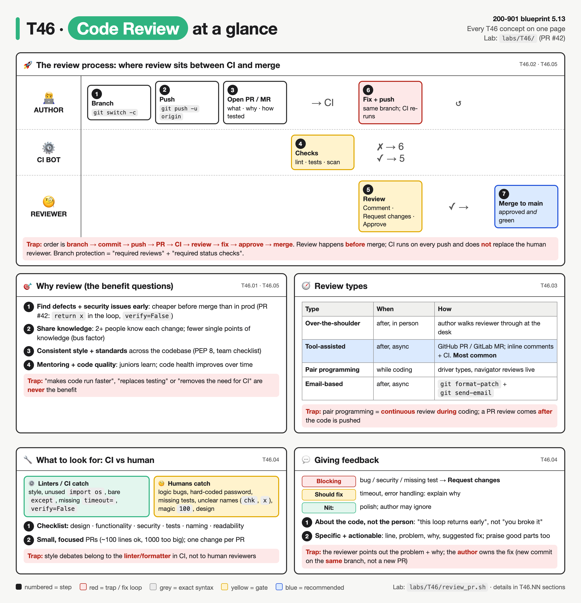
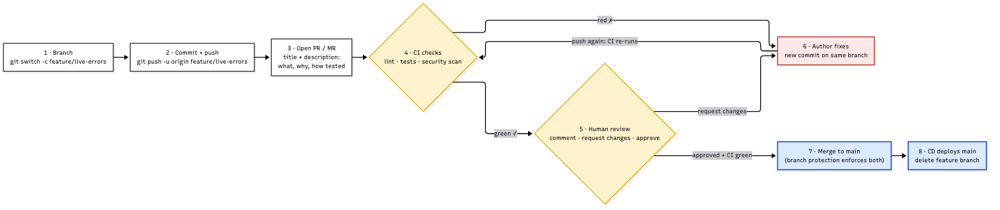
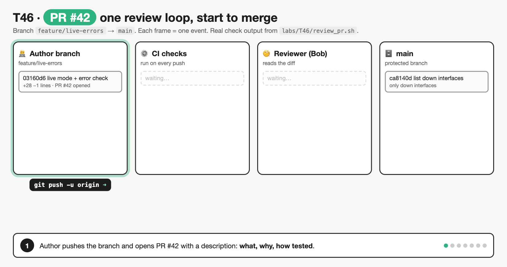
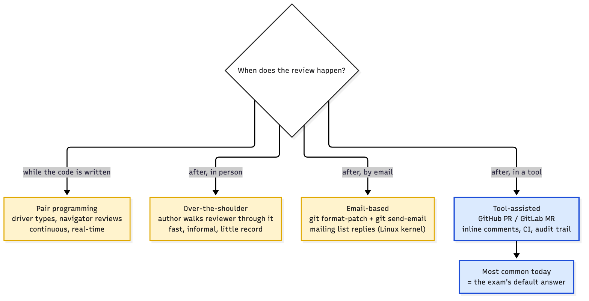
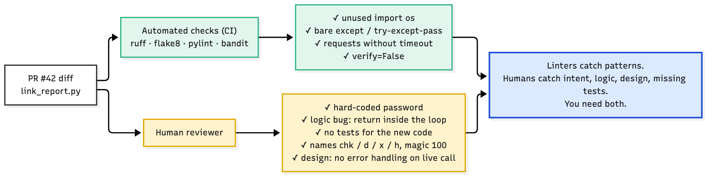
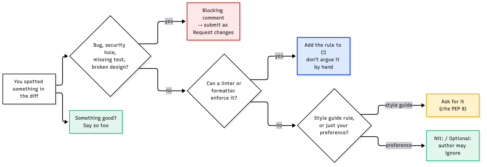

# T46 · Code review principles: essentials

> Blueprint 5.13: code review process principles and benefits · Full note: [bee/T46-code-review-principles.md](../bee/T46-code-review-principles.md)



*The top swim-lane is the process in numbered order (red is the fix loop, blue is the merge). The four panels below cover purpose, review types, what to look for, and how to give feedback. Red boxes are exam traps.*

## 🧭 The big idea

> 💡 **Code review** = another person reads a change **before** it joins the main branch. The topic answers three questions.

| | Question | Answer options | Analogy |
|---|---|---|---|
| 🏆 | **Why review?** | the benefits: early defects, knowledge sharing, standards, mentoring | **a second pilot doing the pre-flight checklist.** The autopilot self-test (CI) catches the instrument faults it was built to detect. The co-pilot (the human reviewer) catches what no instrument measures: the wrong destination typed in, a missing passenger list. Both sign off before take-off (merge), and the flight log (the PR thread) records who checked what. |
| 🔀 | **Where does it sit?** | in the branch → PR → CI → review → merge flow | |
| 🧑‍🏫 | **How is it done well?** | the review types, what to look for, and how to write a comment | review types = **proofreading an essay** (see section 3) |

- 🧪 **The running example: PR #42**, a small network script change with ten planted issues. CI caught some; only a human caught the rest.
- 🎯 **What the exam asks:** "which is a benefit", "which step comes next", "which review type is this", "which is the best comment". CBT has no 5.13 video, so this page and the full note are your coverage.

## 🟥 Must know

### 1. 🏆 Why we review: the benefits the exam wants

| | Benefit | In one line | Why | PR #42 example |
|---|---|---|---|---|
| 🐞 | **Find defects early** | cheaper in review than in production | a bug found in review costs a comment; in production it costs an outage | `return x` was indented inside a `for` loop, so the error report silently stopped after the first interface and missed Gi4 |
| 🔒 | **Find security issues early** | before it reaches `main` and Git history | a second pair of eyes before code reaches `main` and Git history | a hard-coded password and `verify=False` |
| 🤝 | **Knowledge sharing** | no single person owns a module | at least two people understand every change, so there are fewer single points of knowledge (the "bus factor") | Bob, the reviewer, now knows how live mode works and can maintain it |
| 📏 | **Consistent standards** | team rules applied every time | team rules (PEP 8, "always set a timeout") are applied every time, so code reads the same everywhere | |
| 🎓 | **Mentoring / quality** | juniors learn, code health improves | juniors learn from comments, and code health improves over time | a comment teaching `.get()` instead of `try/except: pass` |

> 🔐 **Exam-sim gap:** collaborative review is also a **learning tool**. Juniors learn the codebase and standards, seniors spread knowledge, and the team converges on shared conventions.
>
> 🎯 Cue: "benefit of collaborative code review" → **a supportive environment for learning and knowledge sharing**, not "removes the need for testing".

- ❌ **Wrong answers to spot:** "makes code run faster", "replaces unit tests", "removes the need for CI", "lets one senior engineer own each module".

### 2. 🔀 Where review sits in the workflow

> 💡 **Two gates before merge:** 🤖 CI (automatic) and 🧑‍✈️ human review (manual). Merge needs **both** green.

The steps, in order:

1. 🌿 **Branch**: work on a feature branch, never commit straight to `main`: `git switch -c feature/live-errors`.
2. ⬆️ **Commit and push** the branch: `git push -u origin feature/live-errors`.
3. 📝 **Open a pull request** (GitHub) or **merge request** (GitLab) with a description: what changed, why, how you tested it, anything risky. First line = a short imperative summary ("Add live RESTCONF mode to link_report").
4. 🤖 **CI runs automatically**: lint, unit tests, security scan. If CI is red, the author fixes it before anyone spends review time.
5. 🧑‍✈️ **Reviewers read the diff** and submit one of three decisions (table below).
6. 🔁 **The author pushes fixes to the same branch.** That updates the **same PR**, and CI re-runs on every push. No new PR.
7. ✅ **Approval + green checks → merge** to `main` (merge, squash or rebase), delete the branch. CD can then deploy.

| | Decision | Means | Blocks merge? |
|---|---|---|---|
| 💬 | **Comment** | general feedback; neither approves nor blocks | ❌ no: neutral |
| 🛑 | **Request changes** | must be addressed before merging | ✅ yes: must be addressed |
| 👍 | **Approve** | ready to merge | ❌ no: ready to merge |

- ✈️ Analogy tie-in: the co-pilot doesn't write a new flight plan when they spot an error; you correct **this** plan and run the checklist again.
- 🎯 **Where does review fit?** After the PR is opened (and usually after CI is green), **before merge**. CI and review are both gates; neither replaces the other.



*Any red result loops back to the author on the same branch; merge needs both gates green.*



*PR #42 step by step: push + open PR → CI flags issues → reviewer requests changes → author pushes a fix to the same branch → CI re-runs green → approve → merge.*

### 3. 🧑‍🏫 The four review types

> 💡 **Sort by when the review happens:** pair programming reviews **during** coding; the other three review **after** the code is written. Analogy: **proofreading an essay**.

| | Type | How it works | When | ✅ Good | ❌ Bad | 📝 Essay analogy | Scenario wording |
|---|---|---|---|---|---|---|---|
| 👀 | **Over-the-shoulder** | the author walks a reviewer through the change at the desk or on a screen share | after | fast, informal, easy discussion | no written record, and the author steers attention | you reading the finished essay aloud to them | "walks a colleague through at the desk" |
| 🛠️ | **Tool-assisted (most common)** | a GitHub PR or GitLab MR with inline comments, approvals and CI status in one place | after | asynchronous, an audit trail, CI built in, enforceable by branch protection | can be slow; big PRs get rubber-stamped | handing it in with tracked changes and comments | "comments on a GitHub/GitLab PR" |
| 👯 | **Pair programming** | two people, one keyboard. The **driver** types; the **navigator** reviews each line live | **during** | continuous review, instant feedback, strong knowledge sharing | two people's time on one task, no separate record | someone reading over your shoulder **as you write each sentence** | "two developers, one writes, one watches each line" |
| 📧 | **Email-based** | patches sent with `git format-patch` and `git send-email`; reviewers reply inline on a mailing list (Linux kernel style) | after | needs no platform | manual, threads hard to track, no CI gate | posting it to them and getting a marked-up reply | "patches on a mailing list" |

**🔍 The common exam pair:**

| | 👯 Pair programming | 🛠️ PR review |
|---|---|---|
| When | **while** writing | **after** pushing |
| Timing | synchronous | asynchronous |
| Record | no record | recorded |
| CI gate | | can be gated by CI |

- 🔀 Teams often do both.



*Pair programming reviews during coding; the other three review afterwards. Tool-assisted is the default modern answer.*

### 4. 🔎 What to review, and what tools own

**✍️ Author side:**

| | Do | Why |
|---|---|---|
| 📏 | Keep the PR **small and focused**. Google's guide: about 100 lines is usually reasonable, about 1,000 is usually too large | small PRs are reviewed faster and more thoroughly, cause fewer bugs and roll back cleanly |
| ✂️ | Don't mix a mass reformat with a logic change: split them into two PRs | or the real change hides in the noise |
| 🧪 | Put the **tests in the same PR** as the code, review your own diff first, and say how you tested it | |

**🧑‍✈️ Reviewer checklist** (Google's priority order):

| 🥇 | 🥈 | 🥉 | 4 | 5 | 6 | 7 | 8 |
|---|---|---|---|---|---|---|---|
| design | functionality and edge cases | security | complexity | tests (would they fail if the code broke?) | naming | comments and docs | style |

> 💡 **Let tools own style.** A formatter (`black`, `ruff format`), linters (`flake8`, `pylint`, `ruff`) and a security scanner (`bandit`) run in CI on every push, so humans spend their time on logic, design and tests. On style questions, the style guide (PEP 8) wins over personal preference.

**🤖 CI green ≠ reviewed.** Part of PR #42's diff, with the issues annotated:

```diff
+def get_live(h):                                             # vague name           (human)
+    r = requests.get("https://" + h + "/restconf/data/ietf-interfaces:interfaces-state",  # no timeout= (linter)
+                     auth=("admin", "FAKE-Passw0rd-not-real"), # hard-coded password  (human only)
+                     headers={"Accept": "application/yang-data+json"},
+                     verify=False)                             # TLS check off        (linter)
+    return r.json()["ietf-interfaces:interfaces-state"]["interface"]
+
+def chk(d):
+    x = []
+    for i in d:
+        try:
+            if i["statistics"]["in-errors"] > 100:             # magic number         (human)
+                x.append(i["name"])
+        except:                                                # bare except          (linter)
+            pass
+        return x                                               # LOGIC BUG: returns after 1st item (human only)
```

| 🤖 CI flagged | 🧑‍✈️ Only the human caught |
|---|---|
| the unused `import os` | the hard-coded password |
| the bare `except` | the early `return` inside the loop |
| the missing timeout | the missing tests |
| `verify=False` | the vague names |
| | the magic number |
| linters find **patterns** | a person finds **intent** bugs, secrets and missing tests |

- ⚠️ `py_compile` only checks **syntax**. PR #42 compiled, passed its old test and printed output, with all ten issues inside.



*Green items were found by the real linter run; yellow items only by a person reading the diff. Neither list covers the other.*

> 🔐 **Exam-sim gap: industry best practices** (often quoted on exams):
>
> | | Practice | Detail |
> |---|---|---|
> | 📊 | **Set goals and measure** | inspection rate (lines per hour), defect rate, defects found per review |
> | 🐢 | **Keep it small and slow** | a few hundred lines at a time, under about 500 lines an hour, stop after about 60 to 90 minutes (⚠ verify these figures; they come from the SmartBear/Cisco study, not a standard) |
> | 🗒️ | **The author annotates the change first** | explaining intent and pointing at risky parts |
> | 🎯 | **Assign reviewers by expertise, not seniority** | and use a checklist |
>
> 🎯 Cue: "best practice for code review" → **set review goals and collect metrics**.

### 5. 💬 Giving feedback well

> 💡 **Talk about the code, not the person.**

| ❌ Bad | ✅ Good |
|---|---|
| "Why did you hard-code the password?" | "The password on line 18 ends up in Git history; please read it from `RESTCONF_PASS`." |

**🎯 Be specific and actionable:** the file and line, the problem, **why** it matters, and a suggested fix. A real blocking comment from the PR #42 review:

```
3. link_report.py:37 (bug) `return x` is indented inside the for loop, so chk()      <- file:line + category
   returns after the first interface. With fixtures/interfaces.json it reports Gi1    <- the problem + its effect
   but misses Gi4 (120 errors). Dedent the return one level, and please add a test    <- the fix
   that has two interfaces over the threshold so this can't come back.                <- how to prevent it
```

| | Habit | Detail |
|---|---|---|
| 🏷️ | **Label the severity** | blocking, should fix, `Nit:`, `Optional:`, `FYI:`. Without labels, authors treat every comment as mandatory |
| 🌟 | **Praise the good parts** | the PR #42 review opens with what's good about live mode before the blocking items |
| 🧭 | **Point out the problem, let the author choose the fix** | they're closer to the code; give direct code when that's quicker |

- 🎯 **"Best review comment?"** → the one that names the line, explains why, suggests a fix, and is about the code. "You always…" is never the best answer.



*Blocking issues mean Request changes. Anything a tool can enforce belongs in CI. Preferences become `Nit:` comments. Say what's good too.*

## ⚠️ Exam traps

| ❌ Looks like… | ✅ Actually… |
|---|---|
| CI green means the code is reviewed | 🤖 **CI green ≠ reviewed.** Linters only find patterns; a human finds intent bugs, hard-coded secrets and missing tests. Both gates are required. |
| review can happen after deployment | 🔀 **Review happens before merge**, not after deployment. "Review the code in production logs" is a distractor. |
| pairing and over-the-shoulder are the same | 👯 **Pairing reviews continuously while coding;** 👀 over-the-shoulder happens **after** the code is written, with the author walking the reviewer through it. |
| fixes need a new PR | 🔁 **Fixes go on the same branch**, which updates the same PR and re-runs CI. No new PR, no direct push to `main`. |
| any review comment blocks merge | 🛑 **Only Request changes blocks;** 💬 Comment is neutral. A 2,000-line PR is a reason to ask for a split, not to approve quickly. |
| "it compiles and runs" is enough | **"It compiles and runs" is not a review**, and style belongs to tools: put the rule in the linter, don't argue whitespace. |

<details><summary><b>🟨 Should know (second pass)</b></summary>

### 🏆 Secondary benefits and approval standard

| | Item | Detail |
|---|---|---|
| 🧩 | **Secondary benefits** (also appear as answers) | **shared ownership** of the codebase, **better documentation** (the PR description and thread record *why*), and an **audit trail** (who approved what) |
| 👍 | **Google's approval standard** | approve once a change **definitely improves overall code health**, even if it isn't perfect. Aim for continuous improvement, not perfection |

### 🛡️ Branch protection enforces the gates

| Setting | Enforces |
|---|---|
| "Require pull request reviews before merging" | N approvals, optionally from a **code owner** listed in `CODEOWNERS` |
| "Require status checks before merging" | CI must pass |
| GitLab's equivalent | protected branches + approval rules |

- 🛑 "Request changes" only blocks merging when branch protection requires reviews (⚠ verify).
- 🏛️ **Formal inspection** (a Fagan-style meeting with set roles: moderator, reader, recorder) also exists but is heavyweight and rarely the answer (⚠ verify whether the exam names it).

### 💬 Etiquette and disagreements

| | Rule | Detail |
|---|---|---|
| ✍️ | **Author etiquette** | reply to every comment, push fixes, don't take it personally. If a reviewer asks "what does this do?", the right fix is clearer code, not an explanation that lives only in the PR thread |
| ⏱️ | **Respond fast** | within one business day; quick replies matter more than the total time to merge |
| ⚖️ | **Disagreements** | facts and data beat opinions. If stuck, talk live, then escalate to the tech lead, and record the outcome in the PR |
| 🧪 | **Prove a logic bug with a test** | one 10-line test with two errored interfaces failed with `['GigabitEthernet1'] != ['GigabitEthernet1', 'GigabitEthernet4']`, which no linter flagged. That's why "no tests" is a **blocking** comment |

</details>

> 📚 **Recognise only, details in the full note:** specific linter rule codes (F401, E722, S501, B113…), `gh` CLI review commands, merge vs squash vs rebase details, the full `review-42.txt` and fix-up diff, inspection roles, Google's guide wording on "large" across many files.

## ✍️ Quick self-check
<details><summary>Q1. Name two real benefits of code review.</summary>Any two of: early defect and security detection, knowledge sharing, consistent standards, mentoring. Never "faster code" or "replaces testing".</details>
<details><summary>Q2. Two developers share one keyboard; one types and one checks each line. Which review type?</summary>Pair programming: continuous review while coding, with driver and navigator roles.</details>
<details><summary>Q3. Where does review sit relative to CI and merge?</summary>On the open PR, alongside CI; an approving review and passing checks are both required before merge.</details>
<details><summary>Q4. Which comment is best for <code>verify=False</code>?</summary>One that names the line, explains that it disables certificate checks so a man-in-the-middle could read the password, and suggests keeping verification on or passing the CA bundle.</details>
<details><summary>Q5. A PR reformats 40 files and changes retry logic in one. What should the reviewer ask for?</summary>Split it into a formatting-only PR and a separate logic PR, so the real change is not hidden.</details>
<details><summary>Q6. The reviewer requests changes. What does the author do next?</summary>Push fix commits to the same branch. That updates the same PR, and CI re-runs; no new PR is needed.</details>
<details><summary>Q7. Which is a code review best practice: set review goals and collect metrics, or let one senior engineer approve everything?</summary>Set review goals and collect metrics (inspection rate, defect rate). Reviewers are assigned by expertise, not seniority.</details>

## 🗣️ Say it out loud
- 🏆 "Review finds bugs early, spreads knowledge, keeps standards and mentors people; it never replaces tests."
- 🔀 "Branch, push, PR, CI, review, fix on the same branch, approve, merge."
- 🤖🧑‍✈️ "Tools own style; humans own logic, security and tests."
- 👯🛠️ "Pairing reviews while you type; a PR reviews after you push."
- 💬 "Talk about the line, not the person, and label it blocking or nit."
