# T47 · Sequence diagrams with API calls: essentials

> Blueprint 5.14: interpret a sequence diagram with API calls · Full note: [bee/T47-sequence-diagrams-with-api-calls.md](../bee/T47-sequence-diagrams-with-api-calls.md) · Teach-back 2026-10-25

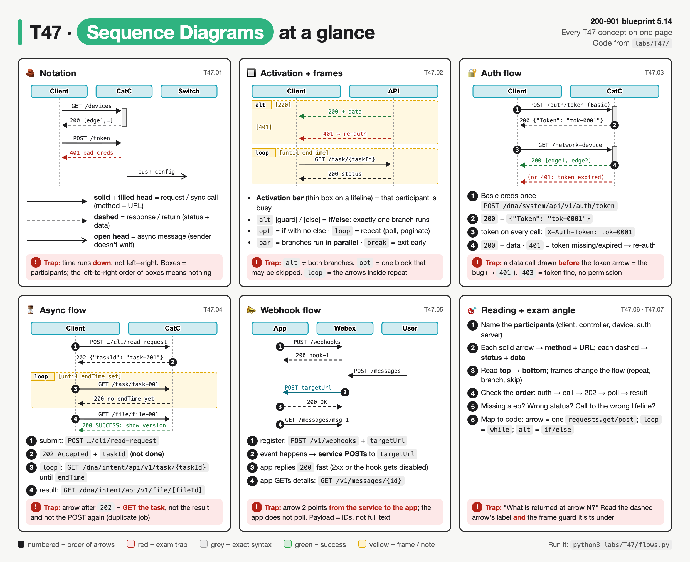

*Six panels, one per concept group. Read each mini diagram top to bottom: the black numbers are the order of the arrows, solid lines are requests, dashed lines are responses, and yellow boxes are frames. Red boxes are exam traps.*

## The big idea
- A **sequence diagram** answers one question: **who talks to whom, and in what order?** For APIs, it shows which system calls which endpoint and what comes back.
- **Analogy: a comic strip of a phone conversation**, read from top to bottom. Each person has a column, and each speech bubble is an arrow from one column to another. A question is a solid arrow; the answer is a dashed arrow coming back.
- **Analogy for frames: the stage directions in a script.** "If the caller is angry, say A, otherwise say B" (`alt`), "maybe mention the weather" (`opt`), "keep asking until they answer" (`loop`).
- Every HTTP call you write with `requests` becomes **two arrows**: the request going out and the response coming back. If you can read a diagram as code, you can answer the questions.
- **What the exam asks:** "what is arrow N?", "put these calls in order", "spot the missing step". CBT has no 5.14 video, so this page and the full note are your coverage.

## 🟥 Must know

### 1. The basic notation: boxes, lifelines, arrows
- **Participants** are the boxes along the top, one per system: your script, an auth server, a controller (Catalyst Center (DNA Center), SD-WAN Manager, the Meraki cloud), a device, or a webhook receiver. A stick figure (`actor`) is a human; same meaning.
- The **left-to-right order of the boxes means nothing**. The author just chose it.
- Each box has a **lifeline**: the vertical, often dashed, line underneath it. It represents that participant existing over time.
- **Time runs from top to bottom.** An arrow lower on the page happens later. "Which call happens first?" → the **highest** arrow, whatever box it starts at.
- **The arrows:**
  - **Solid line, filled arrowhead** = a synchronous call = a **request**, labelled with **method + URL** (sometimes a header or body).
  - **Dashed line** = a reply = a **response**, labelled with **status code + data**. A dashed arrow never carries a `GET`.
  - **Solid line, open arrowhead** = an asynchronous message: the sender doesn't wait (fire-and-forget event, push, webhook).
  - **Arrow from a box back to itself** = local processing, such as parsing JSON.
- In the comic-strip analogy: a solid arrow is someone asking, a dashed arrow is the answer; an open arrowhead is shouting a message and walking off without waiting.
- A real auth-then-call diagram in Mermaid, annotated:

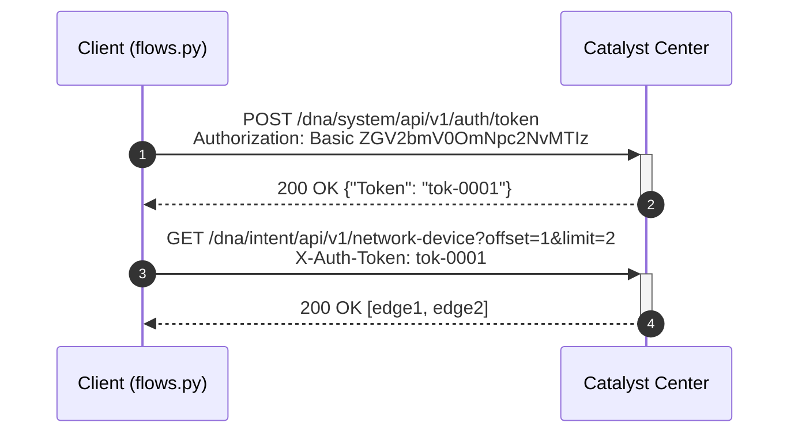

  - `participant` lines = the boxes. `autonumber` = number the arrows 1, 2, 3…
  - `->>` = solid request arrow. `-->>` = dashed response arrow.
  - `+` / `-` start and end the activation bar on CatC (section 2).
  - 4 arrows = **2 HTTP calls**: count the solid arrows only.
- Arrows may be numbered so a question can say "at arrow 5". Whether the exam numbers them is ⚠ verify.

| Looks like | Meaning | In an API diagram | Mermaid |
|---|---|---|---|
| solid line, **filled** arrowhead | synchronous call | request: method + URL | `A->>B: label` |
| **dashed** line | reply | response: status + data | `B-->>A: label` |
| solid line, **open** arrowhead | async message (sender doesn't wait) | event, push, webhook | `A-)B: label` |
| arrow back to itself | self-call | local processing | `A->>A: label` |

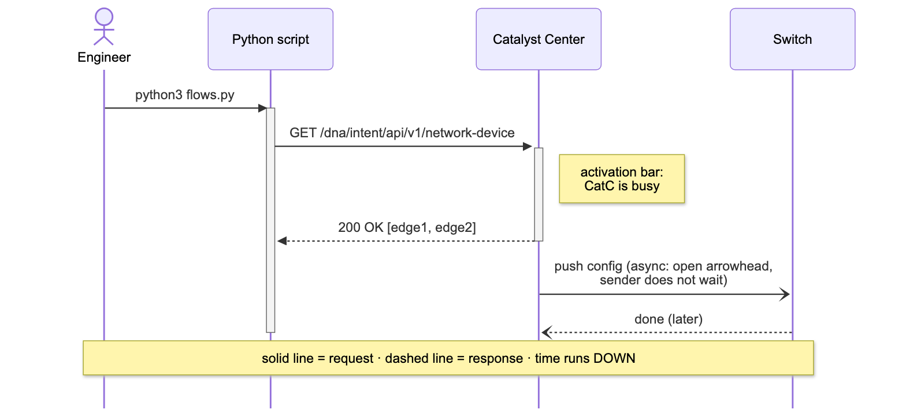

*Four participants, time running down. Solid is a request and dashed is a response; the open arrowhead to the switch is async. The grey bars are activation.*

- **Exam-sim gap:** practice tests may show **telecom-style time-sequence diagrams** (OSI/ITU service primitives), not just API calls.
  - The vertical lines are the **endpoints**: the service user and the service provider on each side of an interface.
  - Messages between them are labelled with primitives such as **request, indication, response and confirm**.
  - Timers and checks (for example a timer-check function) mark completion or error events.
  - These are less likely on the real exam than API diagrams (⚠ verify). The reading rule is the same: **vertical lines = participants/endpoints**, time runs down, an arrow is a message.

### 2. Activation bars and frames
- An **activation bar** is a thin rectangle on a lifeline. It starts when a request arrives and ends when the response leaves. It means **this participant is busy working right now**.
  - Lifeline = "exists". Activation bar = "busy".
  - A long bar on the client during a synchronous call means the client is blocked waiting.
- A **frame** is a box drawn around some arrows, with an **operator** tag in the top-left corner and a **guard** condition in `[brackets]`. Frames are code structures, like the stage directions in the analogy:
  - **`alt [g1] / [else]`**: at most **one** branch runs → `if … elif … else`.
  - **`opt [g]`**: the block happens or nothing happens → `if` with no `else`.
  - **`loop [g]`**: the block repeats → `while` / `for` (polling, paging). The diagram **never** says how many times.
  - **`par`**: the branches run in parallel → threads / `asyncio.gather()`.
- **Notes** (`Note over A,B: …`) are yellow comment boxes. They are **not** messages.

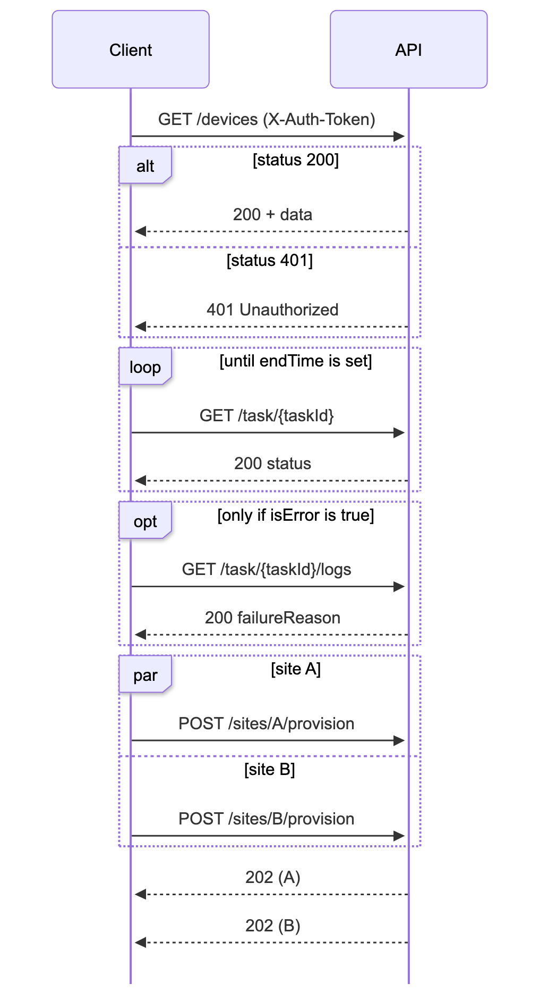

*alt: exactly one of [200] or [401] happens. loop: the GET and its 200 repeat. opt: the logs call happens only if isError. par: both POSTs go out together, and the two 202s can return in either order.*

| Frame | Rule | Code |
|---|---|---|
| `alt` | exactly one branch | `if / else` |
| `opt` | may not run at all | `if` (no else) |
| `loop` | repeats; count not shown | `while` / `for` |
| `par` | at the same time | threads / `asyncio.gather()` |

### 3. The auth flow: token first, then data
- The most common diagram. Four arrows (the Mermaid in section 1):
  1. Client → auth endpoint: `POST /dna/system/api/v1/auth/token` with Basic credentials.
  2. Auth endpoint → client: `200 OK {"Token": "..."}`.
  3. Client → API: `GET /dna/intent/api/v1/network-device` with the header `X-Auth-Token: <token>`.
  4. API → client: `200 OK` + the device list (or `401` if the token is missing or expired).
- The password is sent **once**, in arrow 1. After that, the token travels in a header instead.
- **Why order matters:** arrow 3 needs a value (the token) that only arrow 2 provides. A data call drawn **before** the token arrow is the classic bug → expect a `401`.

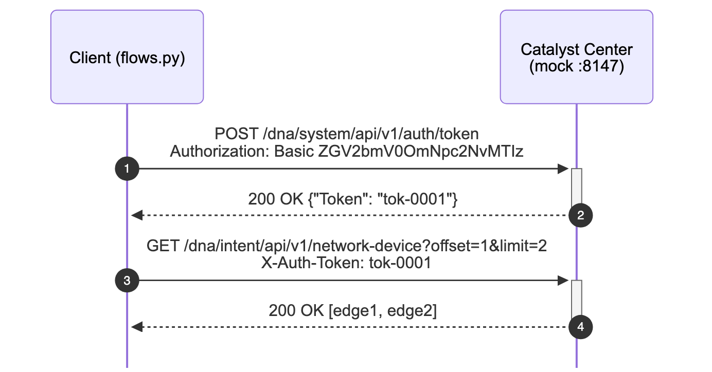

*Arrow 1 sends Basic credentials once; arrow 2 brings the token back in the body; arrow 3 carries the token in a header; arrow 4 is the data.*

- **The `alt` version: the token expired.** The GET returns `401`, so the client logs in again and retries once. In code, the frame is literally the `if`:

```python
    status, body = call("Client", "CatC", "GET", path, headers={"X-Auth-Token": session["token"]})
    if status == 401:                       # alt [401 token expired]
        session["token"] = get_token()      # new POST /auth/token arrow pair
        status, body = call("Client", "CatC", "GET", path, headers={"X-Auth-Token": session["token"]})
    return body["response"]                 # alt [200]: just use the data
```

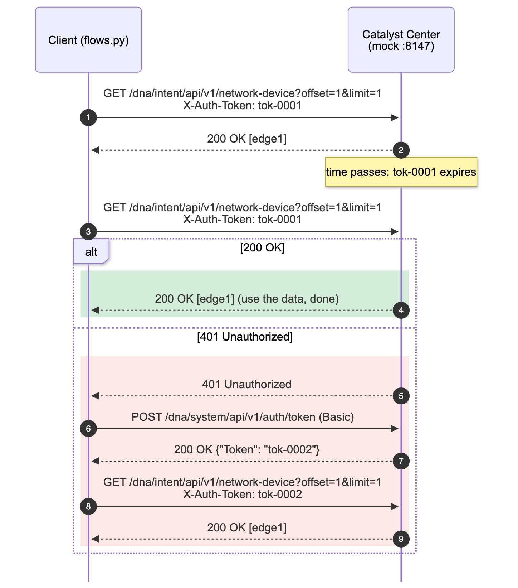

*The same GET is sent, and its answer decides the branch. [200] ends the flow; [401] adds a new token request and a retry. Only one branch runs.*

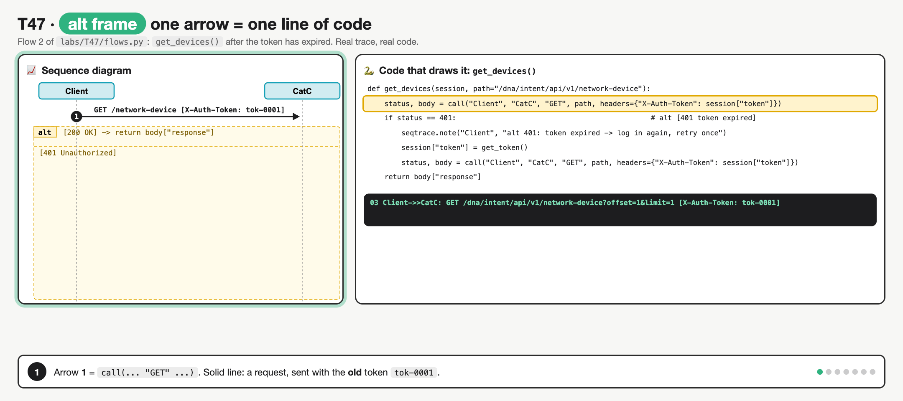

*GET with the old token, `401`, the alt picks the [401] branch, POST for a new token, the new token returns, retry GET, `200`. Both branches do not run, and a `401` does not end the flow.*

- **`401` vs `403`:** `401` = no valid token, so the fix is to authenticate. `403` = the token is fine but the user lacks the role, so re-authenticating won't help.

### 4. The async flow: submit, poll, fetch
- For long jobs the server accepts the request and works in the background (the "restaurant buzzer" from T09):

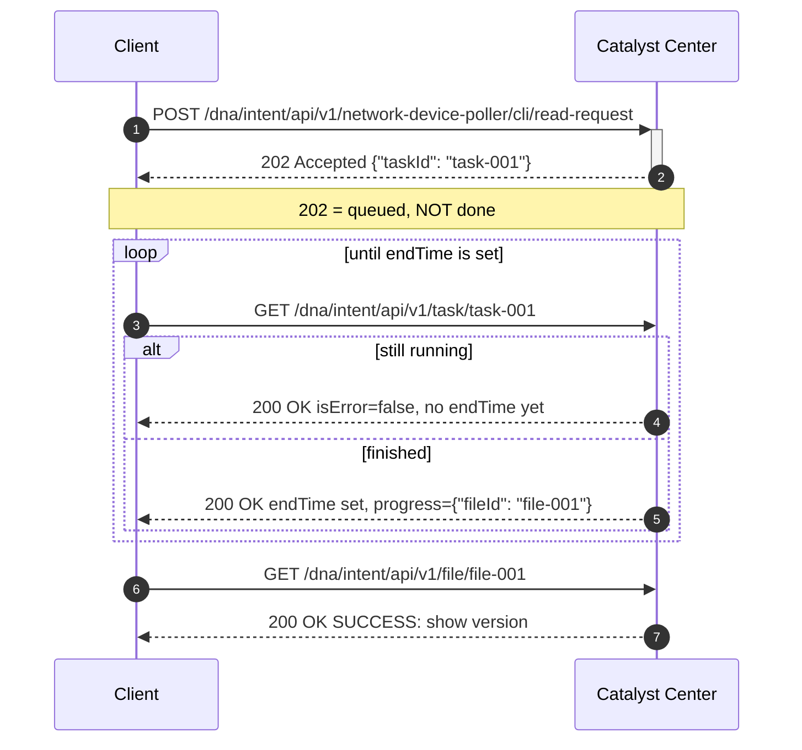

  - Arrow 1: **submit** the job (`POST`).
  - Arrow 2: **`202 Accepted`** + a `taskId`. This means "accepted", **not** "done".
  - `loop`: **poll** `GET /dna/intent/api/v1/task/{taskId}`. Every poll returns `200`; only the finished one carries `endTime` and the `fileId`.
  - Last pair: **fetch** the result with `GET /dna/intent/api/v1/file/{fileId}`.
- **The diagram draws the loop body once and never tells you how many times it ran.** In the lab it ran three times. A diagram only gives you the condition.
- An `opt [isError]` inside the loop means "if the task failed, stop with an error".
- **"What comes after the 202?"** → `GET /task/{taskId}`. Not "read the result" (not ready yet), and not "POST again" (that queues a duplicate job).

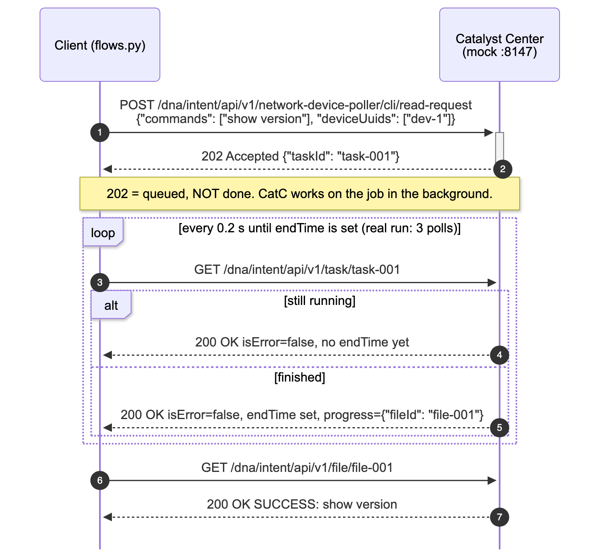

*The 202 arrow is short and fast because the job runs in the background. Every poll gets a 200, but only the [finished] branch carries endTime and the fileId.*

- **Pagination is the same shape:** a `loop` around one GET with `offset` and `limit`, stopping when a page comes back shorter than the limit. In the lab: offset 1, 3, 5 with limit 2, stopping at a 1-item page. Catalyst Center's `offset` starts at 1 (⚠ verify).

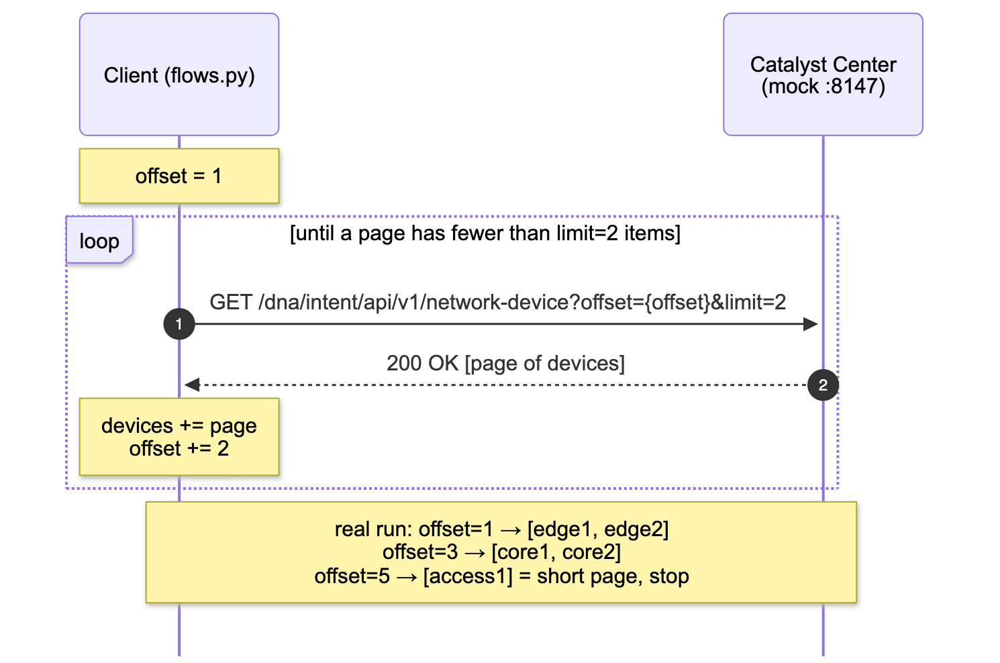

*One GET inside a loop. The real run made 3 calls (offset 1, 3, 5) and stopped when the page had fewer than limit=2 items.*

### 5. The webhook flow: the arrows change direction
- Here the **service calls the app**. Analogy: instead of you phoning the restaurant every five minutes (polling), you leave your number and they call you.
- The eight arrows, from the lab's real Webex-shaped trace:
  1. App → service: `POST /v1/webhooks` with `name`, `targetUrl`, `resource: "messages"`, `event: "created"`.
  2. Service → app: `200 OK`, webhook registered. Then the app sits idle, **no polling**.
  3. and 4. Someone else causes the event (a user posts a message) and gets their own `200`.
  5. **Service → app**: `POST <targetUrl>` with a small payload of IDs. The service is now the client.
  6. App → service: a quick `200 OK` acknowledgement.
  7. and 8. App → service: `GET /v1/messages/{id}` with its Bearer token; the full message comes back.

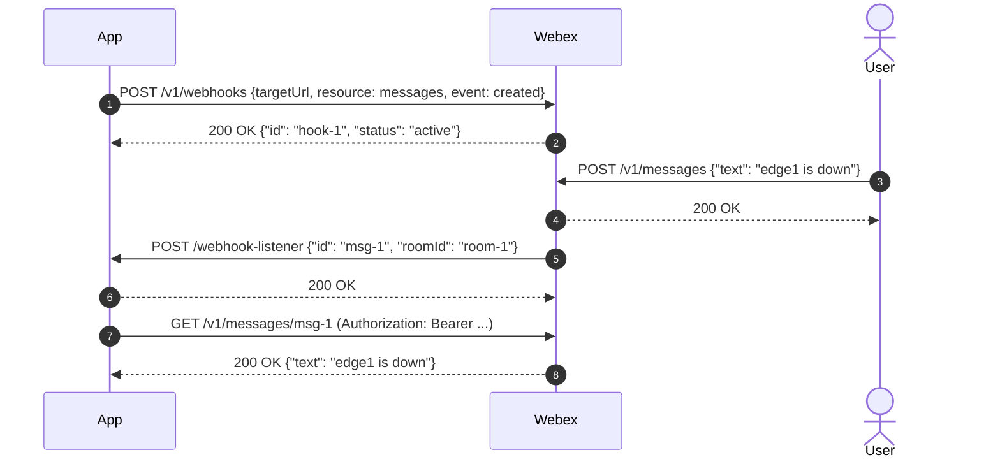

  - Arrow 5 starts at **Webex** and points at the **App**: that direction is what makes it a webhook.
  - Arrow 7 exists because, for sensitive resources, Webex sends only metadata in the notification. The app must make an authenticated GET to `/messages/{id}`.
  - Arrow 6 comes **before** the slow work because Webex disables a webhook that keeps failing to get a 2xx (100 failed attempts within five minutes, ⚠ verify).

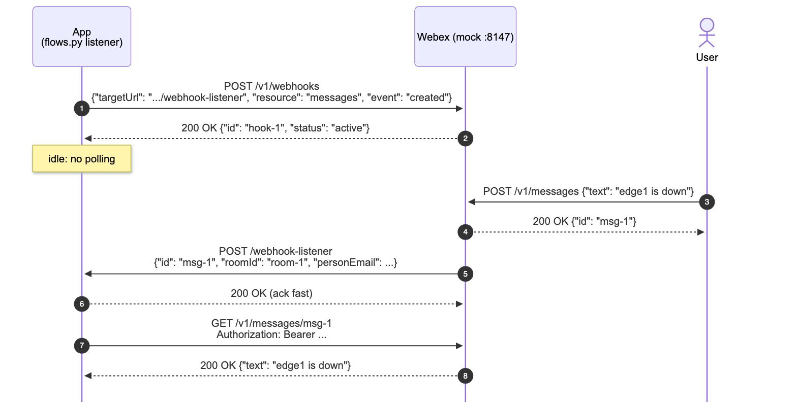

*The app registers once and then waits. Arrow 5 starts at Webex and points at the app. The app replies 200 quickly, then GETs the full message by ID.*

- **Webhook vs polling at a glance:** the async diagram has a `loop` on the client; the webhook diagram has **no loop**, and one arrow runs from the **service to the app**.

### 6. Reading routine, ordering and spotting bugs
- Use this **five-step routine** on every exam diagram:
  1. **Participants**: name each box. Which one holds the data?
  2. **Solid arrows**: write the method and URL for each. Is the verb right? (create = `POST`, read = `GET`, replace = `PUT`, partial update = `PATCH`.)
  3. **Dashed arrows**: what status and data would you expect? `200` OK, `201` created, `202` accepted (async), `204` no content, or `401` / `403` / `404` / `429`.
  4. **Frames**: what repeats (`loop`), what branches (`alt`), what may be skipped (`opt`)?
  5. **Order**: auth before data, submit before poll, poll before result, register before event.
- **"Order the calls" questions:** find the anchors first (auth is always first, the result GET is always last), then fill the middle by **data dependency**. You can't call `/task/{taskId}` until a response gave you `taskId`.
- **"What is arrow N?" questions:** solid → the answer is a method + URL; dashed → a status + data. Then check which frame and guard it sits under.

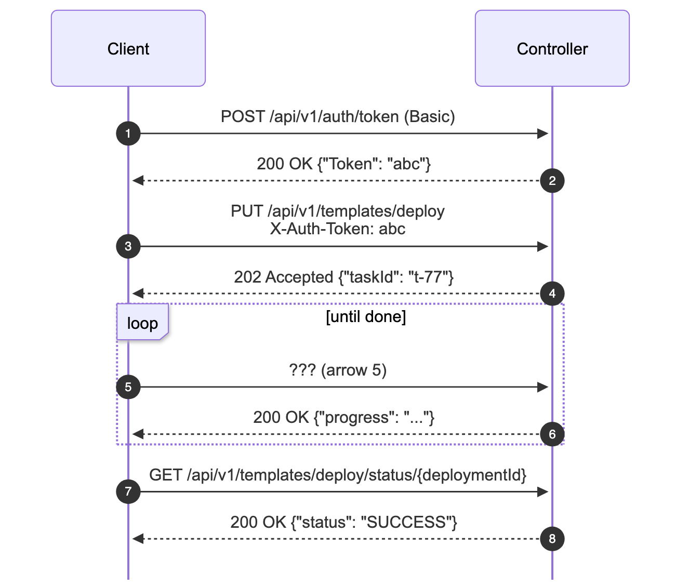

*A template deploy: token, PUT the job, 202 + taskId, then a loop. Arrow 5 is `GET /api/v1/task/t-77` (with `X-Auth-Token: abc`): arrow 4 handed back the taskId, and it sits inside `loop [until done]`. Not the PUT again.*

- **Spot the bug:**

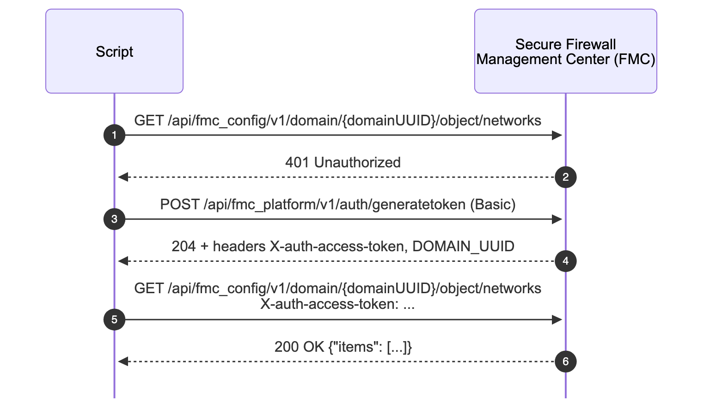

*A script against Secure Firewall Management Center (FMC). Arrow 1 calls the data API before any token exists, so arrow 2 is a 401. Then the script authenticates and repeats the call.*

  - Arrows 1 and 2 are wasted: the call came **before auth**. A correct script starts at arrow 3.
  - Second clue: FMC returns the token and `DOMAIN_UUID` in **response headers**, so the `{domainUUID}` in arrow 1's URL couldn't be known yet (⚠ verify the `204` status on `generatetoken`).
- **Other missing-step or wrong-order patterns:**
  - A GET for the result straight after `202`, with no polling: the result isn't ready yet.
  - A repeated job `POST` inside the loop instead of `GET /task/{taskId}`: duplicate jobs.
  - A response with no request above it.
  - A webhook arrow drawn from the app to the service at event time: that's polling, not a webhook.
  - A retry after `429` with no wait: it should honour `Retry-After`.
- **Diagram → code** (the exam can show either side):

| Diagram | Python (`requests`) |
|---|---|
| solid + dashed arrow pair | one `requests.get()` / `post()` call |
| label `200 {"Token": …}` | `token = r.json()["Token"]` |
| `alt [200] / [401]` | `if r.status_code == 401: … else: …` |
| `opt [isError]` | `if task["isError"]: raise …` |
| `loop [until endTime]` | `while "endTime" not in task: time.sleep(2); task = …` |
| arrow from service to app | an HTTP route handler that receives the POST |

## Exam traps
- **Dashed is always a response** (status + data); solid is a request (method + URL). **One HTTP call = two arrows**: count only the solid arrows.
- **Box order means nothing; the highest arrow happens first.**
- **`202 Accepted` is the middle, not the end.** The next arrow is `GET /task/{taskId}`, not "read the result" and not "POST again".
- **`alt` = exactly one branch runs.** `opt` may not run at all, and `loop` never tells you the number of passes.
- **A data call before the token arrow is the classic bug** → `401`. Only `401` is fixed by re-authenticating; `403` is a role or scope problem.
- **Open arrowhead = async** (the sender doesn't wait), filled = sync call; a `202` response is still drawn dashed. In a webhook, the event arrow goes **from the service to the app**.

<details><summary><b>🟨 Should know (second pass)</b></summary>

- **More frames:**
  - `break [g]`: this block runs **instead of** the rest of the diagram → an early `return` or `raise`.
  - `critical`: an atomic region that can't be interleaved → a lock (awareness only).
- **Mermaid syntax for drawing your own:**
  - Frames: `alt …` / `else …` / `end`, `opt … end`, `loop … end`, `par … and … end`, `break … end`.
  - Activation: `activate CatC` / `deactivate CatC`, or the shorthand `Client->>+CatC:` and `CatC-->>-Client:`.
  - `rect rgb(…)` only adds a background colour; it isn't a UML frame.
  - Renders in GitHub Markdown inside a `mermaid` code block.
- **Activation on async replies:** on a `202`, the server's activation bar ends at once, because the job runs in the background; that's why the 202 arrow looks short.
- **Token headers vary by platform:** `X-Auth-Token` (Catalyst Center), `X-auth-access-token` (FMC), `Authorization: Bearer` (Webex). All mean "token auth" on a diagram (see T10).
- **Webhook security and testing** (`X-Spark-Signature`, testing tools) are in T43.

</details>

> **Recognise only, details in the full note:** UML 2.5.1 section numbers, the lab's `flows.py` / `mock_api.py` / `seqtrace.py` / `trace_to_mmd.py`, the mock API table, the curl drill, the Meraki `Link`-header paging example (⚠ verify), the OAuth version of the auth diagram (T10).

## Quick self-check
<details><summary>Q1. A dashed arrow from the controller to the script says <code>200 OK</code>. What is it?</summary>The response to an earlier request from the script; dashed means reply.</details>
<details><summary>Q2. Order: GET task, POST auth/token, GET file, 202 + taskId, POST job, 200 + Token.</summary>POST auth/token, 200 + Token, POST job, 202 + taskId, GET task (in a loop), GET file. Each call needs a value from the response before it.</details>
<details><summary>Q3. An <code>alt [200] / [401]</code> frame, and the token is valid. How many branches run?</summary>Only the [200] branch; alt is if/else.</details>
<details><summary>Q4. In a webhook diagram, what comes right after "a user posts a message"?</summary>The service POSTs a JSON notification to the app's <code>targetUrl</code>.</details>
<details><summary>Q5. A diagram has 5 solid and 5 dashed arrows. How many HTTP requests?</summary>Five; each solid arrow is a request and each dashed arrow is its response.</details>
<details><summary>Q6. A <code>loop [until endTime]</code> frame contains one GET/200 pair. How many times did the client poll?</summary>The diagram doesn't say. A loop shows the body once and only gives the condition.</details>
<details><summary>Q7. A GET with a fresh, valid token comes back <code>403</code>. Should the next arrow be a new <code>POST /auth/token</code>?</summary>No. <code>403</code> means the token is fine but the role isn't allowed; only <code>401</code> is fixed by getting a new token.</details>

## Say it out loud
- "Boxes across, time down; solid asks, dashed answers."
- "alt is if/else, opt is if, loop is while, par is at the same time."
- "Token first, then data; a data call before the token is a 401."
- "202 means poll the task, not read the result."
- "In a webhook, the service draws the arrow to me, I say 200, then I GET the details."
