# T08 · API consumption constraints

> Owner: **Beedy** · Blueprint: **2.3** · CBT coverage: **None** · Learn by 2026-10-17

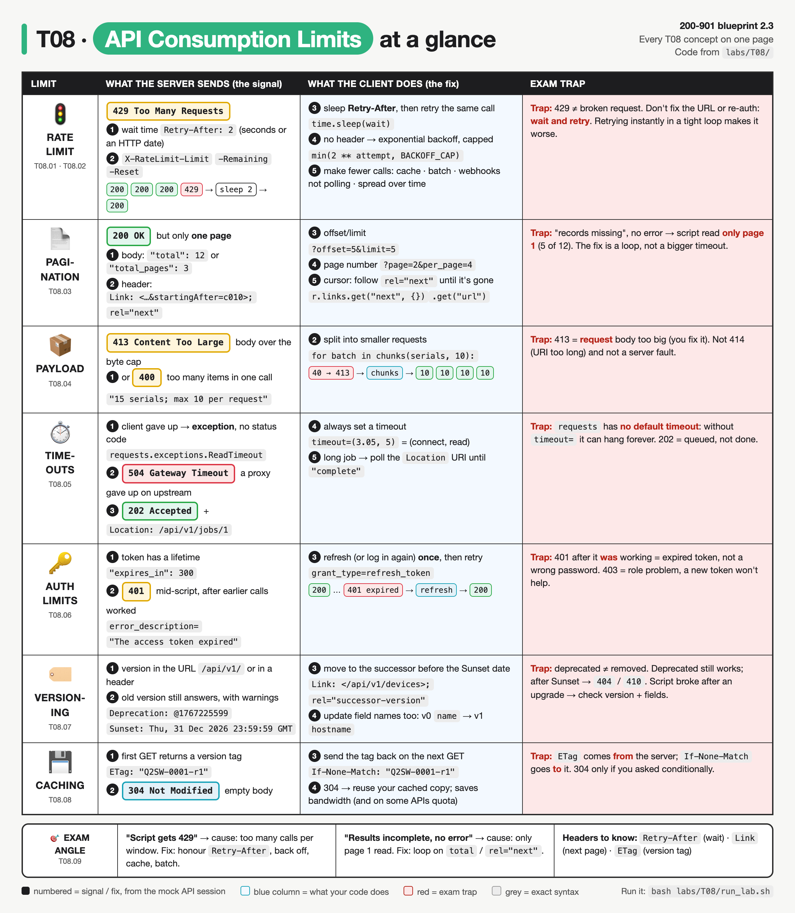

*Every T08 concept on one page. Each row is one limit (IDs under the icon). Read it left to right: what the server sends, then what your code does (blue), then the exam trap (red). Numbers index the signals and fixes from the mock API session in `labs/T08/`.*

<!-- toc:start -->

**Contents**

- [TL;DR](#tldr)
- [Concepts](#concepts)
  - [T08.01](#t0801--rate-limiting) Rate limiting · [T08.02](#t0802--rate-limiting) Rate limiting · [T08.03](#t0803--pagination) Pagination · [T08.04](#t0804--payload-limits) Payload limits · [T08.05](#t0805--timeouts) Timeouts · [T08.06](#t0806--auth-limits) Auth limits · [T08.07](#t0807--versioning) Versioning · [T08.08](#t0808--caching) Caching · [T08.09](#t0809--exam-angle) Exam angle
- [Exam traps](#exam-traps)
- [Examples](#examples)
- [Practice questions](#practice-questions)
- [Study aids](#study-aids)
- [Sources](#sources)
- [To verify](#to-verify)

<!-- toc:end -->

## TL;DR

- **Rate limit → `429` + `Retry-After`.** Sleep exactly what `Retry-After` says, then retry the **same** call. With no header, use capped exponential backoff (1, 2, 4, 8 s). Cut the call count with caching, batching and webhooks instead of polling. `X-RateLimit-Remaining: 0` warns you before the 429 arrives.
- **Pagination → `200` with only part of the data.** Loop until done: offset/limit (`total`), page number (`total_pages`), or a cursor in the `Link` header (`rel="next"`, Meraki `startingAfter`). Payload too big → `413`; split it with `chunks()`. Always pass `timeout=`; a long job comes back as `202` + `Location`, so poll it.
- **Tokens expire, versions retire, ETags save calls.** `401` mid-script after earlier calls worked = expired token → refresh once, then retry. `Deprecation`/`Sunset` = migrate to `/v1` and rename fields. `ETag` → `If-None-Match` → `304`, empty body.
- **Trap:** "records missing, no error" = only page 1 was read, not a timeout or permissions issue. "429" = too fast, not a broken request: don't change the URL or re-authenticate, just wait.

## Concepts

Every section below explains one part of the same API session. Read it once first. This builds directly on [T07](T07-rest-fundamentals-http-codes.md): same request/response anatomy, same status codes. T07 met `429` once; here are all the limits a **consumer** hits and how a script survives them.

- `labs/T08/mock_api.py` is a fake "cloud dashboard" API (Meraki-style), written with the Python standard library only. It runs at `http://127.0.0.1:8108/api/v1` and enforces every limit in this topic: a rate limit, three pagination styles, a body size cap, slow and async endpoints, expiring tokens, a deprecated `/api/v0` and ETags.
- `labs/T08/consume_api.py` (shown below) is the **reference program**. It's one polite client built on `requests` (the T11 library). One method, `Client.call()`, holds every retry rule; the rest of `main()` walks through each limit.
- To run both: `bash labs/T08/run_lab.sh`. It starts the API, runs the client, then stops the API.

**API doc for the mock** (the kind of limits table you find on developer.cisco.com):

| Method | Path | Limit it demonstrates | Responses |
|---|---|---|---|
| `POST` | `/auth/token` | Basic auth → token with `expires_in`; or form body `grant_type=refresh_token` | `200` `{"access_token", "refresh_token", "expires_in"}` · `400` · `401` |
| `GET` | `/devices/{serial}/status` | **3 requests per 2 s per token** | `200` + `X-RateLimit-*` · `429` + `Retry-After` |
| `GET` | `/reports/flaky` | fails twice, then works; no `Retry-After` | `503`, `503`, `200` |
| `GET` | `/devices?offset=&limit=` | offset/limit paging, default `limit=5` | `200` `{"response": [...], "total": 12}` |
| `GET` | `/events?page=&per_page=` | page-number paging, default `per_page=4` | `200` `{"items": [...], "total_pages": 3}` |
| `GET` | `/networks/N_100/clients?perPage=` | cursor paging via `Link` header (`startingAfter`) | `200` + `Link: <…>; rel="next"` |
| `POST` | `/devices/claim` | body ≤ 512 bytes, ≤ 10 serials | `200` · `413` · `400` |
| `GET` | `/reports/slow` | takes 2 s to answer | `200` (if you wait) |
| `GET` | `/reports/gateway` | proxy gave up on upstream | `504` |
| `POST` | `/reports` then `GET /jobs/{id}` | long job runs async | `202` + `Location`, then `running`, `running`, `complete` |
| `GET` | `/api/v0/devices` | deprecated version, old field `name` | `200` + `Deprecation` + `Sunset` + `Link: rel="successor-version"` |
| `GET` | `/devices/{serial}` | conditional GET | `200` + `ETag` · `304` |

All endpoints except `/auth/token` need `Authorization: Bearer <token>`. Tokens last 300 s by default. The mock's `?ttl=1` on `/auth/token` exists only so the lab can show expiry in 1 second.

**`labs/T08/consume_api.py`**

```python
"""T08 reference program: a polite API consumer that survives every consumer-side limit.

Start the mock API first:   python3 labs/T08/mock_api.py
Then in another terminal:   python3 labs/T08/consume_api.py
Needs the `requests` library (in the lab container, or: python3 -m pip install requests).
"""
import os
import time
from urllib.parse import urlsplit

import requests

BASE_URL = os.environ.get("API_BASE", "http://127.0.0.1:8108/api/v1")
USER = os.environ.get("API_USER", "admin")
PASSWORD = os.environ.get("API_PASS", "C1sco12345")
TIMEOUT = (3.05, 5)            # (connect, read) seconds: never wait forever
MAX_RETRIES = 4
BACKOFF_CAP = 8                # seconds: exponential backoff never waits longer than this
SHOW = ("Retry-After", "X-RateLimit-Limit", "X-RateLimit-Remaining", "X-RateLimit-Reset",
        "Location", "Link", "ETag", "Deprecation", "Sunset")


class Client:
    def __init__(self, ttl=300):
        self.session = requests.Session()
        self.login(ttl)

    # ---------- auth limits ----------
    def login(self, ttl):
        r = self.session.post(f"{BASE_URL}/auth/token", params={"ttl": ttl},
                              auth=(USER, PASSWORD), timeout=TIMEOUT)
        r.raise_for_status()
        self.save_tokens(r.json())

    def save_tokens(self, data):
        self.session.headers["Authorization"] = f"Bearer {data['access_token']}"
        self.refresh_token = data["refresh_token"]
        print(f"    token {data['access_token']} (expires_in={data['expires_in']}s)")

    def refresh(self):
        r = self.session.post(f"{BASE_URL}/auth/token", timeout=TIMEOUT,
                              data={"grant_type": "refresh_token", "refresh_token": self.refresh_token})
        r.raise_for_status()
        self.save_tokens(r.json())

    # ---------- one call, with every retry rule ----------
    def call(self, method, path, quiet=False, **kwargs):
        url = path if path.startswith("http") else BASE_URL + path
        kwargs.setdefault("timeout", TIMEOUT)
        refreshed = False
        for attempt in range(MAX_RETRIES + 1):
            r = self.session.request(method, url, **kwargs)
            if not quiet or r.status_code >= 400:
                show(method, url, r)
            if r.status_code == 401 and "expired" in r.headers.get("WWW-Authenticate", "") and not refreshed:
                print("    ~ token expired: refresh it, then retry once")
                self.refresh()
                refreshed = True
                continue
            if r.status_code == 429:                                 # rate limited: obey the server
                wait = int(r.headers.get("Retry-After", min(2 ** attempt, BACKOFF_CAP)))
                print(f"    ~ 429: sleeping Retry-After={wait}s (attempt {attempt + 1})")
                time.sleep(wait)
                continue
            if r.status_code in (502, 503, 504) and "Retry-After" not in r.headers:
                wait = min(2 ** attempt, BACKOFF_CAP)                # 1, 2, 4, 8, 8 ...
                print(f"    ~ {r.status_code}: exponential backoff, sleeping {wait}s (attempt {attempt + 1})")
                time.sleep(wait)
                continue
            return r
        return r


def show(method, url, r):
    sent = urlsplit(r.url)                                           # the URL actually sent, with ?params
    print(f">>> {method} {sent.path}{'?' + sent.query if sent.query else ''}")
    print(f"<<< {r.status_code} {r.reason}")
    for name in SHOW:
        if name in r.headers:
            print(f"    {name}: {r.headers[name]}")
    if r.status_code >= 400 and r.content:
        print(f"    body: {r.text}")


# ---------- pagination ----------
def first_page_only(api):
    """The classic bug: one GET, no paging loop."""
    return api.call("GET", "/devices").json()["response"]


def all_by_offset(api, limit=5):
    items, offset = [], 0
    while True:
        body = api.call("GET", "/devices", params={"offset": offset, "limit": limit}).json()
        items += body["response"]
        offset += limit
        if offset >= body["total"]:
            return items


def all_by_page_number(api, per_page=4):
    items, page = [], 1
    while True:
        body = api.call("GET", "/events", params={"page": page, "per_page": per_page}).json()
        items += body["items"]
        if page >= body["total_pages"]:
            return items
        page += 1


def all_by_link_header(api, per_page=10):
    items, url = [], f"{BASE_URL}/networks/N_100/clients?perPage={per_page}"
    while url:
        r = api.call("GET", url)
        items += r.json()
        url = r.links.get("next", {}).get("url")                     # None on the last page
    return items


# ---------- payload limits ----------
def chunks(items, size):
    for i in range(0, len(items), size):
        yield items[i:i + size]


def main():
    print("== 1. Log in (token has a lifetime) ==")
    api = Client()

    print("\n== 2. Rate limit: 6 status calls against a 3-per-2s limit ==")
    for n in range(1, 7):
        api.call("GET", f"/devices/Q2SW-{n:04d}/status")

    print("\n== 3. 503 with no Retry-After: exponential backoff ==")
    print("    final:", api.call("GET", "/reports/flaky").json())

    print("\n== 4. Pagination ==")
    print(f"    BUG first page only: {len(first_page_only(api))} devices")
    print(f"    offset/limit:        {len(all_by_offset(api))} devices")
    print(f"    page/per_page:       {len(all_by_page_number(api))} events")
    print(f"    Link rel=next:       {len(all_by_link_header(api))} clients")

    print("\n== 5. Payload limits ==")
    serials = [f"Q2XX-{n:04d}" for n in range(1, 41)]
    api.call("POST", "/devices/claim", json={"serials": serials})               # 413: body too big
    api.call("POST", "/devices/claim", json={"serials": serials[:15]})          # 400: too many items
    for batch in chunks(serials, 10):                                           # fix: split
        r = api.call("POST", "/devices/claim", json={"serials": batch}, quiet=True)
        print(f"    batch of {len(batch)} -> {r.status_code} {r.json()}")

    print("\n== 6. Timeouts and async jobs ==")
    try:
        api.call("GET", "/reports/slow", timeout=(3.05, 1))
    except requests.exceptions.ReadTimeout:
        print("    requests.exceptions.ReadTimeout: no reply within the 1 s read timeout")
    print("    with read timeout 5s:", api.call("GET", "/reports/slow", quiet=True).json())
    r = api.session.get(f"{BASE_URL}/reports/gateway", timeout=TIMEOUT)        # one raw call, no retry loop
    show("GET", r.url, r)
    r = api.call("POST", "/reports")                                            # 202 + Location
    job_url = r.headers["Location"].replace("/api/v1", "")
    while True:
        poll = api.call("GET", job_url, quiet=True)
        print(f"    poll {job_url} -> {poll.json()['status']}")
        if poll.json()["status"] == "complete":
            break
        time.sleep(int(poll.headers.get("Retry-After", 1)))

    print("\n== 7. Token expiry mid-script ==")
    short = Client(ttl=1)
    time.sleep(1.5)
    print("    final:", short.call("GET", "/devices", params={"limit": 1}).status_code)

    print("\n== 8. Versioning ==")
    old = api.call("GET", BASE_URL.replace("/v1", "/v0") + "/devices").json()["response"]
    print(f"    v0 fields: {sorted(old[0])}  (v1 renamed name -> hostname)")
    api.call("GET", BASE_URL.replace("/v1", "/v2") + "/devices")

    print("\n== 9. Caching with ETag ==")
    r = api.call("GET", "/devices/Q2SW-0001")
    cached, etag = r.json(), r.headers["ETag"]
    r = api.call("GET", "/devices/Q2SW-0001", headers={"If-None-Match": etag})
    if r.status_code == 304:
        print(f"    304: no body ({len(r.content)} bytes), reuse cached {cached['hostname']}")


if __name__ == "__main__":
    main()
```

**Output** (`bash labs/T08/run_lab.sh`, about 15 s because of the real sleeps):

```
== 1. Log in (token has a lifetime) ==
    token at-0001 (expires_in=300s)

== 2. Rate limit: 6 status calls against a 3-per-2s limit ==
>>> GET /api/v1/devices/Q2SW-0001/status
<<< 200 OK
    X-RateLimit-Limit: 3
    X-RateLimit-Remaining: 2
    X-RateLimit-Reset: 2
>>> GET /api/v1/devices/Q2SW-0002/status
<<< 200 OK
    X-RateLimit-Limit: 3
    X-RateLimit-Remaining: 1
    X-RateLimit-Reset: 2
>>> GET /api/v1/devices/Q2SW-0003/status
<<< 200 OK
    X-RateLimit-Limit: 3
    X-RateLimit-Remaining: 0
    X-RateLimit-Reset: 2
>>> GET /api/v1/devices/Q2SW-0004/status
<<< 429 Too Many Requests
    Retry-After: 2
    X-RateLimit-Limit: 3
    X-RateLimit-Remaining: 0
    X-RateLimit-Reset: 2
    body: {"error": "rate limit: 3 requests per 2 s"}
    ~ 429: sleeping Retry-After=2s (attempt 1)
>>> GET /api/v1/devices/Q2SW-0004/status
<<< 200 OK
    X-RateLimit-Limit: 3
    X-RateLimit-Remaining: 2
    X-RateLimit-Reset: 2
>>> GET /api/v1/devices/Q2SW-0005/status
<<< 200 OK
    X-RateLimit-Limit: 3
    X-RateLimit-Remaining: 1
    X-RateLimit-Reset: 2
>>> GET /api/v1/devices/Q2SW-0006/status
<<< 200 OK
    X-RateLimit-Limit: 3
    X-RateLimit-Remaining: 0
    X-RateLimit-Reset: 2

== 3. 503 with no Retry-After: exponential backoff ==
>>> GET /api/v1/reports/flaky
<<< 503 Service Unavailable
    body: {"error": "backend busy, try again later"}
    ~ 503: exponential backoff, sleeping 1s (attempt 1)
>>> GET /api/v1/reports/flaky
<<< 503 Service Unavailable
    body: {"error": "backend busy, try again later"}
    ~ 503: exponential backoff, sleeping 2s (attempt 2)
>>> GET /api/v1/reports/flaky
<<< 200 OK
    final: {'report': 'flaky', 'rows': 42}

== 4. Pagination ==
>>> GET /api/v1/devices
<<< 200 OK
    BUG first page only: 5 devices
>>> GET /api/v1/devices?offset=0&limit=5
<<< 200 OK
>>> GET /api/v1/devices?offset=5&limit=5
<<< 200 OK
>>> GET /api/v1/devices?offset=10&limit=5
<<< 200 OK
    offset/limit:        12 devices
>>> GET /api/v1/events?page=1&per_page=4
<<< 200 OK
>>> GET /api/v1/events?page=2&per_page=4
<<< 200 OK
>>> GET /api/v1/events?page=3&per_page=4
<<< 200 OK
    page/per_page:       9 events
>>> GET /api/v1/networks/N_100/clients?perPage=10
<<< 200 OK
    Link: <http://127.0.0.1:8108/api/v1/networks/N_100/clients?perPage=10>; rel="first", <http://127.0.0.1:8108/api/v1/networks/N_100/clients?perPage=10&startingAfter=c010>; rel="next"
>>> GET /api/v1/networks/N_100/clients?perPage=10&startingAfter=c010
<<< 200 OK
    Link: <http://127.0.0.1:8108/api/v1/networks/N_100/clients?perPage=10>; rel="first", <http://127.0.0.1:8108/api/v1/networks/N_100/clients?perPage=10&startingAfter=c020>; rel="next"
>>> GET /api/v1/networks/N_100/clients?perPage=10&startingAfter=c020
<<< 200 OK
    Link: <http://127.0.0.1:8108/api/v1/networks/N_100/clients?perPage=10>; rel="first"
    Link rel=next:       25 clients

== 5. Payload limits ==
>>> POST /api/v1/devices/claim
<<< 413 Content Too Large
    body: {"error": "body is 533 bytes; limit is 512"}
>>> POST /api/v1/devices/claim
<<< 400 Bad Request
    body: {"error": "15 serials; max 10 per request"}
    batch of 10 -> 200 {'claimed': 10}
    batch of 10 -> 200 {'claimed': 10}
    batch of 10 -> 200 {'claimed': 10}
    batch of 10 -> 200 {'claimed': 10}

== 6. Timeouts and async jobs ==
    requests.exceptions.ReadTimeout: no reply within the 1 s read timeout
    with read timeout 5s: {'report': 'slow', 'rows': 1200}
>>> GET /api/v1/reports/gateway
<<< 504 Gateway Timeout
    body: {"error": "gateway: upstream did not respond within 30 s"}
>>> POST /api/v1/reports
<<< 202 Accepted
    Location: /api/v1/jobs/1
    poll /jobs/1 -> running
    poll /jobs/1 -> running
    poll /jobs/1 -> complete

== 7. Token expiry mid-script ==
    token at-0002 (expires_in=1s)
>>> GET /api/v1/devices?limit=1
<<< 401 Unauthorized
    body: {"error": "token expired"}
    ~ token expired: refresh it, then retry once
    token at-0003 (expires_in=300s)
>>> GET /api/v1/devices?limit=1
<<< 200 OK
    final: 200

== 8. Versioning ==
>>> GET /api/v0/devices
<<< 200 OK
    Link: </api/v1/devices>; rel="successor-version"
    Deprecation: @1767225599
    Sunset: Thu, 31 Dec 2026 23:59:59 GMT
    v0 fields: ['name', 'serial']  (v1 renamed name -> hostname)
>>> GET /api/v2/devices
<<< 404 Not Found
    body: {"error": "unknown API version in /api/v2/devices"}

== 9. Caching with ETag ==
>>> GET /api/v1/devices/Q2SW-0001
<<< 200 OK
    ETag: "Q2SW-0001-r1"
>>> GET /api/v1/devices/Q2SW-0001
<<< 304 Not Modified
    ETag: "Q2SW-0001-r1"
    304: no body (0 bytes), reuse cached sw01
```

### T08.01 · Rate limiting

**Must cover:**

- [x] Rate limit = max requests per time window (e.g. per second per org/key)
- [x] Exceeding it returns 429 Too Many Requests
- [x] Retry-After header: seconds (or a date) to wait before retrying
- [x] Some APIs expose X-RateLimit-Limit / -Remaining / -Reset headers

**Notes:**

- **Rate limit** = the most requests the server accepts from one caller in one **time window**.
  - The "caller" is whatever the server counts by: an API key, a token, a user, an org or an IP.
  - Example: the mock allows **3 requests per 2 s per token**. Meraki Dashboard enforces a limit per **organization**; the Meraki Python SDK 4.6.0 source states "default 10 req/s" ⚠ verify against the current Meraki rate-limit docs.
  - Why servers do it: to protect the backend from bursts and to share capacity fairly between customers.
- Going over the limit → **`429 Too Many Requests`** (RFC 6585). It's a **4xx**, so the request is "your fault", but the request itself is fine. It was just sent **too soon**.
- **`Retry-After`** (RFC 9110 §10.2.3) tells you how long to wait. It has **two forms**:
  - delay-seconds: `Retry-After: 2`
  - HTTP-date: `Retry-After: Fri, 31 Dec 1999 23:59:59 GMT`
  - It also appears on `503` (maintenance) and `413` (if the limit is temporary).
- **`X-RateLimit-*`** headers are a **convention, not a standard**. GitHub, the mock and many others use them, but names and meanings vary. An IETF draft (`RateLimit` / `RateLimit-Policy`) aims to standardise them.

| Header | Meaning (in the mock) |
|---|---|
| `X-RateLimit-Limit: 3` | quota per window |
| `X-RateLimit-Remaining: 0` | calls left in **this** window. 0 = the next call gets `429` |
| `X-RateLimit-Reset: 2` | seconds until the window resets (some APIs send a Unix epoch time instead) |

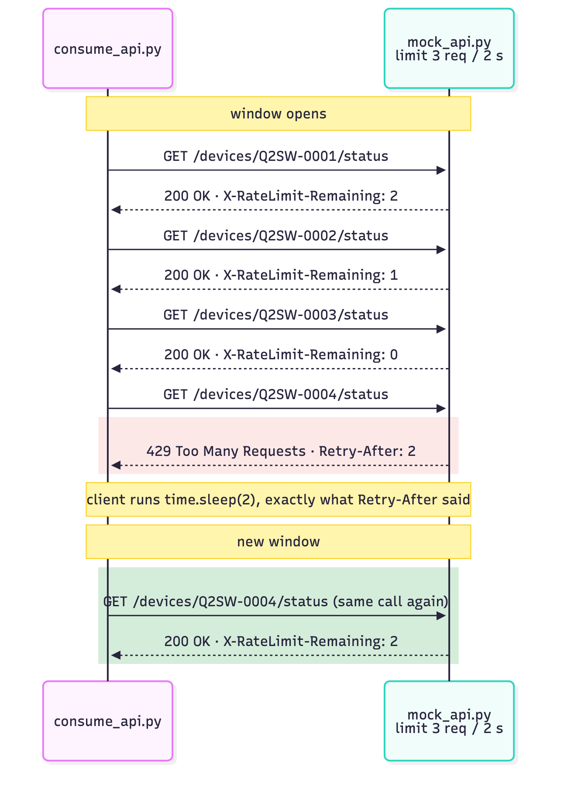

*Section 2 of the output, drawn out. `Remaining` counts down 2 → 1 → 0, the 4th call gets `429`, and the **same** call succeeds after the 2-second sleep.*

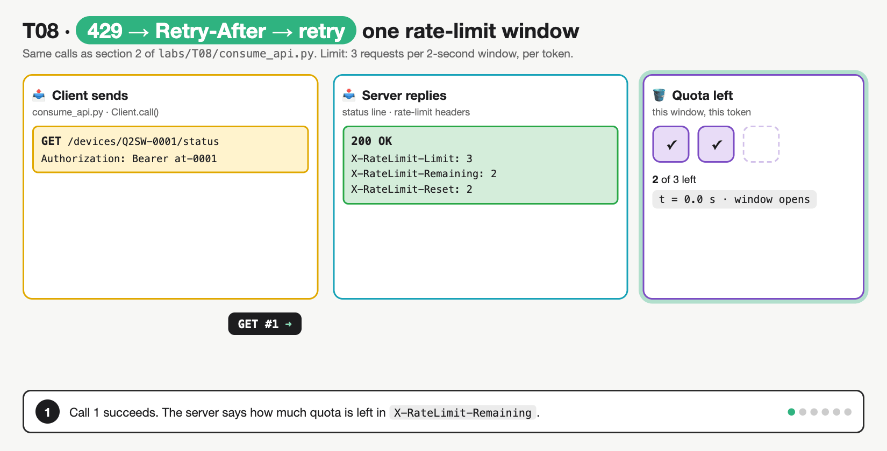

*One window, step by step: GET #1 (quota 2 left) → GET #2, #3 (0 left) → GET #4 gets `429` + `Retry-After: 2` → client sleeps, sends nothing → the same GET #4 succeeds in the new window → #5, #6 carry on. It fixes the misconception that **a 429 means the call failed and the data is lost**. It's a pause signal; the retry gets the data.*

### T08.02 · Rate limiting

**Must cover:**

- [x] On 429: sleep for Retry-After, then retry
- [x] Exponential backoff: wait 1s, 2s, 4s… with a cap
- [x] Reduce calls: cache results, batch requests, use webhooks instead of polling
- [x] Spread work across time rather than bursts

**Notes:**

- All the retry logic lives in **`Client.call()`**, in one `for attempt in range(MAX_RETRIES + 1)` loop:
  - `429` → `wait = int(r.headers.get("Retry-After", min(2 ** attempt, BACKOFF_CAP)))` (the header if sent, else backoff), then `time.sleep(wait)`, then `continue` (send the same request again).
  - `502`/`503`/`504` **without** `Retry-After` → exponential backoff: `wait = min(2 ** attempt, BACKOFF_CAP)`, giving 1, 2, 4, 8, 8 s. Section 3 shows it: `503` → sleep 1 → `503` → sleep 2 → `200`.
  - After `MAX_RETRIES` it stops and returns the last response. Never retry forever.
- Rules of thumb (the exam asks "what should the script do?"):

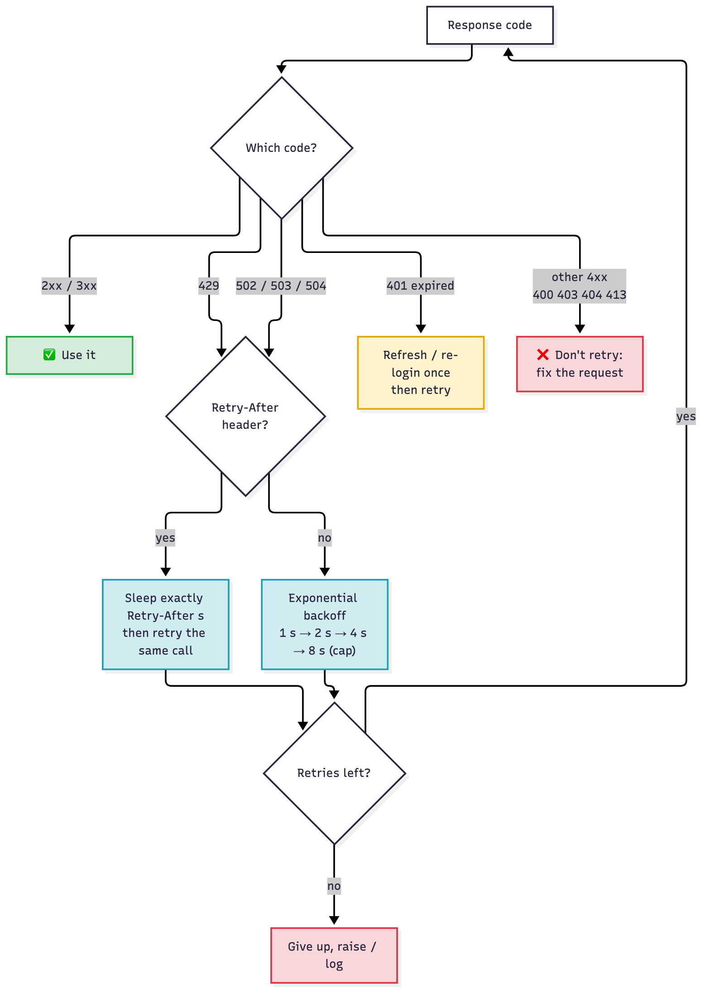

*Retry only "come back later" codes (blue): `429` and `502`/`503`/`504`. Obey `Retry-After` when present, otherwise back off. Other 4xx codes (red) mean the request is wrong, so retrying the same request can't help.*

- **Why exponential, and why a cap?** Each failure doubles the wait, so a struggling server gets breathing room fast. The cap stops waits growing to minutes. Real clients add random **jitter** so 1000 scripts don't all retry on the same second.
  - The Meraki SDK does exactly this: it uses `Retry-After` if sent, else `min(2**attempt * (1 + random), nginx_429_retry_wait_time)`. Defaults in SDK 4.6.0: `wait_on_rate_limit=True`, `maximum_retries=5`, `nginx_429_retry_wait_time=60` ⚠ verify.
  - curl does it too: `--retry 3` retries on 408, 429, 500, 502, 503 and 504, starting at 1 s and doubling, and obeys `Retry-After` (since curl 7.66.0). See the curl drill.
- **Make fewer calls** (the best fix, because a call you don't make can't be throttled):

| Technique | How | Saves |
|---|---|---|
| **Cache** | keep results you already have; revalidate with `ETag` (T08.08) | repeat GETs |
| **Batch** | one call with many items instead of many calls (Meraki "action batches" ⚠ verify limits) | N calls → 1 |
| **Webhooks instead of polling** | the platform POSTs to you when something changes ([T43](T43-webhooks.md)) | the "anything new?" loop |
| **Bigger pages** | `perPage=1000` instead of 10 | pagination calls |
| **Spread over time** | throttle yourself below the limit (e.g. `time.sleep(0.1)` between calls, or a token bucket) | the burst that triggers 429 |

- **Spread, don't burst.** Section 2 sends 6 calls in a tight loop, so calls 1–3 burst through, 4 hits `429`, and the script stalls for 2 s. Pacing the same 6 calls at 1 per 0.7 s would never trigger a 429. The Meraki SDK's "smart flow" (on by default in 4.6.0) does this pacing for you ⚠ verify.

### T08.03 · Pagination

**Must cover:**

- [x] APIs return large collections in pages to limit load
- [x] Offset/limit: ?offset=100&limit=50
- [x] Page number: ?page=3&per_page=50
- [x] Cursor/token: response gives a next token (startingAfter in Meraki)
- [x] Link header with rel="next" gives the next page URL (Meraki)
- [x] Script bug pattern: only the first page is read → records "missing"

**Notes:**

- **Pagination** = the server returns a big collection in **pages**, one page per request, so no single response is huge.
  - Each page is a normal `200 OK`. Nothing in the status code tells you there's more; you must check the body or headers.
- Three styles, all in section 4 of the program:

| Style | Request | "Is there more?" signal | Program function |
|---|---|---|---|
| **Offset / limit** | `?offset=5&limit=5` (skip 5, take 5) | body `"total": 12` → stop when `offset >= total` | `all_by_offset()` |
| **Page number** | `?page=2&per_page=4` | body `"total_pages": 3` → stop when `page >= total_pages` | `all_by_page_number()` |
| **Cursor / token** | `?perPage=10&startingAfter=c010` | `Link` header has `rel="next"` → stop when it's gone | `all_by_link_header()` |

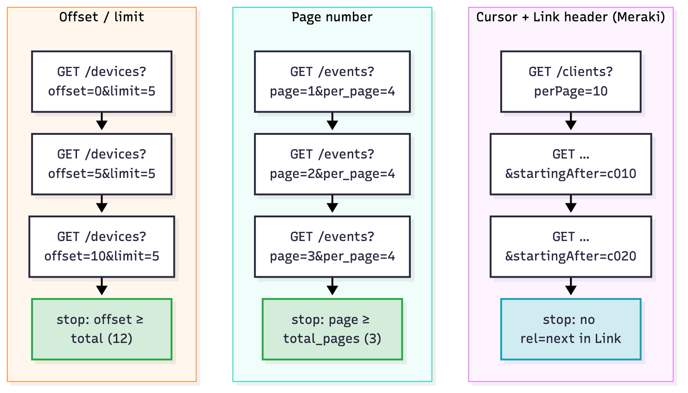

*Same idea, three different stop signals. Offset and page number read a count from the **body**. The cursor style reads the next URL from the **header** (blue = the Meraki answer).*

- **Cursor style (Meraki):**
  - The server, not you, picks the cursor value. The SDK docstring says it plainly: `startingAfter` is "a token used by the server to indicate the start of the page… This parameter should not be defined by client applications. The link for the first, last, prev, or next page in the HTTP Link header should define it."
  - The `Link` header (RFC 8288) carries ready-made URLs: `Link: <https://…?perPage=10&startingAfter=c010>; rel="next"`. Possible `rel` values include `first`, `prev`, `next` and `last`. On the **last** page there's no `rel="next"`.
  - `requests` parses it for you: `r.links["next"]["url"]`. `all_by_link_header()` uses `r.links.get("next", {}).get("url")`, which returns `None` on the last page and ends the `while url:` loop.
  - Why cursors? An offset shifts if rows are added while you page (you'd skip or repeat one). A cursor always says "after this exact item".
  - The Meraki SDK pages for you: `total_pages=-1` (or `"all"`) fetches every page; the default is `total_pages=1`, so **only the first page**. `perPage` maximums vary per endpoint (e.g. 3–1000 for `getOrganizationDevicesStatuses`, 3–5000 for `getNetworkClients`, from the SDK 4.6.0 docstrings ⚠ verify).
- **The classic bug:** `first_page_only()` does one GET and returns **5 of 12** devices. No error, no exception, just missing data.

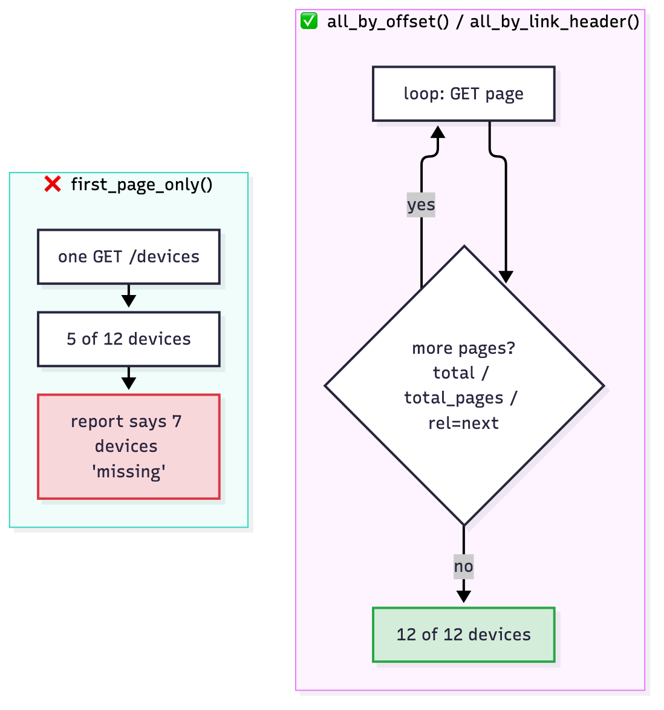

*Exam scenario "the script only reports some devices": the cause is a missing paging loop (red), and the fix is to loop on the "more?" signal (green).*

#### Page size, jumping to a page, cursors and resuming

- **Who decides how big a page is?** The **API** sets a default and a maximum, written in its docs. **You** choose a size within that limit with a query parameter (`limit`, `per_page`, `perPage`).
  - Real run: `/events?per_page=4` gives `total_pages: 3`. Ask for `per_page=6` and the same 9 events come back as `total_pages: 2`.
  - Over the maximum → most APIs answer `400`, or quietly cap it to the maximum ⚠ verify per API.
  - Fewer, bigger pages = fewer calls against your rate limit (T08.01), but each response is slower and heavier. Pick a size near the maximum unless responses time out (T08.05).
- **What's on page n?** There's no index; it's arithmetic on the **page size**:
  - Offset/limit: items `offset` to `offset + limit − 1`. Page 3 at `limit=5` is `offset=10`.
  - Page number: page *n* holds items `(n − 1) × per_page + 1` to `n × per_page`. Page 3 at `per_page=4` is items 9–12.
  - Real run: `GET /events?page=3&per_page=4` went **straight to page 3** and returned `[9]`, the last item. No earlier pages needed.
  - This only works if the list is always **sorted the same way** (by id or time). "Page 2" at size 4 and at size 6 hold different items.
- **A cursor is a bookmark.** It marks the last item you saw; the next request means "continue after this one".
  - Meraki style: `startingAfter=c010` = "after client c010". The server builds the next URL into `Link: <…&startingAfter=c010>; rel="next"`, so you never make up a cursor yourself.
  - **Why cursors exist:** if items are added or deleted while you page, page numbers and offsets shift, so you skip or repeat items. A cursor is tied to a real item, so it doesn't shift.
  - **Trade-off:** no jumping to "page 7". You can only follow `next` (sometimes `prev`, `first`, `last`).
  - Some APIs use an opaque token instead (e.g. `nextPageToken=eyJ…`): same idea, you just pass it back unchanged.

| Style | Who builds the next request | Jump to a page? | Stable if data changes? | Typical "more?" signal |
|---|---|---|---|---|
| Offset / limit | you: `offset += limit` | ✅ | ❌ | body `total` |
| Page number | you: `page += 1` | ✅ | ❌ | body `total_pages` |
| Cursor / `Link` | the server: `rel="next"` | ❌ (next only) | ✅ | `Link` header `rel="next"` |

- **It fails halfway: restart or resume?** The API **doesn't remember** where you stopped: REST is stateless ([T07.02](T07-rest-fundamentals-http-codes.md#t0702--rest-constraints)). **Your script** decides.
  - No bookmark saved → it starts again at page 1 and fetches everything twice (wasted calls, maybe another `429`).
  - Bookmark saved after each page → it resumes from the first page it hadn't got yet.
  - Order matters: **save the page's data first, then move the bookmark.** If it crashes between the two, the worst case is fetching that one page again, so make saving an item twice harmless (dedupe on the item's id).
  - On `429` or a timeout, retry the **same** URL (T08.02). Only a successful page moves the bookmark.
  - Cursors can **expire** ⚠ verify per API. If resuming gives `400`/`410`, start again from page 1.

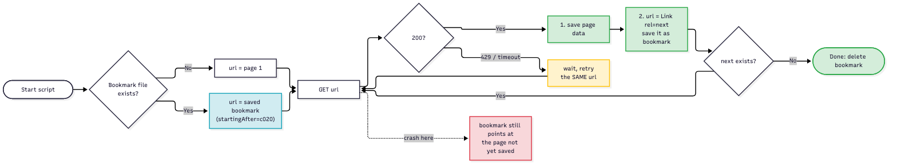

*Each page: save data (1), then save the next URL as the bookmark (2). A crash leaves the bookmark pointing at the first page not yet saved, so a restart resumes there instead of at page 1.*

- **Real run** (`bash labs/T08/run_lab.sh labs/T08/resume_paging.py`): run 1 saves 2 pages and then "crashes"; run 2 reads the bookmark and fetches only the rest.

```
== Run 1 (crashes after 2 pages)
  no bookmark: starting from page 1
  page 1: c001..c010 saved
  page 2: c011..c020 saved
  !! simulated crash (network dropped). Bookmark kept: True

== Run 2 (same script, started again)
  resuming from bookmark: .../networks/N_100/clients?perPage=10&startingAfter=c020
  page 1: c021..c025 saved

Saved 25 clients (c001..c025), duplicates: 0, bookmark left behind: False
```

### T08.04 · Payload limits

**Must cover:**

- [x] Servers cap request body size and items per call
- [x] 413 Payload Too Large when a body is too big
- [x] Split large updates into several smaller requests

**Notes:**

- Servers cap what one request may carry, in two ways:
  - **Bytes:** the whole body. The mock caps it at 512 bytes.
  - **Items:** entries per call. The mock allows at most 10 serials. Meraki's synchronous action batches allow at most 20 actions (SDK docstring for `createOrganizationActionBatch` ⚠ verify).
- **`413`** = body too big. RFC 9110 renamed it from "Payload Too Large" to **"Content Too Large"**, which is why the output prints `413 Content Too Large`. Both names mean the same code. If the limit is temporary the server SHOULD add `Retry-After`.
  - The mock checks `Content-Length` **before** parsing, which is how real servers reject big uploads cheaply.
- An items limit often comes back as a plain **`400`** with an explanation in the body (`"15 serials; max 10 per request"`), not as 413. Read the error body.
- Related, rarely tested: `414 URI Too Long` (a giant query string) and `431 Request Header Fields Too Large` (RFC 6585).
- **Fix: split.** `chunks(items, size)` yields slices of `size`, and section 5 posts 40 serials as 4 × 10 → 4 × `200`.

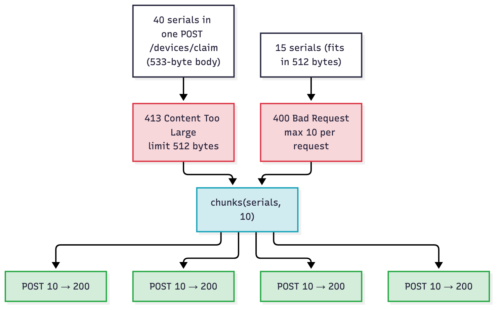

*Both limits lead to the same fix (blue): split into batches that fit under **both** caps.*

- Splitting multiplies the call count, so mind the rate limit too (T08.01). Batch size is a trade-off between payload cap and request count.

### T08.05 · Timeouts

**Must cover:**

- [x] Client timeout: requests.get(url, timeout=10) avoids hanging forever
- [x] Server/gateway timeouts show up as 504
- [x] Long-running jobs are often returned as async tasks (202) instead

**Notes:**

- **`requests` has no default timeout.** The requests docs say: "By default, requests do not time out unless a timeout value is set explicitly. Without a timeout, your code may hang for minutes or more."
  - `timeout=10` applies 10 s to **both** the connect and the read phase.
  - `timeout=(3.05, 5)` = (**connect**, **read**). The program's `TIMEOUT` constant. Connect = TCP handshake; read = max seconds **between bytes** from the server (not the total download time).
  - Hitting it raises an **exception**, not a status code: `requests.exceptions.ConnectTimeout` or `requests.exceptions.ReadTimeout` (both subclass `requests.exceptions.Timeout`). There's no HTTP response at all.
  - Section 6: `/reports/slow` takes 2 s; with a 1 s read timeout → `ReadTimeout`; with 5 s → it works.
  - curl equivalents: `--connect-timeout 3` and `--max-time 10` (whole transfer); a timeout exits with code **28**.
- **`504 Gateway Timeout`** = a proxy, load balancer or API gateway **in the middle** gave up waiting for the backend. It **is** an HTTP response, sent by the middle box. (T07: `502` = bad reply from upstream, `504` = **no** reply in time.)
- **Async jobs:** for work that takes longer than any sensible timeout (reports, firmware upgrades, config backups), the API answers **`202 Accepted`** at once, with a job URI in `Location`. You then **poll** that URI until it says complete.
  - Section 6: `POST /reports` → `202` + `Location: /api/v1/jobs/1` → poll `running`, `running`, `complete`. The loop sleeps for the poll response's own `Retry-After: 1` between polls.
  - Catalyst Center (DNA Center) works this way: many write calls return a task ID you poll ⚠ verify the exact task endpoint path.

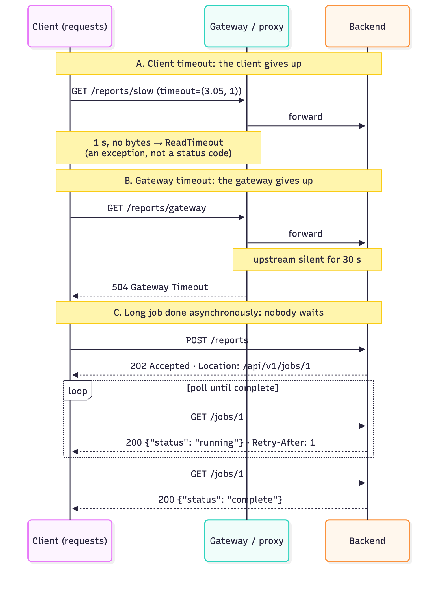

*A: the **client** gives up (exception, no code). B: the **gateway** gives up (`504`). C: nobody waits: `202` + poll.*

### T08.06 · Auth limits

**Must cover:**

- [x] Tokens expire (e.g. after a set number of minutes)
- [x] 401 mid-script often means an expired token → log in again
- [x] Some APIs issue refresh tokens

**Notes:**

- Access tokens are short-lived on purpose: a leaked token stops working soon. The lifetime is usually in the login response as `"expires_in": 300` (seconds, the OAuth 2.0 name from RFC 6749).
  - Platform lifetimes differ, e.g. FMC (Secure Firewall Management Center) about 30 min and Webex personal tokens about 12 h ⚠ verify both; covered per platform in [T10](T10-api-authentication.md).
- **Symptom:** the script worked for its first N calls, then gets **`401`** in the middle. The password didn't change; the token **expired**.
  - A well-behaved server says so: `WWW-Authenticate: Bearer realm="…", error="invalid_token", error_description="The access token expired"` (the RFC 6750 example). The mock sends exactly that.
- **Fix:** get a new token, then retry the failed call **once**.
  - **Refresh token:** a second, longer-lived credential issued with the access token. POST it with `grant_type=refresh_token` to get a new access token without re-sending the password (RFC 6749 §6). `Client.refresh()` does this.
  - **No refresh token** (many Cisco APIs): just log in again (`Client.login()`).
  - **Retry once, not forever.** `Client.call()` uses a `refreshed` flag, so a second `401` is returned to the caller. It would mean the credentials really are wrong.
  - Better still: refresh **before** expiry by tracking `expires_in`.

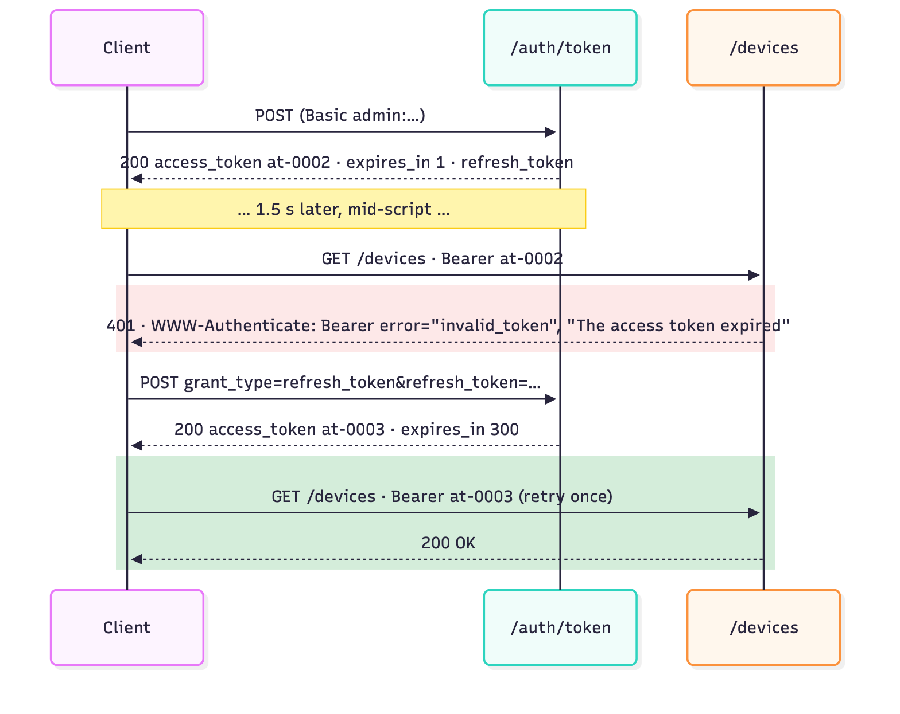

*Section 7: the token lives 1 s; 1.5 s later the call gets `401` with "The access token expired"; refresh → new token → the same call returns `200`.*

- **401 vs 403 again (T07):** a new token fixes 401. It never fixes 403, because 403 means the role lacks permission.

### T08.07 · Versioning

**Must cover:**

- [x] APIs are versioned in the URL (/v1/) or a header
- [x] Old versions get deprecated and removed
- [x] Scripts must be updated to new versions/fields

**Notes:**

- APIs change. A **version** lets the provider ship breaking changes (renamed fields, new paths) without breaking existing scripts overnight.
  - **URL versioning:** `/api/v1/devices` (Meraki `https://api.meraki.com/api/v1`, Catalyst Center `/dna/intent/api/v1/…`). It's the most common and the one the exam shows.
  - **Header versioning:** e.g. `Accept: application/vnd.example.v2+json` or a custom `X-API-Version: 2`. The URL stays the same.
- **Lifecycle: active → deprecated → removed.**
  - **Deprecated** = still works, but you're told to move. Standard response headers: `Deprecation` (RFC 9745) gives when it was deprecated (`@1767225599` = a Unix timestamp); `Sunset` (RFC 8594) gives when it stops working; `Link: <…>; rel="successor-version"` points at the replacement.
  - **Removed** = after the sunset date, calls fail (`404` or `410 Gone`).

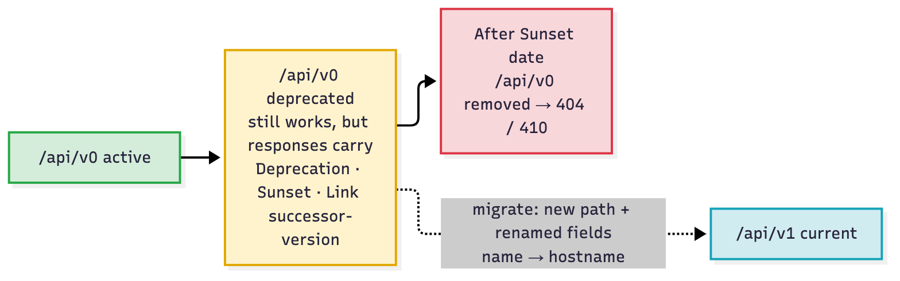

*Deprecated (yellow) still answers `200`, which is why scripts don't notice until it's removed (red). Migrate during the yellow phase.*

- Section 8: `/api/v0/devices` still answers `200`, with `Deprecation`, `Sunset` and `Link` headers, and returns the field `name`. In v1 the same field is `hostname`. A script that switches the URL to v1 but still reads `d["name"]` gets a `KeyError`. **Migrate the fields, not just the path.**
- A version that doesn't exist (`/api/v2`) → `404`.

### T08.08 · Caching

**Must cover:**

- [x] Server sends ETag (version tag) with a resource
- [x] Client sends If-None-Match: <etag> on the next GET
- [x] 304 Not Modified = nothing changed, no body, saves bandwidth and quota

**Notes:**

- **`ETag`** = an opaque version tag for one resource, sent **by the server** in a response header: `ETag: "Q2SW-0001-r1"`. When the resource changes, the tag changes. (`W/"…"` marks a "weak" tag, meaning equivalent but not byte-identical.)
- **`If-None-Match`** = the client sends the tag **back** on the next GET: "only send the body if it's no longer this version". That's a **conditional GET**.
  - Unchanged → **`304 Not Modified`**, **empty body** (`len(r.content)` is 0 in section 9), so reuse your cached copy.
  - Changed → normal `200` with the new body and a new `ETag`.
- Saves bandwidth and server work. Whether a `304` counts against your rate limit depends on the API ⚠ verify per platform. (GitHub, for example, documents that conditional requests returning 304 don't count against the primary rate limit for authorized requests ⚠ verify.)
- `Cache-Control: max-age=60` (the mock sends it) = "you may reuse this for 60 s without asking at all". That's even cheaper, because no request is sent.
- Same mechanism as in T07.02 (the **cacheable** REST constraint). T08 is the consumer angle: use it to stay under quota.

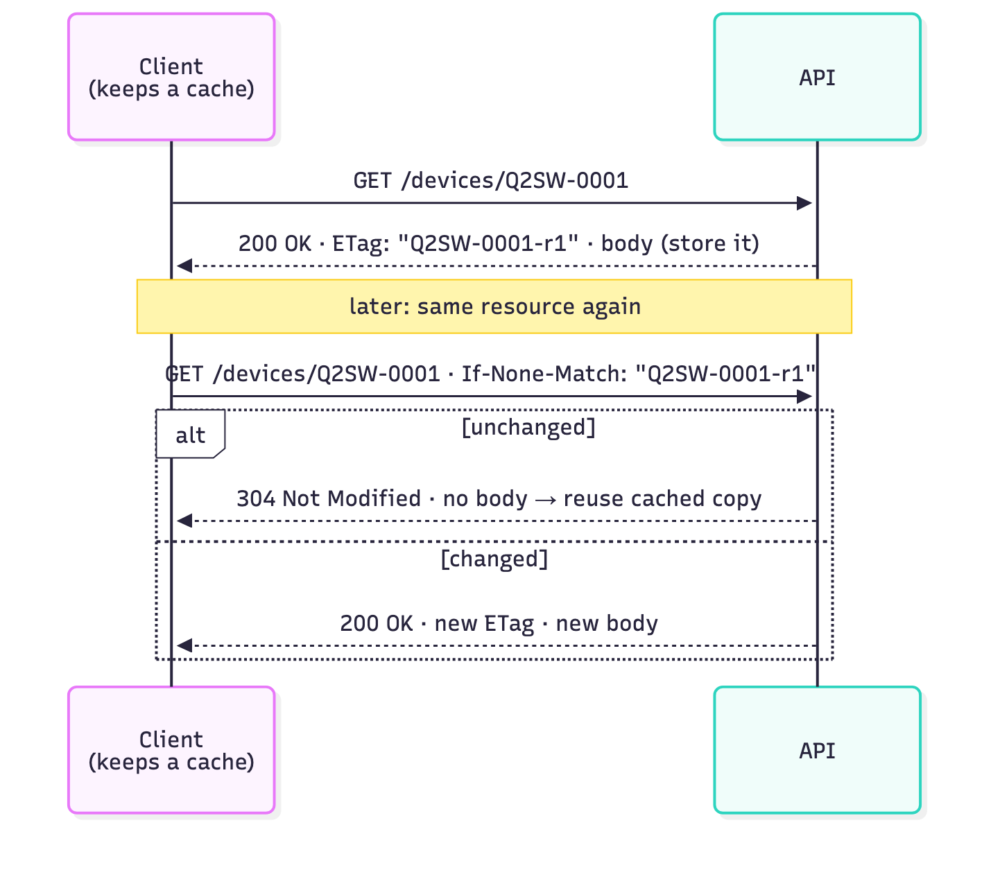

*The tag goes **out** as `ETag` and comes **back** as `If-None-Match`. Only a conditional GET can produce `304`.*

### T08.09 · Exam angle

**Must cover:**

- [x] Pick the cause and fix for 429 errors or incomplete results
- [x] Know the headers involved: Retry-After, Link, ETag

**Notes:**

| Scenario in the question | Cause | Fix |
|---|---|---|
| Script loops over 500 devices, starts getting `429` | too many calls per window | honour `Retry-After`; back off; pace calls; cache/batch; webhooks instead of polling |
| Report shows 1000 clients but the dashboard has 2400 | only the first page read | loop on `Link rel="next"` / `total` / `total_pages`; in the Meraki SDK, `total_pages="all"` |
| Script hangs forever on one call | no client timeout | `requests.get(url, timeout=(3.05, 10))` |
| `504` from the API | gateway timed out waiting for the backend | retry later with backoff; use the async (`202`) variant if there is one |
| Bulk update returns `413` | body too large | split into smaller requests |
| Works for 30 min, then every call returns `401` | token expired | refresh / re-login, then retry |
| Script broke after the vendor's upgrade notice | old version removed or fields renamed | move to `/v1`, update field names |
| Want to re-check config often without burning quota | repeat full GETs | `ETag` + `If-None-Match` → `304` |

- **Header → purpose:** `Retry-After` = how long to wait · `Link` = where the next page is · `ETag` = the version of what you have · `X-RateLimit-Remaining` = calls left · `Location` = where the job (202) or new resource (201) is · `Deprecation`/`Sunset` = version end of life.

## Exam traps

- **429 vs 503:** 429 = **you** sent too many (per-client limit). 503 = the **service** is down or overloaded for everyone. Both can carry `Retry-After`; both are "wait and retry".
- **429 ≠ fix the request.** Don't change the URL, body or token. Wait `Retry-After` seconds and send the **same** request again.
- **`Retry-After` has two forms:** seconds (`120`) **or** an HTTP-date. `int(r.headers["Retry-After"])` (as in `consume_api.py`, fine for this mock) crashes on the date form (see Examples 4).
- **Retrying instantly makes it worse:** each extra call extends the throttle. Always sleep; cap the backoff; cap the retries.
- **Don't retry other 4xx:** 400/401/403/404/413 mean the request is wrong. Retrying unchanged can't succeed. (401-expired is the exception: get a new token first.)
- **Missing records, no error → pagination.** The status is `200` on every page; "more data" is only in the body (`total`, `total_pages`) or the `Link` header.
- **Who sets the page size?** The API sets the default and maximum (in its docs); the client picks a size up to that maximum with `limit` / `per_page` / `perPage`.
- **Cursor ≠ page number.** A cursor (`startingAfter`, `nextPageToken`) is a bookmark the **server** gives you: you can only go to `next`, not jump to page 7, but it doesn't skip or repeat items when data changes.
- **The API won't resume for you.** A paged fetch that dies halfway restarts from page 1 unless **your script** saved the next cursor/offset. Save the page data first, then the bookmark.
- **Where's the next page?** Meraki: in the **`Link` response header**, `rel="next"`, not in the body. Don't build `startingAfter` yourself; follow the URL. `r.links["next"]["url"]` in `requests`.
- **Meraki SDK `total_pages` defaults to 1**, so only the first page unless you pass `total_pages="all"` (or `-1`).
- **413 name:** "Payload Too Large" (RFC 7231, older) = "Content Too Large" (RFC 9110, current). Same code, both may appear. 414 = URI too long.
- **`requests` has no default timeout.** `timeout=5` = both connect and read; `timeout=(3.05, 27)` = (connect, read). A timeout is an **exception**, not a status code.
- **Client timeout vs `504`:** your own timeout → `ReadTimeout` exception, no response. `504` → a gateway's timeout, delivered as an HTTP response.
- **`202` = queued, not done.** Poll the `Location` URI; don't treat 202 as success of the job.
- **Mid-script `401` after successes = expired token,** not wrong credentials. Refresh or re-login **once**. If it's still 401, stop.
- **Deprecated ≠ removed.** Deprecated APIs still answer `200` (with `Deprecation`/`Sunset` headers). After the sunset date: `404`/`410`.
- **`ETag` direction:** server → client in `ETag`; client → server in `If-None-Match`. `304` has **no body**, so calling `.json()` on it fails.
- **Webhooks vs polling:** "reduce API calls for change notifications" → webhooks (push), not a faster polling loop.

## Examples

### 1. Run the reference program

Needs Python 3, `requests` and curl. Nothing else, and no DevNet sandbox.

```bash
python3 -m venv "$TMPDIR/t08-venv" && "$TMPDIR/t08-venv/bin/pip" install --quiet requests
PATH="$TMPDIR/t08-venv/bin:$PATH" bash labs/T08/run_lab.sh                         # mock API + consume_api.py
PATH="$TMPDIR/t08-venv/bin:$PATH" bash labs/T08/run_lab.sh labs/T08/curl_drill.sh  # mock API + curl drill
```

Or by hand, in two terminals:

```bash
python3 labs/T08/mock_api.py                     # terminal 1: leave running (stdlib only)
python3 labs/T08/consume_api.py                  # terminal 2: needs requests
```

In the lab container (it already has `requests`, and the API and client share the container's localhost):

```bash
docker build --tag ccna-auto-lab:latest --file labs/Dockerfile labs/
docker run --rm --volume "$(pwd)":/work --workdir /work ccna-auto-lab:latest bash labs/T08/run_lab.sh
```

### 2. curl drill (`labs/T08/curl_drill.sh`)

```bash
#!/usr/bin/env bash
# T08 curl drill against the local mock API. Start it first:  python3 labs/T08/mock_api.py
set -u
BASE="http://127.0.0.1:8108/api/v1"

TOKEN=$(curl --silent --request POST --user admin:C1sco12345 "$BASE/auth/token" \
  | python3 -c "import json, sys; print(json.load(sys.stdin)['access_token'])")
echo "TOKEN=$TOKEN"

echo; echo "== 1. Burst 4 calls: the 4th gets 429 + Retry-After + X-RateLimit-*"
for n in 1 2 3 4; do
  curl --silent --output /dev/null --dump-header - \
    --header "Authorization: Bearer $TOKEN" \
    "$BASE/devices/Q2SW-000$n/status" | grep -E '^(HTTP|Retry-After|X-RateLimit)' | tr -d '\r'
done

echo; echo "== 2. curl --retry obeys Retry-After on 429 (needs curl >= 7.66)"
for n in 1 2 3; do                     # use up this window's quota first
  curl --silent --output /dev/null --header "Authorization: Bearer $TOKEN" "$BASE/devices/Q2SW-0005/status"
done
curl --no-progress-meter --retry 3 --output /dev/null \
  --write-out "final %{http_code}\n" \
  --header "Authorization: Bearer $TOKEN" \
  "$BASE/devices/Q2SW-0005/status" 2>&1

echo; echo "== 3. Link header: the next page URL is in a header, not the body"
curl --silent --output /dev/null --dump-header - \
  --header "Authorization: Bearer $TOKEN" \
  "$BASE/networks/N_100/clients?perPage=10" | grep -i '^Link' | tr -d '\r'

echo; echo "== 4. Client-side timeout: --max-time 1 on a 2 s endpoint (exit code 28)"
curl --silent --show-error --max-time 1 \
  --header "Authorization: Bearer $TOKEN" \
  "$BASE/reports/slow"
echo "curl exit code: $?"

echo; echo "== 5. ETag then If-None-Match -> 304, empty body"
ETAG=$(curl --silent --output /dev/null --dump-header - \
  --header "Authorization: Bearer $TOKEN" \
  "$BASE/devices/Q2SW-0001" | grep -i '^ETag' | cut -d' ' -f2 | tr -d '\r')
echo "ETag=$ETAG"
curl --silent --include \
  --header "Authorization: Bearer $TOKEN" \
  --header "If-None-Match: $ETAG" \
  "$BASE/devices/Q2SW-0001" | tr -d '\r'
```

Output (curl 8.7.1, `bash labs/T08/run_lab.sh labs/T08/curl_drill.sh`):

```
TOKEN=at-0001

== 1. Burst 4 calls: the 4th gets 429 + Retry-After + X-RateLimit-*
HTTP/1.1 200 OK
X-RateLimit-Limit: 3
X-RateLimit-Remaining: 2
X-RateLimit-Reset: 2
HTTP/1.1 200 OK
X-RateLimit-Limit: 3
X-RateLimit-Remaining: 1
X-RateLimit-Reset: 2
HTTP/1.1 200 OK
X-RateLimit-Limit: 3
X-RateLimit-Remaining: 0
X-RateLimit-Reset: 2
HTTP/1.1 429 Too Many Requests
Retry-After: 2
X-RateLimit-Limit: 3
X-RateLimit-Remaining: 0
X-RateLimit-Reset: 2

== 2. curl --retry obeys Retry-After on 429 (needs curl >= 7.66)
Warning: Problem : HTTP error. Will retry in 2 seconds. 3 retries left.
final 200

== 3. Link header: the next page URL is in a header, not the body
Link: <http://127.0.0.1:8108/api/v1/networks/N_100/clients?perPage=10>; rel="first", <http://127.0.0.1:8108/api/v1/networks/N_100/clients?perPage=10&startingAfter=c010>; rel="next"

== 4. Client-side timeout: --max-time 1 on a 2 s endpoint (exit code 28)
curl: (28) Operation timed out after 1005 milliseconds with 0 bytes received
curl exit code: 28

== 5. ETag then If-None-Match -> 304, empty body
ETag="Q2SW-0001-r1"
HTTP/1.1 304 Not Modified
Server: MockDashboard/1.0
Date: Sat, 10 Oct 2026 11:44:56 GMT
ETag: "Q2SW-0001-r1"
Content-Length: 0
```

- Step 1: the headers count down, and the 4th call gets `429`. `--dump-header -` prints the response headers to stdout.
- Step 2: `--retry 3` saw the 429, printed "Will retry in **2** seconds" (that's the server's `Retry-After: 2`, not curl's default 1 s), then got `200`.
- Step 3: the next-page URL is in the `Link` **header**; the body is just the list of clients.
- Step 4: the client gave up → curl exit code `28`, no HTTP status at all.

### 3. Break it on purpose

Copy `labs/T08/` somewhere else, make one edit, and run `bash <copy>/run_lab.sh`. All five were run against the mock, and the result shown is the real changed output.

| Edit in `consume_api.py` | What changes in the output | Lesson |
|---|---|---|
| `MAX_RETRIES = 4` → `MAX_RETRIES = 0` | section 2: the `429` for Q2SW-0004 is not retried, so device 4's status is **never read** (the next line is Q2SW-0005). Section 3: `final: {'error': 'backend busy, try again later'}`. Section 7: `final: 401` | no retry = silently lost data |
| in `all_by_link_header()`, `url = r.links.get("next", {}).get("url")` → `url = None` | `Link rel=next:       10 clients` (was 25) | the first-page bug, with no error |
| `TIMEOUT = (3.05, 5)` → `TIMEOUT = (3.05, 1)` | section 6 crashes: `requests.exceptions.ReadTimeout: HTTPConnectionPool(host='127.0.0.1', port=8108): Read timed out. (read timeout=1)` | a too-short read timeout is an exception, not a status code |
| `chunks(serials, 10)` → `chunks(serials, 20)` | `batch of 20 -> 400 {'error': '20 serials; max 10 per request'}` (twice) | batch size must fit the items cap |
| delete the line `self.refresh()` in `Client.call()` | section 7: `401` again after "refresh it, then retry once" → `final: 401` | retrying with the same expired token can't work; the guard stops an endless loop |

### 4. Trap snippet: `Retry-After` can be a date

Save as `$TMPDIR/retry_after.py` and run `python3 "$TMPDIR/retry_after.py"`:

```python
from datetime import datetime, timezone
from email.utils import parsedate_to_datetime


def retry_after_seconds(value, now):
    """Retry-After is either delay-seconds ("120") or an HTTP-date (RFC 9110 10.2.3)."""
    if value.isdigit():
        return int(value)
    return max(0, int((parsedate_to_datetime(value) - now).total_seconds()))


now = datetime(2026, 10, 10, 12, 0, 0, tzinfo=timezone.utc)
print(retry_after_seconds("120", now))
print(retry_after_seconds("Sat, 10 Oct 2026 12:01:30 GMT", now))
int("Sat, 10 Oct 2026 12:01:30 GMT")       # what a naive script does
```

Output:

```
120
90
Traceback (most recent call last):
  …
ValueError: invalid literal for int() with base 10: 'Sat, 10 Oct 2026 12:01:30 GMT'
```

### 5. Drill: parse a Meraki-style `Link` header without a server

`requests` parses `Link` for you. Save as `$TMPDIR/links.py` and run it with the venv from Example 1: `"$TMPDIR/t08-venv/bin/python" "$TMPDIR/links.py"`.

```python
import requests

header = ('<https://api.meraki.com/api/v1/networks/N_100/clients?perPage=10>; rel=first, '
          '<https://api.meraki.com/api/v1/networks/N_100/clients?perPage=10&startingAfter=c010>; rel=next')
r = requests.models.Response()
r.headers["Link"] = header
print(r.links["next"]["url"])
print(r.links.get("prev", {}).get("url"))
```

Output:

```
https://api.meraki.com/api/v1/networks/N_100/clients?perPage=10&startingAfter=c010
None
```

- `.get("prev", {}).get("url")` returns `None` instead of raising `KeyError`, which is how `all_by_link_header()` knows it's on the last page.

### 6. Real Cisco API: Meraki Dashboard with the SDK

Not run (needs a Meraki API key). The always-on DevNet Meraki sandbox key and org change, so check developer.cisco.com/sandbox ⚠ verify. Put the key in `labs/.env` as `MERAKI_DASHBOARD_API_KEY` and an org ID as `MERAKI_ORG_ID`.

```bash
set -a && source labs/.env && set +a
docker run --rm --volume "$(pwd)":/work --workdir /work \
  --env MERAKI_DASHBOARD_API_KEY --env MERAKI_ORG_ID \
  ccna-auto-lab:latest python3 -c '
import os, meraki
dashboard = meraki.DashboardAPI(suppress_logging=True, wait_on_rate_limit=True, maximum_retries=5)
devices = dashboard.organizations.getOrganizationDevices(os.environ["MERAKI_ORG_ID"], total_pages="all", perPage=1000)
print(len(devices), "devices")
'
```

- `wait_on_rate_limit=True` = the SDK sleeps on `429` (using `Retry-After`) instead of raising.
- `total_pages="all"` = the SDK follows `Link rel="next"` for you. Leave it out and you get page 1 only.
- The SDK reads `MERAKI_DASHBOARD_API_KEY` from the environment automatically.

Same thing with raw curl, showing the `Link` header (⚠ verify the auth header form: current Meraki docs use `Authorization: Bearer <key>`; older docs used `X-Cisco-Meraki-API-Key`):

```bash
set -a && source labs/.env && set +a
curl --silent --output /dev/null --dump-header - \
  --header "Authorization: Bearer $MERAKI_DASHBOARD_API_KEY" \
  "https://api.meraki.com/api/v1/organizations/$MERAKI_ORG_ID/devices?perPage=3" \
  | grep -iE '^(HTTP|link|retry-after)'
```

## Practice questions

**Q1.** A script reads interface status for 400 Meraki devices in a tight loop. After about 10 calls, every response is:

```
HTTP/1.1 429 Too Many Requests
Retry-After: 1
```

What's the best fix?
A. Regenerate the API key  B. Sleep for the `Retry-After` value and retry, and pace the loop  C. Switch the method from GET to POST  D. Increase the client `timeout`

<details><summary>Answer</summary>

**B.** 429 = too many requests in the window. The request itself is fine, so wait the advertised time, retry, and slow the loop down. A new key (A) or a bigger timeout (D) doesn't change the call rate. (T08.01, T08.02)
</details>

**Q2.** A script lists all wireless clients in a network and reports 10 clients. The dashboard shows 25. The script gets `200 OK` and logs no errors. Refer to the response header:

```
Link: <https://api.meraki.com/api/v1/networks/N_100/clients?perPage=10&startingAfter=c010>; rel=next
```

What's the cause?
A. The API key lacks read permission for some clients  B. The script didn't follow the `rel=next` URL to fetch the remaining pages  C. The response was truncated by a payload limit  D. The token expired halfway through

<details><summary>Answer</summary>

**B.** A `rel=next` link means more pages exist. Only page 1 (10 clients) was read. Missing permissions would give `403`, and an expired token `401`. (T08.03)
</details>

**Q3.** Complete the code so it collects **every** page:

```python
items, url = [], f"{BASE_URL}/networks/N_100/clients?perPage=10"
while url:
    r = session.get(url, timeout=(3.05, 10))
    items += r.json()
    url = ______________________
```

<details><summary>Answer</summary>

**`r.links.get("next", {}).get("url")`**. `requests` parses the `Link` header into `r.links`. On the last page there's no `next`, so this returns `None` and the loop ends. `r.links["next"]["url"]` would raise `KeyError` on the last page. (T08.03, `all_by_link_header()`)
</details>

**Q4.** Put the steps of a polite retry in order, starting when a call returns `429`: send the same request again · read the `Retry-After` header · receive `429` · sleep that many seconds · if no `Retry-After`, wait 1, 2, 4… seconds

<details><summary>Answer</summary>

receive `429` → read the `Retry-After` header (if there's none, wait 1, 2, 4… seconds instead) → sleep that many seconds → send the same request again. Backoff is the fallback for a missing header, not an extra step. (T08.02, retry-decision diagram)
</details>

**Q5.** Which response tells a client that its cached copy is still current?
A. `200 OK` with `Cache-Control: no-cache`  B. `204 No Content`  C. `304 Not Modified` after the request sent `If-None-Match`  D. `202 Accepted`

<details><summary>Answer</summary>

**C.** A conditional GET (`If-None-Match: <etag>`) gets `304` with no body if the resource hasn't changed. `204` is "success, no body" for e.g. DELETE, and has nothing to do with caching. (T08.08)
</details>

**Q6.** A config-backup script works for the first 25 minutes, then every call returns:

```
HTTP/1.1 401 Unauthorized
WWW-Authenticate: Bearer error="invalid_token", error_description="The access token expired"
```

What should the script do?
A. Retry the same request every second until it succeeds  B. Obtain a new access token (refresh or re-login), then retry the call once  C. Switch to the `/v2` endpoint  D. Ask the admin for a role with more privileges

<details><summary>Answer</summary>

**B.** The token's lifetime ran out. A new token fixes it; retrying with the old one (A) never will. More privileges (D) is the fix for `403`, not `401`. (T08.06)
</details>

**Q7.** Which two statements about client timeouts in the Python `requests` library are true? (Choose two.)
A. Requests time out after 30 seconds by default  B. `timeout=(3.05, 27)` sets the connect timeout to 3.05 s and the read timeout to 27 s  C. A read timeout raises `requests.exceptions.ReadTimeout`  D. A read timeout returns a response with status `504`  E. `timeout` only applies to POST requests

<details><summary>Answer</summary>

**B, C.** There's **no** default timeout (A is false). A client timeout is an exception with no response object. `504` comes from a gateway, not from your own timeout. (T08.05)
</details>

**Q8.** A bulk-claim call with 2000 serials in one JSON body returns `413`. What's the most appropriate change?
A. Send the body with `Content-Type: text/plain`  B. Split the serials into several smaller requests  C. Retry after a backoff delay  D. Add `If-None-Match` to the request

<details><summary>Answer</summary>

**B.** 413 = the request body is larger than the server accepts. Waiting (C) doesn't shrink it. Split it into batches that fit both the size and the items-per-call limits. (T08.04)
</details>

**Q9.** A script pages through 40,000 Meraki clients with `perPage=1000`. It crashes on page 23 with a timeout. The developer wants the restart to continue from page 23, not page 1. What must the script have done before the crash?
A. Set `total_pages=-1`  B. Saved the `Link` header's `rel="next"` URL after each successful page  C. Increased `perPage` to 5000  D. Re-authenticated before every page

<details><summary>Answer</summary>

**B.** The API keeps no record of how far a client got (stateless). The script must store the next cursor URL itself and start from it next time. (T08.03)
</details>

**Q10.** Which statement about cursor-based pagination is correct?
A. The client can request page 7 directly  B. The client computes the cursor from the page size  C. The server supplies the cursor, and the client follows it page by page  D. The cursor is the total number of items

<details><summary>Answer</summary>

**C.** The server gives the next cursor (e.g. in `Link: rel="next"`). You can't jump to an arbitrary page, but pages don't shift when items are added or deleted. (T08.03)
</details>

<details><summary>Answer key (all 10): open only after answering every question</summary>

| Q | Answer | Why | Reread |
|---|---|---|---|
| 1 | **B** | 429 = too many requests in the window. The request itself is fine, so wait the advertised time, retry, and slow the loop down. A new key (A) or a bigger timeout (D) doesn't change the call rate. | [T08.01](#t0801--rate-limiting), [T08.02](#t0802--rate-limiting) |
| 2 | **B** | A `rel=next` link means more pages exist. Only page 1 (10 clients) was read. Missing permissions would give `403`, and an expired token `401`. | [T08.03](#t0803--pagination) |
| 3 | **`r.links.get("next", {}).get("url")`** | . `requests` parses the `Link` header into `r.links`. On the last page there's no `next`, so this returns `None` and the loop ends. `r.links["next"]["url"]` would raise `KeyError` on the last page. (T08.03, `all_by_link_header()`) | [T08.03](#t0803--pagination) |
| 4 | receive `429` → read the `Retry-After` header (if there's none, wait 1, 2, 4… seconds instead) → sleep that many seconds → send the same request again. Backoff is the fallback for a missing header, not an extra step. (T08.02, retry-decision diagram) |  | [T08.02](#t0802--rate-limiting) |
| 5 | **C** | A conditional GET (`If-None-Match: <etag>`) gets `304` with no body if the resource hasn't changed. `204` is "success, no body" for e.g. DELETE, and has nothing to do with caching. | [T08.08](#t0808--caching) |
| 6 | **B** | The token's lifetime ran out. A new token fixes it; retrying with the old one (A) never will. More privileges (D) is the fix for `403`, not `401`. | [T08.06](#t0806--auth-limits) |
| 7 | **B, C** | There's **no** default timeout (A is false). A client timeout is an exception with no response object. `504` comes from a gateway, not from your own timeout. | [T08.05](#t0805--timeouts) |
| 8 | **B** | 413 = the request body is larger than the server accepts. Waiting (C) doesn't shrink it. Split it into batches that fit both the size and the items-per-call limits. | [T08.04](#t0804--payload-limits) |
| 9 | **B** | The API keeps no record of how far a client got (stateless). The script must store the next cursor URL itself and start from it next time. | [T08.03](#t0803--pagination) |
| 10 | **C** | The server gives the next cursor (e.g. in `Link: rel="next"`). You can't jump to an arbitrary page, but pages don't shift when items are added or deleted. | [T08.03](#t0803--pagination) |

Count only the ones you answered before looking. For each miss, reread the linked concept.

</details>

## Study aids

| Aid | Type | Title | Est. min | Resource |
|---|---|---|---|---|
| T08.1 | Top-up | 429 + Retry-After, pagination, payload limits | 15 | Meraki Dashboard API docs |

- Skip / low priority: n/a
- CBT has no video for blueprint 2.3 consumer limits (its "RESTful API Constraints" video is about REST architecture rules; see `data/blueprint-map.csv`). This note plus `labs/T08/` is the top-up.

## Sources

- Resume drill: `labs/T08/resume_paging.py` (run with `bash labs/T08/run_lab.sh labs/T08/resume_paging.py`). Diagram: `assets/T08/11-resume-paging.mmd`.
- Overview image: HTML source `assets/T08/00-overview.html`, rendered to PNG (see `assets/README.md`). Diagrams: Mermaid sources in `assets/T08/*.mmd`. Animation: `assets/T08/10-rate-limit-retry-anim.html` → `.gif`.
- RFC 6585, 429 Too Many Requests (MAY include `Retry-After`; MUST NOT be cached) and 431: https://www.rfc-editor.org/rfc/rfc6585
- RFC 9110, HTTP Semantics: `Retry-After` both forms (§10.2.3), `413 Content Too Large` (+ `Retry-After` if temporary), `202`, `304`, `If-None-Match`, `ETag`: https://www.rfc-editor.org/rfc/rfc9110
- RFC 8288, Web Linking (`Link` header syntax, `rel`, relative references): https://www.rfc-editor.org/rfc/rfc8288
- RFC 9745, Deprecation header; RFC 8594, Sunset header: https://www.rfc-editor.org/rfc/rfc9745 · https://www.rfc-editor.org/rfc/rfc8594
- RFC 6749, OAuth 2.0 (refresh tokens §1.5 and §6, `expires_in` §5.1): https://www.rfc-editor.org/rfc/rfc6749
- RFC 6750, Bearer tokens (401 `error="invalid_token"`, "The access token expired" example): https://www.rfc-editor.org/rfc/rfc6750
- IETF draft, RateLimit header fields (draft-ietf-httpapi-ratelimit-headers-11; appendix on `X-RateLimit-*`): https://datatracker.ietf.org/doc/draft-ietf-httpapi-ratelimit-headers/
- Requests docs, Advanced Usage (Timeouts: no default, connect/read tuple; Link Headers: `r.links`; Retry via urllib3): https://requests.readthedocs.io/en/latest/user/advanced/
- curl man page, local curl 8.7.1 (`--retry` transient codes 408/429/500/502/503/504, exponential backoff from 1 s, `Retry-After` since 7.66.0; `--max-time`): https://curl.se/docs/manpage.html
- Python docs, `email.utils.parsedate_to_datetime`: https://docs.python.org/3/library/email.utils.html
- Meraki Dashboard API Python SDK 4.6.0 source, read from the installed package (`meraki/config.py` defaults; `session/base.py` 429 handling; `smart_flow.py` docstring; endpoint docstrings for `perPage`, `startingAfter`, `total_pages`, action batches): https://pypi.org/project/meraki/ · https://github.com/meraki/dashboard-api-python
- Meraki Dashboard API docs (rate limits, pagination): https://developer.cisco.com/meraki/api-v1/ (⚠ not reachable this session; see To verify)
- Cisco 200-901 v1.1 exam topics (2.3): https://learningcontent.cisco.com/documents/marketing/exam-topics/200-901-CCNAAUTO_v.1.1.pdf

## To verify

- ⚠ Page-size limits and cursor expiry vary per API: whether an over-maximum `perPage` returns `400` or is silently capped, and how long a cursor stays valid. Check each platform's docs (Meraki, Catalyst Center).
- ⚠ **Meraki rate limit (~10 req/s per org).** Taken from the Meraki Python SDK 4.6.0 source (`smart_flow.py`: "default 10 req/s"; config `SMART_FLOW_ORG_RATE = 9`). developer.cisco.com failed a TLS check this session, so not confirmed against the Meraki rate-limit docs. Also confirm whether there's a per-IP limit and what Meraki returns in `Retry-After`.
- ⚠ **Meraki SDK defaults** (`wait_on_rate_limit=True`, `maximum_retries=5`, `nginx_429_retry_wait_time=60`, `single_request_timeout=60`, smart flow on by default, `total_pages=1` default, `perPage` ranges, max 20 actions per synchronous action batch). Read from SDK 4.6.0 source on 10 Oct 2026; they can change between SDK versions.
- ⚠ **Meraki auth header** in Example 6: `Authorization: Bearer <key>` vs the older `X-Cisco-Meraki-API-Key`. Not confirmed this session. Example 6 wasn't run (no API key).
- ⚠ **Catalyst Center async task pattern** (write calls return a task to poll). The exact task endpoint path wasn't confirmed this session.
- ⚠ **FMC token ~30 min, Webex personal token ~12 h.** Not confirmed this session; owned by T10.
- ⚠ **Whether a 304 counts against the rate limit** varies by API. The GitHub statement is from prior knowledge (docs.github.com failed a TLS check).
- ⚠ Docker command in Example 1: not run, because the lab image isn't built in this session.
- The reference program, curl drill, five break-it edits and Examples 4–5 were all run locally (Python 3.14, requests 2.34.2, curl 8.7.1), and the output shown is real. The mock binds port 8108, which needs local port binding (blocked in the Claude Code sandbox; it runs normally in your own terminal).
- The mock is a teaching stand-in. Real limits, header names (`X-RateLimit-*` vs `RateLimit`) and pagination styles vary per platform. Always read that platform's docs.
