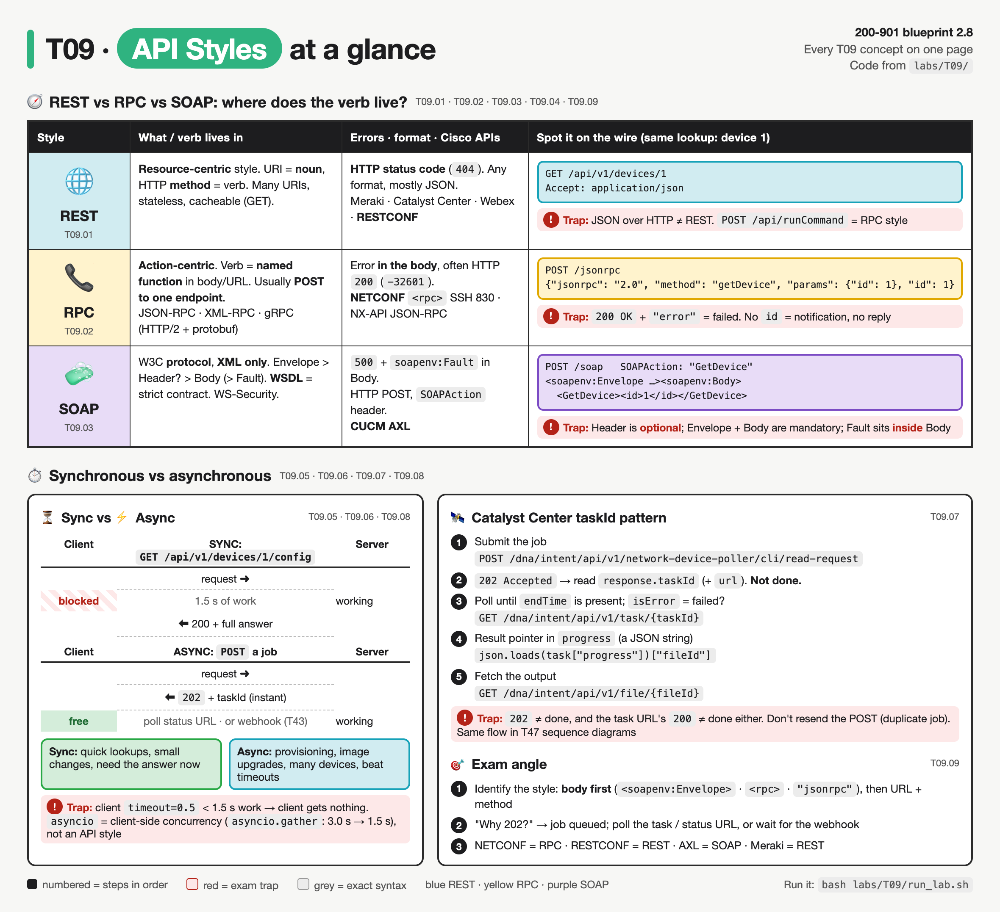
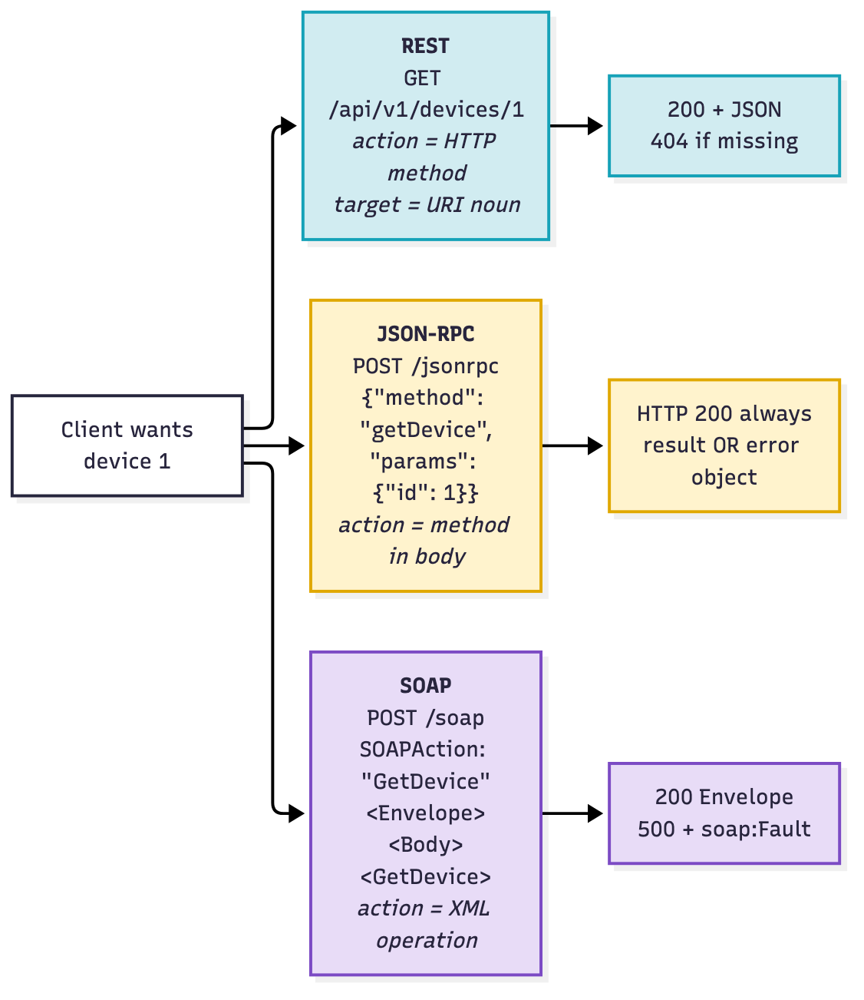
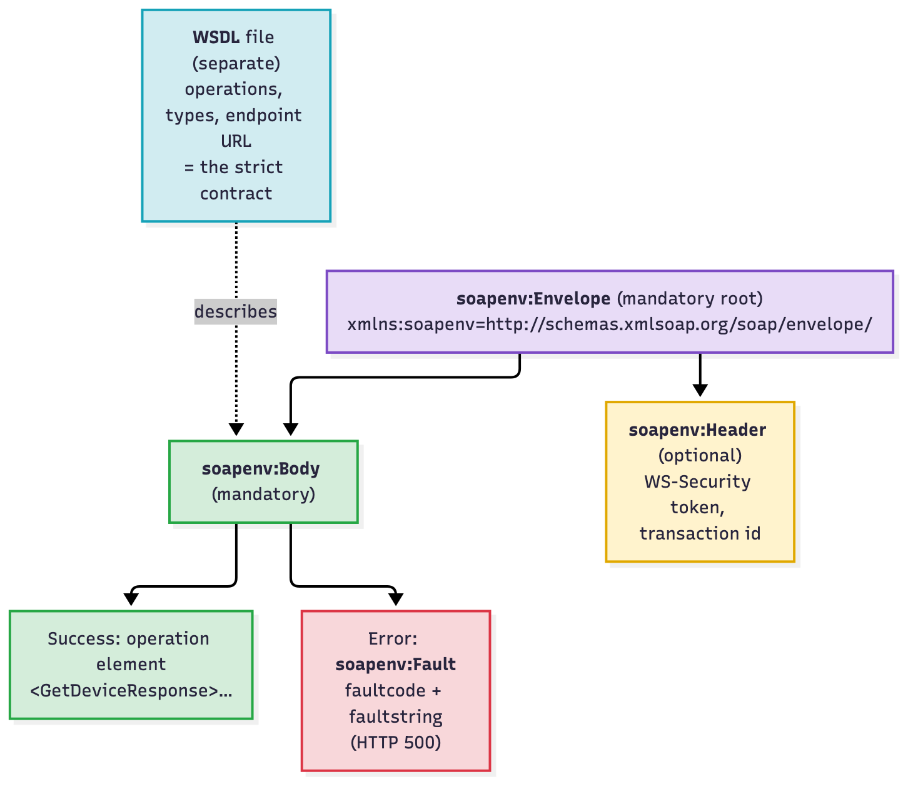
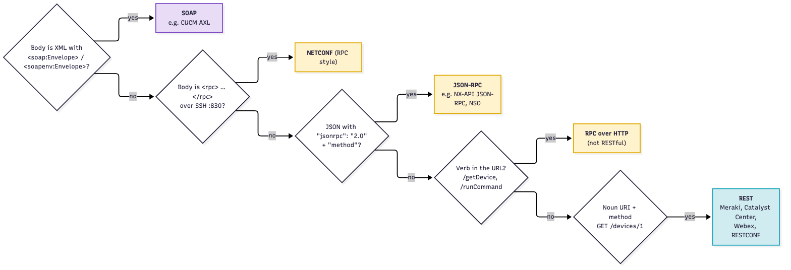
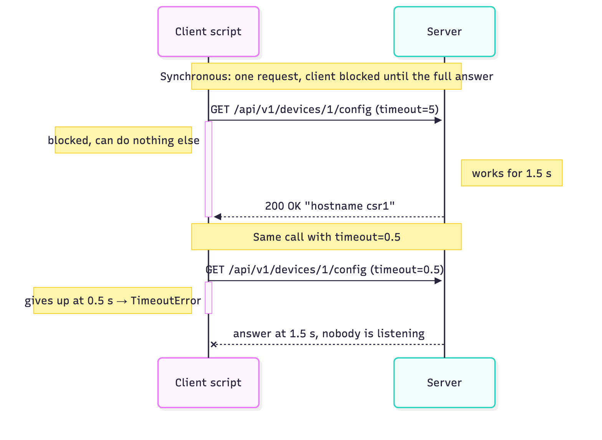
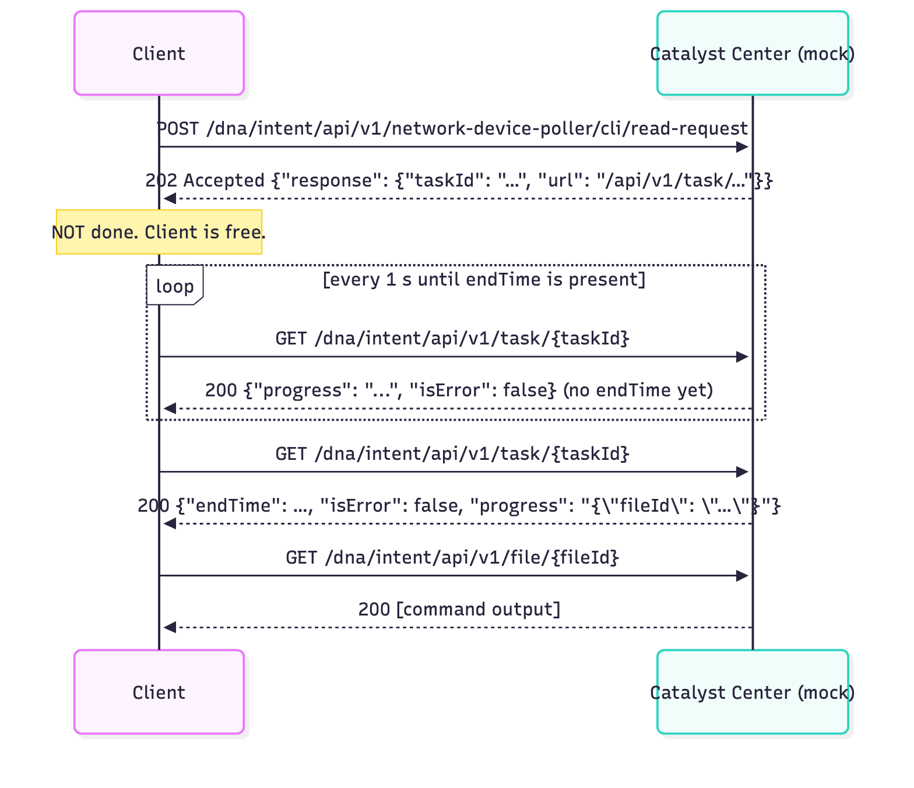
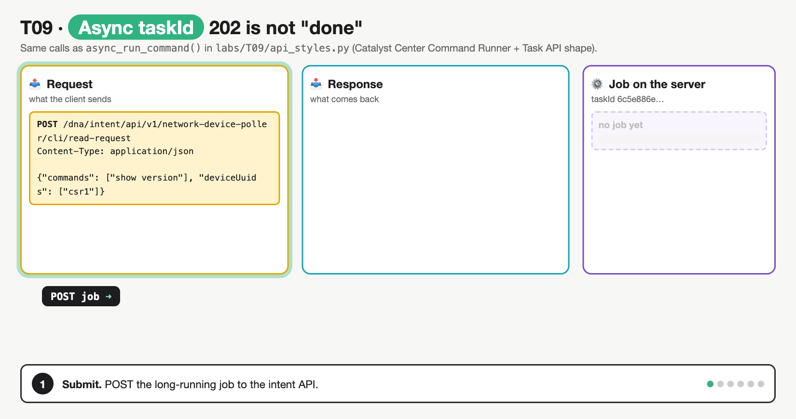
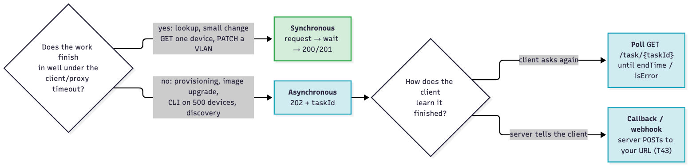

# T09 · API styles: REST vs RPC, sync vs async

> Owner: **Beedy** · Blueprint: **2.8** · CBT coverage: **Partial** · Learn by 2026-10-17 · Teach-back 2026-10-18



*Top table: one row per API style, compared on the same columns; the right-hand column shows how to spot each style from the wire. Bottom: sync vs async side by side, with the Catalyst Center taskId steps numbered in order. Red boxes are exam traps.*

<!-- toc:start -->

**Contents**

- [TL;DR (teach-back card)](#tldr-teach-back-card)
- [Concepts](#concepts)
  - [T09.01](#t0901--rest) REST · [T09.02](#t0902--rpc) RPC · [T09.03](#t0903--soap) SOAP · [T09.04](#t0904--comparison) Comparison · [T09.05](#t0905--synchronous) Synchronous · [T09.06](#t0906--asynchronous) Asynchronous · [T09.07](#t0907--async-example) Async example · [T09.08](#t0908--choosing) Choosing · [T09.09](#t0909--exam-angle) Exam angle
- [Exam traps](#exam-traps)
- [Examples](#examples)
- [Practice questions](#practice-questions)
- [Study aids](#study-aids)
- [Sources](#sources)
- [To verify](#to-verify)

<!-- toc:end -->

## TL;DR (teach-back card)

- **Where is the verb?** REST: the verb is the **HTTP method** and the URI is a **noun** (`GET /api/v1/devices/1`). RPC: the verb is a **named function** in the body or URL, usually `POST` to one endpoint (`{"jsonrpc": "2.0", "method": "getDevice"}`; NETCONF `<rpc><get-config>`). SOAP: XML **Envelope > Header? > Body (> Fault)**, contract in a **WSDL**; Cisco example = CUCM **AXL**.
- **Sync** = the client blocks until the full answer (fine for quick reads). **Async** = the server answers at once with **`202 Accepted` + a task ID / status URL**, and the client polls (or gets a webhook) later. Use async for long jobs: provisioning, image upgrades, CLI on many devices.
- **Catalyst Center pattern:** `POST` intent API → `202` + `taskId` → `GET /dna/intent/api/v1/task/{taskId}` until `endTime` is set (check `isError`) → read the result pointer (e.g. `fileId` in `progress`) → `GET /dna/intent/api/v1/file/{fileId}`.
- **Trap:** `202` ≠ done. And JSON-RPC errors come back inside **HTTP 200**: check for an `error` member, not just the status code.

## Concepts

Every section below explains one part of the same program. Read it once first.

- `labs/T09/mock_api.py` is a fake API (Python standard library only) on `http://127.0.0.1:8109`. It serves the **same device data three ways** (REST, JSON-RPC, SOAP) and has a slow synchronous endpoint plus a Catalyst Center (DNA Center)-shaped async job with a task API.
- `labs/T09/api_styles.py` (below) is the **reference program**. One client looks up device 1 in each style, then runs a slow call synchronously, then the same kind of work asynchronously, then shows `asyncio` waiting on two calls at once.
- Run both: `bash labs/T09/run_lab.sh`. It starts the API, runs the client, then stops the API. It builds on the REST basics from [T07](T07-rest-fundamentals-http-codes.md).

**API doc for the mock:**

| Style | Method | Path | Body | Success | Error |
|---|---|---|---|---|---|
| REST | `GET` | `/api/v1/devices/{id}` | none | `200` JSON | `404` |
| JSON-RPC 2.0 | `POST` | `/jsonrpc` | `{"jsonrpc": "2.0", "method": "getDevice", "params": {"id": n}, "id": n}` | `200` + `result` | `200` + `error` (`-32601`, `-32602`) |
| SOAP 1.1 | `POST` | `/soap` | `<soapenv:Envelope>…<GetDevice><id>n</id></GetDevice>…`, header `SOAPAction: "GetDevice"` | `200` Envelope | `500` + `soapenv:Fault` |
| Sync | `GET` | `/api/v1/devices/{id}/config` | none | `200` text after **1.5 s** | |
| Async start | `POST` | `/dna/intent/api/v1/network-device-poller/cli/read-request` | `{"commands": [...], "deviceUuids": [...]}` | `202` + `taskId` | |
| Task status | `GET` | `/dna/intent/api/v1/task/{taskId}` | none | `200`; `endTime` appears after **2 s** | `404` |
| Result | `GET` | `/dna/intent/api/v1/file/{fileId}` | none | `200` command output | `404` |

**`labs/T09/api_styles.py`**

```python
"""T09 reference program: one device lookup in three API styles, then sync vs async.

Start the mock API first:   python3 labs/T09/mock_api.py
Then in another terminal:   python3 labs/T09/api_styles.py
Or both at once:            bash labs/T09/run_lab.sh

Python stdlib only (urllib), so every method, URL, header and body is visible.
"""
import asyncio
import json
import os
import socket
import time
import urllib.error
import urllib.request

BASE = os.environ.get("API_BASE", "http://127.0.0.1:8109")


def http(method, path, body=None, headers=None, timeout=10):
    """Send one request, print what went over the wire, return (status, body text)."""
    data = body.encode() if isinstance(body, str) else body
    request = urllib.request.Request(BASE + path, data=data, headers=headers or {}, method=method)
    print(f">>> {method} {path}")
    for name, value in (headers or {}).items():
        print(f"    {name}: {value}")
    if body:
        print("    " + body.strip().replace("\n", "\n    "))
    try:
        response = urllib.request.urlopen(request, timeout=timeout)
    except urllib.error.HTTPError as err:          # 4xx/5xx still carry a body
        response = err
    text = response.read().decode()
    print(f"<<< {response.status} {response.reason}")
    print("    " + text.strip().replace("\n", "\n    "))
    return response.status, text


# ---------- 1. REST: the resource is in the URI, the action is the HTTP method ----------
def rest_get_device(dev_id):
    return http("GET", f"/api/v1/devices/{dev_id}", headers={"Accept": "application/json"})


# ---------- 2. JSON-RPC: one endpoint, always POST, the action is "method" in the body ----------
def rpc_call(method, params, call_id):
    payload = json.dumps({"jsonrpc": "2.0", "method": method, "params": params, "id": call_id})
    status, text = http("POST", "/jsonrpc", payload, {"Content-Type": "application/json"})
    reply = json.loads(text)
    if "error" in reply:                           # errors arrive inside an HTTP 200
        print(f"    -> HTTP {status} but JSON-RPC error {reply['error']['code']}")
    return reply


# ---------- 3. SOAP: XML Envelope > Body, operation named by SOAPAction + body element ----------
SOAP_REQUEST = """<?xml version="1.0" encoding="utf-8"?>
<soapenv:Envelope xmlns:soapenv="http://schemas.xmlsoap.org/soap/envelope/">
  <soapenv:Header/>
  <soapenv:Body>
    <GetDevice><id>{dev_id}</id></GetDevice>
  </soapenv:Body>
</soapenv:Envelope>
"""


def soap_get_device(dev_id):
    return http("POST", "/soap", SOAP_REQUEST.format(dev_id=dev_id),
                {"Content-Type": "text/xml; charset=utf-8", "SOAPAction": '"GetDevice"'})


# ---------- 4. Synchronous: the client blocks until the full answer arrives ----------
def sync_get_config(dev_id, timeout):
    start = time.monotonic()
    try:
        http("GET", f"/api/v1/devices/{dev_id}/config", timeout=timeout)
    except (TimeoutError, socket.timeout, urllib.error.URLError) as err:
        print(f"    !!! client gave up: {err}")
    print(f"    (blocked for {time.monotonic() - start:.1f} s)")


# ---------- 5. Asynchronous: 202 + taskId -> poll the task -> fetch the result ----------
def async_run_command():
    payload = json.dumps({"commands": ["show version"], "deviceUuids": ["csr1"]})
    status, text = http("POST", "/dna/intent/api/v1/network-device-poller/cli/read-request",
                        payload, {"Content-Type": "application/json"})
    task_id = json.loads(text)["response"]["taskId"]           # 202: accepted, NOT done
    print(f"    -> {status}: job queued, taskId {task_id[:8]}..., client is free")

    for attempt in range(1, 11):
        time.sleep(1)                                            # poll interval
        task = json.loads(http("GET", f"/dna/intent/api/v1/task/{task_id}")[1])["response"]
        if task.get("isError"):
            raise RuntimeError(task.get("failureReason", "task failed"))
        if "endTime" in task:                                    # endTime set = finished
            print(f"    -> finished after {attempt} poll(s)")
            break
    file_id = json.loads(task["progress"])["fileId"]             # result pointer lives in progress
    http("GET", f"/dna/intent/api/v1/file/{file_id}")


# ---------- 6. asyncio (awareness): wait on two slow calls at the same time ----------
def fetch_quietly(dev_id):
    with urllib.request.urlopen(f"{BASE}/api/v1/devices/{dev_id}/config", timeout=10) as r:
        return r.read().decode().strip()


async def fetch_both():
    return await asyncio.gather(asyncio.to_thread(fetch_quietly, 1),
                                asyncio.to_thread(fetch_quietly, 2))


def main():
    print("== 1. REST ==")
    rest_get_device(1)
    rest_get_device(99)

    print("\n== 2. JSON-RPC ==")
    rpc_call("getDevice", {"id": 1}, 1)
    rpc_call("deleteEverything", {}, 2)

    print("\n== 3. SOAP ==")
    soap_get_device(1)
    soap_get_device(99)

    print("\n== 4. Synchronous (server takes 1.5 s) ==")
    sync_get_config(1, timeout=0.5)
    sync_get_config(1, timeout=5)

    print("\n== 5. Asynchronous (Catalyst Center-style task API) ==")
    async_run_command()

    print("\n== 6. asyncio: two 1.5 s calls ==")
    start = time.monotonic()
    one_by_one = [fetch_quietly(1), fetch_quietly(2)]
    print(f"    sequential: {one_by_one} in {time.monotonic() - start:.1f} s")
    start = time.monotonic()
    together = asyncio.run(fetch_both())
    print(f"    asyncio.gather: {together} in {time.monotonic() - start:.1f} s")


if __name__ == "__main__":
    main()
```

**Output** (`bash labs/T09/run_lab.sh`; task and file IDs are random UUIDs, so yours differ):

```
== 1. REST ==
>>> GET /api/v1/devices/1
    Accept: application/json
<<< 200 OK
    {"id": 1, "hostname": "csr1", "mgmt_ip": "10.10.20.48", "role": "edge", "os": "iosxe"}
>>> GET /api/v1/devices/99
    Accept: application/json
<<< 404 Not Found
    {"error": "device 99 not found"}

== 2. JSON-RPC ==
>>> POST /jsonrpc
    Content-Type: application/json
    {"jsonrpc": "2.0", "method": "getDevice", "params": {"id": 1}, "id": 1}
<<< 200 OK
    {"jsonrpc": "2.0", "result": {"id": 1, "hostname": "csr1", "mgmt_ip": "10.10.20.48", "role": "edge", "os": "iosxe"}, "id": 1}
>>> POST /jsonrpc
    Content-Type: application/json
    {"jsonrpc": "2.0", "method": "deleteEverything", "params": {}, "id": 2}
<<< 200 OK
    {"jsonrpc": "2.0", "error": {"code": -32601, "message": "Method not found"}, "id": 2}
    -> HTTP 200 but JSON-RPC error -32601

== 3. SOAP ==
>>> POST /soap
    Content-Type: text/xml; charset=utf-8
    SOAPAction: "GetDevice"
    <?xml version="1.0" encoding="utf-8"?>
    <soapenv:Envelope xmlns:soapenv="http://schemas.xmlsoap.org/soap/envelope/">
      <soapenv:Header/>
      <soapenv:Body>
        <GetDevice><id>1</id></GetDevice>
      </soapenv:Body>
    </soapenv:Envelope>
<<< 200 OK
    <?xml version="1.0" encoding="utf-8"?>
    <soapenv:Envelope xmlns:soapenv="http://schemas.xmlsoap.org/soap/envelope/">
      <soapenv:Body>
        <GetDeviceResponse><device><id>1</id><hostname>csr1</hostname><mgmt_ip>10.10.20.48</mgmt_ip><role>edge</role><os>iosxe</os></device></GetDeviceResponse>
      </soapenv:Body>
    </soapenv:Envelope>
>>> POST /soap
    Content-Type: text/xml; charset=utf-8
    SOAPAction: "GetDevice"
    <?xml version="1.0" encoding="utf-8"?>
    <soapenv:Envelope xmlns:soapenv="http://schemas.xmlsoap.org/soap/envelope/">
      <soapenv:Header/>
      <soapenv:Body>
        <GetDevice><id>99</id></GetDevice>
      </soapenv:Body>
    </soapenv:Envelope>
<<< 500 Internal Server Error
    <?xml version="1.0" encoding="utf-8"?>
    <soapenv:Envelope xmlns:soapenv="http://schemas.xmlsoap.org/soap/envelope/">
      <soapenv:Body>
        <soapenv:Fault>
          <faultcode>soapenv:Client</faultcode>
          <faultstring>No device with id 99</faultstring>
        </soapenv:Fault>
      </soapenv:Body>
    </soapenv:Envelope>

== 4. Synchronous (server takes 1.5 s) ==
>>> GET /api/v1/devices/1/config
    !!! client gave up: timed out
    (blocked for 0.5 s)
>>> GET /api/v1/devices/1/config
<<< 200 OK
    hostname csr1
    (blocked for 1.5 s)

== 5. Asynchronous (Catalyst Center-style task API) ==
>>> POST /dna/intent/api/v1/network-device-poller/cli/read-request
    Content-Type: application/json
    {"commands": ["show version"], "deviceUuids": ["csr1"]}
<<< 202 Accepted
    {"response": {"taskId": "6c5e886e-fc97-45d1-a328-0ccf39fb74f1", "url": "/api/v1/task/6c5e886e-fc97-45d1-a328-0ccf39fb74f1"}, "version": "1.0"}
    -> 202: job queued, taskId 6c5e886e..., client is free
>>> GET /dna/intent/api/v1/task/6c5e886e-fc97-45d1-a328-0ccf39fb74f1
<<< 200 OK
    {"response": {"taskId": "6c5e886e-fc97-45d1-a328-0ccf39fb74f1", "startTime": 1791632410846, "isError": false, "progress": "CLI Runner request creation"}, "version": "1.0"}
>>> GET /dna/intent/api/v1/task/6c5e886e-fc97-45d1-a328-0ccf39fb74f1
<<< 200 OK
    {"response": {"taskId": "6c5e886e-fc97-45d1-a328-0ccf39fb74f1", "startTime": 1791632410846, "isError": false, "progress": "{\"fileId\": \"b8f95fe2-5fb4-4966-bdb9-a61a8ad3260a\"}", "endTime": 1791632412846}, "version": "1.0"}
    -> finished after 2 poll(s)
>>> GET /dna/intent/api/v1/file/b8f95fe2-5fb4-4966-bdb9-a61a8ad3260a
<<< 200 OK
    [{"deviceUuid": "csr1", "commandResponses": {"SUCCESS": {"show version": "show version\ncsr1 uptime is 4 weeks"}}}]

== 6. asyncio: two 1.5 s calls ==
    sequential: ['hostname csr1', 'hostname n9k1'] in 3.0 s
    asyncio.gather: ['hostname csr1', 'hostname n9k1'] in 1.5 s
```

### T09.01 · REST

**Must cover:**

- [x] Resources are nouns in the URI (/devices/1); actions are HTTP methods
- [x] Stateless, cacheable, usually JSON over HTTP
- [x] Examples: Meraki, Catalyst Center, Webex, RESTCONF

**Notes:**

- Full detail is in [T07.01](T07-rest-fundamentals-http-codes.md#t0701--rest-basics) and [T07.02](T07-rest-fundamentals-http-codes.md#t0702--rest-constraints). Here, only what separates it from RPC.
- **Resource-centric.** The URI names a *thing*; the HTTP method is the *action*.
  - `rest_get_device()` sends `GET /api/v1/devices/1`. To delete it you would keep the **same URI** and change the method to `DELETE`.
  - Many URIs, few verbs (GET/POST/PUT/PATCH/DELETE).
- **HTTP status codes carry the outcome.** Device 99 → `404 Not Found` in the status line, not hidden in the body.
- **Stateless** (token on every call) and **cacheable** (`GET` responses can be cached, `ETag`/`304`). Usually JSON, but REST doesn't mandate a format (the mock in T07 also returns XML).
- Cisco REST APIs: **Meraki Dashboard API**, **Catalyst Center (DNA Center) Intent API**, **Webex**, **RESTCONF** (REST-like access to YANG data, [T16](../bob/T16-restconf.md)), also ACI/APIC, SD-WAN Manager (vManage), Secure Firewall Management Center (FMC).

### T09.02 · RPC

**Must cover:**

- [x] RPC = Remote Procedure Call: the client calls a named function on the server
- [x] Action is in the payload or URL (e.g. "method": "getDevice")
- [x] Usually POST to a single endpoint
- [x] Examples: JSON-RPC, XML-RPC, gRPC (HTTP/2 + protobuf), NX-API CLI (JSON-RPC option)
- [x] NETCONF is RPC-based: <rpc><get-config>…</get-config></rpc>

**Notes:**

- **RPC = Remote Procedure Call.** The idea: calling a function on another machine should look like calling a local function. `getDevice(id=1)` → sent over the network → result returned.
- **Action-centric.** The verb is the function name, carried **in the payload** (`"method": "getDevice"`) or sometimes **in the URL** (`POST /api/getDevice`).
- **Usually one endpoint, always `POST`.** In the program, both `rpc_call()` lines hit `POST /jsonrpc`; only the `method` field changes.
- **HTTP is just a pipe.** The mock answers `200 OK` even for an unknown method: the error is in the body (`"error": {"code": -32601, "message": "Method not found"}`). `rpc_call()` checks `if "error" in reply`, not the status code.



*Same question, three wire formats. REST puts the verb in the HTTP method; JSON-RPC and SOAP put it in the body and always POST. Only REST uses HTTP status codes for the outcome.*

**JSON-RPC 2.0 fields** (jsonrpc.org spec):

| Member | Request | Response |
|---|---|---|
| `jsonrpc` | must be `"2.0"` | `"2.0"` |
| `method` | function name | |
| `params` | optional, object or array | |
| `id` | correlates request and reply. **No `id` = a notification: the server must not reply** | same `id` |
| `result` / `error` | | **exactly one of them**. `error` = `{code, message, data?}` |

- Standard error codes: `-32700` parse error, `-32600` invalid request, `-32601` method not found, `-32602` invalid params, `-32603` internal error.
- Batch: send an array of request objects.

**RPC family members to recognise:**

| Name | Encoding / transport | Spot it by |
|---|---|---|
| **JSON-RPC** | JSON, transport-agnostic (usually HTTP POST) | `"jsonrpc": "2.0"`, `"method"` |
| **XML-RPC** | XML over HTTP POST | `<methodCall><methodName>` |
| **gRPC** | **Protocol Buffers** (binary) over **HTTP/2**; service defined in a `.proto` IDL; supports streaming | `.proto` file, `rpc SayHello (HelloRequest) returns (HelloReply)`; model-driven telemetry dial-out on IOS XE/NX-OS ⚠ verify |
| **NX-API CLI** (Nexus) | send CLI commands over HTTP(S); message format can be JSON-RPC, JSON or XML | `"method": "cli"`, `"params": {"cmd": "show version", "version": 1}` ⚠ verify |
| **NETCONF** | XML over **SSH port 830** | `<rpc message-id="101">` … `<rpc-reply>` |

- **NETCONF is RPC-based** (RFC 6241 §4.1): every operation is an `<rpc>` element with a mandatory `message-id`, and the reply is `<rpc-reply>` with the same `message-id`. The operation name is the child element: `<get-config>`, `<edit-config>`, `<lock>`, `<commit>`. Details in [T15](../bob/T15-netconf.md).

```xml
<rpc message-id="101" xmlns="urn:ietf:params:xml:ns:netconf:base:1.0">
  <get-config>
    <source><running/></source>
  </get-config>
</rpc>
```

- **RESTCONF vs NETCONF** is the classic REST vs RPC pair on the exam: same YANG data, RESTCONF uses URIs + HTTP methods, NETCONF uses named `<rpc>` operations.

### T09.03 · SOAP

**Must cover:**

- [x] SOAP = Simple Object Access Protocol, XML only
- [x] Message = Envelope > optional Header > Body (> Fault on errors)
- [x] WSDL describes the operations and types (strict contract)
- [x] Typically HTTP POST; Cisco AXL (CUCM) is SOAP

**Notes:**

- **SOAP = Simple Object Access Protocol.** A W3C **protocol** (REST is a *style*). Messages are **always XML**. Effectively RPC with a heavy, standardised XML wrapper.
- **Structure** (`SOAP_REQUEST` in the program):
  - `<soapenv:Envelope>`: mandatory root; its namespace says the SOAP version (1.1 `http://schemas.xmlsoap.org/soap/envelope/`, 1.2 `http://www.w3.org/2003/05/soap-envelope`).
  - `<soapenv:Header>`: **optional**; metadata such as WS-Security credentials.
  - `<soapenv:Body>`: **mandatory**; the operation element (`<GetDevice>`) and its arguments.
  - `<soapenv:Fault>`: inside the Body **on errors**. SOAP 1.1 children `faultcode` / `faultstring`; SOAP 1.2 uses `Code` / `Reason` / `Detail`.



*Envelope is the root; Header is optional; Body is mandatory and holds either the operation or a Fault. The WSDL is a separate file that defines what may go in the Body.*

- **WSDL** (Web Services Description Language) = an XML file listing every operation, its input/output types and the endpoint URL. Strict contract: tools generate client code from it, and a request that doesn't match the schema is rejected.
- **Transport:** typically **HTTP POST**, `Content-Type: text/xml` (1.1) or `application/soap+xml` (1.2). SOAP 1.1 over HTTP also sends a `SOAPAction` header naming the operation.
- **Errors use HTTP 500 + Fault.** In the output, device 99 → `500 Internal Server Error` with `<faultcode>soapenv:Client</faultcode>`. (SOAP 1.2 maps a sender fault to `400`.) 
- **Cisco example:** CUCM **AXL** (Administrative XML) is SOAP, for provisioning phones/users ([T21](../bob/T21-collaboration-cucm-axl-uds.md)). CUCM UDS is the REST one. AXL endpoint `https://<cucm>:8443/axl/` ⚠ verify.

### T09.04 · Comparison

**Must cover:**

- [x] REST: resource-centric, flexible formats, light
- [x] RPC: action-centric, simple to map to functions
- [x] SOAP: strict contract, heavier XML, built-in standards (WS-Security)
- [x] Recognise the style from a payload: <soap:Envelope> = SOAP; {"jsonrpc": "2.0", "method": …} = JSON-RPC; GET /resources/123 = REST

**Notes:**

| | REST | RPC (JSON-RPC, XML-RPC, gRPC, NETCONF) | SOAP |
|---|---|---|---|
| Kind | architectural **style** | style / family of protocols | W3C **protocol** |
| Centred on | **resources** (nouns) | **actions** (function names) | actions (operations in WSDL) |
| Verb lives in | HTTP method | body `method` / URL / `<rpc>` child | Body element + `SOAPAction` |
| Endpoints | many URIs | usually **one** | usually one |
| HTTP methods | GET/POST/PUT/PATCH/DELETE | POST | POST |
| Format | any (mostly JSON) | JSON / XML / protobuf | **XML only** |
| Contract | API docs / OpenAPI (optional) | IDL optional (`.proto` for gRPC) | **WSDL**, strict |
| Errors | HTTP status code | in the body (often HTTP 200) | `Fault` (HTTP 500) |
| Caching | yes (GET) | no (POST) | no (POST) |
| Weight | light | light | heavy; brings WS-Security, WS-* standards |
| Cisco examples | Meraki, Catalyst Center, Webex, RESTCONF, FMC | NETCONF, NX-API JSON-RPC, NSO JSON-RPC ⚠ verify, gRPC telemetry | CUCM AXL |

- **Recognise the style from a payload** (the exam's favourite form):



*Check the body first (SOAP envelope, NETCONF `<rpc>`, `"jsonrpc"`), then the URL: a verb in the path means RPC over HTTP; a noun plus an HTTP method means REST.*

- `POST /api/v1/runCommand` with `{"cmd": "show ip int brief"}` is **RPC-style over HTTP**, even though it's JSON over HTTPS. JSON ≠ REST.

### T09.05 · Synchronous

**Must cover:**

- [x] Client sends a request and blocks until the full response arrives
- [x] Simple to code and reason about
- [x] Problem for long jobs: timeouts, client tied up

**Notes:**

- **Synchronous** = request → **wait** → full answer, on the same connection. Every call in sections 1–3 of the program is synchronous.
- **Simple:** the result is the return value of the call; the next line can use it. No IDs, no polling.
- **Problem for long jobs** (`sync_get_config()`):
  - The server needs 1.5 s. With `timeout=5` the call works, and the client was **blocked for 1.5 s** doing nothing.
  - With `timeout=0.5` the client gives up (`timed out`) and gets **nothing**, even though the server goes on to finish the work. Real-world equivalents: a proxy/load balancer idle timeout (`504 Gateway Timeout`, [T07.09](T07-rest-fundamentals-http-codes.md#t0709--key-codes)), or `requests` `timeout=` ([T11](T11-python-requests-scripting.md)).
  - Scale it up: 500 devices × 1.5 s each = 12.5 min of one script doing nothing but waiting.



*The activation bar is the time the client is stuck. If the client's timeout is shorter than the work, the reply arrives after the client stopped listening.*

### T09.06 · Asynchronous

**Must cover:**

- [x] Server accepts the job and replies at once, typically 202 Accepted with a task ID or status URL
- [x] Client gets the result later by polling the status URL or via a callback/webhook
- [x] Client is free to do other work meanwhile
- [x] Asynchronous code in Python: asyncio (awareness)

**Notes:**

- **Asynchronous API** = the server **accepts** the job and answers **immediately**, before the work is done.
  - Typical reply: **`202 Accepted`** + a **task/job ID** or **status URL** (body or `Location` header).
  - RFC 9110: 202 means "accepted for processing, but the processing has not been completed"; the response "ought to … point to (or embed) a status monitor".
- **How the client learns the result:**
  - **Polling:** `GET` the status URL in a loop until it says done (`async_run_command()` polls every 1 s).
  - **Callback / webhook:** the client registers a URL; the server `POST`s to it when done. No polling. See [T43](T43-webhooks.md).
- **Client is free meanwhile:** between polls, the script could start jobs on other devices. The `202` came back in milliseconds.
- **Async API ≠ async code.** An async *API* is about the server's reply pattern. *Async code* is about the client not blocking while waiting.
- **`asyncio` (awareness only):** Python's standard library for concurrent code with `async` / `await`. Section 6 of the program: two 1.5 s calls take **3.0 s** one after the other but **1.5 s** with `asyncio.gather()`, because the waits overlap.
  - `async def` defines a coroutine; `await` pauses it until the result is ready; `asyncio.run()` starts the event loop; `asyncio.gather()` runs several at once.
  - `urllib` and `requests` are blocking, so the program wraps them with `asyncio.to_thread()`. Native async HTTP clients exist (e.g. `aiohttp`, `httpx`); not on the exam.

### T09.07 · Async example

**Must cover:**

- [x] POST/PUT to an intent API → response contains taskId (and URL)
- [x] GET /dna/intent/api/v1/task/{taskId} until endTime is set / isError is false
- [x] Then GET the result (e.g. fileId or progress field)
- [x] Same pattern shows in sequence-diagram questions (T47)

**Notes:**

- Catalyst Center's write/long-running **Intent API** calls (`POST`/`PUT`/`DELETE`) are asynchronous. The mock copies the **Command Runner** flow: run `show version` on a device.



*Read top to bottom: one POST, a quick 202 with a taskId, a polling loop on the task URL, then one more GET for the actual result.*



*Step by step: POST → `202` + `taskId` → poll (no `endTime`) → poll (`endTime` set, `isError` false, `fileId` in `progress`) → GET file → output. Fixes the misconception that `202` (or the first `200` from the task URL) means the job is finished.*

| Step | Call | What to read |
|---|---|---|
| 1 | `POST /dna/intent/api/v1/network-device-poller/cli/read-request` | `202`, `response.taskId` (and `response.url`) |
| 2 | `GET /dna/intent/api/v1/task/{taskId}` (repeat) | **`endTime` missing = still running.** `isError: true` = failed (`failureReason`) |
| 3 | same, until `endTime` is present | `isError: false` → success. `progress` holds the result pointer, here `{"fileId": "…"}` |
| 4 | `GET /dna/intent/api/v1/file/{fileId}` | the command output |

- In code: `async_run_command()` → `task_id = json.loads(text)["response"]["taskId"]` → loop with `if task.get("isError")` / `if "endTime" in task` → `json.loads(task["progress"])["fileId"]`.
  - `progress` is a **string containing JSON**, so it needs a second `json.loads()`.
- Other Catalyst Center async jobs follow the same shape: device discovery, template deploy, SWIM image distribution/activation ⚠ verify the exact result field for each.
- Newer Catalyst Center releases also expose `/dna/intent/api/v1/tasks/{id}` (plural) alongside `/task/{taskId}` (seen in the SDK). The exam pattern is the one above.
- **Sequence-diagram questions** ([T47](T47-sequence-diagrams-with-api-calls.md)) draw exactly this: auth → POST → 202 → loop GET task → GET result. "What is the next call after the 202?" → GET the task URL.

### T09.08 · Choosing

**Must cover:**

- [x] Synchronous: quick lookups, small changes
- [x] Asynchronous: long-running jobs (provisioning, image upgrades), large scale, avoiding HTTP timeouts

**Notes:**



*The question is "will the work finish well inside the timeout?" If not, go async, then choose polling (client asks) or a webhook (server tells).*

| Use **synchronous** | Use **asynchronous** |
|---|---|
| read one device, list VLANs, get a token | provision a site, push a template to 200 switches |
| small config change on one device | image upgrade (SWIM), device discovery |
| answer needed before the next line can run | job takes longer than the client/proxy timeout |
| | many jobs in parallel; client must stay responsive |

- **Polling vs webhook:** polling is simple and works through firewalls/NAT, but wastes calls (watch rate limits, [T08](T08-api-consumption-constraints.md)). A webhook needs a reachable HTTPS listener but gives instant notice.

### T09.09 · Exam angle

**Must cover:**

- [x] Identify the API style from a snippet
- [x] Explain why a call returned 202 and what to do next
- [x] Match REST/RPC/SOAP to example Cisco APIs

**Notes:**

- **Identify the style:** use the T09.04 decision flow. Look at the **body first**, then the URL and method.
- **"Why 202, what next?"** The server queued the job. Read the task ID / status URL from the response, **poll** it (or wait for the webhook) until it reports done, check for errors, then fetch the result. Don't resend the POST (it would queue a duplicate job).
- **Match platform → style:**

| Cisco API | Style |
|---|---|
| Meraki Dashboard, Catalyst Center Intent API, Webex, ACI/APIC, SD-WAN Manager, FMC, Intersight | REST |
| RESTCONF | REST (over YANG data) |
| NETCONF | RPC (XML `<rpc>` over SSH 830) |
| NX-API CLI | RPC (JSON-RPC option) |
| gRPC model-driven telemetry / gNMI | RPC (HTTP/2 + protobuf) |
| CUCM AXL | SOAP |

## Exam traps

- **`202` ≠ done.** `201` = created now; `202` = accepted and queued. Next step: poll the task/status URL. Retrying the POST queues a duplicate job.
- **First `200` from the task URL ≠ done either.** The task *lookup* succeeded; the *job* finished only when `endTime` is present. Then check `isError`.
- **JSON-RPC errors arrive in HTTP 200.** Check for the `error` member. `result` and `error` never appear together.
- **JSON-RPC notification:** no `id` → the server sends **no reply**.
- **JSON over HTTP ≠ REST.** `POST /api/runCommand` or `"method": "getDevice"` = RPC style. REST needs noun URIs + HTTP methods.
- **SOAP is XML only**, always has an **Envelope** and a **Body**; **Header is optional**; **Fault** sits **inside the Body**. The **WSDL** is the contract, not part of each message.
- **SOAP is a protocol; REST is a style.** "Which one has a strict, machine-readable contract and WS-Security?" → SOAP.
- **NETCONF = RPC, RESTCONF = REST**, same YANG data. NETCONF uses SSH port 830; every `<rpc>` has a `message-id` echoed in `<rpc-reply>`.
- **gRPC = HTTP/2 + Protocol Buffers.** Not HTTP/1.1, not JSON by default.
- **Async API vs `asyncio`:** a 202/taskId API is about the server; `async`/`await` is about the client not blocking. You can poll an async API from fully synchronous code (the reference program does).
- **Catalyst Center `progress` is a JSON string** inside JSON: `json.loads(task["progress"])["fileId"]`.

## Examples

### 1. Run the reference program

Needs only Python 3 and curl. Nothing to install.

```bash
bash labs/T09/run_lab.sh                         # mock API + api_styles.py
bash labs/T09/run_lab.sh labs/T09/curl_drill.sh  # mock API + curl drill
```

Or by hand, in two terminals:

```bash
python3 labs/T09/mock_api.py                     # terminal 1: leave running
python3 labs/T09/api_styles.py                   # terminal 2
```

In the lab container:

```bash
docker build --tag ccna-auto-lab:latest --file labs/Dockerfile labs/
docker run --rm --volume "$(pwd)":/work --workdir /work ccna-auto-lab:latest bash labs/T09/run_lab.sh
```

### 2. curl drill: spot the style from the request (`labs/T09/curl_drill.sh`)

```bash
#!/usr/bin/env bash
# T09 curl drill: spot the API style from the request alone. Start the API first:
#   python3 labs/T09/mock_api.py      (or: bash labs/T09/run_lab.sh labs/T09/curl_drill.sh)
set -u
BASE="http://127.0.0.1:8109"

echo "== 1. REST: noun in the URI, verb is the HTTP method"
curl --silent --show-error --write-out "\n[HTTP %{http_code}]\n" \
  --header "Accept: application/json" \
  "$BASE/api/v1/devices/2"

echo; echo "== 2. JSON-RPC: one URL, POST, the verb is \"method\" in the body"
curl --silent --show-error --write-out "\n[HTTP %{http_code}]\n" --request POST \
  --header "Content-Type: application/json" \
  --data '{"jsonrpc": "2.0", "method": "getDevice", "params": {"id": 2}, "id": 7}' \
  "$BASE/jsonrpc"

echo; echo "== 3. SOAP: XML Envelope, operation in SOAPAction + the Body element"
curl --silent --show-error --write-out "\n[HTTP %{http_code}]\n" --request POST \
  --header "Content-Type: text/xml; charset=utf-8" \
  --header 'SOAPAction: "GetDevice"' \
  --data '<soapenv:Envelope xmlns:soapenv="http://schemas.xmlsoap.org/soap/envelope/"><soapenv:Body><GetDevice><id>2</id></GetDevice></soapenv:Body></soapenv:Envelope>' \
  "$BASE/soap"

echo; echo "== 4. Sync call with a 0.5 s client timeout (server needs 1.5 s)"
curl --silent --show-error --max-time 0.5 "$BASE/api/v1/devices/2/config"
echo "[curl exit code $?]"

echo; echo "== 5. Async: 202 + taskId, then poll the task"
TASK_ID=$(curl --silent --request POST \
  --header "Content-Type: application/json" \
  --data '{"commands": ["show version"], "deviceUuids": ["csr1"]}' \
  "$BASE/dna/intent/api/v1/network-device-poller/cli/read-request" \
  | python3 -c "import json, sys; print(json.load(sys.stdin)['response']['taskId'])")
echo "taskId=$TASK_ID"
curl --silent --show-error --write-out "\n[HTTP %{http_code}] (right away: no endTime)\n" \
  "$BASE/dna/intent/api/v1/task/$TASK_ID"
sleep 2.5
curl --silent --show-error --write-out "\n[HTTP %{http_code}] (after 2.5 s: endTime set)\n" \
  "$BASE/dna/intent/api/v1/task/$TASK_ID"
```

Output (curl 8.7.1, `bash labs/T09/run_lab.sh labs/T09/curl_drill.sh`):

```
== 1. REST: noun in the URI, verb is the HTTP method
{"id": 2, "hostname": "n9k1", "mgmt_ip": "10.10.20.58", "role": "core", "os": "nxos"}
[HTTP 200]

== 2. JSON-RPC: one URL, POST, the verb is "method" in the body
{"jsonrpc": "2.0", "result": {"id": 2, "hostname": "n9k1", "mgmt_ip": "10.10.20.58", "role": "core", "os": "nxos"}, "id": 7}
[HTTP 200]

== 3. SOAP: XML Envelope, operation in SOAPAction + the Body element
<?xml version="1.0" encoding="utf-8"?>
<soapenv:Envelope xmlns:soapenv="http://schemas.xmlsoap.org/soap/envelope/">
  <soapenv:Body>
    <GetDeviceResponse><device><id>2</id><hostname>n9k1</hostname><mgmt_ip>10.10.20.58</mgmt_ip><role>core</role><os>nxos</os></device></GetDeviceResponse>
  </soapenv:Body>
</soapenv:Envelope>

[HTTP 200]

== 4. Sync call with a 0.5 s client timeout (server needs 1.5 s)
curl: (28) Operation timed out after 505 milliseconds with 0 bytes received
[curl exit code 28]

== 5. Async: 202 + taskId, then poll the task
taskId=d8ea7afb-c877-435a-86d2-f7b0bce6e832
{"response": {"taskId": "d8ea7afb-c877-435a-86d2-f7b0bce6e832", "startTime": 1791632860449, "isError": false, "progress": "CLI Runner request creation"}, "version": "1.0"}
[HTTP 200] (right away: no endTime)
{"response": {"taskId": "d8ea7afb-c877-435a-86d2-f7b0bce6e832", "startTime": 1791632860449, "isError": false, "progress": "{\"fileId\": \"dc7f4ff7-d4a6-4307-98a4-b15fb5c3cbee\"}", "endTime": 1791632862449}, "version": "1.0"}
[HTTP 200] (after 2.5 s: endTime set)
```

- Steps 1–3 return the **same device**. Only the request shape tells you the style.
- Step 4: curl exit code `28` = operation timed out. Synchronous call, client gave up first.
- Step 5: the task URL answers `200` both times. Only the presence of `endTime` says the job finished.

### 3. Break it on purpose

Copy the lab to scratch, make one edit, run it:

```bash
mkdir -p "$TMPDIR/t09" && cp labs/T09/*.py labs/T09/run_lab.sh "$TMPDIR/t09/"
# edit $TMPDIR/t09/api_styles.py as in the table, then:
bash "$TMPDIR/t09/run_lab.sh"
```

All four were run; the result column is the real output line.

| Edit in `api_styles.py` | What you get | Lesson |
|---|---|---|
| In `main()`, change `rpc_call("getDevice", {"id": 1}, 1)` to `rpc_call("GetDevice", {"id": 1}, 1)` | `<<< 200 OK` then `"error": {"code": -32601, "message": "Method not found"}` | RPC method names are exact; the HTTP status still says 200 |
| In `soap_get_device()`, change `'"GetDevice"'` to `'"getDevice"'` | `<<< 500 Internal Server Error` with `<faultstring>Unknown SOAPAction 'getDevice'</faultstring>` | SOAP error = 500 + Fault in the Body |
| In `async_run_command()`, change `if "endTime" in task:` to `if True:` | `-> finished after 1 poll(s)`, then `json.decoder.JSONDecodeError: Expecting value: line 1 column 1 (char 0)` | stopped polling too early: `progress` was still a status text, not the `fileId` |
| In `main()`, change `sync_get_config(1, timeout=0.5)` to `timeout=2` | `<<< 200 OK` and `(blocked for 1.5 s)` twice | a long enough timeout "fixes" sync, at the cost of a blocked client |

### 4. Trap snippets

JSON-RPC notification (no `id`) gets no reply, by spec:

```json
{"jsonrpc": "2.0", "method": "logEvent", "params": {"msg": "link up"}}
```

SOAP 1.2 fault (compare with the SOAP 1.1 `faultcode`/`faultstring` in the program output):

```xml
<env:Envelope xmlns:env="http://www.w3.org/2003/05/soap-envelope">
  <env:Body>
    <env:Fault>
      <env:Code><env:Value>env:Sender</env:Value></env:Code>
      <env:Reason><env:Text xml:lang="en">No device with id 99</env:Text></env:Reason>
    </env:Fault>
  </env:Body>
</env:Envelope>
```

NX-API CLI in JSON-RPC format (Nexus with `feature nxapi`; DevNet sandbox host and credentials from `labs/.env` as `NXOS_HOST`, `NXOS_USER`, `NXOS_PASS`). ⚠ verify the content type and body against the NX-API docs; not run.

```bash
set -a && source labs/.env && set +a
curl --silent --insecure --request POST \
  --user "$NXOS_USER:$NXOS_PASS" \
  --header "Content-Type: application/json-rpc" \
  --data '[{"jsonrpc": "2.0", "method": "cli", "params": {"cmd": "show version", "version": 1}, "id": 1}]' \
  "https://$NXOS_HOST/ins"
```

### 5. Real Catalyst Center async call (DevNet Sandbox)

⚠ verify the host and credentials at developer.cisco.com/sandbox, and put them in `labs/.env` as `DNAC_HOST`, `DNAC_USER`, `DNAC_PASS`. Not run (no sandbox access this session). The device UUID comes from `GET /dna/intent/api/v1/network-device`.

```bash
set -a && source labs/.env && set +a

TOKEN=$(curl --silent --insecure --request POST \
  --user "$DNAC_USER:$DNAC_PASS" \
  "https://$DNAC_HOST/dna/system/api/v1/auth/token" \
  | python3 -c "import json, sys; print(json.load(sys.stdin)['Token'])")

DEVICE_ID=$(curl --silent --insecure --header "X-Auth-Token: $TOKEN" \
  "https://$DNAC_HOST/dna/intent/api/v1/network-device" \
  | python3 -c "import json, sys; print(json.load(sys.stdin)['response'][0]['id'])")

TASK_ID=$(curl --silent --insecure --request POST \
  --header "X-Auth-Token: $TOKEN" \
  --header "Content-Type: application/json" \
  --data "{\"commands\": [\"show version\"], \"deviceUuids\": [\"$DEVICE_ID\"]}" \
  "https://$DNAC_HOST/dna/intent/api/v1/network-device-poller/cli/read-request" \
  | python3 -c "import json, sys; print(json.load(sys.stdin)['response']['taskId'])")

sleep 5
curl --silent --insecure --header "X-Auth-Token: $TOKEN" \
  "https://$DNAC_HOST/dna/intent/api/v1/task/$TASK_ID"
```

## Practice questions

**Q1.** Which API style does this request use?

```
POST /api HTTP/1.1
Content-Type: application/json

{"jsonrpc": "2.0", "method": "interfaces.list", "params": {"device": "edge1"}, "id": 12}
```

A. REST  B. SOAP  C. RPC  D. RESTCONF

<details><summary>Answer</summary>

**C.** The action is a named function in the body (`"method"`), POSTed to one endpoint. That's JSON-RPC. REST would be something like `GET /devices/edge1/interfaces`. (T09.02, T09.04)
</details>

**Q2.** A script sends `POST /dna/intent/api/v1/network-device-poller/cli/read-request` and gets:

```
HTTP/1.1 202 Accepted

{"response": {"taskId": "4b1f…", "url": "/api/v1/task/4b1f…"}, "version": "1.0"}
```

What should the script do next?
A. Read the command output from this response body  B. Resend the POST until it returns 200  C. GET `/dna/intent/api/v1/task/{taskId}` until the task shows it has finished  D. Wait for a 201 on the same connection

<details><summary>Answer</summary>

**C.** 202 = accepted, not finished. Poll the task until `endTime` is set and `isError` is false, then fetch the result. Resending the POST would queue another job. (T09.06, T09.07)
</details>

**Q3.** Which two elements must be present in every SOAP message? (Choose two.)
A. Header  B. Envelope  C. Fault  D. Body  E. WSDL

<details><summary>Answer</summary>

**B, D.** Envelope (root) and Body are mandatory. Header is optional, Fault appears only on errors (inside the Body), and the WSDL is a separate contract file. (T09.03)
</details>

**Q4.** Match each Cisco API to its style: CUCM AXL · NETCONF · Meraki Dashboard API · RESTCONF. Styles: REST, RPC, SOAP (a style can be used more than once).

<details><summary>Answer</summary>

CUCM AXL → **SOAP**. NETCONF → **RPC** (`<rpc>` operations over SSH 830). Meraki Dashboard API → **REST**. RESTCONF → **REST**. (T09.09)
</details>

**Q5.** Complete the polling loop so it stops only when the Catalyst Center task has finished:

```python
while True:
    task = requests.get(f"{BASE}/dna/intent/api/v1/task/{task_id}",
                        headers={"X-Auth-Token": token}, verify=False).json()["response"]
    if task.get("isError"):
        raise RuntimeError(task.get("failureReason"))
    if __________:
        break
    time.sleep(2)
```

<details><summary>Answer</summary>

**`"endTime" in task`** (or `task.get("endTime")`). The task lookup returns 200 the whole time; `endTime` appears only when the job is finished. (T09.07)
</details>

**Q6.** A JSON-RPC client sends a valid request with `"method": "getVlan"`, but the server has no such method. What comes back over HTTP?
A. `404 Not Found`, no body  B. `405 Method Not Allowed`  C. Often `200 OK` with `"error": {"code": -32601, "message": "Method not found"}`  D. A SOAP Fault

<details><summary>Answer</summary>

**C.** JSON-RPC carries its own error object; the HTTP layer usually still says 200. Check for `error` in the reply, not just the status code. (T09.02)
</details>

**Q7.** An engineer must upgrade the IOS XE image on 300 switches through a controller API. Why is an asynchronous API the better fit? (Choose two.)
A. The job runs longer than a typical HTTP client or proxy timeout  B. Async responses are smaller than sync ones  C. The client can start or track other work instead of being blocked  D. Async APIs don't need authentication  E. Async calls always use SOAP

<details><summary>Answer</summary>

**A, C.** Long jobs would hit timeouts on a synchronous call, and async frees the client between status checks. Auth and format are unrelated to sync vs async. (T09.05, T09.08)
</details>

**Q8.** Put the calls of an asynchronous Catalyst Center job in order: `GET /dna/intent/api/v1/file/{fileId}` · `POST /dna/system/api/v1/auth/token` · `GET /dna/intent/api/v1/task/{taskId}` (repeated) · `POST /dna/intent/api/v1/network-device-poller/cli/read-request`

<details><summary>Answer</summary>

`POST …/auth/token` → `POST …/cli/read-request` (202 + taskId) → `GET …/task/{taskId}` until `endTime` → `GET …/file/{fileId}`. Token first, then submit, poll, fetch. The same order appears in sequence-diagram questions (T47). (T09.07)
</details>

<details><summary>Answer key (all 8): open only after answering every question</summary>

| Q | Answer | Why | Reread |
|---|---|---|---|
| 1 | **C** | The action is a named function in the body (`"method"`), POSTed to one endpoint. That's JSON-RPC. REST would be something like `GET /devices/edge1/interfaces`. | [T09.02](#t0902--rpc), [T09.04](#t0904--comparison) |
| 2 | **C** | 202 = accepted, not finished. Poll the task until `endTime` is set and `isError` is false, then fetch the result. Resending the POST would queue another job. | [T09.06](#t0906--asynchronous), [T09.07](#t0907--async-example) |
| 3 | **B, D** | Envelope (root) and Body are mandatory. Header is optional, Fault appears only on errors (inside the Body), and the WSDL is a separate contract file. | [T09.03](#t0903--soap) |
| 4 | CUCM AXL → **SOAP**. NETCONF → **RPC** (`<rpc>` operations over SSH 830). Meraki Dashboard API → **REST**. RESTCONF → **REST**. |  | [T09.09](#t0909--exam-angle) |
| 5 | **`"endTime" in task`** | (or `task.get("endTime")`). The task lookup returns 200 the whole time; `endTime` appears only when the job is finished. | [T09.07](#t0907--async-example) |
| 6 | **C** | JSON-RPC carries its own error object; the HTTP layer usually still says 200. Check for `error` in the reply, not just the status code. | [T09.02](#t0902--rpc) |
| 7 | **A, C** | Long jobs would hit timeouts on a synchronous call, and async frees the client between status checks. Auth and format are unrelated to sync vs async. | [T09.05](#t0905--synchronous), [T09.08](#t0908--choosing) |
| 8 | `POST …/auth/token` → `POST …/cli/read-request` (202 + taskId) → `GET …/task/{taskId}` until `endTime` → `GET …/file/{fileId}`. Token first, then submit, poll, fetch. The same order appears in sequence-diagram questions (T47). |  | [T09.07](#t0907--async-example) |

Count only the ones you answered before looking. For each miss, reread the linked concept.

</details>

## Study aids

| Aid | Type | Title | Est. min | Resource |
|---|---|---|---|---|
| T09.1 | Top-up | Async taskId polling pattern | 30 | Catalyst Center API docs (task API) |
| T09.2 | Top-up | REST vs RPC (JSON-RPC / NETCONF RPC examples) | 20 | NSO docs; own notes |

- Skip / low priority: n/a
- Blueprint gap (2.8): the CBT course is title-matched to REST vs SOAP only. RPC and sync vs async come from this note plus top-ups T09.1/T09.2 (`data/top-ups.csv`).

## Sources

- Overview image: HTML source `assets/T09/00-overview.html`, rendered to PNG (see `assets/README.md`). Diagrams: Mermaid sources in `assets/T09/*.mmd`. Animation: `assets/T09/07-async-task-anim.html` → `.gif`.
- JSON-RPC 2.0 specification (request/response members, notifications, error codes, batch, transport-agnostic): https://www.jsonrpc.org/specification
- SOAP 1.2 Part 1 (Envelope, optional Header, mandatory Body, Fault with Code/Reason/Detail, envelope namespace): https://www.w3.org/TR/soap12-part1/
- SOAP 1.2 Part 2 (`application/soap+xml`, fault → HTTP status mapping: Sender 400, Receiver 500): https://www.w3.org/TR/soap12-part2/
- SOAP 1.1 W3C Note (envelope namespace `http://schemas.xmlsoap.org/soap/envelope/`, `text/xml`, `SOAPAction` header): https://www.w3.org/TR/2000/NOTE-SOAP-20000508/
- RFC 9110 §15.3.3, 202 Accepted: https://www.rfc-editor.org/rfc/rfc9110#name-202-accepted
- RFC 6241 §4.1, NETCONF `<rpc>` element and `message-id`: https://www.rfc-editor.org/rfc/rfc6241
- gRPC introduction and core concepts (Protocol Buffers IDL, sync vs async RPC calls): https://grpc.io/docs/what-is-grpc/introduction/ · https://grpc.io/docs/what-is-grpc/core-concepts/
- Python `asyncio`: https://docs.python.org/3/library/asyncio.html
- Catalyst Center paths (`/dna/intent/api/v1/task/{taskId}`, `/dna/intent/api/v1/network-device-poller/cli/read-request`, `/dna/intent/api/v1/file/{fileId}`, task query fields `isError`/`progress`/`endTime`): read from the official Cisco `dnacentersdk` 2.11.4 package source (`api/v2_3_7_9/task.py`, `command_runner.py`, `file.py`), PyPI: https://pypi.org/project/dnacentersdk/ . Its docstrings link https://developer.cisco.com/docs/dna-center/#!get-task-by-id (⚠ not reachable this session).
- Cisco 200-901 v1.1 exam topics (2.8): https://learningcontent.cisco.com/documents/marketing/exam-topics/200-901-CCNAAUTO_v.1.1.pdf

## To verify

- ⚠ Catalyst Center task **response** fields: the SDK confirms the paths and that `isError`, `progress`, `endTime` exist as task fields, but the exact reply shape (`fileId` as a JSON string inside `progress`, `failureReason`, `202` status on `cli/read-request`, `url` beginning `/api/v1/task/`) is from prior knowledge. Check against the API reference or the sandbox.
- ⚠ Which other Catalyst Center jobs (discovery, template deploy, SWIM) put their result in `progress` vs `data`/`additionalStatusURL`.
- ⚠ NX-API CLI JSON-RPC: `Content-Type: application/json-rpc`, `method: "cli"`, `params.version: 1`, endpoint `/ins`. Not run.
- ⚠ CUCM AXL endpoint `https://<cucm>:8443/axl/`.
- ⚠ NSO northbound JSON-RPC API and gRPC/gNMI telemetry on IOS XE/NX-OS: listed from prior knowledge; developer.cisco.com wasn't reachable.
- ⚠ Example 5 (Catalyst Center sandbox) and the Docker command in Example 1: not run (no sandbox access; lab image not built).
- The reference program, curl drill and four break-it edits were all run locally (Python 3.14, curl 8.7.1); the output shown is real. Running the mock API needs local port binding, which the Claude Code sandbox blocks; it runs normally in your own terminal.
