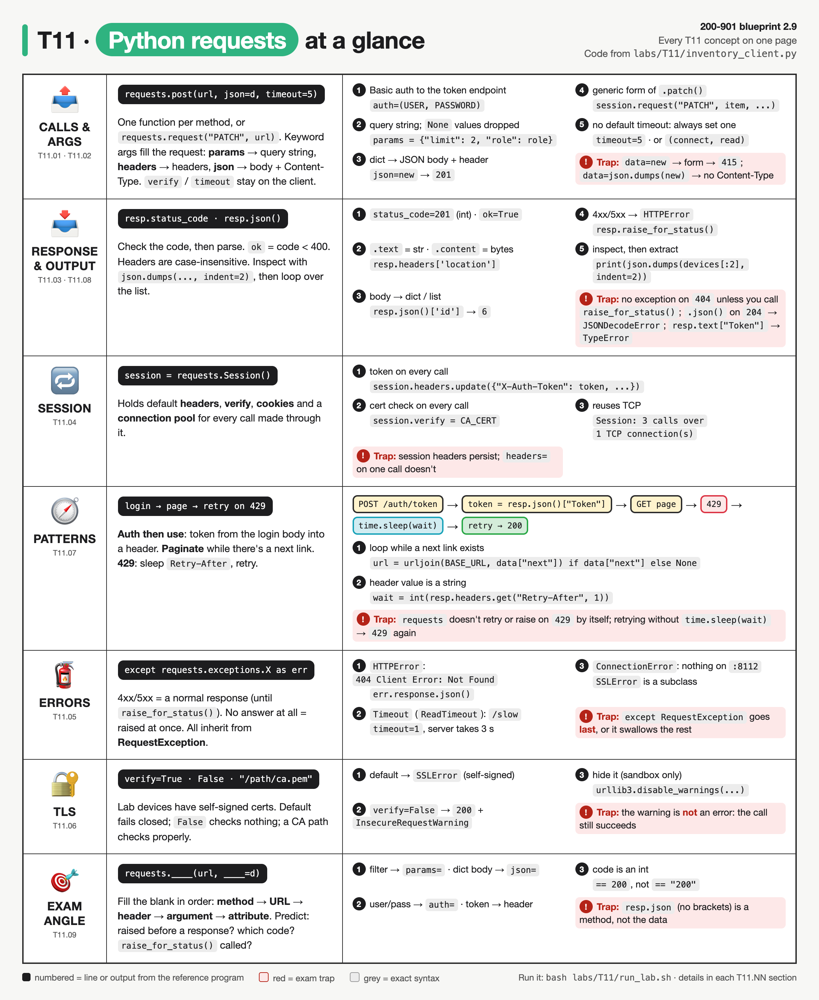
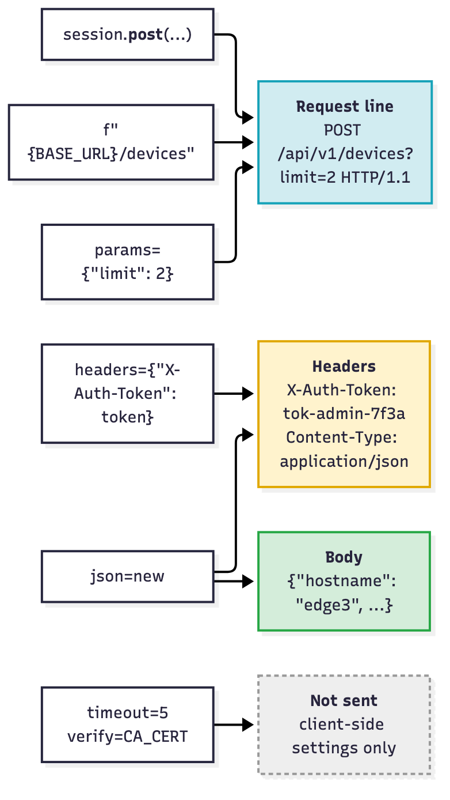
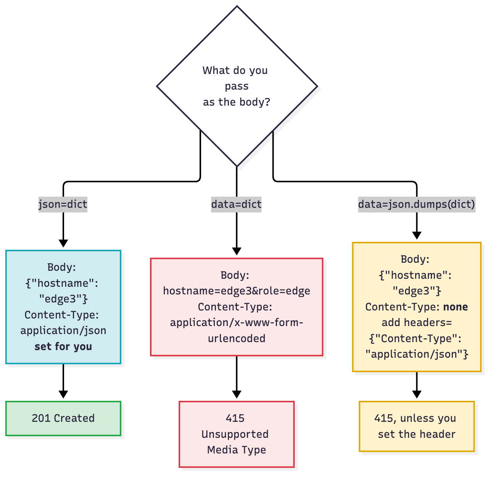
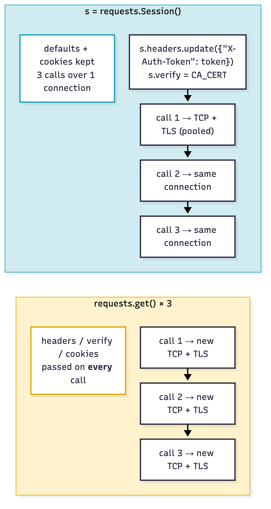
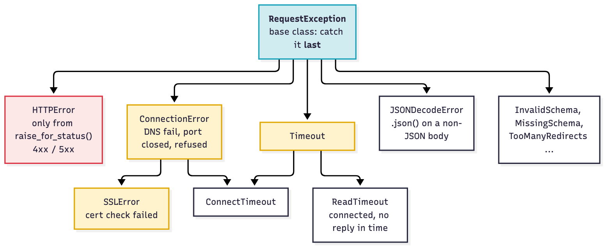
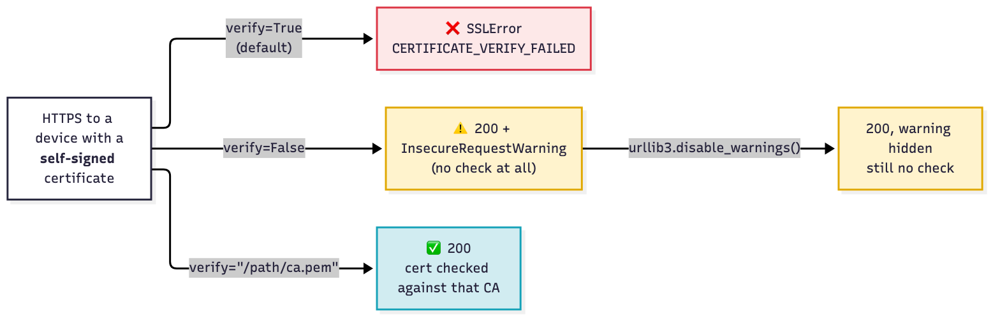
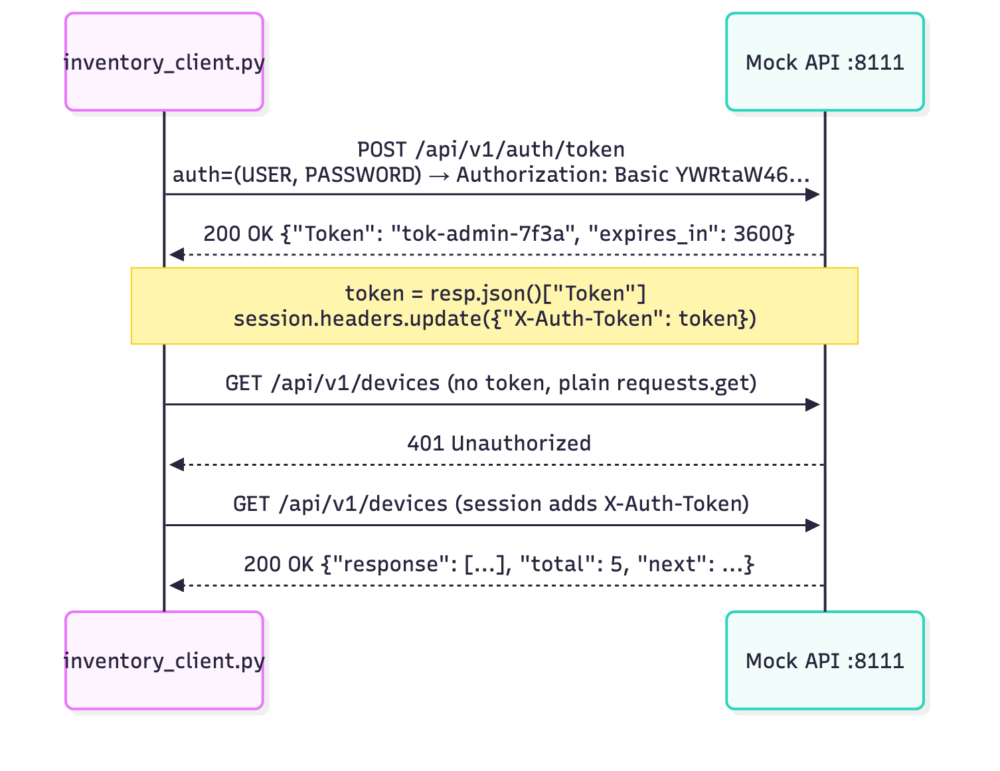
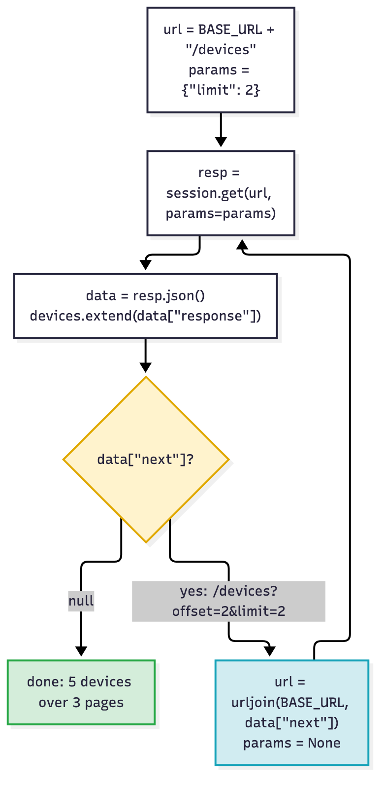
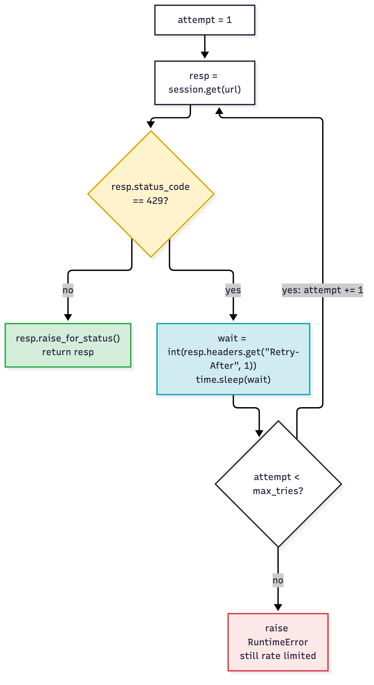
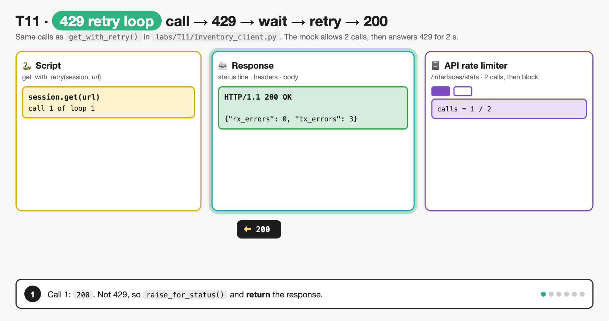

# T11 · Python requests scripting

> Owner: **Beedy** · Blueprint: **2.9** · CBT coverage: **Full** · Learn by 2026-10-17



*Every T11 concept on one page. Each row is a concept group (IDs under the icon), numbered items are lines from `labs/T11/inventory_client.py`, and red boxes are exam traps.*

<!-- toc:start -->

**Contents**

- [TL;DR](#tldr)
- [Concepts](#concepts)
  - [T11.01](#t1101--calls) Calls · [T11.02](#t1102--arguments) Arguments · [T11.03](#t1103--response) Response · [T11.04](#t1104--sessions) Sessions · [T11.05](#t1105--errors) Errors · [T11.06](#t1106--tls-warnings) TLS warnings · [T11.07](#t1107--patterns) Patterns · [T11.08](#t1108--output) Output · [T11.09](#t1109--exam-angle) Exam angle
- [Exam traps](#exam-traps)
- [Examples](#examples)
- [Practice questions](#practice-questions)
- [Study aids](#study-aids)
- [Sources](#sources)
- [To verify](#to-verify)

<!-- toc:end -->

## TL;DR

- **One call = method + URL + keyword args.** `requests.get/post/put/patch/delete(url, ...)` or `requests.request("PATCH", url, ...)`. `params=` builds `?a=1&b=2`, `headers=` adds headers, `json=` sends a dict as JSON **and** sets `Content-Type: application/json`, `auth=(u, p)` adds Basic auth, `verify=` and `timeout=` are client-side only.
- **Read the response in order:** `resp.status_code` (int) / `resp.ok` (< 400) → `resp.headers` (case-insensitive) → `resp.json()` (dict/list), `resp.text` (str), `resp.content` (bytes). `requests` **never raises on a 4xx/5xx by itself**; call `resp.raise_for_status()` to get an `HTTPError`.
- **Script pattern:** POST login → `token = resp.json()["Token"]` → `s = requests.Session()` + `s.headers.update({"X-Auth-Token": token})` → loop while there's a `next` page → on `429` `time.sleep(int(resp.headers["Retry-After"]))` and retry → `except requests.exceptions.RequestException` last.
- **Trap:** `data=dict` sends a **form** (`application/x-www-form-urlencoded`), and `data=json.dumps(d)` sends **no** Content-Type, so both get `415` from a JSON API. Use `json=d`. And `resp.json` without `()` is a method object, not the data.

## Concepts

Every section below explains one part of the same script. Read it once first.

- [T07](T07-rest-fundamentals-http-codes.md) built a REST session with the standard library (`urllib`). T11 rebuilds the same calls with `requests`, against the same fake inventory API.
- `labs/T11/mock_api.py` is that API, adapted from `labs/T07/mock_api.py`. It runs at `https://127.0.0.1:8111/api/v1` with three changes:
  - **HTTPS with a self-signed cert**, so `verify=` behaves like a real lab device.
  - **Catalyst Center style login:** `POST /auth/token` with Basic auth returns `{"Token": …}`, and later calls send it in an `X-Auth-Token` header.
  - **Paging** (`"next"` link in the body), a **short rate limit** (2 calls, then `429` + `Retry-After: 2`), and a **slow endpoint** (3 s) for timeouts.
- `labs/T11/inventory_client.py` (below) is the **reference program**.
- To run both: `bash labs/T11/run_lab.sh`. It makes a throwaway cert, starts the API, runs the client, then stops the API.

**API doc for the mock:**

| Method | Path | Body | Success | Errors |
|---|---|---|---|---|
| `POST` | `/auth/token` | none; `Authorization: Basic <base64 user:pass>` | `200` `{"Token": …, "expires_in": 3600}` | `401` |
| `GET` | `/devices?role=&os=&offset=&limit=` | none | `200` `{"response": [...], "total": n, "next": "/api/v1/devices?offset=…" or null}` | `401` |
| `POST` | `/devices` | JSON, required: `hostname`, `mgmt_ip`, `role`, `os` | `201` + `Location` | `400` `409` `415` |
| `GET` / `PUT` / `PATCH` / `DELETE` | `/devices/{id}` | JSON for PUT (all fields) / PATCH (some) | `200`, DELETE `204` | `400` `404` `415` |
| `GET` | `/interfaces/stats` | none | `200` | `429` + `Retry-After: 2` after 2 calls |
| `GET` | `/slow` | none | `200` after 3 s | (client times out first) |
| `GET` | `/health` | none, no token | `200` | |

All endpoints except `/auth/token` and `/health` need `X-Auth-Token: <token>`. Every response carries `X-Client-Port` (the client's TCP source port), so the script can count TCP connections.

**`labs/T11/inventory_client.py`**

```python
"""T11 reference program: a requests client for the mock inventory API.

Same API as T07 (labs/T07/rest_walkthrough.py used urllib), now with `requests`:
log in, reuse a Session, page through devices, CRUD, retry on 429, handle every error.

Run everything:   bash labs/T11/run_lab.sh
Credentials are fake and read from env vars (defaults match the local mock).
"""
import json
import os
import time
import warnings
from urllib.parse import urljoin

import requests
import urllib3

BASE_URL = os.environ.get("API_BASE", "https://127.0.0.1:8111/api/v1")
USER = os.environ.get("API_USER", "admin")
PASSWORD = os.environ.get("API_PASS", "C1sco12345")
CA_CERT = os.environ.get("API_CA_CERT", True)   # path to the mock's self-signed cert (run_lab.sh sets it)


def show(resp):
    """One line per response: method, URL, status code, reason phrase."""
    print(f"  {resp.request.method:6} {resp.url} -> {resp.status_code} {resp.reason}")


def tls_demo():
    """T11.06: verify=True fails on a self-signed cert, verify=False warns, verify=<CA path> works."""
    url = f"{BASE_URL}/health"
    try:
        requests.get(url, timeout=5)                                   # verify=True is the default
    except requests.exceptions.SSLError as err:
        print("  verify=True (default) ->", type(err).__name__, "(self-signed cert)")
    with warnings.catch_warnings(record=True) as caught:               # capture the warning to print it
        warnings.simplefilter("always")
        resp = requests.get(url, verify=False, timeout=5)
    print("  verify=False          ->", resp.status_code, "+", caught[0].category.__name__)
    urllib3.disable_warnings(urllib3.exceptions.InsecureRequestWarning)  # lab only: hide the warning
    with warnings.catch_warnings(record=True) as caught:               # no "always" filter this time
        requests.get(url, verify=False, timeout=5)
    print("  after disable_warnings ->", len(caught), "warnings")
    resp = requests.get(url, verify=CA_CERT, timeout=5)                # the right fix: trust the cert
    print("  verify=<CA cert path> ->", resp.status_code, "no warning")


def login():
    """T11.07 step 1: POST credentials with Basic auth, read the token from the JSON body."""
    resp = requests.post(f"{BASE_URL}/auth/token", auth=(USER, PASSWORD), verify=CA_CERT, timeout=5)
    show(resp)
    resp.raise_for_status()
    return resp.json()["Token"]


def get_all_devices(session, role=None):
    """T11.07 pagination: keep calling while the body has a "next" link."""
    devices, url = [], f"{BASE_URL}/devices"
    params = {"limit": 2, "role": role}            # a None value is left out of the query string
    while url:
        resp = session.get(url, params=params, timeout=5)
        show(resp)
        resp.raise_for_status()
        data = resp.json()
        devices.extend(data["response"])
        url = urljoin(BASE_URL, data["next"]) if data["next"] else None
        params = None                              # the next link already carries the query string
    return devices


def get_with_retry(session, url, max_tries=4):
    """T11.07 rate limit: on 429, sleep Retry-After seconds, then try again."""
    for attempt in range(1, max_tries + 1):
        resp = session.get(url, timeout=5)
        show(resp)
        if resp.status_code != 429:
            resp.raise_for_status()
            return resp
        wait = int(resp.headers.get("Retry-After", 1))
        print(f"         try {attempt} got 429: sleeping {wait}s (Retry-After), then retrying")
        time.sleep(wait)
    raise RuntimeError(f"still rate limited after {max_tries} tries")


def safe_get(session, url, timeout=5):
    """T11.05: catch the specific exceptions first and the base class last."""
    try:
        resp = session.get(url, timeout=timeout)
        resp.raise_for_status()                    # 4xx/5xx -> HTTPError
        return resp.json()
    except requests.exceptions.HTTPError as err:
        print(f"  HTTPError: {err}")
        print(f"    err.response.json() = {err.response.json()}")
    except requests.exceptions.Timeout as err:
        print(f"  Timeout ({type(err).__name__}): no reply within {timeout}s")
    except requests.exceptions.ConnectionError as err:
        print(f"  ConnectionError: nothing listening at {err.request.url}")
    except requests.exceptions.RequestException as err:  # base class of all of the above
        print(f"  RequestException ({type(err).__name__}): {err}")
    return None


def main():
    print("== 1. TLS: verify= ==")
    tls_demo()

    print("\n== 2. Log in, then reuse a Session ==")
    token = login()
    session = requests.Session()
    session.headers.update({"X-Auth-Token": token, "Accept": "application/json"})
    session.verify = CA_CERT                       # every session call checks the cert
    show(requests.get(f"{BASE_URL}/devices", verify=CA_CERT, timeout=5))     # no token -> 401
    show(session.get(f"{BASE_URL}/devices", timeout=5))                      # token from session -> 200
    ports = {session.get(f"{BASE_URL}/health", timeout=5).headers["X-Client-Port"] for _ in range(3)}
    print(f"  Session: 3 calls over {len(ports)} TCP connection(s)")
    ports = {requests.get(f"{BASE_URL}/health", verify=CA_CERT, timeout=5).headers["X-Client-Port"]
             for _ in range(3)}
    print(f"  requests.get: 3 calls over {len(ports)} TCP connection(s)")

    print("\n== 3. Read every page, inspect, extract ==")
    devices = get_all_devices(session)
    print(json.dumps(devices[:2], indent=2))       # look at the structure first
    for d in devices:                              # then pull out the fields you need
        print(f"  {d['hostname']:8} {d['mgmt_ip']:12} {d['role']}")

    print("\n== 4. Create, update, delete ==")
    new = {"hostname": "edge3", "mgmt_ip": "10.10.20.50", "role": "edge", "os": "iosxe"}
    show(session.post(f"{BASE_URL}/devices", data=new, timeout=5))          # dict as a form -> 415
    resp = session.post(f"{BASE_URL}/devices", json=new, timeout=5)          # json= -> 201
    show(resp)
    print(f"  status_code={resp.status_code!r} ok={resp.ok} Location={resp.headers['location']}")
    print(f"  text={resp.text!r}")
    print(f"  content={resp.content[:30]!r}...")
    print(f"  json()['id']={resp.json()['id']}")
    item = urljoin(BASE_URL, resp.headers["Location"])
    show(session.request("PATCH", item, json={"role": "core"}, timeout=5))  # generic form of .patch()
    show(session.put(item, json={**new, "role": "core", "mgmt_ip": "10.10.20.51"}, timeout=5))
    resp = session.delete(item, timeout=5)
    show(resp)
    try:
        resp.json()                                # 204 has an empty body
    except requests.exceptions.JSONDecodeError:
        print(f"  204 body={resp.text!r} -> .json() raises JSONDecodeError")

    print("\n== 5. Rate limit: retry on 429 ==")
    for _ in range(3):
        get_with_retry(session, f"{BASE_URL}/interfaces/stats")

    print("\n== 6. Errors ==")
    safe_get(session, f"{BASE_URL}/devices/99")                       # 404 -> HTTPError
    safe_get(session, f"{BASE_URL}/slow", timeout=1)                  # server takes 3 s -> Timeout
    safe_get(session, "https://127.0.0.1:8112/api/v1/health")         # nothing on 8112 -> ConnectionError
    safe_get(session, "127.0.0.1:8111/api/v1/health")                 # no scheme -> RequestException


if __name__ == "__main__":
    main()
```

**Output** (`bash labs/T11/run_lab.sh`, requests 2.34.2, Python 3.14):

```
== 1. TLS: verify= ==
  verify=True (default) -> SSLError (self-signed cert)
  verify=False          -> 200 + InsecureRequestWarning
  after disable_warnings -> 0 warnings
  verify=<CA cert path> -> 200 no warning

== 2. Log in, then reuse a Session ==
  POST   https://127.0.0.1:8111/api/v1/auth/token -> 200 OK
  GET    https://127.0.0.1:8111/api/v1/devices -> 401 Unauthorized
  GET    https://127.0.0.1:8111/api/v1/devices -> 200 OK
  Session: 3 calls over 1 TCP connection(s)
  requests.get: 3 calls over 3 TCP connection(s)

== 3. Read every page, inspect, extract ==
  GET    https://127.0.0.1:8111/api/v1/devices?limit=2 -> 200 OK
  GET    https://127.0.0.1:8111/api/v1/devices?offset=2&limit=2 -> 200 OK
  GET    https://127.0.0.1:8111/api/v1/devices?offset=4&limit=2 -> 200 OK
[
  {
    "id": 1,
    "hostname": "csr1",
    "mgmt_ip": "10.10.20.48",
    "role": "edge",
    "os": "iosxe"
  },
  {
    "id": 2,
    "hostname": "n9k1",
    "mgmt_ip": "10.10.20.58",
    "role": "core",
    "os": "nxos"
  }
]
  csr1     10.10.20.48  edge
  n9k1     10.10.20.58  core
  edge2    10.10.20.49  edge
  cat9k1   10.10.20.60  access
  cat9k2   10.10.20.61  access

== 4. Create, update, delete ==
  POST   https://127.0.0.1:8111/api/v1/devices -> 415 Unsupported Media Type
  POST   https://127.0.0.1:8111/api/v1/devices -> 201 Created
  status_code=201 ok=True Location=/api/v1/devices/6
  text='{"id": 6, "hostname": "edge3", "mgmt_ip": "10.10.20.50", "role": "edge", "os": "iosxe"}'
  content=b'{"id": 6, "hostname": "edge3",'...
  json()['id']=6
  PATCH  https://127.0.0.1:8111/api/v1/devices/6 -> 200 OK
  PUT    https://127.0.0.1:8111/api/v1/devices/6 -> 200 OK
  DELETE https://127.0.0.1:8111/api/v1/devices/6 -> 204 No Content
  204 body='' -> .json() raises JSONDecodeError

== 5. Rate limit: retry on 429 ==
  GET    https://127.0.0.1:8111/api/v1/interfaces/stats -> 200 OK
  GET    https://127.0.0.1:8111/api/v1/interfaces/stats -> 200 OK
  GET    https://127.0.0.1:8111/api/v1/interfaces/stats -> 429 Too Many Requests
         try 1 got 429: sleeping 2s (Retry-After), then retrying
  GET    https://127.0.0.1:8111/api/v1/interfaces/stats -> 200 OK

== 6. Errors ==
  HTTPError: 404 Client Error: Not Found for url: https://127.0.0.1:8111/api/v1/devices/99
    err.response.json() = {'error': 'device 99 not found'}
  Timeout (ReadTimeout): no reply within 1s
  ConnectionError: nothing listening at https://127.0.0.1:8112/api/v1/health
  RequestException (InvalidSchema): No connection adapters were found for '127.0.0.1:8111/api/v1/health'
```

### T11.01 · Calls

**Must cover:**

- [x] import requests
- [x] requests.get / post / put / patch / delete(url, ...)
- [x] Or the generic requests.request("GET", url, ...)

**Notes:**

- `import requests` is a third-party package (`pip install requests`), not the standard library. In a script the import order is stdlib (`json`, `os`, `time`) then third-party (`requests`, `urllib3`).
- One function per HTTP method. Each returns a `Response` object:

| Function | In the program |
|---|---|
| `requests.get(url, ...)` | `requests.get(f"{BASE_URL}/devices", verify=CA_CERT, timeout=5)` → `401` (no token) |
| `requests.post(url, ...)` | `login()`: `requests.post(f"{BASE_URL}/auth/token", auth=(USER, PASSWORD), ...)` |
| `.put(url, ...)` | section 4: `session.put(item, json={**new, ...})` |
| `.patch(url, ...)` | section 4, written the generic way (next row) |
| `.delete(url, ...)` | section 4: `session.delete(item, timeout=5)` → `204` |
| `requests.request("PATCH", url, ...)` | section 4: `session.request("PATCH", item, json={"role": "core"}, timeout=5)` |

- `requests.get(url)` is literally `requests.request("GET", url)`. The generic form is handy when the method is a variable, e.g. `requests.request(method, url)` in a loop over a CRUD table.
- The same methods exist on a `Session` (`session.get`, `session.request`, …), see T11.04.
- `resp.request.method` and `resp.url` tell you what was actually sent. `show()` prints both.

### T11.02 · Arguments

**Must cover:**

- [x] headers={...}: Content-Type, Accept, auth headers
- [x] params={...}: builds the query string (?a=1&b=2)
- [x] json=dict: serialises body and sets Content-Type: application/json
- [x] data=string/dict: raw or form-encoded body (you set Content-Type yourself)
- [x] auth=(user, pass), verify=False (skip TLS check), timeout=seconds

**Notes:**

- Each keyword argument fills one part of the HTTP request ([T07.05](T07-rest-fundamentals-http-codes.md#t0705--request-parts)). `verify` and `timeout` are never sent; they only change how the client behaves.



*Method, URL and `params` make the request line (blue). `headers` and `json` make headers (yellow); `json` also makes the body (green). `timeout` and `verify` stay on the client (grey).*

| Argument | Goes into | In the program |
|---|---|---|
| `headers={...}` | request headers | session default `{"X-Auth-Token": token, "Accept": "application/json"}` |
| `params={...}` | query string, URL-encoded | `get_all_devices()`: `{"limit": 2, "role": None}` → `?limit=2`. A `None` value is **dropped** |
| `json=dict` | body as JSON **+** `Content-Type: application/json` | `session.post(..., json=new)` → `201` |
| `data=dict` | body form-encoded **+** `Content-Type: application/x-www-form-urlencoded` | `session.post(..., data=new)` → `415` |
| `data="string"` | body sent as-is, **no** Content-Type added | break-it edit 2 → `415` |
| `auth=(user, pass)` | `Authorization: Basic <base64>` | `login()` |
| `verify=` | TLS check: `True` (default), `False`, or a CA bundle path | `tls_demo()`, `session.verify = CA_CERT` |
| `timeout=` | seconds to wait for connect / for data; float or `(connect, read)` tuple | `timeout=5` everywhere, `timeout=1` on `/slow` |



*`json=` is the only option that both serialises the dict and labels it (blue). `data=dict` sends a form (red). `data=json.dumps(d)` sends the right bytes with no label (yellow), so add the header yourself.*

- Proof without a server: the `requests.Request(...).prepare()` drill in **Examples** prints the exact Content-Type and body each one produces.
- **No timeout by default.** Without `timeout=`, a call to a dead host can hang for a long time. Use it on every call.
- `json=` is ignored if `data=` or `files=` is also passed.
- `auth=` beats an `Authorization` header you set in `headers=` (the requests docs list `auth=` as higher priority).
- Auth styles per platform (Basic, `X-Auth-Token`, `Authorization: Bearer`, API key) are in [T10](T10-api-authentication.md). In `requests` they're all either `auth=` or a header.

### T11.03 · Response

**Must cover:**

- [x] resp.status_code (int), resp.ok (True for <400)
- [x] resp.headers (dict-like), resp.text (str), resp.content (bytes)
- [x] resp.json() → Python dict/list
- [x] resp.raise_for_status() raises HTTPError on 4xx/5xx

**Notes:**

- The program's section 4 prints every attribute of the `201` response:

| Attribute | Type | Output line |
|---|---|---|
| `resp.status_code` | `int` | `status_code=201` (an int: compare with `== 201`, not `== "201"`) |
| `resp.reason` | `str` | `201 Created` in `show()` |
| `resp.ok` | `bool` | `ok=True`. True for **any code below 400**, so a `301` or `204` is also `ok` |
| `resp.headers` | case-insensitive dict | `resp.headers['location']` works although the server sent `Location` |
| `resp.text` | `str` (decoded) | `text='{"id": 6, ...}'` |
| `resp.content` | `bytes` (raw) | `content=b'{"id": 6, ...` (note the `b`) |
| `resp.json()` | `dict` / `list` | `json()['id']=6` |
| `resp.url`, `resp.request` | final URL, the request sent | used in `show()` |

- **`.json()` is a method**: `resp.json()["id"]`. `resp.json["id"]` → `TypeError: 'method' object is not subscriptable`.
- **`.text` is a string, not a dict**: `resp.text["Token"]` → `TypeError: string indices must be integers` (break-it edit 4).
- `.json()` on an empty or non-JSON body (e.g. `204`) raises `requests.exceptions.JSONDecodeError`. Section 4 shows it: `204 body='' -> .json() raises JSONDecodeError`.
- A successful `.json()` doesn't mean the request worked: error responses have JSON bodies too (`{"error": "device 99 not found"}`). Check the code first.
- `raise_for_status()` returns `None` on `< 400`, and raises `HTTPError` on `4xx`/`5xx`. It's the one line that turns a bad status into an exception. `login()` and `get_all_devices()` call it straight after each request.

### T11.04 · Sessions

**Must cover:**

- [x] s = requests.Session() keeps cookies and default headers across calls
- [x] s.headers.update({"X-Auth-Token": token})
- [x] Reuses TCP connections (faster)

**Notes:**

- `requests.Session()` is a client object holding **defaults** for every call made through it: `headers`, `auth`, `verify`, `cookies`, plus a **connection pool**.
- In `main()` section 2:
  - `session.headers.update({"X-Auth-Token": token, "Accept": "application/json"})`: every later `session.get/post/...` sends both headers.
  - `session.verify = CA_CERT`: every call checks the cert against the lab CA.
  - Proof: plain `requests.get(... /devices)` → `401`; `session.get(... /devices)` → `200`.
- Per-call arguments are **merged** with session defaults and override them for that call only. They aren't saved: `session.get(url, headers={"X-Debug": "1"})` doesn't add `X-Debug` to the next call.
- **Cookies:** a `Set-Cookie` from the server is stored in `session.cookies` and sent back automatically. That's how cookie-based logins (e.g. some controllers' session cookie) stay logged in. See [T10.05](T10-api-authentication.md#t1005--sessioncookie).
- **Connection reuse:** the mock echoes the client's TCP port. Output: `Session: 3 calls over 1 TCP connection(s)` vs `requests.get: 3 calls over 3 TCP connection(s)`. One TCP + TLS handshake instead of three is why sessions are faster.



*A Session keeps headers, verify and cookies, and reuses one pooled connection (blue). Plain `requests.get()` builds everything again each time (yellow).*

- `with requests.Session() as s:` closes the session's connections at the end of the block.

### T11.05 · Errors

**Must cover:**

- [x] requests.exceptions.HTTPError (from raise_for_status)
- [x] ConnectionError (host unreachable), Timeout
- [x] try: … except requests.exceptions.RequestException as e: catches all

**Notes:**

- Two kinds of failure, handled differently:
  - **The server answered with 4xx/5xx.** That's a normal `Response`. Nothing is raised unless you call `raise_for_status()` → `HTTPError`.
  - **No usable answer** (DNS failure, port closed, TLS failure, too slow). `requests` raises straight away. There's no `resp` to look at.
- `safe_get()` in the program hits all four, and the output shows each:

| Call | Exception | Output |
|---|---|---|
| `/devices/99` | `HTTPError` (from `raise_for_status()`) | `HTTPError: 404 Client Error: Not Found for url: …` + `err.response.json()` |
| `/slow` with `timeout=1` | `Timeout` (actually `ReadTimeout`) | `Timeout (ReadTimeout): no reply within 1s` |
| port 8112, nothing listening | `ConnectionError` | `ConnectionError: nothing listening at …:8112/…` |
| `"127.0.0.1:8111/..."` (no `https://`) | `RequestException` (actually `InvalidSchema`) | `RequestException (InvalidSchema): No connection adapters were found …` |



*Everything inherits from `RequestException`, so it goes in the **last** `except`. `SSLError` is a kind of `ConnectionError`; `ConnectTimeout` is both a `ConnectionError` and a `Timeout`.*

- **Order matters.** Python uses the first matching `except`. If `except RequestException` came first, it would catch everything and the specific handlers below it would never run.
- `err.response` on an `HTTPError` is the full `Response`, so you can still read the error body.
- `requests.exceptions.X` and `requests.X` are the same classes (`requests.HTTPError is requests.exceptions.HTTPError`).
- Exception names verified with requests 2.34.2: `HTTPError`, `ConnectionError`, `Timeout`, `ConnectTimeout`, `ReadTimeout`, `SSLError`, `JSONDecodeError`, `InvalidSchema`, `MissingSchema`, `TooManyRedirects` all inherit from `RequestException`.

### T11.06 · TLS warnings

**Must cover:**

- [x] verify=False triggers InsecureRequestWarning on self-signed lab certs
- [x] requests.packages.urllib3.disable_warnings() or urllib3.disable_warnings() hides it
- [x] Acceptable in sandboxes only; real scripts should verify certificates

**Notes:**

- Lab devices (IOS XE, NX-OS, sandbox controllers) usually ship with **self-signed** certs. No public CA vouches for them, so the default check fails.
- `tls_demo()` shows all four outcomes:



*Default = fail closed (red). `verify=False` works but checks nothing (yellow), and hiding the warning doesn't change that. Pointing `verify=` at the CA cert is the real fix (blue).*

| Call | Output |
|---|---|
| `requests.get(url)` (default `verify=True`) | `SSLError` (`CERTIFICATE_VERIFY_FAILED … self-signed certificate`) |
| `requests.get(url, verify=False)` | `200` + `InsecureRequestWarning` |
| after `urllib3.disable_warnings(urllib3.exceptions.InsecureRequestWarning)` | `200`, `0 warnings` |
| `requests.get(url, verify=CA_CERT)` (path to the cert/CA bundle) | `200`, no warning |

- `InsecureRequestWarning` is a **warning, not an error**: the request still goes through and you get the response.
- Two spellings of the same call: `urllib3.disable_warnings()` and `requests.packages.urllib3.disable_warnings()`. Both work in 2.34.2 (`requests.packages.urllib3 is urllib3` → `True`). With no argument it hides all urllib3 warnings; with `urllib3.exceptions.InsecureRequestWarning` only that one.
- `verify=False` and `disable_warnings()` are for sandboxes only. A real script should verify, using `verify="/path/to/ca.pem"` or the `REQUESTS_CA_BUNDLE` env var.
- Lab gotcha met while building this lab: if `REQUESTS_CA_BUNDLE` is set in the environment (some corporate setups do this), it overrides `session.verify`. `run_lab.sh` unsets it. ⚠ verify: this is documented requests behaviour for `Session` (GitHub issue #3829), not tested on the exam.

### T11.07 · Patterns

**Must cover:**

- [x] Auth then use: POST login → read token → GET with token header
- [x] Pagination: loop while a next link/page exists
- [x] Rate limits: if status_code == 429: time.sleep(int(resp.headers["Retry-After"])) then retry

**Notes:**

- **Auth then use** (`login()` + section 2). This is the Catalyst Center (DNA Center) shape: Basic auth once, then a token header on every call.



*The token comes back in the **body** of the login response. The script copies it into a session **header**, so every later call carries it (REST is stateless, [T07.02](T07-rest-fundamentals-http-codes.md#t0702--rest-constraints)).*

- **Pagination** (`get_all_devices()`): the API returns one page plus a pointer to the next. Keep calling until there isn't one.



*Loop while `data["next"]` is set. Output: 3 GETs (`limit=2`, then `offset=2`, then `offset=4`) → 5 devices.*

  - `params = None` after the first page, because the `next` link already has the query string. Sending `params` again would duplicate `limit`.
  - `urljoin(BASE_URL, data["next"])` turns the relative link `/api/v1/devices?offset=2&limit=2` into a full URL.
  - Other APIs page differently: a `Link: <…>; rel="next"` header (`requests` parses it into `resp.links["next"]["url"]`), or `offset`/`limit` you count yourself. Pagination styles and rate-limit policy are [T08](T08-api-consumption-constraints.md) material.
- **Rate limit** (`get_with_retry()`): on `429`, read `Retry-After`, sleep, retry the same request.



*Sleep for exactly the header's value, then retry. Cap the tries so a stuck API can't loop forever.*



*Section 5 of the output, step by step: call → `200` → call → `200` → call → `429` + `Retry-After: 2` → `time.sleep(2)` → same call → `200`. The last frame is break-it edit 3: retry **without** sleeping and all 4 tries get `429`. Fixes two misconceptions: that `requests` raises on a 429 (it doesn't; you check `status_code`), and that retrying straight away helps (it doesn't; the wait is the fix).*

  - `int(...)` because header values are always **strings** (`"2"`). `time.sleep("2")` → `TypeError`.
  - `resp.headers.get("Retry-After", 1)` gives a default if the header is missing. `resp.headers["Retry-After"]` raises `KeyError` if it's missing.
  - `Retry-After` can also be an HTTP date (RFC 9110). `int()` would fail on that; the exam pattern assumes seconds.
  - `requests` doesn't retry by itself. Built-in alternative: `urllib3.util.Retry` mounted on a session with `HTTPAdapter(max_retries=...)` (requests advanced docs). Know it exists; the exam pattern is the manual loop.

### T11.08 · Output

**Must cover:**

- [x] print(json.dumps(data, indent=2)) to inspect structure
- [x] Then extract fields: for d in data["response"]: print(d["hostname"])

**Notes:**

- Two steps, both in section 3:
  1. **Inspect:** `print(json.dumps(devices[:2], indent=2))` pretty-prints the structure so you can see the keys and nesting. `print(devices)` would dump one long line with Python `'single quotes'`.
  2. **Extract:** `for d in devices: print(f"  {d['hostname']:8} {d['mgmt_ip']:12} {d['role']}")`.
- Map the JSON path to Python: the body is `{"response": [ {...}, {...} ], "total": 5, "next": ...}`, so it's
  - `data["response"]` → a list,
  - `data["response"][0]` → the first device dict,
  - `data["response"][0]["hostname"]` → `"csr1"`.
- Real Cisco APIs wrap results the same way: Catalyst Center uses `"response"`; Meraki returns a bare list. ⚠ verify per platform.
- `json.dumps` = Python → JSON **string** (to print or send). `json.loads` = JSON string → Python. `resp.json()` = `json.loads(resp.text)` for you. See [T06](T06-data-formats-parsing.md).

### T11.09 · Exam angle

**Must cover:**

- [x] Complete-the-code: missing method, URL, header, argument or attribute
- [x] Predict the output or the error of a short script
- [x] Spot json= vs data= and .json() vs .text mistakes

**Notes:**

- **Complete-the-code checklist.** Read the API doc snippet, then fill each blank in this order:

| Blank | Pick from | Clue |
|---|---|---|
| method | `get` `post` `put` `patch` `delete` | the doc's method / CRUD verb ([T07.03](T07-rest-fundamentals-http-codes.md#t0703--http-methods)) |
| URL | base URL + path (+ `{id}`) | f-string like `f"{BASE_URL}/devices/{dev_id}"` |
| header | `X-Auth-Token`, `Authorization`, `Content-Type`, `Accept` | which platform ([T10](T10-api-authentication.md)) |
| argument | `headers=` `params=` `json=` `data=` `auth=` `verify=` `timeout=` | filter → `params`; dict body → `json`; user/pass → `auth` |
| attribute | `.status_code` `.json()` `.text` `.headers` `.ok` | int code vs parsed body vs raw string |

- **Predict the output.** Ask, in order:
  1. Does it raise before a response exists? (wrong scheme, refused, timeout, `SSLError` with `verify` default)
  2. What status code comes back? (`401` no token, `415` `data=dict`, `404` wrong id)
  3. Does the script call `raise_for_status()`? If not, a 4xx carries on silently.
  4. Is the attribute right? (`.json()` vs `.json` vs `.text[...]`)
- **Spot the mistake:** the four the program's break-it edits show (see **Examples**): `data=` instead of `json=`, `.text["key"]` instead of `.json()["key"]`, no token header, no sleep on 429.

## Exam traps

- **`json=` vs `data=`:** `json=d` → JSON body + `Content-Type: application/json`. `data=d` (dict) → form body `a=1&b=2` + form content type. `data=json.dumps(d)` → JSON body but **no** Content-Type. Only `json=` "just works" against a JSON API.
- **`requests` doesn't raise on 4xx/5xx.** `resp = requests.get(url)` returns quietly with `status_code == 404`. Only `resp.raise_for_status()` turns it into `HTTPError`.
- **`resp.ok` is True for anything below 400,** including `204` and `3xx`. It's not "is 200".
- **`resp.json()` vs `resp.json` vs `resp.text`:** method call → dict/list; no brackets → method object; `.text` → `str`. `resp.text["Token"]` → `TypeError`.
- **`.json()` on `204 No Content`** → `JSONDecodeError`. Check the code before parsing.
- **`status_code` is an int:** `if resp.status_code == "200":` is always False.
- **Header values are strings:** `int(resp.headers["Retry-After"])` before `time.sleep()`. Header **names** are case-insensitive.
- **`params=` vs path:** a filter or page goes in `params={"role": "edge"}` (query string). The device id goes in the URL path (`/devices/4`).
- **`verify=False` → `InsecureRequestWarning`, not an error.** The call still succeeds. `urllib3.disable_warnings()` only hides the message.
- **Default `verify=True` + self-signed cert → `SSLError`** (a `ConnectionError` subclass). No response object.
- **No default timeout.** `timeout=5` on every call. `Timeout` = no reply in time; `ConnectionError` = couldn't connect at all.
- **`except RequestException` goes last.** It's the base class and would swallow the specific handlers below it.
- **Session headers persist; per-call headers don't.** `s.headers.update({...})` = every call. `s.get(url, headers={...})` = that call only.
- **`auth=(u, p)` = HTTP Basic auth.** It's how you call a token endpoint (Catalyst Center). It's not how you send the token afterwards; that's a header.

## Examples

### 1. Run the reference program

Needs Python 3 with `requests`, plus `openssl` and `curl` (for `run_lab.sh`). No DevNet sandbox needed.

```bash
python3 -m venv /tmp/t11-venv
/tmp/t11-venv/bin/pip install requests
PYTHON=/tmp/t11-venv/bin/python bash labs/T11/run_lab.sh
```

Or by hand, in two terminals:

```bash
# terminal 1: cert + API (leave running)
openssl req -x509 -newkey rsa:2048 -nodes -days 1 -keyout /tmp/t11-key.pem -out /tmp/t11-cert.pem \
  -subj "/CN=127.0.0.1" -addext "subjectAltName=IP:127.0.0.1"
python3 labs/T11/mock_api.py /tmp/t11-cert.pem /tmp/t11-key.pem

# terminal 2: client
API_CA_CERT=/tmp/t11-cert.pem /tmp/t11-venv/bin/python labs/T11/inventory_client.py
```

In the lab container (it already has `requests`; the API and client share the container's localhost):

```bash
docker build --tag ccna-auto-lab:latest --file labs/Dockerfile labs/
docker run --rm --volume "$(pwd)":/work --workdir /work ccna-auto-lab:latest bash labs/T11/run_lab.sh
```

### 2. `json=` vs `data=` vs `params=` without a server

`Request(...).prepare()` builds the exact request `requests` would send, without sending it. Save as `/tmp/t11_prepare.py` and run `/tmp/t11-venv/bin/python /tmp/t11_prepare.py`:

```python
import json
import requests

url = "https://api.example.com/api/v1/devices"
body = {"hostname": "edge3", "role": "edge"}

for label, kwargs in [
    ("json=body", {"json": body}),
    ("data=body", {"data": body}),
    ("data=json.dumps(body)", {"data": json.dumps(body)}),
]:
    prep = requests.Request("POST", url, **kwargs).prepare()   # build the request, don't send it
    print(f"{label:22} Content-Type={prep.headers.get('Content-Type')!s:34} body={prep.body!r}")

prep = requests.Request("GET", url, params={"role": "edge", "limit": 2, "os": None}).prepare()
print("params ->", prep.url)
prep = requests.Request("GET", url, auth=("admin", "C1sco12345")).prepare()
print("auth=  ->", prep.headers["Authorization"])
print("defaults ->", dict(requests.utils.default_headers()))
```

Output:

```
json=body              Content-Type=application/json                   body=b'{"hostname": "edge3", "role": "edge"}'
data=body              Content-Type=application/x-www-form-urlencoded  body='hostname=edge3&role=edge'
data=json.dumps(body)  Content-Type=None                               body='{"hostname": "edge3", "role": "edge"}'
params -> https://api.example.com/api/v1/devices?role=edge&limit=2
auth=  -> Basic YWRtaW46QzFzY28xMjM0NQ==
defaults -> {'User-Agent': 'python-requests/2.34.2', 'Accept-Encoding': 'gzip, deflate, zstd', 'Accept': '*/*', 'Connection': 'keep-alive'}
```

- Line 3 is the silent trap: right bytes, no `Content-Type`.
- `"os": None` vanished from the query string.
- `requests` sends `Accept: */*` and `User-Agent: python-requests/…` unless you override them.

### 3. Break it on purpose

Copy the client, make one edit, run the copy with `run_lab.sh`. All five were run; the result column is the real last line of output.

```bash
cp labs/T11/inventory_client.py /tmp/t11_break.py
# edit /tmp/t11_break.py as in the table, then:
PYTHON=/tmp/t11-venv/bin/python bash labs/T11/run_lab.sh /tmp/t11_break.py
```

| # | Edit in `/tmp/t11_break.py` | Result | Lesson |
|---|---|---|---|
| 1 | Replace `session.headers.update({"X-Auth-Token": token, "Accept": "application/json"})` with `pass` | `GET …/devices -> 401 Unauthorized` (twice), then `requests.exceptions.HTTPError: 401 Client Error: Unauthorized for url: https://127.0.0.1:8111/api/v1/devices?limit=2` | the session supplies the token; without it every call is `401`, and `raise_for_status()` stops the script |
| 2 | Change `json=new` to `data=json.dumps(new)` on the `resp = session.post(...)` line | `POST …/devices -> 415 Unsupported Media Type`, then `KeyError: 'location'` | no Content-Type → `415`; and code that assumes success crashes on the next line |
| 3 | In `get_with_retry()`, replace `time.sleep(wait)` with `pass` | 4 × `429 Too Many Requests`, then `RuntimeError: still rate limited after 4 tries` | retrying without waiting just burns the attempts |
| 4 | In `login()`, change `resp.json()["Token"]` to `resp.text["Token"]` | `TypeError: string indices must be integers, not 'str'` | `.text` is a `str`; parse with `.json()` |
| 5 | Replace `session.verify = CA_CERT` with `pass` | `requests.exceptions.SSLError: … CERTIFICATE_VERIFY_FAILED … self-signed certificate` | session defaults matter: without `verify`, each call falls back to the default `True` |

### 4. Real Cisco API (DevNet Sandbox)

The same script shape against Catalyst Center (DNA Center). ⚠ verify the sandbox host, credentials and paths at developer.cisco.com/sandbox, and put them in `labs/.env` as `DNAC_HOST`, `DNAC_USER`, `DNAC_PASS`. Not run this session.

```bash
set -a && source labs/.env && set +a
/tmp/t11-venv/bin/python - <<'EOF'
import json
import os

import requests
import urllib3

urllib3.disable_warnings(urllib3.exceptions.InsecureRequestWarning)   # sandbox self-signed cert
host = os.environ["DNAC_HOST"]

resp = requests.post(f"https://{host}/dna/system/api/v1/auth/token",
                     auth=(os.environ["DNAC_USER"], os.environ["DNAC_PASS"]),
                     verify=False, timeout=10)
resp.raise_for_status()
token = resp.json()["Token"]

with requests.Session() as s:
    s.headers.update({"X-Auth-Token": token, "Accept": "application/json"})
    s.verify = False
    resp = s.get(f"https://{host}/dna/intent/api/v1/network-device", timeout=10)
    resp.raise_for_status()
    data = resp.json()
    print(json.dumps(data["response"][0], indent=2))
    for d in data["response"]:
        print(d["hostname"], d["managementIpAddress"])
EOF
```

## Practice questions

**Q1.** Complete the code so it creates the VLAN and the server receives JSON with the right `Content-Type`:

```python
resp = requests.post(f"{BASE}/vlans", headers={"X-Auth-Token": token},
                     ________={"id": 30, "name": "CAMERAS"}, timeout=5)
```

A. `data`  B. `json`  C. `params`  D. `body`

<details><summary>Answer</summary>

**B.** `json=` serialises the dict and sets `Content-Type: application/json`. `data=` would send a form (`415` from a JSON API), `params=` would put it in the query string, and `body=` isn't a `requests` argument (`TypeError`). (T11.02)
</details>

**Q2.** What does this print if the device doesn't exist?

```python
resp = requests.get(f"{BASE}/devices/99", headers=hdrs, timeout=5)
print(resp.status_code, resp.ok)
```

A. Nothing; `HTTPError` is raised  B. `404 False`  C. `"404" False`  D. `404 True`

<details><summary>Answer</summary>

**B.** `requests` doesn't raise on 4xx/5xx unless you call `raise_for_status()`. `status_code` is an `int`, and `ok` is False because 404 ≥ 400. (T11.03)
</details>

**Q3.** A script logs in to Catalyst Center and makes 50 calls. Which change sends the token on all of them and reuses one TCP connection?

A. `requests.headers.update({"X-Auth-Token": token})`  B. `s = requests.Session()` then `s.headers.update({"X-Auth-Token": token})`, and call `s.get(...)`  C. `requests.get(url, auth=token)`  D. `os.environ["X-Auth-Token"] = token`

<details><summary>Answer</summary>

**B.** A `Session` keeps default headers and pools connections. There's no module-level `requests.headers`, `auth=token` (a string) isn't the Basic tuple, and env vars aren't sent as headers. (T11.04)
</details>

**Q4.** Put the lines of a rate-limit-aware call in order: `time.sleep(wait)` · `resp = s.get(url, timeout=5)` · `wait = int(resp.headers["Retry-After"])` · `if resp.status_code == 429:` · `resp = s.get(url, timeout=5)` (retry)

<details><summary>Answer</summary>

`resp = s.get(url, timeout=5)` → `if resp.status_code == 429:` → `wait = int(resp.headers["Retry-After"])` → `time.sleep(wait)` → `resp = s.get(url, timeout=5)`. Call, check, read the header (a string, so `int()`), wait, then retry the same request. (T11.07)
</details>

**Q5.** What happens when this runs against a sandbox switch with a self-signed certificate?

```python
resp = requests.get("https://10.10.20.48/restconf/data/ietf-interfaces:interfaces",
                    auth=("developer", "C1sco12345"), verify=False, timeout=5)
print(resp.status_code)
```

A. `requests.exceptions.SSLError`  B. The status code prints, plus an `InsecureRequestWarning`  C. `ConnectionError`  D. The status code prints with no warning

<details><summary>Answer</summary>

**B.** `verify=False` skips the check, so the call works, and urllib3 emits `InsecureRequestWarning` (a warning, not an exception). Without `verify=False` you'd get `SSLError` (A). To get D you'd also call `urllib3.disable_warnings()`. (T11.06)
</details>

**Q6.** Which line causes `TypeError: string indices must be integers`?

```python
resp = requests.post(f"{BASE}/auth/token", auth=(user, pw), timeout=5)   # line 1
resp.raise_for_status()                                                    # line 2
token = resp.text["Token"]                                                 # line 3
headers = {"X-Auth-Token": token}                                          # line 4
```

<details><summary>Answer</summary>

**Line 3.** `resp.text` is a `str`, so `["Token"]` is a string index. Use `resp.json()["Token"]`. (T11.03, T11.09)
</details>

**Q7.** The API is up, but this handler prints `Something failed` for a `404` instead of `HTTP error 404`. Why?

```python
try:
    resp = s.get(url, timeout=5)
    resp.raise_for_status()
except requests.exceptions.RequestException:
    print("Something failed")
except requests.exceptions.HTTPError as e:
    print("HTTP error", e.response.status_code)
```

A. `raise_for_status()` doesn't raise on 404  B. `HTTPError` is a subclass of `RequestException`, so the first `except` catches it  C. A `Session` suppresses `HTTPError`  D. `timeout` turns the 404 into a `Timeout`

<details><summary>Answer</summary>

**B.** Python runs the first matching `except`. Put specific exceptions first and `RequestException` last. (T11.05)
</details>

**Q8.** The API returns `{"response": [{"hostname": "csr1", "mgmt_ip": "10.10.20.48"}, {"hostname": "n9k1", "mgmt_ip": "10.10.20.58"}]}`. Complete the loop to print each hostname:

```python
data = resp.json()
for d in ________:
    print(________)
```

<details><summary>Answer</summary>

`for d in data["response"]:` and `print(d["hostname"])`. The list is under the `"response"` key, and each item is a dict. `print(json.dumps(data, indent=2))` first shows you that structure. (T11.08)
</details>

<details><summary>Answer key (all 8): open only after answering every question</summary>

| Q | Answer | Why | Reread |
|---|---|---|---|
| 1 | **B** | `json=` serialises the dict and sets `Content-Type: application/json`. `data=` would send a form (`415` from a JSON API), `params=` would put it in the query string, and `body=` isn't a `requests` argument (`TypeError`). | [T11.02](#t1102--arguments) |
| 2 | **B** | `requests` doesn't raise on 4xx/5xx unless you call `raise_for_status()`. `status_code` is an `int`, and `ok` is False because 404 ≥ 400. | [T11.03](#t1103--response) |
| 3 | **B** | A `Session` keeps default headers and pools connections. There's no module-level `requests.headers`, `auth=token` (a string) isn't the Basic tuple, and env vars aren't sent as headers. | [T11.04](#t1104--sessions) |
| 4 | `resp = s.get(url, timeout=5)` → `if resp.status_code == 429:` → `wait = int(resp.headers["Retry-After"])` → `time.sleep(wait)` → `resp = s.get(url, timeout=5)`. Call, check, read the header (a string, so `int()`), wait, then retry the same request. |  | [T11.07](#t1107--patterns) |
| 5 | **B** | `verify=False` skips the check, so the call works, and urllib3 emits `InsecureRequestWarning` (a warning, not an exception). Without `verify=False` you'd get `SSLError` (A). To get D you'd also call `urllib3.disable_warnings()`. | [T11.06](#t1106--tls-warnings) |
| 6 | **Line 3** | `resp.text` is a `str`, so `["Token"]` is a string index. Use `resp.json()["Token"]`. | [T11.03](#t1103--response), [T11.09](#t1109--exam-angle) |
| 7 | **B** | Python runs the first matching `except`. Put specific exceptions first and `RequestException` last. | [T11.05](#t1105--errors) |
| 8 | `for d in data["response"]:` and `print(d["hostname"])`. The list is under the `"response"` key, and each item is a dict. `print(json.dumps(data, indent=2))` first shows you that structure. |  | [T11.08](#t1108--output) |

Count only the ones you answered before looking. For each miss, reread the linked concept.

</details>

## Study aids

| Aid | Type | Title | Est. min | Resource |
|---|---|---|---|---|
| T11.1 | Lab | requests script: auth header, JSON body, raise_for_status, 429 retry | 30 | Docker lab |

- Skip / low priority: Writing long scripts
- The T11.1 lab is `labs/T11/` (`bash labs/T11/run_lab.sh`). Blueprint 2.9 has no standalone CBT video; per `data/blueprint-map.csv` it's embedded in the platform and RESTCONF script videos.

## Sources

- Overview image: HTML source `assets/T11/00-overview.html`, rendered to PNG (see `assets/README.md`). Diagrams: Mermaid sources in `assets/T11/*.mmd`. Animation: `assets/T11/09-retry-429-anim.html` → `.gif`; frame values come from section 5 of the real program output.
- Requests Quickstart (methods, `params` and `None`, `json=` sets Content-Type, `data=` dict form-encodes, `data=` string adds no Content-Type, `json` ignored with `data`/`files`, `.json()` raises `JSONDecodeError` and success ≠ request success, `raise_for_status`, case-insensitive headers, `auth=` beats `headers=` Authorization, no timeout by default, exception list): https://requests.readthedocs.io/en/latest/user/quickstart/
- Requests Advanced Usage (Session: persistent params, cookies, connection pooling, method-level params not persisted; `verify` default True / False / CA path, `REQUESTS_CA_BUNDLE`; timeouts tuple; `Link` header → `resp.links`; `urllib3.util.Retry` with `HTTPAdapter`; `requests.request` for custom verbs): https://requests.readthedocs.io/en/latest/user/advanced/
- Requests API reference (`Response.ok` = status < 400, `requests.request` parameters, exception classes): https://requests.readthedocs.io/en/latest/api/
- RFC 6585 §4, 429 Too Many Requests: https://www.rfc-editor.org/rfc/rfc6585
- RFC 9110 §10.2.3, Retry-After (seconds or HTTP-date): https://www.rfc-editor.org/rfc/rfc9110
- Python `json` and `urllib.parse.urljoin`: https://docs.python.org/3/library/json.html · https://docs.python.org/3/library/urllib.parse.html
- Exception hierarchy, `requests.packages.urllib3 is urllib3`, default headers and `prepare()` output: checked by running requests 2.34.2 / urllib3 2.8.0 locally.
- Catalyst Center API reference: https://developer.cisco.com/docs/dna-center/ (⚠ not reachable this session; see To verify)
- Cisco 200-901 v1.1 exam topics (2.9): https://learningcontent.cisco.com/documents/marketing/exam-topics/200-901-CCNAAUTO_v.1.1.pdf

## To verify

- ⚠ Example 4 (Catalyst Center sandbox): **not run.** developer.cisco.com failed a TLS check from this machine. The paths (`/dna/system/api/v1/auth/token`, `/dna/intent/api/v1/network-device`), the `Token` key, the `X-Auth-Token` header and the `managementIpAddress` field are from prior knowledge. Check them against the API reference and the sandbox.
- ⚠ T11.08: "Catalyst Center wraps results in `response`, Meraki returns a bare list" is from prior knowledge. Confirm per platform in [T18](../bob/T18-meraki.md)/[T20](../bob/T20-catalyst-center-dna-center.md) notes or the docs.
- ⚠ T11.06: `REQUESTS_CA_BUNDLE` overriding `session.verify` was observed in this lab (it broke the first run until `run_lab.sh` unset it). The requests issue number (#3829) is from memory, not fetched.
- ⚠ Docker command in Example 1: not run (lab image not built). It assumes `openssl` is present in `python:3.12-slim`; if `run_lab.sh` fails there with no cert, add `openssl` to the image's `apt-get install` line.
- The reference program, the `prepare()` drill and all five break-it edits were run locally (requests 2.34.2, urllib3 2.8.0, Python 3.14.6, OpenSSL 3.6.3), and the output shown is real. The mock API needs local port binding, which the Claude Code sandbox blocks; it runs normally in your own terminal.
- Exact behaviour like `resp.ok` and the `json=`/`data=` headers has been stable for years, but re-check if the lab image pins a much older `requests`.
