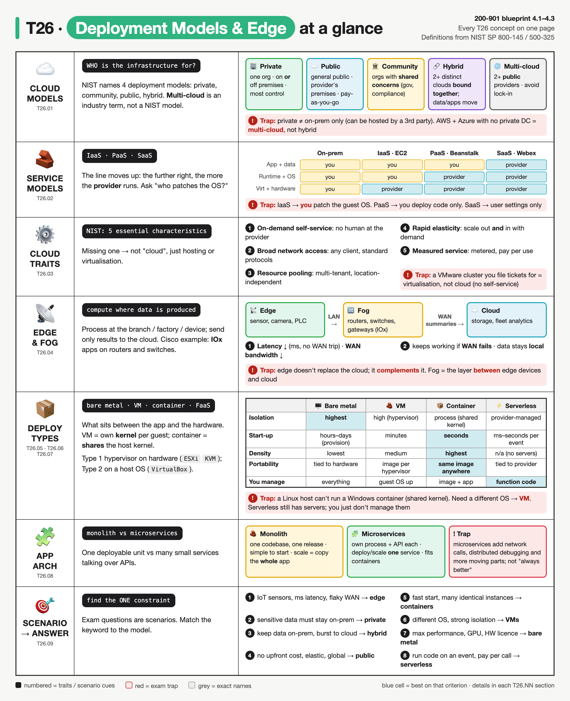
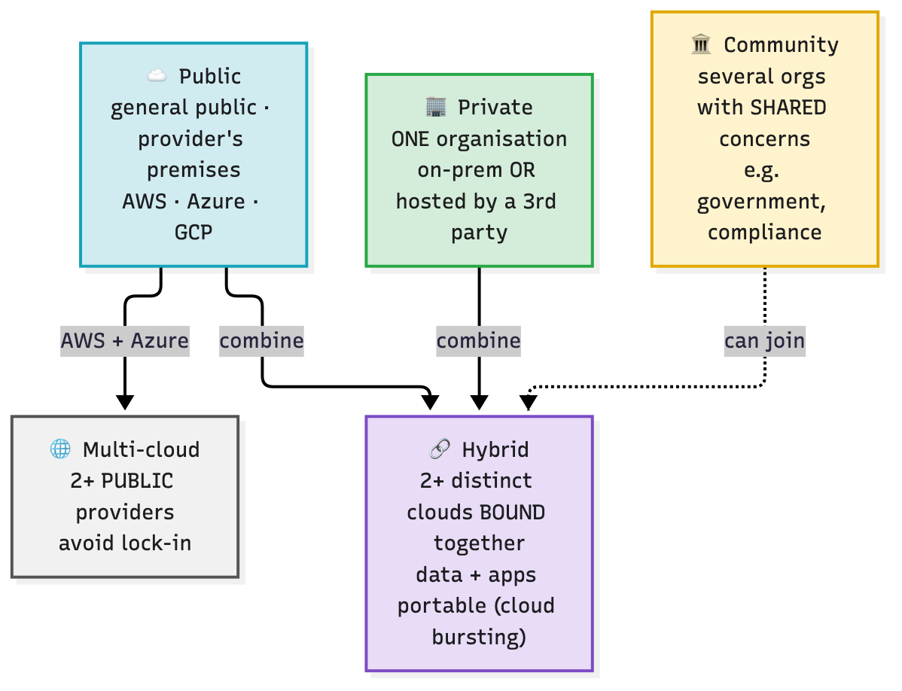
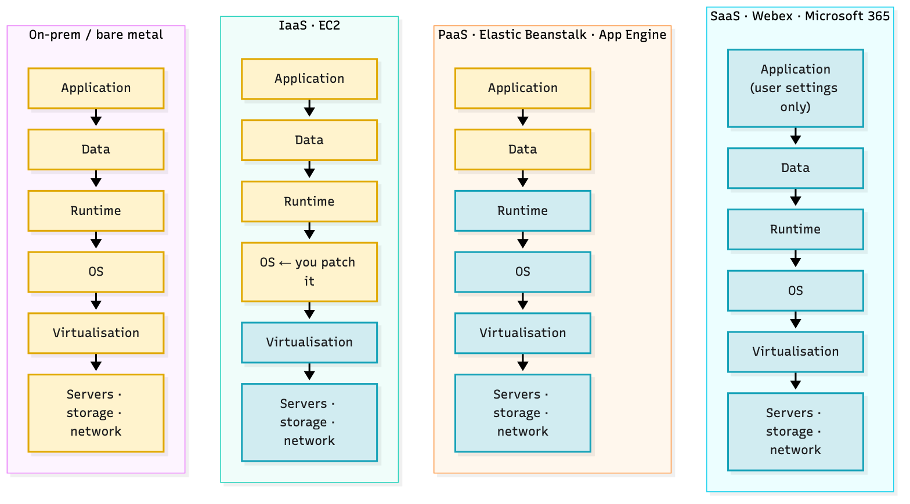
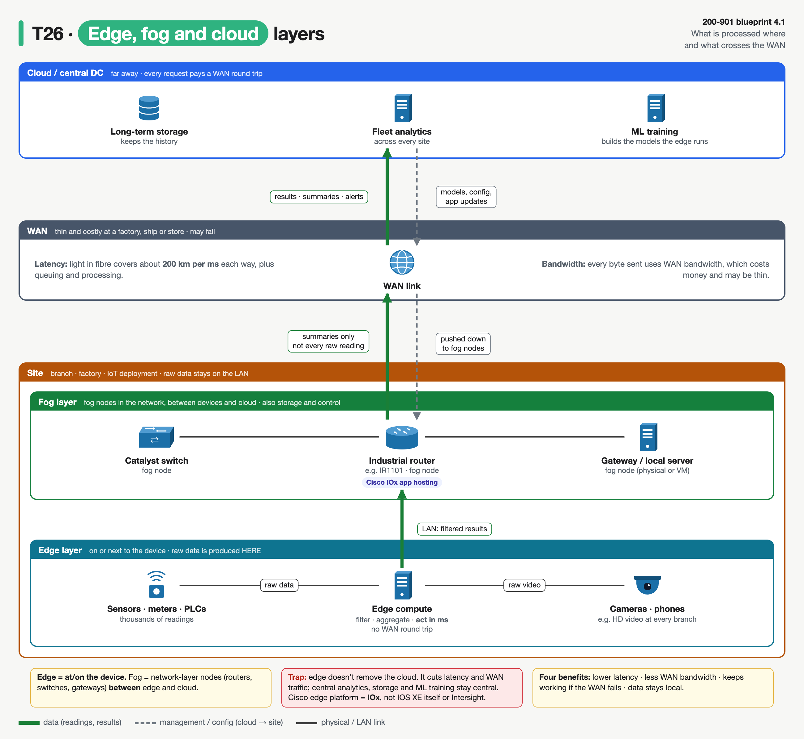
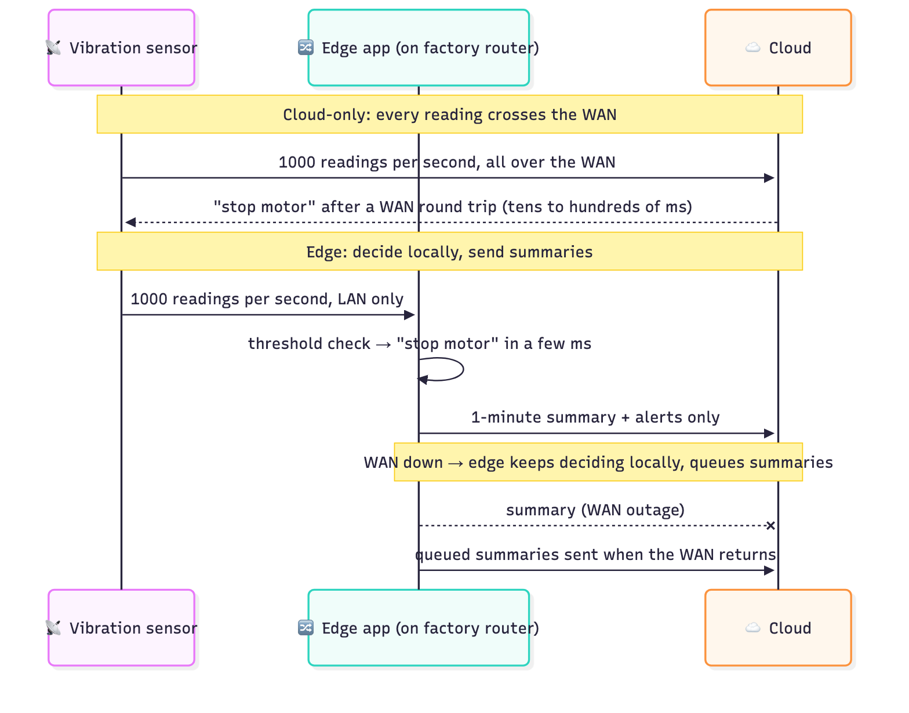
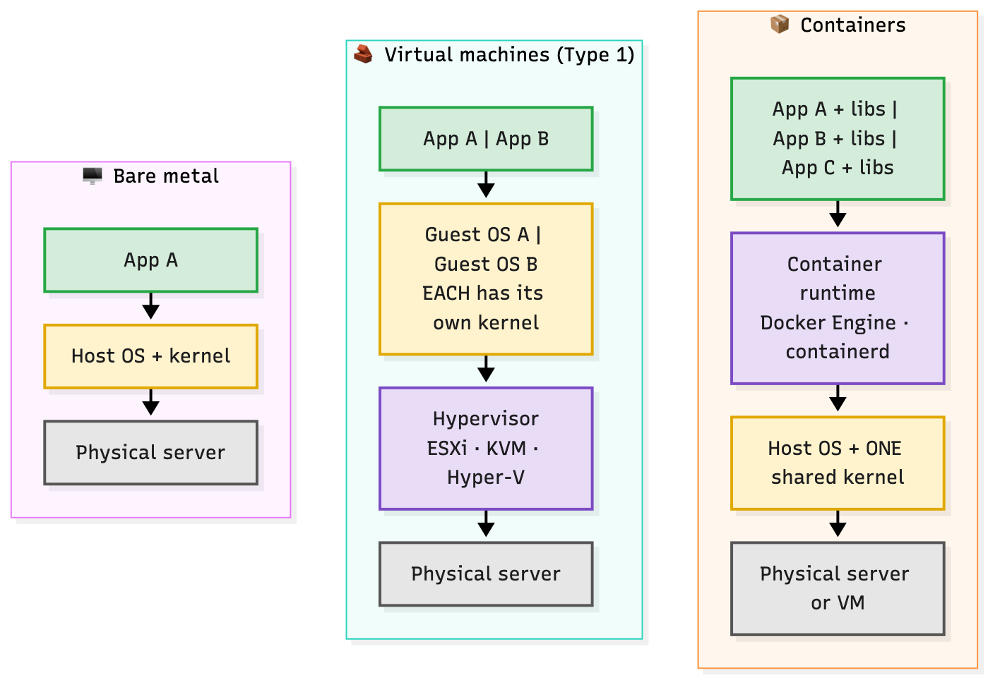
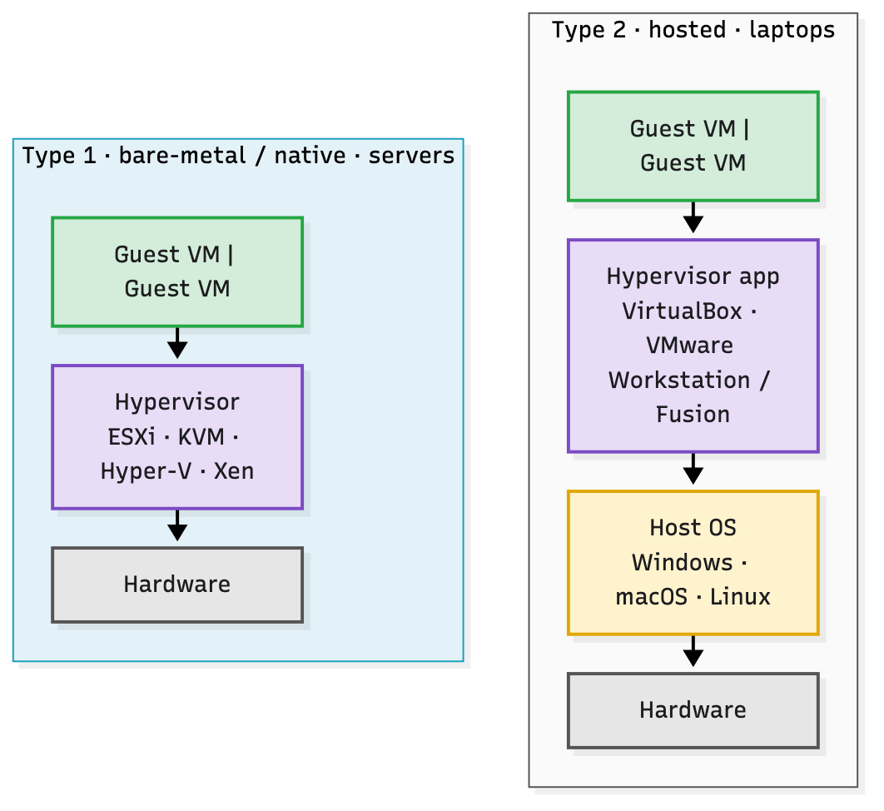
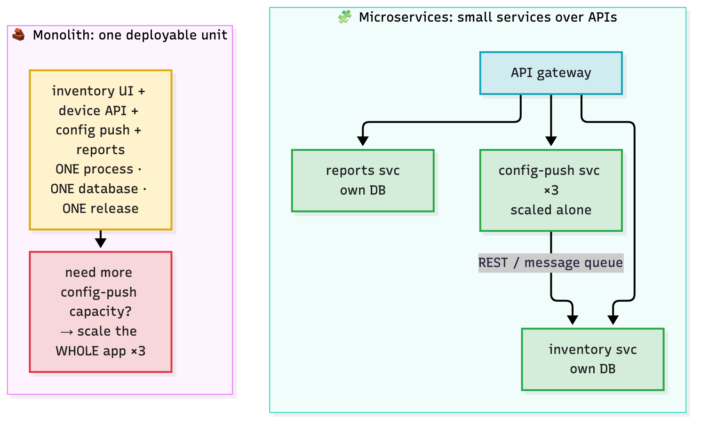
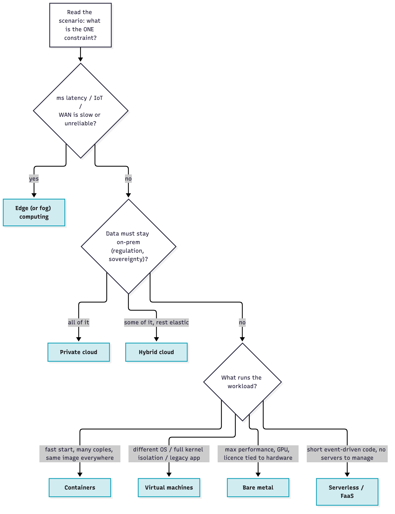

# T26 · Deployment models + edge computing

> Owner: **Beedy** · Blueprint: **4.1-4.3** · CBT coverage: **Full** · Learn by 2026-10-24 · Teach-back 2026-10-25



*Every T26 concept on one page. Each row is a concept group (IDs under the icon), blue cells mark the winner on that criterion, numbered items are traits or scenario cues, and red boxes are exam traps.*

<!-- toc:start -->

**Contents**

- [TL;DR (teach-back card)](#tldr-teach-back-card)
- [Concepts](#concepts)
  - [T26.01](#t2601--cloud-models) Cloud models · [T26.02](#t2602--service-models) Service models · [T26.03](#t2603--cloud-traits) Cloud traits · [T26.04](#t2604--edge-computing) Edge computing · [T26.05](#t2605--deployment-types) Deployment types · [T26.06](#t2606--comparison) Comparison · [T26.07](#t2607--other-types) Other types · [T26.08](#t2608--app-architecture) App architecture · [T26.09](#t2609--exam-angle) Exam angle
- [Exam traps](#exam-traps)
- [Examples](#examples)
- [Practice questions](#practice-questions)
- [Study aids](#study-aids)
- [Sources](#sources)
- [To verify](#to-verify)

<!-- toc:end -->

## TL;DR (teach-back card)

- **Two separate questions:** *who* the cloud is for (private · public · community · hybrid; multi-cloud = 2+ public providers) and *how much the provider runs* (IaaS → you patch the OS, PaaS → you push code, SaaS → you use the app). NIST's 5 traits: self-service, broad network access, pooling, rapid elasticity, measured service.
- **Edge = compute where the data is produced.** Wins: lower latency, less WAN bandwidth, keeps working when the WAN drops, data stays local. Fog = the layer between edge devices and cloud (routers, switches, gateways); Cisco runs edge apps on them with **IOx**.
- **Bare metal → VM → container: less isolation, more density, faster start.** A VM has its own kernel on a hypervisor (Type 1 on hardware: ESXi/KVM; Type 2 on a host OS: VirtualBox). A container shares the host kernel. Serverless runs a function per event, and you pay per execution.
- **Trap:** a container can't run a different OS kernel than its host (no Windows container on a Linux host), so "different OS / strongest isolation" → **VM**. And AWS + Azure with nothing on-prem is **multi-cloud**, not hybrid.

## Concepts

The note hangs on two pictures: **where** the workload runs (cloud model, edge) and **what wraps it** (bare metal, VM, container, function). Exam questions are almost always scenarios, so every section ends with the cue word that points to the answer. The decision tree in [T26.09](#t2609--exam-angle) ties them together.

- Cloud definitions follow **NIST SP 800-145**, which is the standard vocabulary the exam's wording matches. Fog/edge follow **NIST SP 500-325**.
- AWS basics are skipped (you know them). The focus is on what the exam asks and where the Cisco angle comes in.

### T26.01 · Cloud models

**Must cover:**

- [x] Private cloud: dedicated to one organisation (on-prem or hosted); most control, highest cost
- [x] Public cloud: shared provider infrastructure (AWS, Azure, GCP); pay-as-you-go, elastic
- [x] Hybrid cloud: private + public connected, workloads move between them
- [x] Community cloud: shared by organisations with common needs (e.g. government)
- [x] Multi-cloud: several public providers, avoids lock-in

**Notes:**

- A deployment model answers **"who is the infrastructure provisioned for?"**, not "where is the rack?".



*The three base models (top) define who uses the infrastructure. Hybrid combines distinct clouds that stay separate but are bound together; multi-cloud is several public providers.*

| Model | NIST definition (short) | Owner / location | Exam cue |
|---|---|---|---|
| **Private** | exclusive use by **one organisation** (may have many business units) | org, a 3rd party, or both · **on or off premises** | "regulated data", "full control", "own hardware", highest cost |
| **Public** | open use by the **general public** | provider · **provider's premises** | "no capex", "pay-as-you-go", "global", "elastic" |
| **Community** | exclusive use by a **community** of orgs with shared concerns (mission, security, policy, compliance) | one or more members, a 3rd party, or both · on or off premises | "several agencies", "same compliance regime" |
| **Hybrid** | **2+ distinct** clouds (private, community or public) that stay separate but are **bound together** by technology that enables data and app portability | mix | "burst to cloud at peak", "keep DB on-prem, front end in cloud" |
| **Multi-cloud** | *not a NIST model*: workloads spread across **2+ public** providers | several providers | "avoid vendor lock-in", "best service from each provider" |

- **Private ≠ on-prem.** A dedicated hosted environment run by a third party is still private. The test is exclusive use by one org.
- **Hybrid needs a binding** (VPN, Direct Connect / ExpressRoute, a common management layer) so workloads or data can move. Two unconnected clouds aren't hybrid.
- NIST's hybrid example is **cloud bursting**: run on private capacity, overflow to public at peak.
- Hybrid and multi-cloud can overlap: on-prem + AWS + Azure is both.
- Cisco angle (context only): Cisco's management platforms come both ways, e.g. Meraki dashboard is SaaS (public cloud), while Catalyst Center (DNA Center) is an appliance you run on-prem ([T20](../bob/T20-catalyst-center-dna-center.md)).

### T26.02 · Service models

**Must cover:**

- [x] IaaS: provider runs hardware/virtualisation; you manage OS, runtime, apps (EC2)
- [x] PaaS: provider also runs OS/runtime; you deploy code (Elastic Beanstalk, App Engine)
- [x] SaaS: complete application delivered to users (Webex, Microsoft 365)

**Notes:**

- Service model = **how much of the stack the provider runs**. It's independent of the deployment model: you can have private IaaS (OpenStack in your DC) or public SaaS.



*Yellow = you manage, blue = provider manages. Each step to the right hands one more layer to the provider.*

| | You control (NIST) | Provider controls | Example |
|---|---|---|---|
| **IaaS** | OS, storage, deployed apps, maybe some networking (host firewalls) | underlying infrastructure | EC2, Azure VMs, Cisco DevNet Sandbox VMs |
| **PaaS** | your deployed app + maybe hosting-environment config | network, servers, **OS**, storage | Elastic Beanstalk, Google App Engine, Heroku |
| **SaaS** | at most limited user-specific settings | everything, including the app | Webex, Microsoft 365, Meraki dashboard |

- One-question test: **"who patches the OS?"** You → IaaS. Provider, and you still write code → PaaS. You only log in → SaaS.
- Other "as a service" labels (FaaS, CaaS, NaaS) are marketing extensions. FaaS is covered in [T26.07](#t2607--other-types).

### T26.03 · Cloud traits

**Must cover:**

- [x] On-demand self-service
- [x] Broad network access
- [x] Resource pooling (multi-tenant)
- [x] Rapid elasticity (scale up/down)
- [x] Measured service (pay per use)

**Notes:**

- NIST lists **five essential characteristics**. If any is missing, it's hosting or virtualisation, not cloud.

| Trait | NIST meaning | Exam cue / counter-example |
|---|---|---|
| **On-demand self-service** | consumer provisions compute/storage **without human interaction** with the provider | "raise a ticket and wait 3 days for a VM" → fails this one |
| **Broad network access** | reachable over the network via standard mechanisms from any client (phone, laptop, workstation) | API + web console from anywhere |
| **Resource pooling** | provider resources serve **many consumers (multi-tenant)**, assigned dynamically; customer usually doesn't know the exact location, but may pick a region | "you choose a region, not a rack" |
| **Rapid elasticity** | scale **out and in** quickly, sometimes automatically; capacity appears unlimited | auto scaling group grows at peak, shrinks at night |
| **Measured service** | usage is metered, monitored and reported; typically pay per use | per-second billing, usage dashboard |

- **Elasticity ≠ scalability.** Scalability = can grow. Elasticity = grows **and shrinks** with demand, ideally automatically.
- Pooling is why public cloud is **multi-tenant**. A private cloud still pools, but only across one org's business units.

### T26.04 · Edge computing

**Must cover:**

- [x] Processing happens close to where data is produced (branch, factory, IoT device) instead of a central DC/cloud
- [x] Benefits: lower latency, less WAN bandwidth, keeps working if the WAN fails, data stays local (privacy/sovereignty)
- [x] Fog computing: layer between edge devices and cloud
- [x] Cisco example: apps hosted on routers/switches (IOx)

**Notes:**

- **First principles.** A cloud region is far away. Every request pays a **WAN round trip** (light in fibre covers about 200 km per ms each way, plus queuing and processing). Every byte sent uses **WAN bandwidth**, which costs money and may be thin at a factory, ship or store.
- **Edge computing** moves the processing to the data: on the device, or on a box next to it (router, switch, gateway, local server). Only results, summaries or alerts go to the cloud.



*Read it bottom to top. Raw data stops at the edge layer; only filtered results reach the fog nodes and only summaries cross the WAN (green). The cloud pushes models, config and app updates back down (grey dashed).*

**The four benefits (blueprint 4.1):**

| Benefit | Why | Scenario cue |
|---|---|---|
| **Lower latency** | the decision is made locally in ms, with no WAN round trip | "robot arm must stop within 10 ms", "video analytics in real time" |
| **Less WAN bandwidth** | filter/aggregate locally, send summaries (the drill in [Examples §1](#1-why-edge-wan-and-latency-drill) shows ~99% less) | "thousands of sensors", "HD cameras at every branch" |
| **Resilience** | keeps working when the WAN link fails; queues results until it returns | "remote oil rig", "ship", "intermittent satellite link" |
| **Data locality** | raw data never leaves the site (privacy, sovereignty, compliance) | "patient video must not leave the hospital" |



*Same sensor, two designs. Cloud-only pays a WAN round trip for every decision; edge decides locally and keeps working through a WAN outage.*

- **Fog computing** (Cisco coined the term; NIST SP 500-325 defines it): a layer of **fog nodes** between smart end devices and the cloud. Fog nodes are physical (gateways, **switches, routers**, servers) or virtual (VMs, virtual switches).
  - NIST: edge = the layer of the end devices themselves (sensor, meter). Fog = hierarchical, multi-layer, sits above them and also does storage and control.
  - On the exam, "edge" and "fog" are usually close cousins. If the options split them, fog = **in the network between** devices and cloud.
- **Cisco IOx** = Cisco's application-hosting framework for running your own apps on Cisco network devices (industrial routers such as the IR1101, Catalyst switches, IOS XE routers). It's the textbook "Cisco edge computing" answer. ⚠ verify the supported-platform list and app types (Docker images, native packages) in the current IOx docs.
  - Apps are packaged with the `ioxclient` CLI and managed through IOx Local Manager or the IOS XE `app-hosting` CLI (see [Examples §4](#4-cisco-edge-app-hosting-on-ios-xe-reference-only)). ⚠ verify.
- Edge **complements** the cloud, it doesn't replace it. Fleet-wide analytics, long-term storage and ML training stay central.
- Downsides worth one line: many distributed boxes to patch and secure, limited CPU/RAM per node, physical exposure.

**Exam-sim gap (practice test review):**
- **IOx only runs trusted apps.** IOx supports **application signing**: apps are signed and the device verifies the signature before it runs them, so only approved code executes on a router or switch ⚠ verify the exact signing workflow in the IOx docs.
- Exam cue: "Cisco framework that hosts only signed, verified applications on network devices" → **IOx** (not Intersight, not Meraki dashboard).

### T26.05 · Deployment types

**Must cover:**

- [x] Bare metal: OS directly on hardware; best performance, slow to provision, low density
- [x] VM: hypervisor runs multiple guest OSes; Type 1 (bare-metal: ESXi, KVM) vs Type 2 (hosted: VirtualBox)
- [x] Container: isolated process sharing the host kernel; packages app + dependencies

**Notes:**

- Deployment type = **what sits between your app and the hardware**. This is the Kubernetes docs' "traditional → virtualised → container" story.



*Count the kernels (yellow): one per server on bare metal, one per guest on VMs, one shared by all containers.*

- **Bare metal**: one OS on the physical server. There's no resource boundary between apps on it, so either one app hogs the box or you buy a server per app (under-used, expensive).
  - Pick it for: max performance, GPUs/low-latency hardware access, software licensed per physical CPU, or as the host for a hypervisor or Kubernetes.
- **Virtual machine**: a **hypervisor** carves one server into many VMs. Each VM has virtual hardware and a **complete guest OS with its own kernel**, so Windows and Linux VMs can share one host.
- **Container**: a process (or group) isolated by the host kernel's namespaces and cgroups, packaged with its libraries in an **image**. All containers on a host **share one kernel**. Details and commands are in [T27 Docker](T27-docker.md).
  - NIST SP 800-190: containers are **OS-family specific**. A Linux host only runs Linux containers. (Docker Desktop on macOS/Windows quietly runs a Linux VM to host them.)



*Type 2 has an extra host-OS layer (yellow) under the hypervisor. That's why it suits laptops, not data centres.*

| | **Type 1** (bare-metal / native) | **Type 2** (hosted) |
|---|---|---|
| Runs on | the hardware directly (can be in firmware) | top of a host OS (Windows, macOS, Linux) |
| Examples | VMware ESXi, KVM, Microsoft Hyper-V, Xen | Oracle VirtualBox, VMware Workstation / Fusion |
| Used for | servers, data centres, cloud (EC2 runs on a Type 1 hypervisor) | desktops/laptops, labs (e.g. a CML VM on your laptop) |
| Trade-off | less overhead, smaller attack surface (no host OS) | easy install, shares files with host, more overhead |

- **KVM** is a Linux kernel module that turns Linux itself into a Type 1 hypervisor. It's usually classed as Type 1, even though a full Linux sits underneath. ⚠ verify if the exam options treat KVM differently.

### T26.06 · Comparison

**Must cover:**

- [x] Isolation: bare metal > VM > container
- [x] Overhead/start-up: container (seconds) < VM (minutes) < bare metal
- [x] Density: containers highest
- [x] Portability: containers run the same anywhere with a container runtime

**Notes:**

| Criterion | Bare metal | VM | Container | Why |
|---|---|---|---|---|
| **Isolation** | **highest** (separate hardware) | high (hypervisor, separate kernels) | lowest (shared kernel) | NIST SP 800-190: a shared kernel means a larger attack surface than a hypervisor |
| **Start-up / provision** | hours–days (rack, cable, install OS) | minutes (boot a full OS) | **seconds or less** (start a process) | a container skips the OS boot |
| **Overhead** | none | a guest OS per VM (RAM, disk, CPU) | tiny (no guest OS) | |
| **Density** (workloads per host) | 1 OS per box | tens | **hundreds** | |
| **Portability** | tied to that hardware | image tied to a hypervisor format (VMDK, QCOW2) | **same image on any host with a runtime** (same OS family/CPU arch) | "works on my machine" fixed |
| **Different OS per workload** | no | **yes** | no (same kernel family) | |

- Memory hook: **isolation goes down as density goes up.**
- Containers often run **inside VMs** in the cloud (EC2 + ECS/EKS). The types stack; they don't exclude each other.
- "Same anywhere" has limits: an `amd64` image won't run natively on `arm64`, and a Linux image won't run on a Windows kernel.

### T26.07 · Other types

**Must cover:**

- [x] Serverless/FaaS: run functions on events, provider manages servers, pay per execution (Lambda)

**Notes:**

- **Serverless / FaaS** (Function as a Service): you upload a **function**, and the provider runs it **when an event fires** (HTTP request, file upload, queue message, schedule), then tears it down.
  - Provider manages servers, OS, runtime and scaling (including **scale to zero**).
  - You pay **per invocation and duration**, not for idle time.
  - Examples: AWS Lambda, Azure Functions, Google Cloud Functions.
- Exam angle: "short, event-driven, unpredictable or bursty load, no servers to manage" → serverless.
- Limits that make it the wrong answer: long-running jobs (max run time per invocation, Lambda's is 15 min ⚠ verify), **cold-start** latency on first call, stateless (store state elsewhere), provider lock-in.
- "Serverless" still runs on servers. You just don't see or manage them.
- Network-automation example: a webhook from Meraki or Webex ([T43](T43-webhooks.md)) hits an API gateway → a Lambda opens a ticket. Nothing runs between events.

### T26.08 · App architecture

**Must cover:**

- [x] Monolith: one deployable unit; simple at first, hard to scale parts independently
- [x] Microservices: small services communicating over APIs; independent deploy/scale, more complexity

**Notes:**



*To add config-push capacity, the monolith copies the whole app (red); microservices scale only the busy service.*

| | **Monolith** | **Microservices** |
|---|---|---|
| Shape | one codebase, one process, one deployable unit, usually one DB | suite of small services, each in its own process, talking over lightweight APIs (REST, message queue) |
| Deploy | whole app every release | each service independently (fits CI/CD, [T28](T28-ci-cd-devops-principles.md)) |
| Scale | copy the **whole** app, even if only one part is busy | scale only the busy service |
| Failure | one bug can take down everything | a failure can be contained to one service (if designed for it) |
| Tech | one language/stack | each service can pick its own language and DB |
| Cost | simple to build, test and debug at first | network latency between services, distributed tracing, versioned APIs, more ops work |

- Microservices pair naturally with **containers** (one service per image) and an orchestrator such as Kubernetes.
- Exam angle: "scale one component independently / teams deploy separately" → microservices. "Small team, simple app, quick start" → monolith is fine.

### T26.09 · Exam angle

**Must cover:**

- [x] Scenario: "low latency for IoT sensors" → edge
- [x] "Sensitive data must stay on-prem" → private/hybrid
- [x] "Fast start-up, many instances" → containers

**Notes:**

- Find the **one constraint** in the scenario, then walk the tree.



*Blue boxes are the answers. Latency/IoT is checked first because it overrides everything else; data location next; then the workload wrapper.*

| Scenario cue | Answer |
|---|---|
| IoT sensors, ms latency, limited/unreliable WAN, real-time video analytics | **Edge** (fog if the options say "in the network between devices and cloud") |
| Run a Docker app on a Cisco router or switch at the branch | **Edge**, via Cisco **IOx** / app hosting |
| All data must stay on-prem, full control of hardware | **Private** cloud |
| Customer DB on-prem by regulation, web tier scales in AWS at peak | **Hybrid** cloud |
| Workloads on AWS and Azure to avoid lock-in | **Multi-cloud** |
| Several government agencies share infrastructure under one compliance regime | **Community** cloud |
| No upfront cost, scale globally, pay as you go | **Public** cloud |
| You patch the OS of your cloud servers | **IaaS** |
| Push code, provider runs the runtime and OS | **PaaS** |
| Users just log into the app (Webex) | **SaaS** |
| Fast start-up, many identical instances, same image dev → prod | **Containers** |
| Need Windows and Linux on one host, or strongest isolation short of separate hardware | **VMs** |
| Max performance, GPU, licence per physical socket | **Bare metal** |
| Code runs only when an event arrives, pay per execution | **Serverless / FaaS** |
| Scale one part of the app independently | **Microservices** |

## Exam traps

- **Private ≠ on-prem.** Private = exclusive to one org; it can be hosted off-premises by a third party.
- **Hybrid vs multi-cloud:** hybrid = **2+ distinct cloud types bound together** (typically private + public). Multi-cloud = **2+ public providers**. AWS + Azure with no private part is multi-cloud.
- **Community** cloud is the answer when several organisations share infrastructure because of shared concerns (compliance, mission). It isn't "public cloud for a community".
- **IaaS vs PaaS:** "who patches the OS?" You → IaaS. Provider → PaaS (or SaaS).
- **Elasticity** = scale out **and in**, automatically. Just "can get bigger" is scalability.
- **No self-service = not cloud.** A ticket-driven VMware farm is virtualisation, not a private cloud.
- **Edge vs fog:** edge = at/on the device producing data. Fog = network-layer nodes (routers, switches, gateways) **between** edge and cloud.
- **Edge doesn't remove the cloud.** It reduces latency and WAN traffic; central analytics and storage remain.
- **Cisco edge platform = IOx** (app hosting on routers/switches). Don't confuse it with IOS XE itself or with Intersight.
- **Type 1 vs Type 2:** Type 1 on hardware (ESXi, KVM, Hyper-V, Xen). Type 2 on a host OS (VirtualBox, VMware Workstation/Fusion). "Hosted" = Type 2.
- **Containers share the host kernel.** So they start in seconds and pack densely, but they're less isolated than VMs and can't run a different OS family. "Different OS" → VM.
- **Isolation order:** bare metal > VM > container. **Start-up / density order** is the reverse.
- **Serverless still has servers.** It also doesn't suit long-running or stateful jobs (cold starts, max duration).
- **Microservices ≠ always better.** They trade independent scaling and deploys for network calls and operational complexity.
- **IOx + signed apps:** IOx is the Cisco app-hosting framework that can enforce signed, verified app packages on routers/switches.

## Examples

### 1. Why edge? WAN and latency drill

Back-of-envelope numbers you can reproduce. Change the constants and re-run.

```bash
mkdir -p "$TMPDIR/t26" && cat > "$TMPDIR/t26/edge_math.py" <<'PY'
"""T26 drill: why edge? WAN bandwidth and latency, cloud-only vs edge."""
SENSORS = 200            # vibration sensors on one factory floor
READINGS_PER_SEC = 10    # per sensor
BYTES_PER_READING = 64   # timestamp + sensor id + value + overhead
SUMMARY_BYTES = 512      # one per sensor per minute (min/max/avg + alerts)

raw_per_day = SENSORS * READINGS_PER_SEC * BYTES_PER_READING * 86_400
edge_per_day = SENSORS * SUMMARY_BYTES * 1_440
print(f"Cloud-only WAN upload: {raw_per_day / 1e9:6.2f} GB/day")
print(f"Edge (summaries only): {edge_per_day / 1e9:6.2f} GB/day")
print(f"WAN traffic saved:     {100 * (1 - edge_per_day / raw_per_day):6.2f} %")

# Light in fibre covers ~200 km per ms, so round trip time >= 2 * distance / 200.
for name, km in [("edge app on the factory router", 0.1),
                 ("regional cloud region", 800),
                 ("cloud region on another continent", 10_000)]:
    print(f"{name:34} min RTT {2 * km / 200:7.3f} ms (propagation only)")
PY
python3 "$TMPDIR/t26/edge_math.py"
```

Real output:

```
Cloud-only WAN upload:  11.06 GB/day
Edge (summaries only):   0.15 GB/day
WAN traffic saved:      98.67 %
edge app on the factory router     min RTT   0.001 ms (propagation only)
regional cloud region              min RTT   8.000 ms (propagation only)
cloud region on another continent  min RTT 100.000 ms (propagation only)
```

- These are **lower bounds**. Real WAN RTTs add queuing, routing and TLS handshakes on top.
- Drill: set `SENSORS = 5000` (a large plant) and see the cloud-only figure pass 270 GB/day.

### 2. Shared kernel vs own kernel (Docker)

Proves "containers share the host kernel" in three commands. Run them on a Linux host or the T27 lab VM.

```bash
uname -r
docker run --rm alpine:3.20 uname -r
docker run --rm ubuntu:24.04 uname -r
```

- Expected: **all three print the same kernel version**, even though Alpine and Ubuntu are different distros. The image brings userland (libraries, shell), not a kernel.
- On macOS with Docker Desktop, the two containers print the kernel of Docker Desktop's **Linux VM**, not the macOS (Darwin) kernel. That's the "containers are OS-family specific" rule in action.
- A VM would print its **own** guest kernel.

Start-up time, container vs VM (container side only):

```bash
time docker run --rm alpine:3.20 true
```

- Expected: well under a few seconds once the image is pulled. A VM has to boot a full OS first.

### 3. Am I on bare metal, a VM or a container? (Linux)

```bash
systemd-detect-virt
systemd-detect-virt --container
cat /proc/1/cgroup
```

- `systemd-detect-virt` prints the hypervisor (`kvm`, `vmware`, `microsoft`, `oracle`…), or `none` on bare metal.
- `--container` prints `docker`, `podman`, etc. inside a container, or `none`.
- Useful when a T26 question shows command output and asks where the script is running.

### 4. Cisco edge: app hosting on IOS XE (reference only)

Shape of the IOS XE CLI that installs and runs an IOx app package from flash. ⚠ verify: syntax from prior knowledge, not checked against current docs or run on a device. Platform support varies.

```
configure terminal
 iox
 app-hosting appid sensorapp
  app-vnic AppGigabitEthernet trunk
   vlan 10 guest-interface 0
    guest-ipaddress 10.10.10.50 netmask 255.255.255.0
 end
app-hosting install appid sensorapp package flash:sensorapp.tar
app-hosting activate appid sensorapp
app-hosting start appid sensorapp
show app-hosting list
```

- Lifecycle to remember: **install → activate → start** (and `stop → deactivate → uninstall` to remove).
- `iox` in global config enables the hosting framework.

### 5. Break it on purpose (thought drills)

- Change a hybrid design so the on-prem DC and the AWS VPC have **no VPN or Direct Connect** → no longer hybrid (no binding), just two separate clouds.
- Run `docker run --rm mcr.microsoft.com/windows/nanoserver:ltsc2022 cmd /c ver` on a Linux host → it fails with a "no matching manifest for linux/…" or platform error. A Windows container needs a Windows kernel. ⚠ verify the exact error text (not run here).
- Move the vibration-threshold logic from the factory router to the cloud in diagram 04 → each "stop motor" decision now waits a WAN round trip, and it stops working in a WAN outage.

## Practice questions

**Q1.** A manufacturer has 3,000 vibration sensors per plant and a 20 Mbps WAN link. Motors must be shut down within 10 ms of an abnormal reading. Which model best meets the requirement?
A. Public cloud with auto scaling  B. Edge computing at the plant  C. SaaS analytics platform  D. Community cloud

<details><summary>Answer</summary>

**B.** A 10 ms deadline and a thin WAN rule out a cloud round trip. Processing at the plant gives local decisions and sends only summaries upstream. Auto scaling fixes capacity, not distance. (T26.04, T26.09)
</details>

**Q2.** A company runs its customer database in its own data centre for regulatory reasons. Its web front end runs in AWS and scales out during sales, connected to the data centre over a site-to-site VPN. Which deployment model is this?
A. Private  B. Public  C. Hybrid  D. Multi-cloud

<details><summary>Answer</summary>

**C.** Two distinct cloud types (private + public) bound together so workloads and data can interact. Multi-cloud would mean 2+ public providers. (T26.01)
</details>

**Q3.** Match each statement to the service model (IaaS, PaaS, SaaS):
1. The team patches the guest OS and installs Python on its cloud servers.
2. Staff log in to Webex meetings; IT only manages user settings.
3. Developers push a Flask app; the provider handles the OS, runtime and scaling.

<details><summary>Answer</summary>

1 → **IaaS**, 2 → **SaaS**, 3 → **PaaS**. Ask who patches the OS: you (IaaS), provider and you push code (PaaS), provider and you only use the app (SaaS). (T26.02)
</details>

**Q4.** Which two statements about containers compared with virtual machines are true? (Choose two.)
A. Each container includes its own kernel  B. Containers share the host OS kernel  C. Containers provide stronger isolation than VMs  D. Containers typically start in seconds  E. A Linux host can run Windows containers natively

<details><summary>Answer</summary>

**B, D.** Containers are isolated processes on a shared kernel, so they skip an OS boot. That shared kernel is also why isolation is weaker than a VM's (C false) and why the OS family must match the host (E false). (T26.05, T26.06)
</details>

**Q5.** An engineer installs VirtualBox on a macOS laptop to run a Linux VM for lab work. What kind of hypervisor is VirtualBox?
A. Type 1, because it runs Linux guests  B. Type 2, because it runs on top of a host OS  C. A container runtime  D. A bare-metal hypervisor built into firmware

<details><summary>Answer</summary>

**B.** A Type 2 (hosted) hypervisor runs as an application on a host OS. Type 1 (ESXi, KVM, Hyper-V) runs directly on hardware. (T26.05)
</details>

**Q6.** An organisation runs a VMware cluster. To get a new VM, teams email the infrastructure team and wait two days. Which NIST cloud characteristic is missing?
A. Resource pooling  B. Measured service  C. On-demand self-service  D. Broad network access

<details><summary>Answer</summary>

**C.** On-demand self-service means provisioning without human interaction with the provider. Pooling may well be present (one cluster shared by many teams). (T26.03)
</details>

**Q7.** Which Cisco capability lets a network team run a containerised data-collection app directly on a branch industrial router, in line with a fog computing design?
A. Cisco IOx  B. Cisco Intersight  C. Meraki dashboard  D. Catalyst Center (DNA Center)

<details><summary>Answer</summary>

**A.** IOx is Cisco's application-hosting framework for running apps on routers and switches at the edge. Intersight manages UCS/HyperFlex infrastructure, and the other two are management platforms, not on-box app hosting. (T26.04)
</details>

**Q8.** Put these deployment types in order from **strongest workload isolation** to **highest density per host**: containers · bare metal · virtual machines

<details><summary>Answer</summary>

**Bare metal → virtual machines → containers.** Isolation falls and density rises as more of the stack is shared: hardware is shared by VMs, and hardware and kernel are shared by containers. (T26.06)
</details>

## Study aids

| Aid | Type | Title | Est. min | Resource |
|---|---|---|---|---|
| T26.1 | Video | Computing and Application Deployment Models (1.5x) | 31 | CBT module |

- Skip / low priority: n/a
- Open flag (HANDOVER §6): how deep the CBT video goes on edge computing is unconfirmed. T26.04 above is enough on its own for blueprint 4.1.

## Sources

- Overview image: HTML source `assets/T26/00-overview.html`, rendered to PNG (see `assets/README.md`). Diagrams: Mermaid sources in `assets/T26/*.mmd`.
- Architecture diagram: HTML source `assets/T26/03-edge-fog-cloud-arch.html` (shared kit `assets/_arch/`)
- NIST SP 800-145, The NIST Definition of Cloud Computing (5 essential characteristics, 3 service models, 4 deployment models; quoted wording checked): https://nvlpubs.nist.gov/nistpubs/Legacy/SP/nistspecialpublication800-145.pdf
- NIST SP 500-325, Fog Computing Conceptual Model (fog nodes = gateways, switches, routers, servers; Annex A fog vs edge): https://nvlpubs.nist.gov/nistpubs/SpecialPublications/NIST.SP.500-325.pdf
- NIST SP 800-125, Guide to Security for Full Virtualization Technologies (bare-metal/native vs hosted virtualisation): https://nvlpubs.nist.gov/nistpubs/Legacy/SP/nistspecialpublication800-125.pdf
- NIST SP 800-190, Application Container Security Guide (shared kernel, OS-family specific, weaker isolation than hypervisors): https://nvlpubs.nist.gov/nistpubs/SpecialPublications/NIST.SP.800-190.pdf
- Kubernetes docs, Overview, "Going back in time" (traditional → virtualised → container deployment eras): https://kubernetes.io/docs/concepts/overview/
- Martin Fowler & James Lewis, Microservices (definition; monolith scaling needs the whole app): https://martinfowler.com/articles/microservices.html
- Cisco IOx developer docs: https://developer.cisco.com/docs/iox/ (⚠ not reachable this session: TLS check failed)
- Cisco 200-901 v1.1 exam topics (4.1–4.3): https://learningcontent.cisco.com/documents/marketing/exam-topics/200-901-CCNAAUTO_v.1.1.pdf (⚠ not reachable this session; blueprint wording taken from `data/blueprint-map.csv`, which is paraphrased)

## To verify

- ⚠ **Cisco IOx details:** supported platforms (IR1101, Catalyst 9000, IOS XE routers), app types (Docker images, native packages), `ioxclient` and Local Manager. Written from prior knowledge, because developer.cisco.com and cisco.com failed a TLS check from this machine.
- ⚠ **IOS XE `app-hosting` CLI** in Examples §4 (`iox`, `app-vnic …`, `install → activate → start`, `show app-hosting list`): not checked against current docs and not run on a device. The `app-vnic` sub-mode syntax varies by platform.
- ⚠ **AWS Lambda maximum run time (15 min)**: from prior knowledge; the AWS docs failed a TLS check this session.
- ⚠ **KVM classification**: shown as Type 1 (the common classification). Check that no exam-prep source classes it differently.
- ⚠ **Blueprint 4.1–4.3 exact wording**: the Cisco PDF wasn't reachable (TLS); check it against the official PDF.
- ⚠ Examples §2, §3 and the Windows-container break-it in §5 were **not run**: the Docker daemon wasn't running on this machine. Expected results are described from documented behaviour (NIST SP 800-190 shared kernel), not pasted output.
- Examples §1 (edge drill) was run locally with Python 3; the output shown is real.
- CBT video depth on edge computing: unconfirmed (open flag). Don't assume the video covers fog or IOx.
