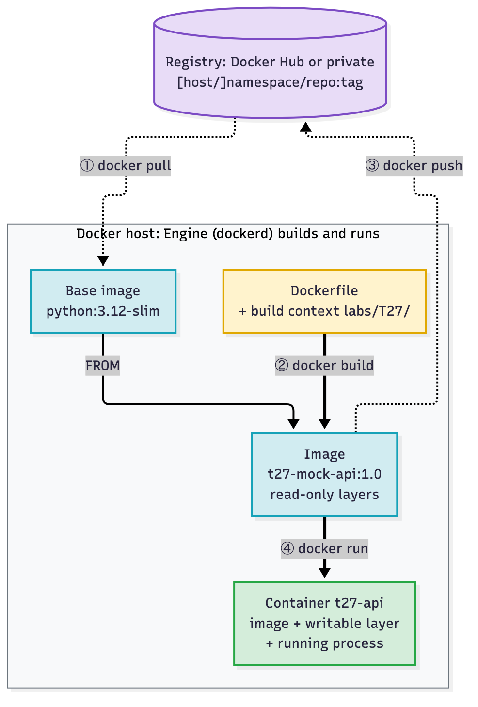
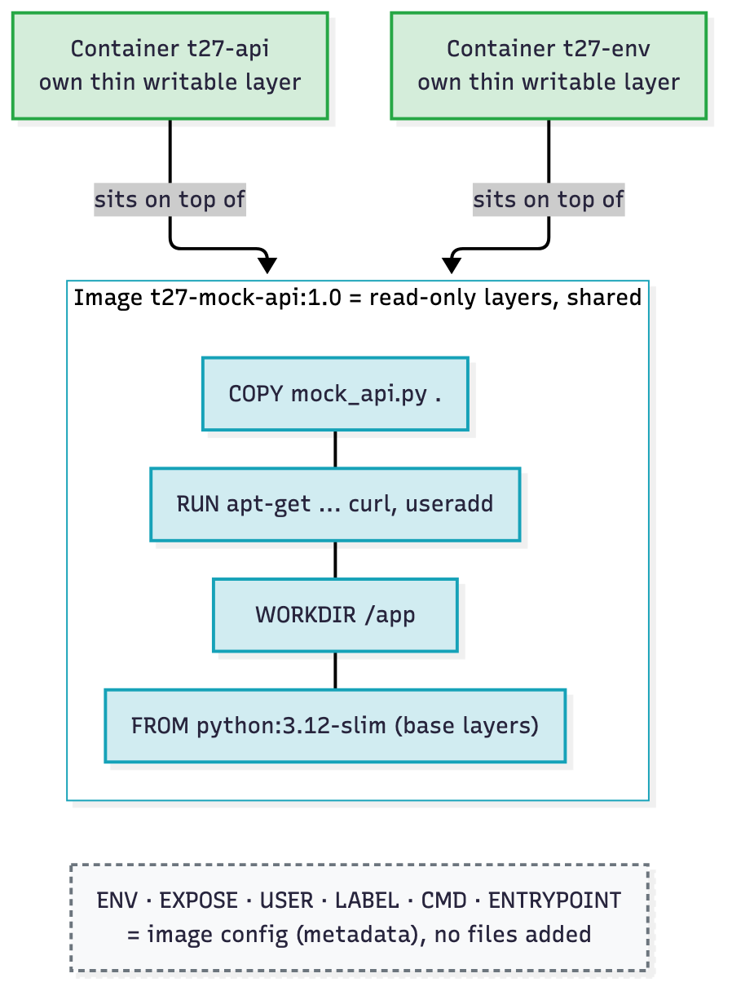
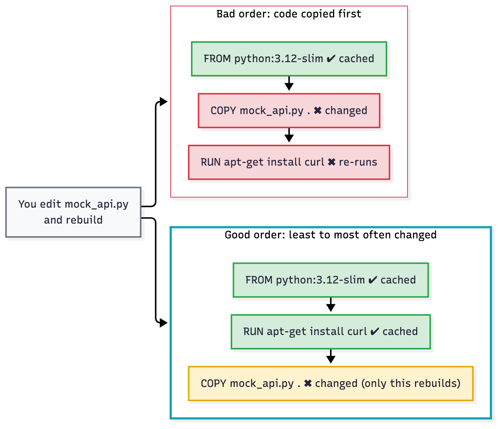
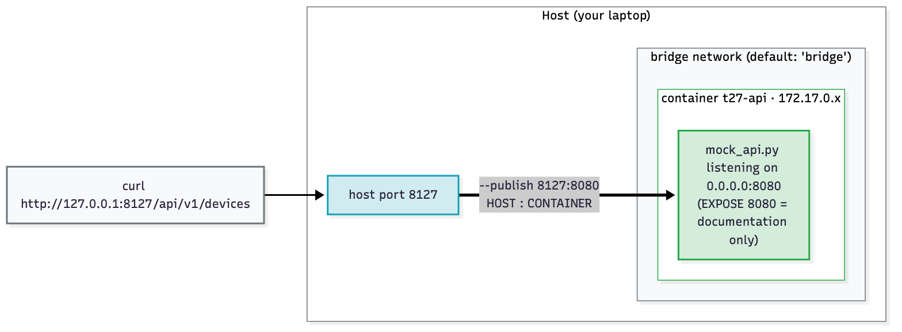
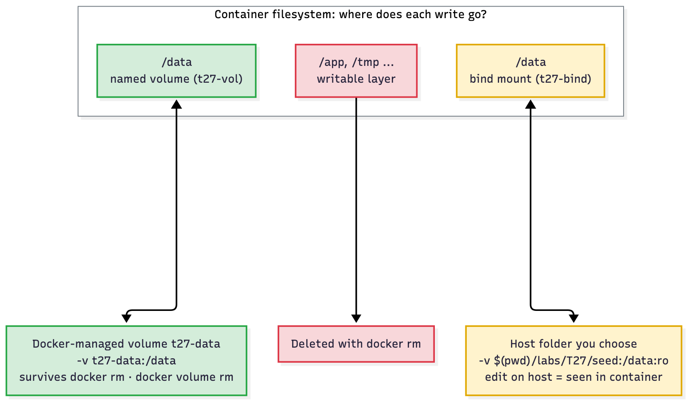

# T27 · Docker

> Owner: **Beedy** · Blueprint: **4.3, 4.6, 4.7** · CBT coverage: **Full** · Learn by 2026-10-13 · Teach-back 2026-10-16


*Every T27 concept on one page. Read left to right: Dockerfile → image → container → host/registry. Grey IDs label each zone, numbered circles are the drill steps in `labs/T27/docker_drill.sh`, and red boxes are exam traps.*

## TL;DR (teach-back card)

- **Image = read-only layers (template). Container = image + its own writable layer + one running process.** `docker build` turns a Dockerfile into an image, `docker run` turns an image into a container, and a registry stores images as `[host/]namespace/repo:tag` (no tag = `latest`).
- **Read a Dockerfile top to bottom:** `FROM` = base, `RUN` = build-time step (new layer), `COPY` = your files, `EXPOSE` = documents the port (publishes nothing), `USER` = who runs it, `ENTRYPOINT` + `CMD` = what runs at start. Args after the image name **replace CMD** and are **appended to ENTRYPOINT**.
- **Run flags:** `-d` background · `-it` interactive shell · `--rm` delete on exit · `-p HOST:CONTAINER` · `-e KEY=value` · `-v src:/path` (host path = bind mount, plain name = named volume). Then `docker logs` · `docker exec -it <c> sh` · `docker inspect`.
- **Trap:** `-p 8127:8080` means host **8127** → container **8080** (host first). And `EXPOSE 8080` alone doesn't make the port reachable: you still need `-p` (or `-P`).

## Concepts

Every section below explains one part of the same reference program. Read the program once first.

- `labs/T27/mock_api.py` is the T07 mock network-inventory REST API ([T07](T07-rest-fundamentals-http-codes.md)), copied with four small additions: `--host`/`--port` arguments, `API_PORT` from the environment, an access log on stdout (`ACCESS_LOG=1`) and an optional inventory file (`DEVICES_FILE`) so a mount can persist data.
- `labs/T27/Dockerfile` (below) is the **reference program**: it turns that script into an image `t27-mock-api:1.0`.
- `labs/T27/docker_drill.sh` builds the image and then runs every command on the exam against it: run, ps, logs, exec, inspect, CMD vs ENTRYPOINT override, `-e`, EXPOSE vs `-p`, bind mount vs named volume, stop vs rm, clean-up. Only host port **8127** is published.
- `labs/T27/compose.yaml` runs the same API plus a one-shot curl client as a two-container stack (T27.08).

**`labs/T27/Dockerfile`** (line numbers are used in every section below)

```dockerfile
# T27 reference Dockerfile: containerise the T07 mock REST API (labs/T27/mock_api.py).
# Build:  docker build --tag t27-mock-api:1.0 labs/T27
# Run:    docker run --detach --name t27-api --publish 8127:8080 t27-mock-api:1.0
ARG PYTHON_VERSION=3.12
FROM python:${PYTHON_VERSION}-slim

LABEL org.opencontainers.image.title="t27-mock-api" \
      org.opencontainers.image.description="Mock network-inventory REST API for the T27 Docker drill"

ENV API_PORT=8080 \
    ACCESS_LOG=1

WORKDIR /app

RUN apt-get update \
    && apt-get install --yes --no-install-recommends curl \
    && rm -rf /var/lib/apt/lists/* \
    && useradd --create-home --uid 10001 apiuser \
    && mkdir /data \
    && chown apiuser /data

COPY mock_api.py .

EXPOSE 8080

USER apiuser

ENTRYPOINT ["python3", "mock_api.py"]
CMD ["--host", "0.0.0.0"]
```

**`labs/T27/.dockerignore`**

```text
# Keep the build context to what the image needs (mock_api.py).
*.sh
compose.yaml
seed/
README.md
__pycache__/
```

**Read it like the exam does** (this is T27.09 in one table):

| Question | Answer from the Dockerfile | Line |
|---|---|---|
| Base image? | `python:3.12-slim` (from `ARG PYTHON_VERSION=3.12`) | 4–5 |
| What is installed? | `curl` via apt; a user `apiuser` (uid 10001); a folder `/data` | 15–20 |
| What app code goes in? | `mock_api.py` into `/app` (the `WORKDIR`) | 13, 22 |
| Which port does it listen on? | `8080` (documented by `EXPOSE`; set by `ENV API_PORT=8080`) | 10, 24 |
| Runs as? | `apiuser`, not root | 26 |
| What runs at start? | `python3 mock_api.py --host 0.0.0.0` (ENTRYPOINT + CMD) | 28–29 |
| How do I reach it? | Nothing in the Dockerfile publishes it: `docker run --publish 8127:8080 …` | – |

**Ran on the host first** (Python 3.14, no Docker), to prove the additions work before containerising. The commands, with a scratch copy of the seed file:

```bash
mkdir -p /tmp/t27 && cp labs/T27/seed/devices.json /tmp/t27/devices.json
ACCESS_LOG=1 DEVICES_FILE=/tmp/t27/devices.json python3 labs/T27/mock_api.py --host 127.0.0.1 --port 8127 &
curl --silent --header "Authorization: Bearer tok-viewer-91c2" http://127.0.0.1:8127/api/v1/devices; echo
curl --silent --output /dev/null --write-out '%{http_code}\n' --request DELETE \
  --header "Authorization: Bearer tok-admin-7f3a" http://127.0.0.1:8127/api/v1/devices/2
kill %1
cat /tmp/t27/devices.json
python3 labs/T27/mock_api.py --help
```

Real output:

```
loaded 2 devices from /tmp/t27/devices.json
Mock API on http://127.0.0.1:8127/api/v1  (Ctrl+C to stop)
{"response": [{"id": 1, "hostname": "lab-csr1", "mgmt_ip": "10.10.20.48", "role": "edge", "os": "iosxe"}, {"id": 2, "hostname": "lab-n9k1", "mgmt_ip": "10.10.20.58", "role": "core", "os": "nxos"}], "total": 2}
127.0.0.1 "GET /api/v1/devices HTTP/1.1" 200 -
127.0.0.1 "DELETE /api/v1/devices/2 HTTP/1.1" 204 -
204
[
  {
    "id": 1,
    "hostname": "lab-csr1",
    "mgmt_ip": "10.10.20.48",
    "role": "edge",
    "os": "iosxe"
  }
]
usage: mock_api.py [-h] [--host HOST] [--port PORT]

Mock network-inventory REST API

options:
  -h, --help   show this help message and exit
  --host HOST
  --port PORT
```

(The scratch path was under `$TMPDIR` in the real run; the server log lines are interleaved with curl output in a real terminal.)

**`labs/T27/docker_drill.sh`**

```bash
#!/usr/bin/env bash
# T27 Docker drill: build the mock-API image, then exercise run / ps / logs / exec / inspect,
# port mapping, env vars, CMD vs ENTRYPOINT, bind mount vs named volume, stop vs rm, clean up.
# Run from the repo root:  bash labs/T27/docker_drill.sh
# Only host port 8127 is published. Everything it creates is prefixed t27- and removed at the end.
set -u
LAB="$(cd "$(dirname "$0")" && pwd)"
VIEWER="Authorization: Bearer tok-viewer-91c2"
ADMIN="Authorization: Bearer tok-admin-7f3a"
step() { printf '\n== %s ==\n' "$1"; }
wait_up() {   # wait_up <container> <port>: poll from INSIDE the container until the API answers
  for _ in $(seq 1 40); do
    docker exec "$1" curl --silent --output /dev/null "http://127.0.0.1:$2/api/v1/devices" && return 0
    sleep 0.25
  done
  echo "$1 did not come up on port $2"
}

step "1. Build the image (build context = labs/T27)"
docker build --quiet --tag t27-mock-api:1.0 "$LAB" > /dev/null
docker tag t27-mock-api:1.0 t27-mock-api:latest
docker images t27-mock-api --format '{{.Repository}}:{{.Tag}}  {{.ID}}'

step "2. Run detached, publish host 8127 -> container 8080"
docker run --detach --name t27-api --publish 8127:8080 t27-mock-api:1.0 > /dev/null
wait_up t27-api 8080
docker ps --filter name=t27-api --format '{{.Names}}  {{.Image}}  {{.Ports}}'
curl --silent --header "$VIEWER" "http://127.0.0.1:8127/api/v1/devices/1"; echo

step "3. Logs (stdout/stderr of PID 1)"
docker logs t27-api

step "4. Exec a command in the running container"
docker exec t27-api whoami
docker exec t27-api pwd
docker exec t27-api printenv API_PORT ACCESS_LOG

step "5. Inspect (JSON) with a Go template"
docker inspect --format '{{.Config.Entrypoint}} {{.Config.Cmd}} {{.Config.User}} {{.Config.ExposedPorts}}' t27-api
docker inspect --format '{{json .NetworkSettings.Ports}}' t27-api

step "6. Args after the image REPLACE CMD and are APPENDED to ENTRYPOINT"
docker run --rm t27-mock-api:1.0 --help | head -n 1
docker run --rm --entrypoint python3 t27-mock-api:1.0 --version

step "7. --env overrides ENV; EXPOSE alone publishes nothing"
docker run --detach --name t27-env --env API_PORT=9000 t27-mock-api:1.0 > /dev/null
wait_up t27-env 9000
docker logs t27-env | head -n 1
docker ps --filter name=t27-env --format '{{.Names}}  ports: {{.Ports}}'

step "8a. Bind mount: host folder labs/T27/seed, read-only"
docker run --detach --name t27-bind --env DEVICES_FILE=/data/devices.json \
  --volume "$LAB/seed":/data:ro t27-mock-api:1.0 > /dev/null
wait_up t27-bind 8080
docker exec t27-bind curl --silent --header "$VIEWER" "http://127.0.0.1:8080/api/v1/devices"; echo

step "8b. Named volume: survives docker rm"
docker volume create t27-data > /dev/null
docker run --detach --name t27-vol --env DEVICES_FILE=/data/devices.json \
  --volume t27-data:/data t27-mock-api:1.0 > /dev/null
wait_up t27-vol 8080
docker exec t27-vol curl --silent --output /dev/null --write-out 'DELETE /devices/3 -> %{http_code}\n' \
  --request DELETE --header "$ADMIN" "http://127.0.0.1:8080/api/v1/devices/3"
docker stop t27-vol > /dev/null
docker rm t27-vol > /dev/null
docker volume ls --filter name=t27-data --format 'volume still here: {{.Name}}'
docker run --detach --name t27-vol2 --env DEVICES_FILE=/data/devices.json \
  --volume t27-data:/data t27-mock-api:1.0 > /dev/null
wait_up t27-vol2 8080
docker logs t27-vol2 | head -n 1
docker exec t27-vol2 curl --silent --header "$VIEWER" "http://127.0.0.1:8080/api/v1/devices" \
  | python3 -c 'import json,sys; print("hostnames:", [d["hostname"] for d in json.load(sys.stdin)["response"]])'

step "9. Stop keeps the container, rm deletes it"
docker stop t27-api > /dev/null
docker ps --all --filter name=t27-api --format '{{.Names}}  {{.Status}}'
docker start t27-api > /dev/null
docker ps --filter name=t27-api --format '{{.Names}}  {{.Status}}'

step "10. Clean up"
docker rm --force t27-api t27-env t27-bind t27-vol2 > /dev/null
docker volume rm t27-data > /dev/null
docker rmi t27-mock-api:1.0 t27-mock-api:latest > /dev/null
echo "t27 containers left: $(docker ps --all --quiet --filter name=t27- | wc -l | tr -d ' ')"
```

**Output:** ⚠ verify. The Docker daemon was **not running** when this note was drafted, so the drill has not been run yet and no output is pasted here. Each step's comment says what to look for; paste the real output under this line after the first run.

### T27.01 · Concepts

**Must cover:**

- [x] Image: read-only template made of layers
- [x] Container: running instance of an image (adds a writable layer)
- [x] Registry: stores images (Docker Hub, private registries); repo:tag naming (python:3.12-slim)
- [x] Docker Engine/daemon builds and runs containers

**Notes:**



*Follow the numbers: pull the base, build your image, push it, run it. Blue = images (read-only), green = the running container.*

- **Image:** an immutable, read-only stack of filesystem layers + config (env, user, entrypoint, cmd, exposed ports). Built once, run many times. Drill step 1 builds `t27-mock-api:1.0`.
- **Container:** a running (or stopped) instance of one image. Docker adds a thin **writable layer** on top. Everything the process writes goes there, and it is **deleted with `docker rm`**. The image doesn't change.
  - Many containers from one image share the read-only layers; each has its own writable layer (diagram below).
  - A container is an isolated **process** on the host kernel, not a VM. It has no own kernel ([T26](T26-deployment-models-edge-computing.md) compares containers, VMs and bare metal).
- **Registry:** a server that stores images in **repositories**. Docker Hub is the default; private ones include Harbor, GitLab registry, AWS ECR, etc.
  - Full name: `[HOST[:PORT]/]NAMESPACE/REPOSITORY[:TAG]`. Omit the host → `docker.io`. Omit the namespace on Docker Hub → `library` (official images). Omit the tag → `latest`.
  - `python:3.12-slim` = `docker.io/library/python:3.12-slim`. `registry.example.com:5000/team/t27-mock-api:1.0` = private registry, namespace `team`.
  - `latest` is just a default tag name, **not** "newest".
- **Docker Engine:** the daemon `dockerd` does the work (build, pull, run, network, volumes). The `docker` CLI is only a client that talks to it over a socket or API. "Cannot connect to the Docker daemon" = CLI fine, daemon not running.



*FROM, RUN and COPY/ADD add filesystem layers (WORKDIR may add a tiny one when it creates the folder); the dashed box is config only. Two containers share the blue image and each gets its own green writable layer.*

### T27.02 · Dockerfile

**Must cover:**

- [x] FROM base image (first instruction)
- [x] RUN executes a command at build time (new layer)
- [x] COPY src dest copies local files; ADD can also fetch URLs and unpack tar files
- [x] WORKDIR sets the working directory; ENV sets environment variables; ARG = build-time variable
- [x] EXPOSE documents the listening port (does not publish it)
- [x] USER sets the run-as user; LABEL adds metadata
- [x] CMD default command/args at run time; ENTRYPOINT fixed executable

**Notes:**

Every instruction, by line in `labs/T27/Dockerfile`:

| Instruction | Line | What it does here | Exam point |
|---|---|---|---|
| `ARG` | 4 | `PYTHON_VERSION=3.12`, override with `docker build --build-arg PYTHON_VERSION=3.13 …` | **Build-time only.** Not in the running container. An `ARG` before `FROM` can only be used in `FROM` |
| `FROM` | 5 | base image `python:3.12-slim` | A valid Dockerfile **starts with FROM** (only `ARG`, comments and parser directives may come before it). Several `FROM`s = multi-stage build |
| `LABEL` | 7–8 | OCI title + description | Metadata only, visible in `docker inspect` |
| `ENV` | 10–11 | `API_PORT=8080`, `ACCESS_LOG=1` | **Persists** into the container; `docker run -e` overrides it |
| `WORKDIR` | 13 | `/app` | Sets the cwd for later `RUN`, `COPY`, `CMD`, `ENTRYPOINT` and for `docker exec`. Created if missing. Use it instead of `RUN cd /app` (each `RUN` is a new shell) |
| `RUN` | 15–20 | apt install curl, add user, make `/data` | Executes **at build time**; result committed as a new layer. Chained with `&&` so it's one layer, and the apt cache is cleaned in the **same** layer |
| `COPY` | 22 | `mock_api.py` → `/app/mock_api.py` (dest `.` = WORKDIR) | Source is relative to the **build context**, never outside it (`COPY ../x` fails) |
| `EXPOSE` | 24 | `8080` (TCP by default) | **Documentation only.** Does not publish. Used by `-P` (publish all exposed ports to random host ports) |
| `USER` | 26 | `apiuser` | Every later instruction and the container process run as this user (drill step 4: `whoami` → `apiuser`). Default is root |
| `ENTRYPOINT` | 28 | `["python3", "mock_api.py"]` | The fixed executable. Override only with `docker run --entrypoint` |
| `CMD` | 29 | `["--host", "0.0.0.0"]` | Default **arguments** to the ENTRYPOINT here. Replaced by any args after the image name |

- **`COPY` vs `ADD`:** both copy from the build context. `ADD` can also take a **remote URL** or **Git repo** as the source, and **auto-extracts a local tar archive** into the destination. Remote tarballs are downloaded but **not** extracted by default. Docker's guidance: use `COPY` unless you need one of those `ADD` features.
- **`ARG` vs `ENV`:** `ARG` = build-time variable, gone at run time (`--build-arg`). `ENV` = baked into the image, present at run time (`-e` to override). If both use the same name, `ENV` wins. Neither is for secrets (both are visible in the image history or config; see [T29](T29-secrets-encryption-data-handling.md)).
- **Why `--host 0.0.0.0`?** Inside a container, `127.0.0.1` is the container's own loopback. An app bound to `127.0.0.1` can't be reached through `-p`. The CMD makes the API listen on all container interfaces. Classic "container runs but curl gets connection reset" bug.
- **Exec form vs shell form:**
  - Exec form `["python3", "mock_api.py"]`: runs the program directly as PID 1, gets signals (`docker stop` → SIGTERM), and can take CMD args.
  - Shell form `python3 mock_api.py`: runs under `/bin/sh -c`. Variables expand, but the app isn't PID 1, and a shell-form `ENTRYPOINT` **ignores CMD and run args**.

### T27.03 · Dockerfile

**Must cover:**

- [x] RUN = build time; CMD/ENTRYPOINT = when the container starts
- [x] Only the last CMD counts; docker run args override CMD but are appended to ENTRYPOINT
- [x] Order instructions from least to most frequently changing to use layer cache

**Notes:**

- **Build time vs run time:**
  - `RUN` executes during `docker build` and its result is saved in the image. It never runs again when a container starts.
  - `CMD` and `ENTRYPOINT` execute nothing at build time. They are stored in the image config and run every time a container **starts**.
  - So "install a package" → `RUN`; "start the server" → `CMD`/`ENTRYPOINT`.
- **Only one counts:** if a Dockerfile has several `CMD` lines (or several `ENTRYPOINT` lines), **only the last one** takes effect.


*What actually runs. Blue = the case the exam likes: args after the image name are appended to ENTRYPOINT and CMD is dropped.*

How `labs/T27/Dockerfile` behaves (drill step 6):

| You run | Process that starts | Why |
|---|---|---|
| `docker run t27-mock-api:1.0` | `python3 mock_api.py --host 0.0.0.0` | ENTRYPOINT + CMD |
| `docker run --rm t27-mock-api:1.0 --help` | `python3 mock_api.py --help` | args **replace CMD**, **appended** to ENTRYPOINT |
| `docker run --rm --entrypoint python3 t27-mock-api:1.0 --version` | `python3 --version` | `--entrypoint` replaces ENTRYPOINT; the image CMD is dropped, trailing args become the new args |
| `docker run --rm python:3.12-slim python3 --version` | `python3 --version` | no ENTRYPOINT in that image → args replace CMD entirely |

The official interaction table (exec form unless stated):

| | No ENTRYPOINT | `ENTRYPOINT exec_entry p1` (shell form) | `ENTRYPOINT ["exec_entry", "p1"]` |
|---|---|---|---|
| **No CMD** | error | `/bin/sh -c exec_entry p1` | `exec_entry p1` |
| **`CMD ["exec_cmd", "p1_cmd"]`** | `exec_cmd p1_cmd` | `/bin/sh -c exec_entry p1` | `exec_entry p1 exec_cmd p1_cmd` |
| **`CMD exec_cmd p1_cmd`** (shell) | `/bin/sh -c exec_cmd p1_cmd` | `/bin/sh -c exec_entry p1` | `exec_entry p1 /bin/sh -c exec_cmd p1_cmd` |

- **Layer cache:** each layer is reused on rebuild if its instruction and inputs are unchanged. Once one layer changes, **every layer after it is rebuilt**, even if those later steps didn't change.
  - So order from **least to most often changed**: base → system packages → dependencies (`COPY requirements.txt` + `RUN pip install`) → app code (`COPY . .`) last.
  - In `labs/T27/Dockerfile`, editing `mock_api.py` invalidates only line 22 onward; the apt layer (15–20) stays cached.
  - `RUN apt-get update && apt-get install …` in **one** `RUN`: a separate cached `apt-get update` layer would go stale. `docker build --no-cache` ignores the cache completely.
  - `.dockerignore` keeps unneeded files out of the context, so unrelated changes don't bust the `COPY` cache and the build sends less data.



*Same edit to mock_api.py, two orders. Red = rebuilt, green = from cache. Blue frame = the recommended order.*

### T27.04 · Commands

**Must cover:**

- [x] docker build -t myapp:1.0 . (dot = build context)
- [x] docker images; docker pull nginx; docker push repo/myapp:1.0
- [x] docker rmi <image>; docker tag

**Notes:**

- **`docker build --tag t27-mock-api:1.0 labs/T27`** (drill step 1). The last argument is the **build context**: the folder whose files `COPY` can see, sent to the daemon.
  - `docker build -t myapp:1.0 .` → context = current folder, Dockerfile = `./Dockerfile`.
  - `--file`/`-f` picks a different Dockerfile; the context stays the last argument: `docker build --tag ccna-auto-lab:latest --file labs/Dockerfile labs/` (the repo lab image).
  - `--build-arg KEY=value` sets an `ARG`; `--no-cache` forces a full rebuild.
- **List / get / share:**
  - `docker images` (= `docker image ls`): local images, with repository, tag, image ID and size. `docker images t27-mock-api` filters by repo.
  - `docker pull nginx`: downloads `docker.io/library/nginx:latest`. `docker run` pulls automatically if the image is missing.
  - `docker push registry.example.com/team/t27-mock-api:1.0`: uploads. You must `docker login registry.example.com` first, and the image name must include the registry host and namespace, so **tag first**.
- **`docker tag SOURCE[:TAG] TARGET[:TAG]`** adds a second name to the **same image ID**. It doesn't copy anything. Drill step 1 adds `t27-mock-api:latest`.

  ```bash
  docker tag t27-mock-api:1.0 registry.example.com/team/t27-mock-api:1.0
  docker push registry.example.com/team/t27-mock-api:1.0
  ```

- **`docker rmi t27-mock-api:1.0`** (= `docker image rm`) removes a tag; the image data goes when its last tag goes. It refuses while a container (even a stopped one) uses the image, unless `--force`. Drill step 10 removes both tags.
- Related housekeeping: `docker image prune` removes dangling (untagged) images; `docker system df` shows disk use.

### T27.05 · Commands

**Must cover:**

- [x] docker run -d (detached) -it (interactive terminal) --name web --rm
- [x] -p 8080:80 = host port 8080 → container port 80
- [x] -v /host/path:/container/path or -v volname:/path
- [x] -e KEY=value
- [x] docker ps (running), docker ps -a (all); docker stop / start / rm

**Notes:**

`docker run [OPTIONS] IMAGE [ARGS]`: **options go before the image name.** Anything after it is passed to the container (T27.03).

| Flag | Long form | Meaning | In the drill |
|---|---|---|---|
| `-d` | `--detach` | run in background, print the container ID | step 2 |
| `-i` | `--interactive` | keep STDIN open | – |
| `-t` | `--tty` | allocate a terminal | `-it` together = interactive shell |
| `--name` | | fixed name instead of a random one (`t27-api`) | step 2 |
| `--rm` | | delete the container (and its anonymous volumes) when it exits | step 6 |
| `-p` | `--publish` | `HOST:CONTAINER`, e.g. `8127:8080` | step 2 |
| `-P` | `--publish-all` | publish every `EXPOSE`d port to a random high host port | – |
| `-e` | `--env` | `KEY=value`, overrides `ENV` | step 7 |
| | `--env-file` | read many `KEY=value` lines from a file | repo lab (`labs/.env`) |
| `-v` | `--volume` | `src:/path[:ro]`; host path = bind mount, plain name = named volume | step 8 |
| | `--network` | attach to a network (`bridge` default, `host`, user-defined) | T27.07 |
| | `--entrypoint` | replace the image ENTRYPOINT | step 6 |

- Typical exam combos:
  - Web service in the background: `docker run -d --name web -p 8080:80 nginx`.
  - Throwaway interactive shell: `docker run -it --rm python:3.12-slim bash`.
  - Our API with a different port: `docker run -d --name t27-env -e API_PORT=9000 t27-mock-api:1.0`. The app now listens on 9000, but nothing is published: step 7's `docker ps` shows only the exposed `8080/tcp`, with no `->` mapping.
- **`docker ps`** lists **running** containers only. **`docker ps -a`** (`--all`) adds stopped/exited ones. Columns include ID, image, command, status, ports, names. `--filter name=t27-` and `--format` narrow the output.
- **Lifecycle** (drill step 9):


*Stop keeps the container (and its writable layer); rm deletes it. Green = running, yellow = stopped but kept, red = gone.*

- `docker stop t27-api` sends SIGTERM to PID 1, then SIGKILL after a timeout (10 s default). That's why the T27 copy of `mock_api.py` handles SIGTERM. `docker kill` sends SIGKILL at once.
- `docker start t27-api` restarts the **same** container (same writable layer, same name and settings). `docker restart` = stop + start.
- `docker rm t27-api` deletes a **stopped** container; `docker rm --force` also stops a running one. A name stays taken until the container is removed ("Conflict. The container name "/t27-api" is already in use").
- `docker run` = `docker create` + `docker start`.

### T27.06 · Commands

**Must cover:**

- [x] docker exec -it <container> /bin/bash (shell inside)
- [x] docker logs <container> (-f to follow)
- [x] docker inspect <container> (JSON details)

**Notes:**

- **`docker exec`** runs an **extra** process in an **already running** container (drill step 4).
  - `docker exec -it t27-api /bin/bash`: interactive shell. `python:3.12-slim` is Debian-based, so `bash` exists; Alpine images only have `sh` → use `docker exec -it <c> sh`.
  - `docker exec t27-api whoami` → `apiuser` (the `USER`), `pwd` → `/app` (the `WORKDIR`), `printenv API_PORT` → `8080` (the `ENV`). That's how you check a Dockerfile's effect from inside.
  - Fails on a stopped container ("is not running"). `exec` vs `run`: `run` creates a **new** container; `exec` joins an existing one.
  - The command must be an executable, so chains need a shell: `docker exec t27-api sh -c "cd /data && ls"`.
- **`docker logs t27-api`** prints what PID 1 wrote to **stdout/stderr** (drill step 3: the start-up line and one access-log line per request). That's why `ACCESS_LOG=1` prints to stdout and uses `flush=True`.
  - `-f`/`--follow` streams new lines (like `tail -f`); `--tail 20` = last 20 lines; `--since 10m`; `-t` adds timestamps.
  - Logs written to a file inside the container don't appear here.
- **`docker inspect t27-api`** dumps the full JSON config and state of a container (or an image, volume or network). Use `--format` with a Go template to pull one field (drill step 5):
  - `{{.Config.Entrypoint}} {{.Config.Cmd}} {{.Config.User}} {{.Config.ExposedPorts}}`: what the image set.
  - `{{json .NetworkSettings.Ports}}`: what `-p` actually published.
  - `{{.NetworkSettings.IPAddress}}`: the container IP on the default bridge.
  - Related: `docker port t27-api` (published ports), `docker top t27-api` (processes), `docker stats` (live CPU/mem).

### T27.07 · Networking/storage

**Must cover:**

- [x] -p host:container (host side first)
- [x] Bind mount (host path) vs named volume (managed by Docker)
- [x] Default bridge network; --network host shares the host network

**Notes:**



*Host port first, container port second. The app inside must listen on 0.0.0.0, and EXPOSE alone opens nothing.*

- **`-p HOST:CONTAINER`**, host side **first**. `--publish 8127:8080` → `http://127.0.0.1:8127` on the laptop reaches port 8080 inside `t27-api`.
  - `-p 127.0.0.1:8127:8080` binds only the host loopback. Without an IP, Docker publishes on **all** host interfaces (`0.0.0.0` and `::`).
  - `-p 8127:8080/udp` for UDP; TCP is the default.
  - Two containers can both listen on container port 8080, but each needs its **own host port** ("port is already allocated" otherwise).
- **Bind mount vs named volume** (drill step 8):



*Red = writable layer, lost on docker rm. Yellow = bind mount, it's your host folder. Green = named volume, kept by Docker until docker volume rm.*

| | Bind mount | Named volume |
|---|---|---|
| `-v` source looks like | a path: `"$(pwd)/labs/T27/seed":/data:ro` | a name: `t27-data:/data` |
| Lives | where you said on the host | in Docker's storage area, managed by Docker |
| Manage with | normal host tools | `docker volume create / ls / inspect / rm` |
| Empty at first? | shows the host folder's content (hides the image's `/data`) | Docker **copies the image's content** at the mount path into an empty volume |
| Survives `docker rm`? | yes (it's your folder) | yes, until `docker volume rm` |
| Best for | local dev: edit code on the host, see it in the container at once | database / app data you want Docker to own |

- `-v` with a host path that doesn't exist **creates it** as a folder; `--mount type=bind,src=…,dst=…` errors instead. `--mount` is the explicit, preferred long syntax.
- `:ro` makes the mount read-only. In step 8a the API reads `/data/devices.json` from `labs/T27/seed/`, and any write would fail (the app logs `warning: cannot save …`).
- Step 8b: delete device 3 → stop and remove the container → the volume still exists → a new container on the same volume starts with `loaded 2 devices from /data/devices.json`. The writable layer died; the volume didn't.
- `docker rm -v` / `--rm` remove **anonymous** volumes only, never named ones.
- **Networks:**
  - **Default `bridge`:** every container without `--network` joins it. Private IPs (typically `172.17.0.x`), NAT out, reachable from the host only through `-p`. Containers reach each other **by IP only**.
  - **User-defined bridge** (`docker network create t27-net`, then `--network t27-net`): adds **DNS by container name** and isolation from unrelated containers. Compose creates one per project (T27.08).
  - **`--network host`:** the container shares the host's network stack. No NAT, no separate IP, and `-p` is ignored (published ports are discarded with a warning). Linux engine; Docker Desktop only from 4.34 with a setting enabled.
  - **`--network none`:** loopback only.


*Steps: run with a named volume → delete a device (written to the volume) → docker stop → docker rm → docker run a new container on the same volume (the change is still there) → docker volume rm (only now is the data gone). Fixes the misconception that removing a container deletes a named volume, or that stopping a container loses its data.*

### T27.08 · Local dev

**Must cover:**

- [x] Same environment for every developer (no "works on my machine")
- [x] Run dependencies (DB, test tools) locally in containers
- [x] docker compose: multi-container apps defined in YAML (awareness)

**Notes:**

- **Same environment everywhere:** the image pins the OS, Python version and packages. Beedy and Bob both run `t27-mock-api:1.0` and get the same API, whatever is installed on their laptops. The same image goes through CI ([T28](T28-ci-cd-devops-principles.md)) and to prod.
- **Dependencies in containers, not on the laptop:** a database, a mock API, or test tools run as containers and are deleted afterwards.
  - Example: `docker run -d --name t27-db -e POSTGRES_PASSWORD=devonly -p 5432:5432 postgres:16`, then `docker rm --force t27-db`.
  - This repo's lab image (`labs/Dockerfile`) is the same idea for tools: Python, ncclient, pyang, Ansible and the SDKs, with the repo bind-mounted at `/work`:

    ```bash
    docker build --tag ccna-auto-lab:latest --file labs/Dockerfile labs/
    docker run --rm --interactive --tty --volume "$(pwd)":/work --env-file labs/.env ccna-auto-lab:latest
    ```

  - Bind-mount the source folder for live editing (`-v "$(pwd)":/work`); bake the code into the image (`COPY`) for anything you ship.
- **Docker Compose (awareness):** one YAML file (`compose.yaml`) declares several services, their ports, env, volumes and networks; `docker compose up` starts them all.
  - Compose puts all services on one project network, and each is reachable **by service name**. That's why the client calls `http://api:8080`.
  - `labs/T27/compose.yaml`:

```yaml
# T27 local dev stack: the mock API plus a one-shot client container on the same network.
# Run from the repo root:  docker compose --file labs/T27/compose.yaml up --build --detach
name: t27
services:
  api:
    build: .
    image: t27-mock-api:1.0
    ports:
      - "8127:8080"
    environment:
      DEVICES_FILE: /data/devices.json
    volumes:
      - t27-data:/data
  client:
    image: curlimages/curl:8.10.1
    depends_on:
      - api
    command: ["--silent", "--retry", "5", "--retry-connrefused", "--header", "Authorization: Bearer tok-viewer-91c2", "http://api:8080/api/v1/devices"]
volumes:
  t27-data:
```

  - Run and clean up (⚠ verify: not run, daemon down):

    ```bash
    docker compose --file labs/T27/compose.yaml up --build --detach
    docker compose --file labs/T27/compose.yaml logs client
    docker compose --file labs/T27/compose.yaml ps --all
    docker compose --file labs/T27/compose.yaml down --volumes --rmi local
    ```

  - `docker compose down` removes the containers and network; `--volumes` also removes named volumes declared in the file; `--rmi local` removes images without a custom tag (use `--rmi all` to also drop `t27-mock-api:1.0`).
  - Compose v2 is the `docker compose` plugin (space). `docker-compose` (hyphen) is the old v1 tool.

### T27.09 · Exam angle

**Must cover:**

- [x] Read a Dockerfile: base image, what is installed, which port, what runs
- [x] Pick the command for a task (run detached with port mapping, open a shell)

**Notes:**

- **Reading a Dockerfile:** use the table at the top of Concepts. Go line by line and answer four questions: base (`FROM`), installed (`RUN`, `COPY`), port (`EXPOSE` and the app's own config), started process (`ENTRYPOINT` + `CMD`). Watch for traps in the options: "EXPOSE publishes", "RUN runs at start", "ARG is available at run time".
- **Task → command:**

| Task | Command |
|---|---|
| Build an image tagged `myapp:1.0` from the current folder | `docker build -t myapp:1.0 .` |
| Run it detached, host 8080 → container 80, named `web` | `docker run -d --name web -p 8080:80 myapp:1.0` |
| Open a shell in running container `web` | `docker exec -it web /bin/bash` (or `sh`) |
| Start a throwaway interactive container | `docker run -it --rm python:3.12-slim bash` |
| See why `web` crashed | `docker ps -a` (status), then `docker logs web` |
| Follow live logs | `docker logs -f web` |
| Find the container IP / mounts / env | `docker inspect web` |
| Pass an env var | `docker run -e API_PORT=9000 …` |
| Share a host folder | `docker run -v "$(pwd)":/work …` |
| Keep data after the container is removed | `docker run -v mydata:/var/lib/data …` (named volume) |
| List images / pull / push | `docker images` · `docker pull nginx` · `docker push repo/myapp:1.0` |
| Rename for a registry, then upload | `docker tag myapp:1.0 registry.example.com/team/myapp:1.0` → `docker push …` |
| Stop / restart / delete | `docker stop web` · `docker start web` · `docker rm web` |
| Delete an image | `docker rmi myapp:1.0` |

## Exam traps

- **`-p 8127:8080`** = host **8127** → container **8080**. Host first, container second (same order as `-v host:container`).
- **EXPOSE ≠ publish.** `EXPOSE 8080` only documents. Without `-p`/`-P` nothing on the host reaches it.
- **RUN vs CMD:** `RUN` = build time (installs, creates layers). `CMD`/`ENTRYPOINT` = container start. "Install curl" is never `CMD`.
- **CMD vs ENTRYPOINT:** args after the image name **replace CMD** and are **appended to ENTRYPOINT**. Change ENTRYPOINT only with `--entrypoint`. Several `CMD` lines → **only the last** counts.
- **COPY vs ADD:** same for local files. Only `ADD` fetches URLs/Git and auto-extracts **local** tar archives. Prefer `COPY`.
- **ARG vs ENV:** `ARG` = build only (`--build-arg`). `ENV` = also at run time (`-e` overrides).
- **Image vs container:** image = read-only template; container = instance + writable layer. `docker images` vs `docker ps`. `docker rmi` vs `docker rm`.
- **`docker ps` hides stopped containers.** Crashed container "disappeared" → `docker ps -a`.
- **`docker exec` needs a running container.** `docker run` always creates a new one.
- **`docker stop` keeps the container** (and its data). `docker rm` deletes the writable layer. Named volumes survive both.
- **Bind mount vs named volume:** `-v /path:/x` or `-v "$(pwd)":/x` = host folder; `-v name:/x` = Docker-managed volume.
- **Build context:** the last argument of `docker build` (`.`), not the Dockerfile path. `COPY` can't reach outside it.
- **`latest`** is only the default tag, not the newest version.
- **Layer cache:** a changed layer rebuilds **everything after it**. Copy app code last, dependencies first.
- **Options before the image:** `docker run -p 8127:8080 t27-mock-api:1.0`, not `docker run t27-mock-api:1.0 -p 8127:8080` (that passes `-p` to the app).
- **App bound to 127.0.0.1 inside a container** is unreachable through `-p`; it must listen on `0.0.0.0`.
- **`--network host`:** no port mapping; `-p` is ignored.

## Examples

### 1. Run the reference program

Needs Docker (Docker Desktop or Engine) and curl. Run from the repo root:

```bash
bash labs/T27/docker_drill.sh
```

Or the core steps by hand:

```bash
docker build --tag t27-mock-api:1.0 labs/T27
docker run --detach --name t27-api --publish 8127:8080 t27-mock-api:1.0
curl --silent --header "Authorization: Bearer tok-viewer-91c2" http://127.0.0.1:8127/api/v1/devices
docker logs --follow t27-api                       # Ctrl+C to stop following
docker exec --interactive --tty t27-api /bin/bash  # exit to leave
docker rm --force t27-api
docker rmi t27-mock-api:1.0
```

### 2. Break it on purpose

Each one is a one-line change. Run it, read the error, put it back. ⚠ verify: none of these has been run yet (daemon down), so the expected results below are from the Docker docs, not pasted output.

| Change | Expected result | Lesson |
|---|---|---|
| Drop `--publish 8127:8080` from the run command | `curl` to `127.0.0.1:8127` → connection refused; `docker ps` shows `8080/tcp` with no `->` | EXPOSE doesn't publish |
| Swap to `--publish 8080:8127` | connection refused on 8127; nothing listens on container port 8127 | host side first |
| Change line 29 to `CMD ["--host", "127.0.0.1"]`, rebuild, run with `-p 8127:8080` | container is `Up`, but curl from the host fails (connection reset / empty reply) | listen on 0.0.0.0 inside containers |
| Put `-p 8127:8080` after the image name | the app gets `-p` as an argument → argparse error `unrecognized arguments: -p 8127:8080`, container exits | options before the image |
| Move `COPY mock_api.py .` above the `RUN apt-get …` block, rebuild twice after editing `mock_api.py` | second build re-runs apt-get every time | cache order |
| Run `docker run --name t27-api …` twice | `Conflict. The container name "/t27-api" is already in use` | names are unique until `docker rm` |
| `docker rmi t27-mock-api:1.0` while `t27-api` exists (even stopped) | error: image is being used by a container | rm the container first, or `--force` |
| `docker exec t27-api whoami` after `docker stop t27-api` | error: container is not running | exec needs a running container |

### 3. Shell vs exec form (standalone)

Shows why a shell-form ENTRYPOINT ignores CMD and run args:

```bash
mkdir -p "$TMPDIR/t27-forms" && cd "$TMPDIR/t27-forms"
cat > Dockerfile <<'DOCKERFILE'
FROM python:3.12-slim
ENTRYPOINT echo "entrypoint got:"
CMD ["ignored-arg"]
DOCKERFILE
docker build --quiet --tag t27-forms:shell .
docker run --rm t27-forms:shell also-ignored     # prints only: entrypoint got:
sed -i.bak 's/^ENTRYPOINT .*/ENTRYPOINT ["echo", "entrypoint got:"]/' Dockerfile
docker build --quiet --tag t27-forms:exec .
docker run --rm t27-forms:exec                   # entrypoint got: ignored-arg
docker run --rm t27-forms:exec from-run          # entrypoint got: from-run
docker rmi t27-forms:shell t27-forms:exec
```

(⚠ verify: not run, daemon down. Expected output is in the comments.)

### 4. Drill: read this Dockerfile

Answer without running it: base image, what's installed, listening port, user, start command, and what `docker run img --debug` runs.

```dockerfile
FROM python:3.12-alpine
RUN pip install --no-cache-dir flask==3.0.3
WORKDIR /srv
COPY app.py .
ENV FLASK_DEBUG=0
EXPOSE 5000
CMD ["flask", "--app", "app", "run", "--host", "0.0.0.0"]
```

<details><summary>Answer</summary>

- Base: `python:3.12-alpine` (Alpine Linux, so the shell is `sh`, not `bash`).
- Installed at build time: Flask 3.0.3 (`RUN pip install`). Copied: `app.py` into `/srv` (the `WORKDIR`).
- Port: 5000, documented only. To reach it: `docker run -d -p 5000:5000 img`. It listens on `0.0.0.0`, so the mapping works.
- User: no `USER` line, so root (the base image default).
- Start: `flask --app app run --host 0.0.0.0` (CMD; this Dockerfile sets no ENTRYPOINT).
- `docker run img --debug`: with no ENTRYPOINT, `--debug` **replaces** the whole CMD, so Docker tries to execute a program called `--debug` and the container fails to start. To add a flag you'd repeat the full command: `docker run img flask --app app run --host 0.0.0.0 --debug`.
</details>

## Practice questions

**Q1.** Refer to `labs/T27/Dockerfile`. An engineer runs `docker run --detach --name t27-api t27-mock-api:1.0` and then `curl http://127.0.0.1:8080/api/v1/devices` on the host. The connection is refused. What's the fix?
A. Add `EXPOSE 8080` to the Dockerfile  B. Run with `--publish 8080:8080`  C. Change `CMD` to `["--host", "127.0.0.1"]`  D. Use `docker exec` instead of `docker run`

<details><summary>Answer</summary>

**B.** The Dockerfile already has `EXPOSE 8080`, but EXPOSE only documents the port. Publishing needs `-p HOST:CONTAINER`. Binding to 127.0.0.1 inside the container would make it worse. (T27.02, T27.07)
</details>

**Q2.** Using the same image, which command runs the process `python3 mock_api.py --port 9000`?
A. `docker run t27-mock-api:1.0 python3 mock_api.py --port 9000`  B. `docker run t27-mock-api:1.0 --port 9000`  C. `docker run --entrypoint --port 9000 t27-mock-api:1.0`  D. `docker run --cmd "--port 9000" t27-mock-api:1.0`

<details><summary>Answer</summary>

**B.** Args after the image replace `CMD` (`--host 0.0.0.0`) and are appended to `ENTRYPOINT ["python3", "mock_api.py"]`. A would run `python3 mock_api.py python3 mock_api.py --port 9000`. There is no `--cmd` flag. (Note the app would then listen on 127.0.0.1, because the `--host 0.0.0.0` default was replaced.) (T27.03)
</details>

**Q3.** Put these Dockerfile instructions in the order that makes the best use of the build cache for a Python app whose code changes daily and whose dependencies change monthly.
1. `COPY . .`  2. `FROM python:3.12-slim`  3. `RUN pip install --no-cache-dir -r requirements.txt`  4. `COPY requirements.txt .`  5. `CMD ["python3", "app.py"]`

<details><summary>Answer</summary>

**2 → 4 → 3 → 1 → 5.** Base first, then the rarely changing dependency file and its install, then the often-changing code. A code edit then only rebuilds from `COPY . .` onwards. `CMD` is metadata and goes last by convention. (T27.03)
</details>

**Q4.** Which two statements about `COPY` and `ADD` are true? (Choose two.)
A. Only `ADD` can take a remote URL as the source  B. Only `COPY` can copy directories  C. `ADD` extracts a local `.tar.gz` source into the destination  D. `COPY` can read files outside the build context with `../`  E. `ADD` runs at container start

<details><summary>Answer</summary>

**A and C.** Both copy directories; neither can leave the build context; both run at build time. (T27.02)
</details>

**Q5.** A developer must open an interactive shell in the already-running container `t27-api`. Complete the command:

```bash
docker ______ ______ t27-api /bin/bash
```

<details><summary>Answer</summary>

**`docker exec -it t27-api /bin/bash`.** `exec` joins a running container; `-i` keeps STDIN open and `-t` allocates a terminal. `docker run -it` would create a new container. (T27.06)
</details>

**Q6.** A container that writes its inventory to `/data` is removed with `docker rm` and recreated from the same image. The inventory must survive. Which run option meets this with storage that Docker manages?
A. `--volume t27-data:/data`  B. `--volume "$(pwd)/data":/data`  C. `--tmpfs /data`  D. No option is needed; the writable layer is kept

<details><summary>Answer</summary>

**A.** A named volume lives outside the container lifecycle and is managed by Docker. B (bind mount) also persists, but it's a host folder you manage. tmpfs lives in memory. The writable layer is deleted with `docker rm`. (T27.07)
</details>

**Q7.** `docker ps` shows nothing, but the developer started a container named `web` a minute ago. Which command shows it and its exit status?
A. `docker images`  B. `docker ps -a`  C. `docker inspect --format '{{.State.Running}}' web` only  D. `docker logs -f`

<details><summary>Answer</summary>

**B.** `docker ps` lists only running containers; `-a` adds exited ones with their status (e.g. `Exited (1) 40 seconds ago`). Next step: `docker logs web` to see why. (T27.05, T27.06)
</details>

**Q8.** Which statement about a Dockerfile `ARG` is correct?
A. It's available as an environment variable in every running container  B. It's set at build time with `--build-arg` and isn't kept in the container's environment  C. It must always come after `FROM`  D. It overrides an `ENV` of the same name

<details><summary>Answer</summary>

**B.** `ARG` is build-time only. It may appear before `FROM` (then only `FROM` can use it, as in `labs/T27/Dockerfile` line 4). `ENV` overrides `ARG`, not the other way round. (T27.02)
</details>

## Study aids

| Aid | Type | Title | Est. min | Resource |
|---|---|---|---|---|
| T27.1 | Video | Containerize Your App with a Dockerfile (2x) | 5 | CBT: Understand the Basics of Docker |

- Skip / low priority: Whole video

## Sources

- Overview image: HTML source `assets/T27/00-overview.html`, rendered to PNG (see `assets/README.md`). Diagrams: Mermaid sources in `assets/T27/*.mmd`. Animation: `assets/T27/08-data-lifecycle-anim.html` → `.gif`.
- Dockerfile reference (FROM first, ARG before FROM, RUN vs CMD, only the last CMD/ENTRYPOINT counts, CMD/ENTRYPOINT interaction table, exec vs shell form, EXPOSE doesn't publish and defaults to TCP, ADD URL/Git/local-tar extraction, WORKDIR auto-created, ENV overrides ARG): https://docs.docker.com/reference/dockerfile/
- Building best practices (ADD or COPY guidance, `apt-get update && install` in one RUN, USER non-root, cache busting): https://docs.docker.com/build/building/best-practices/
- Build cache (a changed layer rebuilds all later layers): https://docs.docker.com/build/cache/
- Build context and `.dockerignore`: https://docs.docker.com/build/concepts/context/
- Storage drivers (container = image + thin writable layer, deleted with the container): https://docs.docker.com/engine/storage/drivers/
- What is an image (immutable, made of layers; Docker Hub): https://docs.docker.com/get-started/docker-concepts/the-basics/what-is-an-image/
- `docker image tag` (reference format `[HOST[:PORT]/]NAMESPACE/REPOSITORY[:TAG]`, defaults `docker.io`, `library`, `latest`): https://docs.docker.com/reference/cli/docker/image/tag/
- `docker run` reference (`-d`, `-i`, `-t`, `--rm` removes anonymous volumes, `-p`, `-P`, `-e`, `--env-file`, `--entrypoint`): https://docs.docker.com/reference/cli/docker/container/run/
- `docker exec` (running container only, command must be an executable): https://docs.docker.com/reference/cli/docker/container/exec/
- `docker logs` (`-f`, `--tail`, `--since`, `-t`): https://docs.docker.com/reference/cli/docker/container/logs/
- Port publishing (`HOST:CONTAINER`, `/udp`, default bind to all interfaces, `127.0.0.1:` prefix): https://docs.docker.com/engine/network/port-publishing/
- Bridge driver (default `bridge`, user-defined bridges add DNS by name): https://docs.docker.com/engine/network/drivers/bridge/
- Host driver (published ports discarded; Docker Desktop 4.34+): https://docs.docker.com/engine/network/drivers/host/
- Volumes (managed by Docker, survive container removal, empty volume populated from the image, anonymous volumes and `--rm`): https://docs.docker.com/engine/storage/volumes/
- Bind mounts (`-v` creates a missing host path, `--mount` errors): https://docs.docker.com/engine/storage/bind-mounts/
- Compose application model (`compose.yaml`) and networking (one default network, services found by name): https://docs.docker.com/compose/intro/compose-application-model/ · https://docs.docker.com/compose/how-tos/networking/
- `docker compose down` (`--volumes`, `--rmi local|all`): https://docs.docker.com/reference/cli/docker/compose/down/
- Cisco 200-901 v1.1 exam topics (4.3 deployment types incl. containers, 4.6 interpret a Dockerfile, 4.7 utilize Docker images in a local developer environment): https://learningcontent.cisco.com/documents/marketing/exam-topics/200-901-CCNAAUTO_v.1.1.pdf

## To verify

- ⚠ **Nothing Docker-related has been run yet.** The Docker CLI (29.2.1) is installed, but the daemon (Docker Desktop) wasn't running when this note was drafted. Not run: `labs/T27/docker_drill.sh` (all 10 steps), the `compose.yaml` commands, Example 1 by hand, every "break it" row, Example 3 (shell vs exec form). Start Docker Desktop, run `bash labs/T27/docker_drill.sh`, and paste the real output under the drill in Concepts. Check especially:
  - step 8b: the new named volume inherits `/data` ownership from the image so `apiuser` can write `devices.json` (expected `loaded 2 devices from /data/devices.json`, then `hostnames: ['csr1', 'n9k1']`);
  - step 8a: the bind-mounted seed file is readable by uid 10001 on Docker Desktop for Mac;
  - the exact text of the "break it" errors (container name conflict, image in use, not running).
- ⚠ Example 4 assumes the official `python` base image sets no ENTRYPOINT of its own. Check with `docker inspect --format '{{.Config.Entrypoint}}' python:3.12-alpine` (expect `[]`).
- ⚠ `curlimages/curl:8.10.1` tag in `compose.yaml`: chosen from prior knowledge; confirm it exists on Docker Hub (or switch to `curlimages/curl:latest`).
- ⚠ Docker Desktop host networking (4.34+, opt-in setting) is from the current Docker docs page and may change between Desktop releases.
- Ran for real (output pasted above): `labs/T27/mock_api.py` on the host with `ACCESS_LOG=1`, `DEVICES_FILE`, `--host`/`--port` and `--help`; a read-only inventory file (prints `warning: cannot save … Permission denied`, request still returns 204); SIGTERM exits with status 0. Local port binding needed the Claude Code sandbox disabled; it runs normally in your own terminal.
- Not claimed: what the CBT video covers. Coverage "Full" comes from the video title only.
