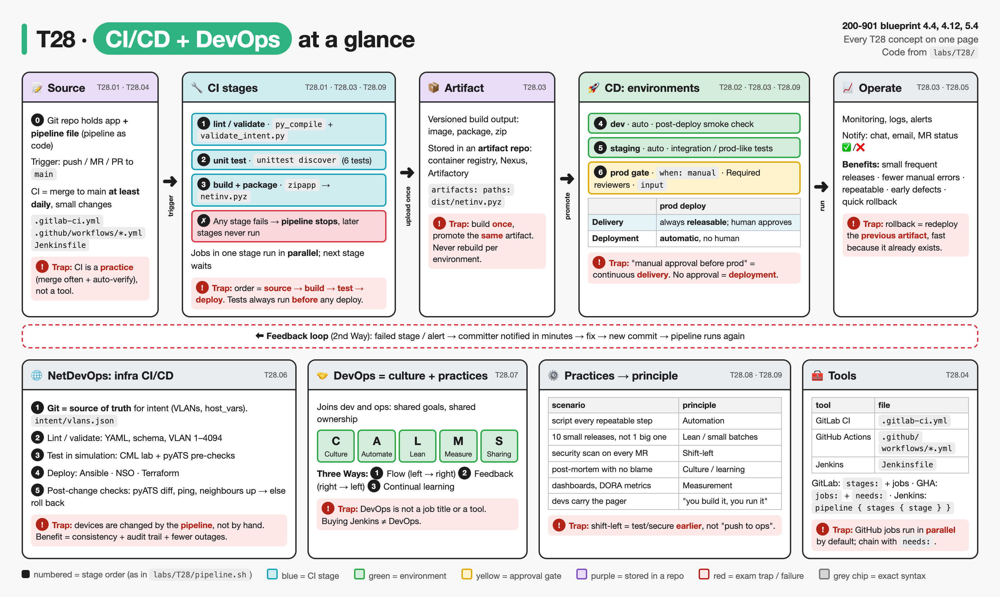
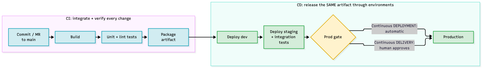
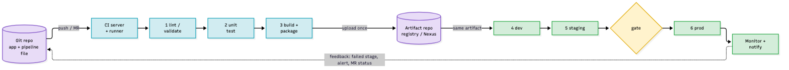
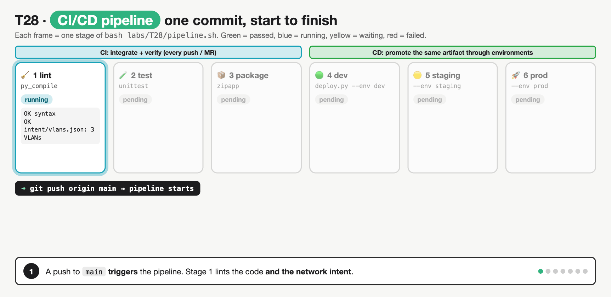
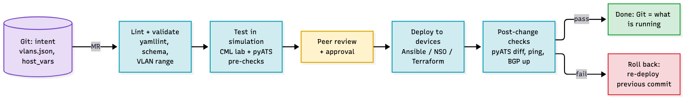
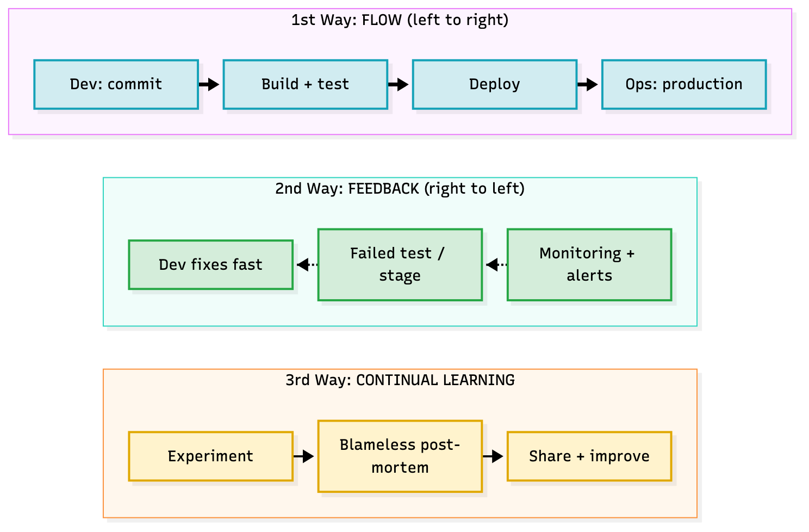

# T28 · CI/CD + DevOps principles

> Owner: **Beedy** · Blueprint: **4.4, 4.12, 5.4** · CBT coverage: **Full** · Learn by 2026-10-24 · Teach-back 2026-10-25



*Every T28 concept on one page. Top row = one commit flowing left to right through the lanes (Source → CI → Artifact → CD → Operate), the dashed red bar = the feedback loop back to the developer. Bottom row = NetDevOps, DevOps culture, scenario → principle and tools. Numbered circles are the stages of `labs/T28/pipeline.sh`; red boxes are exam traps.*

<!-- toc:start -->

**Contents**

- [TL;DR (teach-back card)](#tldr-teach-back-card)
- [Concepts](#concepts)
  - [T28.01](#t2801--ci) CI · [T28.02](#t2802--cd) CD · [T28.03](#t2803--pipeline-components) Pipeline components · [T28.04](#t2804--tools-awareness) Tools (awareness) · [T28.05](#t2805--benefits) Benefits · [T28.06](#t2806--infra-cicd) Infra CI/CD · [T28.07](#t2807--devops) DevOps · [T28.08](#t2808--devops-practices) DevOps practices · [T28.09](#t2809--exam-angle) Exam angle
- [Exam traps](#exam-traps)
- [Examples](#examples)
- [Practice questions](#practice-questions)
- [Study aids](#study-aids)
- [Sources](#sources)
- [To verify](#to-verify)

<!-- toc:end -->

## TL;DR (teach-back card)

- **CI = merge small changes to main at least daily; every push triggers an automated lint + test + build.** A failing stage stops the line, so main stays releasable. The output is **one artifact**, built once and stored in an artifact repo (registry, Nexus, Artifactory).
- **CD promotes that same artifact through dev → staging → prod.** Continuous **delivery** = always releasable, a **human approves** prod. Continuous **deployment** = every passing change goes to prod **automatically**. For infrastructure (NetDevOps), Git holds the intent, the pipeline validates it, tests it in simulation (CML/pyATS), deploys it (Ansible/NSO/Terraform) and runs post-change checks.
- **DevOps = culture + practices that join dev and ops.** CALMS (Culture, Automation, Lean, Measurement, Sharing) and the Three Ways (flow, feedback, continual learning). Practices: automate the repeatable, small batches, shift-left, monitoring + blameless post-mortems, "you build it, you run it".
- **Trap:** "manual approval before production" is continuous **delivery**, not deployment. And the stage order is always source → build → test → (package/artifact) → deploy; tests never come after deploy to prod.

## Concepts

Every section below points at one reference pipeline. Read it once first.

- `labs/T28/src/` is an **unchanged copy** of the [T02](T02-functions-classes-modules.md) inventory builder (`build_inventory.py` + `netlib/`). It is the "app" the pipeline ships.
- `labs/T28/intent/vlans.json` is a tiny piece of **network intent** (VLANs for a site), so the pipeline also validates infrastructure data (T28.06).
- `labs/T28/tests/test_build_inventory.py`: 6 `unittest` tests ([T32](T32-tdd-python-unit-tests.md)).
- `labs/T28/ci/validate_intent.py`: lint stage for the intent file. `labs/T28/ci/deploy.py`: simulated deploy (copies the artifact into `envs/<env>/`, then a smoke check).
- `labs/T28/pipeline.sh` (below) is the **reference program**: the same six stages as the pipeline files, run locally, stopping at the first failure.
- The same pipeline as code for three tools: `labs/T28/.gitlab-ci.yml` (below), `labs/T28/ci/github-actions.yml`, `labs/T28/ci/Jenkinsfile`. None of them is live: GitLab only reads `.gitlab-ci.yml` at the repo root and GitHub only reads `.github/workflows/`.

**`labs/T28/pipeline.sh`** (line numbers are used below)

```bash
#!/usr/bin/env bash
# T28 local pipeline: the same stages as .gitlab-ci.yml, in order, stopping at the first failure.
# Usage: bash labs/T28/pipeline.sh                  # continuous DELIVERY: stops before prod
#        APPROVE_PROD=yes bash labs/T28/pipeline.sh # a human approved the prod gate
#        MODE=deployment bash labs/T28/pipeline.sh  # continuous DEPLOYMENT: no gate
set -euo pipefail                                  # any failing command ends the run (fail fast)

LAB="$(cd "$(dirname "$0")" && pwd)"
cd "$LAB"                                          # every path below is relative to labs/T28
OUT="${OUT:-${TMPDIR:-/tmp}/t28-pipeline}"         # runner workspace (never inside the repo)
MODE="${MODE:-delivery}"
INTENT="${INTENT:-intent/vlans.json}"              # the network source of truth
export PYTHONPATH="src" PYTHONDONTWRITEBYTECODE=1 PYTHONPYCACHEPREFIX="$OUT/pycache"  # keep the repo clean
rm -rf "$OUT" && mkdir -p "$OUT/dist"

stage() { echo; echo "=== stage $1: $2 ==="; }
trap 'echo; echo "PIPELINE FAILED in stage ${CURRENT:-?}: later stages did not run"' ERR

CURRENT=lint
stage 1 "lint / validate (source + network intent)"
python3 -m py_compile src/build_inventory.py src/netlib/*.py
echo "  OK syntax: build_inventory.py netlib/"
python3 ci/validate_intent.py "$INTENT"

CURRENT=test
stage 2 "unit test"
python3 -m unittest discover --start-directory tests 2>&1 | sed 's/^/  /'

CURRENT=build
stage 3 "build + package the artifact (once)"
python3 -m zipapp src --main "build_inventory:main" --output "$OUT/dist/netinv.pyz"
echo "  artifact: dist/netinv.pyz ($(wc -c < "$OUT/dist/netinv.pyz" | tr -d ' ') bytes, built once, reused below)"

CURRENT=deploy-dev
stage 4 "deploy dev (automatic)"
python3 ci/deploy.py --env dev --artifact "$OUT/dist/netinv.pyz" --out "$OUT"

CURRENT=deploy-staging
stage 5 "deploy staging (automatic)"
python3 ci/deploy.py --env staging --artifact "$OUT/dist/netinv.pyz" --out "$OUT"

CURRENT=deploy-prod
stage 6 "deploy prod"
if [[ "$MODE" == "deployment" || "${APPROVE_PROD:-no}" == "yes" ]]; then
  python3 ci/deploy.py --env prod --artifact "$OUT/dist/netinv.pyz" --out "$OUT"
  echo; echo "PIPELINE PASSED: released to prod (mode=$MODE)"
else
  echo "  WAITING: manual approval gate. Re-run with APPROVE_PROD=yes"
  echo; echo "PIPELINE PASSED up to the gate: artifact is releasable (mode=$MODE)"
fi
```

**Real output** (`bash labs/T28/pipeline.sh` from the repo root, Python 3.14):

```text

=== stage 1: lint / validate (source + network intent) ===
  OK syntax: build_inventory.py netlib/
  OK intent/vlans.json: 3 VLANs valid for site sandbox

=== stage 2: unit test ===
  ......
  ----------------------------------------------------------------------
  Ran 6 tests in 0.000s
  
  OK

=== stage 3: build + package the artifact (once) ===
  artifact: dist/netinv.pyz (7041 bytes, built once, reused below)

=== stage 4: deploy dev (automatic) ===
  deployed dist/netinv.pyz -> envs/dev/netinv.pyz
  post-deploy check OK in dev: 3 devices: {'IOSXE': 1, 'NXOS': 1, 'Device': 1}

=== stage 5: deploy staging (automatic) ===
  deployed dist/netinv.pyz -> envs/staging/netinv.pyz
  post-deploy check OK in staging: 3 devices: {'IOSXE': 1, 'NXOS': 1, 'Device': 1}

=== stage 6: deploy prod ===
  WAITING: manual approval gate. Re-run with APPROVE_PROD=yes

PIPELINE PASSED up to the gate: artifact is releasable (mode=delivery)
```

(The artifact size varies by a few bytes per run because the zip stores file timestamps.)

**`labs/T28/.gitlab-ci.yml`** (the same pipeline as GitLab CI code)

```yaml
# T28 reference pipeline (GitLab CI). Same stages as labs/T28/pipeline.sh.
# GitLab only runs a .gitlab-ci.yml at the repo ROOT, so this copy inside labs/T28/ is never live.
# To try it: put the contents of labs/T28/ at the root of a GitLab project and push.
stages:            # stages run in this order; jobs in one stage run in parallel
  - lint
  - test
  - build
  - deploy

default:
  image: python:3.12-slim          # every job runs in a fresh container from this image

variables:
  PYTHONPATH: src

workflow:
  rules:
    - if: $CI_PIPELINE_SOURCE == "merge_request_event"   # run on every MR...
    - if: $CI_COMMIT_BRANCH == $CI_DEFAULT_BRANCH         # ...and every push to main

lint:
  stage: lint
  script:
    - python3 -m py_compile src/build_inventory.py src/netlib/*.py
    - python3 ci/validate_intent.py intent/vlans.json

unit-test:
  stage: test
  script:
    - python3 -m unittest discover --start-directory tests

package:
  stage: build
  script:
    - mkdir -p dist
    - python3 -m zipapp src --main "build_inventory:main" --output dist/netinv.pyz
  artifacts:                        # saved by GitLab and passed to later stages
    paths:
      - dist/netinv.pyz
    expire_in: 1 week

deploy-dev:
  stage: deploy
  script:
    - python3 ci/deploy.py --env dev --artifact dist/netinv.pyz --out .
  environment:
    name: dev
  rules:
    - if: $CI_COMMIT_BRANCH == $CI_DEFAULT_BRANCH

deploy-staging:
  stage: deploy
  needs: [deploy-dev, package]      # after dev, still in the deploy stage
  script:
    - python3 ci/deploy.py --env staging --artifact dist/netinv.pyz --out .
  environment:
    name: staging
  rules:
    - if: $CI_COMMIT_BRANCH == $CI_DEFAULT_BRANCH

deploy-prod:
  stage: deploy
  needs: [deploy-staging, package]
  script:
    - python3 ci/deploy.py --env prod --artifact dist/netinv.pyz --out .
  environment:
    name: prod
  rules:
    - if: $CI_COMMIT_BRANCH == $CI_DEFAULT_BRANCH
      when: manual                  # continuous DELIVERY: a human clicks "play"
                                    # delete this line = continuous DEPLOYMENT
```

**Map: local script ↔ pipeline file**

| Stage | `pipeline.sh` line | `.gitlab-ci.yml` job | What fails it |
|---|---|---|---|
| 1 lint / validate | 21–23 | `lint` | syntax error; VLAN out of 1–4094, no name, duplicate ID; bad JSON |
| 2 unit test | 27 | `unit-test` | any failing `unittest` assertion |
| 3 build + package | 31–32 | `package` (+ `artifacts:`) | build error |
| 4 deploy dev | 36 | `deploy-dev` | post-deploy smoke check (no "3 devices") |
| 5 deploy staging | 40 | `deploy-staging` | same check, prod-like env |
| 6 deploy prod | 44–50 | `deploy-prod` (`when: manual`) | waits for a human (delivery) unless `MODE=deployment` |

### T28.01 · CI

**Must cover:**

- [x] Developers merge to the main branch frequently (at least daily)
- [x] Each push triggers an automated build and tests
- [x] Catches integration bugs early, keeps main releasable

**Notes:**



*Blue = CI (ends with a tested, packaged artifact). Green = CD (moves that artifact through environments). The yellow gate is the only difference between delivery and deployment.*

- **Continuous integration** (Fowler's definition): each developer merges into the mainline **at least daily**, and **each integration is verified by an automated build (including tests)**.
  - Short-lived branches / small MRs ([T04 branching](T04-git-version-control.md)). Long-lived feature branches = "integration hell", the thing CI exists to stop.
  - The trigger is the push / MR (`workflow: rules:` in `.gitlab-ci.yml` lines 16–19), not a nightly human.
- **Fail fast:** `set -euo pipefail` (line 6) + the `ERR` trap (line 17) = first failing command ends the run. GitLab does the same between stages: the next stage only starts if the previous one succeeded.
- **Why:** an integration bug is found minutes after the commit that caused it, by the person who wrote it, while the change is small. Main stays **green = releasable**.
- **Rule:** a broken main build is fixed **immediately** (or the commit is reverted) before anyone piles more changes on it.
- CI is a **practice**, not a product. Running Jenkins on a branch nobody merges for a month isn't CI.

### T28.02 · CD

**Must cover:**

- [x] Continuous delivery: every change is releasable; production deploy needs a manual approval
- [x] Continuous deployment: every passing change goes to production automatically

**Notes:**

| | Continuous **delivery** | Continuous **deployment** |
|---|---|---|
| Every change… | is built, tested, deployable | is built, tested **and deployed** |
| Prod deploy | **manual decision** (button / approval) | **automatic** when all stages pass |
| In `labs/T28` | default run: stops at `WAITING: manual approval gate` | `MODE=deployment bash labs/T28/pipeline.sh` |
| GitLab | `when: manual` on `deploy-prod` (line 70) | delete that line |
| GitHub Actions | `environment: prod` with **Required reviewers** | no protection rule |
| Jenkins | `input { message 'Deploy to prod?' }` in the prod stage | remove the `input` |
| Needs | good tests | **excellent** automated tests + monitoring + fast rollback |

- Both start with CI. Both are abbreviated "CD", so the exam spells them out: read for "approval", "manual", "button", "business decides" → **delivery**; "automatically to production", "no human" → **deployment**.
- Fowler: continuous delivery means you **can** deploy any version on demand ("push-button"); deployment means every change **does** go to production.
- GitLab detail: `when: manual` **inside `rules:`** makes a **blocking** manual job (`allow_failure: false`); at job level (outside `rules`) a manual job defaults to `allow_failure: true`. Not an exam point, but it is why the prod job above is in `rules:`.
- Real runs of the two modes (last lines only):

```text
$ APPROVE_PROD=yes bash labs/T28/pipeline.sh | tail -6

=== stage 6: deploy prod ===
  deployed dist/netinv.pyz -> envs/prod/netinv.pyz
  post-deploy check OK in prod: 3 devices: {'IOSXE': 1, 'NXOS': 1, 'Device': 1}

PIPELINE PASSED: released to prod (mode=delivery)

$ MODE=deployment bash labs/T28/pipeline.sh | tail -4
  deployed dist/netinv.pyz -> envs/prod/netinv.pyz
  post-deploy check OK in prod: 3 devices: {'IOSXE': 1, 'NXOS': 1, 'Device': 1}

PIPELINE PASSED: released to prod (mode=deployment)
```

### T28.03 · Pipeline components

**Must cover:**

- [x] Source control repo (trigger on commit/PR)
- [x] Build (compile, package, container image)
- [x] Test: unit, integration, security/lint
- [x] Artifact repository (image registry, Nexus/Artifactory)
- [x] Deploy stages: dev → test/staging → production, with approvals/gates
- [x] Notifications and monitoring/feedback

**Notes:**



*Purple = things stored in a repo (code, artifact). Blue = CI stages. Green = environments + monitoring. The dotted line is the feedback that closes the loop.*

| Component | Job | In `labs/T28` | Real-world examples |
|---|---|---|---|
| **Source repo** | single source of truth for code **and** pipeline file; push/MR = trigger | `src/`, `intent/`, `.gitlab-ci.yml` | GitHub, GitLab, Bitbucket |
| **CI server + runner** | reads the pipeline file, runs jobs in clean workers (often a container) | `image: python:3.12-slim` (line 11) | GitLab runner, GitHub-hosted runner, Jenkins agent |
| **Lint / static checks** | cheapest checks first: syntax, style, schema, security scan (SAST, secret scan) | `py_compile` + `validate_intent.py` | pylint, flake8, yamllint, Bandit |
| **Build** | compile / package / build a **container image** ([T27](T27-docker.md)) | `python3 -m zipapp … netinv.pyz` | `docker build`, `mvn package` |
| **Test** | **unit** (one function, fast, mocked), **integration** (parts together, in a real-ish env), security, then acceptance | `unittest discover` (6 tests); smoke check in `deploy.py` | pytest, pyATS |
| **Artifact repo** | stores the versioned output so every env gets **the same bytes** | `artifacts: paths: dist/netinv.pyz` | Docker Hub / ECR / Harbor, Nexus, Artifactory |
| **Deploy stages** | dev → test/staging → prod, each with checks; **gates/approvals** before prod | `deploy-dev`, `deploy-staging`, `deploy-prod` + `environment:` | Ansible, Helm, Terraform |
| **Notify + monitor** | tell the committer (chat, email, MR ✅/❌); watch prod (metrics, logs, alerts) | `PIPELINE FAILED in stage …` line | Webex/Slack bot, Prometheus, Grafana |

- **Order on the exam:** source → build → test → (store artifact) → deploy dev → staging → (approval) → prod → monitor. Many CBT-style diagrams merge lint into test and "package" into build. Either way, **tests come before any deploy** and the **artifact is created before the deploy stages**.
- **What an artifact is:** the **packaged output of a build**, the thing that actually gets deployed. Source code is the recipe (in Git); the artifact is the finished product (in an artifact repo).
  - Made by the **pipeline**, not by hand, and **immutable**: a new commit produces a **new** artifact, it never edits an old one.
  - Examples: a **container image** pushed to a registry ([T27](T27-docker.md)), a `.jar` from `mvn package`, or this lab's `dist/netinv.pyz` from `python3 -m zipapp`.
  - In `.gitlab-ci.yml`, `artifacts: paths: [dist/netinv.pyz]` (plus `expire_in: 1 week`) tells GitLab to save that file from `package` and hand it to the deploy jobs. No passing tests → `package` never runs → **no artifact**, nothing to deploy.
  - It is the **hand-over point** between CI and CD: CI ends with a tested artifact; CD promotes it. Keeping old artifacts is what makes **rollback = redeploy the previous artifact** fast.
- **Build once, promote many:** `deploy.py` line 16 copies the **same** `netinv.pyz` to every env. Rebuilding per env means prod runs bytes nobody tested.
- **Where each test runs:** lint + unit tests in **CI** (every push, seconds). Integration / end-to-end tests against a **deployed** env (staging). Smoke / post-deploy checks right after each deploy.
- **Environments:** GitLab's deployment tiers are `production`, `staging`, `testing`, `development`, `other`. Promote left to right; only staging should look like prod.



*Steps: push → lint → unit test → package once → deploy dev → deploy staging → prod waits for approval (delivery) → next commit fails a test and every later stage is skipped. Fixes the misconception that "CD" starts at commit: CI ends with the artifact, CD only moves that artifact, and a failure anywhere stops the line.*

### T28.04 · Tools (awareness)

**Must cover:**

- [x] Jenkins (Jenkinsfile), GitLab CI (.gitlab-ci.yml), GitHub Actions (workflows YAML)
- [x] Pipeline as code: pipeline definition version-controlled with the app

**Notes:**

| | GitLab CI | GitHub Actions | Jenkins |
|---|---|---|---|
| File (in the repo) | `.gitlab-ci.yml` at the **root** | `.github/workflows/*.yml` (or `.yaml`) | `Jenkinsfile` (Groovy) |
| Language | YAML | YAML | Groovy DSL: declarative or scripted |
| Unit of order | `stages:` list; jobs pick a `stage:` | `jobs:`; order only via `needs:` | `pipeline { stages { stage('X') { steps { … } } } }` |
| Default concurrency | jobs in the **same stage** run in parallel; next stage waits | **all jobs parallel** unless `needs:` | stages sequential |
| Where it runs | `image:` on a runner | `runs-on: ubuntu-latest` | `agent` (e.g. `agent { docker { image 'python:3.12-slim' } }`) |
| Pass files between jobs | `artifacts: paths:` | `actions/upload-artifact` / `download-artifact` | `archiveArtifacts` / `stash` |
| Manual gate | `when: manual` | environment **Required reviewers** | `input` step |
| In `labs/T28` | `.gitlab-ci.yml` | `ci/github-actions.yml` | `ci/Jenkinsfile` |

- **Pipeline as code:** the pipeline definition lives in the **same repo** as the app. So it gets code review (MR), history and audit trail like any code; one source of truth (Jenkins docs list these exact benefits).
- GitLab default stages if you don't define `stages:`: `.pre`, `build`, `test`, `deploy`, `.post`.
- Exam level is **awareness**: recognise the file name → tool, and read stage order from a snippet. You won't write Groovy.

### T28.05 · Benefits

**Must cover:**

- [x] Faster, smaller, more frequent releases
- [x] Fewer manual errors; repeatable deploys
- [x] Early defect detection; quick rollback

**Notes:**

| Scenario wording | Benefit |
|---|---|
| "release weekly instead of quarterly", "small changes" | **faster, smaller, more frequent releases** (smaller change = smaller blast radius) |
| "no more copy-paste deploy runbook", "same steps every time" | **fewer manual errors, repeatable deploys** |
| "the bug was found 5 minutes after the commit" | **early defect detection** (cheaper to fix) |
| "the bad release was undone in 2 minutes" | **quick rollback**: redeploy the **previous artifact** (already built and tested) |
| "everyone sees which commit broke it" | visibility / feedback |

- In `labs/T28`, the "break it" runs below show early detection: a VLAN typo fails at **lint** in under a second and nothing is built or deployed.

### T28.06 · Infra CI/CD

**Must cover:**

- [x] Network config/intent stored in Git (source of truth)
- [x] Pipeline: lint/validate → test in simulation (CML, pyATS) → deploy (Ansible, NSO, Terraform) → post-change checks
- [x] Same benefits for infrastructure: consistency, audit trail, fewer outages

**Notes:**



*Same shape as an app pipeline, but the "code" is network intent and the "deploy" changes devices. Red = the rollback path when post-change checks fail.*

From first principles:

- **Classic network change:** an engineer SSHes into each device and types config. No review, no test, drift between devices, and the only record is the device itself.
- **NetDevOps** = apply CI/CD to the network. The desired state (**intent**: VLANs, interfaces, BGP neighbours, ACLs) is **data in Git**, e.g. `intent/vlans.json`, Ansible `host_vars/`, YAML. **Git is the source of truth**; devices should match it.
- **Pipeline stages for infra:**
  1. **Lint / validate**: YAML/JSON syntax, schema, business rules. `ci/validate_intent.py` rejects VLAN 4095, unnamed VLANs and duplicates, reusing `Device.is_valid_vlan()` from the app (1–4094).
  2. **Test in simulation**: push the change to a virtual copy of the network first (Cisco Modeling Labs, CML) and check it with **pyATS** ([T44](T44-pyats-genie.md)): pre-checks, `genie learn` / `diff`.
  3. **Review + approval**: an MR reviewed by a peer ([T46](T46-code-review-principles.md)); the change window is the gate.
  4. **Deploy**: a tool pushes config: **Ansible** ([T34](T34-ansible-playbook-interpretation.md)), Cisco **NSO**, **Terraform** ([T33](T33-iac-tool-comparison.md)), or controller APIs (RESTCONF/NETCONF).
  5. **Post-change checks**: pyATS diff, ping, routing neighbours up, interfaces up. Fail → **roll back** by redeploying the previous commit's intent.
- **Benefits for infra:** consistency (every device from the same template), **audit trail** (`git log` = who changed what, when, why), peer review, tested before prod, **fewer outages**, fast rollback.
- `labs/T28` simulates step 1 and the deploy pattern only; it doesn't touch a device. ⚠ verify: the stage list above is the common NetDevOps pattern from Cisco DevNet learning material; the exact wording the exam uses for blueprint 5.4 should be checked in the PDF.

**Exam-sim gap (practice test review):**
- **CI/CD for NSO (or any network change) works only if the pipeline is the *only* path to production.** If engineers can still push changes by hand, devices drift from what's in Git and nothing is repeatable or auditable.
- **Plan the work in a tracking system too.** Features and changes start as tickets (e.g. **Jira**), each linked to the branch/MR that implements it. Ticket → branch → pipeline → deploy gives traceability from request to change.
- Exam cues: "best practice for CI/CD with NSO" → single pipeline to prod, no manual side doors · "what else does the setup need" → issue/feature tracking (Jira) alongside Git and the CI server.

### T28.07 · DevOps

**Must cover:**

- [x] DevOps = culture + practices that join development and operations
- [x] CALMS: Culture, Automation, Lean, Measurement, Sharing
- [x] Three Ways: flow (fast left-to-right), feedback (right-to-left), continual learning/experimentation

**Notes:**

- **DevOps** = a culture plus a set of practices that join **development** (wants change) and **operations** (wants stability) into one team with shared goals, so change is fast **and** safe. Not a job title, not a tool.
- **CALMS** (coined by Jez Humble):

| Letter | Means | Spot it in a scenario |
|---|---|---|
| **C**ulture | collaboration, shared ownership, no blame | dev and ops in the same stand-up; blameless post-mortem |
| **A**utomation | automate build, test, deploy, infra | the pipeline in `labs/T28`; IaC |
| **L**ean | small batches, limit WIP, remove waste | ship small MRs often |
| **M**easurement | measure everything, decide with data | DORA metrics, dashboards |
| **S**haring | share knowledge, tools, responsibility | shared runbooks, wikis, demos |



*1st Way = work flows left to right fast. 2nd Way = information flows right to left fast. 3rd Way = the whole loop keeps improving.*

- **The Three Ways** (Gene Kim, *The Phoenix Project* / *DevOps Handbook*):
  1. **Flow / systems thinking:** optimise the **whole** dev → ops flow, not one silo. Small batches, automation, no handoffs, never pass a known defect downstream.
  2. **Amplify feedback loops:** fast information **right to left**: failing tests, monitoring, alerts, MR status. Fix where the problem is found.
  3. **Continual experimentation and learning:** take risks, learn from failure (blameless post-mortems), practise, share.
- **DORA metrics** (Measurement, awareness): change lead time, deployment frequency, failed deployment recovery time, change fail rate (DORA now also lists deployment rework rate).

**Exam-sim gap (practice test review):**
- **Learning culture = continuous improvement.** Blameless post-mortems, sharing what broke and why, and small experiments let the team improve the process after each failure (the DevOps "Third Way": continual learning).
- Exam cue: "why a learning culture matters in DevOps" → **continuous improvement**, not "fewer meetings" or "less testing".

### T28.08 · DevOps practices

**Must cover:**

- [x] Automate everything repeatable
- [x] Small batch sizes, frequent releases
- [x] Shift-left: test and secure early
- [x] Monitoring and fast feedback; blameless post-mortems
- [x] Shared responsibility ("you build it, you run it")

**Notes:**

| Practice | What it means | In `labs/T28` / example |
|---|---|---|
| **Automate everything repeatable** | build, test, deploy, infra, checks: if it is done twice, script it | `pipeline.sh` replaces a manual runbook |
| **Small batches, frequent releases** | small change = easy review, easy rollback, smaller blast radius | one VLAN per MR, not 40 |
| **Shift-left** | move testing and security **earlier** (left on the timeline), into CI and the developer's laptop | lint + unit tests are stages 1–2, before any deploy; SAST / secret scan in CI ([T29](T29-secrets-encryption-data-handling.md)) |
| **Monitoring + fast feedback** | the pipeline and prod both tell you within minutes | `PIPELINE FAILED in stage …`; alerts |
| **Blameless post-mortem** | after an incident, ask "what in the system let this happen?", not "who"; produce fixes | culture + learning (3rd Way) |
| **Shared responsibility** | "**you build it, you run it**": the team that writes the code is on call for it | devs carry the pager |

- **Shift-left ≠ "hand it to someone else".** Left = earlier in the lifecycle. "Run security scans only before the yearly audit" is the opposite.

### T28.09 · Exam angle

**Must cover:**

- [x] Put pipeline stages in the correct order
- [x] Pick the benefit or DevOps principle a scenario describes
- [x] Delivery vs deployment distinction

**Notes:**

- **Order drill:** commit/push → (trigger) → build → unit test / lint → package + store artifact → deploy to dev/test → integration tests on staging → approval (delivery only) → deploy prod → monitor → feedback. Same as stages 1–6 of `pipeline.sh` (lint is before build there because it is cheapest; both orders are before deploy).
- **Scenario → answer:** use the T28.05 table for benefits, the T28.07 CALMS table and the T28.08 practices table for principles.
- **Delivery vs deployment:** look for the human. Approval/button = delivery. Fully automatic to prod = deployment. CI alone never deploys to prod.
- **"Which stage catches X?"** syntax / style / bad VLAN → lint; a function returns the wrong value → unit test; two services don't talk → integration test (staging); config applied but BGP down → post-change check.

## Exam traps

- **Continuous delivery vs continuous deployment:** both abbreviate to CD. Manual approval to prod = **delivery**. Automatic to prod = **deployment**.
- **CI ends at a tested artifact.** CI does not deploy to production; "CI pipeline deployed to prod" is wrong unless CD is also in place.
- **Stage order:** build → test → deploy. Integration tests run **after** deploying to a test/staging env, unit tests **before**. Monitoring is **after** prod.
- **Build once, promote the same artifact.** Rebuilding for prod = untested bytes in prod.
- **Artifact repo ≠ source repo.** Git stores code + pipeline file; Nexus/Artifactory/registry stores **build outputs**.
- **Fail fast:** a failed stage stops the pipeline; later stages are **skipped**, not run "with warnings".
- **GitHub Actions jobs run in parallel by default.** Order only with `needs:`. GitLab orders with `stages:` (same stage = parallel).
- **File names:** `.gitlab-ci.yml` = GitLab, `.github/workflows/*.yml` = GitHub Actions, `Jenkinsfile` = Jenkins.
- **Pipeline as code** = pipeline definition in the **app's** repo, versioned and reviewed. Not "the pipeline is written in Python".
- **Shift-left** = test/secure **earlier**, not "move work to ops".
- **CALMS:** the L is **Lean**, not "Logging"; the M is **Measurement**, not "Monitoring" (monitoring is one way to measure).
- **Three Ways order:** 1 Flow, 2 Feedback, 3 Continual learning/experimentation.
- **DevOps is culture + practices**, not a team name or a tool. "Buy Jenkins" ≠ DevOps.
- **NetDevOps source of truth = Git**, not the running config on the device. A manual CLI change on a device = drift the pipeline will overwrite.
- **Blameless post-mortem** asks what in the system failed, not who.
- **CI/CD discipline:** the pipeline must be the only route to prod, changes start as tracked tickets (Jira), and a learning culture = continuous improvement.

## Examples

### 1. Run the reference program

Needs only Python 3 (standard library) and Bash. From the repo root:

```bash
bash labs/T28/pipeline.sh                        # continuous delivery: stops at the prod gate
APPROVE_PROD=yes bash labs/T28/pipeline.sh       # a human approved prod
MODE=deployment bash labs/T28/pipeline.sh        # continuous deployment: no gate
ls "${TMPDIR:-/tmp}/t28-pipeline/envs"           # dev  prod  staging (after an approved run)
```

In the lab container (needs Docker; ⚠ not run here, daemon down):

```bash
docker build --tag ccna-auto-lab:latest --file labs/Dockerfile labs/
docker run --rm --volume "$(pwd)":/work --workdir /work ccna-auto-lab:latest bash labs/T28/pipeline.sh
```

Run the pipeline file for real: copy `labs/T28/` to the root of a new GitLab project and push (the `.gitlab-ci.yml` then sits at the root). For GitHub, copy it to a new repo and save `ci/github-actions.yml` as `.github/workflows/ci.yml`. ⚠ Neither was run on a real GitLab/GitHub runner; every `script:`/`run:` line was executed locally in order with Python 3.14 and exited 0.

### 2. Break it on purpose (all run; real output)

Each one works on a throwaway copy, so `labs/T28` stays clean.

**a) Bad intent → fails at lint, nothing built.**

```bash
cat > "$TMPDIR/bad-vlans.json" <<'EOF'
{"site": "sandbox", "vlans": [{"id": 10, "name": "users"}, {"id": 4095, "name": "oops"}, {"id": 10, "name": ""}]}
EOF
INTENT="$TMPDIR/bad-vlans.json" bash labs/T28/pipeline.sh; echo "exit=$?"
```

```text

=== stage 1: lint / validate (source + network intent) ===
  OK syntax: build_inventory.py netlib/
  FAIL /tmp/claude-501/bad-vlans.json: VLAN 4095 out of range 1-4094
  FAIL /tmp/claude-501/bad-vlans.json: VLAN 10 has no name
  FAIL /tmp/claude-501/bad-vlans.json: duplicate VLAN IDs in [10, 4095, 10]

PIPELINE FAILED in stage lint: later stages did not run
exit=1
```

**b) Code change breaks a test → fails at test, no artifact.**

```bash
rm -rf "$TMPDIR/t28-break" && cp -R labs/T28 "$TMPDIR/t28-break"
sed -i '' 's/^MAX_VLAN = 4094/MAX_VLAN = 4095/' "$TMPDIR/t28-break/src/netlib/devices.py"   # Linux: sed -i 's/…/…/'
bash "$TMPDIR/t28-break/pipeline.sh"; echo "exit=$?"
```

```text

=== stage 1: lint / validate (source + network intent) ===
  OK syntax: build_inventory.py netlib/
  OK intent/vlans.json: 3 VLANs valid for site sandbox

=== stage 2: unit test ===
  .....F
  ======================================================================
  FAIL: test_vlan_range (test_build_inventory.TestVlans.test_vlan_range)
  ----------------------------------------------------------------------
  Traceback (most recent call last):
    File "/private/tmp/claude-501/t28-break/tests/test_build_inventory.py", line 37, in test_vlan_range
      self.assertFalse(Device.is_valid_vlan(4095))
      ~~~~~~~~~~~~~~~~^^^^^^^^^^^^^^^^^^^^^^^^^^^^
  AssertionError: True is not false
  
  ----------------------------------------------------------------------
  Ran 6 tests in 0.000s
  
  FAILED (failures=1)

PIPELINE FAILED in stage test: later stages did not run
```

(`exit=1`.) Note the lint stage still **passed** with the bad code: lint checks the intent against the rule, the unit test checks the rule itself.

**c) Syntax error → fails at lint.**

```bash
rm -rf "$TMPDIR/t28-break" && cp -R labs/T28 "$TMPDIR/t28-break"
sed -i '' 's/^def summary(devices):/def summary(devices)/' "$TMPDIR/t28-break/src/build_inventory.py"
bash "$TMPDIR/t28-break/pipeline.sh"; echo "exit=$?"
```

```text
=== stage 1: lint / validate (source + network intent) ===
  File "src/build_inventory.py", line 59
    def summary(devices)
                        ^
SyntaxError: expected ':'

PIPELINE FAILED in stage lint: later stages did not run
exit=1
```

**d) Passes every test, fails the post-deploy check in dev → never reaches staging/prod.**

```bash
rm -rf "$TMPDIR/t28-break" && cp -R labs/T28 "$TMPDIR/t28-break"
sed -i '' 's/print(f"{total} devices: {dict(counts)}")/print(f"{total} device(s): {dict(counts)}")/' "$TMPDIR/t28-break/src/build_inventory.py"
bash "$TMPDIR/t28-break/pipeline.sh" | tail -8
```

```text
=== stage 3: build + package the artifact (once) ===
  artifact: dist/netinv.pyz (7043 bytes, built once, reused below)

=== stage 4: deploy dev (automatic) ===
  deployed dist/netinv.pyz -> envs/dev/netinv.pyz
  post-deploy check FAILED in dev

PIPELINE FAILED in stage deploy-dev: later stages did not run
```

Lesson: unit tests didn't cover `summary()`'s output text; the **smoke check after deploy** caught it in dev, which is why each environment has its own checks.

### 3. Drill: read this pipeline

Answer without running it: stage order, which job runs first, what happens if `unit` fails, delivery or deployment?

```yaml
stages: [build, test, deploy]
unit:
  stage: test
  script: [pytest -q]
lint:
  stage: test
  script: [flake8 .]
image-build:
  stage: build
  script: [docker build --tag registry.example.com/net/app:$CI_COMMIT_SHORT_SHA .]
prod:
  stage: deploy
  script: [ansible-playbook --inventory prod.ini site.yml]
  environment:
    name: production
```

<details><summary>Answer</summary>

- Order: `build` → `test` → `deploy`. `image-build` runs first; `unit` and `lint` run **in parallel** (same stage); `prod` last.
- If `unit` fails, the `test` stage fails, so `prod` **doesn't run**.
- No `when: manual` and no approval → every passing commit goes to production: **continuous deployment**.
- Missing compared to `labs/T28`: no staging environment, and the image is built but never pushed (no `docker push`), so the artifact never reaches a registry.
</details>

## Practice questions

**Q1.** Put these stages of the `labs/T28` pipeline in the order they run.
A. deploy staging  B. unit test  C. package artifact  D. lint / validate intent  E. deploy prod (approved)  F. deploy dev

<details><summary>Answer</summary>

**D → B → C → F → A → E.** Cheapest checks first, artifact built once, then promoted through environments. (T28.03, T28.09)
</details>

**Q2.** A team's pipeline builds, tests and deploys every commit to staging automatically. A release manager clicks a button to send a chosen build to production. Which practice is this?
A. Continuous integration only  B. Continuous delivery  C. Continuous deployment  D. Infrastructure as code

<details><summary>Answer</summary>

**B.** Every change is releasable, but production needs a human decision. Deployment would push to prod with no click. (T28.02)
</details>

**Q3.** Which two statements describe continuous integration? (Choose two.)
A. Developers merge small changes into the main branch at least daily  B. Every change is deployed to production automatically  C. Each merge triggers an automated build and test  D. Integration testing is done once, before a quarterly release  E. Each developer keeps a feature branch for several weeks

<details><summary>Answer</summary>

**A and C.** B is continuous deployment. D and E are exactly what CI replaces. (T28.01)
</details>

**Q4.** In `labs/T28/.gitlab-ci.yml`, `package` stores `dist/netinv.pyz` under `artifacts:` and every deploy job uses that file. Why not rebuild the package inside each deploy job?
A. GitLab forbids `script:` in deploy jobs  B. So the exact bytes tested in dev and staging are what reach prod  C. Artifacts make jobs run in parallel  D. Rebuilding would skip the lint stage

<details><summary>Answer</summary>

**B.** Build once, promote the same artifact. A rebuild could pick up different dependencies or code, so prod would run something no stage tested. (T28.03)
</details>

**Q5.** A network team keeps VLAN and interface intent in Git. A merge request triggers a pipeline that validates the YAML, applies the change to a CML topology and runs pyATS checks, then an engineer approves an Ansible run against production, followed by pyATS post-checks. Which two benefits does this give over manual CLI changes? (Choose two.)
A. An audit trail of who changed what and why  B. No need for any testing  C. Consistent, repeatable changes across devices  D. Devices no longer need management IPs  E. The running config becomes the source of truth

<details><summary>Answer</summary>

**A and C.** Git history = audit trail; the same automation = consistency. Testing is still required (it's in the pipeline), and **Git**, not the device, is the source of truth. (T28.06)
</details>

**Q6.** After an outage, the team meets to find which missing alert and test let a bad change through, without naming who made it, and files tickets to add them. Which DevOps idea is this?
A. Shift-left  B. Blameless post-mortem (culture of continual learning)  C. Lean small batches  D. Continuous deployment

<details><summary>Answer</summary>

**B.** Blameless review that focuses on the system = Culture in CALMS / the Third Way. (T28.07, T28.08)
</details>

**Q7.** A security team moves its dependency and secret scanning from a yearly audit into the CI stage that runs on every merge request. Which principle does this apply?
A. Shift-left  B. You build it, you run it  C. Measurement  D. Continuous delivery

<details><summary>Answer</summary>

**A.** Testing and security move earlier in the lifecycle, so issues are found when they are cheapest to fix. (T28.08)
</details>

**Q8.** Which file defines a pipeline for GitHub Actions?
A. `Jenkinsfile` at the repo root  B. `.gitlab-ci.yml` at the repo root  C. A YAML file under `.github/workflows/`  D. `pipeline.json` in the artifact repository

<details><summary>Answer</summary>

**C.** Jenkins uses `Jenkinsfile`, GitLab uses `.gitlab-ci.yml`. All three are pipeline as code, stored in the app's repo. (T28.04)
</details>

## Study aids

- Practice Qs only (known topic or no dedicated aid).

- Skip / low priority: Whole video

## Sources

- Overview image: HTML source `assets/T28/00-overview.html`, rendered to PNG (see `assets/README.md`). Diagrams: Mermaid sources in `assets/T28/*.mmd`. Animation: `assets/T28/05-pipeline-run-anim.html` → `05-pipeline-run.gif`.
- Martin Fowler, Continuous Integration (merge at least daily, each integration verified by an automated build including tests, fix broken builds immediately, keep the build fast): https://martinfowler.com/articles/continuousIntegration.html
- Martin Fowler, Continuous Delivery (push-button deploys; delivery vs deployment): https://martinfowler.com/bliki/ContinuousDelivery.html
- GitLab, What is CI/CD (continuous delivery vs continuous deployment): https://about.gitlab.com/topics/ci-cd/
- GitLab CI/CD YAML reference (default stages `.pre build test deploy .post`; same-stage jobs run in parallel, next stage after success; `when: manual` and `allow_failure`; `artifacts:paths`, `expire_in`, `environment`, `needs`, `rules`, `image`, `script`): https://docs.gitlab.com/ci/yaml/
- GitLab environments (deployment tiers production / staging / testing / development / other): https://docs.gitlab.com/ci/environments/
- GitHub Actions workflow syntax (files in `.github/workflows`, `.yml`/`.yaml`; jobs run in parallel by default, `needs`, `runs-on`): https://docs.github.com/en/actions/reference/workflows-and-actions/workflow-syntax
- GitHub deployment environments (Required reviewers, wait timer): https://docs.github.com/en/actions/reference/workflows-and-actions/deployments-and-environments
- Jenkins, Using a Jenkinsfile (pipeline as code checked into source control; code review, audit trail, single source of truth; declarative vs scripted; agent / stages / steps): https://www.jenkins.io/doc/book/pipeline/jenkinsfile/
- Atlassian, CALMS framework (coined by Jez Humble: Culture, Automation, Lean, Measurement, Sharing): https://www.atlassian.com/devops/frameworks/calms-framework
- Gene Kim, The Three Ways (Flow/Systems Thinking, Amplify Feedback Loops, Culture of Continual Experimentation and Learning): https://itrevolution.com/articles/the-three-ways-principles-underpinning-devops/
- DORA metrics (change lead time, deployment frequency, failed deployment recovery time, change fail rate, deployment rework rate): https://dora.dev/guides/dora-metrics-four-keys/
- Python docs, `zipapp` and `unittest` (used by the reference pipeline): https://docs.python.org/3/library/zipapp.html · https://docs.python.org/3/library/unittest.html
- Cisco 200-901 v1.1 exam topics (4.4 CI/CD pipeline components, 4.12 DevOps principles, 5.4 CI/CD for infrastructure automation): https://learningcontent.cisco.com/documents/marketing/exam-topics/200-901-CCNAAUTO_v.1.1.pdf

## To verify

- ⚠ **Pipeline files not run on a real CI service.** `labs/T28/.gitlab-ci.yml`, `labs/T28/ci/github-actions.yml` and `labs/T28/ci/Jenkinsfile` were never run on GitLab, GitHub or Jenkins. Their `script:`/`run:` commands were all run locally in stage order (exit 0), and both YAML files parse. Not checked: GitLab's YAML linter (`needs:` + `rules:` combination), action versions (`actions/checkout@v4`, `setup-python@v5`, `upload-artifact@v4`, `download-artifact@v4`), and the Jenkins `agent { docker … }` syntax (needs the Docker Pipeline plugin).
- ⚠ **Docker lab command** in Examples §1 not run (Docker daemon down).
- ⚠ GitHub Required reviewers on Free/Pro/Team plans are only available for **public** repositories (GitHub docs, as fetched 10 Oct 2026); plan rules change.
- ⚠ Blueprint 5.4 wording and the NetDevOps stage list (T28.06) come from the paraphrased `data/blueprint-map.csv` and general Cisco DevNet material; developer.cisco.com wasn't reachable (TLS) to confirm. Check the exam PDF.
- ⚠ DORA's metric names changed recently (e.g. "failed deployment recovery time", the added "deployment rework rate"); exam questions may still use the older "four keys" names (MTTR, lead time for changes).
- Ran for real (output pasted above): `labs/T28/pipeline.sh` in all three modes and the four "break it" edits (on throwaway copies), with Python 3.14 on macOS. The pipeline writes only to `$TMPDIR/t28-pipeline`, not to the repo.
- Not claimed: what the CBT video covers. Coverage "Full" comes from the video title only.
