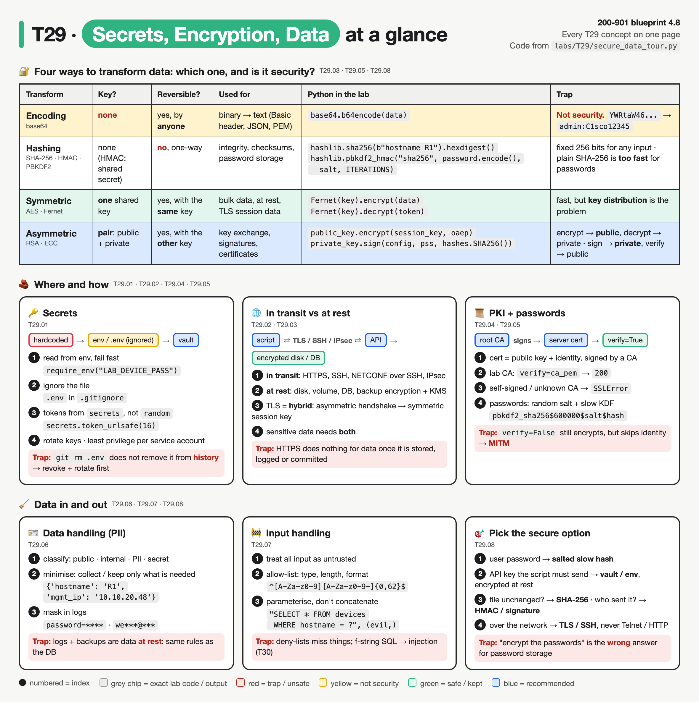
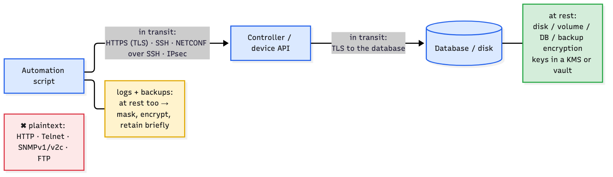
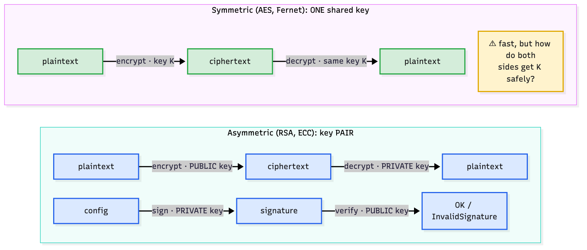
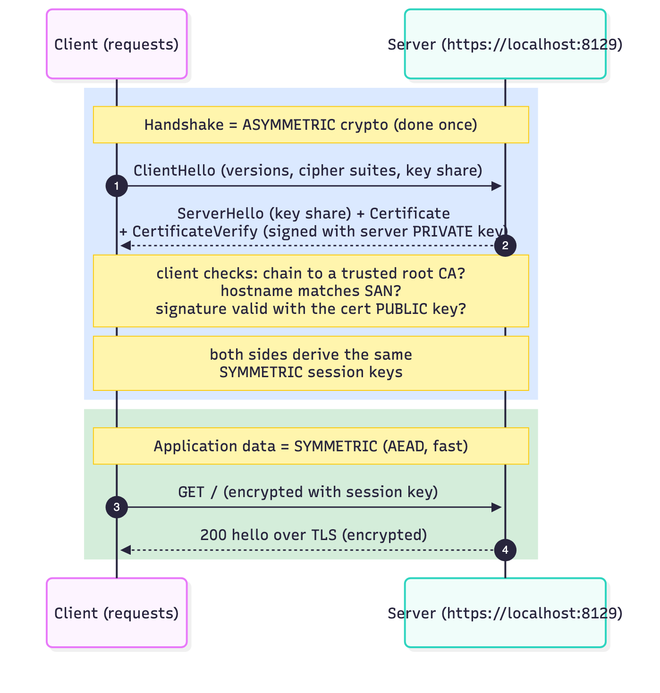
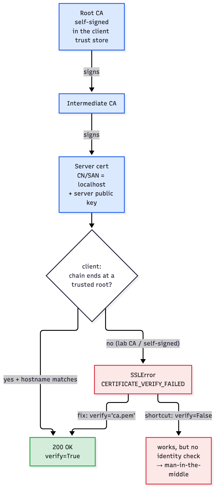
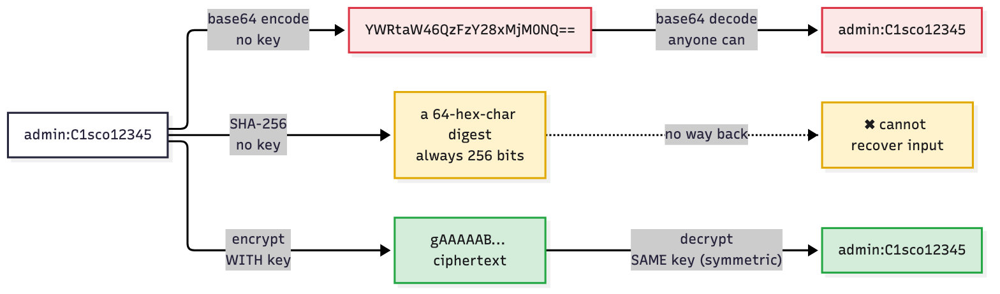
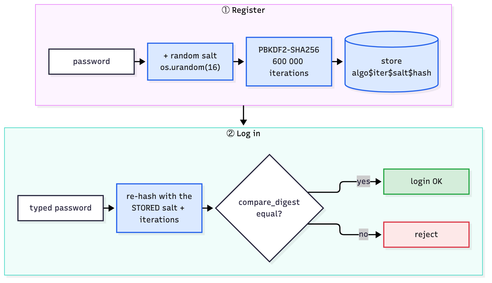
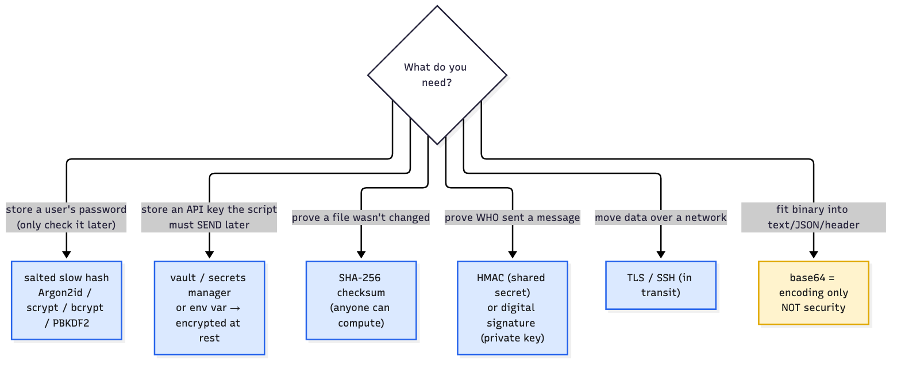

# T29 · Secrets, encryption, data handling

> Owner: **Beedy** · Blueprint: **4.8** · CBT coverage: **Full** · Learn by 2026-10-14 · Teach-back 2026-10-16



*Every T29 concept on one page. The top table answers "which transform, and is it security?" (key, reversible, use, exact Python). The six panels below cover where secrets live and how data is protected, handled and validated. Red boxes are the exam traps; grey chips are exact code or output from `labs/T29/secure_data_tour.py`.*

<!-- toc:start -->

**Contents**

- [TL;DR (teach-back card)](#tldr-teach-back-card)
- [Concepts](#concepts)
  - [T29.01](#t2901--secrets) Secrets · [T29.02](#t2902--encryption) Encryption · [T29.03](#t2903--crypto-basics) Crypto basics · [T29.04](#t2904--pki) PKI · [T29.05](#t2905--hashing) Hashing · [T29.06](#t2906--data-handling) Data handling · [T29.07](#t2907--input-handling) Input handling · [T29.08](#t2908--exam-angle) Exam angle
- [Exam traps](#exam-traps)
- [Examples](#examples)
- [Practice questions](#practice-questions)
- [Study aids](#study-aids)
- [Sources](#sources)
- [To verify](#to-verify)

<!-- toc:end -->

## TL;DR (teach-back card)

- **Four transforms, one question each: is there a key, and can it be reversed?** Encoding (base64) has no key and anyone can reverse it, so it is **not security**. Hashing (SHA-256) has no key and can't be reversed: it's for integrity and password checks. Symmetric encryption (AES) uses **one shared key** both ways; it's fast. Asymmetric (RSA/ECC) uses a **key pair**: encrypt with the public key, decrypt with the private key; sign with the private key, verify with the public key.
- **Protect data in transit *and* at rest.** In transit means TLS (HTTPS), SSH, IPsec. At rest means disk, DB and backup encryption. TLS is hybrid: an asymmetric handshake proves the server's identity (certificate chain to a trusted root CA) and agrees a symmetric session key. `verify=False` still encrypts, but skips the identity check, so a man-in-the-middle can sit in the path.
- **Secrets stay out of code, Git and logs.** Read them from env vars or a vault; put `.env` in `.gitignore`; rotate them; give service accounts least privilege. Mask secrets and PII in logs; collect and keep only what you need; validate input with allow-lists and parameterised queries.
- **Trap:** for storing user passwords, "encrypt them" and "SHA-256 them" are both **wrong**. The answer is a **salted, slow hash** (Argon2id, scrypt, bcrypt, PBKDF2). Encryption is reversible, and plain SHA-256 is fast and gives the same output for the same password.

## Concepts

Every section below explains one part of the same program. Read it once first.

- `labs/T29/secure_data_tour.py` is the **reference program**. It walks through every T29 concept in order: secrets from env, then encoding vs hashing vs encryption, RSA, a real TLS server with a lab CA, password hashing, HMAC, data minimisation with log masking, and input validation.
- `labs/T29/fake-secrets.env` holds **fake** values only. The program reads them from environment variables.
- Every key and certificate is **generated at runtime**, either in memory or in a temp dir that is deleted afterwards. No key file is ever written to the repo.
- The TLS server listens on `https://localhost:8129` for a few milliseconds during section 4, then shuts down.
- To run it all: `bash labs/T29/run_lab.sh`. It needs `cryptography` and `requests` (`pip install cryptography requests`).
- Credential *sending* (Basic, tokens, API keys, OAuth) is covered in [T10](T10-api-authentication.md#t1008--credential-handling). T29 is about how secrets and data are **stored, protected and handled**.

**`labs/T29/fake-secrets.env`**

```bash
# FAKE credentials for the T29 lab. None of these values is real or works anywhere.
# Real secrets go in labs/.env (git-ignored) or a vault, never in a committed file.
LAB_DEVICE_USER=netops
LAB_DEVICE_PASS=FAKE-Pa55-not-real
LAB_WEBHOOK_SECRET=FAKE-whsec-0000-not-real
```

**`labs/T29/secure_data_tour.py`**

```python
"""T29 reference program: secrets, encoding vs hashing vs encryption, PKI, data handling.

Load the FAKE secrets:   set -a && source labs/T29/fake-secrets.env && set +a
Then:                    python3 labs/T29/secure_data_tour.py
Or all in one:           bash labs/T29/run_lab.sh

Needs `cryptography` and `requests` (pip install cryptography requests).
Every key and certificate is generated at runtime, in memory or in a temp dir that is deleted.
"""
import base64
import datetime
import hashlib
import hmac
import logging
import os
import re
import secrets
import sqlite3
import ssl
import sys
import tempfile
import threading
import warnings
from http.server import BaseHTTPRequestHandler, HTTPServer

import requests
from cryptography import x509
from cryptography.exceptions import InvalidSignature
from cryptography.fernet import Fernet, InvalidToken
from cryptography.hazmat.primitives import hashes, serialization
from cryptography.hazmat.primitives.asymmetric import padding, rsa
from cryptography.x509.oid import NameOID

TLS_PORT = 8129


# ---------- 1. Secrets come from the environment, never from the source ----------
def require_env(name):
    """Read a secret from the environment; stop with a clear message if it's missing."""
    value = os.environ.get(name)
    if not value:
        sys.exit(f"ERROR: environment variable {name} is not set (see labs/T29/fake-secrets.env)")
    return value


DEVICE_USER = require_env("LAB_DEVICE_USER")
DEVICE_PASS = require_env("LAB_DEVICE_PASS")
WEBHOOK_SECRET = require_env("LAB_WEBHOOK_SECRET").encode()


# ---------- 6. Logs: mask secrets and PII before they are written ----------
class RedactFilter(logging.Filter):
    """Mask passwords, tokens and email addresses in every log record."""
    PATTERNS = [
        (re.compile(r"(password|pass|secret|token)=\S+", re.I), r"\1=****"),
        (re.compile(r"(Authorization: \w+) \S+"), r"\1 ****"),
        (re.compile(r"([\w.]{2})[\w.]*@([\w-]+\.)+\w+"), r"\1***@***"),
    ]

    def filter(self, record):
        msg = record.getMessage()
        for pattern, repl in self.PATTERNS:
            msg = pattern.sub(repl, msg)
        record.msg, record.args = msg, None
        return True


log = logging.getLogger("t29")
handler = logging.StreamHandler(sys.stdout)
handler.setFormatter(logging.Formatter("    LOG %(levelname)s %(message)s"))
log.addHandler(handler)
log.setLevel(logging.INFO)


def secrets_demo():
    print("== 1. Secrets: read from env, mask in logs ==")
    print(f"    user from env: {DEVICE_USER}   password length: {len(DEVICE_PASS)} (value never printed)")
    log.info("no filter yet: login user=%s password=%s", DEVICE_USER, DEVICE_PASS)   # leaks
    log.addFilter(RedactFilter())                                                     # mask from now on
    log.info("filter on:     login user=%s password=%s", DEVICE_USER, DEVICE_PASS)
    log.info("api call with header Authorization: Bearer %s", secrets.token_hex(8))
    print(f"    new API token (secrets, not random): {secrets.token_urlsafe(16)}")


# ---------- 2. Encoding vs hashing vs encryption ----------
def encoding_hashing_encryption():
    print("\n== 2. Encoding vs hashing vs encryption ==")
    data = b"admin:C1sco12345"
    encoded = base64.b64encode(data)
    print(f"    base64 encode : {encoded.decode()}")
    print(f"    base64 decode : {base64.b64decode(encoded).decode()}   <- no key needed: encoding is NOT security")

    d1 = hashlib.sha256(b"hostname R1").hexdigest()
    d2 = hashlib.sha256(b"hostname R2").hexdigest()
    print(f"    sha256('hostname R1') = {d1}")
    print(f"    sha256('hostname R2') = {d2}")
    print(f"    always {len(d1)} hex chars = {hashlib.sha256().digest_size * 8} bits; one-way, no 'unhash'")

    key = Fernet.generate_key()                         # symmetric: ONE key does both jobs
    token = Fernet(key).encrypt(data)
    print(f"    Fernet key    : {key.decode()[:12]}... (32 bytes, base64)")
    print(f"    ciphertext    : {token.decode()[:40]}...")
    print(f"    decrypt       : {Fernet(key).decrypt(token).decode()}   <- reversible WITH the key")
    try:
        Fernet(Fernet.generate_key()).decrypt(token)
    except InvalidToken:
        print("    wrong key     : InvalidToken")
    tampered = token[:-5] + (b"A" if token[-5:-4] != b"A" else b"B") + token[-4:]
    try:
        Fernet(key).decrypt(tampered)
    except InvalidToken:
        print("    1 char edited : InvalidToken   <- Fernet also checks integrity (HMAC)")


# ---------- 3. Asymmetric: encrypt with public, sign with private ----------
def asymmetric_demo():
    print("\n== 3. Asymmetric (RSA 2048): key pair generated in memory ==")
    private_key = rsa.generate_private_key(public_exponent=65537, key_size=2048)
    public_key = private_key.public_key()
    oaep = padding.OAEP(mgf=padding.MGF1(hashes.SHA256()), algorithm=hashes.SHA256(), label=None)

    session_key = Fernet.generate_key()                 # hybrid: RSA protects a small symmetric key
    wrapped = public_key.encrypt(session_key, oaep)
    print(f"    public key encrypts a 32-byte session key -> {len(wrapped)} bytes of ciphertext")
    print(f"    private key decrypts it: match = {private_key.decrypt(wrapped, oaep) == session_key}")
    bulk = Fernet(session_key).encrypt(b"show running-config ... (large payload)")
    print(f"    bulk data then uses the fast symmetric key: {len(bulk)} byte token")

    pss = padding.PSS(mgf=padding.MGF1(hashes.SHA256()), salt_length=padding.PSS.MAX_LENGTH)
    config = b"interface Gi1\n ip address 10.0.0.1 255.255.255.0\n"
    signature = private_key.sign(config, pss, hashes.SHA256())
    public_key.verify(signature, config, pss, hashes.SHA256())
    print(f"    private key signs config ({len(signature)}-byte signature); public key verifies: OK")
    try:
        public_key.verify(signature, config.replace(b"10.0.0.1", b"10.0.0.9"), pss, hashes.SHA256())
    except InvalidSignature:
        print("    config changed after signing -> InvalidSignature")


# ---------- 4. PKI: CA signs a server cert; client trusts the chain, or not ----------
def make_cert(subject_cn, issuer_cert, issuer_key, public_key, is_ca):
    now = datetime.datetime.now(datetime.timezone.utc)
    issuer = issuer_cert.subject if issuer_cert else x509.Name([x509.NameAttribute(NameOID.COMMON_NAME, subject_cn)])
    builder = (
        x509.CertificateBuilder()
        .subject_name(x509.Name([x509.NameAttribute(NameOID.COMMON_NAME, subject_cn)]))
        .issuer_name(issuer)
        .public_key(public_key)
        .serial_number(x509.random_serial_number())
        .not_valid_before(now - datetime.timedelta(minutes=1))
        .not_valid_after(now + datetime.timedelta(days=1))
        .add_extension(x509.BasicConstraints(ca=is_ca, path_length=None), critical=True)
    )
    builder = builder.add_extension(x509.SubjectKeyIdentifier.from_public_key(public_key), critical=False)
    builder = builder.add_extension(x509.AuthorityKeyIdentifier.from_issuer_public_key(issuer_key.public_key()),
                                    critical=False)
    if is_ca:
        builder = builder.add_extension(x509.KeyUsage(digital_signature=False, content_commitment=False,
                                                      key_encipherment=False, data_encipherment=False,
                                                      key_agreement=False, key_cert_sign=True, crl_sign=True,
                                                      encipher_only=False, decipher_only=False), critical=True)
    else:
        builder = builder.add_extension(x509.SubjectAlternativeName([x509.DNSName("localhost")]), critical=False)
    return builder.sign(issuer_key, hashes.SHA256())


class Hello(BaseHTTPRequestHandler):
    def do_GET(self):
        self.send_response(200)
        self.end_headers()
        self.wfile.write(b"hello over TLS")

    def log_message(self, *args):
        pass


def pki_demo():
    print("\n== 4. PKI: lab CA -> server cert -> requests verify ==")
    ca_key = rsa.generate_private_key(public_exponent=65537, key_size=2048)
    ca_cert = make_cert("T29 Lab Root CA (FAKE)", None, ca_key, ca_key.public_key(), is_ca=True)
    srv_key = rsa.generate_private_key(public_exponent=65537, key_size=2048)
    srv_cert = make_cert("localhost", ca_cert, ca_key, srv_key.public_key(), is_ca=False)
    print(f"    server cert subject={srv_cert.subject.rfc4514_string()}  issuer={srv_cert.issuer.rfc4514_string()}")
    srv_cert.verify_directly_issued_by(ca_cert)
    print("    signature on server cert checks out against the CA public key")

    with tempfile.TemporaryDirectory() as tmp:          # deleted at the end; nothing lands in the repo
        ca_pem, crt_pem, key_pem = (os.path.join(tmp, n) for n in ("ca.pem", "server.pem", "server.key"))
        with open(ca_pem, "wb") as f:
            f.write(ca_cert.public_bytes(serialization.Encoding.PEM))
        with open(crt_pem, "wb") as f:
            f.write(srv_cert.public_bytes(serialization.Encoding.PEM))
        with open(key_pem, "wb") as f:
            f.write(srv_key.private_bytes(serialization.Encoding.PEM, serialization.PrivateFormat.PKCS8,
                                          serialization.NoEncryption()))
        ctx = ssl.SSLContext(ssl.PROTOCOL_TLS_SERVER)
        ctx.load_cert_chain(crt_pem, key_pem)
        server = HTTPServer(("127.0.0.1", TLS_PORT), Hello)
        server.socket = ctx.wrap_socket(server.socket, server_side=True)
        threading.Thread(target=server.serve_forever, daemon=True).start()
        url = f"https://localhost:{TLS_PORT}/"
        try:
            try:
                requests.get(url, timeout=5)                         # default verify=True, system CAs
            except requests.exceptions.SSLError as e:
                reason = re.search(r"certificate verify failed: ([^(]+)", str(e))
                print(f"    verify=True (default) : SSLError: {reason.group(1).strip() if reason else e}")
                print("                            <- lab CA is not in the default trust store")
            r = requests.get(url, verify=ca_pem, timeout=5)
            print(f"    verify=ca.pem         : {r.status_code} {r.text}  <- chain leads to a CA we trust")
            with warnings.catch_warnings(record=True) as caught:
                warnings.simplefilter("always")
                r = requests.get(url, verify=False, timeout=5)
            print(f"    verify=False          : {r.status_code} {r.text}  + {caught[0].category.__name__}  <- MITM-able")
        finally:
            server.shutdown()


# ---------- 5. Passwords: salted, slow hash; never plain SHA-256, never encryption ----------
ITERATIONS = 600_000


def hash_password(password, salt=None):
    salt = salt or os.urandom(16)
    digest = hashlib.pbkdf2_hmac("sha256", password.encode(), salt, ITERATIONS)
    return f"pbkdf2_sha256${ITERATIONS}${salt.hex()}${digest.hex()}"


def check_password(password, stored):
    _, iterations, salt_hex, digest_hex = stored.split("$")
    candidate = hashlib.pbkdf2_hmac("sha256", password.encode(), bytes.fromhex(salt_hex), int(iterations))
    return hmac.compare_digest(candidate.hex(), digest_hex)


def password_demo():
    print("\n== 5. Password storage: salted PBKDF2 vs plain SHA-256 ==")
    plain_a = hashlib.sha256(b"Summer2026!").hexdigest()
    plain_b = hashlib.sha256(b"Summer2026!").hexdigest()
    print(f"    plain sha256, alice: {plain_a[:24]}...")
    print(f"    plain sha256, bob  : {plain_b[:24]}...   same = {plain_a == plain_b} <- rainbow-table friendly")
    alice, bob = hash_password("Summer2026!"), hash_password("Summer2026!")
    print(f"    pbkdf2, alice: {alice[:60]}...")
    print(f"    pbkdf2, bob  : {bob[:60]}...")
    print(f"    same password, different salt -> same hash = {alice == bob}")
    print(f"    login 'Summer2026!' -> {check_password('Summer2026!', alice)}   login 'summer2026!' -> {check_password('summer2026!', alice)}")


# ---------- 5b. Integrity: checksum (anyone) vs HMAC (needs the shared secret) ----------
def integrity_demo():
    print("\n== 5b. Integrity: SHA-256 checksum vs HMAC signature ==")
    image = b"FAKE-IOS-XE-IMAGE-BYTES" * 1000
    print(f"    sha256 of image : {hashlib.sha256(image).hexdigest()[:32]}...  (compare with the vendor's published value)")
    body = b'{"event": "device.down", "device": "R1"}'
    sig = hmac.new(WEBHOOK_SECRET, body, hashlib.sha256).hexdigest()
    print(f"    webhook HMAC    : {sig[:32]}...  (sender and receiver share the secret)")
    forged = hmac.new(b"attacker-guess", body, hashlib.sha256).hexdigest()
    ok = hmac.compare_digest(sig, hmac.new(WEBHOOK_SECRET, body, hashlib.sha256).hexdigest())
    print(f"    receiver check  : genuine = {ok}, forged = {hmac.compare_digest(forged, sig)}")


# ---------- 6. Data handling: classify, minimise, mask ----------
CLASSIFICATION = {"hostname": "internal", "mgmt_ip": "internal", "owner_email": "PII", "owner_phone": "PII",
                  "snmp_community": "secret"}
NEEDED_FOR_REPORT = {"hostname", "mgmt_ip"}


def data_handling_demo():
    print("\n== 6. Data handling: classify, minimise, mask ==")
    record = {"hostname": "R1", "mgmt_ip": "10.10.20.48", "owner_email": "wendy.tan@example.com",
              "owner_phone": "+65 9123 4567", "snmp_community": "FAKE-community"}
    for field, value in record.items():
        print(f"    {field:<15} {CLASSIFICATION[field]}")
    minimal = {k: v for k, v in record.items() if k in NEEDED_FOR_REPORT}
    print(f"    report keeps only what it needs: {minimal}")
    log.info("ticket opened by %s for %s password=%s", record["owner_email"], record["hostname"], DEVICE_PASS)


# ---------- 7. Input handling: allow-list validation + parameterised query ----------
HOSTNAME_RE = re.compile(r"^[A-Za-z0-9][A-Za-z0-9-]{0,62}$")


def validate(hostname, vlan):
    if not HOSTNAME_RE.fullmatch(hostname):
        raise ValueError(f"bad hostname {hostname!r}")
    vlan = int(vlan)                                   # type check: raises ValueError on 'ten'
    if not 1 <= vlan <= 4094:
        raise ValueError(f"VLAN {vlan} out of range 1-4094")
    return hostname, vlan


def input_demo():
    print("\n== 7. Input handling: validate, then parameterise ==")
    for hostname, vlan in [("R1", "10"), ("R1; reload", "10"), ("SW2", "4095"), ("SW2", "ten")]:
        try:
            print(f"    accept {validate(hostname, vlan)}")
        except ValueError as e:
            print(f"    reject {e}")
    db = sqlite3.connect(":memory:")
    db.execute("CREATE TABLE devices (hostname TEXT, vlan INTEGER)")
    db.executemany("INSERT INTO devices VALUES (?, ?)", [("R1", 10), ("SW2", 20)])
    evil = "x' OR '1'='1"
    unsafe = db.execute(f"SELECT * FROM devices WHERE hostname = '{evil}'").fetchall()
    safe = db.execute("SELECT * FROM devices WHERE hostname = ?", (evil,)).fetchall()
    print(f"    f-string query with {evil!r}: {unsafe}   <- SQL injection (T30)")
    print(f"    parameterised query, same input: {safe}")


if __name__ == "__main__":
    secrets_demo()
    encoding_hashing_encryption()
    asymmetric_demo()
    pki_demo()
    password_demo()
    integrity_demo()
    data_handling_demo()
    input_demo()
```

**Real output** (`bash labs/T29/run_lab.sh`, Python 3.14.6, cryptography 50.0.2, requests 2.34.2). Keys, tokens, salts and ciphertext change on every run; the SHA-256 and base64 values never do.

```text
== 1. Secrets: read from env, mask in logs ==
    user from env: netops   password length: 18 (value never printed)
    LOG INFO no filter yet: login user=netops password=FAKE-Pa55-not-real
    LOG INFO filter on:     login user=netops password=****
    LOG INFO api call with header Authorization: Bearer ****
    new API token (secrets, not random): Ht5eUhWscyvE1Qw2hHJnJg

== 2. Encoding vs hashing vs encryption ==
    base64 encode : YWRtaW46QzFzY28xMjM0NQ==
    base64 decode : admin:C1sco12345   <- no key needed: encoding is NOT security
    sha256('hostname R1') = 0c87ff65f38dc9c8193d1c9bab1416ddcd1a5fe953cbd54847e779cd9dc359fd
    sha256('hostname R2') = c17d4d34622d66af9bba9c812794c5596db63ac94b8d1e9aa497c8bd54f040d9
    always 64 hex chars = 256 bits; one-way, no 'unhash'
    Fernet key    : bN51j97Dzh94... (32 bytes, base64)
    ciphertext    : gAAAAABqyi9Uk3EF32n4wjjsur2InKkp_WEDO5nE...
    decrypt       : admin:C1sco12345   <- reversible WITH the key
    wrong key     : InvalidToken
    1 char edited : InvalidToken   <- Fernet also checks integrity (HMAC)

== 3. Asymmetric (RSA 2048): key pair generated in memory ==
    public key encrypts a 32-byte session key -> 256 bytes of ciphertext
    private key decrypts it: match = True
    bulk data then uses the fast symmetric key: 140 byte token
    private key signs config (256-byte signature); public key verifies: OK
    config changed after signing -> InvalidSignature

== 4. PKI: lab CA -> server cert -> requests verify ==
    server cert subject=CN=localhost  issuer=CN=T29 Lab Root CA (FAKE)
    signature on server cert checks out against the CA public key
    verify=True (default) : SSLError: unable to get local issuer certificate
                            <- lab CA is not in the default trust store
    verify=ca.pem         : 200 hello over TLS  <- chain leads to a CA we trust
    verify=False          : 200 hello over TLS  + InsecureRequestWarning  <- MITM-able

== 5. Password storage: salted PBKDF2 vs plain SHA-256 ==
    plain sha256, alice: a5c95e887dbf1c0a49fd01bc...
    plain sha256, bob  : a5c95e887dbf1c0a49fd01bc...   same = True <- rainbow-table friendly
    pbkdf2, alice: pbkdf2_sha256$600000$eee80c3da8984b3d96ed9286797cbcef$b3a905...
    pbkdf2, bob  : pbkdf2_sha256$600000$08546cf687d31401d5f78ab76d75ecd9$52d312...
    same password, different salt -> same hash = False
    login 'Summer2026!' -> True   login 'summer2026!' -> False

== 5b. Integrity: SHA-256 checksum vs HMAC signature ==
    sha256 of image : 3ef0818a49eebbc420639cea1cb8a681...  (compare with the vendor's published value)
    webhook HMAC    : 93bdd502a318b1aba9939a6a56aeeb26...  (sender and receiver share the secret)
    receiver check  : genuine = True, forged = False

== 6. Data handling: classify, minimise, mask ==
    hostname        internal
    mgmt_ip         internal
    owner_email     PII
    owner_phone     PII
    snmp_community  secret
    report keeps only what it needs: {'hostname': 'R1', 'mgmt_ip': '10.10.20.48'}
    LOG INFO ticket opened by we***@*** for R1 password=****

== 7. Input handling: validate, then parameterise ==
    accept ('R1', 10)
    reject bad hostname 'R1; reload'
    reject VLAN 4095 out of range 1-4094
    reject invalid literal for int() with base 10: 'ten'
    f-string query with "x' OR '1'='1": [('R1', 10), ('SW2', 20)]   <- SQL injection (T30)
    parameterised query, same input: []
```

### T29.01 · Secrets

**Must cover:**

- [x] Hardcoded secrets end up in Git history and logs
- [x] Use environment variables, secret managers (HashiCorp Vault, AWS Secrets Manager), Ansible Vault
- [x] Add secret files (.env) to .gitignore
- [x] Rotate keys; least privilege for service accounts

**Notes:**

- You know env vars, Ansible Vault and AWS Secrets Manager already. The exam angle is "which is the **secure** place for this credential?", and the answer is never the script, never Git, and never a log.
- **Program:** `require_env()` reads every secret at start-up and exits with `ERROR: environment variable LAB_DEVICE_PASS is not set …` if one is missing (break-it 1). `secrets_demo()` prints the password's **length**, never its value.
- **Why hardcoding is so bad:** Git keeps every version of every file.
  - `git rm .env` plus a new commit removes the file from the working tree, but `git show HEAD~1:.env` still prints it (drill 3 below). Every clone and fork already has it too.
  - **Fix order** (OWASP Secrets Management): **revoke/rotate first**, then clean history, then find out who used it. Rewriting history alone isn't enough.
- **`.gitignore` only stops *untracked* files.** A file that's already committed stays tracked until you `git rm --cached` it. This repo ignores `.env`, `.env.*`, `*.pem`, `*.key` and similar, so only clearly fake files like `labs/T29/fake-secrets.env` get committed.
- **Ranked, least to most secure:**

| Where | Good for | Weakness |
|---|---|---|
| hardcoded in the script | nothing | in Git history, code review, screenshots, forks |
| env var / git-ignored `.env` | local dev, CI-injected values | readable by the process and its children; can end up in crash dumps or `env` output |
| CI secret store (GitHub Actions secrets, GitLab CI variables) | pipeline jobs | masked in job logs, but any job that can read it can leak it |
| secrets manager / vault (HashiCorp Vault, AWS Secrets Manager, Ansible Vault for playbook vars) | shared and production secrets | needs auth to the vault itself; best with short-lived, auto-rotated credentials |

- **Rotate** keys on a schedule and immediately after a leak, so a stolen key only works for a short window. Automate it where you can.
- **Least privilege:** each script or service account gets only the roles it needs. For example, a read-only Meraki key for an inventory report. A leaked read-only key can't push config.
- **Tokens you generate yourself:** use `secrets.token_urlsafe()` / `secrets.token_hex()`, not `random`. The Python docs say `random` is "designed for modelling and simulation, not security or cryptography".

### T29.02 · Encryption

**Must cover:**

- [x] In transit: TLS (HTTPS), SSH, IPsec protect data on the wire
- [x] At rest: disk/volume/database encryption protects stored data
- [x] Both are usually required for sensitive data

**Notes:**



*Every arrow is "in transit" (TLS, SSH, IPsec). Every box that stores data is "at rest": the database, but also the logs and backups.*

- **In transit** = data moving between two systems. A network attacker could read or change it.
  - **TLS:** HTTPS, RESTCONF, controller REST APIs (Catalyst Center (DNA Center), Meraki, Webex), gRPC with TLS.
  - **SSH:** CLI, NETCONF (port 830, see [T15](../bob/T15-netconf.md)), SCP/SFTP.
  - **IPsec:** site-to-site and remote-access VPN tunnels, at the network layer.
  - **Plaintext protocols to recognise as the "wrong" answer:** HTTP, Telnet, FTP, SNMPv1/v2c (community string in clear). SNMPv3 with authPriv adds auth and encryption.
- **At rest** = data stored somewhere: a disk or volume (LUKS, BitLocker, encrypted cloud volumes), a database (transparent or column-level encryption), backups, config archives, log files.
  - Keys live in a KMS, HSM or vault, **not** next to the data.
  - The program's `Fernet(key).encrypt(...)` in section 2 is the application-level version: the app encrypts a field before storing it.
- **Why both:** TLS protects only the trip. Once the API writes the record to disk, TLS has done its job. A stolen backup or disk snapshot is exposed unless it's encrypted at rest. Equally, an encrypted DB doesn't help if the app sends the data over plain HTTP.
- **Exam pattern:** "data is encrypted in the database, but an attacker on the network captured it" → missing **in transit** (TLS). "A backup tape was stolen" → missing **at rest**.

### T29.03 · Crypto basics

**Must cover:**

- [x] Symmetric: one shared key encrypts and decrypts (AES); fast, key distribution is the problem
- [x] Asymmetric: public key encrypts/verifies, private key decrypts/signs (RSA, ECC)
- [x] TLS uses asymmetric crypto to exchange a symmetric session key

**Notes:**



*Symmetric uses the same key K on both arrows. Asymmetric uses different keys on each side of each arrow, and the order flips between encryption and signing.*

| | Symmetric | Asymmetric |
|---|---|---|
| Keys | **one** shared secret key | **pair**: public (share freely) + private (never leaves the owner) |
| Algorithms | AES (AES-128/256), ChaCha20; old: DES, 3DES | RSA, ECC (ECDSA, ECDH), Diffie-Hellman |
| Speed | fast: bulk data, disks, VPN and TLS traffic | slow: small data only (keys, signatures) |
| Problem | **key distribution**: how do both sides get K safely? | which public key really belongs to whom? → PKI (T29.04) |
| In the program | `Fernet(key).encrypt(data)` / `.decrypt(token)` | `public_key.encrypt(session_key, oaep)`, `private_key.sign(config, pss, …)` |

- **Symmetric (section 2):** `Fernet` is AES-128-CBC plus an HMAC-SHA256 integrity check (cryptography.io docs). The same `key` encrypts and decrypts. A **wrong key** gives `InvalidToken`. A ciphertext with **one character changed** also gives `InvalidToken`, because the HMAC catches tampering.
- **Asymmetric (section 3):** two different jobs, with the key roles reversed.
  - **Confidentiality:** encrypt with the recipient's **public** key → only their **private** key decrypts. The program wraps a 32-byte session key this way (256 bytes of RSA ciphertext for a 2048-bit key).
  - **Signature (integrity + who sent it):** sign with your **private** key → anyone with your **public** key can verify. Changing `10.0.0.1` to `10.0.0.9` after signing → `InvalidSignature`.
  - Memory hook: **"Public locks, private unlocks. Private signs, public checks."**
- **Hybrid = how real systems use both** (section 3, lines `session_key = Fernet.generate_key()` → `public_key.encrypt(session_key, …)` → `Fernet(session_key).encrypt(bulk)`). Asymmetric crypto solves key distribution for a small key; symmetric crypto then does the fast bulk work.



*Steps 1–2 use asymmetric crypto: key shares, plus the certificate and a signature that prove the server holds the private key. After that, both sides derive the same symmetric session keys, and steps 3–4 (the actual HTTP) are symmetric.*

- **TLS 1.3 detail** (RFC 8446): key exchange is (EC)DHE, and static RSA key transport was removed so every session has forward secrecy. The server authenticates with its **certificate** plus a **CertificateVerify** signature made with its private key. Application data uses AEAD symmetric ciphers.
- **Exam level:** "TLS uses asymmetric crypto to authenticate and agree a key, then symmetric crypto for the data." Older material says "the client encrypts a session key with the server's RSA public key". That is TLS 1.2 RSA key exchange, and it gives the same exam answer. ⚠ verify which wording the exam uses.

### T29.04 · PKI

**Must cover:**

- [x] Certificate binds a public key to an identity, signed by a Certificate Authority (CA)
- [x] Client trusts the server if the chain leads to a trusted root CA
- [x] Self-signed certs are not trusted by default (common in labs)
- [x] verify=False disables the check → open to man-in-the-middle

**Notes:**



*Trust flows down the chain from a root CA in the client's trust store. If the chain doesn't end at a trusted root, the fix is to trust that CA (`verify=` a CA file), not to turn checking off.*

- **Certificate (X.509)** = a public key + an identity (subject CN, and SAN DNS names/IPs) + a validity period, all **signed by the issuer's private key**.
  - In the program, `make_cert()` builds two: a lab root CA (`is_ca=True`, self-signed) and a `localhost` server cert signed by that CA.
  - `srv_cert.verify_directly_issued_by(ca_cert)` checks the CA's signature.
- **Chain of trust:** server cert ← intermediate CA ← root CA. The client accepts the cert only if all of these hold:
  1. Every signature in the chain verifies.
  2. The chain ends at a root in the client's **trust store**. `requests` uses the `certifi` bundle.
  3. The hostname matches the cert's SAN.
  4. The cert is within its dates.
- **What the program shows (section 4):**

| Call | Result | Why |
|---|---|---|
| `requests.get(url)` (default `verify=True`) | `SSLError: unable to get local issuer certificate` | the lab CA isn't in certifi's bundle |
| `requests.get(url, verify=ca_pem)` | `200 hello over TLS` | chain leads to a CA we chose to trust |
| `requests.get(url, verify=False)` | `200` + `InsecureRequestWarning` | still encrypted, but **any** cert is accepted |

- **Self-signed** = issuer == subject. Nobody vouches for it. `openssl verify` says `error 18 at 0 depth lookup: self-signed certificate` (drill 2). DevNet sandboxes and fresh IOS XE devices usually present self-signed certs, so `verify=False` / `curl --insecure` appears in lab code everywhere.
- **Why `verify=False` matters:** an attacker in the path can present *their own* cert. Your script completes TLS with the attacker, sends the credentials, and the attacker relays them to the real server = **man-in-the-middle**. The requests docs say it "will accept any TLS certificate … vulnerable to man-in-the-middle (MitM) attacks".
- **Correct fixes:** `verify="/path/ca.pem"`, `REQUESTS_CA_BUNDLE=/path/ca.pem`, or install a cert signed by your company CA on the device. See [T11.06](T11-python-requests-scripting.md#t1106--tls-warnings) for the `requests` warning mechanics.
- **Hostname matters too:** break-it 4 changes the SAN to `router1.lab`, and the same trusted CA now gives `Hostname mismatch, certificate is not valid for 'localhost'`.

### T29.05 · Hashing

**Must cover:**

- [x] Hash: one-way fixed-length digest (SHA-256); used for integrity and password storage
- [x] Encryption: reversible with the key
- [x] Passwords: store salted hashes (bcrypt, PBKDF2), never plaintext or reversible encryption

**Notes:**



*Same input, three paths. Encoding comes back without a key (red: not security). Hashing never comes back (yellow: one-way). Encryption comes back only with the key (green).*

- **Hash** = a one-way function. Any input gives a fixed-length digest. SHA-256 always gives 256 bits = 64 hex characters (`hostname R1` and `hostname R2` in section 2).
  - **Deterministic:** the same input always gives the same digest.
  - **Avalanche:** one character changed gives a completely different digest.
  - There is no "unhash". To find the input you have to guess and compare.
  - MD5 and SHA-1 have known collision weaknesses (Python `hashlib` docs). Use SHA-256 or better.
- **Encryption** = reversible **with the key** (Fernet in section 2). **Encoding** = reversible **without** any key (base64). Only the first two involve a secret.
- **Integrity uses (section 5b):**
  - **Checksum:** `sha256` of an IOS XE image, compared to the value the vendor publishes. Anyone can compute it, so it proves "unchanged", not "who sent it".
  - **HMAC** = hash + a shared secret key. Only someone with the key can produce a matching value. Webhook receivers use it to check the sender: `genuine = True, forged = False`. Compare with `hmac.compare_digest`, which takes constant time. See [T43](T43-webhooks.md).
- **Passwords (section 5):** the server never needs the password back, only to check it. So use a hash, not encryption.



*Register: random salt + slow KDF → store `algo$iterations$salt$hash`. Log in: re-hash the typed password with the **stored** salt and iterations, then compare in constant time.*

- **Plain SHA-256 is wrong for passwords:**
  - It's fast, so attackers can test billions of guesses.
  - It's unsalted, so the same password gives the same hash. The output shows alice and bob both at `a5c95e887dbf…` (`same = True`), which is exactly what precomputed rainbow tables exploit.
  - Python's own docs: SHA-256 "is not suitable for hashing passwords".
- **Salt** = random per-user bytes (`os.urandom(16)`), stored **next to** the hash. It isn't secret. Its job is to make identical passwords hash differently (`same hash = False`) and to break precomputed tables. NIST SP 800-63B: salt **SHALL** be at least 32 bits.
- **Slow on purpose:** `hashlib.pbkdf2_hmac("sha256", password.encode(), salt, 600_000)`. OWASP's current PBKDF2-HMAC-SHA256 minimum is **600 000 iterations**.
- **OWASP order:** Argon2id → scrypt → bcrypt (legacy; 72-byte input limit) → PBKDF2 (when FIPS-140 is required). `hashlib.scrypt` is also in the stdlib.
- **Pepper** (awareness) = one extra secret key applied to all hashes, stored in an HSM or vault, **not** in the DB.
- **Never:** plaintext, base64, reversible encryption (whoever has the key gets every password), or MD5/SHA-1/SHA-256 on their own.

### T29.06 · Data handling

**Must cover:**

- [x] PII = personally identifiable information
- [x] Classify data by sensitivity; apply controls accordingly
- [x] Collect only what you need; retain only as long as needed
- [x] Mask/redact secrets and PII in logs

**Notes:**

- **PII** = data that identifies a person, alone or combined with other data: name, email, phone, home address, government ID, and sometimes IP or MAC addresses tied to a user.
  - In network automation, PII hides in client lists (Meraki clients, ISE sessions), Webex rosters, and ticket fields.
- **Classify, then control** (`CLASSIFICATION` dict in section 6):

| Class | Example in the record | Controls |
|---|---|---|
| public | product docs | none |
| internal | `hostname`, `mgmt_ip` | access control |
| PII | `owner_email`, `owner_phone` | minimise, mask in logs, encrypt at rest, retention limit |
| secret | `snmp_community`, passwords, API keys | vault, never logged, rotate |

- **Minimise:** `minimal = {k: v for k, v in record.items() if k in NEEDED_FOR_REPORT}` keeps only `hostname` and `mgmt_ip`, so the report never holds PII. Collect only what the task needs, and keep it only as long as needed (retention policy, then delete).
- **Mask in logs:** `RedactFilter` is a `logging.Filter` that rewrites every record before it's written.
  - `password=FAKE-Pa55-not-real` → `password=****`
  - `Authorization: Bearer c680…` → `Authorization: Bearer ****`
  - `wendy.tan@example.com` → `we***@***`
- **The output shows the before and after:** the first `LOG` line (`no filter yet`) leaks the password. Every line after `log.addFilter(RedactFilter())` is masked. Break-it 2 removes the filter and shows every leak.
- **Logs are data at rest.** They're shipped to SIEMs, kept for months and read by many people. OWASP's logging cheat sheet lists passwords, access tokens, session IDs, connection strings, encryption keys and sensitive PII as things to remove, mask, hash or encrypt.
- **Regulation awareness:** GDPR (EU), PDPA (Singapore) and similar laws require purpose limitation, minimisation and breach notification. The exam asks about the principle, not the law text.

### T29.07 · Input handling

**Must cover:**

- [x] Treat all input as untrusted
- [x] Validate type, length, format (allow-lists)
- [x] Sanitise/escape before use in queries, commands or HTML (links to OWASP T30)

**Notes:**

- **Untrusted = anything your code didn't create itself:** user prompts, CSV inventories, API responses, webhook bodies, CLI output, env vars from an unknown source.
- **Validate with an allow-list** (`validate()` in section 7): describe what's **allowed** and reject everything else.
  - **Format + length:** `HOSTNAME_RE = ^[A-Za-z0-9][A-Za-z0-9-]{0,62}$` rejects `'R1; reload'`, because `;` and space aren't allowed. That rejection is what blocks command injection into a CLI string.
  - **Type:** `int(vlan)` rejects `'ten'`.
  - **Range:** `1 <= vlan <= 4094` rejects `4095`.
  - A deny-list ("block `;`") always misses something: backticks, `$()`, newlines, Unicode look-alikes.
- **Escape / parameterise at the point of use:**
  - **SQL:** the f-string query with `x' OR '1'='1` returns **every row** = SQL injection. The parameterised `"... WHERE hostname = ?", (evil,)` returns `[]`, because the driver treats the input as data, never as SQL.
  - **Shell:** pass an argument list (`subprocess.run(["ping", "-c", "1", host])`), never `shell=True` with string concatenation.
  - **HTML:** escape output (`html.escape`) or use a templating engine that auto-escapes. Attacks and defences in detail: [T30](T30-owasp-xss-sqli-csrf.md#t3004--sql-injection).
- Validate on the **server** side even if a GUI or client already checks. Client-side checks are a convenience, not a control.

### T29.08 · Exam angle

**Must cover:**

- [x] Pick the secure option for storing credentials, transmitting data, or logging
- [x] Know symmetric vs asymmetric and hash vs encrypt

**Notes:**



*Start from what you need to do, not from the algorithm name. Base64 is the only "tool" here that gives no security at all.*

- **Scenario → answer:**

| Scenario | Secure answer | Wrong answers to recognise |
|---|---|---|
| Web app stores user login passwords | salted slow hash (Argon2id/bcrypt/PBKDF2) | AES-encrypt them; SHA-256; base64 |
| Script needs a Meraki API key | env var / vault, injected at runtime | hardcode it; commit `.env`; key in the URL query string |
| Script calls a controller with a self-signed cert | trust that CA (`verify="ca.pem"`) or install a CA-signed cert | `verify=False` in production |
| Send config to a device | SSH / NETCONF over SSH / HTTPS RESTCONF | Telnet, HTTP |
| Prove a downloaded image is untampered | compare its SHA-256 with the vendor's published hash | base64 it; check its file size |
| Prove a webhook came from the platform | HMAC signature with the shared secret, constant-time compare | check the source IP only; `==` on strings |
| Debug log needs the request | log method, URL and status; mask the `Authorization` header | log the full headers |
| Encrypt a large backup for a partner | hybrid: AES for the file, the partner's public key to wrap the AES key | RSA on the whole file |

- **Key roles drill:** encrypt *to* Bob → Bob's **public** key. Bob decrypts → Bob's **private** key. Alice signs → Alice's **private** key. Bob verifies → Alice's **public** key.
- **Symmetric vs asymmetric in one line:** one shared key, fast, key-distribution problem; versus key pair, slow, solves key distribution and gives signatures.

## Exam traps

- **Encoding ≠ encryption ≠ hashing.** base64 has no key and anyone can reverse it. Encryption is reversible with the key. A hash can't be reversed at all. "Credentials are base64-encoded, so they're protected" → false; only TLS protects them.
- **Password storage = salted slow hash.** Not AES (reversible), not plain SHA-256 (fast, no salt), not MD5. The salt isn't secret and is stored next to the hash.
- **Public/private roles flip between encryption and signing.** Encrypt with the recipient's public key; sign with your own private key. "Encrypt with the private key" is how signing is sometimes loosely described, but on the exam, *confidentiality* always means the public key encrypts.
- **Symmetric = one key, fast, key-distribution problem. Asymmetric = key pair, slow.** TLS uses both: asymmetric for authentication and key agreement, symmetric for the data.
- **`verify=False` still encrypts.** It removes the *identity* check, so the threat is man-in-the-middle, not "data in plaintext". The fix is to trust the CA, not to disable checking.
- **Self-signed ≠ invalid crypto.** The encryption is just as strong. The problem is that no trusted CA vouches for the identity.
- **In transit vs at rest:** TLS/SSH/IPsec protect the wire only. A stolen disk, backup or log file needs at-rest encryption.
- **`git rm` doesn't un-leak a secret.** It's still in history and in every clone. Rotate it first.
- **`.gitignore` doesn't affect already-tracked files.** `git rm --cached .env` first.
- **Checksum vs HMAC vs signature:** a SHA-256 checksum proves "unchanged" (anyone can compute it). HMAC proves "someone with the shared secret sent it". A digital signature proves "the private-key holder sent it", and anyone can verify that with the public key.
- **`random` vs `secrets`:** tokens and passwords come from `secrets` (or `os.urandom`), never `random`.
- **Allow-list > deny-list,** and parameterise rather than escape by hand.

## Examples

### 1. Run the reference program

```bash
# one-off throwaway venv (or use the labs/ Docker image)
python3 -m venv /tmp/t29-venv
/tmp/t29-venv/bin/pip install cryptography requests
PATH=/tmp/t29-venv/bin:$PATH bash labs/T29/run_lab.sh
```

**`labs/T29/run_lab.sh`**

```bash
#!/usr/bin/env bash
# Load the FAKE T29 secrets into the environment, then run the reference program.
# Usage:  bash labs/T29/run_lab.sh                 (runs secure_data_tour.py)
#         bash labs/T29/run_lab.sh /path/to/copy.py
set -euo pipefail
here="$(cd "$(dirname "$0")" && pwd)"
set -a
# shellcheck source=/dev/null
source "$here/fake-secrets.env"
set +a
python3 "${1:-$here/secure_data_tour.py}"
```

- Docker lab container (not run: no Docker daemon on the drafting machine). `labs/requirements.txt` doesn't list `cryptography`, so it's installed inside the run:

```bash
docker build --tag ccna-auto-lab:latest --file labs/Dockerfile labs/
docker run --rm --volume "$(pwd)":/work --workdir /work ccna-auto-lab:latest \
  bash -c "pip install --quiet cryptography && bash labs/T29/run_lab.sh"
```

- Section 4 binds `127.0.0.1:8129`. The Claude Code sandbox blocks local port binding, so the drafting run used an unsandboxed terminal. Your own terminal is fine.

### 2. openssl drill (`labs/T29/openssl_drill.sh`)

The same ideas from the shell: base64, SHA-256, AES with a passphrase, RSA encrypt/sign, and a self-signed cert. Keys are created in a temp dir and deleted on exit.

```bash
#!/usr/bin/env bash
# T29 openssl drill: encode vs hash vs symmetric vs asymmetric vs certificates, from the shell.
# Every key is generated in a temp dir that is deleted on exit. Nothing lands in the repo.
# Usage:  bash labs/T29/openssl_drill.sh
set -euo pipefail
work="$(mktemp -d)"
trap 'rm -rf "$work"' EXIT
cd "$work"

echo "== 1. Encoding: base64 round trip, no key =="
printf '%s' 'admin:C1sco12345' | base64
printf '%s' 'YWRtaW46QzFzY28xMjM0NQ==' | base64 --decode; echo

echo "== 2. Hashing: same input -> same digest; 1 char changed -> totally different =="
printf '%s' 'hostname R1' | openssl dgst -sha256
printf '%s' 'hostname R2' | openssl dgst -sha256

echo "== 3. Symmetric: AES-256 with one passphrase (FAKE) for both directions =="
printf '%s' 'snmp-server community FAKE-community RO' > secret.txt
openssl enc -aes-256-cbc -pbkdf2 -salt -in secret.txt -out secret.enc -pass pass:FAKE-drill-passphrase
openssl enc -d -aes-256-cbc -pbkdf2 -in secret.enc -pass pass:FAKE-drill-passphrase; echo
openssl enc -d -aes-256-cbc -pbkdf2 -in secret.enc -pass pass:wrong-passphrase 2>&1 | head -1 || true

echo "== 4. Asymmetric: public encrypts, private decrypts; private signs, public verifies =="
openssl genpkey -algorithm RSA -pkeyopt rsa_keygen_bits:2048 -out lab.key 2>/dev/null
openssl pkey -in lab.key -pubout -out lab.pub
printf '%s' 'session-key-32-bytes-FAKE-000000' > session.key
openssl pkeyutl -encrypt -pubin -inkey lab.pub -pkeyopt rsa_padding_mode:oaep -in session.key -out session.enc
openssl pkeyutl -decrypt -inkey lab.key -pkeyopt rsa_padding_mode:oaep -in session.enc; echo
printf '%s\n' 'interface Gi1' ' ip address 10.0.0.1 255.255.255.0' > config.txt
openssl dgst -sha256 -sign lab.key -out config.sig config.txt
openssl dgst -sha256 -verify lab.pub -signature config.sig config.txt
printf '%s\n' 'interface Gi1' ' ip address 10.0.0.9 255.255.255.0' > config.txt
openssl dgst -sha256 -verify lab.pub -signature config.sig config.txt 2>/dev/null | tail -1 || true

echo "== 5. Self-signed certificate: issuer == subject, so nobody vouches for it =="
openssl req -x509 -newkey rsa:2048 -nodes -keyout self.key -out self.crt -days 1 \
  -subj "/CN=router1.lab" -addext "subjectAltName=DNS:router1.lab" 2>/dev/null
openssl x509 -in self.crt -noout -subject -issuer -dates
openssl verify self.crt 2>&1 | grep 'error 18' || true
openssl verify -CAfile self.crt self.crt
```

Real output (`bash labs/T29/openssl_drill.sh`, OpenSSL 3.6.3, macOS):

```text
== 1. Encoding: base64 round trip, no key ==
YWRtaW46QzFzY28xMjM0NQ==
admin:C1sco12345
== 2. Hashing: same input -> same digest; 1 char changed -> totally different ==
SHA2-256(stdin)= 0c87ff65f38dc9c8193d1c9bab1416ddcd1a5fe953cbd54847e779cd9dc359fd
SHA2-256(stdin)= c17d4d34622d66af9bba9c812794c5596db63ac94b8d1e9aa497c8bd54f040d9
== 3. Symmetric: AES-256 with one passphrase (FAKE) for both directions ==
snmp-server community FAKE-community RO
bad decrypt
== 4. Asymmetric: public encrypts, private decrypts; private signs, public verifies ==
session-key-32-bytes-FAKE-000000
Verified OK
Verification failure
== 5. Self-signed certificate: issuer == subject, so nobody vouches for it ==
subject=CN=router1.lab
issuer=CN=router1.lab
notBefore=Oct 10 12:29:50 2026 GMT
notAfter=Oct 11 12:29:50 2026 GMT
error 18 at 0 depth lookup: self-signed certificate
self.crt: OK
```

- The SHA-256 values match section 2 of the Python program exactly, because the same input always gives the same digest.
- `bad decrypt` = wrong passphrase. In symmetric crypto, the same key must be used both ways.
- `Verification failure` = the config changed after it was signed.
- `error 18 … self-signed certificate` = no trusted CA. `-CAfile self.crt` explicitly trusts it, so the result becomes `OK`. That's the shell equivalent of `verify="ca.pem"`.

### 3. A leaked secret survives `git rm` (drill)

Run in a throwaway directory. The key is fake.

```bash
mkdir -p /tmp/t29-leak && cd /tmp/t29-leak && git init -q -b main
git config commit.gpgsign false && git config user.name lab && git config user.email lab@example.com
printf '%s\n' 'MERAKI_API_KEY=FAKE-0000-not-a-real-key' > .env
printf '%s\n' 'import os' 'key = os.environ["MERAKI_API_KEY"]' > inventory.py
git add .env inventory.py && git commit -q -m "add inventory script"
git rm -q .env && printf '%s\n' '.env' > .gitignore && git add .gitignore && git commit -q -m "remove .env, ignore it"
git show HEAD~1:.env
git log --all -p -S FAKE-0000 --oneline | grep -E '^[0-9a-f]{7}|FAKE'
printf '%s\n' 'MERAKI_API_KEY=FAKE-1111-rotated' > .env && git status --short && git check-ignore -v .env
```

Real output (hashes differ per run):

```text
MERAKI_API_KEY=FAKE-0000-not-a-real-key
76b75b1 remove .env, ignore it
-MERAKI_API_KEY=FAKE-0000-not-a-real-key
5a41a79 add inventory script
+MERAKI_API_KEY=FAKE-0000-not-a-real-key
.gitignore:1:.env	.env
```

- The deleted key is still readable from history. `git log -S` finds it in both commits.
- `git status --short` prints nothing for the new `.env`, because it's now ignored. `check-ignore -v` shows which rule matched.
- Real fix: **revoke and rotate the key**. History rewriting (`git filter-repo`) is secondary.

### 4. Break it on purpose

Copy `labs/T29/secure_data_tour.py`, make one edit, then run `bash labs/T29/run_lab.sh /path/to/copy.py`. All four were run, and the result shown is the real changed output.

| Edit | What changes in the output | Lesson |
|---|---|---|
| Run with `LAB_DEVICE_PASS` unset (`set -a; source labs/T29/fake-secrets.env; set +a; unset LAB_DEVICE_PASS; python3 labs/T29/secure_data_tour.py`) | `ERROR: environment variable LAB_DEVICE_PASS is not set (see labs/T29/fake-secrets.env)` | fail fast on a missing secret |
| Comment out `log.addFilter(RedactFilter())` | `LOG INFO filter on:     login user=netops password=FAKE-Pa55-not-real` · `Authorization: Bearer c680637ea127e0ba` · `ticket opened by wendy.tan@example.com … password=FAKE-Pa55-not-real` | without a redaction filter, secrets and PII land in logs |
| In `hash_password()`, change `os.urandom(16)` to `b"fixed-salt-1234!"` | `same password, different salt -> same hash = True` | a fixed or shared salt brings back the rainbow-table problem |
| In `make_cert()`, change `x509.DNSName("localhost")` to `x509.DNSName("router1.lab")` | the `verify=ca_pem` call → `SSLError … Hostname mismatch, certificate is not valid for 'localhost'` | a trusted CA isn't enough; the name must match too |

### 5. Short trap snippets

```python
import random, secrets
random.seed(1); print(random.getrandbits(64))   # same number every run with this seed -> predictable
print(secrets.token_hex(16))                    # CSPRNG: 32 hex chars, unpredictable

import hmac
hmac.compare_digest("abc", "abd")               # False, constant time; '==' can leak timing
```

## Practice questions

**Q1.** A developer stores application users' passwords. Which approach is the most secure?

- A. Encrypt each password with AES-256 and store the key in the application config
- B. Store `SHA-256(password)` for each user
- C. Store a per-user random salt and `PBKDF2-HMAC-SHA256(password, salt, 600000)`
- D. Base64-encode each password before storing it

<details><summary>Answer</summary>

**C.** A salted, deliberately slow hash can't be reversed and resists guessing. A is reversible by anyone with the key; B is fast and unsalted (same password → same hash); D isn't security at all. (T29.05)
</details>

**Q2.** Alice wants to send Bob a file that only Bob can read. Which key does Alice use to encrypt it?

- A. Alice's private key
- B. Alice's public key
- C. Bob's public key
- D. Bob's private key

<details><summary>Answer</summary>

**C.** Encrypt with the recipient's public key; only the matching private key (Bob's) can decrypt it. Alice's private key is for *signing*. (T29.03)
</details>

**Q3.** Refer to the exhibit.

```python
r = requests.get("https://10.10.20.48/restconf/data/ietf-interfaces:interfaces",
                 auth=(os.environ["IOSXE_USER"], os.environ["IOSXE_PASS"]),
                 headers={"Accept": "application/yang-data+json"},
                 verify=False)
```

Which statement is true?

- A. The credentials are sent in plaintext because certificate checking is off
- B. The traffic is encrypted, but the script can't detect a man-in-the-middle presenting a fake certificate
- C. The script fails with `SSLError` because the device's certificate is self-signed
- D. `verify=False` makes requests fall back to HTTP

<details><summary>Answer</summary>

**B.** TLS still encrypts, but with `verify=False` any certificate is accepted, so an attacker in the path can impersonate the device. Fix: `verify="/path/ca.pem"`. (T29.04)
</details>

**Q4.** Put these TLS steps in order (drag and drop).

1. Client and server encrypt HTTP requests and responses with the symmetric session key
2. Client checks the server certificate chains to a trusted root CA and the hostname matches
3. Client sends ClientHello with supported cipher suites and a key share
4. Both sides derive the same symmetric session keys
5. Server sends ServerHello, its certificate and a signature made with its private key

<details><summary>Answer</summary>

**3 → 5 → 2 → 4 → 1.** The asymmetric handshake authenticates the server and agrees keys; then symmetric crypto protects the data. (T29.03, T29.04)
</details>

**Q5.** A network team's backup server holds device configs. Configs are copied to it over SCP. An auditor flags a risk if the backup disk is stolen. What control addresses the finding?

- A. Switch from SCP to SFTP
- B. Enable encryption at rest on the backup volume, with keys held in a KMS
- C. Base64-encode the config files
- D. Add an HMAC to each file

<details><summary>Answer</summary>

**B.** SCP already protects data in transit. A stolen disk is an at-rest risk. Base64 isn't protection; HMAC proves integrity but doesn't hide content. (T29.02)
</details>

**Q6.** A developer accidentally pushed a commit containing a Webex bot token to a shared repo, then removed the file in the next commit. What should happen **first**?

- A. Add the file name to `.gitignore`
- B. Rewrite the history to remove the token
- C. Revoke or regenerate the token
- D. Make the repo private

<details><summary>Answer</summary>

**C.** The token is still in history and in every clone, so treat it as compromised: revoke or rotate it first. Clean history and ignore rules afterwards. (T29.01)
</details>

**Q7.** Complete the code so the password is checked against the stored salted hash in constant time.

```python
_, iterations, salt_hex, digest_hex = stored.split("$")
candidate = hashlib.pbkdf2_hmac("sha256", password.encode(), ______, int(iterations))
return ______(candidate.hex(), digest_hex)
```

<details><summary>Answer</summary>

**`bytes.fromhex(salt_hex)`** and **`hmac.compare_digest`**. Re-hash with the *stored* salt and iteration count, then compare in constant time (`check_password()` in the lab). A new random salt would never match. (T29.05)
</details>

**Q8.** Which two practices reduce the risk of PII exposure from an automation script's logs? (Choose two.)

- A. Log full request headers at DEBUG level
- B. Apply a logging filter that masks email addresses, tokens and passwords
- C. Write logs to a file named `.log` so they're hidden
- D. Only collect and log the fields the task needs
- E. Base64-encode log lines

<details><summary>Answer</summary>

**B, D.** Mask what must appear, and don't collect what isn't needed. A leaks the `Authorization` header; C and E are obscurity, not protection. (T29.06)
</details>

## Study aids

| Aid | Type | Title | Est. min | Resource |
|---|---|---|---|---|
| T29.1 | Video | Secure Data in Your Applications | 22 | CBT module |

- Skip / low priority: n/a

## Sources

- Overview image: HTML source `assets/T29/00-overview.html`, rendered to PNG (see `assets/README.md`). Diagrams: Mermaid sources in `assets/T29/*.mmd`.
- Python `hashlib` (SHA-256 digest size, `pbkdf2_hmac` signature, salt ≥ 16 bytes from `os.urandom`, "hundreds of thousands of iterations", SHA-256 not suitable for passwords, MD5/SHA-1 collision weakness): https://docs.python.org/3/library/hashlib.html
- Python `secrets` (CSPRNG vs `random`, `token_hex`/`token_urlsafe`, `compare_digest`): https://docs.python.org/3/library/secrets.html
- Python `hmac`, `logging`, `sqlite3` (parameter placeholders), `ssl`: https://docs.python.org/3/library/hmac.html · https://docs.python.org/3/library/logging.html · https://docs.python.org/3/library/sqlite3.html · https://docs.python.org/3/library/ssl.html
- cryptography Fernet (AES-128-CBC + HMAC-SHA256, 32-byte url-safe base64 key, `InvalidToken` on tamper/wrong key): https://cryptography.io/en/latest/fernet/
- requests SSL Cert Verification (`verify` default True, CA bundle path, `REQUESTS_CA_BUNDLE`, `verify=False` → MitM, certifi): https://requests.readthedocs.io/en/latest/user/advanced/
- RFC 8446, TLS 1.3 (handshake purpose, (EC)DHE/PSK modes, static RSA removed, Certificate + CertificateVerify, AEAD record protection): https://www.rfc-editor.org/rfc/rfc8446
- OWASP Password Storage Cheat Sheet (Argon2id → scrypt → bcrypt → PBKDF2 600 000 iterations, pepper, bcrypt 72 bytes, hash not encrypt): https://cheatsheetseries.owasp.org/cheatsheets/Password_Storage_Cheat_Sheet.html
- OWASP Secrets Management Cheat Sheet (rotation, least privilege, env-var caveats, leak response: revoke → rotate → delete → log): https://cheatsheetseries.owasp.org/cheatsheets/Secrets_Management_Cheat_Sheet.html
- OWASP Logging Cheat Sheet (data to exclude/mask in logs): https://cheatsheetseries.owasp.org/cheatsheets/Logging_Cheat_Sheet.html
- NIST SP 800-63B-4 (salt ≥ 32 bits, approved KDF with high cost factor, keyed pepper in HSM): https://pages.nist.gov/800-63-4/sp800-63b.html
- Cisco 200-901 v1.1 exam topics (4.8): https://learningcontent.cisco.com/documents/marketing/exam-topics/200-901-CCNAAUTO_v.1.1.pdf

## To verify

- ⚠ verify whether exam items describe TLS key exchange the TLS 1.2 RSA way ("client encrypts the session key with the server's public key") or the TLS 1.3 (EC)DHE way. Both lead to the same "asymmetric for key exchange, symmetric for data" answer.
- ⚠ verify the OWASP iteration and parameter numbers (PBKDF2-SHA256 600 000, Argon2id 19 MiB/2/1) before the exam. OWASP raises them over time.
- ⚠ The Docker command in Example 1 wasn't run: no Docker daemon on the drafting machine, and `cryptography` isn't in `labs/requirements.txt` (installed at run time instead).
- Run locally (Python 3.14.6, cryptography 50.0.2, requests 2.34.2, OpenSSL 3.6.3): the reference program, the openssl drill, the git-leak drill and all four break-it edits. The output shown is real.
  - Section 4 needs local port binding on 8129, which the Claude Code sandbox blocks, so that run was outside the sandbox.
  - Python 3.14's stricter X.509 checks required the lab certs to carry Subject/Authority Key Identifier and CA KeyUsage extensions. `make_cert()` adds them.
