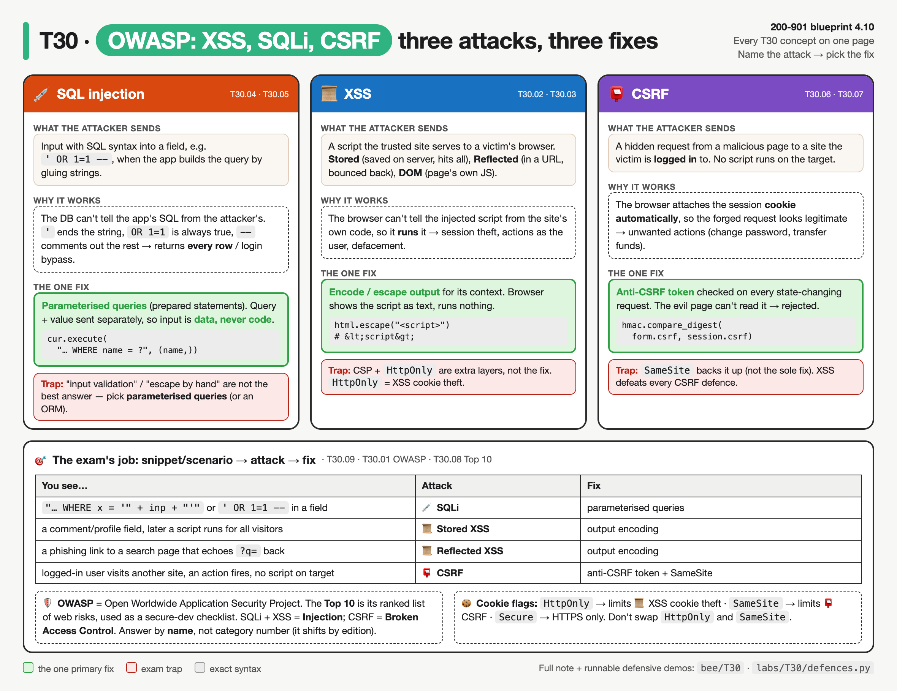
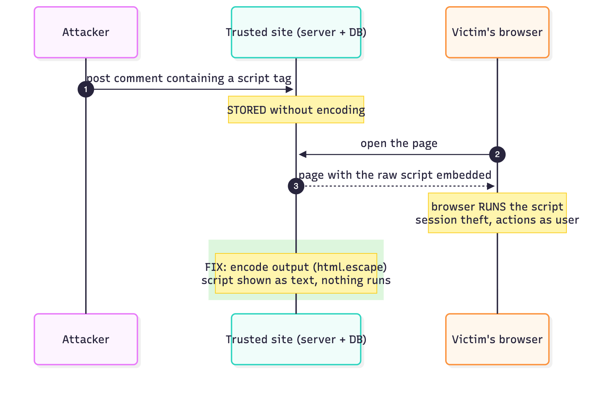
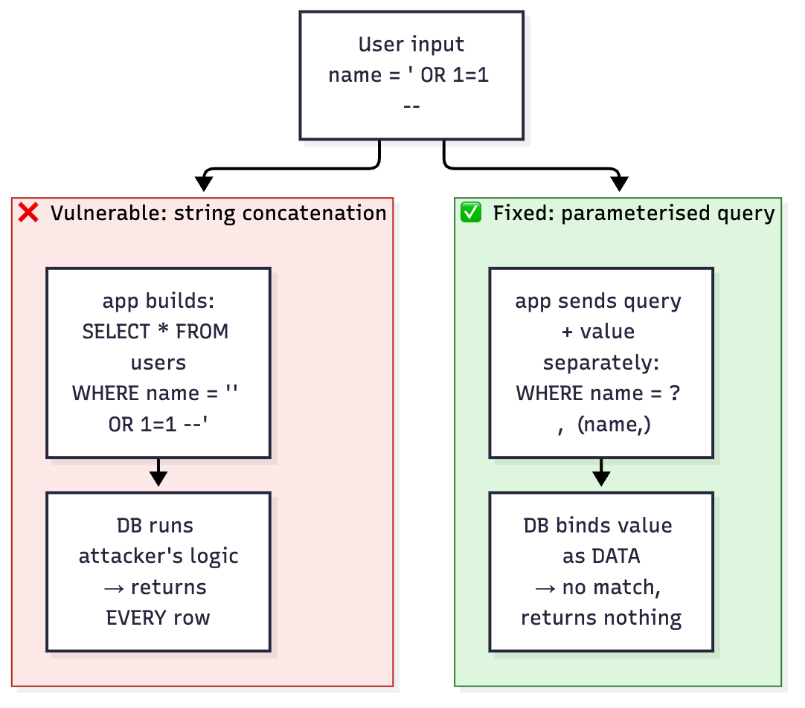
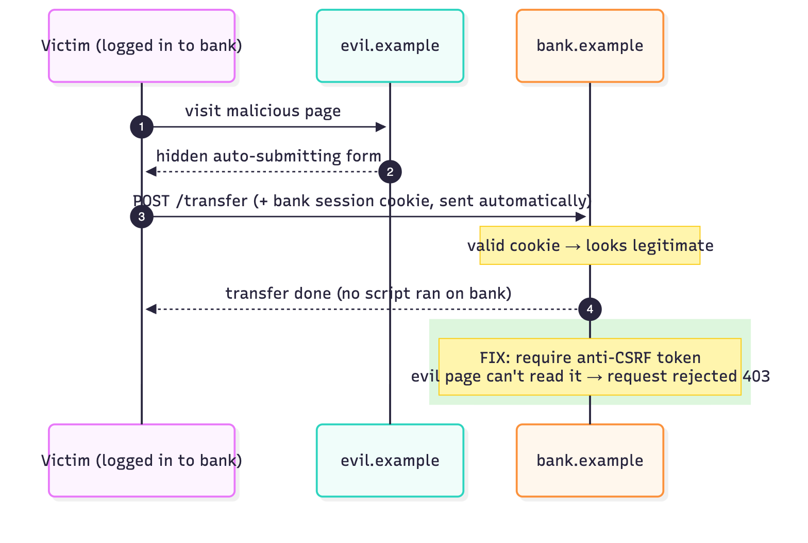
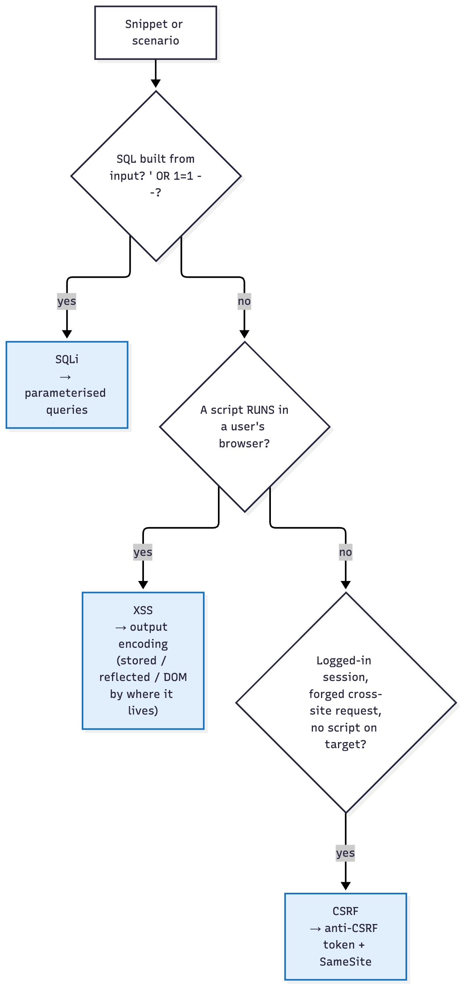

# T30 · OWASP: XSS, SQLi, CSRF

> Owner: **Beedy** · Blueprint: **4.10** · CBT coverage: **Full** · Learn by 2026-10-31



*Three attack cards (IDs top-left of each), each read the same way: what the attacker sends → why it works → the one fix. The bottom strip is the exam's job: snippet/scenario → name the attack → pick the fix. Red = traps.*

<!-- toc:start -->

**Contents**

- [TL;DR](#tldr)
- [Concepts](#concepts)
  - [T30.01](#t3001--owasp) OWASP · [T30.02](#t3002--xss) XSS · [T30.03](#t3003--xss-defences) XSS defences · [T30.04](#t3004--sql-injection) SQL injection · [T30.05](#t3005--sqli-defences) SQLi defences · [T30.06](#t3006--csrf) CSRF · [T30.07](#t3007--csrf-defences) CSRF defences · [T30.08](#t3008--other-top-10-awareness) Other Top 10 (awareness) · [T30.09](#t3009--exam-angle) Exam angle
- [Exam traps](#exam-traps)
- [Examples](#examples)
- [Practice questions](#practice-questions)
- [Study aids](#study-aids)
- [Sources](#sources)
- [To verify](#to-verify)

<!-- toc:end -->

## TL;DR

- **Three attacks, three fixes, memorised as pairs:** SQL injection → **parameterised queries**; XSS → **output encoding/escaping**; CSRF → **anti-CSRF token**. The exam gives a snippet or scenario and wants the name, then the fix.
- **All three abuse trust.** SQLi: the database trusts the query string the app glued together. XSS: the browser trusts any script the trusted site serves. CSRF: the site trusts any request that carries a valid session cookie.
- **XSS vs CSRF is the classic confusion.** XSS = the attacker's **script runs** in the victim's browser. CSRF = **no script on the target site**; the victim's browser is tricked into **sending one forged request** that rides on their logged-in cookie.
- **Trap:** fixes don't cross over. A CSRF token does nothing against SQLi; parameterised queries do nothing against XSS. And "input validation" is a supporting defence, not the *best* answer for SQLi (parameterised queries) or XSS (output encoding).

## Concepts

<!-- This is a concept/awareness topic (blueprint 4.10), not a build. No attack lab: the only runnable code is the DEFENSIVE pattern for each (html.escape, a parameterised query, a token compare), which is safe and reproducible. -->

### T30.01 · OWASP

**Must cover:**

- [x] Open Worldwide Application Security Project: community publishing the OWASP Top 10 web app risks
- [x] Used as a baseline checklist for secure development

**Notes:**

- **OWASP** = the **Open Worldwide Application Security Project** (was "Open Web Application Security Project"). A non-profit community that publishes free, vendor-neutral web-security guidance: the **Top 10**, the **Cheat Sheet Series**, testing guides, and tools like ZAP.
- **OWASP Top 10** = a ranked list of the most critical web-application security risks, refreshed every few years from real-world data. Teams use it as a **baseline checklist** for secure development, design review and code review. It is awareness and prioritisation, not a certification standard.
- Where the three blueprint attacks sit in the Top 10:

| Attack | OWASP category | 2021 | 2025 (⚠ verify, see To verify) |
|---|---|---|---|
| SQL injection | **Injection** | A03 | A05 |
| XSS | **Injection** (XSS folded into Injection since 2021) | A03 | A05 |
| CSRF | **Broken Access Control** | A01 | A01 |

- The 200-901 v1.1 blueprint names the three attacks **by name** (XSS, SQL injection, CSRF), not by category number, so answer by name. The category numbers move between editions.

### T30.02 · XSS

**Must cover:**

- [x] Cross-Site Scripting: attacker gets malicious script to run in another user's browser
- [x] Stored: script saved on the server (e.g. in a comment) and served to others
- [x] Reflected: script in a URL/parameter echoed back in the response
- [x] DOM-based: client-side JavaScript writes untrusted data into the page
- [x] Impact: session theft, defacement, actions as the user

**Notes:**

- **XSS = Cross-Site Scripting.** The attacker gets a **script to run in another user's browser**, delivered by a site the victim trusts. The browser can't tell the injected script from the site's own code, so it runs it with the site's privileges (its cookies, its DOM, its origin).
- Why "cross-site": the script originates from the attacker but executes in the context of the **target site**.
- **Three types** (the exam names the type from a scenario):

| Type | Where the script lives | Server involved? | Who is hit | Scenario cue |
|---|---|---|---|---|
| **Stored** (persistent) | **saved on the server** (comment, forum post, profile field), then served to every viewer | yes, it's stored and re-served | **everyone** who views the page → worst impact | "comment box", "forum post", "all visitors affected" |
| **Reflected** | in a **URL/query parameter**; the server **echoes it straight back** in that one response (e.g. a search page showing "results for X") | yes, but not stored | only whoever opens the crafted link (usually via phishing) | "link in an email", "search page echoes the term" |
| **DOM-based** | the page's own **client-side JavaScript** reads untrusted input (e.g. `location.hash`) and writes it into the DOM | no (can be purely client-side) | whoever opens the crafted URL | "the vulnerability is in the JavaScript", "no server round-trip" |

- **Impact:** steal the session cookie (account takeover), read or change page content (defacement), make requests **as the logged-in user**, keylog, redirect to phishing.
- Diagram: see T30.03 for the flow (attack + fix together).

### T30.03 · XSS defences

**Must cover:**

- [x] Encode/escape output for its context (HTML, JS, URL)
- [x] Validate input; use templating frameworks that auto-escape
- [x] Content Security Policy header restricts script sources
- [x] HttpOnly cookies limit token theft

**Notes:**

- **Primary fix: encode/escape output for its context.** Before user data is written into a page, convert the characters that have meaning in that context into harmless text, so the browser **displays** them instead of **executing** them.
  - In HTML: `html.escape()` turns `< > & " '` into entities. Verified output:

```python
import html
html.escape('<script>alert(document.cookie)</script>')
# '&lt;script&gt;alert(document.cookie)&lt;/script&gt;'  -> rendered as text, nothing runs
```

  - **Context matters:** the same data needs different encoding in HTML body vs an HTML attribute vs inside `<script>` vs a URL vs CSS. Encoding for the wrong context still leaves a hole.
- **Use a templating framework that auto-escapes** and let it do the encoding: Jinja2 with autoescape on, Django templates, React (JSX escapes by default), Angular. Avoid the escape hatches (`| safe` in Jinja2, `dangerouslySetInnerHTML` in React, `innerHTML`).
- **Input validation** (allow-list: expected type, length, format) reduces the attack surface but is a **supporting** control, not a replacement for output encoding. The same comment is safe on one page and dangerous on another, so the fix belongs at output time.
- **Defence in depth (not the primary answer):**

| Layer | What it does | Limit |
|---|---|---|
| **Content Security Policy (CSP)** header | the server lists which script sources the browser may run, so an injected inline script is blocked | OWASP calls it defence in depth, not the fix |
| **`HttpOnly` cookie** flag | JavaScript can't read the cookie, so an XSS script can't steal the session token | the script still runs and can act as the user |



*Stored XSS: the script is saved once and runs in every viewer's browser. Output encoding (green) turns it into displayed text instead of running code. HttpOnly and CSP are extra layers, not the fix.*

### T30.04 · SQL injection

**Must cover:**

- [x] User input concatenated into a SQL statement changes its logic
- [x] Example: username = ' OR 1=1 -- returns all rows / bypasses login
- [x] Impact: data theft, modification, deletion

**Notes:**

- **SQL injection (SQLi)** = the app builds a SQL statement by **concatenating user input into the query string**. If the input contains SQL syntax, it changes what the statement *does*, because the database can't tell the app's SQL from the attacker's.
- **The classic example: login bypass with `' OR 1=1 --`.** Verified against SQLite:

```python
# VULNERABLE: input pasted into the SQL text
name = "' OR 1=1 --"
cur.execute(f"SELECT * FROM users WHERE name = '{name}'")
# the DB receives:  SELECT * FROM users WHERE name = '' OR 1=1 --'
# -> returns [('alice','admin'), ('bob','user')]  i.e. EVERY row
```

| Part of the input | Effect on the query |
|---|---|
| `'` | closes the app's opening quote early, so what follows is read as SQL, not data |
| `OR 1=1` | adds an always-true condition, so the `WHERE` matches **every row** |
| `--` | starts a SQL comment: the app's leftover trailing `'` is ignored, keeping the query valid |

- **Impact:** read any data (dump the users table), modify or delete rows, bypass authentication, and on some databases run stacked commands or read files. OWASP: injection can lead to full host compromise.

### T30.05 · SQLi defences

**Must cover:**

- [x] Parameterised queries / prepared statements (input treated as data, not code)
- [x] ORM frameworks
- [x] Input validation
- [x] Least-privilege database accounts

**Notes:**

- **Primary fix: parameterised queries (prepared statements).** The SQL text and the values are sent to the database **separately**. The query structure is fixed first; the values can never change it. Input is always **data, never code**. Verified:

```python
# SAFE: ? placeholder, value passed separately as a tuple
cur.execute("SELECT * FROM users WHERE name = ?", (name,))
# with name = "' OR 1=1 --"  -> returns []  (treated as a literal, weird username)
```

  - `?` is a positional placeholder (SQLite/`sqlite3`). Other drivers use `%s` (psycopg2, MySQL), named `:name`, etc. The database binds the value into the slot; it is never parsed as SQL.
  - **Placeholders bind values, not identifiers.** You can't parameterise a table or column name — for those use a strict allow-list.
- **Supporting defences (OWASP "additional defenses", not the headline answer):**

| Defence | Note |
|---|---|
| **ORM** (SQLAlchemy, Django ORM) | builds parameterised SQL for you; still parameterised under the hood |
| **Stored procedures** | safe only if they themselves use parameters, not dynamic SQL |
| **Allow-list input validation** | required where placeholders can't go (table/column names, `ORDER BY`); elsewhere a secondary layer |
| **Least-privilege DB account** | the app's account has no DBA rights, so a successful injection does less damage |
| **Escaping input by hand** | OWASP **strongly discourages** it: fragile, easy to get wrong, DB-specific |



*Vulnerable: the app glues input into the SQL text, so the database runs the attacker's logic. Fixed: the query and the value travel separately, so `' OR 1=1 --` is just compared as a username.*

### T30.06 · CSRF

**Must cover:**

- [x] Cross-Site Request Forgery: a malicious site makes the victim's browser send a request to a site where they are logged in
- [x] Browser sends the session cookie automatically, so the request looks legitimate
- [x] Impact: unwanted actions (change password, transfer funds)

**Notes:**

- **CSRF = Cross-Site Request Forgery** (also XSRF). The victim is logged in to a target site (`bank.example`). They visit a malicious page, which makes **their own browser** send a state-changing request to the target. The browser **attaches the session cookie automatically** (that's how cookies work), so to the server the request looks like the real user.
- The attacker never sees the cookie or the response. They just cause the request. That's enough for **state-changing actions**: change the account email or password, transfer money, add an admin.
- **Why it works:** cookie-based sessions authenticate by "does a valid cookie arrive?", and browsers send a site's cookies on *any* request to that site, including ones triggered by another origin (a hidden form, an ``, `fetch`).
- **XSS vs CSRF** (the exam's favourite confusion):

| | XSS | CSRF |
|---|---|---|
| What runs | the attacker's **script**, on the trusted site, in the victim's browser | **no script on the target site**; just a forged request |
| What it borrows | the site's execution context | the victim's logged-in **cookie** |
| Can read the response? | yes (same origin) | usually no |

### T30.07 · CSRF defences

**Must cover:**

- [x] Anti-CSRF tokens: unique token in each form, checked by the server
- [x] SameSite cookie attribute
- [x] Re-authentication or confirmation for sensitive actions
- [x] Check Origin/Referer headers

**Notes:**

- **Primary fix: anti-CSRF token (synchronizer token pattern).** The server generates a **unique, unpredictable token** per session (or per form), embeds it in each form (hidden field) or a custom header, and **checks it on every state-changing request**. The attacker's site can't read or guess the token, so its forged request arrives without the correct one and is rejected. Verified compare:

```python
import hmac
# real token is a long random string, e.g. secrets.token_urlsafe(32)
if not hmac.compare_digest(request.form["csrf_token"], session["csrf_token"]):
    abort(403)   # forged request: token missing/wrong -> rejected, no action
```

  - Use `hmac.compare_digest`, not `==`, to compare: it's constant-time, avoiding timing leaks.
  - Most web frameworks provide this (Django ``, Flask-WTF `CSRFProtect`).
- **Supporting defences:**

| Defence | What it does |
|---|---|
| **`SameSite` cookie** attribute | tells the browser not to send the cookie on cross-site requests (`Lax` default in most browsers; `Strict` strongest). Strong backup, but don't rely on it alone. |
| **Check `Origin` / `Referer`** | confirm the request came from your own site's origin |
| **Re-authentication / confirmation** | prompt for the password or a one-time code before sensitive actions |
| **Never change state with `GET`** | GET slips past `SameSite=Lax`; state changes should be POST/PUT/DELETE + token |

> ⚠ **XSS defeats every CSRF defence.** A script running on your own pages (via XSS) can read the CSRF token and send it with the forged request. You must fix XSS as well; the two aren't substitutes.



*The victim's browser sends the forged request with its bank cookie attached, so it looks real. The anti-CSRF token (green) is the one thing the attacker's page can't supply, so the server rejects the request.*

### T30.08 · Other Top 10 (awareness)

**Must cover:**

- [x] Broken access control; cryptographic failures; injection (includes SQLi, XSS)
- [x] Insecure design; security misconfiguration; vulnerable/outdated components
- [x] Identification and authentication failures; integrity failures; logging/monitoring failures; SSRF

**Notes:**

- Awareness only. The exam focuses on the three named attacks; recognise the other categories by name.
- **OWASP Top 10 — 2021** (the stable, widely-cited edition):

| # | Category | One line |
|---|---|---|
| A01 | **Broken Access Control** | users do things they shouldn't (incl. CSRF) |
| A02 | **Cryptographic Failures** | weak/missing encryption of data in transit or at rest (see [T29](T29-secrets-encryption-data-handling.md)) |
| A03 | **Injection** | SQLi, XSS, command injection: untrusted input treated as code |
| A04 | **Insecure Design** | missing security in the design itself |
| A05 | **Security Misconfiguration** | default creds, verbose errors, open settings |
| A06 | **Vulnerable and Outdated Components** | unpatched libraries/dependencies |
| A07 | **Identification and Authentication Failures** | weak login, session, credential handling (see [T10](T10-api-authentication.md)) |
| A08 | **Software and Data Integrity Failures** | unverified updates, insecure deserialization |
| A09 | **Security Logging and Monitoring Failures** | breaches go undetected |
| A10 | **Server-Side Request Forgery (SSRF)** | server tricked into making requests to internal targets |

- The **2025** edition reorders and renames some entries (⚠ verify; see To verify). Answer by **name/description**, not number.

### T30.09 · Exam angle

**Must cover:**

- [x] Name the attack from a scenario or snippet
- [x] Pick its mitigation (e.g. SQLi → parameterised queries; CSRF → tokens; XSS → output encoding)

**Notes:**

- The question gives a **snippet or scenario**; you name the attack, then pick the fix. Two steps, both from the same table.
- **Scenario → answer:**

| Scenario / snippet | Attack | Primary fix |
|---|---|---|
| `"... WHERE name = '" + name + "'"`, or `' OR 1=1 --` in a field | **SQLi** | parameterised queries / prepared statements |
| a comment or profile field, later a script runs for all visitors | **Stored XSS** | output encoding/escaping |
| a phishing link to a search page that echoes `?q=` back | **Reflected XSS** | output encoding/escaping |
| logged-in user visits another site, an action happens, no script ran on the target | **CSRF** | anti-CSRF token (+ SameSite) |
| JS can't read the session cookie | — | `HttpOnly` cookie (limits XSS theft) |
| cookie not sent cross-site | — | `SameSite` cookie (limits CSRF) |



*Follow the clues: SQL syntax in input → SQLi. A script running for users → XSS (which type by where it's stored). A cross-site request on a logged-in session with no script → CSRF.*

## Exam traps

- **XSS vs CSRF.** XSS = attacker's **script executes** in the victim's browser on the trusted site. CSRF = **no script on the target**; the browser is tricked into **sending a forged request** that rides the session cookie. If a script runs → XSS; if an action happens with no script → CSRF.
- **Fixes don't cross over.** SQLi → parameterised queries. XSS → output encoding. CSRF → anti-CSRF token. A CSRF token does nothing for SQLi; parameterised queries do nothing for XSS.
- **"Input validation" is not the best SQLi/XSS answer.** It helps, but the headline fixes are **parameterised queries** (SQLi) and **output encoding** (XSS). Pick those if both appear.
- **Cookie flags map to different attacks.** `HttpOnly` → limits **XSS** cookie theft (JS can't read it). `SameSite` → limits **CSRF** (cookie not sent cross-site). `Secure` → HTTPS only (neither attack directly). Don't swap `HttpOnly` and `SameSite`.
- **XSS type by location.** Saved on the server, hits all viewers = **stored**. In a URL, bounced back once = **reflected**. Only in the page's own JavaScript = **DOM-based**.
- **CSP is defence in depth, not the fix.** The primary XSS fix is output encoding; CSP is an extra layer. Likewise `SameSite` backs up the CSRF token, it doesn't replace it.
- **OWASP category numbers shift by edition.** Injection is A03 (2021) but A05 (2025); answer by name, not number.
- **Escaping SQL by hand is discouraged.** If "escape the input" and "parameterised query" both appear for SQLi, pick parameterised query / prepared statement.

## Examples

These are the **defensive** patterns only. There is no attack lab; the exam tests recognition, and the safe demos below show *why* each fix works. All output is real (Python 3, stdlib only: `sqlite3`, `html`, `hmac`, `secrets`).

Run any of them with `python3 - <<'EOF' … EOF` (nothing to install), or in the lab container:

```bash
docker run --rm --interactive --tty --volume "$(pwd)":/work ccna-auto-lab:latest python3 /work/labs/T30/defences.py
```

### 1. SQLi: vulnerable vs parameterised (why the fix works)

```python
import sqlite3
db = sqlite3.connect(":memory:")
db.execute("CREATE TABLE users(name TEXT, role TEXT)")
db.executemany("INSERT INTO users VALUES (?,?)", [("alice", "admin"), ("bob", "user")])

evil = "' OR 1=1 --"

# VULNERABLE: input concatenated into the SQL text
q = f"SELECT * FROM users WHERE name = '{evil}'"
print("sent to DB:", q)
print("vulnerable returns:", db.execute(q).fetchall())

# SAFE: placeholder; value bound separately, never parsed as SQL
print("parameterised returns:", db.execute(
    "SELECT * FROM users WHERE name = ?", (evil,)).fetchall())
```

Output:

```
sent to DB: SELECT * FROM users WHERE name = '' OR 1=1 --'
vulnerable returns: [('alice', 'admin'), ('bob', 'user')]
parameterised returns: []
```

- The vulnerable query returns **every row** (login bypass). The parameterised one treats `' OR 1=1 --` as a literal username, finds no match, returns nothing.

### 2. XSS: output encoding turns script into text

```python
import html
comment = '<script>alert(document.cookie)</script>'
print("stored/displayed as:", html.escape(comment))
```

Output:

```
stored/displayed as: &lt;script&gt;alert(document.cookie)&lt;/script&gt;
```

- The browser renders the characters `<script>…` on the page instead of executing a `<script>` element. `html.escape` encodes `& < >` and (by default) `" '`.

### 3. CSRF: the token the attacker can't supply

```python
import hmac, secrets
issued = secrets.token_urlsafe(32)      # server puts this in the user's form + session

def handle(submitted):
    if not hmac.compare_digest(submitted, issued):
        return "403 rejected"
    return "200 action performed"

print("real user  :", handle(issued))   # form carried the right token
print("attacker   :", handle(""))       # forged request has no/wrong token
```

Output:

```
real user  : 200 action performed
attacker   : 403 rejected
```

- The forged cross-site request can't include the per-session token (the attacker's page can't read it), so the server rejects it.

### 4. Break it on purpose

- In example 1, change the safe call back to an f-string → the `[]` result becomes "all rows": that one change is the whole vulnerability.
- In example 2, print `comment` instead of `html.escape(comment)` → you've written raw `<script>` into the page (the bug).
- In example 3, replace `hmac.compare_digest(submitted, issued)` with `submitted == issued` → still works, but is now timing-attackable; constant-time compare is the correct pattern.

## Practice questions

**Q1.** A support app runs `cursor.execute("SELECT * FROM tickets WHERE id = '" + tid + "'")`. What is the vulnerability and the best fix?

<details><summary>Answer</summary>

**SQL injection.** The input `tid` is concatenated into the SQL text, so a value like `' OR 1=1 --` changes the query's logic. Best fix: a **parameterised query / prepared statement** — `cursor.execute("SELECT * FROM tickets WHERE id = ?", (tid,))` — so the input is bound as data. (T30.04, T30.05)
</details>

**Q2.** A forum stores each comment and shows it to everyone who opens the thread. An attacker posts a comment containing `<script>`. Later, every reader's browser runs it. Which attack, which type, and the primary fix?

<details><summary>Answer</summary>

**Stored (persistent) XSS.** The script is saved on the server and served to all viewers. Primary fix: **encode/escape the output** for its HTML context (e.g. an auto-escaping template, or `html.escape`). CSP and `HttpOnly` are extra layers, not the fix. (T30.02, T30.03)
</details>

**Q3.** A user logged in to their bank opens a malicious page. The page silently submits a transfer form to the bank; the browser includes the bank session cookie, and the transfer goes through. No script ran on the bank's site. Attack and primary defence?

<details><summary>Answer</summary>

**CSRF.** The victim's browser sent a forged, cookie-authenticated request. Primary defence: an **anti-CSRF token** the server checks on the state-changing request (backed up by `SameSite` cookies and re-auth for transfers). (T30.06, T30.07)
</details>

**Q4.** Match each fix to its attack: (a) parameterised queries, (b) output encoding, (c) anti-CSRF token.

<details><summary>Answer</summary>

(a) → **SQL injection**, (b) → **XSS**, (c) → **CSRF**. The fixes do not cross over. (T30.09)
</details>

**Q5.** Which cookie attribute limits each of: XSS session-cookie theft; CSRF?

<details><summary>Answer</summary>

**`HttpOnly`** limits XSS cookie theft (JavaScript can't read the cookie). **`SameSite`** limits CSRF (the cookie isn't sent on cross-site requests). (T30.03, T30.07)
</details>

**Q6.** A phishing email links to `https://shop.example/search?q=<script>…`. The search page echoes the `q` value back into the results page, and the script runs for whoever clicked. Which XSS type, and why not "stored"?

<details><summary>Answer</summary>

**Reflected XSS.** The script is in the URL and the server echoes it straight back in that one response; it isn't saved, so only the person who clicks the crafted link is affected. Stored XSS would be saved on the server and served to all viewers. (T30.02)
</details>

**Q7.** Why can a site with a correct anti-CSRF token still be abused if it also has an XSS flaw?

<details><summary>Answer</summary>

A script injected via **XSS** runs in the site's own origin, so it can **read the CSRF token** from the page and include it in a forged request. XSS defeats CSRF defences, so both must be fixed. (T30.07)
</details>

**Q8.** Which OWASP Top 10 (2021) category covers SQL injection and XSS, and which covers CSRF?

<details><summary>Answer</summary>

SQLi and XSS → **Injection (A03 in 2021)**. CSRF → **Broken Access Control (A01)**. Category numbers change by edition, so answer by name. (T30.01, T30.08)
</details>

## Study aids

| Aid | Type | Title | Est. min | Resource |
|---|---|---|---|---|
| T30.1 | Video | Identify OWASP Standard Threats | 21 | CBT module |
| T30.2 | Reference | OWASP Top 10 (2021) | 15 | https://owasp.org/Top10/ |
| T30.3 | Reference | OWASP Cheat Sheet Series (SQLi, XSS, CSRF prevention) | 20 | https://cheatsheetseries.owasp.org/ |

- Skip / low priority: the full 2025 Top 10 ordering — recognise the three attacks by name.

## Sources

- Overview image: HTML source `assets/T30/00-overview.html`, rendered to PNG (see `assets/README.md`). Diagrams: Mermaid sources in `assets/T30/*.mmd`.
- OWASP Top 10 (2021): https://owasp.org/Top10/
- OWASP Top 10 (2025, draft/release — verify status): https://top10.owasp.org/
- OWASP XSS: https://owasp.org/www-community/attacks/xss/
- OWASP SQL Injection: https://owasp.org/www-community/attacks/SQL_Injection
- OWASP CSRF: https://owasp.org/www-community/attacks/csrf
- OWASP Cheat Sheets — SQL Injection Prevention: https://cheatsheetseries.owasp.org/cheatsheets/SQL_Injection_Prevention_Cheat_Sheet.html
- OWASP Cheat Sheets — Cross Site Scripting Prevention: https://cheatsheetseries.owasp.org/cheatsheets/Cross_Site_Scripting_Prevention_Cheat_Sheet.html
- OWASP Cheat Sheets — CSRF Prevention: https://cheatsheetseries.owasp.org/cheatsheets/Cross-Site_Request_Forgery_Prevention_Cheat_Sheet.html
- Python `sqlite3` (placeholders): https://docs.python.org/3/library/sqlite3.html
- Python `html.escape`: https://docs.python.org/3/library/html.html
- Python `hmac.compare_digest`, `secrets`: https://docs.python.org/3/library/hmac.html · https://docs.python.org/3/library/secrets.html
- MDN `Set-Cookie` (HttpOnly, SameSite, Secure): https://developer.mozilla.org/en-US/docs/Web/HTTP/Reference/Headers/Set-Cookie

## To verify

- ⚠ **OWASP Top 10 2025 category numbers and names.** The essentials cite a 2025 edition where Injection is A05. Confirm the 2025 list's status (draft vs final) and exact numbering before relying on numbers; the 2021 edition (Injection A03, Broken Access Control A01) is stable. The exam names attacks, not numbers.
- ⚠ Which Top 10 edition the 200-901 v1.1 exam expects. Blueprint wording is paraphrased ("Top OWASP threats"); the three named attacks are what matters.
- The three defensive code demos were run locally on Python 3 (stdlib `sqlite3`, `html`, `hmac`, `secrets`); output pasted is real. No attack lab was run (none needed for a recognition topic).
