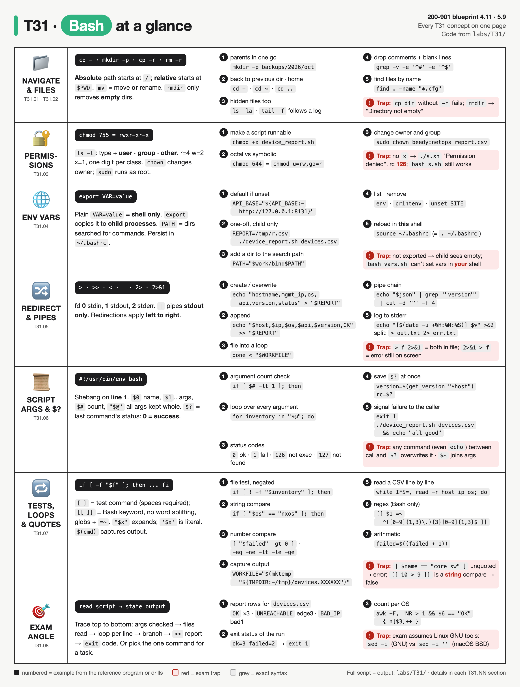
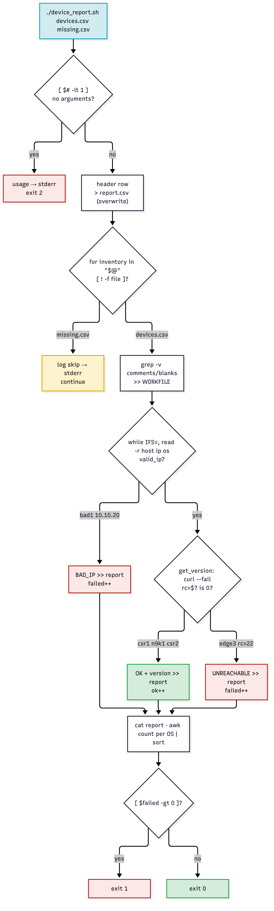
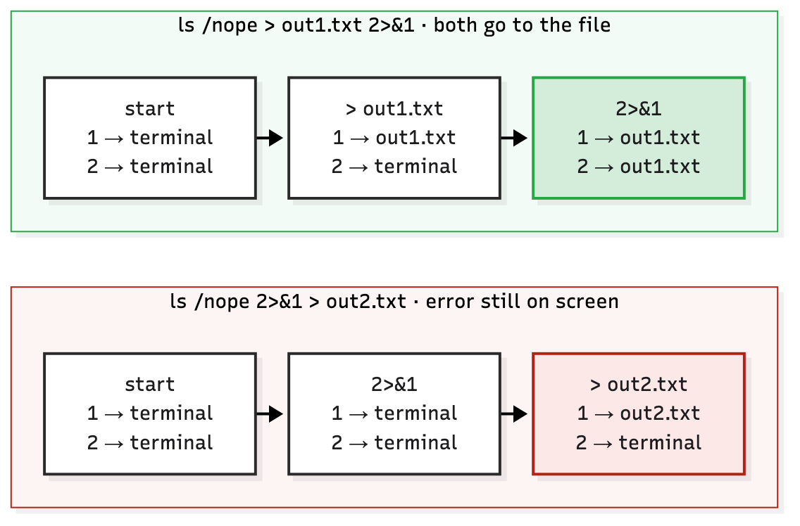

# T31 · Bash

> Owner: **Beedy** · Blueprint: **4.11, 5.9** · CBT coverage: **Full** · Learn by 2026-10-31 · Teach-back 2026-11-01



*Every T31 concept on one page. Rows follow the concept sections, numbered examples are lines from `labs/T31/device_report.sh` or the drills, and red boxes are exam traps.*

<!-- toc:start -->

**Contents**

- [TL;DR (teach-back card)](#tldr-teach-back-card)
- [Concepts](#concepts)
  - [T31.01](#t3101--navigation) Navigation · [T31.02](#t3102--file-management) File management · [T31.03](#t3103--permissions) Permissions · [T31.04](#t3104--environment-variables) Environment variables · [T31.05](#t3105--redirection) Redirection · [T31.06](#t3106--scripts) Scripts · [T31.07](#t3107--scripts) Scripts · [T31.08](#t3108--exam-angle) Exam angle
- [Exam traps](#exam-traps)
- [Examples](#examples)
- [Practice questions](#practice-questions)
- [Study aids](#study-aids)
- [Sources](#sources)
- [To verify](#to-verify)

<!-- toc:end -->

## TL;DR (teach-back card)

- **Two blueprint asks:** 4.11 = pick the command for a file, navigation or env-var task. 5.9 = read a short script and state what it does, what it prints and what exit code it returns.
- **Variables:** `VAR=x` stays in this shell. `export VAR=x` reaches child processes. `VAR=x ./script` sets it for that one child only. `source file` runs it in **this** shell; `bash file` runs it in a child shell.
- **Streams and status:** `>` overwrites, `>>` appends, `|` passes **stdout only**, `2>&1` copies whatever fd 1 points at *right now*. `$?` holds the last command's status (0 = success) and the next command overwrites it.
- **Trap:** `cmd > f 2>&1` puts both streams in the file; `cmd 2>&1 > f` leaves errors on screen. Quote everything (`"$@"`, `"$var"`): unquoted values split on spaces.

## Concepts

Every section below explains part of one script, so read it once first. `device_report.sh` reads one or more device inventory CSVs, skips comments, validates each IP, calls a version API per device with `curl`, appends a row per device to `report.csv`, prints a per-OS summary with `awk`, and exits `1` if any device failed. The files are in `labs/T31/`:

```
labs/T31/
├── device_report.sh   the reference script
├── devices.csv        sample inventory (comment, blank line, bad IP, unreachable host)
├── mock/*.json        what the mock API serves (one file per reachable device)
├── run_lab.sh         starts a mock API on 127.0.0.1:8131, runs the script, stops the API
├── trap_drill.sh      quoting, $@/$*, >/>>, 2>&1, $?, [ ]/[[ ]], export, chmod
└── files_drill.sh     navigation, files, grep/find, PATH, source vs bash
```

**`devices.csv`**

```
# hostname,mgmt_ip,os
csr1,10.10.20.48,iosxe
n9k1,10.10.20.58,nxos

edge3,10.10.20.77,iosxe
bad1,10.10.20,iosxe
csr2,10.10.20.49,iosxe
```

**`device_report.sh`**

```bash
#!/usr/bin/env bash
# device_report.sh: read device inventories, query each device's version API, write a report.
# Usage: ./device_report.sh INVENTORY.csv [MORE.csv ...]
# Env:   API_BASE (default http://127.0.0.1:8131), REPORT (default report.csv)

API_BASE="${API_BASE:-http://127.0.0.1:8131}"     # env var with a default
REPORT="${REPORT:-report.csv}"
WORKFILE="$(mktemp "${TMPDIR:-/tmp}/devices.XXXXXX")" || exit 3   # $(...) captures output
ok=0
failed=0

usage() {
    echo "Usage: $0 INVENTORY.csv [MORE.csv ...]" >&2   # $0 = how the script was called
    exit 2
}

log() {
    echo "[$(date -u +%H:%M:%S)] $*" >&2                # messages go to stderr, data to stdout/file
}

valid_ip() {
    [[ $1 =~ ^([0-9]{1,3}\.){3}[0-9]{1,3}$ ]]          # function's exit status = last command's
}

get_version() {
    local host="$1"                                    # local: not visible outside the function
    local json
    json=$(curl --silent --fail --max-time 3 "$API_BASE/$host.json") || return   # keeps curl's code
    echo "$json" | grep '"version"' | cut -d '"' -f 4  # pipe: stdout of one -> stdin of next
}

if [ $# -lt 1 ]; then                                  # $# = number of arguments
    usage
fi

echo "hostname,mgmt_ip,os,api,version,status" > "$REPORT"   # > creates/overwrites

for inventory in "$@"; do                              # "$@" = each argument, kept whole
    if [ ! -f "$inventory" ]; then
        log "skip: no such file '$inventory'"
        continue
    fi
    grep -v -e '^#' -e '^$' "$inventory" >> "$WORKFILE"     # drop comments and blank lines
done

log "loaded $(wc -l < "$WORKFILE" | tr -d ' ') devices from $# file(s)"

while IFS=, read -r host ip os; do                    # split each line on commas
    if ! valid_ip "$ip"; then
        log "$host: bad IP '$ip'"
        echo "$host,$ip,$os,-,-,BAD_IP" >> "$REPORT"
        failed=$((failed + 1))
        continue
    fi

    if [ "$os" == "nxos" ]; then
        api="NX-API"
    else
        api="RESTCONF"
    fi

    version=$(get_version "$host")
    rc=$?                                              # exit status of the line above
    if [ $rc -eq 0 ]; then
        echo "$host,$ip,$os,$api,$version,OK" >> "$REPORT"     # >> appends
        ok=$((ok + 1))
    else
        log "$host: API call failed (rc=$rc)"
        echo "$host,$ip,$os,$api,-,UNREACHABLE" >> "$REPORT"
        failed=$((failed + 1))
    fi
done < "$WORKFILE"                                     # < feeds the file to the loop's stdin

rm -f "$WORKFILE"

echo "--- $(basename "$REPORT") ---"
cat "$REPORT"
echo "--- OK devices per OS ---"
awk -F, 'NR > 1 && $6 == "OK" { n[$3]++ } END { for (o in n) print o, n[o] }' "$REPORT" | sort
echo "ok=$ok failed=$failed"

if [ "$failed" -gt 0 ]; then
    exit 1                                             # non-zero = something went wrong
fi
exit 0
```

**Output** (`bash labs/T31/run_lab.sh labs/T31/devices.csv missing.csv`, GNU Bash 5.3 on macOS; same result on `/bin/bash` 3.2). Lines starting `[12:..]` are stderr:

```
[12:35:51] skip: no such file 'missing.csv'
[12:35:51] loaded 5 devices from 2 file(s)
[12:35:51] edge3: API call failed (rc=22)
[12:35:51] bad1: bad IP '10.10.20'
--- report.csv ---
hostname,mgmt_ip,os,api,version,status
csr1,10.10.20.48,iosxe,RESTCONF,17.12.4,OK
n9k1,10.10.20.58,nxos,NX-API,10.4.3,OK
edge3,10.10.20.77,iosxe,RESTCONF,-,UNREACHABLE
bad1,10.10.20,iosxe,-,-,BAD_IP
csr2,10.10.20.49,iosxe,RESTCONF,17.9.5,OK
--- OK devices per OS ---
iosxe 2
nxos 1
ok=3 failed=2
device_report.sh exit status: 1
```

- `edge3` has no `mock/edge3.json`, so the mock returns 404 and `curl --fail` exits **22**.
- `bad1` never reaches `curl`: `valid_ip` fails first.
- Exit status is `1` because `failed=2`.



*The script's workflow, traced with the sample run. Red = failure paths, yellow = skipped, green = success. This is the shape of a 5.9 "describe the workflow" answer.*

### T31.01 · Navigation

**Must cover:**

- [x] pwd, cd ~ / cd .. / cd - (previous dir)
- [x] ls -l (long), -a (hidden), -la
- [x] Absolute (/etc/hosts) vs relative (./script.sh) paths

**Notes:**

- `pwd` = print working directory (also in `$PWD`). `cd` with no argument = `cd ~` = `$HOME`. `cd ..` = parent. `cd -` = **previous** directory (`$OLDPWD`), and it prints the path it switched to.
- `files_drill.sh` part 1 shows all four. `cd -` after `cd ../..` lands back in `backups/2026/oct`.
- `ls -l` = long listing (permissions, links, owner, group, size, mtime). `ls -a` = include dot-files and `.` / `..`. `-la` = both. The drill prints `backups csr1.cfg` for `ls` and `. .. .hidden backups csr1.cfg` for `ls -a`.
- **Absolute** path starts at `/` (`/etc/hosts`) and means the same thing from anywhere. **Relative** path starts at the current directory (`./device_report.sh`, `../labs`, `devices.csv`).
- Relative paths broke an early version of `run_lab.sh`: it did `cd` into a temp dir before calling the script, so `labs/T31/devices.csv` no longer existed relative to the new `$PWD`. The fix in the final version is to not `cd`, and send the report to a temp path through `REPORT=` instead.
- `./script.sh` needs the `./` because the current directory isn't in `$PATH` (see T31.04).

**Exam-sim gap (practice test review):**
- **`pushd` / `popd` = a directory stack.** `pushd /etc/ansible` saves where you are and jumps there; `popd` jumps back. Nest them to visit several directories and return in order. `dirs -v` shows the stack.
- Handy in scripts that must work somewhere else and then come back: `pushd "$WORKDIR" > /dev/null … popd > /dev/null`.
- Compare: `cd -` only toggles between the **last two** directories; `pushd`/`popd` remember a whole stack.
- Exam cue: "temporarily change directory and return later" → **`pushd`** (then `popd`).

### T31.02 · File management

**Must cover:**

- [x] touch, mkdir -p a/b/c, cp -r, mv (move/rename), rm -r, rmdir
- [x] cat, less, head -n, tail -n / tail -f
- [x] grep pattern file (-i, -r, -v); find /path -name "*.py"

**Notes:**

| Command | Does | Trap |
|---|---|---|
| `touch f` | create empty file, or update mtime if it exists | doesn't truncate an existing file |
| `mkdir -p a/b/c` | create the whole chain, no error if it exists | without `-p`: "No such file or directory" for missing parents |
| `cp -r src dst` | copy a directory tree | `cp dir dst` without `-r` → "is a directory" |
| `mv a b` | move **or** rename (same command) | no `rename` command needed |
| `rm -r dir` | delete a tree | no recycle bin |
| `rmdir dir` | delete an **empty** dir | "Directory not empty" otherwise (drill part 2) |
| `cat f` · `less f` | print all · page through (q to quit) | |
| `head -n 1 f` · `tail -n 1 f` | first / last N lines (default 10) | |
| `tail -f /var/log/syslog` | follow a growing log | Ctrl-C to stop |

- **`grep`** prints matching lines. `-i` ignore case, `-r` recurse into directories (prefixes `file:`), `-v` invert (non-matching lines), `-q` quiet (just the exit code), `-e` multiple patterns.
  - Line 43: `grep -v -e '^#' -e '^$' "$inventory"` keeps only device lines: drops `# hostname,...` and the blank line, so the run says `loaded 5 devices`.
  - Line 29: `grep '"version"'` picks one line out of the JSON.
  - Drill: `grep -r -i "NTP" .` finds `ntp server` in both copies of the config.
  - **Exit codes:** `0` = match, `1` = no match, `2` = error. That's why `grep -q pattern file && echo found` works.
- **`find /path -name "*.cfg"`** walks the tree. Quote the pattern, or the shell expands `*.cfg` in the current directory first.
- **`cut -d '"' -f 4`** (line 29) splits on `"` and keeps field 4. `"version": "17.12.4"` → fields: (empty), `version`, `: `, `17.12.4`.
- **`awk -F, 'NR > 1 && $6 == "OK" { n[$3]++ } END { ... }'`** (line 79): `-F,` = comma separator, `NR > 1` skips the header row, `$6`/`$3` = columns, `END` runs after the last line. `| sort` makes the order stable.
- `wc -l < file` (line 46) prints just the number. `wc -l file` would add the file name. `tr -d ' '` strips BSD `wc`'s leading spaces.

### T31.03 · Permissions

**Must cover:**

- [x] ls -l shows rwx for user/group/other
- [x] chmod 755 file = rwxr-xr-x; chmod +x script.sh
- [x] chown user:group file; sudo runs as root

**Notes:**

- `ls -l` first column: `-rwxr-xr-x` = type (`-` file, `d` dir, `l` symlink) + 3 triplets for **user (owner) · group · other**.
- Octal: r = 4, w = 2, x = 1, one digit per triplet.

| Octal | Symbolic | Typical use |
|---|---|---|
| `755` | `rwxr-xr-x` | scripts, directories |
| `644` | `rw-r--r--` | config and data files |
| `700` | `rwx------` | private script or dir |
| `600` | `rw-------` | private keys, `.env` with tokens |

- Symbolic form: `chmod u=rw,go=r f` = `644`; `chmod +x f` adds x for all; `chmod u+x f` for the owner only; `chmod g-w f` removes group write. The drill (part 8) prints `-rwxr-xr-x`, `-rw-r--r--`, `-rwxr-xr-x`.
- On a directory, `x` = can `cd` into it, `r` = can list it.
- `chown beedy:netops report.csv` changes owner and group (`chown :netops f` = group only; `chgrp` also works). Changing owner needs root, so: `sudo chown beedy:netops report.csv`.
- `sudo cmd` runs one command as root (or `-u user`). `sudo echo x > /etc/f` **fails**, because the redirect is done by your shell, not by sudo. Use `echo x | sudo tee /etc/f`.
- Run a script without `x`: `./b5.sh` → `Permission denied`, exit **126** (break-it 5). `bash b5.sh` still works, because Bash only needs **read** permission to read the file.

### T31.04 · Environment variables

**Must cover:**

- [x] VAR=value (shell only) vs export VAR=value (passed to child processes)
- [x] echo $VAR; env / printenv list them; unset VAR
- [x] PATH lists dirs searched for commands
- [x] Persist in ~/.bashrc or ~/.profile; source ~/.bashrc reloads

**Notes:**

| Form | Who sees it | In the labs |
|---|---|---|
| `VAR=value` | this shell only (shell variable) | `ok=0`, `failed=0` (lines 9–10) |
| `export VAR=value` | this shell + every child process | drill part 7: child sees `EXPVAR=[b]`, `LOCALVAR=[]` |
| `VAR=value cmd` | that one command only | `REPORT=/tmp/r.csv ./device_report.sh devices.csv`; `REPORT=... "$SCRIPT" "$@"` in `run_lab.sh`; `API_BASE=http://127.0.0.1:9 bash labs/T31/run_lab.sh` |
| `local var` (in a function) | that function only | `local host="$1"` (line 26) |

- No spaces around `=`: `VAR = x` runs a command called `VAR` with arguments `=` and `x`.
- `${API_BASE:-http://127.0.0.1:8131}` (line 6) = use the env var if set and non-empty, else the default. This is how a script reads config from the environment.
- `echo "$VAR"` reads it. `env` / `printenv` list **exported** variables only. `set` lists all shell variables and functions. `unset VAR` deletes it (drill part 4 prints `SITE=[]`).
- **`PATH`** = colon-separated list of directories searched left to right for a command name.
  - Drill part 3: `mytool` → `not found (rc=127)`. After `PATH="$work/bin:$PATH"` it runs, and `command -v mytool` shows where it came from (`which` works too).
  - Assigning `PATH=...` without `$PATH` replaces it and every other command stops being found.
- **Persist:** put `export VAR=value` in `~/.bashrc` (interactive non-login shells) or `~/.profile` / `~/.bash_profile` (login shells). Edits apply to new shells; `source ~/.bashrc` (or `. ~/.bashrc`) reloads into the **current** shell.
- **`source` vs run** (drill part 4): `bash vars.sh` runs in a child, so `SITE=lab` dies with it (`SITE=[]`). `source vars.sh` runs in the current shell (`SITE=[lab]`). A child can never change its parent's variables.

### T31.05 · Redirection

**Must cover:**

- [x] > overwrite file; >> append; < read input from file
- [x] | pipes stdout into the next command
- [x] 2> redirects stderr; 2>&1 merges stderr into stdout

**Notes:**

- Three standard file descriptors: **0** stdin, **1** stdout, **2** stderr.

| Syntax | In the script | Effect |
|---|---|---|
| `> file` | line 36: header `> "$REPORT"` | create or **truncate**, then write |
| `>> file` | line 65: each device row `>> "$REPORT"` | create or **append** |
| `< file` | line 72: `done < "$WORKFILE"` | file becomes the loop's stdin, so `read` gets one line per pass |
| `a \| b` | line 29: `echo "$json" \| grep ... \| cut ...` | a's **stdout** → b's stdin |
| `>&2` (= `1>&2`) | lines 13, 18: `usage`, `log` | send this message to stderr |
| `2> file` | `> out.txt 2> err.txt` (Examples) | stderr only |
| `2>&1` | | point fd 2 wherever fd 1 points **now** |
| `&> file` | | Bash shorthand for `> file 2>&1` |
| `> /dev/null` | `run_lab.sh` silences the mock server | discard |

- **Why `log` writes to stderr:** data (the report) goes to stdout, diagnostics to stderr, so `./device_report.sh devices.csv > out.txt` keeps the timestamps on screen. The split run in Examples gives 12 stdout lines and 3 stderr lines.
- **Order matters**, left to right (GNU Bash manual, Redirections):



*`2>&1` copies fd 1's current target. Put it after `> file` to catch errors; put it first and stderr still points at the terminal.*

- Drill part 4 proves it: `ls /nope > out1.txt 2>&1` → file has 1 line. `ls /nope 2>&1 > out2.txt` → error printed on screen, file has 0 lines.
- A pipe carries stdout only: `cmd 2>&1 | grep err` is needed to grep error text (here `2>&1` comes first, because the pipe is set up before the redirections).
- Break-it 1: change line 65's `>>` to `>` → each OK device **wipes** the report, so only `csr2`'s row survives.

### T31.06 · Scripts

**Must cover:**

- [x] #!/bin/bash shebang on line 1; chmod +x then ./script.sh
- [x] $0 script name; $1 $2 positional args; $# count; $@ all args
- [x] $? exit status of last command (0 = success)

**Notes:**

- **Shebang** must be line 1, first two bytes `#!`. It names the interpreter the kernel runs when you do `./device_report.sh`.
  - `#!/bin/bash` = fixed path (the exam form). `#!/usr/bin/env bash` = first `bash` in `$PATH`. The labs use `env`, because on this Mac `/bin/bash` is 3.2 and Homebrew's 5.3 is first in `PATH`.
  - Running `bash script.sh` or `sh script.sh` ignores the shebang. `sh` may not be Bash (Debian/Ubuntu: `dash`), so `[[ ]]` and `==` can fail there.
- Run it: `chmod +x device_report.sh` then `./device_report.sh devices.csv`.
- **Special parameters** in the script:

| Param | Meaning | Where |
|---|---|---|
| `$0` | name the script was called with | `usage`: `Usage: ./device_report.sh ...` |
| `$1`, `$2`… | positional args (`${10}` needs braces) | inside a function, `$1` = the **function's** first arg: `valid_ip "$ip"` → `$1` (line 22) |
| `$#` | number of args | `[ $# -lt 1 ]` (line 32); `from 2 file(s)` (line 46) |
| `"$@"` | every arg, each kept as one word | `for inventory in "$@"` (line 38) |
| `"$*"` | every arg joined into **one** string | `log` uses `$*` to print its message as one line |
| `$?` | exit status of the last command | `rc=$?` (line 63) |

- **`"$@"` vs `"$*"` vs unquoted** (drill part 2, args `"site a" b`): `"$@"` → `[site a] [b]`; `"$*"` → `[site a b]`; `$@` unquoted → `[site] [a] [b]`. Break-it 4 shows the real-world bug: unquoted `$@` turns `site a/lab inventory.csv` into three missing files.
- **Exit status:** 0 = success, 1–255 = failure. Conventions: `1` general error, `2` misuse/usage (this script's `usage`), **`126`** found but not executable, **`127`** command not found, `128+N` killed by signal N (130 = Ctrl-C).
  - A function's status = its last command's status (`valid_ip` returns the `[[ =~ ]]` result) or `return N`. A bare `return` (line 28) passes on the status of the last command, so `get_version` hands back curl's real code (22 = HTTP error with `--fail`, 7 = can't connect, as in break-it 6).
  - A script's status = `exit N`, or the last command's status. The script ends with `exit 1` when `failed > 0`, so `./device_report.sh devices.csv && echo "all good" || echo "some devices failed"` prints the second message.
  - A pipeline's status = the **last** command's (`set -o pipefail` changes this). Line 29 returns `cut`'s status, not `grep`'s.
- **`$?` is overwritten by every command**, including `echo` and `[`. Drill part 5: `grep -q zzz f.txt; echo "grep rc=$?"; echo "now rc=$?"` → `1`, then `0`. The script saves it on the very next line (`rc=$?`). Break-it 3 adds a `log` line in between, and `edge3` is reported `OK` with no version.
- **`local` hides failures too** (break-it 2): `local json=$(curl ...)` returns the status of `local` (0), not of `curl`, so the `|| return` never fires. That's why line 27 declares `local json` first and assigns on line 28.

### T31.07 · Scripts

**Must cover:**

- [x] if [ -f file ]; then …; fi; [ "$a" == "$b" ]
- [x] for i in 1 2 3; do …; done; while …; do …; done
- [x] $(command) captures output; double quotes expand variables, single quotes do not

**Notes:**

- **`if`** runs a command and branches on its exit status (0 = true). `[` is just a command (`test`) that needs spaces and a closing `]`: `[ -f "$f" ]`, never `[-f "$f"]`.

| Test | True when | In the script |
|---|---|---|
| `-f f` · `-d d` · `-e p` | regular file · directory · exists | `[ ! -f "$inventory" ]` (line 39); `!` negates |
| `-r` `-w` `-x` · `-s` | readable/writable/executable · non-empty | |
| `-z "$s"` · `-n "$s"` | empty · non-empty string | |
| `"$a" == "$b"` · `!=` | strings equal / differ (`=` is the POSIX spelling) | `[ "$os" == "nxos" ]` (line 56) |
| `-eq -ne -lt -le -gt -ge` | **numbers** compare | `[ $# -lt 1 ]`, `[ $rc -eq 0 ]`, `[ "$failed" -gt 0 ]` |

- **`[ ]` vs `[[ ]]`:**

| | `[ ]` (`test`) | `[[ ]]` (Bash keyword) |
|---|---|---|
| Portable to `sh` | yes | no (Bash, zsh, ksh) |
| Unquoted var with spaces | splits → error (drill: `rc=2`) | safe, no word splitting |
| `==` with a pattern | literal compare | glob: `[[ $name == core* ]]` |
| Regex | no | `=~`: `valid_ip` (line 22) |
| `&&` `\|\|` inside | no (use `-a`/`-o` or two `[ ]`) | yes |
| `<` `>` | redirection! (`[ a > b ]` creates file `b`) | **string** order: `[[ 10 > 9 ]]` is false |

- **Loops:**
  - `for x in list; do ...; done`: line 38 loops over `"$@"`. `for i in 1 2 3`, `for f in *.cfg`, `for i in $(seq 1 40)` (in `run_lab.sh`) also work.
  - `while cmd; do ...; done` repeats while `cmd` returns 0. `while IFS=, read -r host ip os; do ... done < "$WORKFILE"` (lines 48–72) is the standard "read a CSV line by line" idiom: `IFS=,` splits on commas for this `read` only, `-r` keeps backslashes, extra fields go into the last variable (`os`).
  - `continue` = next iteration (lines 41, 53); `break` = leave the loop (`run_lab.sh`'s wait loop).
- **`$(command)`** runs the command and substitutes its stdout, trailing newlines removed: `version=$(get_version "$host")`, `$(date -u +%H:%M:%S)`. Old form: backticks `` `cmd` ``.
- **`$((expr))`** = integer arithmetic: `failed=$((failed + 1))`. Plain `x=5+1` stores the string `5+1` (drill part 9).
- **Quotes** (drill part 1):
  - `"double"`: expands `$var`, `$(cmd)`, `$((..))`, keeps spaces → `double: csr1`.
  - `'single'`: everything literal → `single: $host`. Used for the `awk` program (line 79) so the shell doesn't touch `$6` and `$3`.
  - Line 40 shows `'$inventory'` **inside** double quotes: the outer double quotes win, so it expands and prints the name in single-quote marks.
- **Bash 4+ only** (not used in the labs, which run on 3.2 too): associative arrays (`declare -A`), `${var,,}` lowercasing, `mapfile`/`readarray`, `&>>`.

### T31.08 · Exam angle

**Must cover:**

- [x] Read a short script and state its workflow or output
- [x] Pick the command for a file/directory/env-var task

**Notes:**

- **"Describe this script's workflow" (5.9):** trace in this order, and the workflow diagram above is the answer shape:
  1. Shebang + defaults (`${VAR:-default}`).
  2. Argument checks (`$#`, `usage`, `exit 2`).
  3. Loops: what's iterated (`"$@"`, file lines via `< file`).
  4. Branches: which test, which path writes what (`>` vs `>>`, stdout vs stderr).
  5. Final output and **exit status**.
- **"What's in the file / on screen?"** Check: `>` vs `>>`, the order of `2>&1`, whether a message goes to `>&2`, single vs double quotes.
- **"What's `$?` / the exit code?"** It's the last command's: last in the pipeline, last in the function, or the explicit `exit N`.
- **Command-picking (4.11):**

| Task | Command |
|---|---|
| create nested dirs | `mkdir -p backups/2026/oct` |
| rename a file | `mv csr1.cfg csr1-running.cfg` |
| copy a folder | `cp -r backups backups-copy` |
| delete a non-empty folder | `rm -r backups-copy` |
| last 20 lines, then follow | `tail -n 20 -f /var/log/syslog` |
| lines **without** a pattern | `grep -v ntp csr1-running.cfg` |
| find all YAML files | `find . -name "*.yaml"` |
| make a script runnable | `chmod +x device_report.sh` |
| var visible to child processes | `export NETBOX_TOKEN=abc123` |
| reload shell config | `source ~/.bashrc` |
| where is a command | `command -v python3` / `which python3` |

- **The exam assumes Linux (GNU tools).** On macOS the BSD versions differ:
  - `sed -i 's/a/b/' f` (GNU) vs `sed -i '' 's/a/b/' f` (BSD). `sed -i.bak 's/a/b/' f` works on both.
  - `date -d '1 day ago'` (GNU) vs `date -v-1d` (BSD).
  - BSD `wc -l` pads with spaces (hence `tr -d ' '` on line 46).
  - macOS `/bin/bash` is 3.2 (GPLv2) and the default login shell is zsh. Use `#!/usr/bin/env bash` and Homebrew `bash` for 4+ features.
- Bash scripts as automation glue sit next to Python: calling `curl` against a REST API (T07) here plays the role that `requests` plays in [T11](T11-python-requests-scripting.md).

## Exam traps

- **`>` vs `>>`:** `>` truncates first, even when the command fails. `>>` appends. In a loop, `>` leaves only the last row (break-it 1).
- **`2>&1` order:** `cmd > f 2>&1` = both streams in `f`. `cmd 2>&1 > f` = only stdout in `f`, errors on screen. `cmd &> f` = Bash shorthand for the first form.
- **Pipes carry stdout only.** `cmd | grep error` misses stderr unless you write `cmd 2>&1 | grep error`.
- **`$?` is overwritten by the next command**, `echo` and `[` included. Save it right away: `rc=$?`.
- **`local var=$(cmd)` masks `cmd`'s failure** (status of `local` = 0). Declare, then assign.
- **Exit codes:** `0` success, `1` general error, `2` misuse, `126` not executable, `127` not found. `grep`: `0` match, `1` no match, `2` error.
- **`"$@"` vs `"$*"` vs `$@`:** `"$@"` = separate words, spaces preserved. `"$*"` = one string. Unquoted = re-split on spaces.
- **Quoting:** `'$HOME'` prints `$HOME`; `"$HOME"` prints `/Users/...`. An unquoted `$var` with spaces breaks `[ ]` and file names.
- **`[ ]` needs spaces** and quoted vars. `[ $a == b ]` with empty `$a` → `unary operator expected`. `[[ ]]` is safer but Bash-only.
- **Numbers vs strings:** `-eq/-lt/-gt` for numbers; `==`/`!=` for strings. `[[ 10 > 9 ]]` is a string compare → false. `[ 10 > 9 ]` creates a file called `9`.
- **`VAR = value` is wrong** (spaces). **`VAR=value` isn't exported**: children can't see it. **`bash vars.sh` can't set your shell's variables**; `source vars.sh` can.
- **`PATH=/my/bin`** without `:$PATH` replaces the whole search path.
- **`./script.sh`: Permission denied** = no `x` bit → `chmod +x`. `bash script.sh` works anyway. **`script.sh: command not found`** = `.` isn't in `PATH`; use `./`.
- **`chmod 755` = `rwxr-xr-x`**, `644` = `rw-r--r--`, `600` = `rw-------`. On a directory, `x` = permission to enter.
- **`sudo echo x > /root/f` fails**: the redirection runs as you. Use `echo x | sudo tee /root/f`.
- **`rmdir` only removes empty dirs**; `rm -r` removes trees. `cp` on a directory needs `-r`. `mkdir a/b/c` needs `-p` if `a` doesn't exist.
- **`cd -`** = previous directory, not "up one" (that's `cd ..`).
- **`pushd` vs `cd -`:** `pushd` saves the current dir on a stack and `popd` returns; `cd -` only swaps the last two dirs.

## Examples

Run the reference script against the mock API (needs `bash`, `python3` for the mock server, `curl`; the API listens on `127.0.0.1:8131` only while the script runs):

```bash
cd ~/ccna-auto-study-notes
bash labs/T31/run_lab.sh labs/T31/devices.csv missing.csv
echo "exit=$?"
```

**`run_lab.sh`**

```bash
#!/usr/bin/env bash
# Start a mock "device API" on 127.0.0.1:8131 (serves mock/*.json), run device_report.sh, stop the API.
# Usage:  bash labs/T31/run_lab.sh                 (uses labs/T31/devices.csv)
#         bash labs/T31/run_lab.sh my.csv other.csv
#         SCRIPT=/path/to/edited_copy.sh bash labs/T31/run_lab.sh   (run a "break it" copy)
# Needs: bash, python3 (only for the mock server), curl, awk.
HERE="$(cd "$(dirname "$0")" && pwd)"
SCRIPT="${SCRIPT:-$HERE/device_report.sh}"
[ $# -eq 0 ] && set -- "$HERE/devices.csv"

python3 -m http.server 8131 --bind 127.0.0.1 --directory "$HERE/mock" > /dev/null 2>&1 &
API_PID=$!
trap 'kill $API_PID 2>/dev/null' EXIT

for _ in $(seq 1 40); do
    curl --silent --output /dev/null "http://127.0.0.1:8131/csr1.json" && break
    sleep 0.25
done

# No cd here: relative inventory paths stay valid. The report goes to a temp dir instead.
REPORT="${REPORT:-$(mktemp -d "${TMPDIR:-/tmp}/t31lab.XXXXXX")/report.csv}" "$SCRIPT" "$@"
rc=$?
echo "$(basename "$SCRIPT") exit status: $rc"
exit "$rc"
```

Or in the lab container, from the repo root (the image has `bash`, `curl` and `python3`):

```bash
docker build --tag ccna-auto-lab:latest --file labs/Dockerfile labs/
docker run --rm --volume "$(pwd)":/work --workdir /work ccna-auto-lab:latest bash labs/T31/run_lab.sh labs/T31/devices.csv missing.csv
```

Run the script without the mock API at all (every device is UNREACHABLE, rc 7). This shows a one-off env var:

```bash
API_BASE=http://127.0.0.1:9 bash labs/T31/run_lab.sh 2>&1 | grep -E 'csr1|ok='
```

```
[12:33:14] csr1: API call failed (rc=7)
csr1,10.10.20.48,iosxe,RESTCONF,-,UNREACHABLE
ok=0 failed=5
```

Split stdout and stderr:

```bash
bash labs/T31/run_lab.sh > /tmp/out.txt 2> /tmp/err.txt
wc -l < /tmp/out.txt     # 12  (report, summary, exit line)
wc -l < /tmp/err.txt     # 3   (the log lines)
```

**Break it on purpose.** Each edit makes a copy in `/tmp/t31b`, then runs it through `run_lab.sh` with `SCRIPT=`. Output below is real; the `==` headings were added to label each run.

```bash
cd ~/ccna-auto-study-notes
B=/tmp/t31b; mkdir -p "$B"

# 1. >> → > on the OK line: each OK row overwrites the report
sed 's/,OK" >> "\$REPORT"/,OK" > "$REPORT"/' labs/T31/device_report.sh > "$B/b1.sh" && chmod +x "$B/b1.sh"
SCRIPT="$B/b1.sh" bash labs/T31/run_lab.sh 2>/dev/null

# 2. local + assignment on one line: curl's failure is masked
sed -e '/^    local json$/d' -e 's/^    json=\$(curl/    local json=$(curl/' labs/T31/device_report.sh > "$B/b2.sh" && chmod +x "$B/b2.sh"
SCRIPT="$B/b2.sh" bash labs/T31/run_lab.sh 2>&1 | grep -E 'edge3|ok='

# 3. A command between the call and rc=$?
awk '/^    rc=\$\?/ { print "    log \"checked $host\"" } { print }' labs/T31/device_report.sh > "$B/b3.sh" && chmod +x "$B/b3.sh"
SCRIPT="$B/b3.sh" bash labs/T31/run_lab.sh 2>&1 | grep -E 'edge3|ok='

# 4. Unquoted $@ with a path containing spaces
mkdir -p "$B/site a" && cp labs/T31/devices.csv "$B/site a/lab inventory.csv"
sed 's/for inventory in "\$@"; do/for inventory in $@; do/' labs/T31/device_report.sh > "$B/b4.sh" && chmod +x "$B/b4.sh"
SCRIPT="$B/b4.sh" bash labs/T31/run_lab.sh "$B/site a/lab inventory.csv" 2>&1 | grep -E 'skip|loaded'

# 5. No execute bit
cp labs/T31/device_report.sh "$B/b5.sh" && chmod 644 "$B/b5.sh"
SCRIPT="$B/b5.sh" bash labs/T31/run_lab.sh 2>&1 | tail -2
```

```
== 1: only the last OK row survives (and the header is gone)
--- report.csv ---
csr2,10.10.20.49,iosxe,RESTCONF,17.9.5,OK
--- OK devices per OS ---
ok=3 failed=2
b1.sh exit status: 1

== 2: edge3 is "OK" with an empty version
edge3,10.10.20.77,iosxe,RESTCONF,,OK
ok=4 failed=1

== 3: $? now holds log's status (0)
[12:33:29] checked edge3
edge3,10.10.20.77,iosxe,RESTCONF,,OK
ok=4 failed=1

== 4: one path becomes three missing files
[12:33:13] skip: no such file '$B/site'
[12:33:13] skip: no such file 'a/lab'
[12:33:13] skip: no such file 'inventory.csv'
[12:33:13] loaded 0 devices from 1 file(s)

== 5: found but not executable → 126
labs/T31/run_lab.sh: line 21: $B/b5.sh: Permission denied
b5.sh exit status: 126
```

(In 4 and 5, `$B` stands for the full `/tmp/t31b` path.) Also try running with no arguments: `bash labs/T31/device_report.sh; echo $?` prints the usage line to stderr and `2`.

**Trap drill** (`bash labs/T31/trap_drill.sh`; runs in a temp dir, same output on Bash 3.2 and 5.3):

```bash
#!/usr/bin/env bash
# T31 trap drill: run with  bash trap_drill.sh  (works in a throwaway temp dir)
cd "$(mktemp -d "${TMPDIR:-/tmp}/t31drill.XXXXXX")" || exit 1

echo "1. quotes"
host=csr1
echo "double: $host"
echo 'single: $host'

echo "2. \$@ vs \$*"
show() { printf '[%s] ' "$@"; echo; }
args() { show "$@"; show "$*"; show $@; }
args "site a" b

echo "3. > vs >>"
echo one > f.txt; echo two > f.txt; cat f.txt
echo one > g.txt; echo two >> g.txt; cat g.txt

echo "4. 2>&1 order"
ls /nope > out1.txt 2>&1; echo "out1 lines: $(wc -l < out1.txt | tr -d ' ')"
ls /nope 2>&1 > out2.txt; echo "out2 lines: $(wc -l < out2.txt | tr -d ' ')"

echo "5. \$? is overwritten"
grep -q zzz f.txt; echo "grep rc=$?"; echo "now rc=$?"

echo "6. [ ] vs [[ ]]"
name="core sw"
[ $name == "core sw" ] 2>/dev/null || echo "[ ] unquoted: error (rc=$?)"
[ "$name" == "core sw" ] && echo '[ "$name" == "core sw" ] true'
[[ $name == core* ]] && echo '[[ $name == core* ]] true (glob)'
[ 10 -gt 9 ] && echo '[ 10 -gt 9 ] true (numeric)'
[[ 10 > 9 ]] || echo '[[ 10 > 9 ]] false (string compare)'

echo "7. shell var vs export"
LOCALVAR=a; export EXPVAR=b
bash -c 'echo "child: LOCALVAR=[$LOCALVAR] EXPVAR=[$EXPVAR]"'
ONEOFF=c bash -c 'echo "child: ONEOFF=[$ONEOFF]"'; echo "parent: ONEOFF=[$ONEOFF]"

echo "8. chmod"
touch s.sh; chmod 755 s.sh; ls -l s.sh | cut -c1-10
chmod u=rw,go=r s.sh; ls -l s.sh | cut -c1-10
chmod +x s.sh; ls -l s.sh | cut -c1-10

echo "9. \$(...) and arithmetic"
count=$(printf 'a\nb\nc\n' | wc -l | tr -d ' '); echo "count=$count next=$((count + 1))"
x=5+1; echo "x=5+1 -> $x"
```

```
1. quotes
double: csr1
single: $host
2. $@ vs $*
[site a] [b] 
[site a b] 
[site] [a] [b] 
3. > vs >>
two
one
two
4. 2>&1 order
out1 lines: 1
ls: /nope: No such file or directory
out2 lines: 0
5. $? is overwritten
grep rc=1
now rc=0
6. [ ] vs [[ ]]
[ ] unquoted: error (rc=2)
[ "$name" == "core sw" ] true
[[ $name == core* ]] true (glob)
[ 10 -gt 9 ] true (numeric)
[[ 10 > 9 ]] false (string compare)
7. shell var vs export
child: LOCALVAR=[] EXPVAR=[b]
child: ONEOFF=[c]
parent: ONEOFF=[]
8. chmod
-rwxr-xr-x
-rw-r--r--
-rwxr-xr-x
9. $(...) and arithmetic
count=3 next=4
x=5+1 -> 5+1
```

**Files, navigation and env drill** (`bash labs/T31/files_drill.sh`; paths shown relative to its temp dir `$work`):

```bash
#!/usr/bin/env bash
# T31 navigation / files / env drill: run with  bash files_drill.sh
work="$(mktemp -d "${TMPDIR:-/tmp}/t31files.XXXXXX")" || exit 1
cd "$work" || exit 1
work="$(pwd)"                        # normalise (TMPDIR may end in /)

echo "1. navigation"
mkdir -p backups/2026/oct            # -p: create parents, no error if they exist
cd backups/2026/oct && pwd | sed "s|$work|\$work|"
cd ../..  && pwd | sed "s|$work|\$work|"
cd -      >/dev/null && pwd | sed "s|$work|\$work|"   # cd - = previous directory
cd ~ && [ "$PWD" == "$HOME" ] && echo "cd ~ -> \$HOME"
cd "$work" || exit 1

echo "2. files"
printf 'hostname csr1\nntp server 10.0.0.1\nlogging host 10.0.0.9\n' > csr1.cfg
touch .hidden
ls | tr '\n' ' '; echo
ls -a | tr '\n' ' '; echo
cp csr1.cfg backups/2026/oct/         # copy a file
cp -r backups backups-copy            # copy a directory needs -r
mv csr1.cfg csr1-running.cfg          # mv = rename here
rmdir backups-copy 2>&1 | sed "s|$work|\$work|"   # rmdir only removes EMPTY dirs
rm -r backups-copy && echo "rm -r removed backups-copy"
find . -name "*.cfg" | sort
grep -r -i "NTP" . | sort
grep -v ntp csr1-running.cfg
head -n 1 csr1-running.cfg; tail -n 1 csr1-running.cfg

echo "3. PATH"
mkdir bin; printf '#!/usr/bin/env bash\necho "hello from mytool"\n' > bin/mytool; chmod +x bin/mytool
mytool 2>/dev/null || echo "mytool: not found (rc=$?)"
PATH="$work/bin:$PATH"; mytool
command -v mytool | sed "s|$work|\$work|"

echo "4. source vs run"
echo 'SITE=lab' > vars.sh
bash vars.sh; echo "after bash vars.sh: SITE=[$SITE]"
source vars.sh; echo "after source vars.sh: SITE=[$SITE]"
unset SITE; echo "after unset: SITE=[$SITE]"
```

```
1. navigation
$work/backups/2026/oct
$work/backups
$work/backups/2026/oct
cd ~ -> $HOME
2. files
backups csr1.cfg 
. .. .hidden backups csr1.cfg 
rmdir: backups-copy: Directory not empty
rm -r removed backups-copy
./backups/2026/oct/csr1.cfg
./csr1-running.cfg
./backups/2026/oct/csr1.cfg:ntp server 10.0.0.1
./csr1-running.cfg:ntp server 10.0.0.1
hostname csr1
logging host 10.0.0.9
hostname csr1
logging host 10.0.0.9
3. PATH
mytool: not found (rc=127)
hello from mytool
$work/bin/mytool
4. source vs run
after bash vars.sh: SITE=[]
after source vars.sh: SITE=[lab]
after unset: SITE=[]
```

## Practice questions

**Q1.** `report.csv` doesn't exist yet. What does it contain after this runs?

```bash
for h in csr1 csr2 n9k1; do
    echo "$h" > report.csv
done
echo done >> report.csv
```

A. `csr1 csr2 n9k1 done`, one per line  B. `n9k1` and `done`  C. `done` only  D. `csr1` and `done`

<details><summary>Answer</summary>

**B.** `>` truncates on every pass, so only the last host survives. Then `>>` appends `done`. (T31.05)
</details>

**Q2.** A cron job runs `./backup.sh 2>&1 > /var/log/backup.log`. Errors still show up in the cron email instead of the log. Which fix sends **both** streams to the log?

A. `./backup.sh > /var/log/backup.log 2>&1`  B. `./backup.sh 2> /var/log/backup.log`  C. `./backup.sh | tee /var/log/backup.log`  D. `./backup.sh 1>&2 > /var/log/backup.log`

<details><summary>Answer</summary>

**A.** Redirections apply left to right. `2>&1` copies fd 1's target at that moment, so it must come after `> file`. B logs only stderr; C pipes only stdout. (T31.05)
</details>

**Q3.** What does this print?

```bash
ping -c 1 -W 1 192.0.2.1 > /dev/null 2>&1
echo "ping: $?"
echo "status: $?"
```

A. `ping: 0` / `status: 0`  B. `ping: 2` (or another non-zero code) / `status: 0`  C. `ping: 1` / `status: 1`  D. Nothing, output goes to `/dev/null`

<details><summary>Answer</summary>

**B.** 192.0.2.1 is a TEST-NET address, so ping fails with a non-zero code (1 or 2, depending on the platform). The first `echo` succeeds, so the second `$?` is `0`. The `echo` lines aren't redirected. (T31.06)
</details>

**Q4.** An engineer runs these in an interactive shell:

```bash
TOKEN=abc
python3 -c 'import os; print(os.environ.get("TOKEN"))'
```

It prints `None`. Which **one** command, run before the `python3` line, fixes it?

A. `echo $TOKEN`  B. `export TOKEN`  C. `set TOKEN`  D. `source TOKEN`

<details><summary>Answer</summary>

**B.** `TOKEN=abc` is a shell variable only. `export` marks it for child processes such as `python3`. (T31.04)
</details>

**Q5.** Put these lines in order to build a working script `check.sh` that prints `missing` when `devices.csv` doesn't exist, and then run it:

1. `chmod +x check.sh`
2. `if [ ! -f devices.csv ]; then echo missing; fi`
3. `./check.sh`
4. `#!/bin/bash`

<details><summary>Answer</summary>

**4 → 2 → 1 → 3.** The shebang must be line 1 of the file, followed by the test. Then set the execute bit and run it with `./`. (T31.06, T31.07)
</details>

**Q6.** Called as `./show.sh "Gi1/0/1 uplink" Gi1/0/2`, how many lines does this print?

```bash
#!/bin/bash
for port in "$@"; do
    echo "port: $port"
done
```

A. 1  B. 2  C. 3  D. 0

<details><summary>Answer</summary>

**B.** `"$@"` keeps each argument whole: `Gi1/0/1 uplink` and `Gi1/0/2`. Unquoted `$@` or `$*` would split it into 3. `"$*"` would give 1. (T31.06)
</details>

**Q7.** A script file has `-rw-r--r--` permissions. Which command lets the owner run it with `./deploy.sh` while leaving group and other at read-only?

A. `chmod 644 deploy.sh`  B. `chmod 744 deploy.sh`  C. `chmod 777 deploy.sh`  D. `chown +x deploy.sh`

<details><summary>Answer</summary>

**B.** 7 = rwx for the owner, 4 = r for group and other → `rwxr--r--`. A changes nothing; C gives everyone write access; `chown` changes ownership, not mode. (T31.03)
</details>

**Q8.** Read this script, then answer: if `hosts.txt` holds `r1`, `r2` and `r3`, and only `r2` answers, what is printed and what's the exit status?

```bash
#!/bin/bash
down=0
while read -r h; do
    if ping -c 1 -W 1 "$h" > /dev/null 2>&1; then
        echo "$h up"
    else
        echo "$h down" >&2
        down=$((down + 1))
    fi
done < hosts.txt
echo "down=$down"
[ "$down" -eq 0 ]
```

A. stdout: `r2 up`, `down=2`; stderr: `r1 down`, `r3 down`; exit 1
B. stdout: all 4 lines; exit 0
C. stdout: `r2 up`, `down=2`; exit 2
D. stdout: `r2 up`, `down=0`; exit 0

<details><summary>Answer</summary>

**A.** Down hosts go to stderr (`>&2`). The counter is updated inside the `while` loop, which reads from `< hosts.txt` (not a pipe), so `down=2` survives. The script's status is the last command's: `[ 2 -eq 0 ]` is false → 1. (T31.08)
</details>

## Study aids

- Practice Qs only (known topic or no dedicated aid).

- Skip / low priority: Whole video

## Sources

- Overview image: HTML source `assets/T31/00-overview.html`, rendered to PNG (see `assets/README.md`).
- Diagrams: Mermaid sources in `assets/T31/*.mmd`, rendered to PNG. No GIF: the redirection flow has 3 steps and the script workflow is a branch diagram, so neither needed motion.
- GNU Bash manual, Redirections (order of `> file 2>&1` vs `2>&1 > file`, `&>`): https://www.gnu.org/software/bash/manual/html_node/Redirections.html
- GNU Bash manual, Exit Status (126, 127, 128+N): https://www.gnu.org/software/bash/manual/html_node/Exit-Status.html
- GNU Bash manual, Special Parameters (`$@`, `$*`, `$#`, `$?`, `$0`): https://www.gnu.org/software/bash/manual/html_node/Special-Parameters.html
- GNU Bash manual, Conditional Constructs (`[[ ]]`, no word splitting, `=~`): https://www.gnu.org/software/bash/manual/html_node/Conditional-Constructs.html
- GNU Bash manual, Bash Conditional Expressions (`-f`, `-eq`, `==`, string `<` `>`): https://www.gnu.org/software/bash/manual/html_node/Bash-Conditional-Expressions.html
- GNU Bash manual, Environment (export to child processes, `VAR=value cmd`): https://www.gnu.org/software/bash/manual/html_node/Environment.html
- curl man page (`--fail`, exit code 22; exit code 7 = failed to connect): https://curl.se/docs/manpage.html
- Cisco 200-901 v1.1 exam topics (4.11, 5.9): https://learningcontent.cisco.com/documents/marketing/exam-topics/200-901-CCNAAUTO_v.1.1.pdf

## To verify

- Nothing version-sensitive for the exam: these are stable Bash and POSIX behaviours.
- ⚠ verify: the `ping` exit code for no reply differs between platforms (Linux iputils: 1; some builds return 2). Q3 and Q8 only depend on "non-zero".
- ⚠ verify: blueprint 4.11 and 5.9 wording is paraphrased from `data/blueprint-map.csv`; check the exact wording in the Cisco PDF.
- Ran locally on macOS with GNU Bash 5.3.9 (Homebrew) and `/bin/bash` 3.2.57: `run_lab.sh`, the 5 break-it edits, the `API_BASE` and stdout/stderr runs, `trap_drill.sh` and `files_drill.sh`. Output shown is real; timestamps will differ.
- Not run: the Docker commands (Docker daemon wasn't running). curl exit codes 7 and 22 were seen in the runs and match the curl man page.
