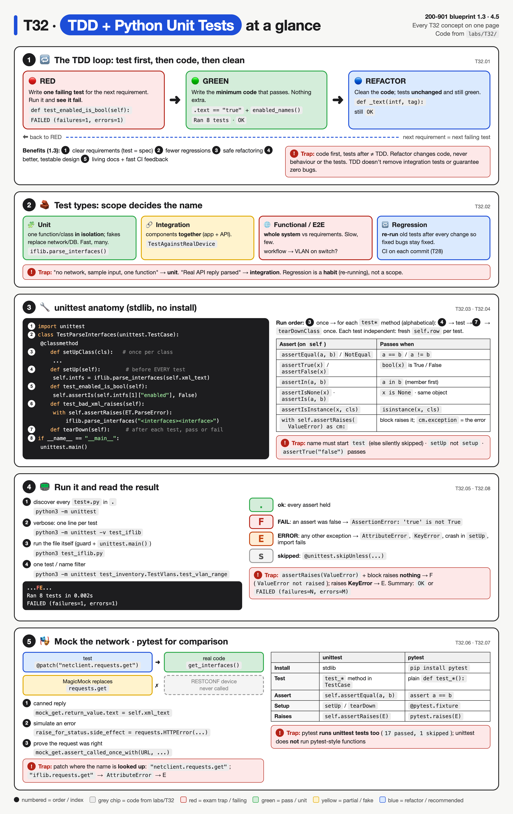
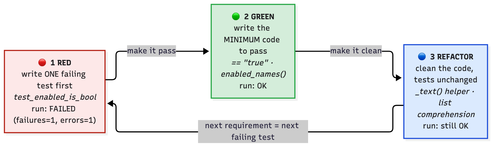
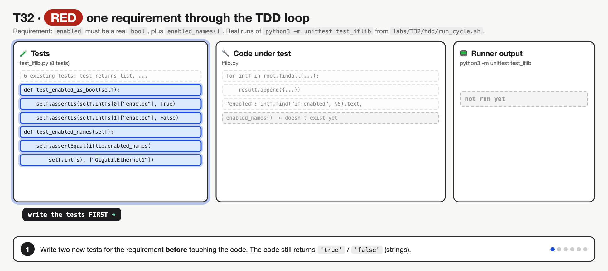
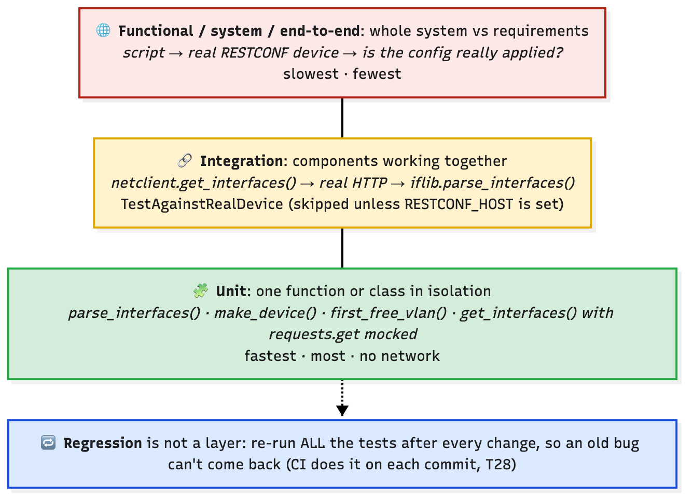
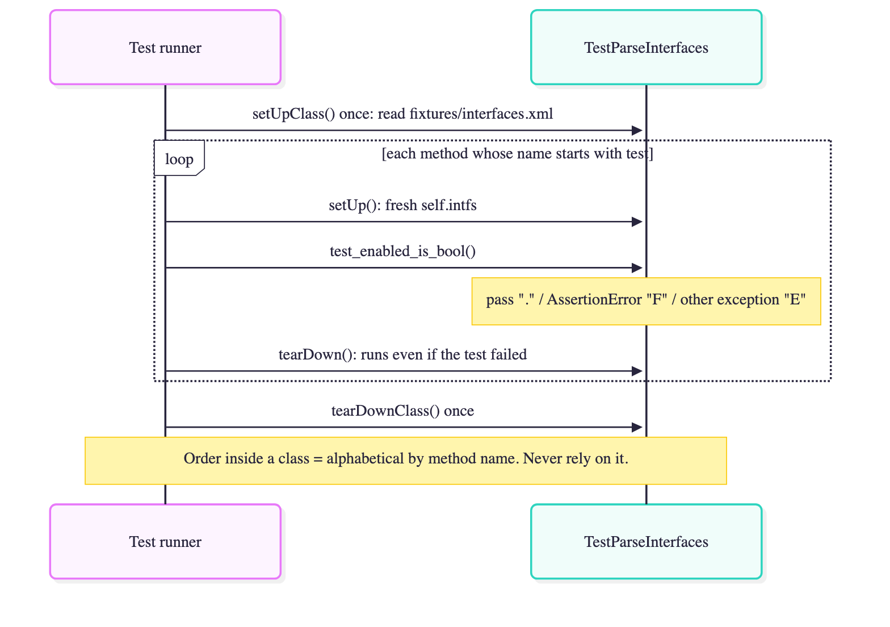
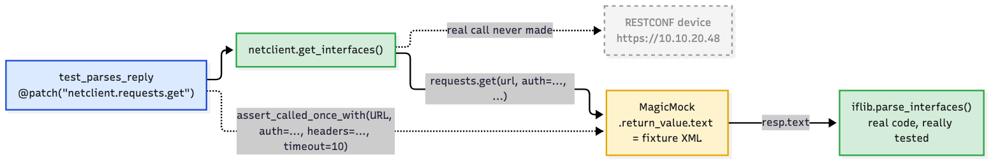

# T32 · TDD + Python unit tests

> Owner: **Beedy** · Blueprint: **1.3, 4.5** · CBT coverage: **Full** · Learn by 2026-10-31 · Teach-back 2026-11-01



*Read top to bottom: panel 1 is the red → green → refactor loop with the real run results, panel 2 the test-type pyramid, panel 3 the anatomy of a `TestCase` (numbered = run order), panel 4 the `.`/`F`/`E` output codes, panel 5 mocking and pytest. Red boxes are exam traps. All code chips come from `labs/T32/`.*

<!-- toc:start -->

**Contents**

- [TL;DR (teach-back card)](#tldr-teach-back-card)
- [Concepts](#concepts)
  - [T32.01](#t3201--tdd) TDD · [T32.02](#t3202--test-types) Test types · [T32.03](#t3203--unittest) unittest · [T32.04](#t3204--unittest) unittest · [T32.05](#t3205--running) Running · [T32.06](#t3206--mocking-awareness) Mocking (awareness) · [T32.07](#t3207--pytest-awareness) pytest (awareness) · [T32.08](#t3208--exam-angle) Exam angle
- [Exam traps](#exam-traps)
- [Examples](#examples)
- [Practice questions](#practice-questions)
- [Study aids](#study-aids)
- [Sources](#sources)
- [To verify](#to-verify)

<!-- toc:end -->

## TL;DR (teach-back card)

- **TDD = red → green → refactor.** Write a failing test first (red), the minimum code to pass it (green), then clean up while the tests stay green (refactor). The test is the requirement.
- **unittest anatomy:** `import unittest` → `class TestX(unittest.TestCase):` → methods named `test_*` using `self.assertEqual / assertTrue / assertIn / assertIsNone / assertRaises`. `setUp()` runs before **every** test, `tearDown()` after every test. Run with `python -m unittest -v` (discovers `test*.py`) or `unittest.main()` under the `__main__` guard.
- **Unit vs integration vs functional:** one function in isolation (mock the network with `unittest.mock.patch`) vs real components together vs the whole system against requirements. Regression = re-run everything after each change.
- **Trap:** `F` = an **assert** failed (`AssertionError`); `E` = **any other exception** (typo, `KeyError`, missing function). A method not starting with `test` is silently **never run**.

## Concepts

Every section below points at one small, real test suite. It tests the **T06 XML parser** (the lab suggested in `labs/README.md`), the **T02 inventory functions**, and a tiny **RESTCONF client** whose network call is mocked. Files are in `labs/T32/`:

```
labs/T32/
├── fixtures/interfaces.xml     the T06 ietf-interfaces XML, copied verbatim
├── iflib.py                    code under test: parse_interfaces(), enabled_names(), ...
├── netclient.py                calls requests.get() → iflib (for the mock demo)
├── test_iflib.py               unittest: setUpClass/setUp/tearDown, asserts, assertRaises
├── test_inventory.py           unittest for labs/T02 make_device(), first_free_vlan() (imported unchanged)
├── test_netclient.py           unittest.mock.patch + one skipped integration test
├── tdd/1-red/iflib.py          TDD snapshot: before the feature (tests fail)
├── tdd/2-green/iflib.py        TDD snapshot: minimum code (tests pass)
├── tdd/run_cycle.sh            runs the SAME tests against red → green → refactor
└── pytest_demo/test_iflib_pytest.py   the same checks in pytest style (comparison only)
```

**The code under test: `iflib.py`** (the final, refactored version)

```python
"""Parse ietf-interfaces XML (the T06 RESTCONF reply) into a list of dicts.

Built test-first: see tdd/ for the red and green snapshots of this file.
"""
import xml.etree.ElementTree as ET

NS = {"if": "urn:ietf:params:xml:ns:yang:ietf-interfaces"}


def _text(intf, tag):
    return intf.find(f"if:{tag}", NS).text


def parse_interfaces(xml_text):
    """Return [{"name": str, "description": str, "enabled": bool}, ...]."""
    return [
        {
            "name": _text(intf, "name"),
            "description": _text(intf, "description"),
            "enabled": _text(intf, "enabled") == "true",
        }
        for intf in ET.fromstring(xml_text).findall("if:interface", NS)
    ]


def enabled_names(interfaces):
    """Names of the interfaces that are enabled."""
    return [i["name"] for i in interfaces if i["enabled"]]


def get_interface(interfaces, name):
    """The dict for one interface, or None if it isn't there."""
    return next((i for i in interfaces if i["name"] == name), None)


def load_interfaces(path):
    """Read an XML file and parse it."""
    with open(path, encoding="utf-8") as f:
        return parse_interfaces(f.read())
```

**The tests: `test_iflib.py`**

```python
"""Unit tests for iflib (the T06 XML parser)."""
import os
import tempfile
import unittest
import xml.etree.ElementTree as ET

import iflib

HERE = os.path.dirname(os.path.abspath(__file__))
FIXTURE = os.path.join(HERE, "fixtures", "interfaces.xml")


class TestParseInterfaces(unittest.TestCase):
    @classmethod
    def setUpClass(cls):                          # once for the whole class
        with open(FIXTURE, encoding="utf-8") as f:
            cls.xml_text = f.read()

    def setUp(self):                              # before EVERY test: a fresh list
        self.intfs = iflib.parse_interfaces(self.xml_text)

    def test_returns_list(self):
        self.assertIsInstance(self.intfs, list)
        self.assertEqual(len(self.intfs), 2)

    def test_first_interface(self):
        self.assertEqual(self.intfs[0]["name"], "GigabitEthernet1")
        self.assertIn("core", self.intfs[0]["description"])

    def test_enabled_is_bool(self):
        self.assertIs(self.intfs[0]["enabled"], True)
        self.assertIs(self.intfs[1]["enabled"], False)

    def test_enabled_names(self):
        self.assertEqual(iflib.enabled_names(self.intfs), ["GigabitEthernet1"])

    def test_get_interface_missing(self):
        self.assertIsNone(iflib.get_interface(self.intfs, "GigabitEthernet9"))
        self.assertIsNotNone(iflib.get_interface(self.intfs, "GigabitEthernet2"))

    def test_bad_xml_raises(self):
        with self.assertRaises(ET.ParseError):
            iflib.parse_interfaces("<interfaces><interface>")


class TestLoadInterfaces(unittest.TestCase):
    def setUp(self):                              # make a temp dir + file for each test
        self.tmp = tempfile.TemporaryDirectory()
        self.path = os.path.join(self.tmp.name, "empty.xml")
        with open(self.path, "w", encoding="utf-8") as f:
            f.write('<interfaces xmlns="urn:ietf:params:xml:ns:yang:ietf-interfaces"/>')

    def tearDown(self):                           # after each test, pass or fail
        self.tmp.cleanup()

    def test_empty_file_gives_empty_list(self):
        self.assertEqual(iflib.load_interfaces(self.path), [])

    def test_missing_file_raises(self):
        with self.assertRaises(FileNotFoundError):
            iflib.load_interfaces(os.path.join(self.tmp.name, "nope.xml"))


if __name__ == "__main__":
    unittest.main()
```

**Output** (`cd labs/T32 && python3 -m unittest -v test_iflib`, Python 3.14):

```
test_empty_file_gives_empty_list (test_iflib.TestLoadInterfaces.test_empty_file_gives_empty_list) ... ok
test_missing_file_raises (test_iflib.TestLoadInterfaces.test_missing_file_raises) ... ok
test_bad_xml_raises (test_iflib.TestParseInterfaces.test_bad_xml_raises) ... ok
test_enabled_is_bool (test_iflib.TestParseInterfaces.test_enabled_is_bool) ... ok
test_enabled_names (test_iflib.TestParseInterfaces.test_enabled_names) ... ok
test_first_interface (test_iflib.TestParseInterfaces.test_first_interface) ... ok
test_get_interface_missing (test_iflib.TestParseInterfaces.test_get_interface_missing) ... ok
test_returns_list (test_iflib.TestParseInterfaces.test_returns_list) ... ok

----------------------------------------------------------------------
Ran 8 tests in 0.002s

OK
```

### T32.01 · TDD

**Must cover:**

- [x] Test-driven development: write a failing test before the code
- [x] Red (test fails) → Green (minimum code to pass) → Refactor (clean up, tests still pass)
- [x] Benefits: clear requirements, fewer regressions, safer refactoring, better design

**Notes:**

- **TDD** = write the test **before** the code. The test states the requirement; the code exists only to make it pass.
- Normal order: code → test (maybe). TDD order: **test → code → clean up**, one small requirement at a time.



*The loop never starts with code. Red must actually fail before you write the fix; refactor changes code, never the tests.*



*One requirement through the loop, one run per frame: write the two tests → run: `...FE...` `FAILED (failures=1, errors=1)` → add `== "true"`: `....E...` → add `enabled_names()`: `OK` → refactor with `_text()`: still `OK`, tests untouched → next requirement starts as a new failing test. It fixes the belief that tests get written after the code, and shows F and E side by side.*

- **The real cycle in this lab.** New requirement: "`enabled` must be a Python `bool`, and I need a list of enabled interface names". `tdd/run_cycle.sh` runs the **same** `test_iflib.py` against three versions of `iflib.py`:

| Step | What changed in `iflib.py` | Result |
|---|---|---|
| 🔴 **1 Red** (`tdd/1-red/`) | nothing yet: `"enabled": intf.find("if:enabled", NS).text` (a string), no `enabled_names()` | `FAILED (failures=1, errors=1)` |
| 🟢 **2 Green** (`tdd/2-green/`) | add `== "true"` and a 2-line `enabled_names()`: the **minimum** to pass | `OK` |
| 🔵 **3 Refactor** (`iflib.py`) | pull the repeated `find(...).text` into `_text()`, loop → list comprehension, add docstrings | still `OK`, tests untouched |

- **Red** output (`PYTHONPATH="1-red:.." python3 -m unittest -v test_iflib`, run inside `labs/T32/tdd`):

```
test_empty_file_gives_empty_list (test_iflib.TestLoadInterfaces.test_empty_file_gives_empty_list) ... ok
test_missing_file_raises (test_iflib.TestLoadInterfaces.test_missing_file_raises) ... ok
test_bad_xml_raises (test_iflib.TestParseInterfaces.test_bad_xml_raises) ... ok
test_enabled_is_bool (test_iflib.TestParseInterfaces.test_enabled_is_bool) ... FAIL
test_enabled_names (test_iflib.TestParseInterfaces.test_enabled_names) ... ERROR
test_first_interface (test_iflib.TestParseInterfaces.test_first_interface) ... ok
test_get_interface_missing (test_iflib.TestParseInterfaces.test_get_interface_missing) ... ok
test_returns_list (test_iflib.TestParseInterfaces.test_returns_list) ... ok

======================================================================
ERROR: test_enabled_names (test_iflib.TestParseInterfaces.test_enabled_names)
----------------------------------------------------------------------
Traceback (most recent call last):
  File "/Users/wendytan/ccna-auto-study-notes/labs/T32/test_iflib.py", line 35, in test_enabled_names
    self.assertEqual(iflib.enabled_names(self.intfs), ["GigabitEthernet1"])
                     ^^^^^^^^^^^^^^^^^^^
AttributeError: module 'iflib' has no attribute 'enabled_names'

======================================================================
FAIL: test_enabled_is_bool (test_iflib.TestParseInterfaces.test_enabled_is_bool)
----------------------------------------------------------------------
Traceback (most recent call last):
  File "/Users/wendytan/ccna-auto-study-notes/labs/T32/test_iflib.py", line 31, in test_enabled_is_bool
    self.assertIs(self.intfs[0]["enabled"], True)
    ~~~~~~~~~~~~~^^^^^^^^^^^^^^^^^^^^^^^^^^^^^^^^
AssertionError: 'true' is not True

----------------------------------------------------------------------
Ran 8 tests in 0.002s

FAILED (failures=1, errors=1)
```

- Read the red run like an exam question:
  - `test_enabled_is_bool` → **FAIL**: the code ran, the assertion was false (`'true' is not True`, a string vs a bool).
  - `test_enabled_names` → **ERROR**: the test crashed before it could assert (`AttributeError`: the function doesn't exist yet).
  - The other 6 tests pass: TDD only adds new failing tests; the old ones keep guarding existing behaviour.
- **Green diff** (the whole fix, nothing more):

```diff
--- tdd/1-red/iflib.py
+++ tdd/2-green/iflib.py
@@ -1,6 +1,6 @@
-"""TDD snapshot 1 (red): the new tests exist, the feature doesn't.
+"""TDD snapshot 2 (green): the minimum code that makes every test pass.
 
-"enabled" is still the raw XML text, and enabled_names() isn't written yet.
+It works, but find(...).text is repeated three times. Step 3 (../../iflib.py) cleans that up.
 """
 import xml.etree.ElementTree as ET
 
@@ -14,11 +14,15 @@
         result.append({
             "name": intf.find("if:name", NS).text,
             "description": intf.find("if:description", NS).text,
-            "enabled": intf.find("if:enabled", NS).text,
+            "enabled": intf.find("if:enabled", NS).text == "true",
         })
     return result
 
 
+def enabled_names(interfaces):
+    return [i["name"] for i in interfaces if i["enabled"]]
+
+
 def get_interface(interfaces, name):
     return next((i for i in interfaces if i["name"] == name), None)
 
```

- **Refactor diff** (behaviour identical; the 8 tests prove it):

```diff
--- tdd/2-green/iflib.py
+++ iflib.py
@@ -1,32 +1,39 @@
-"""TDD snapshot 2 (green): the minimum code that makes every test pass.
+"""Parse ietf-interfaces XML (the T06 RESTCONF reply) into a list of dicts.
 
-It works, but find(...).text is repeated three times. Step 3 (../../iflib.py) cleans that up.
+Built test-first: see tdd/ for the red and green snapshots of this file.
 """
 import xml.etree.ElementTree as ET
 
 NS = {"if": "urn:ietf:params:xml:ns:yang:ietf-interfaces"}
 
 
+def _text(intf, tag):
+    return intf.find(f"if:{tag}", NS).text
+
+
 def parse_interfaces(xml_text):
-    root = ET.fromstring(xml_text)
-    result = []
-    for intf in root.findall("if:interface", NS):
-        result.append({
-            "name": intf.find("if:name", NS).text,
-            "description": intf.find("if:description", NS).text,
-            "enabled": intf.find("if:enabled", NS).text == "true",
-        })
-    return result
+    """Return [{"name": str, "description": str, "enabled": bool}, ...]."""
+    return [
+        {
+            "name": _text(intf, "name"),
+            "description": _text(intf, "description"),
+            "enabled": _text(intf, "enabled") == "true",
+        }
+        for intf in ET.fromstring(xml_text).findall("if:interface", NS)
+    ]
 
 
 def enabled_names(interfaces):
+    """Names of the interfaces that are enabled."""
     return [i["name"] for i in interfaces if i["enabled"]]
 
 
 def get_interface(interfaces, name):
+    """The dict for one interface, or None if it isn't there."""
     return next((i for i in interfaces if i["name"] == name), None)
 
 
 def load_interfaces(path):
+    """Read an XML file and parse it."""
     with open(path, encoding="utf-8") as f:
         return parse_interfaces(f.read())
```

- **Benefits** (blueprint 1.3 wants these words):
  - **Clear requirements:** the test is an executable spec. `test_enabled_is_bool` says exactly what "enabled" must be.
  - **Fewer regressions:** every past requirement stays as a test, so breaking it shows up at once.
  - **Safer refactoring:** step 3 rewrote `parse_interfaces()` completely; 8 green tests prove nothing broke.
  - **Better design:** code written to be testable gets small, pure functions with inputs and return values (see [T02.01 testability](T02-functions-classes-modules.md#t0201--why-organise-code)).
  - Also: **living documentation**, and fast feedback in CI ([T28.01](T28-ci-cd-devops-principles.md#t2801--ci)).
- Cost: more code up front and slower first delivery. Distractor answers: "TDD removes the need for integration tests", "TDD guarantees bug-free code". Neither is true.

### T32.02 · Test types

**Must cover:**

- [x] Unit: one function/class in isolation (fast, many)
- [x] Integration: components working together (e.g. app + API)
- [x] Functional/system/end-to-end: whole system against requirements
- [x] Regression: re-run tests to catch previously fixed bugs returning

**Notes:**



*Top = slow, few, real systems. Bottom = fast, many, isolated. Regression is not a layer but a habit: re-run them all.*

| Type | Scope | Real dependencies? | In this lab |
|---|---|---|---|
| **Unit** | one function or class in **isolation** | no: fakes/mocks replace network, DB, files | `test_iflib.py`, `test_inventory.py`, `TestGetInterfaces` (mocked `requests.get`) |
| **Integration** | 2+ components **working together** (app + API, code + DB) | yes, the real interface between them | `TestAgainstRealDevice`: real HTTPS to a RESTCONF device, skipped unless `RESTCONF_HOST` is set |
| **Functional / system / end-to-end** | the **whole system** against the **requirements** (user's view) | yes, everything | e.g. run the full automation against a DevNet Sandbox, then check the device config changed |
| **Regression** | any of the above, **re-run** after a change | as the original tests | `python3 -m unittest` after the refactor in T32.01; CI runs it on every commit |

- Scenario → answer:
  - "Test `parse_interfaces()` with a sample XML string, no device" → **unit**.
  - "Check the script can authenticate to Catalyst Center and parse its real reply" → **integration**.
  - "Verify a new VLAN appears on the switch after the whole workflow runs" → **functional / end-to-end**.
  - "A bug fixed last month reappeared; which tests should have caught it?" → **regression** (keep the bug's test and re-run it).
- **Unit tests are the TDD tests**: small, fast, many. TDD doesn't replace the other layers.
- Some sources say "functional" for checking one feature's behaviour, "system" or "end-to-end" for the whole stack. The exam treats them as the same family: whole system vs requirements. ⚠ verify the exact wording in your N2K practice Qs.

### T32.03 · unittest

**Must cover:**

- [x] import unittest
- [x] class TestParser(unittest.TestCase):
- [x] Each test is a method whose name starts with test_
- [x] Tests should be independent of each other

**Notes:**

- **`unittest`** = Python's built-in (stdlib) test framework, modelled on Java's JUnit. No `pip install`.
- The four lines every exam "complete the code" question is built from (all in `test_iflib.py`):
  1. `import unittest`
  2. `class TestParseInterfaces(unittest.TestCase):` → **subclass** `unittest.TestCase` (capital T, capital C).
  3. `def test_enabled_is_bool(self):` → a **method** (takes `self`), name **starts with `test`**.
  4. `self.assertIs(self.intfs[1]["enabled"], False)` → assert methods are called on **`self`**.
- **Naming rules** (verified by running `test_traps.py` in **Examples**):
  - The runner collects every method whose name **starts with `test`**. `test_x` and `testX` both run.
  - `check_names()` or `enabled_test()` → **silently ignored**: no error, no warning, the count just drops. Renaming `test_returns_list` to `returns_list` turned `Ran 8 tests` into `Ran 7 tests`, still `OK`.
  - Files must match **`test*.py`** for discovery (`test_iflib.py` ✅, `iflib_test.py` ❌).
  - Class name: by convention `Test...`, but the runner finds any `TestCase` subclass.
- **Independence:**
  - Every test must pass alone and in any order. Inside a class, unittest runs methods in **alphabetical** order (the output above shows `test_bad_xml_raises` first), not the order written.
  - `setUp()` gives each test a fresh `self.intfs`, and `test_inventory.py` builds a fresh `self.row` dict per test. `test_unknown_os_falls_back_to_device` changes `self.row["os"]`, and `test_missing_hostname_raises` deletes `hostname`. That's safe only because each gets its own copy.
  - Break it: move `self.row` into `setUpClass()` (one shared dict) and an unrelated test errors with `ValueError: no hostname in {'mgmt_ip': '10.10.20.48', 'os': 'junos'}`. Both earlier tests changed the shared dict. See **Examples**.
- Test the T02 code without editing it: `test_inventory.py` adds `labs/T02` to `sys.path` and imports `make_device` / `first_free_vlan`. Only possible because `build_inventory.py` has the `__name__` guard ([T02.08](T02-functions-classes-modules.md#t0208--modules)), so importing it doesn't run `main()`.

**`test_inventory.py`** (tests the [T02](T02-functions-classes-modules.md) reference program):

```python
"""Unit tests for the T02 reference program (labs/T02), imported unchanged."""
import os
import sys
import unittest

sys.path.insert(0, os.path.join(os.path.dirname(os.path.abspath(__file__)), "..", "T02"))

from build_inventory import first_free_vlan, make_device   # noqa: E402
from netlib import IOSXE, Device                           # noqa: E402


class TestMakeDevice(unittest.TestCase):
    def setUp(self):
        self.row = {"hostname": "csr1", "mgmt_ip": "10.10.20.48", "os": "iosxe"}

    def tearDown(self):
        Device.connections = 0                    # connect() changes a class attribute: reset it

    def test_iosxe_row_builds_iosxe(self):
        d = make_device(self.row)
        self.assertIsInstance(d, IOSXE)
        self.assertEqual(d.port, 443)

    def test_unknown_os_falls_back_to_device(self):
        self.row["os"] = "junos"                  # safe: setUp builds a new dict for every test
        self.assertIs(type(make_device(self.row)), Device)

    def test_missing_hostname_raises(self):
        del self.row["hostname"]
        with self.assertRaises(ValueError) as cm:
            make_device(self.row)
        self.assertIn("no hostname", str(cm.exception))

    def test_connect_counts_once(self):
        make_device(self.row).connect()
        self.assertEqual(Device.connections, 1)   # only true because tearDown resets it


class TestVlans(unittest.TestCase):
    def test_first_free_vlan_skips_used(self):
        self.assertEqual(first_free_vlan({10, 20, 30}), 40)

    def test_first_free_vlan_empty(self):
        self.assertNotEqual(first_free_vlan(set()), 20)

    def test_vlan_range(self):
        self.assertTrue(Device.is_valid_vlan(4094))
        self.assertFalse(Device.is_valid_vlan(4095))


if __name__ == "__main__":
    unittest.main()
```

### T32.04 · unittest

**Must cover:**

- [x] setUp() runs before every test; tearDown() after (setUpClass/tearDownClass once per class)
- [x] assertEqual(a, b), assertNotEqual, assertTrue(x), assertFalse(x)
- [x] assertIn(a, b), assertIsNone(x), assertIsInstance(x, cls)
- [x] with self.assertRaises(ValueError): … checks an exception is raised

**Notes:**

- **Fixtures** = the setup a test needs and the cleanup after it.



*Class-level hooks run once; `setUp`/`tearDown` wrap every single test. `tearDown` runs even if the test failed.*

| Hook | Runs | Decorator | In the lab |
|---|---|---|---|
| `setUpClass(cls)` | **once**, before the first test in the class | `@classmethod` (required) | `TestParseInterfaces`: read `fixtures/interfaces.xml` once into `cls.xml_text` |
| `setUp(self)` | before **every** test | none | parse it into a fresh `self.intfs`; `TestLoadInterfaces` creates a temp dir + file |
| `tearDown(self)` | after **every** test, **pass or fail** (only if `setUp` succeeded) | none | `self.tmp.cleanup()`; `TestMakeDevice` resets `Device.connections = 0` |
| `tearDownClass(cls)` | **once**, after the last test | `@classmethod` (required) | not needed here |

- Names are **camelCase and exact**: `setUp`, not `setup`. Typo `def setup(self):` → it's just an ordinary method that never runs, so every test that uses `self.intfs` **errors** with `AttributeError: 'TestParseInterfaces' object has no attribute 'intfs'` (`FAILED (errors=5)`; run in **Examples**).
- If `setUp()` raises, the test counts as an **error** and the test method doesn't run.
- **Why `tearDown` matters:** `Device.connections` is a **class attribute** ([T02.05](T02-functions-classes-modules.md#t0205--classes)), so it outlives one test. Without the reset, running `test_connect_counts_once` twice gives `AssertionError: 2 != 1`.
- **Assert methods** (all are `self.` methods of `TestCase`; failure message shows both values):

| Method | Passes when | In the lab |
|---|---|---|
| `assertEqual(a, b)` | `a == b` | `assertEqual(len(self.intfs), 2)` |
| `assertNotEqual(a, b)` | `a != b` | `assertNotEqual(first_free_vlan(set()), 20)` |
| `assertTrue(x)` | `bool(x) is True` | `assertTrue(Device.is_valid_vlan(4094))` |
| `assertFalse(x)` | `bool(x) is False` | `assertFalse(Device.is_valid_vlan(4095))` |
| `assertIs(a, b)` / `assertIsNot` | same object (`a is b`) | `assertIs(self.intfs[1]["enabled"], False)` |
| `assertIn(a, b)` / `assertNotIn` | `a in b` | `assertIn("core", self.intfs[0]["description"])` |
| `assertIsNone(x)` / `assertIsNotNone` | `x is None` | `assertIsNone(iflib.get_interface(self.intfs, "GigabitEthernet9"))` |
| `assertIsInstance(x, cls)` | `isinstance(x, cls)` | `assertIsInstance(d, IOSXE)` |
| `assertRaises(Exc)` | the block raises `Exc` (or a subclass) | `with self.assertRaises(ET.ParseError):` |
| `assertGreater(a, b)` | `a > b` | integration test: `assertGreater(len(intfs), 0)` |

- **Argument order:** `assertIn(member, container)`: the **thing** first, then where to look. `assertIsInstance(obj, Class)`.
- **Why `assertIs(..., False)` and not `assertFalse(...)`** in `test_enabled_is_bool`: `assertFalse("false")` would **fail** but `assertTrue("false")` **passes**, because any non-empty string is truthy. `assertIs` demands the real `bool`. This is exactly what caught the red-step bug.
- **`assertRaises`** (context-manager form, the one to learn):

  ```python
  with self.assertRaises(ValueError) as cm:
      make_device(self.row)
  self.assertIn("no hostname", str(cm.exception))
  ```

  - Passes only if the block raises `ValueError`. `cm.exception` is the caught exception object, for checking the message.
  - Block raises **nothing** → **FAIL**: `AssertionError: ValueError not raised`.
  - Block raises a **different** exception (e.g. `KeyError`) → **ERROR**: it isn't caught, so it escapes the test.
  - Old call form, same meaning: `self.assertRaises(ValueError, make_device, row)`: pass the function and its args, **don't call it**.

### T32.05 · Running

**Must cover:**

- [x] if __name__ == "__main__": unittest.main()
- [x] python -m unittest (discovers test_*.py files) ; python -m unittest -v
- [x] Output: "." pass, "F" failure (assertion false), "E" error (exception in test); final OK or FAILED

**Notes:**

- **Three ways to run** (all from `labs/T32/`):

| Command | Runs |
|---|---|
| `python3 test_iflib.py` | that file, through `if __name__ == "__main__": unittest.main()` at the bottom |
| `python3 -m unittest` | **discovery**: every `test*.py` under the current directory (same as `python3 -m unittest discover`) |
| `python3 -m unittest -v test_iflib` | one module, **verbose**: one line per test with `ok` / `FAIL` / `ERROR` / `skipped` |
| `python3 -m unittest test_inventory.TestVlans.test_vlan_range` | one class or one method (dotted path) |
| `python3 -m unittest -k enabled test_iflib` | only tests whose name contains `enabled` |

- `unittest.main()` without the `__main__` guard would also run when the file is imported by the discovery runner. Keep the guard ([T02.08](T02-functions-classes-modules.md#t0208--modules)).
- **Discovery** imports each `test*.py` from the start directory (default `.`). Subdirectories are only searched if they are packages (have `__init__.py`), which is why `tdd/` and `pytest_demo/` are **not** picked up here. ⚠ verify: namespace-package discovery changed in Python 3.11 and again in 3.14.
- **Reading the output.** Without `-v` you get one character per test:

| Char | `-v` word | Meaning | Cause |
|---|---|---|---|
| `.` | `ok` | pass | every assert held |
| `F` | `FAIL` | **failure** | an `assert*` was false → `AssertionError` |
| `E` | `ERROR` | **error** | any **other** exception: `NameError`, `KeyError`, `AttributeError`, a crash in `setUp` |
| `s` | `skipped '...'` | skipped | `@unittest.skip` / `skipUnless` |

- Last line: **`OK`** (maybe `OK (skipped=1)`) or **`FAILED (failures=N, errors=M)`**. The process exits `0` for OK and `1` for FAILED, so CI marks the build red ([T28](T28-ci-cd-devops-principles.md)).
- **The whole suite**, quiet mode (`/tmp/t32-venv/bin/python -m unittest`, venv with `requests` installed, see **Examples**):

```
...............s..
----------------------------------------------------------------------
Ran 18 tests in 0.002s

OK (skipped=1)
```

- `...............s..` = 17 passes and 1 skip (`TestAgainstRealDevice`, no `RESTCONF_HOST`). The red run in T32.01 printed `...FE...`: the 4th test failed, the 5th errored.
- Run without `requests` installed → `test_netclient` can't even be **imported** → it shows up as an **error** (`ModuleNotFoundError`), `Ran 16 tests`, `FAILED (errors=1)`.

### T32.06 · Mocking (awareness)

**Must cover:**

- [x] unittest.mock.patch replaces a real call (e.g. requests.get) with a fake
- [x] Lets you test API-calling code without the network

**Notes:**

- **Problem:** `netclient.get_interfaces()` calls a real device. A unit test must not need a device, credentials or the network (slow, flaky, not "isolated").
- **Mock** = a stand-in object that accepts any call, returns what you configure and **records how it was called**. `unittest.mock` is in the stdlib.
- **`patch("netclient.requests.get")`** swaps the real `requests.get` for a `MagicMock` while the test runs, then puts the original back.



*The real `requests.get` is never called. The parsing code is real and really tested; only the network edge is faked.*

**`netclient.py`**

```python
"""Fetch interfaces from a RESTCONF device (T16) and parse them with iflib."""
import requests

import iflib


def get_interfaces(host, user, password):
    url = f"https://{host}/restconf/data/ietf-interfaces:interfaces"
    resp = requests.get(
        url,
        auth=(user, password),
        headers={"Accept": "application/yang-data+xml"},
        timeout=10,
    )
    resp.raise_for_status()                       # 4xx/5xx -> requests.HTTPError
    return iflib.parse_interfaces(resp.text)
```

**`test_netclient.py`**

```python
"""Unit tests for netclient: requests.get is mocked, so no device or network is needed."""
import os
import unittest
from unittest.mock import patch

import requests

import netclient

HERE = os.path.dirname(os.path.abspath(__file__))
URL = "https://10.10.20.48/restconf/data/ietf-interfaces:interfaces"


class TestGetInterfaces(unittest.TestCase):
    @classmethod
    def setUpClass(cls):
        with open(os.path.join(HERE, "fixtures", "interfaces.xml"), encoding="utf-8") as f:
            cls.xml_text = f.read()

    @patch("netclient.requests.get")              # replace requests.get only for this test
    def test_parses_reply(self, mock_get):
        mock_get.return_value.status_code = 200
        mock_get.return_value.text = self.xml_text
        intfs = netclient.get_interfaces("10.10.20.48", "developer", "pw")
        self.assertEqual([i["name"] for i in intfs], ["GigabitEthernet1", "GigabitEthernet2"])
        mock_get.assert_called_once_with(
            URL,
            auth=("developer", "pw"),
            headers={"Accept": "application/yang-data+xml"},
            timeout=10,
        )

    def test_http_error_propagates(self):
        with patch("netclient.requests.get") as mock_get:   # context-manager form
            mock_get.return_value.raise_for_status.side_effect = requests.HTTPError("401 Unauthorized")
            with self.assertRaises(requests.HTTPError):
                netclient.get_interfaces("10.10.20.48", "developer", "wrong")


@unittest.skipUnless(os.environ.get("RESTCONF_HOST"), "integration: set RESTCONF_HOST, RESTCONF_USER, RESTCONF_PASS")
class TestAgainstRealDevice(unittest.TestCase):
    def test_real_device_has_interfaces(self):
        intfs = netclient.get_interfaces(
            os.environ["RESTCONF_HOST"], os.environ["RESTCONF_USER"], os.environ["RESTCONF_PASS"]
        )
        self.assertGreater(len(intfs), 0)


if __name__ == "__main__":
    unittest.main()
```

- What each line does:
  - `@patch("netclient.requests.get")` as a **decorator** → the mock arrives as an extra argument, `mock_get`. As a **context manager** (`with patch(...) as mock_get:`), it's active only inside the block.
  - `mock_get.return_value` = what `requests.get(...)` returns, i.e. the fake `resp`. Setting `.text` gives `iflib` real XML to parse.
  - `side_effect = requests.HTTPError(...)` on `raise_for_status` → calling it **raises**. That tests the 401 path without a device. (`side_effect` can also be a list: one return value per call.)
  - `mock_get.assert_called_once_with(URL, auth=..., headers=..., timeout=10)` → proves the code built the right request: URL, Basic auth, the `Accept: application/yang-data+xml` header ([T16](../bob/T16-restconf.md)).
- **Patch where it's looked up**, not where it's defined. `netclient` does `import requests` and calls `requests.get`, so `"netclient.requests.get"` works. Patching `"iflib.requests.get"` → `AttributeError: module 'iflib' has no attribute 'requests'` → test **error** (run in **Examples**). If the code did `from requests import get`, you'd patch `"netclient.get"`.
- Mocks are for **unit** tests. The same file keeps one real **integration** test, `TestAgainstRealDevice`, and `@unittest.skipUnless(os.environ.get("RESTCONF_HOST"), ...)` skips it unless you point it at a sandbox.
- Related: `requests` itself and `raise_for_status()` are in [T11](T11-python-requests-scripting.md).

### T32.07 · pytest (awareness)

**Must cover:**

- [x] pytest: plain functions named test_* using bare assert statements
- [x] Runs unittest tests too

**Notes:**

- **pytest** = third-party (`pip install pytest`), the most common Python test runner. No class needed, no `self.assert*` methods.

**`pytest_demo/test_iflib_pytest.py`**

```python
"""The same checks as test_iflib.py, pytest style: plain functions + bare assert.

Run with pytest only (unittest ignores it: there's no TestCase class here).
"""
import os
import sys
import xml.etree.ElementTree as ET

import pytest

HERE = os.path.dirname(os.path.abspath(__file__))
sys.path.insert(0, os.path.join(HERE, ".."))
import iflib  # noqa: E402


@pytest.fixture
def intfs():                                      # pytest's version of setUp
    return iflib.load_interfaces(os.path.join(HERE, "..", "fixtures", "interfaces.xml"))


def test_enabled_is_bool(intfs):
    assert intfs[1]["enabled"] is False


def test_enabled_names(intfs):
    assert iflib.enabled_names(intfs) == ["GigabitEthernet1"]


def test_bad_xml_raises():
    with pytest.raises(ET.ParseError):
        iflib.parse_interfaces("<interfaces><interface>")
```

| | unittest | pytest |
|---|---|---|
| Install | stdlib | `pip install pytest` |
| Test = | method `test_*` in a `unittest.TestCase` subclass | plain function `test_*` (classes optional) |
| Assert | `self.assertEqual(a, b)` etc. | bare `assert a == b` (pytest rewrites it to show both values) |
| Setup | `setUp` / `tearDown` / `setUpClass` | `@pytest.fixture`, requested by parameter name |
| Exceptions | `with self.assertRaises(E):` | `with pytest.raises(E):` |
| Run | `python -m unittest -v` | `pytest -v` (finds `test_*.py` or `*_test.py`) |

- **pytest runs unittest tests too.** Real run in the throwaway venv (`-p no:cacheprovider` only stops it writing `.pytest_cache` into the repo):

```
$ pytest -p no:cacheprovider -q test_iflib.py test_inventory.py test_netclient.py
.................s                                                       [100%]
17 passed, 1 skipped in 0.06s
```

- **Not the other way round:** `python3 -m unittest pytest_demo/test_iflib_pytest.py` → `Ran 1 test`, `FAILED (errors=1)`, because `import pytest` fails on a bare Python; and even with pytest installed, unittest ignores plain functions.
- Exam angle: recognise it. If the code has bare `assert` in plain functions → pytest. If it has `class ...(unittest.TestCase)` and `self.assert...` → unittest.

### T32.08 · Exam angle

**Must cover:**

- [x] Complete a TestCase (class base, method name, assert)
- [x] Say why a given test passes, fails or errors

**Notes:**

- **Complete-the-code checklist** (the blanks are almost always one of these):
  1. `import unittest`
  2. base class `unittest.TestCase`
  3. method name starts `test`, has `self`
  4. assert called as `self.assertXxx(...)`, args in the right order
  5. exception check `with self.assertRaises(ErrType):`
  6. runner `unittest.main()` under `if __name__ == "__main__":`
- **Pass / fail / error decision** for any snippet:
  1. Is the method collected? Not starting with `test` → **not run at all**.
  2. Does `setUp` or the test body raise something **other than** `AssertionError` before the assert? → **ERROR** (`E`).
  3. Does an `assert*` evaluate false, or `assertRaises` see no exception? → **FAIL** (`F`).
  4. Otherwise → **pass** (`.`).
- Truthiness catches people: `assertTrue("false")`, `assertTrue([0])`, `assertTrue(10, 20)` all **pass** (the 2nd argument of `assertTrue` is only the failure message).
- `assertEqual(1, True)` passes (`1 == True`); `assertIs(1, True)` fails. `assertEqual(None, False)` fails.

## Exam traps

- **Failure vs error:** `F`/`FAIL` = an assertion was false. `E`/`ERROR` = any other exception (typo, `KeyError`, missing attribute, import failure, crash in `setUp`). Summary line: `FAILED (failures=1, errors=1)`.
- **Method name must start with `test`.** `def check_vlan(self):` never runs and never reports: no error, the count is just lower.
- **`setUp` vs `setUpClass`:** `setUp` before **every** test; `setUpClass` **once** per class and needs `@classmethod`. Typo `setup` → silently ignored.
- **`tearDown` runs even when the test fails** (as long as `setUp` succeeded). That's why cleanup goes there, not at the end of the test.
- **Base class is `unittest.TestCase`**, not `unittest.TestSuite`, `unittest.Test` or `unittest.main`.
- **`assertRaises` needs the context manager or an uncalled function:** `self.assertRaises(ValueError, make_device(row))` calls `make_device` first → the `ValueError` escapes → **ERROR**. Write `self.assertRaises(ValueError, make_device, row)` or use `with`.
- **`assertRaises(ValueError)` around code that raises `KeyError`** → ERROR, not FAIL. Around code that raises nothing → FAIL (`ValueError not raised`).
- **`assertTrue(x)` checks truthiness**, not `== True`. Use `assertIs(x, True)` or `assertEqual(x, True)` when the type matters (`"false"` is truthy).
- **TDD order is red → green → refactor.** Writing the code first and the test after is **not** TDD. Refactor changes code, not behaviour, and never the tests.
- **Unit = isolated (mock the API); integration = real components together; functional/end-to-end = the whole system vs requirements; regression = re-running old tests after a change.**
- **Patch where the name is looked up:** `patch("netclient.requests.get")`, not `patch("requests.get")` when the module did `from requests import get`.
- **pytest runs unittest tests; unittest does not run pytest-style functions.** Bare `assert` in a plain function = pytest.
- **Discovery pattern is `test*.py`** in the current directory. `checks_test.py` isn't found by `python -m unittest` (pytest would find it).

## Examples

**Run the reference suite** (from the repo root):

```bash
cd labs/T32
python3 -m unittest -v test_iflib test_inventory      # stdlib only: no installs needed
python3 test_iflib.py                                 # via unittest.main() under the __main__ guard
python3 -m unittest -k enabled test_iflib             # only tests whose name contains "enabled"
python3 -m unittest test_inventory.TestVlans.test_vlan_range
```

**Whole suite + pytest**, in a throwaway venv (`test_netclient.py` needs `requests`):

```bash
python3 -m venv /tmp/t32-venv
/tmp/t32-venv/bin/pip install requests pytest
cd labs/T32
/tmp/t32-venv/bin/python -m unittest -v
/tmp/t32-venv/bin/pytest -p no:cacheprovider pytest_demo
/tmp/t32-venv/bin/pytest -p no:cacheprovider -q test_iflib.py test_inventory.py test_netclient.py
```

**Replay the TDD cycle** (red → green → refactor, same tests each time):

```bash
bash labs/T32/tdd/run_cycle.sh
```

**Integration test against a real device** (DevNet Always-On IOS XE sandbox; check the current host and credentials at developer.cisco.com/sandbox, ⚠ verify). It also needs the device's certificate to be trusted. Self-signed sandbox certs fail TLS verification, which shows up as an **error**: see [T11.06](T11-python-requests-scripting.md#t1106--tls-warnings).

```bash
cd labs/T32
RESTCONF_HOST="$RESTCONF_HOST" RESTCONF_USER="$RESTCONF_USER" RESTCONF_PASS="$RESTCONF_PASS" \
  /tmp/t32-venv/bin/python -m unittest -v test_netclient
```

**In the lab container** (from the repo root; the image already has `requests` and `pytest`):

```bash
docker build --tag ccna-auto-lab:latest --file labs/Dockerfile labs/
docker run --rm --volume "$(pwd)":/work --workdir /work/labs/T32 ccna-auto-lab:latest python -m unittest -v
docker run --rm --volume "$(pwd)":/work --workdir /work/labs/T32 ccna-auto-lab:latest pytest -p no:cacheprovider -v
```

**Break it on purpose.** Work on a throwaway copy so the lab stays green:

```bash
rm -rf /tmp/t32-break && mkdir -p /tmp/t32-break
cp -R labs/T32 labs/T02 /tmp/t32-break/
cd /tmp/t32-break/T32
export PYTHONDONTWRITEBYTECODE=1
```

| Edit (BSD/macOS `sed`; on Linux drop the `''`) | Run | Real result |
|---|---|---|
| `sed -i '' 's/def test_returns_list/def returns_list/' test_iflib.py` | `python3 -m unittest test_iflib` | `Ran 7 tests` · `OK`: one test silently vanished |
| `sed -i '' 's/def setUp(self):  *# before EVERY test: a fresh list/def setup(self):/' test_iflib.py` | `python3 -m unittest test_iflib` | 5 × `AttributeError: 'TestParseInterfaces' object has no attribute 'intfs'` · `FAILED (errors=5)` |
| `sed -i '' 's/        Device.connections = 0 /        pass  # /' test_inventory.py` | `python3 -m unittest test_inventory.TestMakeDevice.test_connect_counts_once test_inventory.TestMakeDevice.test_connect_counts_once` | `AssertionError: 2 != 1` · `FAILED (failures=1)`: state leaked between tests |
| `sed -i '' 's/@patch("netclient.requests.get")/@patch("iflib.requests.get")/' test_netclient.py` | `/tmp/t32-venv/bin/python -m unittest test_netclient` | `AttributeError: module 'iflib' has no attribute 'requests'` · `FAILED (errors=1, skipped=1)` |

Reset with the `rm -rf ... cp -R ...` block before each row. The shared-state break needs a small rewrite, so run it as a script (in `/tmp/t32-break/T32`):

```bash
python3 - <<'EOF'
s = open("test_inventory.py").read()
s = s.replace("    def setUp(self):\n        self.row = {",
              "    @classmethod\n    def setUpClass(cls):\n        cls.row = {", 1)
open("test_inventory.py", "w").write(s)
EOF
python3 -m unittest test_inventory
```

Real result: `...E...`, then `ValueError: no hostname in {'mgmt_ip': '10.10.20.48', 'os': 'junos'}` in `test_unknown_os_falls_back_to_device`: two earlier tests changed the one shared dict.

**Trap drill: pass, fail or error?** Predict each line, then run it:

```bash
mkdir -p /tmp/t32-traps && cd /tmp/t32-traps
cat > test_traps.py <<'EOF'
import unittest


class TestTraps(unittest.TestCase):
    def test_string_false_is_truthy(self):
        self.assertTrue("false")           # passes: any non-empty string is truthy

    def test_equal_vs_is(self):
        self.assertEqual(1, True)          # passes: 1 == True
        self.assertIsNot(1, True)          # passes: different objects

    def testNoUnderscore(self):            # still runs: the prefix is "test"
        self.assertIn("Gi1", ["Gi1", "Gi2"])

    def check_never_runs(self):            # no "test" prefix: silently ignored
        self.fail("you will never see this")

    def test_assert_true_two_args(self):
        self.assertTrue(10, 20)            # passes: 20 is only the failure message

    def test_raises_wrong_type(self):
        with self.assertRaises(ValueError):
            int("ten")                     # raises ValueError → passes


if __name__ == "__main__":
    unittest.main(verbosity=2)
EOF
python3 test_traps.py
```

```
testNoUnderscore (__main__.TestTraps.testNoUnderscore) ... ok
test_assert_true_two_args (__main__.TestTraps.test_assert_true_two_args) ... ok
test_equal_vs_is (__main__.TestTraps.test_equal_vs_is) ... ok
test_raises_wrong_type (__main__.TestTraps.test_raises_wrong_type) ... ok
test_string_false_is_truthy (__main__.TestTraps.test_string_false_is_truthy) ... ok

----------------------------------------------------------------------
Ran 5 tests in 0.000s

OK
```

- All 5 pass, and `check_never_runs` isn't even listed. `testNoUnderscore` runs because the prefix is `test`, not `test_`.

```bash
cd /tmp/t32-traps
cat > test_raises.py <<'EOF'
import unittest


class TestRaises(unittest.TestCase):
    def test_nothing_raised(self):
        with self.assertRaises(ValueError):
            int("10")                      # no exception → FAIL

    def test_other_exception(self):
        with self.assertRaises(ValueError):
            {}["missing"]                  # KeyError, not ValueError → ERROR


if __name__ == "__main__":
    unittest.main()
EOF
python3 test_raises.py
```

```
FE
======================================================================
ERROR: test_other_exception (__main__.TestRaises.test_other_exception)
----------------------------------------------------------------------
Traceback (most recent call last):
  File "/private/tmp/claude-501/T32-work/traps/test_raises.py", line 11, in test_other_exception
    {}["missing"]                  # KeyError, not ValueError → ERROR
    ~~^^^^^^^^^^^
KeyError: 'missing'

======================================================================
FAIL: test_nothing_raised (__main__.TestRaises.test_nothing_raised)
----------------------------------------------------------------------
Traceback (most recent call last):
  File "/private/tmp/claude-501/T32-work/traps/test_raises.py", line 6, in test_nothing_raised
    with self.assertRaises(ValueError):
         ~~~~~~~~~~~~~~~~~^^^^^^^^^^^^
AssertionError: ValueError not raised

----------------------------------------------------------------------
Ran 2 tests in 0.001s

FAILED (failures=1, errors=1)
```

## Practice questions

**Q1.** Complete the test so it runs and checks that `first_free_vlan({10, 20})` returns `30`:

```python
import unittest
from build_inventory import first_free_vlan

class TestVlan(____(1)____):
    def ____(2)____(self):
        ____(3)____(first_free_vlan({10, 20}), 30)
```

A. (1) `unittest.TestSuite` (2) `free_vlan` (3) `assertEqual`
B. (1) `unittest.TestCase` (2) `test_free_vlan` (3) `self.assertEqual`
C. (1) `unittest.TestCase` (2) `check_free_vlan` (3) `self.assertEqual`
D. (1) `unittest` (2) `test_free_vlan` (3) `assert`

<details><summary>Answer</summary>

**B.** Subclass `unittest.TestCase`, name the method with the `test` prefix, and call the assert on `self`. C's method would never be collected. (T32.03, T32.08)
</details>

**Q2.** Put the TDD steps in order:
1. Refactor the code; the tests still pass
2. Run the new test and watch it fail
3. Write a test for the new requirement
4. Write the minimum code to make the test pass

<details><summary>Answer</summary>

**3 → 2 → 4 → 1.** Write the test, see it go red, make it green with the minimum code, then refactor. (T32.01)
</details>

**Q3.** A test class has 4 test methods, a `setUp()`, a `tearDown()` and a `@classmethod setUpClass()`. One test fails. How many times does each hook run?

A. setUp 4, tearDown 3, setUpClass 1
B. setUp 4, tearDown 4, setUpClass 1
C. setUp 1, tearDown 1, setUpClass 4
D. setUp 4, tearDown 4, setUpClass 4

<details><summary>Answer</summary>

**B.** `setUp`/`tearDown` wrap every test, and `tearDown` runs even when the test fails. `setUpClass` runs once per class. (T32.04)
</details>

**Q4.** What is the result of this test?

```python
def test_bad_row(self):
    row = {"mgmt_ip": "10.10.20.77"}
    with self.assertRaises(ValueError):
        row["hostname"].upper()
```

A. Pass  B. Failure (`F`)  C. Error (`E`)  D. Skipped

<details><summary>Answer</summary>

**C.** `row["hostname"]` raises `KeyError`, not `ValueError`. `assertRaises` doesn't catch it, so it escapes the test as an error. Had the block raised nothing at all, it would be a failure. (T32.04, T32.08)
</details>

**Q5.** A script calls Meraki's API with `requests.get()`. The developer wants a test that runs in CI with no network and checks the parsing logic. Which approach fits? (Choose two.)

A. A unit test that uses `unittest.mock.patch` to replace `requests.get`
B. An end-to-end test against the production dashboard
C. Setting the mock's `return_value` so it returns a sample JSON reply
D. An integration test that needs a Meraki API key

<details><summary>Answer</summary>

**A, C.** Patch the network call and feed it a canned reply. That's a unit test: isolated and fast. B and D need the real API. (T32.02, T32.06)
</details>

**Q6.** `python3 -m unittest` prints:

```
..F.E.
----------------------------------------------------------------------
Ran 6 tests in 0.004s

FAILED (failures=1, errors=1)
```

Which statement is correct?

A. Two assertions were false
B. Test 3 raised an unexpected exception, and test 5 had a false assertion
C. Test 3 had a false assertion, and test 5 raised an exception that was not an `AssertionError`
D. Two tests were skipped

<details><summary>Answer</summary>

**C.** `F` = failure (assertion false), `E` = error (any other exception). Skips would show `s`. (T32.05)
</details>

**Q7.** A team fixed a bug where the parser crashed on an interface with no description. Two months later, the same crash returns after a refactor. Which kind of testing, run on every commit, would have caught it?

A. Load testing  B. Regression testing  C. Usability testing  D. Penetration testing

<details><summary>Answer</summary>

**B.** Keep a test for every fixed bug and re-run them all after each change. (T32.02)
</details>

**Q8.** Which file is a pytest-style test, and what does it need that the unittest version doesn't?

```python
def test_enabled_names(intfs):
    assert iflib.enabled_names(intfs) == ["GigabitEthernet1"]
```

A. unittest; nothing extra
B. pytest; a fixture named `intfs` and the third-party `pytest` package
C. pytest; a `TestCase` base class
D. unittest; `unittest.main()` at the bottom

<details><summary>Answer</summary>

**B.** A plain function with a bare `assert` and a fixture parameter is pytest style. pytest is a pip install; unittest would ignore this function. (T32.07)
</details>

## Study aids

| Aid | Type | Title | Est. min | Resource |
|---|---|---|---|---|
| T32.1 | Video | Unit Tests and TDD (skip Postman testing) | 21 | CBT module |
| T32.2 | Lab | unittest TestCase for your XML parser | 40 | Docker lab |

- Skip / low priority: Postman testing
- The T32.2 lab is `labs/T32/` (`test_iflib.py` tests the T06 XML data).

## Sources

- Overview image: HTML source `assets/T32/00-overview.html`, rendered to PNG (see `assets/README.md`).
- Animation: `assets/T32/02-red-green-anim.html` → `02-red-green.gif`. Every frame's output comes from `tdd/run_cycle.sh`.
- Diagrams: `assets/T32/01-tdd-cycle.mmd`, `03-test-types.mmd`, `04-fixture-order.mmd`, `05-mock-patch.mmd` → `.png`.
- unittest (TestCase, assert methods, setUp/tearDown, setUpClass, discovery, `-v`/`-k`, failure vs error): https://docs.python.org/3/library/unittest.html
- unittest.mock (patch, return_value, side_effect, assert_called_once_with, where to patch): https://docs.python.org/3/library/unittest.mock.html
- xml.etree.ElementTree (`ParseError`, namespaced `find`): https://docs.python.org/3/library/xml.etree.elementtree.html
- pytest getting started / unittest support: https://docs.pytest.org/en/stable/getting-started.html , https://docs.pytest.org/en/stable/how-to/unittest.html
- Cisco 200-901 v1.1 exam topics (1.3, 4.5): https://learningcontent.cisco.com/documents/marketing/exam-topics/200-901-CCNAAUTO_v.1.1.pdf

## To verify

- ⚠ verify: test-type wording ("functional" vs "system" vs "end-to-end") as used in the N2K practice questions. Definitions here are the common industry ones, not from a Cisco page.
- ⚠ verify: unittest discovery of folders without `__init__.py` changed in Python 3.11 (dropped namespace packages) and 3.14 (allowed again as the start directory). The lab's `tdd/` and `pytest_demo/` folders rely on **not** being discovered; checked on 3.14 only.
- ⚠ verify: pytest pages were not fetched (only docs.python.org was reachable); the pytest facts here come from running pytest 9.1.1 in a venv.
- ⚠ verify: DevNet Always-On IOS XE sandbox host and credentials for the integration test (they change).
- Not run: the integration test (`TestAgainstRealDevice`, no sandbox reached), and the Docker commands (Docker daemon not running). Everything else was run on Python 3.14.6 (pytest 9.1.1, requests 2.34.2), and the output shown is real.
