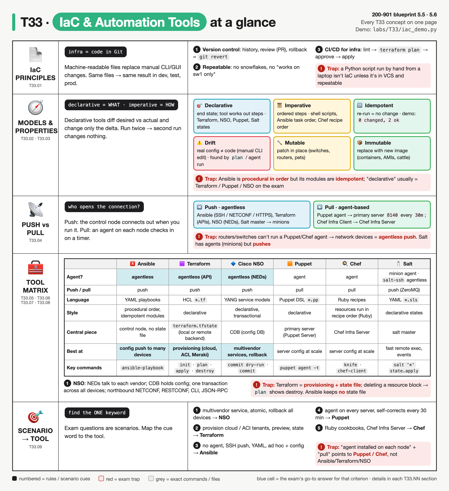
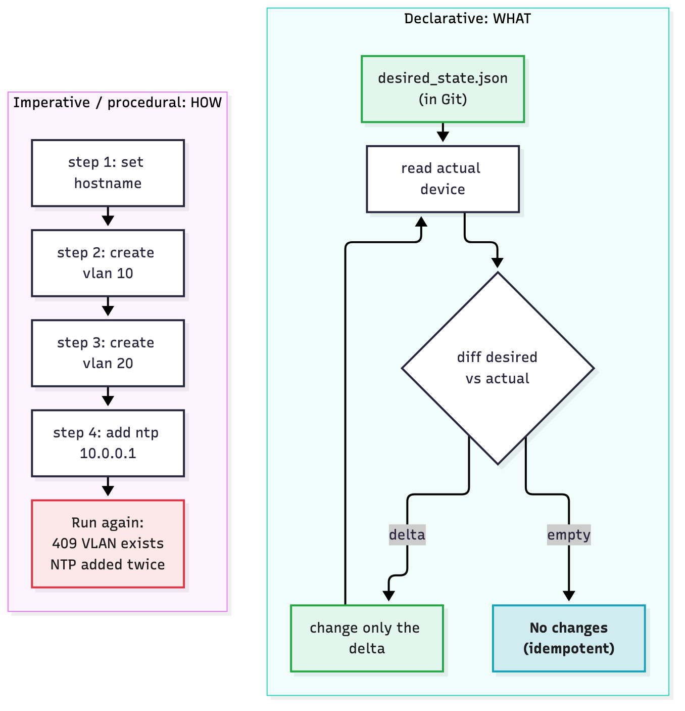
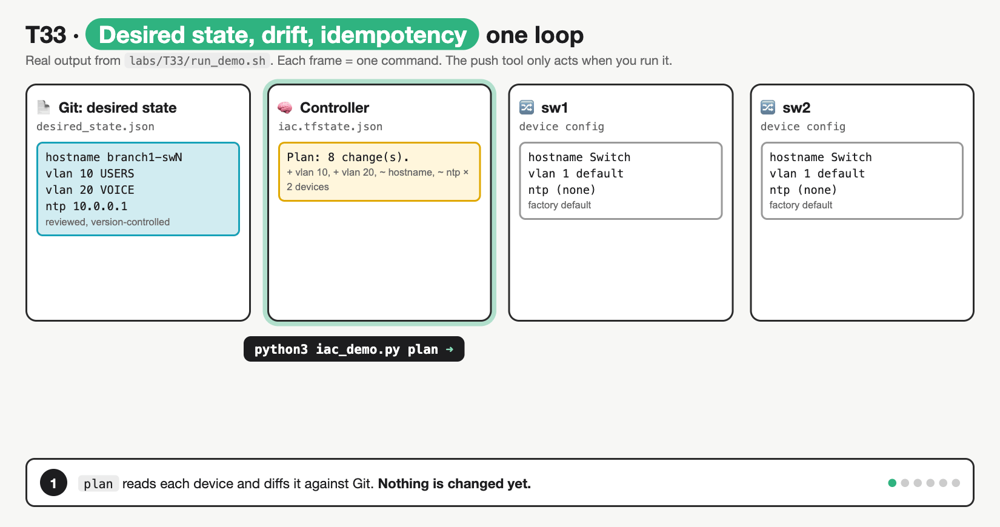
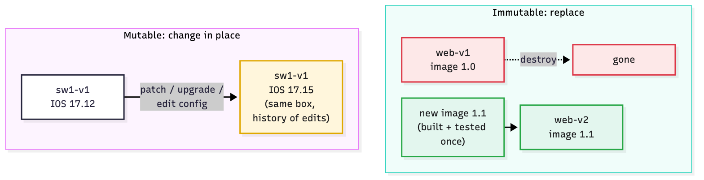
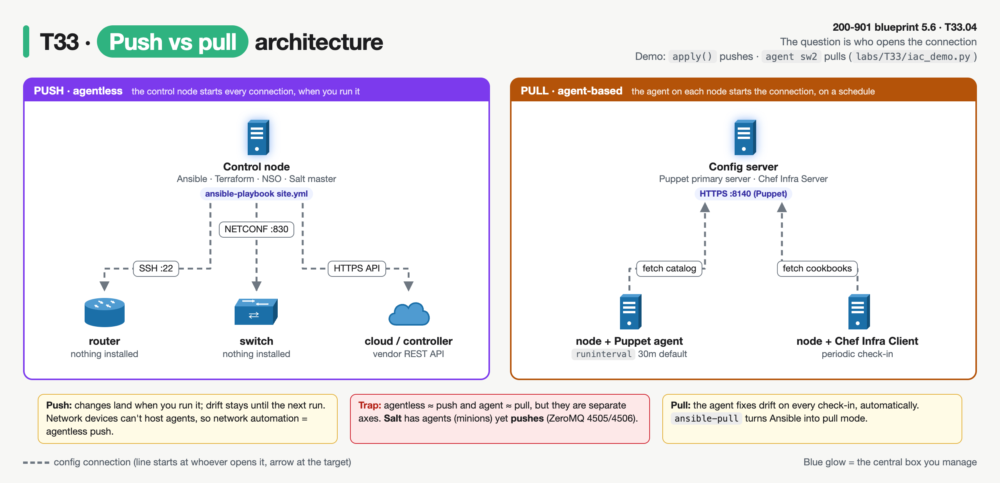
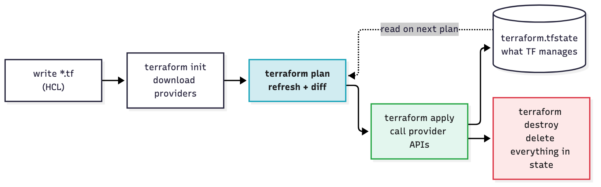
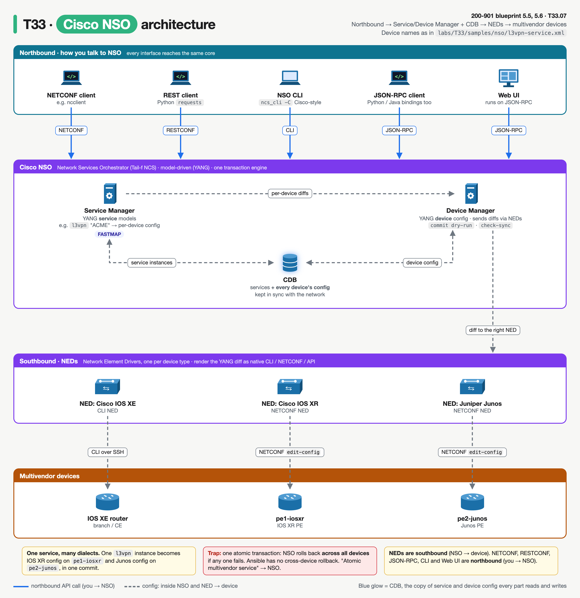
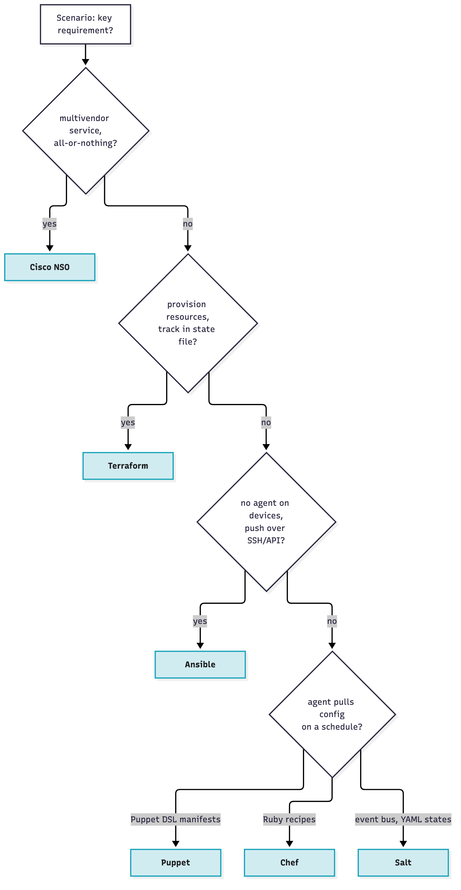

# T33 · IaC + tool comparison

> Owner: **Beedy** · Blueprint: **5.5, 5.6** · CBT coverage: **Full** · Learn by 2026-10-17 · Teach-back 2026-10-20



*Every T33 concept on one page. Rows are concept groups (IDs under the icon), the matrix compares six tools on the same criteria, blue cells are the exam's go-to answer, and red boxes are traps.*

<!-- toc:start -->

**Contents**

- [TL;DR (teach-back card)](#tldr-teach-back-card)
- [Concepts](#concepts)
  - [T33.01](#t3301--iac-principles) IaC principles · [T33.02](#t3302--models) Models · [T33.03](#t3303--properties) Properties · [T33.04](#t3304--architectures) Architectures · [T33.05](#t3305--ansible) Ansible · [T33.06](#t3306--terraform) Terraform · [T33.07](#t3307--nso) NSO · [T33.08](#t3308--puppetchef-awareness) Puppet/Chef (awareness) · [T33.09](#t3309--exam-angle) Exam angle
- [Exam traps](#exam-traps)
- [Examples](#examples)
- [Practice questions](#practice-questions)
- [Study aids](#study-aids)
- [Sources](#sources)
- [To verify](#to-verify)

<!-- toc:end -->

## TL;DR (teach-back card)

- **IaC = infrastructure described in files, kept in Git, applied by a tool.** You get history, review, rollback and repeatable dev → prod. **Declarative** = describe the end state, and the tool diffs it against reality (Terraform, NSO, Puppet). **Imperative** = list the steps (scripts; Ansible runs tasks in order). **Idempotent** = run again, nothing changes.
- **Two axes the exam loves:** agentless vs agent-based, and **push** (the controller connects out when you run it: Ansible, Terraform, NSO) vs **pull** (an agent on each node checks in on a timer: Puppet, Chef). Network devices can't host agents, so network automation is **agentless push**.
- **One line per tool:** Ansible = agentless YAML push over SSH/NETCONF/APIs · Terraform = declarative HCL + providers + **state file** (`plan` → `apply` → `destroy`) · NSO = YANG service models, **NEDs** for multivendor, **CDB**, **atomic transactions with rollback** · Puppet = agent pull, declarative manifests · Chef = agent pull, Ruby recipes.
- **Trap:** "multivendor network service, all devices succeed or none" → **NSO**, not Ansible. "Provision cloud/ACI objects and track them in state" → **Terraform**. "Agent on each node pulls config" → **Puppet/Chef**, never Ansible.

## Concepts

The note hangs on two things:

- **One reference program** (`labs/T33/iac_demo.py`): the same switch baseline applied two ways, *imperative steps* and *declarative plan/apply*. It then shows drift, a pull agent and an immutable replace. Pure Python, no tools to install. T33.01–T33.04 point at its functions and its real output.
- **A tool matrix** ([T33.09](#t3309--exam-angle)), plus one real-syntax sample per tool in `labs/T33/samples/` to read, not run. T33.05–T33.08 point at those.

Ansible and Terraform basics are skipped (you know them). Playbook reading is [T34](T34-ansible-playbook-interpretation.md), and NSO internals are Bob's [T25](../bob/T25-nso-cisco-modeling-labs.md). IaC inside a pipeline is [T28](T28-ci-cd-devops-principles.md).

### The reference program

```
labs/T33/
├── iac_demo.py            the program: imperative vs plan/apply, drift, agent, replace
├── desired_state.json     the "code" that would live in Git
├── run_demo.sh            runs the whole story in order
└── samples/               what each tool's config looks like (read only)
    ├── ansible/inventory.ini, site.yml
    ├── terraform/main.tf
    ├── nso/l3vpn-service.xml
    ├── puppet/site.pp
    ├── chef/default.rb
    └── salt/ntp.sls
```

**`labs/T33/desired_state.json`**

```json
{
  "sw1": {"hostname": "branch1-sw1", "vlans": {"10": "USERS", "20": "VOICE"}, "ntp_servers": ["10.0.0.1"]},
  "sw2": {"hostname": "branch1-sw2", "vlans": {"10": "USERS", "20": "VOICE"}, "ntp_servers": ["10.0.0.1"]}
}
```

**`labs/T33/iac_demo.py`**

```python
"""T33 reference program: imperative steps vs declarative desired state.

Two fake switches (sw1, sw2) are JSON files in a state folder. The same goal
(hostname, VLAN 10/20, one NTP server) is reached two ways:

  imperative   run a fixed list of steps in order (like a shell script)
  plan/apply   compare desired state with the real device, change only the delta
               (like Terraform, NSO, Puppet, or Ansible's state-based modules)

Other commands show drift, push vs pull, and mutable vs immutable changes.
Standard library only. Usage: python3 iac_demo.py <command> [device]
"""
import json
import os
import sys
import tempfile
from pathlib import Path

HERE = Path(__file__).resolve().parent
DESIRED_FILE = HERE / "desired_state.json"            # the "code": lives in Git
STATE_DIR = Path(os.environ.get("T33_STATE_DIR", Path(tempfile.gettempdir()) / "t33-state"))
DEVICES_DIR = STATE_DIR / "devices"                    # the "real" devices
STATE_FILE = STATE_DIR / "iac.tfstate.json"            # what the tool last applied
FACTORY = {"hostname": "Switch", "vlans": {"1": "default"}, "ntp_servers": []}


# ---------- device "API" (stand-in for SSH / NETCONF / RESTCONF) ----------
def read_device(name):
    return json.loads((DEVICES_DIR / f"{name}.json").read_text())


def write_device(name, config):
    (DEVICES_DIR / f"{name}.json").write_text(json.dumps(config, indent=2, sort_keys=True))


def load_desired():
    return json.loads(DESIRED_FILE.read_text())


def load_state():
    return json.loads(STATE_FILE.read_text()) if STATE_FILE.exists() else {"serial": 0, "devices": {}}


# ---------- setup ----------
def reset():
    """Factory-reset both switches and forget the state file."""
    DEVICES_DIR.mkdir(parents=True, exist_ok=True)
    for name in load_desired():
        write_device(name, {"instance_id": f"{name}-v1", **FACTORY})
    STATE_FILE.unlink(missing_ok=True)
    print(f"reset: {', '.join(load_desired())} at factory defaults, state file removed")


# ---------- 1. imperative / procedural ----------
STEPS = [                                              # HOW, in order; no idea of "already done"
    ("set_hostname", None),
    ("create_vlan", "10"),
    ("create_vlan", "20"),
    ("add_ntp_server", "10.0.0.1"),
]


def imperative():
    """Run the step list against every device. Run it twice to see it break."""
    desired = load_desired()
    for name, want in desired.items():
        dev, errors = read_device(name), 0
        for step, arg in STEPS:
            if step == "set_hostname":
                dev["hostname"] = want["hostname"]
            elif step == "create_vlan":
                if arg in dev["vlans"]:                # a real API would answer 409 Conflict
                    print(f"  {name}: create_vlan {arg} -> ERROR 409 VLAN {arg} already exists")
                    errors += 1
                    continue
                dev["vlans"][arg] = want["vlans"][arg]
            elif step == "add_ntp_server":
                dev["ntp_servers"].append(arg)         # appends blindly: duplicates on re-run
        write_device(name, dev)
        print(f"{name}: ran {len(STEPS)} steps, {errors} errors, ntp_servers={dev['ntp_servers']}")


# ---------- 2. declarative: diff desired vs actual ----------
def diff(want, have):
    """Return the list of changes needed to turn `have` into `want`."""
    changes = []
    if have["hostname"] != want["hostname"]:
        changes.append(f'~ hostname "{have["hostname"]}" -> "{want["hostname"]}"')
    for vid, vname in want["vlans"].items():
        if vid not in have["vlans"]:
            changes.append(f"+ vlan {vid} name {vname}")
        elif have["vlans"][vid] != vname:
            changes.append(f'~ vlan {vid} name "{have["vlans"][vid]}" -> "{vname}"')
    for vid in have["vlans"]:
        if vid not in want["vlans"] and vid != "1":    # VLAN 1 can't be deleted
            changes.append(f"- vlan {vid}")
    if have["ntp_servers"] != want["ntp_servers"]:
        changes.append(f"~ ntp_servers {have['ntp_servers']} -> {want['ntp_servers']}")
    return changes


def plan(quiet=False):
    """Refresh each device, compare with the desired state, print the delta."""
    desired, state = load_desired(), load_state()
    total = {}
    for name, want in desired.items():
        have = read_device(name)
        last = state["devices"].get(name)
        if last and {k: have[k] for k in last} != last:
            print(f"{name}: DRIFT detected: device no longer matches last apply (serial {state['serial']})")
        changes = diff(want, have)
        total[name] = changes
        if not quiet:
            for line in changes:
                print(f"  {name}: {line}")
    adds = sum(len(c) for c in total.values())
    print(f"Plan: {adds} change(s)." if adds else "No changes. Devices match the desired state.")
    return total


def converge(name, want):
    """Set the device to exactly the desired values (only called when a diff exists)."""
    dev = read_device(name)
    dev.update(hostname=want["hostname"], vlans={"1": "default", **want["vlans"]},
               ntp_servers=list(want["ntp_servers"]))
    write_device(name, dev)


def apply():
    """PUSH: the controller connects out to every device and fixes only what differs."""
    desired, state = load_desired(), load_state()
    changed = 0
    for name, changes in plan(quiet=True).items():
        if changes:
            converge(name, desired[name])
            changed += 1
        dev = read_device(name)
        state["devices"][name] = {k: dev[k] for k in ("hostname", "vlans", "ntp_servers")}
        print(f"push -> {name}: {'changed' if changes else 'ok'} ({len(changes)} change(s))")
    state["serial"] += 1 if changed else 0             # nothing changed -> same serial
    STATE_FILE.write_text(json.dumps(state, indent=2))
    print(f"Apply complete: {changed} changed, {len(desired) - changed} ok. State serial {state['serial']}.")


# ---------- 3. drift, pull agent, immutable replace ----------
def drift(name="sw2"):
    """Someone logs in and changes the device by hand (outside the IaC tool)."""
    dev = read_device(name)
    dev["vlans"]["20"] = "TEMP-FIX"
    dev["ntp_servers"] = ["192.0.2.99"]
    write_device(name, dev)
    print(f"{name}: manual CLI change: vlan 20 renamed TEMP-FIX, ntp server 192.0.2.99")


def agent(name="sw2"):
    """PULL: the agent on the device fetches its own catalog and converges itself."""
    want = load_desired()[name]
    changes = diff(want, read_device(name))
    print(f"{name} agent: fetched catalog from server, {len(changes)} change(s) needed")
    if changes:
        converge(name, want)
        print(f"{name} agent: converged; next check in 30 min")


def replace(name="sw1"):
    """IMMUTABLE: build a brand-new instance from the desired state, then retire the old one."""
    old = read_device(name)
    version = int(old["instance_id"].rsplit("-v", 1)[1]) + 1
    new = {"instance_id": f"{name}-v{version}", **FACTORY}
    new.update(hostname=load_desired()[name]["hostname"],
               vlans={"1": "default", **load_desired()[name]["vlans"]},
               ntp_servers=list(load_desired()[name]["ntp_servers"]))
    write_device(name, new)
    print(f"{name}: replaced {old['instance_id']} -> {new['instance_id']} (old instance destroyed, not patched)")


def show(name="sw1"):
    print(json.dumps(read_device(name), indent=2, sort_keys=True))


COMMANDS = {"reset": reset, "imperative": imperative, "plan": plan, "apply": apply,
            "drift": drift, "agent": agent, "replace": replace, "show": show}

if __name__ == "__main__":
    if len(sys.argv) < 2 or sys.argv[1] not in COMMANDS:
        sys.exit(f"usage: python3 iac_demo.py {{{'|'.join(COMMANDS)}}} [device]")
    COMMANDS[sys.argv[1]](*sys.argv[2:])
```

**`labs/T33/run_demo.sh`**

```bash
#!/usr/bin/env bash
# T33 walkthrough: imperative vs declarative, idempotency, drift, push vs pull, mutable vs immutable.
# Usage: bash labs/T33/run_demo.sh
set -u
cd "$(dirname "$0")"
export T33_STATE_DIR="${T33_STATE_DIR:-${TMPDIR:-/tmp}/t33-state}"
run() { echo; echo "\$ python3 iac_demo.py $*"; python3 iac_demo.py "$@"; }

echo "=== 1. Imperative: the same steps, run twice ==="
run reset
run imperative
run imperative

echo; echo "=== 2. Declarative: plan, apply, apply again ==="
run reset
run plan
run apply
run apply

echo; echo "=== 3. Drift: a manual change on sw2 ==="
run drift sw2
run plan
run apply

echo; echo "=== 4. Pull: the agent on sw2 fixes its own drift ==="
run drift sw2
run agent sw2
run agent sw2

echo; echo "=== 5. Immutable: replace sw1 instead of patching it ==="
run replace sw1
run plan
```

**Real output** (`bash labs/T33/run_demo.sh`):

```
=== 1. Imperative: the same steps, run twice ===

$ python3 iac_demo.py reset
reset: sw1, sw2 at factory defaults, state file removed

$ python3 iac_demo.py imperative
sw1: ran 4 steps, 0 errors, ntp_servers=['10.0.0.1']
sw2: ran 4 steps, 0 errors, ntp_servers=['10.0.0.1']

$ python3 iac_demo.py imperative
  sw1: create_vlan 10 -> ERROR 409 VLAN 10 already exists
  sw1: create_vlan 20 -> ERROR 409 VLAN 20 already exists
sw1: ran 4 steps, 2 errors, ntp_servers=['10.0.0.1', '10.0.0.1']
  sw2: create_vlan 10 -> ERROR 409 VLAN 10 already exists
  sw2: create_vlan 20 -> ERROR 409 VLAN 20 already exists
sw2: ran 4 steps, 2 errors, ntp_servers=['10.0.0.1', '10.0.0.1']

=== 2. Declarative: plan, apply, apply again ===

$ python3 iac_demo.py reset
reset: sw1, sw2 at factory defaults, state file removed

$ python3 iac_demo.py plan
  sw1: ~ hostname "Switch" -> "branch1-sw1"
  sw1: + vlan 10 name USERS
  sw1: + vlan 20 name VOICE
  sw1: ~ ntp_servers [] -> ['10.0.0.1']
  sw2: ~ hostname "Switch" -> "branch1-sw2"
  sw2: + vlan 10 name USERS
  sw2: + vlan 20 name VOICE
  sw2: ~ ntp_servers [] -> ['10.0.0.1']
Plan: 8 change(s).

$ python3 iac_demo.py apply
Plan: 8 change(s).
push -> sw1: changed (4 change(s))
push -> sw2: changed (4 change(s))
Apply complete: 2 changed, 0 ok. State serial 1.

$ python3 iac_demo.py apply
No changes. Devices match the desired state.
push -> sw1: ok (0 change(s))
push -> sw2: ok (0 change(s))
Apply complete: 0 changed, 2 ok. State serial 1.

=== 3. Drift: a manual change on sw2 ===

$ python3 iac_demo.py drift sw2
sw2: manual CLI change: vlan 20 renamed TEMP-FIX, ntp server 192.0.2.99

$ python3 iac_demo.py plan
sw2: DRIFT detected: device no longer matches last apply (serial 1)
  sw2: ~ vlan 20 name "TEMP-FIX" -> "VOICE"
  sw2: ~ ntp_servers ['192.0.2.99'] -> ['10.0.0.1']
Plan: 2 change(s).

$ python3 iac_demo.py apply
sw2: DRIFT detected: device no longer matches last apply (serial 1)
Plan: 2 change(s).
push -> sw1: ok (0 change(s))
push -> sw2: changed (2 change(s))
Apply complete: 1 changed, 1 ok. State serial 2.

=== 4. Pull: the agent on sw2 fixes its own drift ===

$ python3 iac_demo.py drift sw2
sw2: manual CLI change: vlan 20 renamed TEMP-FIX, ntp server 192.0.2.99

$ python3 iac_demo.py agent sw2
sw2 agent: fetched catalog from server, 2 change(s) needed
sw2 agent: converged; next check in 30 min

$ python3 iac_demo.py agent sw2
sw2 agent: fetched catalog from server, 0 change(s) needed

=== 5. Immutable: replace sw1 instead of patching it ===

$ python3 iac_demo.py replace sw1
sw1: replaced sw1-v1 -> sw1-v2 (old instance destroyed, not patched)

$ python3 iac_demo.py plan
No changes. Devices match the desired state.
```

### T33.01 · IaC principles

**Must cover:**

- [x] Infrastructure defined in machine-readable files instead of manual changes
- [x] Stored in version control: history, review, rollback
- [x] Repeatable and consistent across environments
- [x] Enables CI/CD for infrastructure

**Notes:**

- **IaC** = the wanted infrastructure (VLANs, NTP, VMs, ACI tenants, firewall rules) lives in **machine-readable files**: `desired_state.json`, `*.tf`, playbooks, manifests. A tool applies them. Nobody types the change into a CLI or GUI.
  - In the program, `desired_state.json` is the code and `apply()` is the tool. The devices are only ever changed by the tool, except in `drift()`, which simulates the manual change IaC is meant to stop.
- **Version control** (Git) gives you:
  - **History**: who changed VLAN 20, when and why (commit message).
  - **Review**: the change goes through a PR. Reviewers read the diff and the `terraform plan` output before merge ([T46](T46-code-review-principles.md)).
  - **Rollback**: `git revert` the commit and re-apply. The tool converges the devices back.
- **Repeatable and consistent**: the same files give the same result on every run and in every environment. In the demo, `sw1` and `sw2` come from one file and end up identical apart from hostname.
  - Dev, test and prod differ only in **variables** (IPs, sizes), not in hand-made changes. No "snowflake" devices.
- **Enables CI/CD for infrastructure**: because the change is a commit, a pipeline can run on it. The pipeline is lint/validate → `terraform plan` or `ansible-playbook --check` → approve → apply → test. See [T28.06](T28-ci-cd-devops-principles.md#t2806--infra-cicd). Network changes are often tested in CML first ([T25](../bob/T25-nso-cisco-modeling-labs.md)).
- Other wins the exam may name: speed, fewer human errors, documentation-as-code, disaster recovery (rebuild from the repo).

### T33.02 · Models

**Must cover:**

- [x] Declarative: describe the desired end state; the tool works out the steps (Terraform, NSO, Puppet)
- [x] Imperative/procedural: describe the steps in order (shell scripts; Ansible tasks run in order)

**Notes:**



*Left: a fixed list of steps that knows nothing about the current state, so re-running it breaks. Right: read the device, diff it against the desired state, change only the delta. An empty diff means no change.*

| | **Declarative** (WHAT) | **Imperative / procedural** (HOW) |
|---|---|---|
| You write | the end state: "VLAN 10 named USERS exists" | the steps: "create VLAN 10, then name it" |
| Tool's job | read actual → diff → work out the steps and their order | run the steps in the order written |
| Re-run | no-op if already correct | depends on the author; often errors or duplicates |
| In the demo | `plan()` + `apply()` using `diff()` | `imperative()` running `STEPS` |
| Examples | Terraform (HCL), NSO (YANG service models), Puppet (manifests), Salt states, Kubernetes YAML | shell/Bash/Python scripts; Chef recipes run in order; Ansible plays run tasks top to bottom |

- `imperative()` shows the problem in its real output: the second run gives `ERROR 409 VLAN 10 already exists` and `ntp_servers=['10.0.0.1', '10.0.0.1']`. The steps don't check the current state.
- `diff()` is the heart of every declarative tool. Terraform calls the output a **plan**, NSO a **dry-run**, and Puppet a catalog run that reports **changes/corrective changes**.
- **Order:** Terraform builds a dependency graph, so the order of blocks in `*.tf` doesn't matter. In an Ansible playbook, task order **does** matter.
- **Ansible is the classic grey area.** Plays and tasks run **in order** (procedural). But most modules are **declarative and idempotent**: `state: merged`, `state: present`. Exam wording usually puts Ansible on the procedural side or calls it "both". If the options are Terraform/Puppet/NSO vs Ansible for "declarative", pick the first group. ⚠ verify the exact framing in the CBT/N2K questions.

### T33.03 · Properties

**Must cover:**

- [x] Idempotency: running again with no changes makes no changes
- [x] Configuration drift: real state diverging from the defined state
- [x] Mutable infra: change servers in place; immutable: replace with new instances

**Notes:**



*Steps: plan (8 changes) → apply (pushes the delta) → apply again (0 changed: idempotent) → manual CLI edit on sw2 (drift) → plan detects it → apply fixes only sw2. Fixes the misconception that a push tool watches devices continuously: drift sits there until the next plan/apply run.*

- **Idempotency**: applying the same input any number of times gives the same end state, and runs after the first change nothing.
  - Demo: the second `apply` prints `Apply complete: 0 changed, 2 ok`, and the state serial stays `1`.
  - Ansible reports this as `changed=0` in the play recap. Terraform prints `No changes. Your infrastructure matches the configuration.` ⚠ verify the exact wording for your Terraform version.
  - Idempotency is a property of **how the code is written**, not of the tool. Ansible's `command`/`shell` modules aren't idempotent unless you add `creates:` or `changed_when:` ([T34](T34-ansible-playbook-interpretation.md)).
- **Configuration drift**: the real config moves away from the code, usually because of a manual change (hot fix, TAC session) or another tool.
  - Demo: `drift sw2` renames VLAN 20 to `TEMP-FIX`. `plan` then prints `DRIFT detected` and a 2-change diff.
  - **How tools catch it.** Push tools catch it only when you run them: `terraform plan` (refresh) or `ansible-playbook --check --diff`. Pull agents catch it on their next timed run and fix it themselves (Puppet's default `runinterval` is `30m`). NSO detects it with `check-sync` / `compare-config` ([T25](../bob/T25-nso-cisco-modeling-labs.md)).
  - Terraform reports this as *"Objects have changed outside of Terraform"*.
  - The demo keeps both views. `diff()` compares desired vs actual, which is all Ansible does: it has no state file. The `last` check in `plan()` compares actual vs last-applied, which is what Terraform's state file adds.



*Mutable patches the same box, so its history of edits can drift. Immutable builds a new tested image and destroys the old instance.*

| | **Mutable** | **Immutable** |
|---|---|---|
| Change = | edit/upgrade the existing server or device in place | build a new image/instance, swap it in, destroy the old one |
| Demo | `apply()` edits `sw1-v1` | `replace sw1` → `sw1-v1 -> sw1-v2 (old instance destroyed, not patched)` |
| Drift risk | grows over time (snowflakes) | low: instances are never edited |
| Typical | physical routers/switches, long-lived VMs; Ansible, Puppet, Chef | containers ([T27](T27-docker.md)), cloud VMs from golden images, Terraform `-replace` |
| Rollback | apply the old config | redeploy the previous image |

- Network hardware is **mutable by nature**: you can't throw away a core switch for each change. Immutable is the cloud/container pattern.
- "Pets vs cattle" is the same idea in other words: pets are mutable and nursed back to health; cattle are immutable and replaced.

### T33.04 · Architectures

**Must cover:**

- [x] Push: central server pushes changes (Ansible)
- [x] Pull: agents on nodes fetch config (Puppet, Chef)
- [x] Agentless (SSH/API) vs agent-based (software on each node)

**Notes:**



*The question is who opens the connection: follow each line from its start to its arrow. Push (left): the control node connects out over SSH, NETCONF or HTTPS when you run it, and nothing is installed on the devices. Pull (right): an agent on each node calls the server on a schedule. The red box is the Salt exception.*

| | **Push** | **Pull** |
|---|---|---|
| Who starts the connection | controller → node | node's agent → server |
| When changes land | when you run it (or the CI job runs it) | on the agent's next check-in (Puppet: every 30 min by default) |
| Drift fix | only on the next run | automatic, every agent run |
| Demo | `apply()`: `push -> sw1: ...` | `agent sw2`: `fetched catalog from server, 2 change(s) needed` |
| Tools | Ansible, Terraform, NSO, Salt (master → minions) | Puppet, Chef (also `ansible-pull`, which inverts Ansible into pull mode) |

| | **Agentless** | **Agent-based** |
|---|---|---|
| On the managed node | nothing extra: uses SSH, NETCONF (830), RESTCONF/HTTPS, vendor APIs | a daemon/client installed and kept updated (Puppet agent, Chef Infra Client, Salt minion) |
| Fits | network devices, appliances, cloud APIs | general-purpose servers you control |
| Cost | the controller needs reachability + credentials | agent install, certificates, versions on every node |
| Tools | Ansible, Terraform, NSO (and `salt-ssh`) | Puppet, Chef, Salt (default) |

- **Agentless ≈ push and agent ≈ pull**, but they're separate axes. **Salt** is agent-based (minions) yet **push**: the master publishes over a ZeroMQ bus on ports 4505/4506.
- Routers and switches generally can't run Puppet/Chef agents, so **network automation = agentless push**. ⚠ verify: older NX-OS releases had Puppet/Chef agent support; it isn't exam-relevant, but don't say "never".

### T33.05 · Ansible

**Must cover:**

- [x] Agentless, push model, uses SSH / NETCONF / HTTP APIs
- [x] YAML playbooks of tasks using modules
- [x] Strong for configuration management and orchestration across many devices

**Notes:**

- Home turf, so here is only the comparison angle. Playbook reading is [T34](T34-ansible-playbook-interpretation.md).
- **Agentless + push**: the **control node** connects out using existing credentials. Linux hosts use SSH + Python on the target. **Network modules run on the control node itself** (Ansible docs: "network modules do not run on the managed nodes"). They talk to the device through a connection plugin:

| `ansible_connection` | Talks | Typical use |
|---|---|---|
| `ansible.netcommon.network_cli` | SSH to the device CLI | IOS / IOS XE / NX-OS `*_config`, resource modules |
| `ansible.netcommon.netconf` | NETCONF over SSH (830) | `netconf_config`, `netconf_get` |
| `ansible.netcommon.httpapi` | HTTP(S) API | NX-API, some controllers |
| `local` + module does HTTPS | REST API | Meraki, Catalyst Center, ACI, ISE collections |

- **YAML playbooks → plays → tasks → modules**: `samples/ansible/site.yml` uses resource modules (`cisco.ios.ios_vlans`, `state: merged`). These are idempotent, so a second run reports `changed=0`.
- **No state file.** Every run reads the device and compares. That's why Ansible can't "destroy what it created last time" the way Terraform can.
- **Strengths**: config management and orchestration across many devices (rolling upgrades, multi-step workflows), ad hoc commands, a huge module/collection library. The exam pairs it with **"agentless"** and **"YAML"**.

**`labs/T33/samples/ansible/inventory.ini`**

```ini
# Ansible inventory: the controller pushes to these hosts over SSH (network_cli) or NETCONF
[branch_switches]
sw1 ansible_host=10.10.20.11
sw2 ansible_host=10.10.20.12

[branch_switches:vars]
ansible_network_os=cisco.ios.ios
ansible_connection=ansible.netcommon.network_cli
ansible_user=admin
```

**`labs/T33/samples/ansible/site.yml`** (passed `ansible-playbook --syntax-check`, see [Examples §3](#3-check-the-ansible-sample))

```yaml
---
# Ansible: YAML playbook, tasks run top to bottom (procedural order),
# but each resource module is state-based: state: merged only changes what differs.
- name: Branch switch baseline
  hosts: branch_switches
  gather_facts: false

  tasks:
    - name: Set hostname
      cisco.ios.ios_hostname:
        config:
          hostname: "branch1-{{ inventory_hostname }}"
        state: merged

    - name: VLANs 10 and 20
      cisco.ios.ios_vlans:
        config:
          - vlan_id: 10
            name: USERS
          - vlan_id: 20
            name: VOICE
        state: merged

    - name: NTP server
      cisco.ios.ios_ntp_global:
        config:
          servers:
            - server: 10.0.0.1
        state: merged
```

### T33.06 · Terraform

**Must cover:**

- [x] HashiCorp, declarative HCL
- [x] Providers talk to platform APIs (AWS, ACI, Meraki, IOS XE)
- [x] State file tracks what it manages; terraform plan (preview) → apply → destroy
- [x] Strong for provisioning resources

**Notes:**



*init downloads providers; plan refreshes state and diffs it (blue: the preview step); apply calls the provider APIs and writes the state; destroy (red) removes everything in the state.*

- **HashiCorp** tool. **Declarative HCL** (`*.tf`). HashiCorp docs: configuration files "describe the end state of your infrastructure"; Terraform builds a **resource graph** to work out the order.
- **Providers** = plugins that turn HCL resources into API calls. Cisco ones on the Terraform Registry include `CiscoDevNet/aci`, `CiscoDevNet/iosxe`, `cisco-open/meraki`, `CiscoDevNet/sdwan`, `CiscoDevNet/catalystcenter`, and `CiscoDevNet/ise`. ⚠ verify the namespaces at registry.terraform.io.
  - The `CiscoDevNet/iosxe` provider talks **NETCONF over SSH (port 830)**. From v1.0 it dropped RESTCONF (provider changelog). Older notes and videos may show RESTCONF.
- **State file** `terraform.tfstate` (backup `terraform.tfstate.backup`) maps each resource block to the real object.
  - It is how Terraform knows what *it* manages: remove a block → the next plan says **destroy**.
  - Store it in a **remote backend** (S3, HCP Terraform) for teams. It can hold secrets, so never commit it ([T29](T29-secrets-encryption-data-handling.md)).
- **Workflow:**
  - `terraform init`: download providers, set up the backend.
  - `terraform plan`: refresh, diff, print `Plan: X to add, Y to change, Z to destroy.`
  - `terraform apply`: execute. It shows the plan and asks `yes` unless you pass `-auto-approve`.
  - `terraform destroy`: delete everything in state.
  - Extras: `terraform fmt`, `terraform validate`; `plan -detailed-exitcode` returns `0` = no changes, `2` = changes (CI drift checks).
- **Strengths**: **provisioning** (create/destroy cloud VMs, VPCs, ACI tenants/EPGs, Meraki networks), multi-cloud with one language, and a preview before changing anything.
- **Weaker at**: ongoing in-box config management and ordered procedures. The classic split is "Terraform builds the VM, Ansible configures what runs inside it".

**`labs/T33/samples/terraform/main.tf`** (resource names and attributes from the `CiscoDevNet/iosxe` provider docs; not run: Terraform isn't installed and there's no device)

```hcl
# Terraform: declarative HCL. Order of blocks doesn't matter; Terraform builds a graph.
# terraform init -> terraform plan -> terraform apply  (state kept in terraform.tfstate)
terraform {
  required_providers {
    iosxe = {
      source = "CiscoDevNet/iosxe"
    }
  }
}

provider "iosxe" {
  host     = "10.10.20.11"   # NETCONF over SSH, port 830 by default
  username = "admin"
  password = var.iosxe_password
}

variable "iosxe_password" {
  type      = string
  sensitive = true
}

resource "iosxe_system" "sw1" {
  hostname = "branch1-sw1"
}

resource "iosxe_vlan" "users" {
  vlan_id = 10
  name    = "USERS"
}

resource "iosxe_vlan" "voice" {
  vlan_id = 20
  name    = "VOICE"
}
```

### T33.07 · NSO

**Must cover:**

- [x] Cisco Network Services Orchestrator: model-driven (YANG) service orchestration
- [x] NEDs (Network Element Drivers) talk to multivendor devices
- [x] CDB stores config; changes are transactional across devices with rollback
- [x] Northbound APIs: REST, RESTCONF, NETCONF, CLI

**Notes:**

- Exam-level summary only. Bob owns the deep dive in [T25](../bob/T25-nso-cisco-modeling-labs.md).



*Read top to bottom. Every northbound interface (blue: NETCONF, RESTCONF, CLI, JSON-RPC, Web UI) reaches the same core. The Service Manager maps a YANG service onto per-device config, both kept in the CDB (glowing). The Device Manager sends each diff through one NED per vendor, and the whole change is one atomic transaction across all devices.*

- **Cisco (Crosswork) Network Services Orchestrator**, from the Tail-f acquisition. CLI and file names still say `ncs` / `tail-f`.
  - Two layers: the **Service Manager** (YANG **service models**, e.g. "L3VPN for customer ACME") and the **Device Manager** (device config).
  - **Model-driven**: NSO "learns from the service models" written in **YANG**, rather than being a hard-coded orchestrator.
  - Service changes are mapped down to per-device config by **FASTMAP**, which also handles service modify/delete. ⚠ verify the name stays exam-relevant.
- **NEDs** = Network Element Drivers. Each device interface is modelled in YANG, so NSO can render CLI (Cisco, Juniper, Arista, …), NETCONF, or API calls from the model. That's how it does **multivendor**.
- **CDB** (configuration database): holds the config of every device and service, kept **in sync** with the network (`sync-from`, `sync-to`, `check-sync`), plus the service ↔ device relationships.
- **Transactions**: a commit is pushed "in a distributed and atomic transaction across all devices in parallel". Changes "either succeed … or fail and are rolled back as a whole" (NSO docs). `commit dry-run` previews the device changes first.
  - This is the key differentiator vs Ansible: Ansible has no cross-device rollback.
- **Northbound APIs**: CLI (Cisco- and Juniper-style), Web UI, **NETCONF**, **RESTCONF**, **JSON-RPC**, plus Python/Java/Erlang bindings. Exam wording "REST" maps to RESTCONF/JSON-RPC.
- **Strengths**: service providers and large enterprises running multivendor **services** (L3VPN, EVPN, ACLs) that span many devices, where atomicity and service lifecycle matter.

**`labs/T33/samples/nso/l3vpn-service.xml`** (illustrative: the `l3vpn` service model is invented, as every NSO service model is user-written; XML well-formedness checked only)

```xml
<!-- NSO: you create ONE service instance (fields defined by a YANG service model).
     NSO maps it to device config on every node, pushes it through NEDs in one
     transaction, and rolls back on all devices if any device fails.
     Load with: ncs_cli -C, then: config / load merge l3vpn-service.xml / commit dry-run / commit -->
<config xmlns="http://tail-f.com/ns/config/1.0">
  <l3vpn xmlns="http://example.com/l3vpn">
    <name>ACME</name>
    <as-number>65101</as-number>
    <endpoint>
      <id>branch1</id>
      <device>pe1-iosxr</device>
      <interface>GigabitEthernet0/0/0/1</interface>
      <ip-network>172.16.1.0/30</ip-network>
    </endpoint>
    <endpoint>
      <id>branch2</id>
      <device>pe2-junos</device>
      <interface>ge-0/0/1</interface>
      <ip-network>172.16.2.0/30</ip-network>
    </endpoint>
  </l3vpn>
</config>
```

### T33.08 · Puppet/Chef (awareness)

**Must cover:**

- [x] Puppet: agent-based, pull, declarative manifests
- [x] Chef: agent-based, pull, Ruby "recipes"

**Notes:**

| | **Puppet** | **Chef** | **Salt** (bonus, sometimes an option) |
|---|---|---|---|
| Architecture | agent-server: **Puppet agent** on each node, **primary server** (Puppet Server; older docs say "master") | **Chef Infra Client** on each node, **Chef Infra Server** hub, **Chef Workstation** where you write code (`knife`) | **master** + **minions** (agents); `salt-ssh` = agentless |
| Push/pull | **pull**: agent requests a compiled **catalog** over HTTPS **8140**, default `runinterval` **30m** | **pull**: client "periodically contacts the Chef Infra Server to retrieve the latest cookbooks" | **push** over ZeroMQ (4505/4506) |
| Language | **Puppet DSL** manifests `*.pp`, **declarative** | **Ruby** DSL: **recipes** grouped in **cookbooks** | **YAML** state files `*.sls` |
| Exam cue | "manifest", "catalog", "agent pulls" | "recipe", "cookbook", "Ruby" | "minion", "grains", "event bus" |

- Both converge the node only when it differs from the code (Chef docs: "if (and only if) the current state of the node doesn't conform"). So both are idempotent and correct drift on every run.
- Chef's resources inside a recipe run **in the order written** (procedural flavour). Puppet resources are ordered by dependencies (`require`, `notify`). ⚠ verify if a question calls Chef "declarative".
- Neither is typical for network devices on this exam. Think servers/OS config.

**`labs/T33/samples/puppet/site.pp`**

```puppet
# Puppet: declarative manifest (Puppet DSL). The agent on each node pulls a compiled
# catalog from the Puppet primary server (HTTPS 8140) every 30 min by default.
node 'web01.example.com' {
  package { 'chrony':
    ensure => installed,
  }

  file { '/etc/chrony.conf':
    ensure  => file,
    content => "server 10.0.0.1 iburst\n",
    require => Package['chrony'],
    notify  => Service['chronyd'],
  }

  service { 'chronyd':
    ensure => running,
    enable => true,
  }
}
```

**`labs/T33/samples/chef/default.rb`**

```ruby
# Chef: a recipe (Ruby DSL) inside a cookbook. Chef Infra Client on each node
# periodically contacts Chef Infra Server, fetches cookbooks and converges.
package 'chrony'

file '/etc/chrony.conf' do
  content "server 10.0.0.1 iburst\n"
  notifies :restart, 'service[chronyd]'
end

service 'chronyd' do
  action [:enable, :start]
end
```

**`labs/T33/samples/salt/ntp.sls`**

```yaml
# Salt: YAML state file (SLS). The master pushes over a ZeroMQ bus (4505/4506)
# to minions (agents); salt-ssh is the agentless option.
chrony:
  pkg.installed: []

/etc/chrony.conf:
  file.managed:
    - contents: "server 10.0.0.1 iburst"
    - require:
      - pkg: chrony

chronyd:
  service.running:
    - enable: true
    - watch:
      - file: /etc/chrony.conf
```

- Same job (chrony + NTP server) in all three, so the differences in syntax stand out. These weren't run (Puppet/Chef/Salt not installed). The Salt file was only checked as valid YAML.

### T33.09 · Exam angle

**Must cover:**

- [x] Pick the tool for a scenario (multivendor service transactions → NSO; cloud provisioning with state → Terraform; agentless config push → Ansible)
- [x] Declarative vs imperative and push vs pull definitions

**Notes:**



*Ask the questions in this order. Atomic multivendor services is checked first, because only NSO does it; agent/pull last.*

| | Ansible | Terraform | NSO | Puppet | Chef | Salt |
|---|---|---|---|---|---|---|
| Vendor | Red Hat | HashiCorp (IBM) | Cisco | Perforce (Puppet) | Progress (Chef) | Broadcom/VMware ⚠ verify |
| Agent | agentless | agentless (API) | agentless (NEDs) | agent | agent | minion (or `salt-ssh`) |
| Push/pull | push | push | push | pull | pull | push |
| Language | YAML | HCL | YANG models (+ Python/Java) | Puppet DSL | Ruby | YAML (+ Jinja) |
| Model | procedural order, idempotent modules | declarative | declarative, transactional | declarative | procedural (ordered resources) | declarative states |
| State | none | `terraform.tfstate` | CDB | server + catalog | Chef Infra Server | master |
| Key commands | `ansible-playbook` | `terraform init` · `plan` · `apply` · `destroy` | `commit dry-run` · `commit` | `puppet agent -t` (run now) | `knife` (workstation) · `chef-client` | `salt '*' state.apply` |
| Sweet spot | device config push, orchestration | provisioning | multivendor services + rollback | server config | server config | fast remote exec at scale |

| Scenario cue | Answer |
|---|---|
| Multivendor service across PE routers; if one device fails, every device rolls back | **NSO** |
| Network service defined once as a YANG model; northbound RESTCONF for the OSS | **NSO** |
| Create ACI tenants/EPGs or AWS VPCs, preview changes, track what was created, tear it down later | **Terraform** |
| "State file", "plan", "provider", "HCL" | **Terraform** |
| Push a config change to 500 IOS XE switches over SSH; no software may be installed on them | **Ansible** |
| "Playbook", "inventory", "YAML", "agentless" | **Ansible** |
| Every Linux server must check in and self-correct every 30 min | **Puppet** (or Chef) |
| "Manifest", "catalog" | **Puppet** |
| "Recipe", "cookbook", "Ruby" | **Chef** |
| Describe the end state, let the tool work out the steps | **declarative** |
| Script runs commands one after another | **imperative / procedural** |
| Running the same automation twice causes no extra change | **idempotent** |
| Replace the server with a new one built from an image instead of patching it | **immutable** |

## Exam traps

- **Push vs pull is about who starts the connection**, not which way the config flows. In both, config ends up on the node.
- **Agentless ≠ push by definition.** Salt is agent-based (minions) but push. `ansible-pull` makes Ansible pull. The exam's default pairing is Ansible/Terraform/NSO = agentless push and Puppet/Chef = agent pull.
- **Ansible procedural vs declarative:** tasks run **in order** (procedural), but resource modules are **idempotent / state-based**. If you must pick "declarative", pick Terraform/Puppet/NSO.
- **Idempotent ≠ declarative.** A well-written script can be idempotent. A declarative tool is idempotent by design. Ansible `command`/`shell` tasks are **not** idempotent by default.
- **Terraform state file:** deleting a resource block → `plan` shows **destroy**. Deleting the state file → Terraform forgets the resources (they still exist) and will try to create duplicates. Ansible has **no** state file.
- **`terraform plan` changes nothing**; `apply` does. `destroy` removes everything in state, not "everything in the account".
- **NSO's unique selling point = atomic multivendor transactions with rollback** (plus CDB, NEDs, YANG service models). Ansible can't roll back across devices.
- **NEDs are NSO's southbound drivers.** NSO's **northbound** = CLI, Web UI, NETCONF, RESTCONF, JSON-RPC. Don't swap them.
- **Puppet = declarative manifests (Puppet DSL)**; **Chef = Ruby recipes in cookbooks**. Both are **agent + pull**. Chef/Puppet aren't the answer for routers and switches.
- **Puppet naming:** "primary server" (current docs) = "master" (old docs and many exam-prep sources). The agent talks HTTPS **8140**, default run every **30 min**.
- **Mutable vs immutable:** patching a running box = mutable. "Never modify, replace with a new image" = immutable (containers, golden AMIs).
- **Drift isn't detected live by push tools.** It shows up on the next `plan`/`--check` run. Pull agents fix it on their next interval.

## Examples

### 1. Run the reference program

Python 3 only, nothing to install. State goes to `$TMPDIR/t33-state` (override with `T33_STATE_DIR`).

```bash
bash labs/T33/run_demo.sh
```

One command at a time:

```bash
cd labs/T33
python3 iac_demo.py reset
python3 iac_demo.py plan
python3 iac_demo.py apply
python3 iac_demo.py apply
python3 iac_demo.py drift sw2
python3 iac_demo.py plan
python3 iac_demo.py show sw2
```

In the lab container:

```bash
docker build --tag ccna-auto-lab:latest --file labs/Dockerfile labs/
docker run --rm --volume "$(pwd)":/work --workdir /work ccna-auto-lab:latest bash labs/T33/run_demo.sh
```

### 2. Break it on purpose

Work on a throwaway copy, so the repo files stay clean. Run from the repo root:

```bash
REPO="$(pwd)"
rm -rf "$TMPDIR/t33-copy" && cp -R "$REPO/labs/T33" "$TMPDIR/t33-copy" && cd "$TMPDIR/t33-copy"
export T33_STATE_DIR="$TMPDIR/t33-break"
```

**a) Remove VLAN 20 from the code → the plan says delete** (like removing a Terraform resource block):

```bash
python3 iac_demo.py reset && python3 iac_demo.py apply > /dev/null
python3 - <<'PY'
import json
d = json.load(open("desired_state.json"))
for sw in d.values():
    del sw["vlans"]["20"]
json.dump(d, open("desired_state.json", "w"), indent=2)
PY
python3 iac_demo.py plan
```

Real output:

```
  sw1: - vlan 20
  sw2: - vlan 20
Plan: 2 change(s).
```

**b) Delete the state file, then drift → still fixed, but "since last apply" is lost** (the Ansible model: desired vs actual only):

```bash
rm -rf "$TMPDIR/t33-copy2" && cp -R "$REPO/labs/T33" "$TMPDIR/t33-copy2" && cd "$TMPDIR/t33-copy2"
export T33_STATE_DIR="$TMPDIR/t33-nostate"
python3 iac_demo.py reset && python3 iac_demo.py apply > /dev/null
rm "$T33_STATE_DIR/iac.tfstate.json"
python3 iac_demo.py drift sw2
python3 iac_demo.py plan
```

Real output (no `DRIFT detected` line this time, because there's no record of the last apply to compare with):

```
sw2: manual CLI change: vlan 20 renamed TEMP-FIX, ntp server 192.0.2.99
  sw2: ~ vlan 20 name "TEMP-FIX" -> "VOICE"
  sw2: ~ ntp_servers ['192.0.2.99'] -> ['10.0.0.1']
Plan: 2 change(s).
```

**c) Run the imperative path twice** (already in `run_demo.sh` §1): the second run prints `ERROR 409 VLAN 10 already exists` and duplicates the NTP server. That's non-idempotent code.

### 3. Check the Ansible sample

Syntax-check only (there's no device to run against). Uses a throwaway venv:

```bash
python3 -m venv "$TMPDIR/ansvenv"
"$TMPDIR/ansvenv/bin/pip" install ansible-core
"$TMPDIR/ansvenv/bin/ansible-galaxy" collection install cisco.ios
cd labs/T33/samples/ansible
"$TMPDIR/ansvenv/bin/ansible-playbook" -i inventory.ini site.yml --syntax-check
"$TMPDIR/ansvenv/bin/ansible-inventory" -i inventory.ini --graph
```

Real output (ansible-core 2.21.5, cisco.ios 11.6.0):

```
playbook: site.yml
@all:
  |--@ungrouped:
  |--@branch_switches:
  |  |--sw1
  |  |--sw2
```

Against a real device (DevNet Catalyst 8000v always-on sandbox or CML), the second run of `ansible-playbook -i inventory.ini site.yml --ask-pass` should show `changed=0` in the recap. ⚠ verify: not run here.

### 4. Terraform against IOS XE (reference only, not run)

With Terraform installed and a NETCONF-enabled IOS XE device (`netconf-yang` in config):

```bash
cd labs/T33/samples/terraform
export TF_VAR_iosxe_password='<device password>'
terraform init
terraform plan
terraform apply
terraform plan -detailed-exitcode; echo "exit=$?"
terraform destroy
```

- Expected: the first `plan` shows `3 to add`. After `apply`, `plan -detailed-exitcode` returns `exit=0` (no changes = idempotent). If someone renames VLAN 20 on the CLI, it returns `exit=2` (drift). ⚠ verify: not run (no Terraform binary, no device).

## Practice questions

**Q1.** An engineer runs the same automation against 20 switches twice in a row. The second run reports no changes on any switch. Which property does this show?
A. Immutability  B. Idempotency  C. Configuration drift  D. Pull architecture

<details><summary>Answer</summary>

**B.** Idempotent automation produces the same end state no matter how many times it runs, and changes nothing once the state is correct. The demo's second `apply` shows `0 changed, 2 ok`. (T33.03)
</details>

**Q2.** A service provider must deploy an L3VPN across Cisco IOS XR and Juniper PE routers. If the change fails on any router, the configuration on every router must roll back automatically. Which tool fits best?
A. Ansible  B. Terraform  C. Cisco NSO  D. Puppet

<details><summary>Answer</summary>

**C.** NSO pushes service changes through vendor NEDs as one atomic transaction across all devices, with rollback. Ansible runs per-host tasks and has no cross-device rollback; Puppet is agent-based and server-focused. (T33.07, T33.09)
</details>

**Q3.** Which two tools typically use an agent installed on each managed node that periodically pulls its configuration from a central server? (Choose two.)
A. Ansible  B. Puppet  C. Terraform  D. Chef  E. Cisco NSO

<details><summary>Answer</summary>

**B, D.** The Puppet agent pulls a catalog from the primary server (every 30 min by default); Chef Infra Client pulls cookbooks from Chef Infra Server. Ansible, Terraform and NSO are agentless and push. (T33.04, T33.08)
</details>

**Q4.** A team keeps `main.tf` in Git and runs `terraform apply`. Later, an engineer deletes the `resource "iosxe_vlan" "voice"` block and runs `terraform plan`. What does the plan show, and how does Terraform know?
A. No changes, because the VLAN still exists on the device
B. It plans to destroy VLAN 20, because the state file says Terraform manages it
C. It plans to create VLAN 20 again
D. An error, because resource blocks can't be removed

<details><summary>Answer</summary>

**B.** `terraform.tfstate` maps each resource block to a real object. A block that's in state but no longer in the configuration is planned for destruction. Break-it drill (a) shows the same idea: `- vlan 20`. (T33.06)
</details>

**Q5.** Match each description to **declarative** or **imperative**:
1. "Ensure VLAN 10 named USERS exists on sw1."
2. A Bash script that SSHes to sw1 and sends `vlan 10`, then `name USERS`, in that order.
3. A Terraform `iosxe_vlan` resource block.
4. The `STEPS` list run by `imperative()` in `labs/T33/iac_demo.py`.

<details><summary>Answer</summary>

1 → **declarative**, 2 → **imperative**, 3 → **declarative**, 4 → **imperative**. Declarative states the end result and the tool works out the steps; imperative lists the steps in order. (T33.02)
</details>

**Q6.** Someone changes the NTP server on a router by hand. The router is managed by Ansible playbooks run from a CI pipeline once a day. When does the automation notice?
A. Immediately, because Ansible watches the device
B. At the next playbook run (or a `--check --diff` run)
C. Never, because Ansible keeps no state
D. When the router's agent next checks in

<details><summary>Answer</summary>

**B.** Push tools only see the device when they run. Ansible keeps no state file, but it reads the device each run and compares it with the playbook, so the drift is fixed then. There's no agent on the router (D). (T33.03, T33.04)
</details>

**Q7.** Complete the Terraform workflow so the changes are previewed before anything is modified:
`terraform ______` → `terraform ______` → `terraform ______`

<details><summary>Answer</summary>

**init → plan → apply.** `init` downloads providers and sets up the backend, `plan` shows the diff without changing anything, and `apply` executes it and updates the state. `destroy` removes everything in state. (T33.06)
</details>

**Q8.** A web tier runs on cloud VMs. For each release, the team builds a new machine image, launches new VMs from it and deletes the old VMs instead of updating them. What is this approach called, and what is one benefit?
A. Mutable infrastructure; faster patching
B. Immutable infrastructure; no configuration drift on long-lived servers
C. Pull architecture; agents fix drift
D. Imperative IaC; steps run in order

<details><summary>Answer</summary>

**B.** Replacing instead of modifying is immutable infrastructure. Each instance is built from a tested image and never edited, so there's no drift; rollback = redeploy the previous image. (T33.03)
</details>

## Study aids

| Aid | Type | Title | Est. min | Resource |
|---|---|---|---|---|
| T33.1 | Top-up | One-line differentiator per tool | 15 | Own notes (the matrix in [T33.09](#t3309--exam-angle) and the TL;DR card) |

- Skip / low priority: Whole video (per `data/topics.csv`). This note covers 5.5 and 5.6 on its own.
- Run `bash labs/T33/run_demo.sh` once (2 min). Then read the six samples side by side and say the tool from the syntax alone.

## Sources

- Architecture diagrams: HTML source `assets/T33/08-nso-architecture-arch.html`, `assets/T33/09-push-vs-pull-arch.html` (shared kit `assets/_arch/`)
- Overview image: HTML source `assets/T33/00-overview.html`, rendered to PNG (see `assets/README.md`). Diagrams: Mermaid sources in `assets/T33/*.mmd`. Animation: `assets/T33/07-drift-loop-anim.html` → `07-drift-loop.gif`.
- Ansible, Introduction (agentless, SSH with existing credentials, YAML, idempotent "does not change anything" wording): https://docs.ansible.com/ansible/latest/getting_started/introduction.html
- Ansible, How network automation is different (network modules execute on the control node; connection types): https://docs.ansible.com/ansible/latest/network/getting_started/network_differences.html
- Ansible, `ansible-pull` ("inverts the default push architecture of ansible into a pull architecture"): https://docs.ansible.com/ansible/latest/cli/ansible-pull.html
- Terraform, What is Terraform (declarative config, resource graph, providers via APIs): https://developer.hashicorp.com/terraform/intro
- Terraform, State (`terraform.tfstate`, `.backup`, remote backends): https://developer.hashicorp.com/terraform/language/state
- Terraform, `terraform plan` (speculative plan, `Plan: X to add…`, `-detailed-exitcode` 0/1/2, refresh-only): https://developer.hashicorp.com/terraform/cli/commands/plan
- Terraform tutorial, Manage resource drift ("Objects have changed outside of Terraform"): https://developer.hashicorp.com/terraform/tutorials/state/resource-drift
- CiscoDevNet `iosxe` Terraform provider docs (NETCONF over SSH port 830, `iosxe_vlan`/`iosxe_system` attributes) and changelog (RESTCONF support removed): https://github.com/CiscoDevNet/terraform-provider-iosxe/tree/main/docs
- Cisco NSO, NSO at a Glance (Service/Device Manager, CDB, NEDs modelled in YANG, northbound interfaces, atomic transaction and rollback wording): https://nso-docs.cisco.com/nso-basics/nso-at-a-glance
- Puppet Server, About (agent-server architecture, "primary server", HTTPS port 8140): https://help.puppet.com/core/8/Content/PuppetCore/server/about_server.htm
- Puppet configuration reference (`runinterval` default `30m`): https://github.com/puppetlabs/puppet/blob/main/references/configuration.md
- Chef, Platform overview (Infra Client on every node, periodically retrieves cookbooks from Infra Server, converges only on mismatch; recipes and cookbooks; `knife`): https://docs.chef.io/platform_overview/
- Salt user guide, Overview (master/minion, ZeroMQ, ports 4505/4506, YAML SLS, Salt SSH agentless): https://docs.saltproject.io/salt/user-guide/en/latest/topics/overview.html
- Cisco 200-901 v1.1 exam topics (5.5, 5.6): https://learningcontent.cisco.com/documents/marketing/exam-topics/200-901-CCNAAUTO_v.1.1.pdf (not opened this session; wording from `data/blueprint-map.csv`, which is paraphrased)

## To verify

- ⚠ **Ansible "declarative vs procedural" framing**: the note says tasks run in order (procedural) with idempotent modules. Check how the CBT/N2K questions classify Ansible, so the "pick declarative → Terraform/Puppet/NSO" rule holds.
- ⚠ **Chef "procedural" vs "declarative"**: Chef resources are declarative, but recipes run in written order. Check the exam-prep wording.
- ⚠ **Terraform no-change message** (`No changes. Your infrastructure matches the configuration.`): from memory, not seen in the docs fetched this session.
- ⚠ **Cisco Terraform provider namespaces** (`CiscoDevNet/aci`, `cisco-open/meraki`, `CiscoDevNet/sdwan`, `CiscoDevNet/catalystcenter`, `CiscoDevNet/ise`): only `CiscoDevNet/iosxe` was checked (registry API + GitHub docs).
- ⚠ **NSO FASTMAP**: named from prior knowledge, not in the page fetched. Bob's T25 may cover it.
- ⚠ **NX-OS Puppet/Chef agent support** (legacy): from prior knowledge. Only matters to avoid saying "network devices can never run agents".
- ⚠ **Vendor ownership row** (Terraform/IBM, Puppet/Perforce, Chef/Progress, Salt/Broadcom-VMware): from prior knowledge. It isn't exam content; drop it if unsure.
- **Not run:** Terraform (`samples/terraform/main.tf`, Examples §4), Puppet, Chef, Salt and NSO samples (tools not installed; Salt checked as valid YAML, NSO as well-formed XML only), and the Ansible playbook against a real device (syntax-check only). The Docker lab command wasn't run (Docker daemon not running).
- **Run and pasted:** `run_demo.sh` (full output), break-it drills (a) and (b), and the Ansible `--syntax-check` + `ansible-inventory --graph`.
- CBT coverage: listed as "Full" in `data/topics.csv`, matched from video titles only. Don't assume the video covers Puppet/Chef/Salt.
