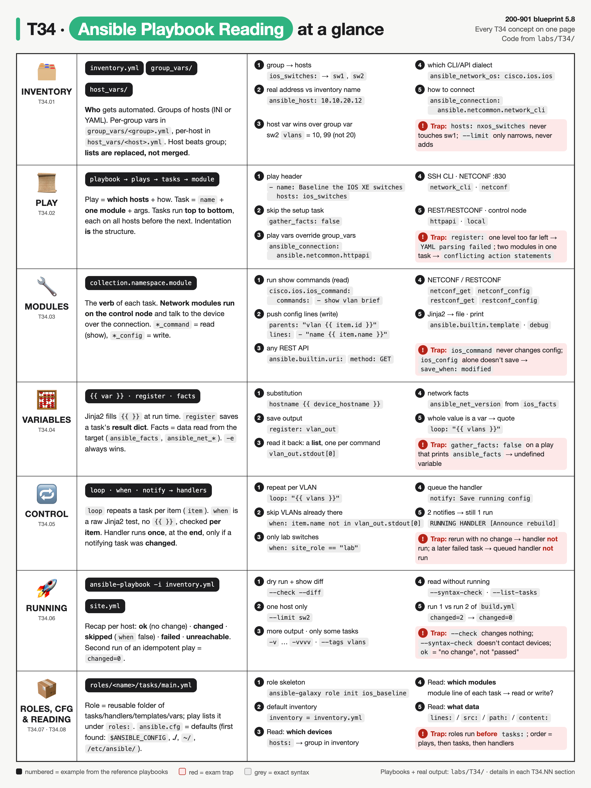
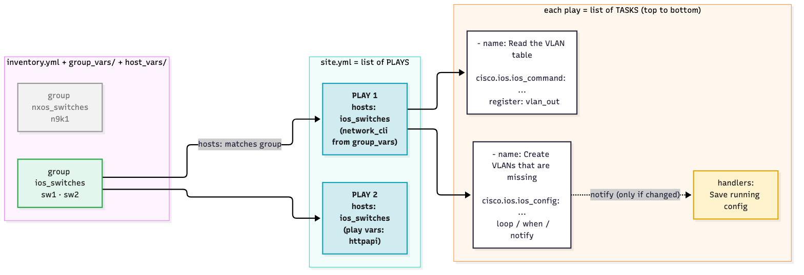
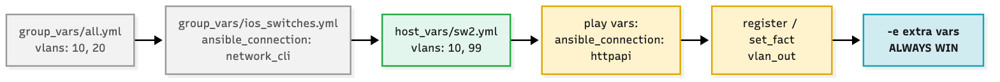
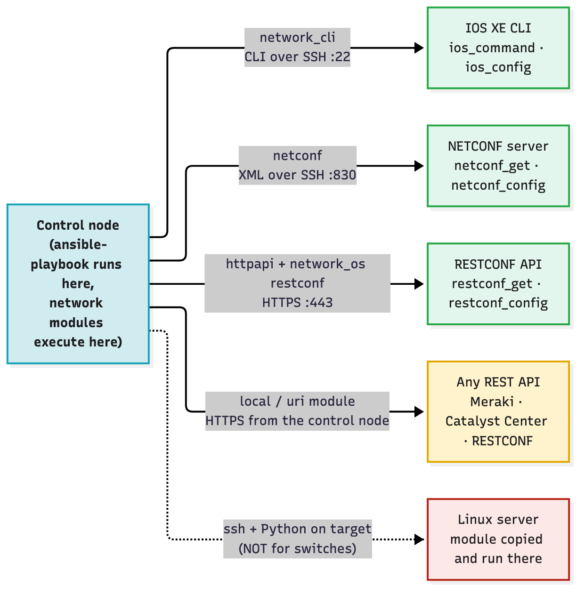
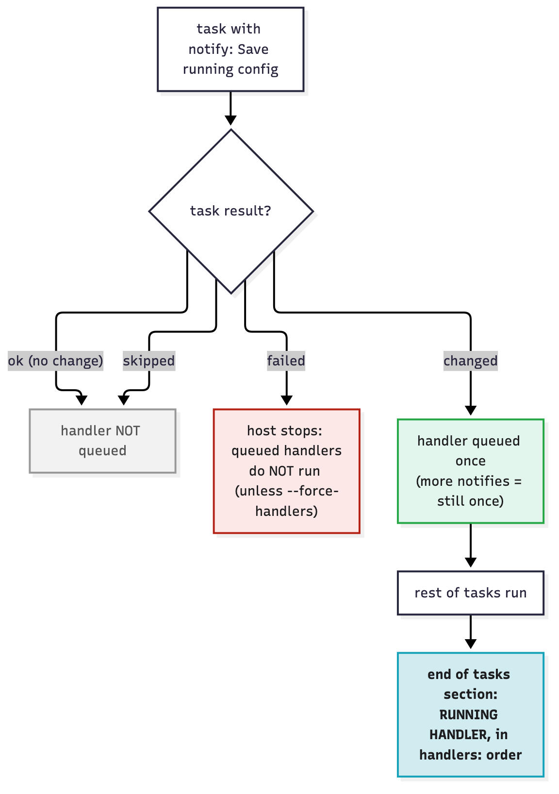
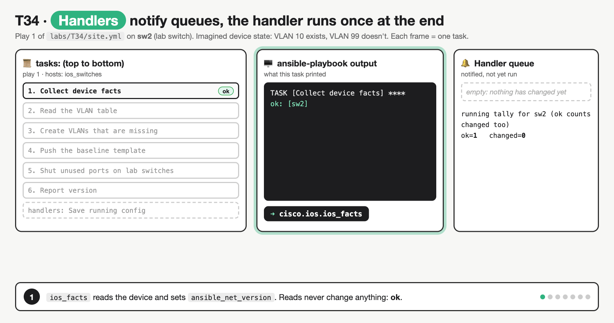
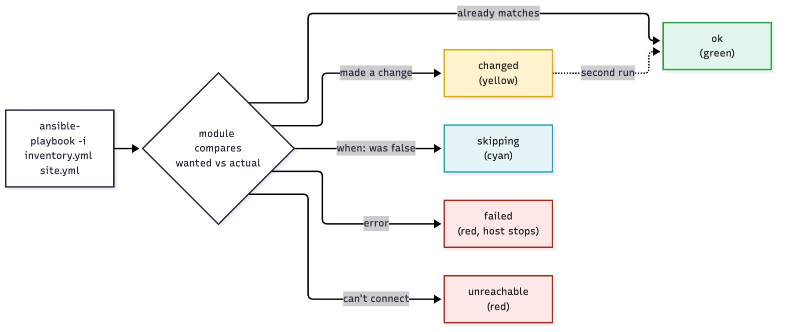

# T34 · Ansible playbook interpretation

> Owner: **Beedy** · Blueprint: **5.8** · CBT coverage: **Full** · Learn by 2026-10-17 · Teach-back 2026-10-20



*Every T34 concept on one page. Rows follow the concept sections (IDs under the icon). Numbered examples are lines from the playbooks in `labs/T34/`. Red boxes are exam traps.*

<!-- toc:start -->

**Contents**

- [TL;DR (teach-back card)](#tldr-teach-back-card)
- [Concepts](#concepts)
  - [T34.01](#t3401--inventory) Inventory · [T34.02](#t3402--playbook-structure) Playbook structure · [T34.03](#t3403--modules) Modules · [T34.04](#t3404--variables) Variables · [T34.05](#t3405--control) Control · [T34.06](#t3406--running) Running · [T34.07](#t3407--structure-awareness) Structure (awareness) · [T34.08](#t3408--exam-angle) Exam angle
- [Exam traps](#exam-traps)
- [Examples](#examples)
- [Practice questions](#practice-questions)
- [Study aids](#study-aids)
- [Sources](#sources)
- [To verify](#to-verify)

<!-- toc:end -->

## TL;DR (teach-back card)

- **Read a playbook in four passes.** (1) `hosts:` → which inventory group, and so which devices. (2) The connection (`ansible_connection` in group_vars or play vars): `network_cli` = SSH CLI, `netconf` = XML over SSH 830, `httpapi` = REST/RESTCONF. (3) The module on each task: `*_command`/`*_get` = read, `*_config` = write, `uri` = any REST call. (4) The data: `lines:`/`src:`/`content:`/`path:` and the `{{ vars }}` that fill them. Tasks run **top to bottom**.
- **Control keywords:** `register` saves a task's result dict (`vlan_out.stdout[0]`). `when` is a raw Jinja2 test, checked **per loop item**. `loop` repeats a task with `item`. `notify` queues a handler that runs **once, after all tasks**, and **only if** a notifying task reported `changed`.
- **Running it:** `ansible-playbook -i inventory.yml site.yml`. Recap states are `ok` (no change), `changed`, `skipped` (`when` false), `failed`, `unreachable`. An idempotent play shows `changed=0` on the second run. `--check` = dry run, `--limit sw2` = narrow the hosts, `-v`…`-vvvv` = more detail.
- **Trap:** `ios_command` never changes config, even with `conf t` lines in a question. `ios_config` changes running-config but **doesn't save** it unless `save_when:` says so. A handler doesn't run on a rerun with no changes, or when a later task fails (without `--force-handlers`).

## Concepts

The note hangs on **one set of reference playbooks** in `labs/T34/`. One project has an inventory with two groups, group and host vars, a Jinja2 template, and three playbooks:

- `site.yml`: the **network** playbook (two plays: CLI over SSH, then RESTCONF). This is the exam's shape. It's syntax-checked and task-listed here, never run against a device.
- `build.yml`: a **localhost** play with builtin modules only, so it **actually runs**. It renders the same template for each switch, and shows `register`, `when`, `loop`, `notify` and idempotency with real output.
- `netconf.yml`: a short NETCONF play, syntax-checked only.

Ansible basics are skipped (home turf). Each section gives the exam's interpretation angle and points at lines in these files. Tool comparison (agentless push, no state file, Ansible vs Terraform/NSO) is in [T33.05](T33-iac-tool-comparison.md#t3305--ansible); its `labs/T33/samples/ansible/` is a smaller resource-module (`state: merged`) example. Model-driven protocols behind `netconf` and `httpapi` are in Bob's [T15 NETCONF](../bob/T15-netconf.md) and [T16 RESTCONF](../bob/T16-restconf.md).



*Read left to right: the inventory group decides the devices, `hosts:` picks the group, each play's tasks run in order, and the dotted `notify` only fires on `changed`.*

### The reference playbooks

```
labs/T34/
├── ansible.cfg                  defaults: inventory = inventory.yml
├── inventory.yml                groups ios_switches (sw1, sw2), nxos_switches (n9k1)
├── group_vars/
│   ├── all.yml                  ntp_server, default vlans list
│   ├── ios_switches.yml         ansible_network_os / ansible_connection / creds from env
│   └── nxos_switches.yml
├── host_vars/
│   ├── sw1.yml                  prod switch
│   └── sw2.yml                  lab switch: own vlans list + unused_ports
├── templates/ios_baseline.j2    Jinja2: hostname, ntp, vlans, lab-only banner
├── site.yml                     network playbook: play 1 network_cli, play 2 RESTCONF
├── build.yml                    localhost play: renders configs (runnable)
├── netconf.yml                  NETCONF play (netconf_get / netconf_config)
└── run_demo.sh                  runs build.yml twice + all the read-only checks
```

**`labs/T34/ansible.cfg`**

```ini
# Read from the current directory: run ansible-playbook from labs/T34/
[defaults]
inventory = inventory.yml
host_key_checking = False

[persistent_connection]
command_timeout = 30
```

**`labs/T34/inventory.yml`**

```yaml
---
# Two groups of switches. Connection details live in group_vars/, per-device data in host_vars/.
all:
  children:
    ios_switches:
      hosts:
        sw1:
          ansible_host: 10.10.20.11
        sw2:
          ansible_host: 10.10.20.12
    nxos_switches:
      hosts:
        n9k1:
          ansible_host: 10.10.20.58
```

**`labs/T34/group_vars/all.yml`**

```yaml
---
# Applies to every host unless a more specific group or host sets the same name
ntp_server: 10.0.0.1
vlans:
  - { id: 10, name: USERS }
  - { id: 20, name: VOICE }
```

**`labs/T34/group_vars/ios_switches.yml`**

```yaml
---
# How Ansible reaches an IOS XE switch: SSH to the CLI, IOS command/prompt handling
ansible_network_os: cisco.ios.ios
ansible_connection: ansible.netcommon.network_cli
ansible_user: "{{ lookup('ansible.builtin.env', 'IOS_USER') }}"
ansible_password: "{{ lookup('ansible.builtin.env', 'IOS_PASSWORD') }}"
```

**`labs/T34/group_vars/nxos_switches.yml`**

```yaml
---
ansible_network_os: cisco.nxos.nxos
ansible_connection: ansible.netcommon.network_cli
ansible_user: "{{ lookup('ansible.builtin.env', 'NXOS_USER') }}"
ansible_password: "{{ lookup('ansible.builtin.env', 'NXOS_PASSWORD') }}"
```

**`labs/T34/host_vars/sw1.yml`**

```yaml
---
device_hostname: BR1-SW1
site_role: prod
```

**`labs/T34/host_vars/sw2.yml`**

```yaml
---
device_hostname: LAB-SW2
site_role: lab
# Replaces the whole vlans list from group_vars/all.yml (lists are not merged)
vlans:
  - { id: 10, name: USERS }
  - { id: 99, name: LAB-TEST }
unused_ports:
  - GigabitEthernet1/0/23
  - GigabitEthernet1/0/24
```

**`labs/T34/templates/ios_baseline.j2`**

```jinja
! Intended config for {{ device_hostname }} ({{ site_role }}), rendered by Ansible
hostname {{ device_hostname }}
ntp server {{ ntp_server }}

vlan {{ vlan.id }}
 name {{ vlan.name }}


banner motd ^LAB SWITCH: changes allowed^

```

**`labs/T34/site.yml`** (the network playbook: read it like an exam question)

```yaml
---
# Play 1: CLI over SSH (network_cli). Targets the ios_switches group only.
- name: Baseline the IOS XE switches
  hosts: ios_switches
  gather_facts: false

  tasks:
    - name: Collect device facts
      cisco.ios.ios_facts:
        gather_subset: min
      tags: [facts]

    - name: Read the VLAN table
      cisco.ios.ios_command:
        commands:
          - show vlan brief
      register: vlan_out
      tags: [vlans]

    - name: Create VLANs that are missing
      cisco.ios.ios_config:
        parents: "vlan {{ item.id }}"
        lines:
          - "name {{ item.name }}"
      loop: "{{ vlans }}"
      when: item.name not in vlan_out.stdout[0]
      notify: Save running config
      tags: [vlans]

    - name: Push the baseline template
      cisco.ios.ios_config:
        src: templates/ios_baseline.j2
      notify: Save running config
      tags: [baseline]

    - name: Shut unused ports on lab switches
      cisco.ios.ios_config:
        parents: "interface {{ item }}"
        lines:
          - shutdown
      loop: "{{ unused_ports | default([]) }}"
      when: site_role == "lab"
      tags: [ports]

    - name: Report version
      ansible.builtin.debug:
        msg: "{{ inventory_hostname }} runs {{ ansible_net_version }} on {{ ansible_net_model }}"
      tags: [facts]

  handlers:
    - name: Save running config
      cisco.ios.ios_config:
        save_when: modified

# Play 2: same switches, but over RESTCONF (httpapi). Play vars override group_vars.
- name: Audit interfaces over RESTCONF
  hosts: ios_switches
  gather_facts: false
  vars:
    ansible_connection: ansible.netcommon.httpapi
    ansible_network_os: ansible.netcommon.restconf
    ansible_httpapi_use_ssl: true
    ansible_httpapi_validate_certs: false

  tasks:
    - name: GET ietf-interfaces with restconf_get
      ansible.netcommon.restconf_get:
        path: /data/ietf-interfaces:interfaces
      register: intf
      tags: [restconf]

    - name: Same GET with the generic uri module
      ansible.builtin.uri:
        url: "https://{{ ansible_host }}/restconf/data/ietf-interfaces:interfaces"
        method: GET
        url_username: "{{ ansible_user }}"
        url_password: "{{ ansible_password }}"
        force_basic_auth: true
        validate_certs: false
        headers:
          Accept: application/yang-data+json
        return_content: true
      delegate_to: localhost
      register: intf_uri
      tags: [restconf]

    - name: Print interface names
      ansible.builtin.debug:
        msg: "{{ intf.response['ietf-interfaces:interfaces']['interface'] | map(attribute='name') | list }}"
      tags: [restconf]
```

**`labs/T34/build.yml`** (runs on the control node only)

```yaml
---
# Runs on the control node only: renders each switch's intended config to a file.
- name: Build intended configs on the control node
  hosts: localhost
  connection: local
  gather_facts: true
  vars:
    build_dir: "{{ lookup('ansible.builtin.env', 'T34_BUILD_DIR') | default('/tmp/t34-build', true) }}"

  tasks:
    - name: Create the build directory
      ansible.builtin.file:
        path: "{{ build_dir }}"
        state: directory
        mode: "0755"
      tags: [build]

    - name: Render one config per IOS switch
      ansible.builtin.template:
        src: templates/ios_baseline.j2
        dest: "{{ build_dir }}/{{ item }}.cfg"
        mode: "0644"
      loop: "{{ groups['ios_switches'] }}"
      vars:
        device_hostname: "{{ hostvars[item]['device_hostname'] }}"
        site_role: "{{ hostvars[item]['site_role'] }}"
        vlans: "{{ hostvars[item]['vlans'] }}"
      register: rendered
      notify: Announce rebuild
      tags: [build]

    - name: List files that changed this run
      ansible.builtin.debug:
        msg: "{{ rendered.results | selectattr('changed') | map(attribute='item') | list }}"
      when: rendered is changed
      tags: [build]

    - name: Warn about lab switches
      ansible.builtin.debug:
        msg: "{{ item }} is a lab switch: banner added"
      loop: "{{ groups['ios_switches'] }}"
      when: hostvars[item]['site_role'] == "lab"
      tags: [report]

    - name: Show where it ran
      ansible.builtin.debug:
        msg: "Control node {{ ansible_facts['system'] }}, Python {{ ansible_facts['python_version'] }}"
      tags: [report]

  handlers:
    - name: Announce rebuild
      ansible.builtin.debug:
        msg: "Handler ran once: configs rebuilt in {{ build_dir }}"
```

**`labs/T34/netconf.yml`**

```yaml
---
# NETCONF over SSH (port 830): netconf_get reads, netconf_config writes.
- name: VLAN description over NETCONF
  hosts: ios_switches
  gather_facts: false
  vars:
    ansible_connection: ansible.netcommon.netconf
    ansible_port: 830

  tasks:
    - name: Get the running hostname
      ansible.netcommon.netconf_get:
        source: running
        filter: <native xmlns="http://cisco.com/ns/yang/Cisco-IOS-XE-native"><hostname/></native>
        display: json
      register: nc_host

    - name: Set the interface description (edit-config)
      ansible.netcommon.netconf_config:
        target: running
        content: |
          <config>
            <interfaces xmlns="urn:ietf:params:xml:ns:yang:ietf-interfaces">
              <interface>
                <name>GigabitEthernet1</name>
                <description>Managed by Ansible</description>
              </interface>
            </interfaces>
          </config>
```

**Real output: `build.yml`, run 1 then run 2** (ansible-core 2.21.5, from `labs/T34/`, with `T34_BUILD_DIR` set to a scratch folder)

```
$ ansible-playbook build.yml   # run 1

PLAY [Build intended configs on the control node] ******************************

TASK [Gathering Facts] *********************************************************
ok: [localhost]

TASK [Create the build directory] **********************************************
changed: [localhost]

TASK [Render one config per IOS switch] ****************************************
changed: [localhost] => (item=sw1)
changed: [localhost] => (item=sw2)

TASK [List files that changed this run] ****************************************
ok: [localhost] => {
    "msg": [
        "sw1",
        "sw2"
    ]
}

TASK [Warn about lab switches] *************************************************
skipping: [localhost] => (item=sw1)
ok: [localhost] => (item=sw2) => {
    "msg": "sw2 is a lab switch: banner added"
}

TASK [Show where it ran] *******************************************************
ok: [localhost] => {
    "msg": "Control node Darwin, Python 3.14.6"
}

RUNNING HANDLER [Announce rebuild] *********************************************
ok: [localhost] => {
    "msg": "Handler ran once: configs rebuilt in /private/tmp/claude-501/T34-work/build"
}

PLAY RECAP *********************************************************************
localhost                  : ok=7    changed=2    unreachable=0    failed=0    skipped=0    rescued=0    ignored=0


$ ansible-playbook build.yml   # run 2

PLAY [Build intended configs on the control node] ******************************

TASK [Gathering Facts] *********************************************************
ok: [localhost]

TASK [Create the build directory] **********************************************
ok: [localhost]

TASK [Render one config per IOS switch] ****************************************
ok: [localhost] => (item=sw1)
ok: [localhost] => (item=sw2)

TASK [List files that changed this run] ****************************************
skipping: [localhost]

TASK [Warn about lab switches] *************************************************
skipping: [localhost] => (item=sw1)
ok: [localhost] => (item=sw2) => {
    "msg": "sw2 is a lab switch: banner added"
}

TASK [Show where it ran] *******************************************************
ok: [localhost] => {
    "msg": "Control node Darwin, Python 3.14.6"
}

PLAY RECAP *********************************************************************
localhost                  : ok=5    changed=0    unreachable=0    failed=0    skipped=1    rescued=0    ignored=0
```

- Run 1: the directory and both files are new, so they're `changed`, and the handler fires **once** even though two loop items changed.
- Run 2: nothing differs → `changed=0`, the `when: rendered is changed` task is **skipped**, and **no `RUNNING HANDLER` line** appears. That's idempotency, and why handlers only fire on change.
- `Warn about lab switches` shows `when` evaluated **per item**: sw1 skipped, sw2 ok. But the task as a whole counts as `ok`, not `skipped`, in the recap.

**Rendered `sw2.cfg`** (the template with sw2's host_vars):

```
! Intended config for LAB-SW2 (lab), rendered by Ansible
hostname LAB-SW2
ntp server 10.0.0.1
vlan 10
 name USERS
vlan 99
 name LAB-TEST
banner motd ^LAB SWITCH: changes allowed^
```

**`site.yml --list-tasks`** (reads the playbook without contacting a device; needs the `cisco.ios` collection installed):

```

playbook: site.yml

  play #1 (ios_switches): Baseline the IOS XE switches	TAGS: []
    tasks:
      Collect device facts	TAGS: [facts]
      Read the VLAN table	TAGS: [vlans]
      Create VLANs that are missing	TAGS: [vlans]
      Push the baseline template	TAGS: [baseline]
      Shut unused ports on lab switches	TAGS: [ports]
      Report version	TAGS: [facts]

  play #2 (ios_switches): Audit interfaces over RESTCONF	TAGS: []
    tasks:
      GET ietf-interfaces with restconf_get	TAGS: [restconf]
      Same GET with the generic uri module	TAGS: [restconf]
      Print interface names	TAGS: [restconf]
```

### T34.01 · Inventory

**Must cover:**

- [x] Inventory lists hosts and groups (INI or YAML)
- [x] group_vars/ and host_vars/ hold per-group / per-host variables
- [x] Variables like ansible_network_os, ansible_connection, ansible_user

**Notes:**

- **The inventory answers "which devices?"** `inventory.yml` has two groups under `all.children`: `ios_switches` (sw1, sw2) and `nxos_switches` (n9k1). The same thing in INI is `[ios_switches]` and then one host per line (see [T33's `inventory.ini`](T33-iac-tool-comparison.md#t3305--ansible)).
- `sw1` is the **inventory name** (`inventory_hostname`). `ansible_host: 10.10.20.11` is the address actually used to connect.
- **Variable files are matched by file name**, with no include needed:
  - `group_vars/ios_switches.yml` → every host in group `ios_switches`.
  - `group_vars/all.yml` → every host.
  - `host_vars/sw2.yml` → only sw2.
- **Host beats group, and specific groups beat `all`.** `ansible-inventory --host sw2` shows the merged result:
  - sw2 gets `vlans` = 10 USERS + **99 LAB-TEST** from `host_vars/sw2.yml`, **not** 10 + 20 from `group_vars/all.yml`.
  - Lists and dicts are **replaced, not merged** (default `hash_behaviour=replace`). VLAN 20 is gone for sw2.
- **The three connection variables the exam shows:**

| Variable | In the lab | Meaning |
|---|---|---|
| `ansible_network_os` | `cisco.ios.ios` | Which platform plugin parses prompts/CLI. Required by `network_cli`, `netconf`, `httpapi` |
| `ansible_connection` | `ansible.netcommon.network_cli` | How to connect (see T34.02 table) |
| `ansible_user` / `ansible_password` | env lookups | Login. Never hard-coded; `ansible-vault` or env vars |

```
@all:
  |--@ungrouped:
  |--@ios_switches:
  |  |--sw1
  |  |--sw2
  |--@nxos_switches:
  |  |--n9k1
{
    "ansible_connection": "ansible.netcommon.network_cli",
    "ansible_host": "10.10.20.12",
    "ansible_network_os": "cisco.ios.ios",
    "ansible_password": "{{ lookup('ansible.builtin.env', 'IOS_PASSWORD') }}",
    "ansible_user": "{{ lookup('ansible.builtin.env', 'IOS_USER') }}",
    "device_hostname": "LAB-SW2",
    "ntp_server": "10.0.0.1",
    "site_role": "lab",
    "unused_ports": [
        "GigabitEthernet1/0/23",
        "GigabitEthernet1/0/24"
    ],
    "vlans": [
        {
            "id": 10,
            "name": "USERS"
        },
        {
            "id": 99,
            "name": "LAB-TEST"
        }
    ]
}
```



*Left to right = lowest to highest precedence (a shortened view of the 22-level list in the docs). Extra vars (`-e`) always win.*

### T34.02 · Playbook structure

**Must cover:**

- [x] Play: hosts (target group), gather_facts, connection, vars, tasks
- [x] connection: network_cli (SSH CLI), netconf, httpapi (REST), local
- [x] Each task: name + module + arguments

**Notes:**

- **Playbook = YAML list of plays. Play = YAML dict that maps hosts to tasks. Task = one module call.** `site.yml` has two plays (two top-level `- name:` items); `--list-tasks` printed `play #1` and `play #2`.
- **Play keywords in `site.yml`:**
  - `hosts: ios_switches`: the inventory **group** (or host, `all`, or pattern like `ios_switches:!sw1`).
  - `gather_facts: false`: skip the implicit `Gathering Facts` task. Network plays usually turn it off and call `ios_facts` explicitly (play 1, task 1). `build.yml` leaves it `true`, so its output starts with `TASK [Gathering Facts]`.
  - `vars:`: play 2 sets `ansible_connection: ansible.netcommon.httpapi`. **Play vars beat group_vars**, so the same hosts are reached over RESTCONF instead of SSH.
  - `connection:`: a play keyword, e.g. `connection: local` in `build.yml`. Equivalent to setting `ansible_connection` for that play.
  - `tasks:` then `handlers:`.
- **Connection types** (all are `ansible.netcommon.*` except `local`):

| `ansible_connection` | Protocol / port | Modules it pairs with | `ansible_network_os` |
|---|---|---|---|
| `network_cli` | CLI over SSH, 22 | `ios_command`, `ios_config`, `ios_facts`, resource modules | platform, e.g. `cisco.ios.ios` |
| `netconf` | XML over SSH, **830** | `netconf_get`, `netconf_config`, `netconf_rpc` | platform (or auto-guess, `default`) |
| `httpapi` | HTTP(S), 443 | `restconf_get`/`restconf_config` (with network_os `ansible.netcommon.restconf`), NX-API | `ansible.netcommon.restconf` or platform |
| `local` | none: runs on the control node | `uri`, `template`, controller collections (Meraki, Catalyst Center) | n/a |



*All network modules execute on the control node and talk out over the connection. Only Linux targets get the module copied over and run there (red).*

- `ansible_connection: local` for **network** devices is deprecated in the docs. Use `network_cli`/`netconf`/`httpapi`. `local` stays normal for `uri` calls and localhost plays.
- **Each task = `name:` + exactly one module key + its arguments + optional task keywords** (`register`, `when`, `loop`, `notify`, `tags`, `delegate_to`). In "Create VLANs that are missing", the module is `cisco.ios.ios_config` and its args are `parents`/`lines`. Everything else is a keyword.
- **Indentation is the structure.**
  - Module args go **under** the module (2 more spaces).
  - Task keywords line up **with** the module name.
  - Get it wrong and you see one of the errors in [Examples §2](#2-break-it-on-purpose).
- **FQCN**: `cisco.ios.ios_config` = collection `cisco.ios` + module `ios_config`. Exam items may show the short form `ios_config`, which means the same module.

### T34.03 · Modules

**Must cover:**

- [x] ios_command / cisco.ios.ios_command: run show commands
- [x] ios_config / cisco.ios.ios_config: push config lines
- [x] uri: generic REST calls
- [x] netconf_get / netconf_config; restconf_get / restconf_config
- [x] template (Jinja2 → file); debug (print variables)

**Notes:**

- **The module name tells you read vs write.** That's half of any "what does this playbook do" question.

| Module (in `labs/T34/`) | Read / write | Key args | What it returns (`register`) |
|---|---|---|---|
| `cisco.ios.ios_command` (site.yml task 2) | **read**: sends exec commands | `commands:` list, optional `wait_for` | `stdout` (list, one string per command), `stdout_lines` (list of lists) |
| `cisco.ios.ios_config` (tasks 3, 4, 5, handler) | **write** to running-config | `lines`, `parents`, `src`, `save_when`, `backup`, `match`, `replace` | `changed`, `commands`/`updates` sent |
| `cisco.ios.ios_facts` (task 1) | read | `gather_subset` (default `min`) | sets `ansible_net_version`, `ansible_net_model`, `ansible_net_hostname`… |
| `ansible.builtin.uri` (play 2, task 2) | either: depends on `method` | `url`, `method`, `headers`, `body`, `status_code`, `return_content` | `status`, `json`, `content` |
| `ansible.netcommon.restconf_get` / `restconf_config` | read / write | `path` (after `/restconf`), `content`, `method` (post/put/patch/delete) | `response` (parsed JSON) |
| `ansible.netcommon.netconf_get` / `netconf_config` (netconf.yml) | read (`<get>`/`<get-config>`) / write (`<edit-config>`) | `source`/`filter`/`display`; `target`/`content`/`commit` | `stdout`, `output` |
| `ansible.builtin.template` (build.yml) | writes a **file on the target**: here localhost | `src` (`.j2`), `dest` | `changed` if content differs |
| `ansible.builtin.debug` | neither: prints | `msg` or `var` | always `ok` |

- **`ios_config` details the exam can show:**
  - `parents: "vlan 99"` + `lines: ["name LAB-TEST"]` = enter `vlan 99`, then type `name LAB-TEST`. It's the same as `conf t` / `vlan 99` / `name LAB-TEST`.
  - `src: templates/ios_baseline.j2`: renders the Jinja2 template on the control node, then pushes the result as config lines.
  - It compares with running-config and only sends missing lines. That's why it reports `ok` on a rerun.
  - `save_when` choices are `always`, `never` (**default**), `modified`, `changed`. The handler in `site.yml` uses `save_when: modified`, the docs' own example of "copy running to startup only if it differs".
- **`uri` vs `restconf_get`:** both can GET RESTCONF.
  - `uri` is generic: you build the full URL, auth and `Accept: application/yang-data+json` yourself.
  - The `uri` task in play 2 has `delegate_to: localhost`, because `uri` is a normal module and must run on the control node. The play's connection is `httpapi`.
  - `restconf_get` uses the `httpapi` connection and needs `ansible_network_os: ansible.netcommon.restconf`. Its `path` starts **after** `/restconf`: `/data/ietf-interfaces:interfaces`.
- **`template` vs `ios_config src:`:** `template` writes a file (build.yml makes `sw1.cfg`, `sw2.cfg`). `ios_config src:` pushes the rendered lines to the device. They use the same `.j2` file.
- **`debug`** prints `msg:` (a string/expression) or `var:` (a variable name, **no** `{{ }}`).

### T34.04 · Variables

**Must cover:**

- [x] {{ variable }} Jinja2 substitution
- [x] register: save task output to a variable
- [x] Facts: gathered device/host data

**Notes:**

- **`{{ var }}` is Jinja2, rendered on the control node per host, just before the task runs.**
  - In `ios_baseline.j2`, `hostname {{ device_hostname }}` became `hostname LAB-SW2` for sw2.
  - `` looped over sw2's own VLAN list.
  - `` added the banner only for sw2.
- **YAML quoting rule:** a value that **starts** with `{{` must be quoted: `loop: "{{ vlans }}"`. Unquoted, YAML reads `{` as the start of a dict and fails to parse.
- **`register: vlan_out`** stores the whole result dict of that task for **this host**:
  - `ios_command` → `vlan_out.stdout` is a **list**, one string per command. So `vlan_out.stdout[0]` = the `show vlan brief` text. `vlan_out.stdout_lines[0]` = the same, split into lines.
  - On a **looped** task, the registered var holds `results`, a list with one entry per item. `build.yml` reads `rendered.results | selectattr('changed') | map(attribute='item') | list` → `["sw1", "sw2"]` on run 1.
  - `rendered is changed` = true if any item changed. Registered vars are visible to **later** tasks in the same play.
- **Facts = data discovered from the target**:
  - Linux/localhost: `ansible_facts['system']`, `ansible_facts['python_version']` (build.yml printed `Darwin`, `3.14.6`). Gathered by the implicit setup when `gather_facts: true`.
  - Network: `cisco.ios.ios_facts` sets `ansible_net_version`, `ansible_net_model`, `ansible_net_hostname`, `ansible_net_serialnum`, `ansible_net_interfaces` (with the `interfaces` subset)…
  - `site.yml`'s "Report version" uses them, which is why task 1 runs `ios_facts` even with `gather_facts: false`.
- **Magic variables** (always there): `inventory_hostname` (sw2), `groups['ios_switches']` (`["sw1","sw2"]`), `hostvars['sw2']['site_role']` (`lab`). `build.yml` uses all three to render configs for other hosts while running on localhost.
- **`-e` extra vars always win**, even over `hostvars[...]` lookups. `-e site_role=lab` made **both** switches print "lab switch" ([Examples §3](#3-drills)).

### T34.05 · Control

**Must cover:**

- [x] loop (or with_items) repeats a task
- [x] when: conditional execution
- [x] notify triggers a handler that runs once at the end if something changed

**Notes:**

- **`loop:`** runs the task once per list element, with the current one in `item`.
  - "Create VLANs that are missing" loops over `vlans`, so `item.id`/`item.name` come from each dict.
  - "Shut unused ports" loops over `unused_ports | default([])`. On sw1 (no such var) it's an empty loop, not an error.
  - `with_items:` is the older form you'll still see in exam items; it reads the same.
- **`when:`** is a **raw Jinja2 expression: no `{{ }}`**.
  - `when: site_role == "lab"`. On sw1 (prod) the whole task is `skipping`.
  - Combined with `loop`, `when` is evaluated **per item**. `when: item.name not in vlan_out.stdout[0]` skips VLANs already in the `show vlan brief` text and creates the rest. The real `build.yml` output shows the per-item effect: `skipping: [localhost] => (item=sw1)` then `ok: ... (item=sw2)`.
  - **`register` + `when`** is the exam's favourite pair: read state with a `*_command` task, then act only if the output (doesn't) contain something.
- **`notify:` + `handlers:`**:
  - `notify: Save running config` **queues** the handler named exactly that, but only if the task result is **`changed`**.
  - Queued handlers run **after all tasks in the section**, in the order they're listed under `handlers:` (not notify order).
  - Notified many times → runs **once**. In build.yml, one task with two changed loop items → one `RUNNING HANDLER`.
  - A task that's `ok` or `skipped` doesn't notify. On run 2 there was no handler at all.
  - If a later task **fails** on that host, its queued handlers **don't run** (unless `--force-handlers`) (verified with a `fail` task, [Examples §2](#2-break-it-on-purpose)).
  - Name mismatch (e.g. `Announce Rebuild` vs `Announce rebuild`) → `ERROR: The requested handler 'Announce Rebuild' was not found…`, and the run fails.
  - `listen:` lets several handlers share one topic name. `meta: flush_handlers` runs them early.



*Only `changed` queues a handler. It still waits until the end of the tasks section.*



*Steps: facts (ok) → read VLANs + register (ok) → create VLAN 99 (changed, handler queued) → template (changed, still one queue entry) → shut ports (changed, no notify) → debug (ok) → RUNNING HANDLER once. It fixes the misconception "the handler runs right after the task that notified it". Device output here is illustrative (no device was used); the order and states match the real `build.yml` run.*

- **`tags:`** label tasks so you can run or skip a subset:
  - `--tags vlans` → only "Read the VLAN table" and "Create VLANs that are missing". Play 2 lists no tasks.
  - `--skip-tags restconf,facts` drops play 2 and the fact/debug tasks.

### T34.06 · Running

**Must cover:**

- [x] ansible-playbook -i inventory.yml site.yml
- [x] --check dry run; -v / -vvv verbosity; --limit host
- [x] Result states: ok (no change), changed, failed, skipped

**Notes:**

- `ansible-playbook -i inventory.yml site.yml`: `-i` picks the inventory. In `labs/T34/` you can drop it, because `ansible.cfg` sets `inventory = inventory.yml`.
- **Flags the exam uses:**

| Flag | Effect | Seen in the lab |
|---|---|---|
| `--check` | Dry run. Modules that support check mode **report** what would change; nothing is changed | `build.yml --check --diff` said `changed: (item=sw2)` but `sw2.cfg` still had `LAB-TEST` |
| `--diff` | Show before/after of files/config | the `@@ -4,5 +4,5 @@` hunk in [Examples §3](#3-drills) |
| `--limit sw2` | Narrow to hosts that match **both** the play's `hosts:` and the limit | `site.yml --list-hosts --limit sw2` → `hosts (1): sw2` in both plays. On `build.yml` (localhost) → `skipping: no hosts matched` |
| `-v` … `-vvvv` | More output. `-v` shows each task's result dict; `-vvv` adds connection detail; `-vvvv` adds connection plugin debugging | |
| `--syntax-check` | Parse only: YAML, keywords, module names. No connection | `playbook: site.yml` = passed |
| `--list-tasks` / `--list-hosts` | What would run, and where | output above |
| `--tags` / `--skip-tags` | Subset by tag | T34.05 |
| `-e key=value` | Extra vars, highest precedence | T34.04 |
| `--ask-pass` / `-k` | Prompt for the SSH password | |

- **Result states** (per task per host, then summed in `PLAY RECAP`):

| State | Colour | Meaning |
|---|---|---|
| `ok` | green | Ran and **changed nothing** (or a read/debug). Not "passed the test" |
| `changed` | yellow | Ran and made a change. In the recap, `ok=` also counts changed tasks (run 1: `ok=7 changed=2`) |
| `skipping` / `skipped` | cyan | `when:` was false (whole task). Per-item skips inside a loop don't count as a skipped task |
| `failed` | red | Error; that host stops running further tasks |
| `unreachable` | red | Couldn't connect (SSH/HTTP); host stops |
| `rescued` / `ignored` | | `block/rescue` caught it, or `ignore_errors: true` |



*The dotted line is idempotency: what was `changed` on run 1 is `ok` on run 2.*

- **Idempotent = run it again, nothing changes**: `build.yml` went `changed=2` → `changed=0`.
  - `ios_config` with full-form commands, the resource modules, and `template` are idempotent.
  - `ansible.builtin.command`/`shell` and `ios_command` aren't "config" at all. `command` reports `changed` every time (the `delegate_to` test printed `changed: [sw1 -> localhost]` for `echo hi`).

### T34.07 · Structure (awareness)

**Must cover:**

- [x] Roles package tasks/vars/templates for reuse
- [x] ansible.cfg sets defaults (inventory path, etc.)

**Notes:**

- **Role = a standard folder layout that a play pulls in by name.** `ansible-galaxy role init ios_baseline` creates:

```
- Role ios_baseline was created successfully
ios_baseline/README.md
ios_baseline/defaults
ios_baseline/files
ios_baseline/handlers
ios_baseline/meta
ios_baseline/tasks
ios_baseline/templates
ios_baseline/tests
ios_baseline/vars
```

  - `tasks/main.yml` = the task list; `handlers/main.yml`; `templates/` (`.j2`) and `files/`.
  - `defaults/main.yml` = **lowest**-precedence vars (meant to be overridden); `vars/main.yml` = high precedence.
  - `meta/main.yml` = dependencies.
  - A play uses it with `roles: [ios_baseline]`. **Roles run before the play's `tasks:`**; order is `pre_tasks` → `roles` → `tasks` → `post_tasks`, with handlers flushed after each section.
  - Collections (`cisco.ios`) package modules/plugins; roles package **your** tasks. Install collections with `ansible-galaxy collection install cisco.ios`.
- **`ansible.cfg`** sets defaults so commands get shorter. `labs/T34/ansible.cfg` sets `inventory`, `host_key_checking = False` and a persistent `command_timeout`.
  - Search order, **first found wins**: `$ANSIBLE_CONFIG` → `./ansible.cfg` → `~/.ansible.cfg` → `/etc/ansible/ansible.cfg`.
  - Ansible ignores `./ansible.cfg` in a world-writable directory.
  - `ansible-config dump --only-changed` showed `DEFAULT_HOST_LIST(.../labs/T34/ansible.cfg) = [.../inventory.yml]`.

### T34.08 · Exam angle

**Must cover:**

- [x] Read a playbook: which devices, which modules, what config or data, in what order

**Notes:**

- **Four passes over any exhibit**, shown on `site.yml`:

| Pass | Ask | `site.yml` answer |
|---|---|---|
| 1. Devices | `hosts:` → which group → which hosts (check `--limit` and `when` too) | Both plays: `ios_switches` = sw1, sw2. n9k1 is **never** touched |
| 2. How | `ansible_connection` / `connection:` (group_vars or play vars) | Play 1: `network_cli` (from group_vars). Play 2: `httpapi` + `restconf` (play vars override) |
| 3. What | Module per task: read or write? What data (`lines`, `src`, `content`, `path`)? | Play 1: facts (read), `show vlan brief` (read), VLAN lines (write, only missing), template (write), shut Gi1/0/23-24 (write, **lab only**), print version. Play 2: GET interfaces twice, print names. **Nothing is written in play 2** |
| 4. Order | Plays in file order; tasks top to bottom, each finishing on **all** hosts before the next; handlers at the end | Save running config runs **once per host** after task 6 of play 1, only on hosts where task 3 or 4 changed |

- **One-sentence answer:** "Play 1 baselines VLANs, hostname and NTP on the IOS XE switches over SSH, shuts unused ports on lab switches only, and saves the config if anything changed. Play 2 reads the interface list from the same switches over RESTCONF."
- Per host, sw1 and sw2 **differ**: sw1 never gets VLAN 99 or the shutdowns; sw2 never gets VLAN 20. Host vars drive the difference, not the playbook.

## Exam traps

- **Play vs task vs module.** Play = `hosts:` + list of tasks (top-level `- name:` with `hosts`). Task = one item under `tasks:`. Module = the one action key inside a task (`cisco.ios.ios_config`). "How many plays?" = count the items that have `hosts:`.
- **`ios_command` is read-only.** It sends exec-mode commands. Config goes through `ios_config` (`lines`/`parents`/`src`) or a resource module. A distractor shows `ios_command` with `configure terminal`: that's not how you configure.
- **`ios_config` doesn't save.** `save_when` defaults to `never`. Startup-config only changes with `save_when: modified|always|changed`, often in a handler.
- **Handler = once, at the end, only on `changed`.**
  - It doesn't run right after the notifying task.
  - It doesn't run on an all-`ok` rerun.
  - It doesn't run if the host later fails (unless `--force-handlers`).
  - Notify names must match exactly (case-sensitive in the lab: `Announce Rebuild` → "not found").
- **`register` + `when`:** `register` stores the result dict. `when:` takes a bare expression (`when: "'VOICE' in vlan_out.stdout[0]"`), **never** `{{ }}`. `stdout` is a **list**, so use `stdout[0]` for the first command's text.
- **`when` + `loop` = per item.** Some items can be skipped while others change in the same task.
- **YAML indentation:**
  - Module args one level **under** the module.
  - `register`/`when`/`loop`/`notify` at the **same** level as the module.
  - Args at the module's level → `conflicting action statements`. A keyword dedented to the `- name` dash level → `YAML parsing failed`.
  - A value starting with `{{` must be quoted.
- **Connection ↔ protocol:** `network_cli` = SSH CLI (22). `netconf` = XML over SSH (**830**). `httpapi` = HTTP(S) API (RESTCONF needs `ansible_network_os: ansible.netcommon.restconf`). `local` = runs on the control node (`uri`). Network modules always **execute on the control node**, never on the switch.
- **`ansible_network_os` ≠ `ansible_connection`.** network_os = which platform (`cisco.ios.ios`). connection = which transport. Both are needed for `network_cli`.
- **`gather_facts`** runs the generic setup module, which isn't for switches. Network plays set it `false` and use `ios_facts`. Referencing `ansible_net_version` without an `ios_facts` task → undefined variable.
- **`ok` means "no change needed"**, not "test passed". `changed=0` on the second run = idempotent.
- **`--check`** = dry run (reports, changes nothing). **`--syntax-check`** = parse only, no connection. **`--limit`** narrows `hosts:`, it can't add hosts outside it. **`-e`** beats every other variable source.
- **host_vars beat group_vars, and lists replace.** sw2's `vlans` list replaces the `all` list entirely, so sw2 never gets VLAN 20.

## Examples

### 1. Run the reference playbooks

Throwaway venv, from the repo root (Galaxy only needed for the `site.yml`/`netconf.yml` checks):

```bash
python3 -m venv "$TMPDIR/t34-venv"
"$TMPDIR/t34-venv/bin/pip" install ansible-core
"$TMPDIR/t34-venv/bin/ansible-galaxy" collection install cisco.ios
export PATH="$TMPDIR/t34-venv/bin:$PATH"
bash labs/T34/run_demo.sh
```

**`labs/T34/run_demo.sh`**

```bash
#!/usr/bin/env bash
# T34 demo: run the localhost play twice (idempotency), then read the network plays without touching a device.
# Needs ansible-playbook on PATH; site.yml/netconf.yml checks also need: ansible-galaxy collection install cisco.ios
set -euo pipefail
cd "$(dirname "$0")"
export T34_BUILD_DIR="${T34_BUILD_DIR:-${TMPDIR:-/tmp}/t34-build}"
rm -rf "$T34_BUILD_DIR"

echo "### 1. build.yml, first run (expect changed=2)"
ansible-playbook build.yml
echo "### 2. build.yml, second run (expect changed=0)"
ansible-playbook build.yml
echo "### 3. rendered sw2 config"
cat "$T34_BUILD_DIR/sw2.cfg"
echo "### 4. inventory as Ansible sees it"
ansible-inventory --graph
ansible-inventory --host sw2
echo "### 5. network plays: syntax and task list only"
ansible-playbook site.yml --syntax-check
ansible-playbook netconf.yml --syntax-check
ansible-playbook site.yml --list-tasks
```

- Output is in [The reference playbooks](#the-reference-playbooks) and T34.01. `build.yml` writes only to `$T34_BUILD_DIR` (default `$TMPDIR/t34-build`).
- `site.yml` and `netconf.yml` are **never run** here. Against a real IOS XE (DevNet Catalyst 8000v sandbox or CML), from `labs/T34/`:

```bash
export IOS_USER='<sandbox user>' IOS_PASSWORD='<sandbox password>'
ansible-playbook site.yml --limit sw1 --check --diff
ansible-playbook site.yml --limit sw1
ansible-playbook site.yml --limit sw1
```

- Expected: the second real run shows `changed=0` and no `RUNNING HANDLER`. ⚠ verify: not run (no device; set `ansible_host` in `inventory.yml` to the sandbox address first).

In the lab container (needs Docker running; `labs/Dockerfile` must include `ansible-core`, ⚠ verify):

```bash
docker build --tag ccna-auto-lab:latest --file labs/Dockerfile labs/
docker run --rm --volume "$(pwd)":/work --workdir /work ccna-auto-lab:latest bash labs/T34/run_demo.sh
```

### 2. Break it on purpose

Set up a throwaway copy (from the repo root, venv on `PATH`):

```bash
REPO="$(pwd)"
export T34_BUILD_DIR="$TMPDIR/t34-build"
rm -rf "$TMPDIR/t34-copy" && cp -R "$REPO/labs/T34" "$TMPDIR/t34-copy" && cd "$TMPDIR/t34-copy"
```

**a) Module arg at the task level → two "modules" in one task**

```bash
cp "$REPO/labs/T34/site.yml" site.yml
sed -i.bak 's/^        gather_subset: min/      gather_subset: min/' site.yml
ansible-playbook site.yml --syntax-check
```

```
[ERROR]: conflicting action statements: cisco.ios.ios_facts, gather_subset
Origin: /private/tmp/claude-501/T34-work/tmpd/t34-copy/site.yml:8:7

6
7   tasks:
8     - name: Collect device facts
        ^ column 7
```

**b) `register:` dedented to the `- name` level → YAML error**

```bash
cp "$REPO/labs/T34/site.yml" site.yml
sed -i.bak 's/^      register: vlan_out/    register: vlan_out/' site.yml
ansible-playbook site.yml --syntax-check
```

```
[ERROR]: YAML parsing failed: While parsing a block collection did not find expected '-' indicator.
Origin: /private/tmp/claude-501/T34-work/tmpd/t34-copy/site.yml:17:5

15         commands:
16           - show vlan brief
17     register: vlan_out
       ^ column 5
```

**c) Misspelled module → caught at syntax check, no device needed**

```bash
cp "$REPO/labs/T34/site.yml" site.yml
sed -i.bak 's/cisco.ios.ios_command:/cisco.ios.ios_comand:/' site.yml
ansible-playbook site.yml --syntax-check
```

```
[ERROR]: couldn't resolve module/action 'cisco.ios.ios_comand'. This often indicates a misspelling, missing collection, or incorrect module path.
Origin: /private/tmp/claude-501/T34-work/tmpd/t34-copy/site.yml:13:7

11       tags: [facts]
12
13     - name: Read the VLAN table
         ^ column 7
```

**d) Handler name typo → the run fails after the changed task**

```bash
cp "$REPO/labs/T34/build.yml" build.yml
sed -i.bak 's/notify: Announce rebuild/notify: Announce Rebuild/' build.yml
rm -rf "$T34_BUILD_DIR"
ansible-playbook build.yml; echo "exit=$?"
```

```

PLAY [Build intended configs on the control node] ******************************

TASK [Gathering Facts] *********************************************************
ok: [localhost]

TASK [Create the build directory] **********************************************
changed: [localhost]

TASK [Render one config per IOS switch] ****************************************
changed: [localhost] => (item=sw1)
changed: [localhost] => (item=sw2)
[ERROR]: The requested handler 'Announce Rebuild' was not found in either the main handlers list nor in the listening handlers list
exit=1
```

**e) A task fails after a notify → the queued handler doesn't run, unless `--force-handlers`**

```bash
cp "$REPO/labs/T34/build.yml" build.yml
python3 - <<'PY'
s = open("build.yml").read()
s = s.replace("    - name: List files that changed this run",
              "    - name: Simulate a failure\n      ansible.builtin.fail:\n        msg: stop here\n\n    - name: List files that changed this run", 1)
open("build.yml", "w").write(s)
PY
rm -rf "$T34_BUILD_DIR"
echo "## without --force-handlers"
ansible-playbook build.yml | grep -E "^fatal|RUNNING HANDLER|^localhost "
rm -rf "$T34_BUILD_DIR"
echo "## with --force-handlers"
ansible-playbook build.yml --force-handlers | grep -E "^fatal|RUNNING HANDLER|^localhost "
```

```
## without --force-handlers
fatal: [localhost]: FAILED! => {"changed": false, "msg": "stop here"}
localhost                  : ok=3    changed=2    unreachable=0    failed=1    skipped=0    rescued=0    ignored=0
## with --force-handlers
fatal: [localhost]: FAILED! => {"changed": false, "msg": "stop here"}
RUNNING HANDLER [Announce rebuild] *********************************************
localhost                  : ok=4    changed=2    unreachable=0    failed=1    skipped=0    rescued=0    ignored=0
```

### 3. Drills

**f) `--check --diff`: reports the change, writes nothing**

```bash
cd "$REPO/labs/T34"
export T34_BUILD_DIR="$TMPDIR/t34-build"
ansible-playbook build.yml > /dev/null
rm -rf "$TMPDIR/t34-copy" && cp -R "$REPO/labs/T34" "$TMPDIR/t34-copy" && cd "$TMPDIR/t34-copy"
sed -i.bak 's/name: LAB-TEST/name: LAB-TEST2/' host_vars/sw2.yml
ansible-playbook build.yml --check --diff --tags build | sed -n '/^--- before/,/^changed: \[localhost\] => (item=sw2)/p'
grep LAB-TEST "$T34_BUILD_DIR/sw2.cfg"
```

```
--- before: /private/tmp/claude-501/T34-work/tmpd/t34-build/sw2.cfg
+++ after: /private/tmp/claude-501/T34-work/ansible-home/tmp/ansible-local-35078acuc72oc/tmp06376911/ios_baseline.j2
@@ -4,5 +4,5 @@
 vlan 10
  name USERS
 vlan 99
- name LAB-TEST
+ name LAB-TEST2
 banner motd ^LAB SWITCH: changes allowed^

changed: [localhost] => (item=sw2)
 name LAB-TEST
```

- The diff shows `LAB-TEST2`, but the last line proves the file still says `LAB-TEST`.

**g) `-e` beats host_vars**

```bash
cd "$REPO/labs/T34"
ansible-playbook build.yml --tags report -e site_role=lab | sed -n '/TASK \[Warn/,/^$/p'
```

```
TASK [Warn about lab switches] *************************************************
ok: [localhost] => (item=sw1) => {
    "msg": "sw1 is a lab switch: banner added"
}
ok: [localhost] => (item=sw2) => {
    "msg": "sw2 is a lab switch: banner added"
}
```

**h) `--limit` and `--tags` without touching a device**

```bash
cd "$REPO/labs/T34"
ansible-playbook site.yml --list-hosts --limit sw2
ansible-playbook site.yml --list-tasks --tags vlans
```

```

playbook: site.yml

  play #1 (ios_switches): Baseline the IOS XE switches	TAGS: []
    pattern: ['ios_switches']
    hosts (1):
      sw2

  play #2 (ios_switches): Audit interfaces over RESTCONF	TAGS: []
    pattern: ['ios_switches']
    hosts (1):
      sw2

playbook: site.yml

  play #1 (ios_switches): Baseline the IOS XE switches	TAGS: []
    tasks:
      Read the VLAN table	TAGS: [vlans]
      Create VLANs that are missing	TAGS: [vlans]

  play #2 (ios_switches): Audit interfaces over RESTCONF	TAGS: []
    tasks:
```

**i) Read-it drill.** Cover the answer column of the [T34.08 table](#t3408--exam-angle), then answer the four passes for `netconf.yml`.
  - Answer: devices = sw1, sw2. Connection = NETCONF over SSH 830 (play vars).
  - Task 1 = `<get-config>` of the running hostname (read). Task 2 = `<edit-config>` on `running` setting the Gi1 description (write).
  - No handlers, no loop.

## Practice questions

**Q1.** In `labs/T34/site.yml`, play 1 runs against sw1 (`site_role: prod`) and sw2 (`site_role: lab`). Which task is reported as `skipping` for sw1 but not for sw2?

- A. Read the VLAN table
- B. Push the baseline template
- C. Shut unused ports on lab switches
- D. Report version

<details><summary>Answer</summary>

**C.** `when: site_role == "lab"` is false for sw1, so the whole task is skipped there. The other tasks have no host-based `when`.
</details>

**Q2.** A playbook task is:

```yaml
    - name: Check NTP
      cisco.ios.ios_command:
        commands:
          - show run | include ntp server
      register: ntp_out

    - name: Add NTP
      cisco.ios.ios_config:
        lines:
          - ntp server 10.0.0.1
      when: "'10.0.0.1' not in ntp_out.stdout[0]"
```

The device already has `ntp server 10.0.0.1`. What does the run show for these two tasks?

- A. `changed`, `changed`
- B. `ok`, `skipping`
- C. `ok`, `ok`
- D. `changed`, `skipping`

<details><summary>Answer</summary>

**B.** `ios_command` only reads, so it's `ok`. The string is in `stdout[0]`, so `when` is false and the second task is skipped.
</details>

**Q3.** Two tasks notify the handler `Save running config`. On this run, task A reports `changed` and task B reports `changed`. A third task, after both, also reports `ok`. When and how often does the handler run?

- A. Twice: right after A and right after B
- B. Once, right after A
- C. Once, after all tasks in the play's `tasks:` section finish
- D. Not at all, because the last task was `ok`

<details><summary>Answer</summary>

**C.** Notifications are queued, deduplicated, and flushed after the tasks section. The `ok` of a task that doesn't notify is irrelevant.
</details>

**Q4.** Put these in the order Ansible processes them for one play of `site.yml` with two hosts: (1) handler "Save running config" on sw2, (2) "Read the VLAN table" on sw1, (3) "Collect device facts" on sw2, (4) "Create VLANs that are missing" on sw1.

<details><summary>Answer</summary>

**3 → 2 → 4 → 1** (with "Collect device facts" on sw1 also in that first step). Each task finishes on all hosts before the next task starts (default `linear` strategy), and handlers come after the last task. ⚠ verify: within one task, host order in the output can vary because of parallel forks.
</details>

**Q5.** Which inventory variable values make a task using `ansible.netcommon.restconf_get` work against IOS XE?

- A. `ansible_connection: ansible.netcommon.network_cli`, `ansible_network_os: cisco.ios.ios`
- B. `ansible_connection: ansible.netcommon.netconf`, `ansible_port: 830`
- C. `ansible_connection: ansible.netcommon.httpapi`, `ansible_network_os: ansible.netcommon.restconf`
- D. `ansible_connection: local`, `ansible_network_os: restconf`

<details><summary>Answer</summary>

**C.** The module docs require the `httpapi` connection with network_os `ansible.netcommon.restconf`. It's exactly what play 2 sets in `vars:`.
</details>

**Q6.** Complete the task so the output of `show version` can be used by a later `when:` (fill in the blank):

```yaml
    - name: Get version
      cisco.ios.ios_command:
        commands:
          - show version
      ______: ver
```

<details><summary>Answer</summary>

**`register`**, at the same indentation as `cisco.ios.ios_command`. A later task reads `ver.stdout[0]`.
</details>

**Q7.** `ansible-playbook -i inventory.yml site.yml --check` is run against the switches. What happens?

- A. The playbook is parsed only; no device is contacted
- B. Devices are contacted, and tasks report what they would change, but no config is changed
- C. Only tasks tagged `check` run
- D. Config is applied, then rolled back

<details><summary>Answer</summary>

**B.** Check mode connects and simulates. A: that's `--syntax-check`. D: Ansible has no automatic rollback.
</details>

**Q8.** `group_vars/all.yml` sets `vlans` to 10 and 20. `host_vars/sw2.yml` sets `vlans` to 10 and 99. Which VLANs does the "Create VLANs that are missing" loop iterate over for sw2?

- A. 10, 20
- B. 10, 99
- C. 10, 20, 99
- D. 10 only

<details><summary>Answer</summary>

**B.** host_vars beat group_vars, and lists are replaced, not merged. `ansible-inventory --host sw2` confirms it.
</details>

## Study aids

| Aid | Type | Title | Est. min | Resource |
|---|---|---|---|---|
| T34.1 | Video | RESTCONF playbook videos only | 15 | CBT: Automate Your Entire Network with Ansible |

- Skip / low priority: Ansible installation
- Run `bash labs/T34/run_demo.sh` once (2 min). Then do the four-pass read of `site.yml` and `netconf.yml` from the T34.08 table, without looking.

## Sources

- Overview image: HTML source `assets/T34/00-overview.html`, rendered to PNG (see `assets/README.md`). Diagrams: Mermaid sources in `assets/T34/*.mmd`. Animation: `assets/T34/06-handler-queue-anim.html` → `06-handler-queue.gif`.
- Ansible, Handlers (run only on change; after `pre_tasks`/`tasks`/`post_tasks`; once per notify; `handlers:` order; `listen`; `meta: flush_handlers`): https://docs.ansible.com/ansible/latest/playbook_guide/playbooks_handlers.html
- Ansible, How network automation is different (network modules execute on the control node; `network_cli`/`netconf`/`httpapi`/`local` table; `ansible_network_os`; `connection: local` deprecated): https://docs.ansible.com/ansible/latest/network/getting_started/network_differences.html
- Ansible, Using variables (`register`; 22-level precedence list, extra vars always win; `hash_behaviour=replace`): https://docs.ansible.com/ansible/latest/playbook_guide/playbooks_variables.html
- Ansible, Check mode and diff mode (`--check`, `--diff`): https://docs.ansible.com/ansible/latest/playbook_guide/playbooks_checkmode.html
- Ansible, Roles (directory layout, `roles:` run before `tasks:`): https://docs.ansible.com/ansible/latest/playbook_guide/playbooks_reuse_roles.html
- Ansible, Configuration settings (`ansible.cfg` search order; world-writable cwd ignored): https://docs.ansible.com/ansible/latest/reference_appendices/config.html
- Module docs read locally with `ansible-doc` (cisco.ios 11.6.0, ansible.netcommon 8.7.1): `cisco.ios.ios_config` (`save_when` choices, default `never`), `cisco.ios.ios_command` (`stdout` list), `cisco.ios.ios_facts` (`gather_subset` default `min`, `ansible_net_*`), `ansible.netcommon.restconf_get` (requires `httpapi` + network_os `ansible.netcommon.restconf`), `netconf_get`, `netconf_config`, `restconf_config`. Same pages online: https://docs.ansible.com/ansible/latest/collections/cisco/ios/index.html and https://docs.ansible.com/ansible/latest/collections/ansible/netcommon/index.html
- Cisco 200-901 v1.1 exam topics (5.8): https://learningcontent.cisco.com/documents/marketing/exam-topics/200-901-CCNAAUTO_v.1.1.pdf (not opened this session; wording from `data/blueprint-map.csv`, which is paraphrased)

## To verify

- ⚠ **Not run against a device:** `site.yml` and `netconf.yml` were only `--syntax-check`ed and `--list-tasks`ed (ansible-core 2.21.5, cisco.ios 11.6.0). Device-side behaviour is from module docs: `ios_config` idempotency on rerun, `save_when: modified` in a handler, the `when: item.name not in vlan_out.stdout[0]` check against real `show vlan brief`, `restconf_get` response shape `intf.response['ietf-interfaces:interfaces']['interface']`, and the GIF's device output. Run them on the DevNet Catalyst 8000v sandbox or CML.
- ⚠ **`netconf.yml` editing `running` directly**: assumes IOS XE accepts `<edit-config>` on `running` (no candidate datastore by default). Check against Bob's T15.
- ⚠ **Docker lab command**: not run (Docker daemon not running), and `labs/Dockerfile` may not include `ansible-core` and `cisco.ios`. This note doesn't edit it.
- ⚠ **Q4 host order** within a task can vary with forks; the task order is guaranteed.
- ⚠ **`-vvvv` description** (connection plugin debugging) is from memory, not from a page fetched this session.
- Run and pasted: `build.yml` twice, `ansible-inventory --graph/--host`, `--list-tasks`, `--list-hosts --limit`, `--tags`, break-it (a)–(e), drills (f)–(h), `ansible-galaxy role init`. The localhost play only writes under `$T34_BUILD_DIR`.
- Sandbox note: `ansible-playbook` needs a local Unix socket (its RPC host), and `ANSIBLE_HOME` must be writable. Outside a sandbox neither matters.
- CBT coverage: "Full" per `data/topics.csv`, matched from video titles only. Don't assume the video covers handlers or `register`/`when`.
