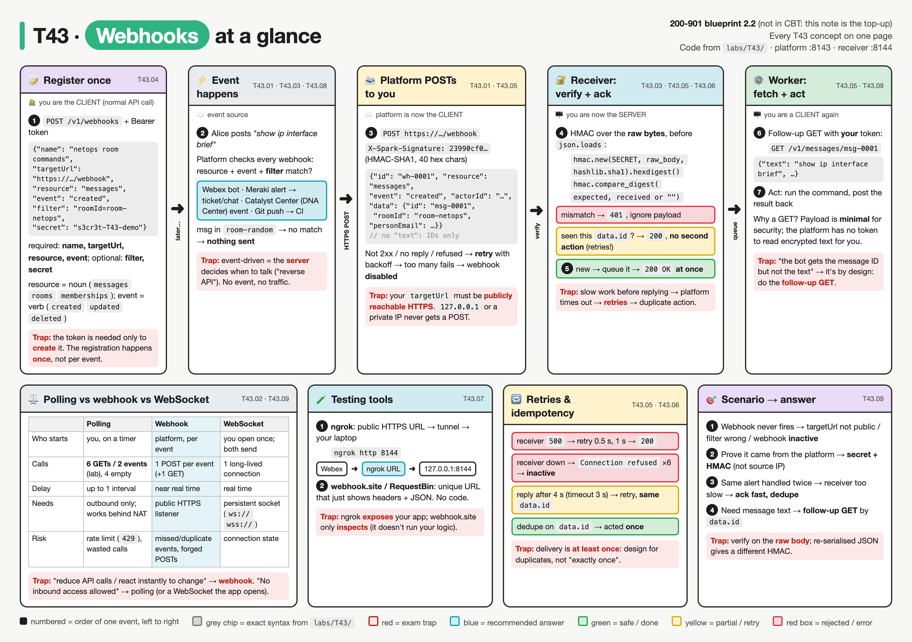
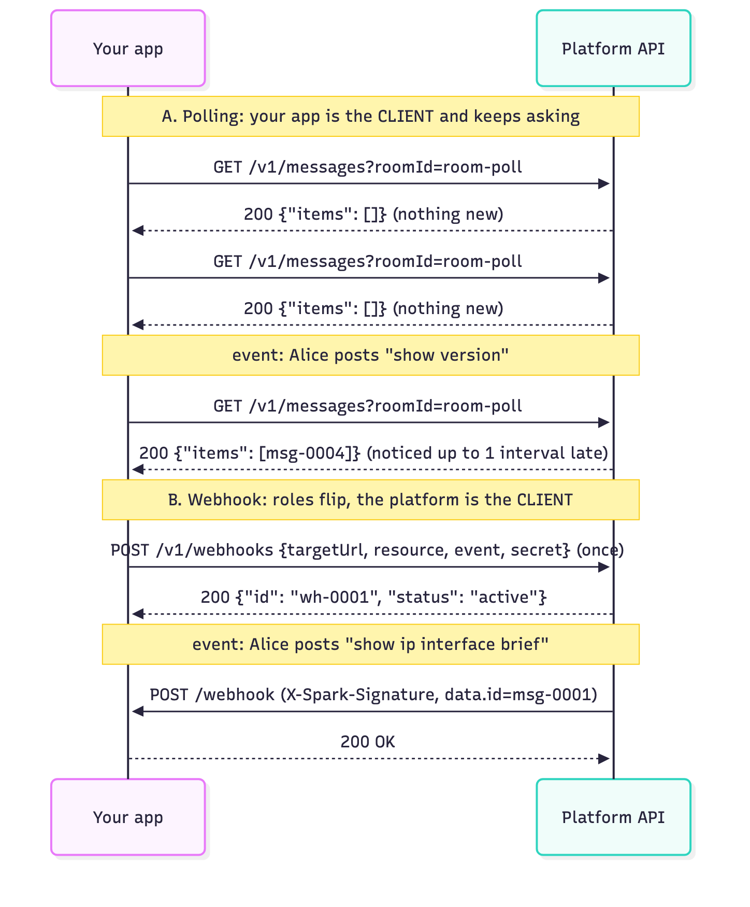
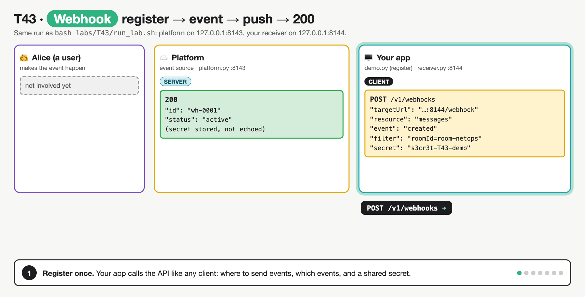
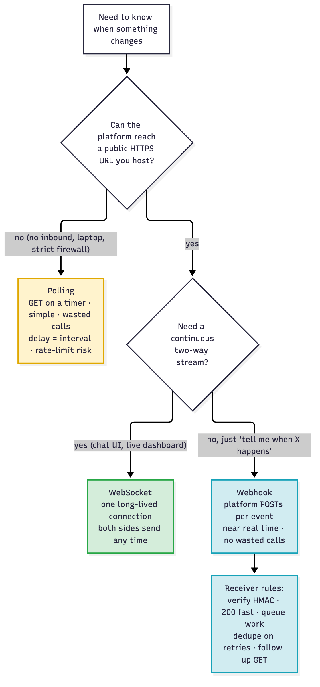
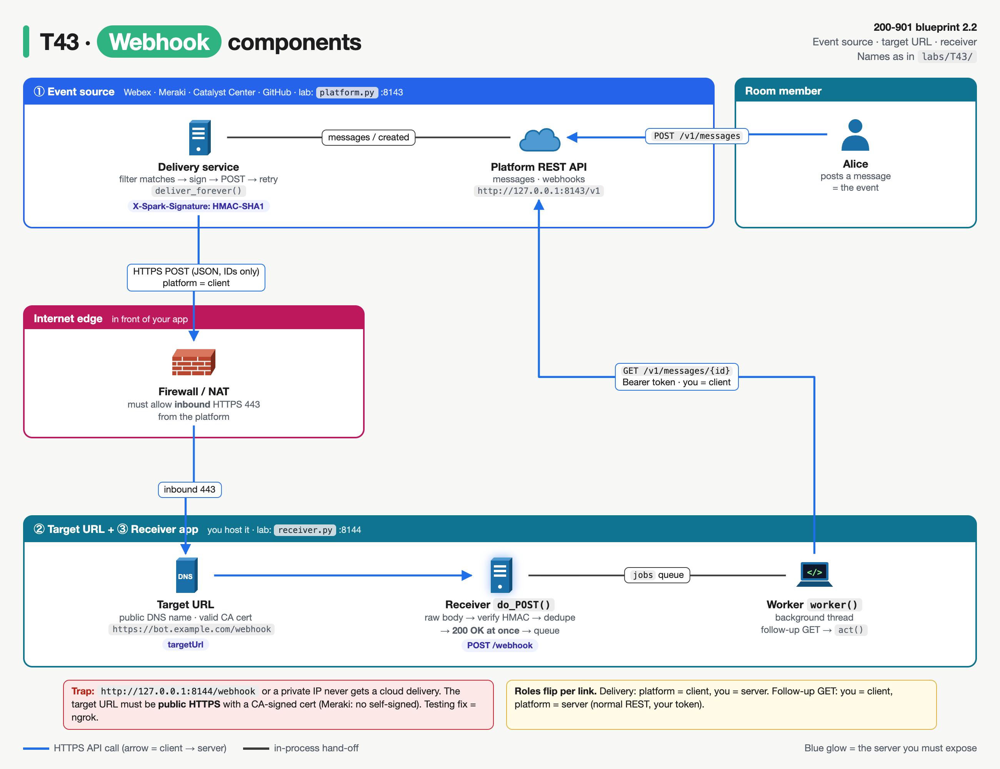
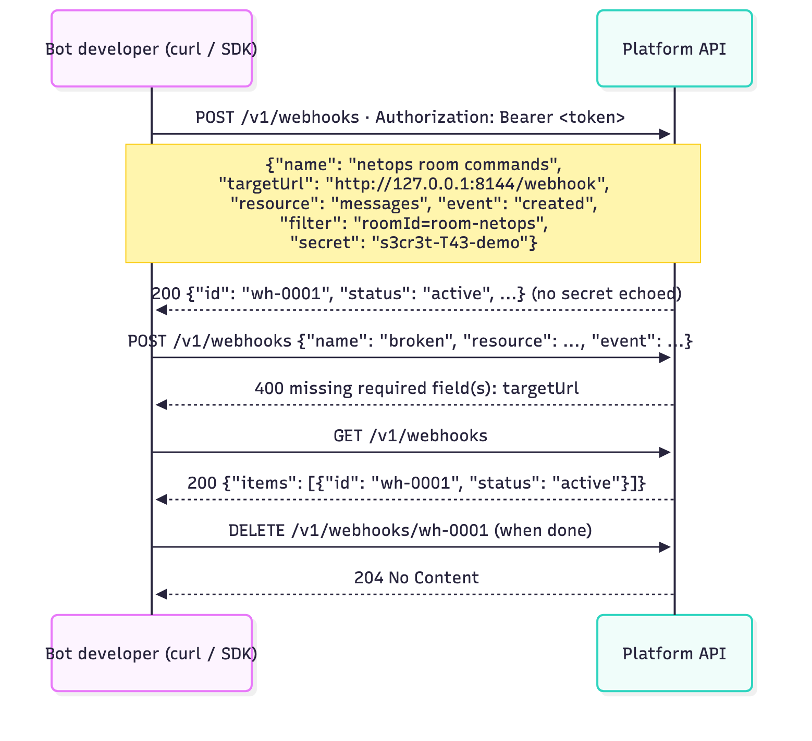
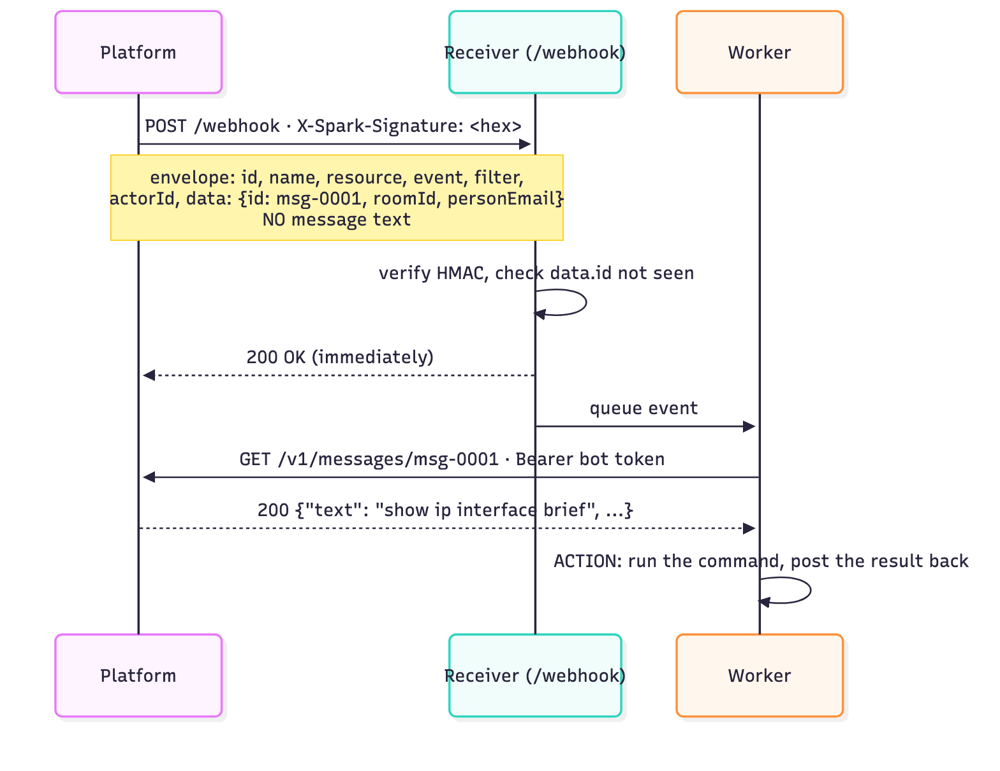
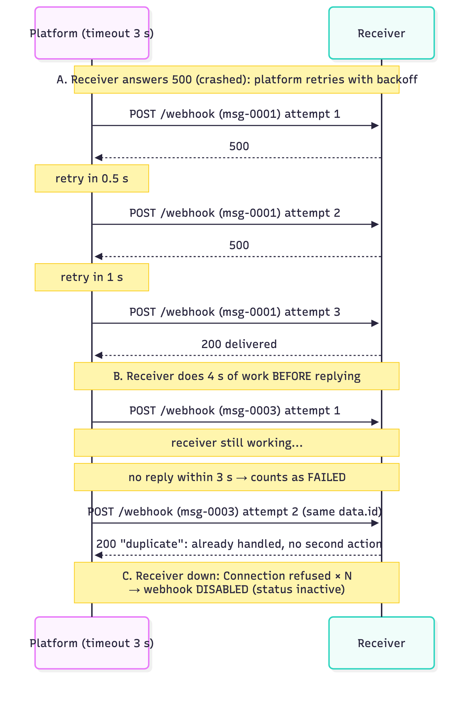
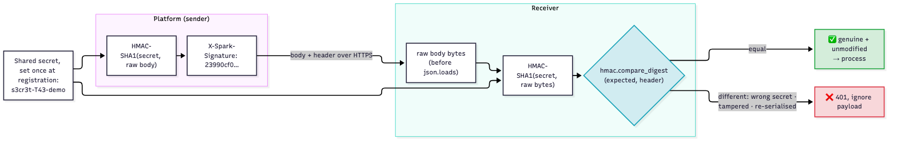
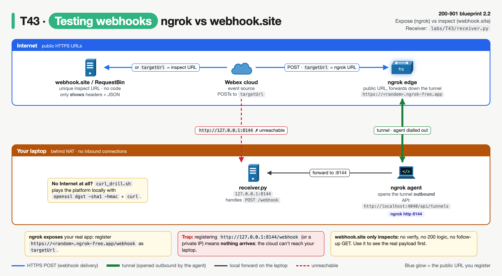

# T43 · Webhooks

> Owner: **Beedy** · Blueprint: **2.2** · CBT coverage: **None** · Learn by 2026-10-18 · Teach-back 2026-10-20



*Every T43 concept on one page. Read the top row left to right as one event's life (numbers = order; the "who" line shows who is client and who is server at each step). The bottom row covers comparison, testing, retries and exam scenarios. Red boxes = exam traps; grey chips = exact syntax from `labs/T43/`.*

<!-- toc:start -->

**Contents**

- [TL;DR (teach-back card)](#tldr-teach-back-card)
- [Concepts](#concepts)
  - [T43.01](#t4301--concept) Concept · [T43.02](#t4302--comparison) Comparison · [T43.03](#t4303--components) Components · [T43.04](#t4304--registration) Registration · [T43.05](#t4305--payload) Payload · [T43.06](#t4306--security) Security · [T43.07](#t4307--testing-tools) Testing tools · [T43.08](#t4308--use-cases) Use cases · [T43.09](#t4309--exam-angle) Exam angle
- [Exam traps](#exam-traps)
- [Examples](#examples)
- [Practice questions](#practice-questions)
- [Study aids](#study-aids)
- [Sources](#sources)
- [To verify](#to-verify)

<!-- toc:end -->

## TL;DR (teach-back card)

- **Webhook = the platform calls you.** You register once (`POST /v1/webhooks` with `name`, `targetUrl`, `resource`, `event`, optional `filter` + `secret`). When a matching event happens, the platform sends an HTTP **POST** with a JSON body to your `targetUrl`. Push, not poll: no wasted "anything new?" calls, near real time, no rate-limit burn.
- **Your receiver is a public HTTPS server.** The platform must reach it, so `localhost`/private IPs don't work; use ngrok while testing. The payload is often **IDs only** (Webex leaves out the message text), so you make a **follow-up GET** (`GET /v1/messages/{id}`) with your own token.
- **Receiver rules:** verify the **HMAC** signature over the **raw body** with the shared secret (Webex `X-Spark-Signature` = HMAC-SHA1), reply **2xx fast**, do the work in the background, and **dedupe** on the event/resource ID, because non-2xx or slow replies cause **retries** and too many failures **disable** the webhook.
- **Trap:** in a webhook the roles flip. The **platform is the HTTP client** and **your app is the server**. "Bot gets the message ID but not the text" is by design (do the follow-up GET), not a bug.

## Concepts

Every section below explains part of one local, three-program lab. Read it once first. It builds on [T07](T07-rest-fundamentals-http-codes.md) (requests, codes), [T08](T08-api-consumption-constraints.md) (polling burns rate limits; retries and backoff), [T09](T09-api-styles-rest-vs-rpc-sync-vs-async.md#t0906--asynchronous) (webhook = the async "callback" option) and [T29](T29-secrets-encryption-data-handling.md#t2905--hashing) (HMAC).

- `labs/T43/platform.py` is a mock **Webex-style messaging platform** (the event source) on `http://127.0.0.1:8143/v1`, written with the Python standard library only.
  - It accepts webhook registrations. When a user posts a message, it POSTs a signed JSON notification to every matching `targetUrl`.
  - It retries on anything that isn't 2xx (0.5 s, 1 s, 2 s backoff, 3 s timeout per attempt) and disables a webhook after 6 failures in a row.
- `labs/T43/receiver.py` is **your app**, the **reference program**, on `http://127.0.0.1:8144/webhook`. It verifies the signature, answers 200 fast, drops duplicates, and does the follow-up GET in a background worker.
- `labs/T43/demo.py` registers the webhook and plays "Alice" posting 3 messages. `labs/T43/poll_client.py` does the same job by **polling**, for contrast.
- To run everything: `bash labs/T43/run_lab.sh`. It starts both servers, runs `demo.py` then `poll_client.py`, prints the servers' log and stops both servers.

**API doc for the mock** (deliberately shaped like the Webex Webhooks API):

| Method | Path | What it does | Responses |
|---|---|---|---|
| `POST` | `/v1/webhooks` | register: `name`, `targetUrl`, `resource`, `event` required; `filter`, `secret` optional | `200` webhook object (secret not echoed) · `400` · `401` |
| `GET` | `/v1/webhooks` | list your webhooks and their `status` (`active` / `inactive`) | `200` `{"items": [...]}` |
| `DELETE` | `/v1/webhooks/{id}` | remove a webhook | `204` · `404` |
| `POST` | `/v1/messages` | a user posts a message: **this is the event** | `200` message |
| `GET` | `/v1/messages?roomId=` | list messages, newest first (what a poller calls) | `200` `{"items": [...]}` |
| `GET` | `/v1/messages/{id}` | one message, **with** `text` (the follow-up GET) | `200` · `404` |
| *outbound* | `POST <targetUrl>` | notification: envelope + `data` (IDs, no text) + `X-Spark-Signature` | expects `2xx` |

Tokens (fake, local only): `bot-token-T43` (your bot) and `alice-token-T43` (a user).

**`labs/T43/receiver.py`** (the reference program):

```python
"""T43 webhook receiver: YOUR app, the HTTP server the platform calls (Python stdlib only).

Run:  python3 -u labs/T43/receiver.py          -> http://127.0.0.1:8144/webhook
1. read the raw body   2. verify X-Spark-Signature (HMAC-SHA1, shared secret)
3. drop duplicates      4. answer 200 at once   5. work in the background:
   follow-up GET /v1/messages/{id} for the text, then act on it.
Knobs for the break-it runs (env vars): WEBHOOK_SECRET, FAIL_FIRST, INLINE_WORK_SECONDS.
"""
import hashlib
import hmac
import json
import os
import queue
import threading
import time
import urllib.request
from http.server import BaseHTTPRequestHandler, ThreadingHTTPServer

HOST, PORT = "127.0.0.1", 8144
PLATFORM = os.environ.get("PLATFORM_API", "http://127.0.0.1:8143/v1")
BOT_TOKEN = os.environ.get("BOT_TOKEN", "bot-token-T43")
SECRET = os.environ.get("WEBHOOK_SECRET", "s3cr3t-T43-demo").encode()   # must equal the secret you registered
FAIL_FIRST = int(os.environ.get("FAIL_FIRST", "0"))                      # break-it: answer 500 to the first N POSTs
INLINE_WORK = float(os.environ.get("INLINE_WORK_SECONDS", "0"))          # break-it: slow work BEFORE replying

lock = threading.Lock()
seen = set()                    # data.id values already accepted (idempotency)
jobs = queue.Queue()
posts = {"count": 0}


def log(text):
    print(f"[receiver] {text}", flush=True)


def signature_ok(raw_body, received):
    expected = hmac.new(SECRET, raw_body, hashlib.sha1).hexdigest()
    return hmac.compare_digest(expected, received or "")


def fetch_message(msg_id):
    """The webhook carried IDs only, so ask the API for the full message (with the bot's token)."""
    request = urllib.request.Request(f"{PLATFORM}/messages/{msg_id}",
                                     headers={"Authorization": f"Bearer {BOT_TOKEN}"})
    with urllib.request.urlopen(request, timeout=5) as reply:
        return json.load(reply)


def act(event):
    msg = fetch_message(event["data"]["id"])
    log(f"  follow-up GET /v1/messages/{msg['id']} -> text={msg['text']!r}")
    if msg["text"].lower().startswith("show"):
        log(f"  ACTION: run '{msg['text']}' and post the result back to {msg['roomId']}")
    else:
        log("  ACTION: none (not a command)")


def worker():
    while True:
        event = jobs.get()
        try:
            act(event)
        except Exception as err:                       # keep the worker alive
            log(f"  follow-up GET for {event['data']['id']} failed: {err}")
        jobs.task_done()


class Handler(BaseHTTPRequestHandler):
    protocol_version = "HTTP/1.1"

    def log_message(self, *args):
        pass

    def reply(self, code, text):
        data = text.encode()
        self.send_response(code)
        self.send_header("Content-Type", "text/plain")
        self.send_header("Content-Length", str(len(data)))
        self.end_headers()
        try:
            self.wfile.write(data)
        except BrokenPipeError:                        # the platform's delivery timeout already fired
            log(f"  reply {code} never arrived: the platform had already hung up")

    def do_POST(self):
        if self.path != "/webhook":
            return self.reply(404, "not found")
        raw = self.rfile.read(int(self.headers.get("Content-Length", 0)))       # 1. raw bytes
        with lock:
            posts["count"] += 1
            count = posts["count"]
        if count <= FAIL_FIRST:
            log(f"POST /webhook #{count}: simulated crash -> 500")
            return self.reply(500, "internal error")
        if not signature_ok(raw, self.headers.get("X-Spark-Signature")):         # 2. verify BEFORE parsing
            log(f"POST /webhook #{count}: signature mismatch -> 401, payload ignored")
            return self.reply(401, "bad signature")
        event = json.loads(raw)
        if event.get("resource") != "messages" or "id" not in event.get("data", {}):  # validate the shape
            log(f"POST /webhook #{count}: unexpected payload -> 400")
            return self.reply(400, "unexpected payload")
        msg_id = event["data"]["id"]
        with lock:
            duplicate = msg_id in seen
            seen.add(msg_id)
        if duplicate:                                                            # 3. idempotency
            log(f"POST /webhook #{count}: {msg_id} already handled (retry) -> 200, no second action")
            return self.reply(200, "duplicate")
        log(f"POST /webhook #{count}: signature OK, {event['resource']}/{event['event']} "
            f"data.id={msg_id} from {event['data']['personEmail']}")
        if INLINE_WORK:                                                          # the anti-pattern
            log(f"  doing {INLINE_WORK}s of work BEFORE replying (anti-pattern)")
            time.sleep(INLINE_WORK)
        jobs.put(event)                                                          # 5. hand off
        return self.reply(200, "ok")                                             # 4. ack fast


if __name__ == "__main__":
    threading.Thread(target=worker, daemon=True).start()
    log(f"listening on http://{HOST}:{PORT}/webhook")
    ThreadingHTTPServer((HOST, PORT), Handler).serve_forever()
```

**`labs/T43/demo.py`** (registration + events):

```python
"""T43 driver: register a webhook, then make events happen (Python stdlib only).

Needs platform.py (8143) and receiver.py (8144) running; run_lab.sh starts both.
Plays two roles:
  * the bot developer: POST /v1/webhooks once (registration)
  * a user, Alice: posts messages, which are the events the platform pushes
"""
import json
import os
import time
import urllib.error
import urllib.request

API = os.environ.get("PLATFORM_API", "http://127.0.0.1:8143/v1")
BOT_TOKEN, ALICE_TOKEN = "bot-token-T43", "alice-token-T43"
SECRET = os.environ.get("REGISTER_SECRET", "s3cr3t-T43-demo")
ROOM = "room-netops"


def call(method, path, token, body=None):
    data = json.dumps(body).encode() if body is not None else None
    request = urllib.request.Request(API + path, data=data, method=method,
                                     headers={"Authorization": f"Bearer {token}", "Content-Type": "application/json"})
    try:
        with urllib.request.urlopen(request, timeout=5) as reply:
            return reply.status, json.loads(reply.read() or b"null")
    except urllib.error.HTTPError as err:
        return err.code, json.loads(err.read() or b"null")


def main():
    print("== 1. Register the webhook (one API call, made by the bot developer) ==")
    status, hook = call("POST", "/webhooks", BOT_TOKEN, {
        "name": "netops room commands",
        "targetUrl": "http://127.0.0.1:8144/webhook",
        "resource": "messages",
        "event": "created",
        "filter": f"roomId={ROOM}",
        "secret": SECRET,
    })
    print(f"POST /v1/webhooks -> {status}")
    print(json.dumps(hook, indent=2))

    print("\n== 1b. A bad registration (no targetUrl) ==")
    print("POST /v1/webhooks ->", *call("POST", "/webhooks", BOT_TOKEN,
                                         {"name": "broken", "resource": "messages", "event": "created"}))

    print("\n== 2. Events happen: Alice posts 3 messages (2 in the filtered room) ==")
    for room, text in [(ROOM, "show ip interface brief"), ("room-random", "lunch?"), (ROOM, "thanks bot")]:
        status, msg = call("POST", "/messages", ALICE_TOKEN, {"roomId": room, "text": text})
        print(f"POST /v1/messages {room!r} {text!r} -> {status} {msg['id']}")
        time.sleep(0.3)
    time.sleep(float(os.environ.get("SETTLE_SECONDS", "1.5")))   # let deliveries (and retries) finish

    print("\n== 3. Webhook status after the run ==")
    status, body = call("GET", "/webhooks", BOT_TOKEN)
    for item in body["items"]:
        print(f"GET /v1/webhooks -> {item['id']} status={item['status']}  (secret not echoed: {'secret' not in item})")


if __name__ == "__main__":
    main()
```

**Output** (`bash labs/T43/run_lab.sh`, about 12 s). The driver output comes first, then the servers' log in time order:

```
== 1. Register the webhook (one API call, made by the bot developer) ==
POST /v1/webhooks -> 200
{
  "id": "wh-0001",
  "name": "netops room commands",
  "targetUrl": "http://127.0.0.1:8144/webhook",
  "resource": "messages",
  "event": "created",
  "filter": "roomId=room-netops",
  "status": "active",
  "createdBy": "person-bot",
  "created": "2026-10-10T13:06:36.000Z"
}

== 1b. A bad registration (no targetUrl) ==
POST /v1/webhooks -> 400 {'message': 'missing required field(s): targetUrl'}

== 2. Events happen: Alice posts 3 messages (2 in the filtered room) ==
POST /v1/messages 'room-netops' 'show ip interface brief' -> 200 msg-0001
POST /v1/messages 'room-random' 'lunch?' -> 200 msg-0002
POST /v1/messages 'room-netops' 'thanks bot' -> 200 msg-0003

== 3. Webhook status after the run ==
GET /v1/webhooks -> wh-0001 status=active  (secret not echoed: True)

== 4. Contrast: polling for the same kind of event ==
poll #4: NEW msg-0004 'show version' (noticed 0.8s after it was posted)
poll #6: NEW msg-0005 'show clock' (noticed 0.3s after it was posted)
polling: 6 GETs in 6s, 4 came back with nothing new, 2 events -> 3.0 calls per event, worst lag 0.8s
webhook: 0 GETs to discover them; 1 POST per event pushed to you (+1 follow-up GET for details)

---------- server log (platform + receiver, in time order) ----------
[platform] listening on http://127.0.0.1:8143/v1
[receiver] listening on http://127.0.0.1:8144/webhook
[platform] registered wh-0001: messages/created filter='roomId=room-netops' -> http://127.0.0.1:8144/webhook
[platform] event: alice@example.com posted msg-0001 in room-netops
[platform] POST http://127.0.0.1:8144/webhook (msg-0001) attempt 1
[receiver] POST /webhook #1: signature OK, messages/created data.id=msg-0001 from alice@example.com
[platform]   <- 200: delivered
[receiver]   follow-up GET /v1/messages/msg-0001 -> text='show ip interface brief'
[receiver]   ACTION: run 'show ip interface brief' and post the result back to room-netops
[platform] event: alice@example.com posted msg-0002 in room-random
[platform] event msg-0002: no webhook matches (resource/event/filter), nothing sent
[platform] event: alice@example.com posted msg-0003 in room-netops
[platform] POST http://127.0.0.1:8144/webhook (msg-0003) attempt 1
[receiver] POST /webhook #2: signature OK, messages/created data.id=msg-0003 from alice@example.com
[platform]   <- 200: delivered
[receiver]   follow-up GET /v1/messages/msg-0003 -> text='thanks bot'
[receiver]   ACTION: none (not a command)
[platform] event: alice@example.com posted msg-0004 in room-poll
[platform] event msg-0004: no webhook matches (resource/event/filter), nothing sent
[platform] event: alice@example.com posted msg-0005 in room-poll
[platform] event msg-0005: no webhook matches (resource/event/filter), nothing sent
```

- Read the log as one story: `registered wh-0001` → `event: … posted msg-0001` → `POST …/webhook (msg-0001) attempt 1` → `signature OK` → `<- 200: delivered` → `follow-up GET` → `ACTION`.
- `msg-0002` went to `room-random`, so the `roomId=room-netops` **filter** stopped it: `no webhook matches`.
- The `200: delivered` line comes **before** the follow-up GET. The receiver acked first and worked afterwards.

`platform.py` (the mock event source, about 230 lines) and `poll_client.py` are in `labs/T43/`. The functions named below are in those files.

### T43.01 · Concept

**Must cover:**

- [x] Webhook = HTTP callback: when an event happens, the service sends an HTTP POST to a URL you registered
- [x] "Reverse API": the server calls you
- [x] Event-driven, near real time

**Notes:**

- **Normal API ([T07](T07-rest-fundamentals-http-codes.md)):** your script is the **client**. It sends a request and the platform answers. The platform never talks first.
- **Webhook** = an **HTTP callback**. You give the platform a URL in advance. When something happens, the platform sends an **HTTP `POST`** with a JSON body to that URL.
  - Webex's own definition: "an HTTP callback, or an HTTP POST, to a specified URL that notifies your app when a particular activity or 'event' has occurred."
  - In the lab: Alice's `POST /v1/messages` makes `platform.py` call `notify()`, which queues a POST to `http://127.0.0.1:8144/webhook`.
- **"Reverse API":** the usual direction flips.
  - At registration you are the client, as normal.
  - At delivery the **platform is the HTTP client** and **your receiver is the HTTP server**: it listens on a port, gets a request, and returns a status code. `receiver.py` is a `ThreadingHTTPServer` on 8144.
- **Event-driven:** traffic happens only when an event happens. No event = no request. Between Alice's messages, nothing is on the wire.
- **Near real time:** the notification leaves as soon as the platform handles the event (milliseconds in the lab).
  - Real platforms add delay. Meraki says an alert is sent "on average … within 90 seconds of the event", and some take up to about 10 minutes.
  - Webex says a follow-up GET to some meeting-related REST resources can lag the webhook (its SLA: synced within 10 minutes for 99.5 % of cases).
  - So the exam wording is "**near** real time", not "instant".



*The same "new message" fact, two ways. Top: you ask over and over and most answers are empty. Bottom: you register once, then the platform POSTs to you only when the event happens.*



*Step by step: ① `POST /v1/webhooks` (you are the client) → ② idle, 0 requests → ③ Alice posts, filter matches → ④ the platform POSTs to `:8144/webhook` (roles flip) → ⑤ verify HMAC, `200 OK` at once → ⑥ follow-up `GET /v1/messages/msg-0001` → ⑦ act. It fixes the misconception that **a webhook is a fast polling loop**: your app never asks; it only listens.*

### T43.02 · Comparison

**Must cover:**

- [x] Polling: client repeatedly asks "anything new?" → wasted calls, delay, rate-limit risk
- [x] Webhook: server pushes only when something happens
- [x] WebSocket: persistent two-way connection (awareness)

**Notes:**

- **Polling** (`poll_client.py`): a loop calls `GET /v1/messages?roomId=room-poll` every `POLL_INTERVAL` (1 s) and diffs the result against what it has `seen`.
  - The real run: `6 GETs in 6s, 4 came back with nothing new, 2 events -> 3.0 calls per event`.
  - **Wasted calls:** every empty answer costs a request against your rate limit ([T08.01](T08-api-consumption-constraints.md#t0801--rate-limiting)). Poll faster to cut the delay and you burn quota faster; that's how a polling loop runs into `429`.
  - **Delay:** an event is only noticed at the next poll, so the worst case is one interval (`noticed 0.8s after it was posted`). A 5-minute poll means up to 5 minutes late.
  - **Upside:** it needs **outbound** access only, so it works from a laptop behind NAT or a locked-down network, and it's simple. If a poll fails, the next poll catches up.
- **Webhook:** the platform pushes **only when something happens**. 1 POST per event, plus 1 follow-up GET if you need details. Nothing to discover, and nothing wasted.
  - **Downside:** you must run a reachable HTTPS listener (T43.03), and you must handle signatures, retries and duplicates (T43.05, T43.06).
- **WebSocket** (RFC 6455, awareness only): **one long-lived, two-way connection** that the client opens (`ws://` / `wss://`, starting as an HTTP `Upgrade`). After that, **either side** can send a message at any time.
  - It suits chat UIs and live dashboards.
  - Because the app opens the connection outbound, no public inbound URL is needed. The cost is a connection that has to stay up.

| | Polling | **Webhook** | WebSocket |
|---|---|---|---|
| Who starts each exchange | your app, on a timer | **the platform, per event** | your app opens it once; then both sides send |
| Connection | new request each poll | **new request per event** | one persistent connection |
| Wasted calls | many (4 of 6 in the lab) | **none** | none (keep-alives only) |
| Latency | up to 1 interval | **near real time** | real time |
| Your side needs | outbound access only | **a public HTTPS endpoint** | outbound + keep the socket up |
| Typical use | simple scripts, no inbound allowed | **bots, alerts, CI triggers** | chat, live UI |



*Exam decision path. "Reduce API calls / react to changes as they happen" → webhook (blue). "No inbound connections allowed" → polling (yellow). "Two-way, continuous" → WebSocket.*

### T43.03 · Components

**Must cover:**

- [x] Event source (e.g. Webex, Meraki, Catalyst Center)
- [x] Target URL: a publicly reachable HTTPS endpoint you host
- [x] Receiver app: parses the payload and acts

**Notes:**

- **① Event source:** the platform where things happen and which sends the notifications. Examples: Webex (messages, rooms, memberships, meetings), Meraki (network alerts), Catalyst Center (DNA Center) (assurance/system events), GitHub/GitLab (push, merge request).
  - In the lab: `platform.py`. Its `deliver_forever()` thread signs, sends and retries.
- **② Target URL:** the address the source will POST to. **You** host it, and it must be reachable **from the source**.
  - Webex: "this URL must be publicly reachable and Internet-accessible by Webex."
  - Meraki: "Webhook HTTP server URLs must use a TLS-enabled **HTTPS** URL located on a **public** server with a **valid SSL certificate**." Meraki also says **self-signed certificates are not supported**; the cert must be signed by a globally trusted CA.
  - So `http://127.0.0.1:8144/webhook`, `http://10.1.1.5/...` or a host behind NAT with no port-forward **never** receives anything from a cloud platform. The lab only works because platform and receiver share one machine.
  - The firewall/NAT must allow **inbound** HTTPS (443) to the receiver (Meraki's troubleshooting list: "Firewall does not allow connections from Meraki IP ranges").
- **③ Receiver app:** the code behind the URL, `receiver.py`. It reads the raw body, verifies the signature, checks the shape, dedupes, answers 2xx, then a worker fetches the details and acts.
  - The two **halves** are separate on purpose: `do_POST()` (fast, synchronous) and `worker()` → `act()` (slow, background). See T43.05.



*Three components in zones: ① event source (top), Internet edge (middle), ② target URL + ③ receiver (bottom). Blue arrows point client → server, so the delivery runs down (platform = client) and the follow-up `GET /v1/messages/{id}` runs back up (you = client, with your token). The firewall zone is the usual reason nothing arrives: the target URL isn't reachable from the Internet.*

### T43.04 · Registration

**Must cover:**

- [x] Register via API (Webex POST /v1/webhooks)
- [x] name, targetUrl, resource (messages, rooms, memberships…), event (created, updated, deleted…)
- [x] Optional filter (e.g. roomId=…) and secret

**Notes:**

- **Registration** = a normal authenticated API call that tells the platform what to send and where. You do it **once**, not per event. Webex: `POST https://webexapis.com/v1/webhooks` with `Authorization: Bearer <token>`.
- Body fields (Webex guide; the lab uses the same names):

| Field | Required | Meaning | Lab value |
|---|---|---|---|
| `name` | yes | a label for you | `"netops room commands"` |
| `targetUrl` | yes | where to POST | `"http://127.0.0.1:8144/webhook"` (real life: public `https://`) |
| `resource` | yes | the **noun** being watched, plural like the API name: `messages`, `rooms`, `memberships`, `attachmentActions`, `meetings`… | `"messages"` |
| `event` | yes | the **verb** that triggers it: `created`, `updated`, `deleted` (some resources have others, e.g. `meetings` `started`/`ended`) | `"created"` |
| `filter` | no | narrow the scope; "generally … a subset of the query parameters" of `GET` on that resource; combine with `&` | `"roomId=room-netops"` |
| `secret` | no | shared secret; the platform uses it to sign every payload (T43.06) | `"s3cr3t-T43-demo"` |

- **Firehose** (Webex): `"resource": "messages", "event": "all"` (every event for one resource), or `"resource": "all", "event": "all"` (all events for memberships, messages and rooms). It needs read scopes for each resource.
- **Scopes:** the token needs **read** scope on the resource, e.g. `spark:messages_read` for a `messages` webhook (Webex guide).
- **Token lifetime:** Webex says a token is needed only to **create** the webhook. "As long as the webhook receives a successful HTTP response it will run indefinitely, even if the OAuth token has expired." Your follow-up GETs still need a valid token.
- **Response:** the webhook object with an `id` (`wh-0001`) and `status: active`. Keep the ID to update or delete it. The mock doesn't echo the `secret` back (that's the mock's design choice; check what the real API returns ⚠ verify).
- **Lifecycle:** `GET /v1/webhooks` (list), `GET /v1/webhooks/{id}`, `PUT /v1/webhooks/{id}` (e.g. a new `targetUrl` or `status: active`), `DELETE /v1/webhooks/{id}`. These are the Webex Webhooks API operations, also wrapped by the official SDK (`webexpythonsdk` `api.webhooks.list/create/get/update/delete`).
- Bad registrations fail like any API call: section 1b of the output shows `400 {'message': 'missing required field(s): targetUrl'}`.



*Registration is ordinary REST CRUD on a `webhooks` resource. Only the **deliveries** are "reverse".*

- **Other Cisco platforms** use the same idea with different names:
  - **Meraki:** add an "HTTP server" (`POST /networks/{networkId}/webhooks/httpServers` with `name`, `url`, optional `sharedSecret`, `payloadTemplate`, per the Meraki SDK 4.6.0 source), then pick it as an alert destination in the network's alert settings.
  - **Catalyst Center:** create a webhook destination (`/dna/intent/api/v1/event/webhook`), then a REST/webhook event subscription (`/dna/intent/api/v1/event/subscription/rest`). Paths are from the `dnacentersdk` 2.11.4 source; ⚠ verify against your Catalyst Center version.

### T43.05 · Payload

**Must cover:**

- [x] Service sends a JSON POST describing the event
- [x] Often minimal (IDs only, e.g. message ID) for security
- [x] Receiver makes a follow-up GET to fetch full details (e.g. GET /messages/{id})
- [x] Receiver should reply quickly with 2xx

**Notes:**

- **The POST body = an envelope + `data`.** The mock copies the Webex shape (`notify()` in `platform.py`):

```json
{"id": "wh-0001", "name": "netops room commands", "resource": "messages", "event": "created",
 "filter": "roomId=room-netops", "orgId": "org-T43", "createdBy": "person-bot", "appId": "app-T43",
 "ownedBy": "creator", "status": "active", "actorId": "person-alice",
 "data": {"id": "msg-0001", "roomId": "room-netops", "roomType": "group", "personId": "person-alice",
          "personEmail": "alice@example.com", "created": "2026-10-10T13:06:36.000Z"}}
```

  - Envelope `id` = the **webhook** ID (not the message). `actorId` = who caused the event. `data.id` = the **resource** ID (the message).
- **Minimal on purpose:** Webex doesn't include the message `text`. Room content is encrypted with keys only room members hold, and "since Webex initiated the request to your backend, it did not have your Access Token with which to decrypt the message."
  - Side effect: if someone forges or intercepts a notification, they get IDs, not content.
- **Follow-up GET:** to get the content, call the API with **your** token: `GET https://webexapis.com/v1/messages/{data.id}`.
  - In the lab, `fetch_message()` sends `GET /v1/messages/msg-0001` with `Bearer bot-token-T43` → `text='show ip interface brief'`.
  - Bots: Webex says bots only see messages in which they're mentioned, so a bot's `messages` webhook only fires for those.
  - Meraki is the opposite: its alert body is **self-contained** (`alertType`, `alertData`, `networkId`, `occurredAt`, `sharedSecret`, …), so usually no follow-up GET is needed. "IDs only" is common, not universal.
- **Reply fast with 2xx.** The sender holds the connection open until you answer, so treat the reply as "got it", not "done it".
  - GitHub documents a hard limit: "respond with a 2XX response within 10 seconds", otherwise it "terminates the connection and considers the delivery a failure". It recommends a queue.
  - Webex disables a webhook after repeated non-2xx/unreachable deliveries (T43.06).
  - `receiver.py` does only cheap checks in `do_POST()`, then `jobs.put(event)` and `return self.reply(200, "ok")`. The slow part (`act()`: the follow-up GET and the action) runs in `worker()`.



*Ack first, work second. The `200 OK` goes back before the follow-up GET even starts.*

- **Retries make duplicates, so make the receiver idempotent.** A timeout or 5xx means the platform **sends the same event again**. If your code had already acted, it acts twice. That's "at least once" delivery.
  - Fix: remember what you've handled. `do_POST()` keeps a `seen` set of `data.id` values: `already handled (retry) -> 200, no second action`.
  - Reply **200** to the duplicate, otherwise the platform keeps retrying it.
  - GitHub gives each delivery a unique `X-GitHub-Delivery` ID for this purpose. A real receiver stores the IDs in a database or Redis, not in memory.



*All three come from real runs (Examples 3). A: a crashed receiver gets retried with backoff. B: a slow receiver is treated as failed even though it was working, so the retry must be deduped. C: an unreachable receiver eventually gets the webhook disabled.*

### T43.06 · Security

**Must cover:**

- [x] Set a secret at registration; service signs each payload with HMAC (Webex: X-Spark-Signature header)
- [x] Receiver recomputes the HMAC to verify origin and integrity
- [x] Use HTTPS; validate and sanitise payloads

**Notes:**

- **The problem:** your target URL is public, so **anyone** can POST to it. You need to know that a request really came from the platform and wasn't changed.
  - Webex explains why IP allow-lists aren't the answer: "We are continuously adding infrastructure to the Webex Cloud so only listing IPs that are allowed is not practical."
- **The fix: a shared secret + HMAC** (the [T29](T29-secrets-encryption-data-handling.md#t2905--hashing) primitive).
  1. At registration, you send `"secret": "s3cr3t-T43-demo"`. After that, only you and the platform know it; it never travels with the events.
  2. For every delivery, the platform computes `HMAC(secret, raw body)` and puts it in a header.
     - **Webex:** `X-Spark-Signature` = **HMAC-SHA1** hex digest "computed over the notification's unmodified raw request body".
     - The current Webex guide also lists `X-Webex-Signature` with HMAC-SHA256/SHA512 "for supported webhook types" and says to prefer it when present.
  3. The receiver recomputes the HMAC over the bytes it received and compares the two in **constant time** (`signature_ok()`: `hmac.new(SECRET, raw_body, hashlib.sha1).hexdigest()` then `hmac.compare_digest(expected, received or "")`).
     - Equal → it was **sent by someone with the secret** (origin) and the body **wasn't changed** (integrity).
     - Different → reject.
- **Rules the official guides spell out:**
  - Hash the **raw request bytes, before parsing**. Webex: "Do not parse, re-serialize, or otherwise normalize the JSON before verification." Example 4 shows why: re-serialised JSON → `False`.
  - Use a constant-time compare (`hmac.compare_digest`), never `==` (GitHub: "Never use a plain == operator").
  - Look headers up case-insensitively. Webex may send the header in lowercase over HTTP/2. Python's `self.headers.get()` is already case-insensitive.
  - Use the algorithm the platform uses. HMAC-SHA256 over the same body gives a different digest (Example 4).
- **Meraki is weaker:** its `sharedSecret` is sent **inside the JSON body** as plain text, and the receiver just compares it (Meraki's own example: `if (meraki.sharedSecret === "asdf1234")`). That's a password check, not a signature: it proves nothing about integrity. Meraki relies on HTTPS for confidentiality.
- **HTTPS:** without TLS, the payload (and a Meraki-style secret) can be read on the wire. Meraki **requires** HTTPS with a CA-signed certificate. Webex requires the URL to be reachable; HTTPS is the expected practice.
- **Validate and sanitise** after the signature passes:
  - Check the shape (`resource`, `data.id` present → else `400`).
  - Treat `text` from the follow-up GET as **untrusted user input**: never pass it to a shell or SQL. `act()` only acts on an allow-listed prefix `show` (see [T30](T30-owasp-xss-sqli-csrf.md) for injection).
- **Replays:** a captured genuine request still has a valid signature. Dedupe on an ID (curl drill step 4: `duplicate -> HTTP 200`), and check timestamps where the platform signs one.



*The secret is shared once (at registration). Every delivery carries only the signature. Anything that changes the bytes (wrong secret, tampering, re-serialised JSON) fails the compare (red).*

### T43.07 · Testing tools

**Must cover:**

- [x] ngrok: exposes a local app on a public URL for testing
- [x] webhook.site / RequestBin: inspect payloads without writing code

**Notes:**

- **The testing problem:** your receiver runs on `127.0.0.1:8144` on a laptop behind NAT. Webex in the cloud can't reach it (T43.03).
- **ngrok:** a tunnel. The `ngrok` agent on your laptop opens an **outbound** connection to ngrok's edge and gets a **public HTTPS URL**. Requests to that URL are forwarded down the tunnel to your local port.
  - Command: `ngrok http 8144` (the official Webex SDK's `examples/ngrokwebhook.py` uses `ngrok http 8080`). Register the HTTPS forwarding URL + `/webhook` as `targetUrl`.
  - The ngrok agent also has a local inspection API at `http://localhost:4040/api/tunnels`. The same SDK example reads it to find the public URL and create the webhook automatically.
  - The free URL changes each run, so update the webhook's `targetUrl` (`PUT /v1/webhooks/{id}`) or re-register ⚠ verify the current ngrok free-tier URL behaviour.
- **webhook.site / RequestBin:** a hosted **inspection** endpoint. You get a unique URL, register it as `targetUrl`, and the site shows each incoming request's headers and JSON body. No code is needed.
  - Use it to see what the platform really sends (field names, the signature header) before you write the receiver.
  - It only **displays** requests; it doesn't run your logic or make the follow-up GET.
  - Meraki's own webhook docs suggest webhook.site to test whether deliveries arrive.
  - Never point a real production webhook (with real data) at a public inspection site.
- **Local-only alternative (this lab):** run the sender yourself. `curl_drill.sh` plays the platform with `openssl dgst -sha1 -hmac` + `curl`, which tests the receiver with no Internet at all.



*ngrok **exposes** your real app (blue glow = the public URL you register). webhook.site only **shows** the request. The green tunnel is opened **outbound** by the agent, which is why it works through NAT; the red dashed line is why `127.0.0.1` as `targetUrl` gets nothing.*

### T43.08 · Use cases

**Must cover:**

- [x] Webex bots reacting to messages
- [x] Meraki alerts to a ticketing/chat system
- [x] Catalyst Center event notifications
- [x] CI pipelines triggered by Git pushes

**Notes:**

| Use case | Event source → event | Registration | Receiver does |
|---|---|---|---|
| **Webex bot** (this lab) | Webex `messages`/`created` (bot mentioned) | `POST /v1/webhooks`, `filter=roomId=…` | follow-up `GET /v1/messages/{id}` → parse command → post a reply (`POST /v1/messages`) |
| **Card button clicks** | Webex `attachmentActions`/`created` | same API | `GET /v1/attachment/actions/{id}` for the submitted inputs ⚠ verify path |
| **Meraki alerts** | Meraki alert (device down, settings changed, …) | add an HTTP server, assign it to alerts | open a ticket (ServiceNow etc.) or post to a Webex room; body has `alertType`, `networkName`, `occurredAt` |
| **Catalyst Center events** | assurance / system events (e.g. device unreachable) | webhook destination + event subscription | open an incident, run remediation ⚠ verify event IDs |
| **CI/CD** ([T28](T28-ci-cd-devops-principles.md)) | GitHub/GitLab push / merge request | repo webhook settings | start a pipeline (lint, test, deploy network config) |
| **Async job done** ([T09](T09-api-styles-rest-vs-rpc-sync-vs-async.md)) | long task finished | callback URL in the request or subscription | fetch the result, instead of polling a task ID |

- The pattern is always the same: **something changes on a platform → it tells your code → your code acts**, with no human and no polling loop.
- **ChatOps** (a Webex bot running `show` commands, as in this lab) is the classic DevNet example. [T42](../bob/T42-webex-webex-devices.md) covers bots from the Webex side.

### T43.09 · Exam angle

**Must cover:**

- [x] Identify a webhook pattern in a scenario
- [x] Explain why the target must be reachable and why a follow-up GET is needed
- [x] Webhook vs polling trade-offs

**Notes:**

- **Spot the pattern.** These phrases point to a webhook:
  - "notify the application when …"
  - "instead of repeatedly querying"
  - "reduce API calls"
  - "the platform sends an HTTP POST to a URL"
  - "callback URL"
  - "event-driven"
  - "subscribe to events"
- **Scenario → answer:**

| Scenario | Answer |
|---|---|
| Script checks for new messages every 10 s and hits `429` | replace polling with a webhook (push) |
| Webhook registered, but the app on a laptop gets nothing | `targetUrl` isn't publicly reachable → public HTTPS host, or ngrok for testing |
| Bot gets `data.id` but no message text | payload is minimal by design → follow-up `GET /v1/messages/{id}` with the bot token |
| App must prove a POST really came from Webex | set `secret` at registration; verify `X-Spark-Signature` (HMAC-SHA1 over the raw body) |
| The same alert creates two tickets | receiver answered too slowly or with an error → platform retried → ack 200 fast, process async, dedupe on ID |
| Deliveries stopped after the receiver was down for a while | the webhook was **disabled** (`status: inactive`) → fix the receiver, then `PUT` `status: active` (Webex) |
| Only events from one room are wanted | add `filter: "roomId=…"` |
| No inbound connections allowed to the app at all | webhook isn't possible → poll (or a WebSocket/long-lived connection the app opens) |
| See exactly what a platform sends, no code | webhook.site / RequestBin as `targetUrl` |

- **Who is client, who is server?** Registration: your app = client. Delivery: platform = client, your app = server. Follow-up GET: your app = client.
- **Status codes your receiver returns** matter: 2xx = delivered. Anything else, or no answer within the timeout, = failed → retry → eventually disabled.
- **Webex auto-disable rule** (current guide): if Webex attempts to deliver 100 notifications within five minutes and the server is unreachable or doesn't answer 2xx, the webhook is disabled and **not** re-enabled automatically. Meraki: disabled after consistent failure for > 100 attempts in 24 hours. ⚠ verify both thresholds before the exam; they're numbers, so they change.

## Exam traps

- **Roles flip.** In a webhook delivery the **platform is the HTTP client** and **your app is the HTTP server**. "Which side needs an open listening port?" → yours.
- **Registration ≠ delivery.** Registration = **your** `POST /v1/webhooks`, once, with a token. Delivery = **the platform's** `POST <targetUrl>`, once per event, signed with the secret.
- **Required Webex fields:** `name`, `targetUrl`, `resource`, `event`. **Optional:** `filter`, `secret`. `resource` is a plural noun (`messages`), `event` a verb (`created`). Swapping them (e.g. `"resource": "created"`) is a typical distractor.
- **`targetUrl` must be public.** `localhost`, `127.0.0.1` or a private IP never gets cloud deliveries. Testing fix = ngrok; inspection fix = webhook.site.
- **Webex payload has no message text.** `data.id` → follow-up `GET /v1/messages/{id}`. The envelope `id` is the **webhook** ID, not the message ID.
- **`X-Spark-Signature` = HMAC-SHA1** of the **raw body** with the webhook's `secret`. Not a token, not base64, not SHA-256 (the newer `X-Webex-Signature` header is the SHA-256/512 one).
- **Verify before parsing, on the raw bytes, with `hmac.compare_digest`.** Re-serialising JSON changes the bytes → mismatch. `==` is a timing leak.
- **HMAC ≠ encryption.** It proves origin and integrity; it hides nothing. HTTPS hides the content.
- **Meraki `sharedSecret` is in the body**, compared as a plain value. It isn't an HMAC header.
- **Reply 2xx fast; do the work later.** A slow reply counts as a failure → retry → duplicate action.
- **Retries mean duplicates.** Make the receiver idempotent (dedupe on ID) and answer `200` to a duplicate. Delivery is "at least once", not "exactly once".
- **Failing receivers get disabled.** It doesn't fix itself; re-enable (Webex: update `status` to `active`) after fixing the receiver.
- **Polling isn't always wrong.** It's the answer when inbound connections are impossible. Webhooks need reachability.
- **WebSocket ≠ webhook.** WebSocket = one persistent two-way connection the client opens. Webhook = a separate HTTP POST per event that the server starts.

## Examples

### 1. Run the reference program

Needs Python 3, curl and openssl. **Stdlib only**, no `pip install`, no Internet, no DevNet sandbox.

```bash
bash labs/T43/run_lab.sh                          # platform + receiver, demo.py, then poll_client.py
bash labs/T43/run_lab.sh labs/T43/curl_drill.sh   # platform + receiver, curl drill
```

By hand, in three terminals:

```bash
python3 -u labs/T43/platform.py                   # terminal 1: event source on 127.0.0.1:8143
python3 -u labs/T43/receiver.py                   # terminal 2: your app on 127.0.0.1:8144
python3 labs/T43/demo.py                          # terminal 3: register + post 3 messages
python3 labs/T43/poll_client.py                   # terminal 3: the polling contrast
```

In the lab container (both servers share the container's localhost):

```bash
docker build --tag ccna-auto-lab:latest --file labs/Dockerfile labs/
docker run --rm --volume "$(pwd)":/work --workdir /work ccna-auto-lab:latest bash labs/T43/run_lab.sh
```

### 2. curl drill: be the platform (`labs/T43/curl_drill.sh`)

```bash
#!/usr/bin/env bash
# T43 curl drill. Needs platform.py (8143) and receiver.py (8144): bash labs/T43/run_lab.sh labs/T43/curl_drill.sh
set -u
API="http://127.0.0.1:8143/v1"
SECRET="s3cr3t-T43-demo"

echo "== 1. Register a webhook with curl (same body shape as Webex POST /v1/webhooks)"
curl --silent --request POST "$API/webhooks" \
  --header "Authorization: Bearer bot-token-T43" \
  --header "Content-Type: application/json" \
  --data '{"name":"curl hook","targetUrl":"http://127.0.0.1:8144/webhook","resource":"messages","event":"created","filter":"roomId=room-curl","secret":"'"$SECRET"'"}'
echo

echo; echo "== 2. Be the platform: sign a body with openssl and POST it to the receiver"
BODY='{"id":"wh-test","resource":"messages","event":"created","data":{"id":"msg-9999","roomId":"room-curl","personEmail":"alice@example.com"}}'
SIG=$(printf '%s' "$BODY" | openssl dgst -sha1 -hmac "$SECRET" | awk '{print $NF}')
echo "X-Spark-Signature: $SIG"
curl --silent --write-out " -> HTTP %{http_code}\n" --request POST "http://127.0.0.1:8144/webhook" \
  --header "Content-Type: application/json" --header "X-Spark-Signature: $SIG" --data "$BODY"

echo; echo "== 3. Same body, one byte changed (msg-9999 -> msg-9998), old signature"
TAMPERED=${BODY/msg-9999/msg-9998}
curl --silent --write-out " -> HTTP %{http_code}\n" --request POST "http://127.0.0.1:8144/webhook" \
  --header "Content-Type: application/json" --header "X-Spark-Signature: $SIG" --data "$TAMPERED"

echo; echo "== 4. Replay the genuine delivery from step 2 (a retry or a replay attack)"
curl --silent --write-out " -> HTTP %{http_code}\n" --request POST "http://127.0.0.1:8144/webhook" \
  --header "Content-Type: application/json" --header "X-Spark-Signature: $SIG" --data "$BODY"

echo; echo "== 5. List webhooks: the secret is never returned"
curl --silent "$API/webhooks" --header "Authorization: Bearer bot-token-T43"
echo
```

Output (`bash labs/T43/run_lab.sh labs/T43/curl_drill.sh`, curl 8.7.1, OpenSSL 3.6.3):

```
== 1. Register a webhook with curl (same body shape as Webex POST /v1/webhooks)
{"id": "wh-0001", "name": "curl hook", "targetUrl": "http://127.0.0.1:8144/webhook", "resource": "messages", "event": "created", "filter": "roomId=room-curl", "status": "active", "createdBy": "person-bot", "created": "2026-10-10T13:08:00.000Z"}

== 2. Be the platform: sign a body with openssl and POST it to the receiver
X-Spark-Signature: 23990cf021a2f4a2bb42188f4191a5354728102b
ok -> HTTP 200

== 3. Same body, one byte changed (msg-9999 -> msg-9998), old signature
bad signature -> HTTP 401

== 4. Replay the genuine delivery from step 2 (a retry or a replay attack)
duplicate -> HTTP 200

== 5. List webhooks: the secret is never returned
{"items": [{"id": "wh-0001", "name": "curl hook", "targetUrl": "http://127.0.0.1:8144/webhook", "resource": "messages", "event": "created", "filter": "roomId=room-curl", "status": "active", "createdBy": "person-bot", "created": "2026-10-10T13:08:00.000Z"}]}

---------- server log (platform + receiver, in time order) ----------
[platform] listening on http://127.0.0.1:8143/v1
[receiver] listening on http://127.0.0.1:8144/webhook
[platform] registered wh-0001: messages/created filter='roomId=room-curl' -> http://127.0.0.1:8144/webhook
[receiver] POST /webhook #1: signature OK, messages/created data.id=msg-9999 from alice@example.com
[receiver]   follow-up GET for msg-9999 failed: HTTP Error 404: Not Found
[receiver] POST /webhook #2: signature mismatch -> 401, payload ignored
[receiver] POST /webhook #3: msg-9999 already handled (retry) -> 200, no second action
```

- Step 2: `openssl dgst -sha1 -hmac "$SECRET"` computes the same HMAC-SHA1 as Python's `hmac.new(secret, body, hashlib.sha1)`. The receiver accepts it, and the follow-up GET then gets `404`, because `msg-9999` was never really posted. A valid signature proves who sent it, not that the content is meaningful.
- Step 3: one byte changed, same signature → `401`. That's integrity.
- Step 4: the exact genuine request again → `duplicate`, no second action. That's replay/retry safety.
- `printf '%s'` matters: `echo` would add a newline, which changes the bytes and the HMAC.

### 3. Break it on purpose

All of these were run, and each output is the real servers' log. Each line is the full command (run from the repo root).

**a. Receiver has the wrong secret** (it doesn't match the one registered):

```bash
WEBHOOK_SECRET=wrong-secret SETTLE_SECONDS=8 bash labs/T43/run_lab.sh labs/T43/demo.py
```

```
[platform] listening on http://127.0.0.1:8143/v1
[receiver] listening on http://127.0.0.1:8144/webhook
[platform] registered wh-0001: messages/created filter='roomId=room-netops' -> http://127.0.0.1:8144/webhook
[platform] event: alice@example.com posted msg-0001 in room-netops
[platform] POST http://127.0.0.1:8144/webhook (msg-0001) attempt 1
[receiver] POST /webhook #1: signature mismatch -> 401, payload ignored
[platform]   <- 401: retry in 0.5s
[platform] event: alice@example.com posted msg-0002 in room-random
[platform] event msg-0002: no webhook matches (resource/event/filter), nothing sent
[platform] POST http://127.0.0.1:8144/webhook (msg-0001) attempt 2
[receiver] POST /webhook #2: signature mismatch -> 401, payload ignored
[platform]   <- 401: retry in 1s
[platform] event: alice@example.com posted msg-0003 in room-netops
[platform] POST http://127.0.0.1:8144/webhook (msg-0001) attempt 3
[receiver] POST /webhook #3: signature mismatch -> 401, payload ignored
[platform]   <- 401: retry in 2s
[platform] POST http://127.0.0.1:8144/webhook (msg-0001) attempt 4
[receiver] POST /webhook #4: signature mismatch -> 401, payload ignored
[platform]   <- 401: gave up on msg-0001
[platform] POST http://127.0.0.1:8144/webhook (msg-0003) attempt 1
[receiver] POST /webhook #5: signature mismatch -> 401, payload ignored
[platform]   <- 401: retry in 0.5s
[platform] POST http://127.0.0.1:8144/webhook (msg-0003) attempt 2
[receiver] POST /webhook #6: signature mismatch -> 401, payload ignored
[platform]   <- 401: 6 failures in a row, webhook wh-0001 DISABLED
```

- Every delivery fails the HMAC check → `401` → the platform retries → after 6 failures in a row, `DISABLED`, and `GET /v1/webhooks` shows `status=inactive`. The receiver rejecting correctly-signed traffic looks exactly like an attack from the platform's side.

**b. Receiver crashes (500) on the first 2 POSTs:**

```bash
FAIL_FIRST=2 SETTLE_SECONDS=3 bash labs/T43/run_lab.sh labs/T43/demo.py
```

```
[platform] listening on http://127.0.0.1:8143/v1
[receiver] listening on http://127.0.0.1:8144/webhook
[platform] registered wh-0001: messages/created filter='roomId=room-netops' -> http://127.0.0.1:8144/webhook
[platform] event: alice@example.com posted msg-0001 in room-netops
[platform] POST http://127.0.0.1:8144/webhook (msg-0001) attempt 1
[receiver] POST /webhook #1: simulated crash -> 500
[platform]   <- 500: retry in 0.5s
[platform] event: alice@example.com posted msg-0002 in room-random
[platform] event msg-0002: no webhook matches (resource/event/filter), nothing sent
[platform] POST http://127.0.0.1:8144/webhook (msg-0001) attempt 2
[receiver] POST /webhook #2: simulated crash -> 500
[platform]   <- 500: retry in 1s
[platform] event: alice@example.com posted msg-0003 in room-netops
[platform] POST http://127.0.0.1:8144/webhook (msg-0001) attempt 3
[receiver] POST /webhook #3: signature OK, messages/created data.id=msg-0001 from alice@example.com
[platform]   <- 200: delivered
[platform] POST http://127.0.0.1:8144/webhook (msg-0003) attempt 1
[receiver] POST /webhook #4: signature OK, messages/created data.id=msg-0003 from alice@example.com
[platform]   <- 200: delivered
[receiver]   follow-up GET /v1/messages/msg-0001 -> text='show ip interface brief'
[receiver]   ACTION: run 'show ip interface brief' and post the result back to room-netops
[receiver]   follow-up GET /v1/messages/msg-0003 -> text='thanks bot'
[receiver]   ACTION: none (not a command)
```

- `500` → retry in 0.5 s → `500` → retry in 1 s → `200: delivered`. Nothing was lost, because the **platform** retried.

**c. Receiver down** (never started):

```bash
NO_RECEIVER=1 SETTLE_SECONDS=8 bash labs/T43/run_lab.sh labs/T43/demo.py
```

```
[receiver] NOT STARTED (NO_RECEIVER=1)
[platform] listening on http://127.0.0.1:8143/v1
[platform] registered wh-0001: messages/created filter='roomId=room-netops' -> http://127.0.0.1:8144/webhook
[platform] event: alice@example.com posted msg-0001 in room-netops
[platform] POST http://127.0.0.1:8144/webhook (msg-0001) attempt 1
[platform]   <- no connection (Connection refused): retry in 0.5s
[platform] event: alice@example.com posted msg-0002 in room-random
[platform] event msg-0002: no webhook matches (resource/event/filter), nothing sent
[platform] POST http://127.0.0.1:8144/webhook (msg-0001) attempt 2
[platform]   <- no connection (Connection refused): retry in 1s
[platform] event: alice@example.com posted msg-0003 in room-netops
[platform] POST http://127.0.0.1:8144/webhook (msg-0001) attempt 3
[platform]   <- no connection (Connection refused): retry in 2s
[platform] POST http://127.0.0.1:8144/webhook (msg-0001) attempt 4
[platform]   <- no connection (Connection refused): gave up on msg-0001
[platform] POST http://127.0.0.1:8144/webhook (msg-0003) attempt 1
[platform]   <- no connection (Connection refused): retry in 0.5s
[platform] POST http://127.0.0.1:8144/webhook (msg-0003) attempt 2
[platform]   <- no connection (Connection refused): 6 failures in a row, webhook wh-0001 DISABLED
```

- `Connection refused` is the same symptom as a non-public `targetUrl`: the platform can't reach you. `msg-0001` is given up after 4 attempts, and the webhook is disabled.

**d. Receiver does 4 s of work before replying** (the platform's timeout is 3 s):

```bash
INLINE_WORK_SECONDS=4 SETTLE_SECONDS=10 bash labs/T43/run_lab.sh labs/T43/demo.py
```

```
[platform] listening on http://127.0.0.1:8143/v1
[receiver] listening on http://127.0.0.1:8144/webhook
[platform] registered wh-0001: messages/created filter='roomId=room-netops' -> http://127.0.0.1:8144/webhook
[platform] event: alice@example.com posted msg-0001 in room-netops
[platform] POST http://127.0.0.1:8144/webhook (msg-0001) attempt 1
[receiver] POST /webhook #1: signature OK, messages/created data.id=msg-0001 from alice@example.com
[receiver]   doing 4.0s of work BEFORE replying (anti-pattern)
[platform] event: alice@example.com posted msg-0002 in room-random
[platform] event msg-0002: no webhook matches (resource/event/filter), nothing sent
[platform] event: alice@example.com posted msg-0003 in room-netops
[platform]   <- no reply within 3s: retry in 0.5s
[platform] POST http://127.0.0.1:8144/webhook (msg-0001) attempt 2
[receiver] POST /webhook #2: msg-0001 already handled (retry) -> 200, no second action
[platform]   <- 200: delivered
[platform] POST http://127.0.0.1:8144/webhook (msg-0003) attempt 1
[receiver] POST /webhook #3: signature OK, messages/created data.id=msg-0003 from alice@example.com
[receiver]   doing 4.0s of work BEFORE replying (anti-pattern)
[receiver]   reply 200 never arrived: the platform had already hung up
[receiver]   follow-up GET /v1/messages/msg-0001 -> text='show ip interface brief'
[receiver]   ACTION: run 'show ip interface brief' and post the result back to room-netops
[platform]   <- no reply within 3s: retry in 0.5s
[platform] POST http://127.0.0.1:8144/webhook (msg-0003) attempt 2
[receiver] POST /webhook #4: msg-0003 already handled (retry) -> 200, no second action
[platform]   <- 200: delivered
[receiver]   reply 200 never arrived: the platform had already hung up
[receiver]   follow-up GET /v1/messages/msg-0003 -> text='thanks bot'
[receiver]   ACTION: none (not a command)
```

- The receiver was working, but the platform gave up at 3 s (`no reply within 3s`) and **sent the same event again**. The dedupe check caught it (`already handled (retry) -> 200, no second action`). `reply 200 never arrived` = the first reply went to a connection the platform had already closed.

**e. Same as d, plus delete the idempotency check** (in a copy: change `duplicate = msg_id in seen` to `duplicate = False`):

```bash
cp -R labs/T43 "$TMPDIR/t43-copy"
sed -i '' 's/            duplicate = msg_id in seen/            duplicate = False/' "$TMPDIR/t43-copy/receiver.py"   # GNU sed: sed -i 's/…/…/'
INLINE_WORK_SECONDS=4 SETTLE_SECONDS=10 bash "$TMPDIR/t43-copy/run_lab.sh" "$TMPDIR/t43-copy/demo.py"
```

```
[receiver] listening on http://127.0.0.1:8144/webhook
[platform] listening on http://127.0.0.1:8143/v1
[platform] registered wh-0001: messages/created filter='roomId=room-netops' -> http://127.0.0.1:8144/webhook
[platform] event: alice@example.com posted msg-0001 in room-netops
[platform] POST http://127.0.0.1:8144/webhook (msg-0001) attempt 1
[receiver] POST /webhook #1: signature OK, messages/created data.id=msg-0001 from alice@example.com
[receiver]   doing 4.0s of work BEFORE replying (anti-pattern)
[platform] event: alice@example.com posted msg-0002 in room-random
[platform] event msg-0002: no webhook matches (resource/event/filter), nothing sent
[platform] event: alice@example.com posted msg-0003 in room-netops
[platform]   <- no reply within 3s: retry in 0.5s
[platform] POST http://127.0.0.1:8144/webhook (msg-0001) attempt 2
[receiver] POST /webhook #2: signature OK, messages/created data.id=msg-0001 from alice@example.com
[receiver]   doing 4.0s of work BEFORE replying (anti-pattern)
[receiver]   reply 200 never arrived: the platform had already hung up
[receiver]   follow-up GET /v1/messages/msg-0001 -> text='show ip interface brief'
[receiver]   ACTION: run 'show ip interface brief' and post the result back to room-netops
[platform]   <- no reply within 3s: retry in 1s
[platform] POST http://127.0.0.1:8144/webhook (msg-0001) attempt 3
[receiver] POST /webhook #3: signature OK, messages/created data.id=msg-0001 from alice@example.com
[receiver]   doing 4.0s of work BEFORE replying (anti-pattern)
[receiver]   reply 200 never arrived: the platform had already hung up
[receiver]   follow-up GET /v1/messages/msg-0001 -> text='show ip interface brief'
[receiver]   ACTION: run 'show ip interface brief' and post the result back to room-netops
[platform]   <- no reply within 3s: retry in 2s
```

- `ACTION: run 'show ip interface brief'` appears **twice** (and attempt 3 is on its way) for **one** message. That's the duplicate-ticket bug from the exam scenario. (The log stops while attempt 3 is still running, because the lab shuts the servers down after `SETTLE_SECONDS`.)

### 4. Trap snippet: verify over the raw bytes, with the right algorithm

Save as `$TMPDIR/reserialise.py` and run `python3 "$TMPDIR/reserialise.py"`:

```python
import hashlib
import hmac
import json

secret = b"s3cr3t-T43-demo"
raw = b'{"resource": "messages", "event": "created", "data": {"id": "msg-0001"}}'   # bytes as sent
sig = hmac.new(secret, raw, hashlib.sha1).hexdigest()                            # X-Spark-Signature

reserialised = json.dumps(json.loads(raw), separators=(",", ":")).encode()       # what a framework may hand you
print("raw bytes     :", hmac.compare_digest(sig, hmac.new(secret, raw, hashlib.sha1).hexdigest()))
print("re-serialised :", hmac.compare_digest(sig, hmac.new(secret, reserialised, hashlib.sha1).hexdigest()))
print("sha256 vs sha1:", hmac.compare_digest(sig, hmac.new(secret, raw, hashlib.sha256).hexdigest()))
```

Output:

```
raw bytes     : True
re-serialised : False
sha256 vs sha1: False
```

- A framework that hands you a parsed `dict`, which you then `json.dumps()`, has changed the spacing, so the HMAC fails. Hash `self.rfile.read(...)` (Flask: `request.get_data()`), not the parsed object.

### 5. Real Webex: register a webhook with curl (top-up T43.1)

Not run here: there was no Webex token, and the task rules say no real services. You need a **public** `targetUrl`: run `ngrok http 8144` next to `receiver.py`, or use a webhook.site URL just to inspect. Put `WEBEX_TOKEN` (a personal or bot token) and `ROOM_ID` in `labs/.env`.

```bash
set -a && source labs/.env && set +a
curl --silent --request POST "https://webexapis.com/v1/webhooks" \
  --header "Authorization: Bearer $WEBEX_TOKEN" \
  --header "Content-Type: application/json" \
  --data '{"name":"T43 lab","targetUrl":"https://YOUR-NGROK-URL/webhook","resource":"messages","event":"created","filter":"roomId='"$ROOM_ID"'","secret":"s3cr3t-T43-demo"}'
curl --silent "https://webexapis.com/v1/webhooks" --header "Authorization: Bearer $WEBEX_TOKEN"
```

- Post a message in that room (as a bot, @mention it). The receiver log should show `signature OK` and a follow-up GET. Point `PLATFORM_API=https://webexapis.com/v1` and `BOT_TOKEN=$WEBEX_TOKEN` at `receiver.py` so the follow-up GET hits real Webex.
- Clean up: `curl --request DELETE "https://webexapis.com/v1/webhooks/<id>" --header "Authorization: Bearer $WEBEX_TOKEN"` → `204`.
- Same thing with the SDK, inside the lab container (`webexpythonsdk` 2.0.6 method signature: `create(name, targetUrl, resource, event, filter=None, secret=None)`):

```bash
docker run --rm --env-file labs/.env ccna-auto-lab:latest python3 -c '
import os
from webexpythonsdk import WebexAPI
api = WebexAPI(access_token=os.environ["WEBEX_TOKEN"])
hook = api.webhooks.create(name="T43 lab", targetUrl="https://YOUR-NGROK-URL/webhook",
                           resource="messages", event="created",
                           filter=f"roomId={os.environ[\"ROOM_ID\"]}", secret="s3cr3t-T43-demo")
print(hook.id, hook.status)
'
```

## Practice questions

**Q1.** A network team's script calls a messaging API every 30 seconds to check for new messages in a room. It often gets `429 Too Many Requests` and reacts up to 30 seconds late. Which change addresses both problems?
A. Poll every 5 seconds  B. Register a webhook so the platform POSTs to the app when a message is created  C. Add `Retry-After` to each request  D. Switch the polling GET to a POST

<details><summary>Answer</summary>

**B.** A webhook removes the "anything new?" calls (no rate-limit burn) and delivers near real time. Polling faster (A) makes the 429s worse. `Retry-After` is a **response** header from the server (C). (T43.02)
</details>

**Q2.** In a webhook delivery, which statement is true?
A. The application is the HTTP client and the platform is the HTTP server  B. The platform is the HTTP client and the application's receiver is the HTTP server  C. Both keep one persistent two-way connection open  D. The application must send a GET to receive each event

<details><summary>Answer</summary>

**B.** The platform starts the POST to your `targetUrl`, so your receiver must listen like a server. C describes a WebSocket; D describes polling. (T43.01)
</details>

**Q3.** Complete the Webex webhook registration so the app is notified only when a **new message** is posted in one specific room:

```json
{"name": "noc bot", "targetUrl": "https://bot.example.com/webhook",
 "resource": "_______", "event": "_______", "filter": "_______=Y2lzY29...", "secret": "x9Fq..."}
```

<details><summary>Answer</summary>

`"resource": "messages"`, `"event": "created"`, `"filter": "roomId=Y2lzY29..."`. resource = plural noun of the API, event = what happened to it, filter = a query parameter of `GET /messages`. (T43.04)
</details>

**Q4.** A Webex bot receives this notification and needs the text the user typed. What should it do next?

```json
{"id": "Y2lz...V0hPT0s", "resource": "messages", "event": "created",
 "data": {"id": "Y2lz...TUVTU0FHRQ", "roomId": "Y2lz...Uk9PTQ", "personEmail": "alice@example.com"}}
```

A. Read `data.text`  B. `GET /v1/messages/Y2lz...TUVTU0FHRQ` with the bot's access token  C. `GET /v1/webhooks/Y2lz...V0hPT0s`  D. Decrypt `data.id` with the webhook secret

<details><summary>Answer</summary>

**B.** Webex leaves the text out of the payload on purpose. Fetch the message by `data.id` with your token. The top-level `id` is the **webhook** ID (C returns the registration, not the message). The secret only signs; it decrypts nothing (D). (T43.05)
</details>

**Q5.** Put the receiver's steps in the recommended order for one incoming webhook POST: return `200 OK` · queue the event for background processing · read the raw request body · compute HMAC over the body with the shared secret and compare with the signature header · check whether this event ID was already handled

<details><summary>Answer</summary>

read the raw request body → compute and compare the HMAC → check for an already-handled ID → queue the event → return `200 OK`. Verify **before** trusting or parsing anything. Dedupe before acting. Ack fast, and do the slow work after replying (`receiver.py` `do_POST()`). (T43.05, T43.06)
</details>

**Q6.** Complete the Python check for a Webex `X-Spark-Signature` header:

```python
expected = hmac.new(SECRET, raw_body, hashlib.______).hexdigest()
if not hmac.____________(expected, request_signature):
    return 401
```

<details><summary>Answer</summary>

`hashlib.sha1` and `hmac.compare_digest`. `X-Spark-Signature` is HMAC-SHA1 over the raw body. `compare_digest` is a constant-time compare, so it doesn't leak timing the way `==` does. (T43.06, `signature_ok()`)
</details>

**Q7.** A developer registers a webhook with `targetUrl` `http://192.168.10.25:5000/events` (their laptop). The registration returns `200`, but no events ever arrive. What's the most likely cause, and a fix for testing?
A. The token expired; refresh it  B. The URL isn't reachable from the Internet; expose the app with ngrok and register the public HTTPS URL  C. The `secret` is wrong; remove it  D. Webhooks need polling to start; call `GET /v1/webhooks` every minute

<details><summary>Answer</summary>

**B.** A private RFC 1918 address can't be reached by the cloud platform. ngrok gives a public HTTPS URL tunnelled to the local port. A wrong secret (C) would still deliver the POSTs; they would just fail verification. (T43.03, T43.07)
</details>

**Q8.** A receiver creates a ticket for each Meraki alert, but each alert creates two tickets. Logs show the receiver takes about 15 seconds to answer each POST. Which two changes fix it? (Choose two.)
A. Respond with 2xx immediately and create the ticket in a background worker  B. Return `500` so the platform stops sending  C. Record each alert's ID and skip IDs already processed  D. Switch the target URL from HTTPS to HTTP  E. Increase the polling interval

<details><summary>Answer</summary>

**A, C.** The slow reply counts as a failed delivery, so the platform **retries**, and the retry creates the second ticket. Ack fast (A) stops the retries; idempotency (C) makes any retry harmless. A `500` (B) triggers **more** retries. This is break-it **d/e** in Examples 3. (T43.05)
</details>

## Study aids

| Aid | Type | Title | Est. min | Resource |
|---|---|---|---|---|
| T43.1 | Top-up | Register a Webex webhook via curl; inspect payload | 45 | Webex developer docs: Webhooks |

- Skip / low priority: n/a
- CBT has no video for blueprint 2.2 (see `data/blueprint-map.csv`). This note plus `labs/T43/` is the top-up. Examples 1–4 run locally in about 1 minute; Example 5 is the live Webex version of T43.1.

## Sources

- Overview image: HTML source `assets/T43/00-overview.html`, rendered to PNG (see `assets/README.md`). Diagrams: Mermaid sources in `assets/T43/*.mmd`. Animation: `assets/T43/09-webhook-flow-anim.html` → `.gif`.
- Webex for Developers, Webhooks guide (definition; publicly reachable URL; registration fields and the request-parameter table; resources/events/filters table; firehose; scopes; token only needed to create; envelope fields; `data` without `text` and the follow-up `GET /messages/{id}`; `X-Spark-Signature` HMAC-SHA1 over the raw body, `X-Webex-Signature` SHA-256/512, case-insensitive header, constant-time compare, no re-serialising; IP allow-listing not practical; auto-disable after 100 failed deliveries in 5 minutes; re-enable via update with `status`; data sync SLA): https://developer.webex.com/docs/api/guides/webhooks (fetched 10 Oct 2026; redirects to `/admin/docs/api/guides/webhooks`)
- Webex Python SDK `webexpythonsdk` 2.0.6 source, from PyPI (`api/webhooks.py` create/list/get/update/delete signatures; `models/mixins/webhook.py` resource and event enums; `config.py` base URL `https://webexapis.com/v1/`): https://pypi.org/project/webexpythonsdk/
- Webex Python SDK examples (`examples/ngrokwebhook.py`: `ngrok http 8080`, `http://localhost:4040/api`; `examples/bot-example-flask.py`: follow-up `api.messages.get(...)`): https://github.com/WebexCommunity/WebexPythonSDK/tree/main/examples
- Meraki Webhooks introduction (HTTPS + valid CA certificate required, no self-signed; `sharedSecret` in the JSON body; common JSON fields; ~90 s average delivery; auto-disable > 100 failed attempts in 24 h; webhook.site for testing; firewall/Meraki IP ranges): https://developer.cisco.com/meraki/webhooks/introduction/
- Meraki Dashboard API Python SDK 4.6.0 source (`createNetworkWebhooksHttpServer`: `POST /networks/{networkId}/webhooks/httpServers` with `name`, `url`, `sharedSecret`, `payloadTemplate`): https://pypi.org/project/meraki/
- Catalyst Center Python SDK `dnacentersdk` 2.11.4 source (`event_management.py`: `/dna/intent/api/v1/event/webhook`, `/dna/intent/api/v1/event/subscription/rest`): https://pypi.org/project/dnacentersdk/
- GitHub Docs, Validating webhook deliveries (HMAC hex digest, `sha256=` prefix, never use `==`, Python `hmac.compare_digest` example): https://docs.github.com/en/webhooks/using-webhooks/validating-webhook-deliveries
- GitHub Docs, Best practices for using webhooks (respond with 2XX within 10 seconds, queue and process asynchronously, `X-GitHub-Delivery` against replays, redeliver missed deliveries, HTTPS): https://docs.github.com/en/webhooks/using-webhooks/best-practices-for-using-webhooks
- ngrok documentation, Get started ("Put your local app on a public URL"): https://ngrok.com/docs/getting-started/
- RFC 6455, The WebSocket Protocol: https://www.rfc-editor.org/rfc/rfc6455
- Architecture diagrams: HTML source `assets/T43/10-components-arch.html`, `assets/T43/11-testing-ngrok-arch.html` (shared kit `assets/_arch/`)
- RFC 2104, HMAC; Python `hmac` and `hashlib` docs: https://www.rfc-editor.org/rfc/rfc2104 · https://docs.python.org/3/library/hmac.html · https://docs.python.org/3/library/hashlib.html
- Python `http.server` (`ThreadingHTTPServer`, `BaseHTTPRequestHandler`) and `urllib.request`: https://docs.python.org/3/library/http.server.html · https://docs.python.org/3/library/urllib.request.html
- Cisco 200-901 v1.1 exam topics (2.2): https://learningcontent.cisco.com/documents/marketing/exam-topics/200-901-CCNAAUTO_v.1.1.pdf

## To verify

- ⚠ **Webex auto-disable threshold** ("100 notifications within five minutes", not re-enabled automatically, lower threshold for 5 minutes after re-enabling). Read in the current Webex guide on 10 Oct 2026; it's a number that can change.
- ⚠ **`X-Webex-Signature`** (HMAC-SHA256/SHA512 "for supported webhook types"): newer than most study material. Confirm which webhook types send it and its exact format before relying on it. For the exam, `X-Spark-Signature` = HMAC-SHA1 is the classic answer.
- ⚠ **Whether the real Webex API echoes `secret`** in the create/get response. The mock never echoes it (a design choice); not confirmed for Webex.
- ⚠ **Meraki details** (auto-disable "> 100 attempts in 24 hours", ~90 s average delivery, `sharedSecret` in the body) were read from the Meraki webhooks intro page on 10 Oct 2026. Also unconfirmed: whether Meraki now offers an HMAC signature header, and its retry schedule.
- ⚠ **Catalyst Center (DNA Center) event-notification paths** (`/dna/intent/api/v1/event/webhook`, `/dna/intent/api/v1/event/subscription/rest`) come from the `dnacentersdk` 2.11.4 source, not the Catalyst Center API docs (the developer.cisco.com page path tried returned 404). Event IDs weren't checked.
- ⚠ **Webex `attachmentActions` follow-up path** (`/v1/attachment/actions/{id}`) wasn't confirmed this session.
- ⚠ **ngrok free-tier URL behaviour** (random URL per run vs a static free domain). Not confirmed; ngrok changes its plans often.
- ⚠ **Retry schedules** of real platforms. The mock's 0.5/1/2 s backoff, 3 s timeout and "disable after 6" are teaching values only. Webex documents the disable rule, not a retry schedule.
- Not run: Example 5 (real Webex: no token, and registering on real services was out of scope for this draft) and the Docker command in Example 1 (Docker daemon not running).
- Run locally (Python 3.14.6, curl 8.7.1): the reference program, the polling contrast, the curl drill, all five break-it runs and Example 4. All output shown is real. The servers bind 127.0.0.1:8143 and :8144, which needs local port binding (blocked in the Claude Code sandbox; it runs normally in your own terminal).
