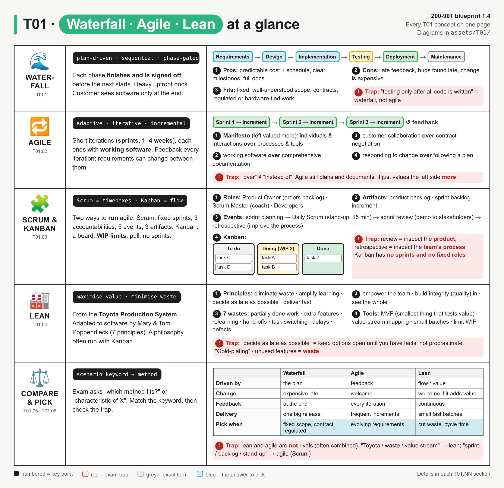
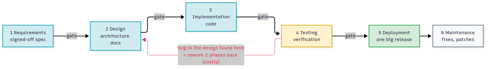
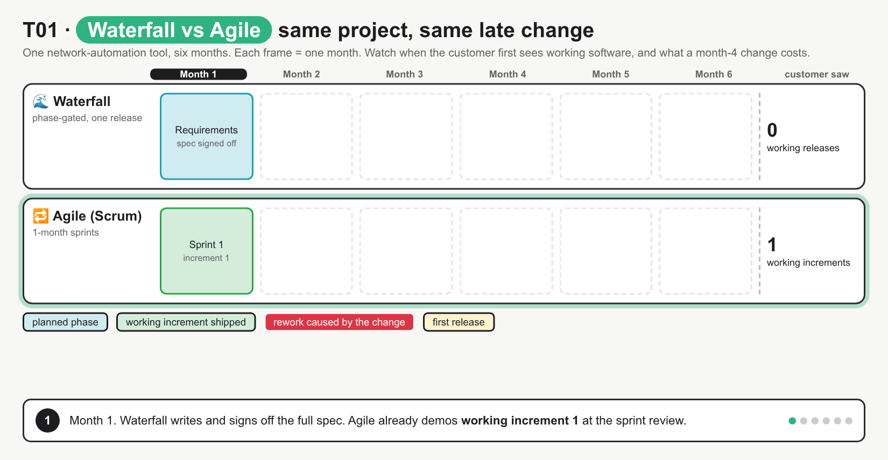
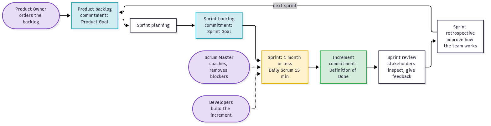
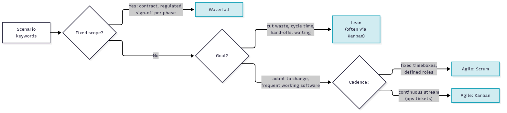

# T01 · Software dev methods: agile, lean, waterfall: essentials

> Blueprint 1.4 · Full note: [bob/T01-software-dev-methods.md](../bob/T01-software-dev-methods.md) · Teach-back 2026-10-11

## In one picture

*Read it one row at a time (waterfall, agile, Scrum and Kanban, lean), then use the bottom table to pick a method from the scenario's keywords.*

## The big idea
- Software teams need a way to organise work from "idea" to "running software", and that way is called the **software development lifecycle (SDLC)**.
- Waterfall, agile and lean are three different ways to run that lifecycle.
- Analogy you already know: a big data-centre build (HLD → LLD → build → test → one cutover in a change window) is **waterfall**. NetDevOps, where you push small tested config changes often through CI/CD, is **agile and lean** applied to the network.
- On the exam this is almost always keyword matching: the question describes a scenario, and you pick the method whose defining words appear in it.

## What you need to know

### 1. Waterfall: one step at a time, sign-off before moving on
- Waterfall is a **linear, sequential** lifecycle: work flows "downhill" through fixed phases and never overlaps.
- The six phases are **requirements → design → implementation → testing → deployment → maintenance**.
- Each phase must finish and be formally **signed off** (a **phase gate**) before the next one starts.
- Every phase hands a document to the next one (specification, design doc, test plan), so waterfall is **documentation-heavy**.
- Testing happens only after all the code is written, so a design flaw found in testing sends you back two or more phases. That is why the **cost of change rises late** in the project.
- The customer sees working software only once, at the very end, in one big release.

*Each arrow is a sign-off gate; the red loop shows how a bug found in testing forces a redo of design and code.*

| Good at | Bad at |
|---|---|
| Predictable budget and schedule, clear milestones | Feedback and bugs arrive late |
| Full documentation, easy to audit | Late change is expensive |
| Fits fixed-price contracts | Customer waits until the end to see anything |

- Waterfall is the **correct** answer when requirements are **fixed and well understood**, when a contract or regulator needs signed-off scope and an audit trail (medical, aerospace, government), or when work is tied to hardware that cannot be iterated cheaply.

### 2. Agile: build a small working piece, show it, adjust, repeat
- **Agile** is a set of values and principles, not one specific process. It was written down in the **Agile Manifesto** (2001).
- It is **iterative**: you repeat a short cycle of plan → build → test → review.
- It is also **incremental**: each cycle adds a slice of **working, tested software** (an **increment**) on top of the last one.
- Iterations are short, usually 1–4 weeks. In Scrum they are called **sprints**, and the Scrum Guide caps a sprint at one month.
- The customer sees working software at the end of every iteration, so **requirements can change between iterations**. This is **continuous feedback**.

The four Manifesto values (the left side is valued **more**, not "instead of"):

| Valued more | over | Valued less |
|---|---|---|
| Individuals and interactions | over | processes and tools |
| Working software | over | comprehensive documentation |
| Customer collaboration | over | contract negotiation |
| Responding to change | over | following a plan |

- A few of the twelve principles worth recognising: deliver valuable software early and continuously, welcome changing requirements even late, business people and developers work together daily, working software is the main measure of progress, and keep things simple (maximise the work **not** done).

*At month 4 the customer asks for IPv6: waterfall has to go back through design and build and releases once in month 6, while agile already ships every month and adds IPv6 in sprint 5.*

### 3. Scrum and Kanban: two ways to run agile day to day
- Agile is the philosophy; **Scrum** and **Kanban** are the two common frameworks that put it into practice. (XP, Extreme Programming, is a third one, with practices like pair programming and test-driven development.)
- The tracker marks ceremony detail as low priority, so learn the names and their purpose, not the minutes.

**Scrum works in fixed timeboxes (sprints).** It has three roles, which the 2020 Scrum Guide calls **accountabilities**:

| Role | What they do in plain words |
|---|---|
| **Product Owner** | Owns and **orders the product backlog**; decides *what* gets built |
| **Scrum Master** | Coaches the team and removes blockers; a servant-leader, **not** a project manager |
| **Developers** | Build the increment each sprint and decide *how* (older material says "Development Team") |

- Scrum has three **artifacts**: the **product backlog** (ordered list of everything the product might need), the **sprint backlog** (items picked for this sprint plus the plan), and the **increment** (the working result that meets the **Definition of Done**).
- The events run in this order inside each sprint: **sprint planning** (choose the work) → **Daily Scrum** or daily stand-up (15 minutes for the Developers to check progress) → **sprint review** (show the product to stakeholders) → **sprint retrospective** (the team looks at how it worked and plans improvements).

*Backlog → planning → sprint with Daily Scrum → increment → review (the product) → retrospective (the process) → next sprint.*

**Kanban works as a continuous flow.** Think of it as a NOC ticket queue made visible.
- A **visual board** has columns for each work state, at minimum **To do / Doing / Done**, and each card is one work item.
- A **WIP limit** (work in progress) caps how many cards can sit in a column, for example "Doing ≤ 2". It stops multitasking and exposes bottlenecks.
- Kanban is **pull, not push**: someone pulls a new card only when the WIP limit leaves a free slot.
- Kanban has **no sprints and no prescribed roles**; items are released whenever they are done.
- Flow is measured with **WIP, throughput, work item age and cycle time** (start to finish).

| | Scrum | Kanban |
|---|---|---|
| Rhythm | Fixed sprints (≤ 1 month) | Continuous flow |
| Roles | Product Owner, Scrum Master, Developers | None prescribed |
| Change mid-cycle | Avoided inside a sprint | Any time, if the WIP limit allows |
| Network fit | Feature work, e.g. a new automation tool | Ops ticket queue, NOC changes |

### 4. Lean: give the customer value and cut out the waste
- **Lean** comes from the **Toyota Production System** (lean manufacturing). Mary and Tom Poppendieck adapted it to software in 2003.
- The core idea is **maximise customer value, minimise waste**, where waste is anything the customer would not see as adding value.
- The seven lean principles are: **eliminate waste, amplify learning, decide as late as possible, deliver as fast as possible, empower the team, build integrity (quality) in, see the whole**.
- "Decide as late as possible" means keep options open until you have the facts; it does **not** mean procrastinate.

The seven wastes of software (⚠ verify: sources word these slightly differently, e.g. "relearning" vs "extra processes", "delays" vs "waiting"):

| Waste | Everyday example |
|---|---|
| Partially done work | Code written but never merged or deployed |
| Extra features | "Gold-plating": features nobody asked for |
| Relearning | Solving the same problem again because nothing was written down |
| Hand-offs | Dev → QA → ops tickets, losing context each time |
| Task switching | One engineer split across five projects |
| Delays / waiting | A week waiting for change-board approval |
| Defects | Bugs found late, causing rework |

- The lean tools to know are the **MVP (minimum viable product)**, the smallest product that tests whether customers value the idea; **value-stream mapping**, where you draw every step from request to production and mark the waiting time; and **small batches with limited WIP and pull**, often via a Kanban board.
- Lean and agile are **combined**, not rivals: lean is the thinking about flow and waste, and Kanban is an agile framework that puts much of it into practice.

### 5. Comparing them and picking one
| | Waterfall | Agile | Lean |
|---|---|---|---|
| Driven by | The plan | Feedback | Flow and customer value |
| Shape | Linear phases | Iterations (sprints) | Continuous flow |
| Requirements | Fixed up front | Evolve between iterations | Decided as late as possible |
| Change | Expensive late | Welcomed | Welcomed if it adds value |
| Testing | A phase after coding | Inside every iteration | Built in |
| Delivery | One big release | Frequent increments | Small, fast batches |
| Key goal | Predictability | Adaptability | Efficiency, less waste |

*Ask in order: fixed scope → waterfall; cutting waste → lean; otherwise agile, then fixed timeboxes → Scrum or a continuous stream → Kanban.*

### 6. How the exam asks it
- Questions come in two shapes: **"which method fits this scenario?"** and **"which is a characteristic of X?"**, and both are keyword matching.

| Keyword in the question | Answer |
|---|---|
| sequential, phases, sign-off, gate, testing after development, fixed requirements, contract, regulated | **Waterfall** |
| iterations, sprints, increments, backlog, stand-up, customer feedback, changing requirements | **Agile** (Scrum if sprints or roles are named) |
| board, WIP limit, pull, continuous flow, no sprints | **Kanban** |
| Toyota, waste, value stream, MVP, cycle time | **Lean** |

- A wrong option often mixes keywords from two methods, such as "agile: each phase must be signed off before the next", so reject anything that blends them.
- For "characteristic of" questions, pick what is *defining* for that method, not just possible: agile teams do write docs, but "heavy upfront documentation" defines waterfall.

## Exam traps (the ones that catch people)
- It looks like agile throws away planning and documentation, but it actually just values working software and responding to change **more**; "over" does not mean "instead of".
- "Each phase completed before the next begins" sounds orderly and modern, but it is the definition of **waterfall**, which has no iterations.
- Sprint review and retrospective sound the same, but the **review** inspects the **product** with stakeholders while the **retrospective** inspects **how the team works**, and the retro closes the sprint.
- The Scrum Master sounds like a project manager, but they are actually a coach who removes blockers; the **Product Owner** decides what gets built and orders the backlog.
- Kanban sounds like "Scrum with a board", but it actually has **no sprints and no prescribed roles**; its levers are the board, WIP limits and pull.
- Lean sounds like "do less work", but it actually means less **waste**: extra features, waiting, hand-offs and half-done work.
- "Sprints of 3 months" looks plausible, but it is wrong because the Scrum Guide caps a sprint at one month (1–4 weeks is typical).
- Waterfall looks like the "old, wrong" answer, but for fixed-scope, regulated or contract-bound work it is the **correct** pick.

## Quick self-check

Q1. A government records system has requirements fixed by law, audit documents per phase and a fixed price. Which method?
Waterfall, because fixed scope, phase sign-off documents and a fixed-price contract are its defining traits.

Q2. Name two lean wastes from this list: partially done work, automated tests, extra features, short feedback loops.
Partially done work and extra features; tests build quality in and feedback loops amplify learning, so those are good practices.

Q3. Put these Scrum events in order: retrospective, Daily Scrum, sprint planning, sprint review.
Sprint planning → Daily Scrum (every day) → sprint review → sprint retrospective; the retro closes the sprint.

Q4. A NOC handles a steady stream of tickets, wants no fixed iterations, and wants to stop engineers starting too many tickets at once. What fits?
Kanban with WIP limits, because it gives continuous flow plus a cap on work in progress.

Q5. A value-stream map shows 2 hours of real work but 8 days elapsed, mostly approvals and hand-offs. Which thinking addresses this?
Lean, because value-stream mapping and removing waiting and hand-off waste are lean tools.

## Cheat lines to say out loud
- "Waterfall = gates and sign-off; agile = sprints and feedback; lean = Toyota and waste."
- "Review checks the product, retro checks the process."
- "Kanban: board, WIP limit, pull, no sprints, no roles."
- "Over is not instead of: agile still plans and documents."
- "Fixed scope or a regulator? Waterfall is the right answer, not the wrong one."
