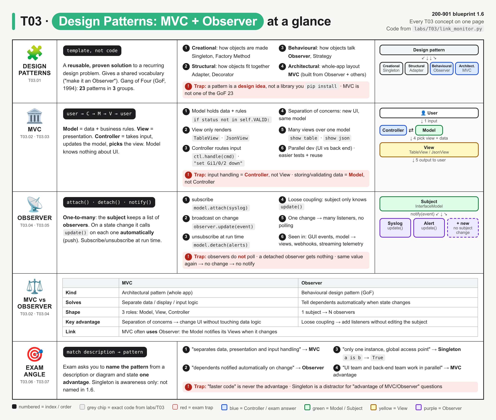
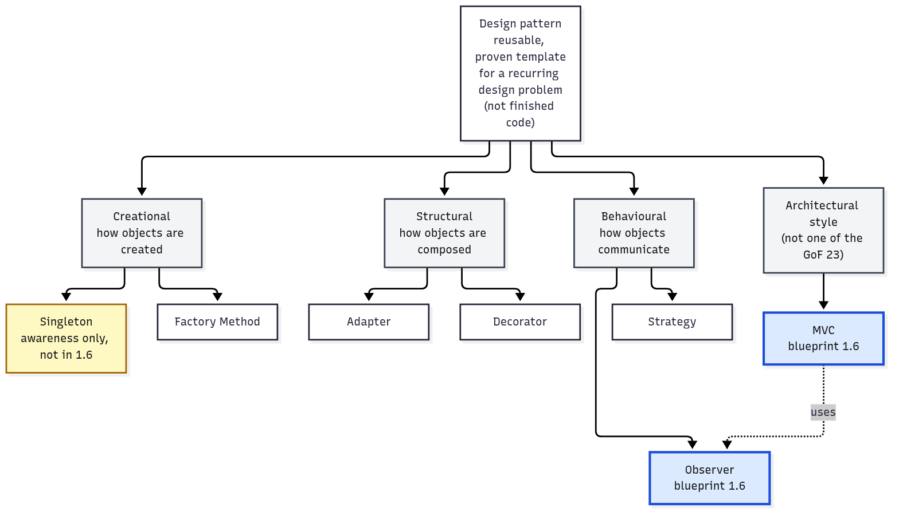
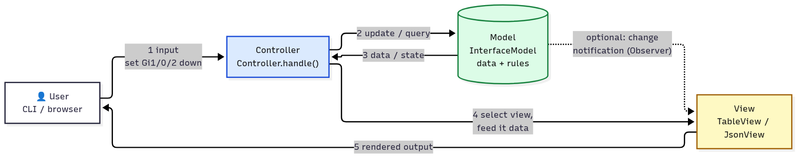
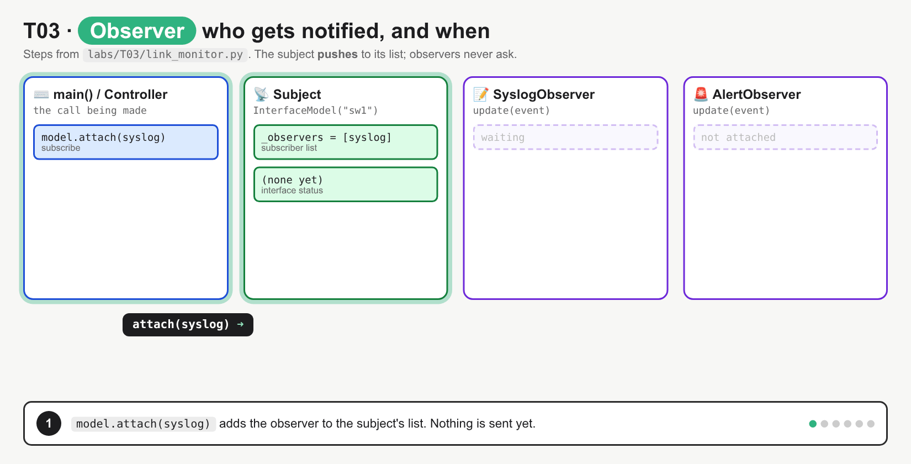

# T03 · Design patterns: MVC + Observer: essentials

> Blueprint 1.6 · Full note: [bob/T03-design-patterns-mvc-observer.md](../bob/T03-design-patterns-mvc-observer.md)

## In one picture

*Read it one row at a time: what a design pattern is, then MVC, then Observer, then the side-by-side table, then how the exam phrases it; the small diagram on the right of each row shows the shape.*

## The big idea
- A **design pattern** is a proven, named way to organise code for a problem that keeps coming back. Think of it like a standard network design (e.g. a collapsed-core campus): it is an idea you reuse, not a box you buy.
- The blueprint names exactly two patterns, **MVC** and **Observer**, and asks for their **advantages**.
- MVC is about **splitting an application into three jobs** (data, display, input handling). Observer is about **telling many interested parties automatically when something changes**, which is the same push idea as webhooks and streaming telemetry.
- The exam gives you a description or diagram and asks "which pattern?", or asks "what is an advantage of X?". Speed is never the answer.

## What you need to know

### 1. What a design pattern is
- A design pattern is a **template or idea, not finished code or a library**; you write it yourself in your own language. You cannot `pip install` a pattern.
- Patterns help because they give the team a **shared vocabulary** ("make the alerter an observer"), reuse solutions others have already proven, and make code easier to maintain and test.
- The classic book is by the **Gang of Four (GoF)** (*Design Patterns*, 1994). It lists **23 patterns** in **3 groups**:

| Group | Question it answers | Examples |
|---|---|---|
| **Creational** | How are objects created? | Singleton, Factory Method, Builder |
| **Structural** | How are objects fitted together into bigger structures? | Adapter, Decorator, Facade |
| **Behavioural** | How do objects talk to each other and share work? | **Observer**, Strategy, Command |

- **Observer is one of the GoF 23** (behavioural). **MVC is not**: it is an **architectural** pattern, meaning it describes how a whole application is split up, and it is older than the book (Smalltalk-80). ⚠ verify: the note's claim that the GoF introduction discusses MVC as built from Observer comes from the book, which was not fetched.


*Observer sits in the behavioural group; MVC stands apart as an architectural style that uses Observer; Singleton (yellow) is awareness only.*

### 2. MVC: three jobs, three parts
Everyday analogy: a restaurant. The **waiter** takes your order and tells the kitchen what to do (Controller); the **kitchen and pantry** hold the food and the recipes (Model); the **plate as served** is what you actually see (View). The waiter never cooks, and the plate never takes orders.

- The **Model** holds the **data and the business rules** (database, state, validation). It knows **nothing** about how things are displayed.
- The **View** is the **presentation**: it only shows model data to the user (a web page, a GUI, a JSON output). It does not change anything.
- The **Controller** **receives user input**, updates the Model, and **picks which View** to show. It is the glue between the other two.
- The flow is **user → Controller → Model → View → user**. Input always goes to the Controller first, never straight to the View.
- Optionally, the Model can **notify** its Views when its data changes; that link is the Observer pattern (section 4).


*Follow the numbers 1 to 5: input goes to the Controller (blue), the Model changes, and the Controller hands data to a View; the dotted line is the optional Observer link.*

Bob's note uses one small program for everything, `labs/T03/link_monitor.py`, an interface-status monitor for a switch:
- `InterfaceModel` is the Model. It stores interface states and enforces the rule that a status must be `up`, `down` or `admin-down`, so `set Gi1/0/3 flapping` is rejected by the Model.
- `TableView` and `JsonView` are two Views of the same data: one table for humans, one JSON blob for an API client.
- `Controller` reads typed commands: `set Gi1/0/2 down` updates the Model, and `show table` picks the table View.

| If the question says the component… | It is the |
|---|---|
| stores, validates or holds the state of data | **Model** |
| renders HTML, a GUI or JSON for the user | **View** |
| processes the user's request and mediates between the other two | **Controller** |

- Real-world MVC examples are web frameworks such as Rails and Flask with Jinja templates. Django calls its version **MTV** (Model-Template-View), and confusingly Django's "view" plays the controller role.
- Network-tooling example from the note: a dashboard (View) over a NetBox-style database (Model), with API handlers in between (Controller).

### 3. Why MVC is worth it (the advantages the exam asks for)
- **Separation of concerns:** each part has one job, so you can redesign the UI without touching the data logic. Adding a CSV export means writing a new View; the Model does not change.
- **Parallel development:** a UI developer and a back-end developer can work at the same time, as long as they agree on the shape of the data passed between them.
- **Many views over one model:** the same data can be shown as a web page, an API response and a report, while the model code is written once.
- **Easier testing and reuse:** you can test the Model on its own with no UI at all (Bob's test file does exactly this and gets `4 passed`), and reuse the same Model behind a different front end.
- Expect advantage words like **maintainability, reusability, testability, scalability of teams**. "Faster execution" is never the answer.

### 4. Observer: tell everyone who signed up, automatically
Everyday analogy: a mailing list. You **subscribe** once, the sender sends one message, and every subscriber gets it without having to keep asking "anything new?". You can unsubscribe at any time. In your world: **streaming telemetry** pushes changes to a collector, whereas **SNMP polling** keeps asking.

- Observer is a **one-to-many** relationship: one **Subject** keeps a list of **Observers**, and when the Subject's state changes it **notifies all of them automatically**.
- Observers can **subscribe (attach) and unsubscribe (detach) at run time**, while the program is running.
- The Subject only relies on one thing: every observer has an **`update()`** method. It does not care what each observer actually does.
- Many names mean the same thing, so match them up: subject = observable = provider = publisher; observer = subscriber = listener; attach = subscribe = register; detach = unsubscribe.

The pattern in its smallest form (the shape to recognise on the exam):

```python
class Subject:
    def __init__(self): self._observers = []        # the subscriber list
    def attach(self, o): self._observers.append(o)  # subscribe
    def notify(self, data):
        for o in self._observers: o.update(data)    # push to every observer
```
- In plain words: the Subject keeps a list, `attach` adds to it, and `notify` loops over the list calling each observer's `update`.

How it plays out in Bob's program:
- `SyslogObserver` writes an IOS-style `%LINK-3-UPDOWN` line on every change, and `AlertObserver` reacts only to "down" (it would POST to a webhook).
- `set Gi1/0/2 down` notifies **both** observers. Setting the **same value again notifies nobody**, because nothing changed.
- After `model.detach(alerts)`, the next change reaches only the syslog observer. A detached observer gets nothing.


*Attach two observers, one change notifies both, the same value again notifies nobody, then after detaching the alerter only syslog hears the next change.*

- **Push vs pull:** in the **push** style the Subject sends the data with the notification (Bob's program does this); in the **pull** style it only says "something changed" and observers ask for the details.
- **Publish-subscribe** is the same idea, but usually with a broker (message bus) in the middle so the two sides never hold references to each other; classic Observer has the Subject call observers directly.

### 5. Why Observer is worth it (the advantages)
- **Loose coupling:** the Subject does not know what its observers do. To add a third observer (say, a change counter), you write a class with `update()` and attach it; **the Subject's code does not change**.
- **Broadcast:** one change reaches every attached observer, so one event can cause many reactions with the code written once.
- **Dynamic:** listeners can be added or removed while the program runs.
- **No polling:** listeners do not loop asking "changed yet?"; they are told, which saves work and reacts faster.
- Where you meet the idea: **GUI event listeners** (a button's on-click), the **Model notifying Views in MVC**, **webhooks** (you register a URL and the platform POSTs to you on an event, see T43), and **model-driven streaming telemetry** subscriptions.
- The costs to know: observers are notified in no guaranteed order, and lots of observers or chatty updates can make it hard to see where a change came from.

### 6. Singleton, and how to tell the patterns apart
- **Singleton** is a creational pattern where a class allows **exactly one instance** with one global access point (one config object, one logger). It is **not** in blueprint 1.6, so expect it only as a **wrong answer** (distractor).

| | MVC | Observer |
|---|---|---|
| Type | Architectural pattern (whole app) | Behavioural design pattern (GoF) |
| Purpose | Separate data, display and input logic | Automatically tell dependents about a change |
| Shape | 3 components | 1 subject → many observers |
| Main advantage | Separation of concerns | Loose coupling |
| Link | MVC often **uses** Observer so the View updates when the Model changes | |

| Description says… | Answer |
|---|---|
| "separates data, presentation and input handling" / "three components" | MVC |
| "UI can change without changing business logic" / "UI and back-end teams in parallel" | MVC advantage |
| "objects are notified automatically when another object changes state" / "one-to-many" | Observer |
| "subscribers register and unregister at run time" / "loosely coupled listeners" | Observer advantage |
| "only one instance of a class" | Singleton (not 1.6) |

## Exam traps (the ones that catch people)
- Handling user input sounds like the View's job because the user "sees" it, but it is actually the **Controller**; the View only displays.
- Validating data sounds like the Controller's job, but storing data and enforcing business rules is the **Model**.
- "The client checks every 30 seconds for changes" looks like Observer, but it is actually **polling**; in Observer the Subject **pushes** to observers.
- MVC looks like one of the famous GoF patterns, but it is actually an **architectural** pattern outside the 23; Observer is the GoF (behavioural) one.
- "MVC uses Observer" is true (the Model notifies Views), but "Observer uses MVC" is false.
- Singleton looks like a reasonable "advantage" answer, but it is not in blueprint 1.6 and is the classic distractor.
- "Makes the app run faster" sounds like a benefit, but patterns buy maintainability, reuse, testability and loose coupling, not speed.
- Django's "view" looks like the MVC View, but in Django it plays the controller role (Django calls the split MTV); answer generic MVC questions with the generic roles.

## Quick self-check
<details><summary>Q1. A web app component receives a form submission, asks the inventory database to add a device, then chooses the "device added" page. Which MVC part is it?</summary>The Controller, because it takes input, updates the Model and picks the View.</details>

<details><summary>Q2. Give two advantages of MVC.</summary>The UI can be redesigned without changing business logic (separation of concerns), and front-end and back-end developers can work in parallel; many views over one model and easier testing also count.</details>

<details><summary>Q3. A monitor must let any number of modules react when a link changes, added or removed while it runs, without the link-state code knowing about them. Which pattern?</summary>Observer: one-to-many automatic notification, attach and detach at run time, loose coupling.</details>

<details><summary>Q4. An observer is detached, then the subject's state changes. What does that observer receive?</summary>Nothing, because it is no longer in the subject's observer list.</details>

<details><summary>Q5. A switch streams counters to a collector when they change instead of being polled by SNMP. Which pattern idea is this?</summary>Observer, because it is subscribe plus push on change, so the collector does not need to poll.</details>

## Cheat lines to say out loud
- "Model holds the data, View shows it, Controller takes the input."
- "User, Controller, Model, View, user."
- "Observer: subscribe once, get told automatically, unsubscribe any time."
- "MVC buys separation of concerns; Observer buys loose coupling; neither buys speed."
- "Singleton is the decoy: one instance, not in 1.6."
