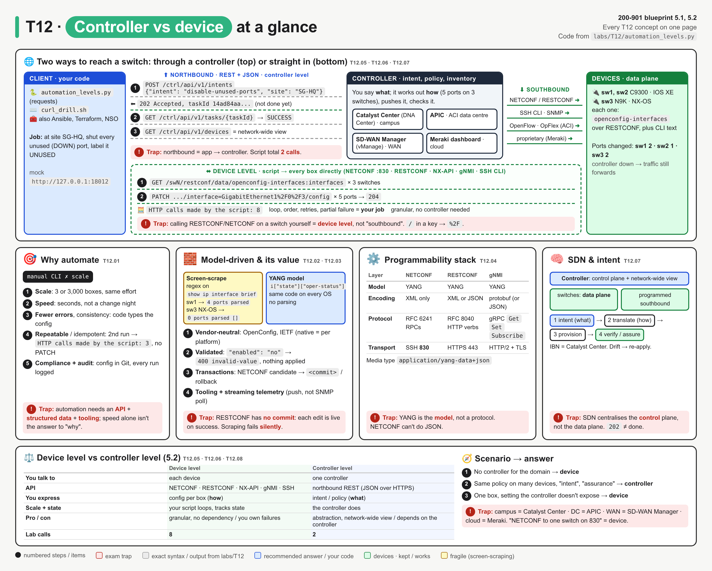
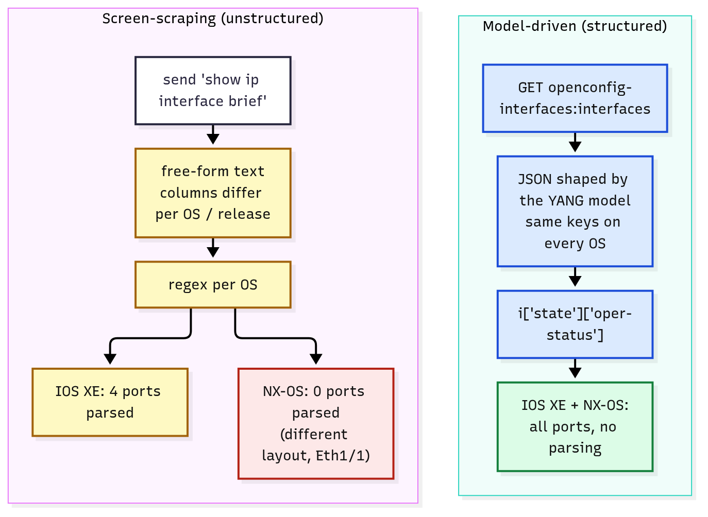
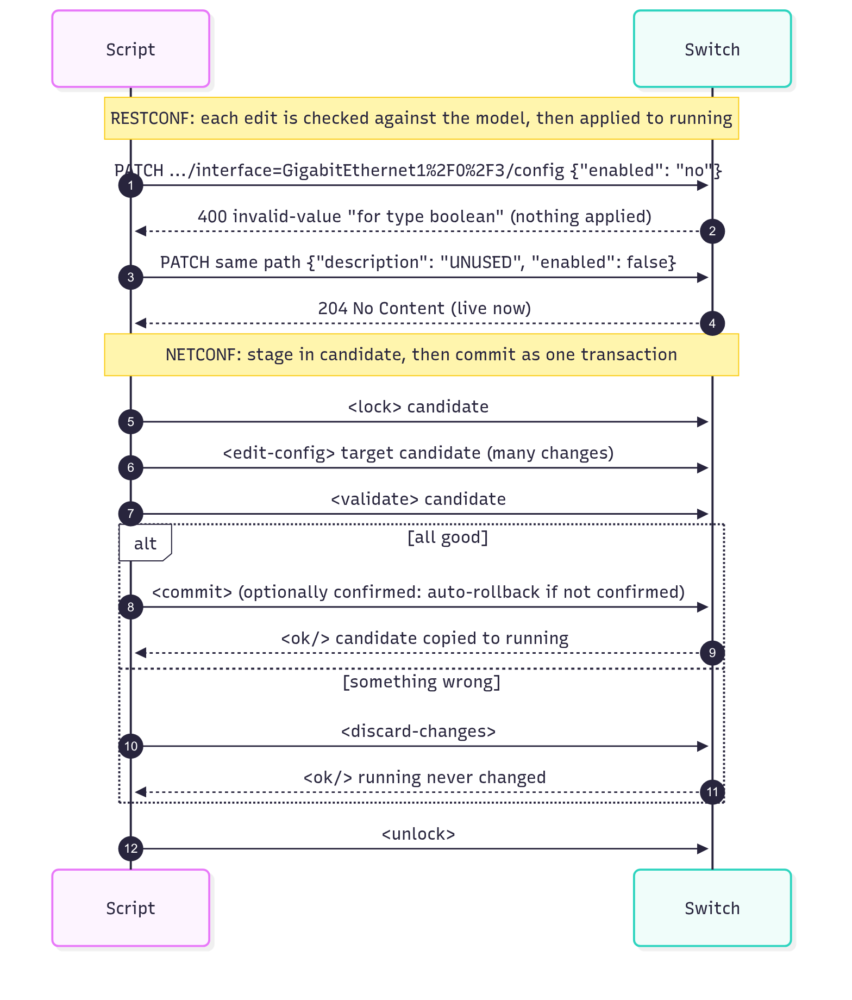
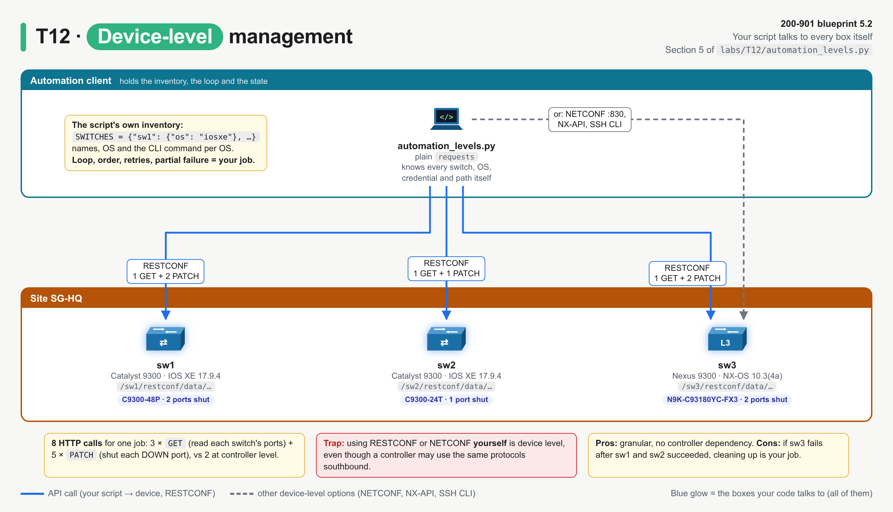
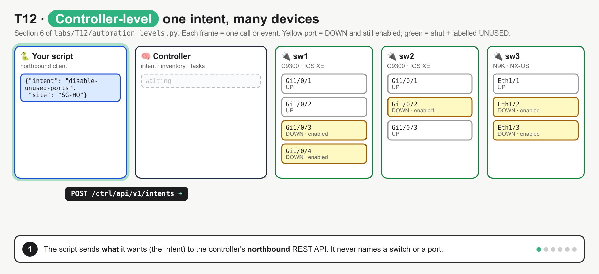
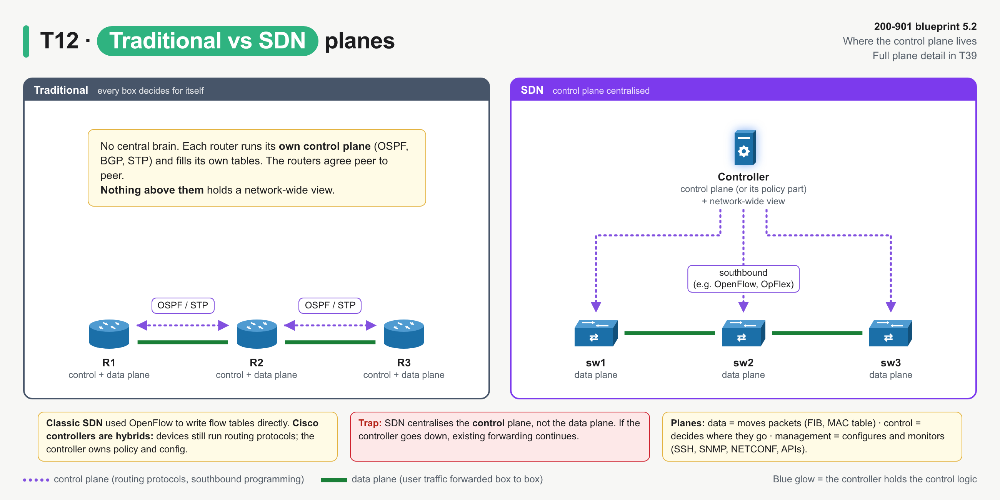

# T12 · Automation foundations: controller vs device: essentials

> Blueprint 5.1, 5.2 · Full note: [bob/T12-automation-foundations-controller-vs-device.md](../bob/T12-automation-foundations-controller-vs-device.md) · Teach-back 2026-10-11

## In one picture

*The top map shows the two routes from your code to a switch, through a controller (top lane) or straight in (bottom lane); the boxes below cover why automate, model-driven value, the stack, SDN, and the device-vs-controller table.*

## The big idea
- There are two ways to automate a network. At **device level** your script talks to every box itself; at **controller level** you tell one central system what you want, and it configures the boxes for you.
- Analogy: device level is phoning every branch manager yourself to change a policy; controller level is telling head office once and letting it roll the change out to every branch and report back.
- Underneath both sits **model-driven programmability**: config and state are described by a **YANG model** and exchanged as structured JSON or XML, instead of you scraping `show` output with regexes.
- Blueprint 5.1 asks for the **value** of model-driven programmability, and 5.2 asks you to **compare** device-level and controller-level management for a scenario.

## What you need to know

### 1. Why automate at all
- Manual CLI does not scale: one engineer, one SSH session, one box at a time. 300 switches × 5 minutes is 25 hours, and box 147 gets the typo.
- Learn the benefit words, because the answer options use them:

| Benefit | What it means in plain words |
|---|---|
| **Scale** | The same change on 3 or 3,000 devices costs the same effort. |
| **Speed** | It takes seconds, not a change-window night. |
| **Fewer human errors / consistency** | The code types the config the same way every time. |
| **Repeatability / idempotency** | Run it again and you get the same end state; nothing extra changes. |
| **Compliance and audit trail** | The desired config lives in Git and every run is logged. |
| **Faster troubleshooting** | You can collect state from every box at once. |

- Automation needs three things: a **programmable interface** (an API), **structured data** (JSON or XML shaped by a model), and **tooling** (Python, Ansible, Terraform, NSO, pyATS).
- Related ideas that appear alongside this on the exam are **Infrastructure as Code** (config as versioned files), **declarative vs imperative** (state the end result vs list the steps) and **NetDevOps** (CI/CD for network config).

### 2. Model-driven programmability and why it beats screen-scraping
- A **data model** is a schema for the device: it says which items exist (interfaces, VLANs, BGP neighbours), their types (string, boolean, enum), and whether each is **config** (read/write) or **state** (read-only). The modelling language is **YANG** (RFC 7950).
- An API (**NETCONF, RESTCONF or gNMI**) carries that model as XML or JSON, so you get keys and values instead of a screen of text.
- **Screen-scraping** means sending a `show` command over SSH and pulling values out with a regex. The text was written for humans, so its layout differs per OS and release, and when it changes **the regex fails silently**: no error, just wrong or missing data.
- Bob's lab proves this. One regex written for IOS XE `show ip interface brief` parses 4 ports on the Catalyst switch, but on the Nexus (`show interface brief`, different columns, `Eth1/2` names) it returns `0 ports parsed []` with no exception.
- The model-driven fix is one `GET .../openconfig-interfaces:interfaces` and reading `["state"]["oper-status"]`; the **same code works on all three switches**.


*Yellow is fragile and red is a silent failure; on the model-driven side the keys are the same on every OS, so nothing needs parsing.*

| | CLI screen-scraping | Model-driven API |
|---|---|---|
| Data | Free-form text | Structured JSON/XML defined by YANG |
| Parsing | Regex or TextFSM per OS and release | None: read the keys |
| Config vs state | Mixed together in `show` output | Kept separate |
| Validation | Device rejects a bad line partway through a paste | Whole edit checked against the schema first |
| Same code across vendors | No | Yes, with OpenConfig or IETF models |

- **SNMP** is the older structured option (MIBs), but it is used mainly for monitoring; writing config through SNMP is rare, and it does not separate config from operational data.

### 3. The value of model-driven programmability (the 5.1 answer list)
- **Vendor-neutral, same code:** models from **IETF** (`ietf-interfaces`) and **OpenConfig** (`openconfig-interfaces`) work across vendors. **Native** models (`Cisco-IOS-XE-native`) cover every platform feature but tie you to that platform.
- **Validation before apply:** the device checks types, ranges and mandatory items against the schema and rejects the whole edit if any part fails. In the lab, `"enabled": "no"` returns `400 invalid-value`, and the description sent in the same request is not applied either.
- **Transactions and rollback:** with NETCONF you stage changes in the **candidate** datastore, `<validate>` them, then `<commit>` all of them at once or `<discard-changes>`. A **confirmed commit** rolls back by itself if you do not confirm in time (IOS XE default 600 s).
- **Easier tooling:** a model can generate code, docs and API paths, and SDKs and Ansible modules are built on the models.
- **Streaming telemetry:** the device **pushes** model-based data on a timer or on change (gNMI `Subscribe`, IOS XE model-driven telemetry), instead of being polled by SNMP.
- ⚠ verify: a practice-exam review flagged **device vs service models**. A YANG model for an individual device's config is a **device data model**, while **service models** span many devices. The note lists this as a point to confirm.
- Things that are **not** values of model-driven programmability: "removes the need for credentials", "faster packet forwarding", "replaces the data plane". The model is a management-plane idea.


*Top: RESTCONF rejects a bad value whole, and a good edit is live as soon as it returns. Bottom: NETCONF stages many changes in candidate, then commits or discards them together.*

- **RESTCONF has no candidate or commit step:** each edit is live as soon as it succeeds (RFC 8040). For a multi-step all-or-nothing change, use NETCONF candidate/commit or one gNMI `SetRequest`.

### 4. The programmability stack: model, encoding, protocol, transport
- Think of it like the OSI layers for management: the same YANG model can be carried by three protocols, and only the encoding and transport change.

| Layer | NETCONF | RESTCONF | gNMI |
|---|---|---|---|
| Model | YANG | YANG | YANG (OpenConfig first) |
| Encoding | **XML only** | **XML or JSON** | **protobuf** (or JSON inside protobuf) |
| Protocol | RFC 6241; RPCs `<get-config>`, `<edit-config>`, `<commit>` | RFC 8040; HTTP `GET POST PUT PATCH DELETE` | OpenConfig spec; RPCs `Capabilities Get Set Subscribe` |
| Transport | **SSH, TCP 830** | **HTTPS, TCP 443** | **gRPC over HTTP/2**, TLS required |

- RESTCONF uses its own media types, `application/yang-data+json` and `application/yang-data+xml`. In the lab, plain `application/json` was refused with `415` (⚠ verify per platform).
- A `/` inside a RESTCONF list key must be encoded as **`%2F`**, so an interface key is written like this:

```
PATCH /restconf/data/openconfig-interfaces:interfaces/interface=GigabitEthernet1%2F0%2F2/config
```
- In plain words: without `%2F` the slashes split the URL path and the lab returns `404` (⚠ verify the exact status on real IOS XE).

### 5. Device-level management: your script talks to every box
- At device level **your code holds a session to every device** and must know each one's details itself.

| Interface | Encoding / transport | Typical tool |
|---|---|---|
| SSH CLI | Text over SSH port 22 | Netmiko, Paramiko (screen-scraping) |
| **NETCONF** | XML over SSH **port 830** | ncclient |
| **RESTCONF** | JSON/XML over HTTPS | `requests`, curl |
| **NX-API** | JSON-RPC or CLI-in-JSON over HTTP(S) | Nexus (NX-OS) only |
| gNMI | protobuf over gRPC | gNMIc, pygnmi |
| SNMP | MIBs over UDP 161 | Legacy, mostly monitoring |

- The upside is that it is **granular** (any leaf the device model exposes), needs **no controller** (good for brownfield, labs and one-off fixes), and nothing sits between you and the box.
- The downside is that the script owns **scale, consistency, state, ordering, retries and partial failure**. If sw3 fails after sw1 and sw2 succeeded, cleaning up is your job.
- In the lab, the job "shut every unused port at site SG-HQ" took the script **8 HTTP calls** at device level (3 GETs plus 5 PATCHes).


*Your script holds the inventory and opens a session to every switch itself: 3 GETs plus 5 PATCHes is 8 calls, and every failure case is yours.*

### 6. Controller-level management: one call, the controller does the rest
- At controller level **you talk to one system that already manages the devices**. It holds the inventory, topology, policy and intent for a whole domain.

| Domain | Controller (old name) | Northbound API | Southbound to devices |
|---|---|---|---|
| Campus / branch | **Catalyst Center** (DNA Center) | REST/JSON, `X-Auth-Token` | SSH/CLI, SNMP, NETCONF |
| Data centre (ACI) | **APIC** | REST (XML/JSON), `aaaLogin` cookie | **OpFlex** |
| WAN | **SD-WAN Manager** (vManage) | REST/JSON, session cookie + XSRF token | NETCONF over the DTLS/TLS control connections |
| Cloud-managed | **Meraki dashboard** | REST/JSON, API key | Proprietary device-initiated cloud tunnel |

- ⚠ verify: the southbound protocol per controller is summarised at exam level; the details are in each controller's own note (T18 to T22).
- **Northbound** is what the controller offers **up** to apps and scripts, usually REST with JSON over HTTPS. **Southbound** is how the controller talks **down** to devices: NETCONF, RESTCONF, CLI/SSH, SNMP, **OpenFlow** (classic SDN), **OpFlex** (ACI) or proprietary. **East-west** is controller to controller.
- In the lab, one `POST /ctrl/api/v1/intents` with `{"intent": "disable-unused-ports", "site": "SG-HQ"}` returned **`202 Accepted` plus a task ID**; the controller then pushed 5 southbound PATCHes to 3 switches, and a `GET` on the task said `SUCCESS`. Total: **2 calls** from the script. (These lab paths are invented for teaching; ⚠ verify real paths in T18 to T22.)
- **`202 Accepted` does not mean done**: controllers run writes as background tasks, so you poll the task ID for the result.


*POST intent, get 202 and a task ID before anything changes, the controller translates the site into 5 ports on 3 switches, pushes them southbound, then the task reports SUCCESS.*

- The upside is **abstraction** (no per-OS detail), a **network-wide view**, consistent policy and fewer calls. The downside is that you **depend on the controller**: it must be up, you are limited to what its API exposes, and it is one more system to licence, run and secure.

| | Device level | Controller level |
|---|---|---|
| You talk to | Each device | One controller |
| API | NETCONF, RESTCONF, NX-API, gNMI, SSH CLI | Northbound REST (JSON over HTTPS) |
| You express | Config per box (**how**) | Intent or policy (**what**) |
| Scale and state | Your script loops and tracks state | The controller does |
| View | One box at a time | Network-wide |
| Dependency | None beyond the device | The controller must be up |
| Lab calls for the job | 8 | 2 |

### 7. SDN and intent-based networking
- You know the three planes: the **data plane** forwards packets, the **control plane** decides where they go (OSPF, BGP, STP), and the **management plane** configures and monitors the box (SSH, SNMP, NETCONF and the APIs here).
- In **SDN** the control plane (or its policy part) moves into a **central controller** with a network-wide view, while devices keep the data plane and are programmed southbound. Cisco's controllers are hybrids: devices still run routing protocols, and the controller owns policy and config.
- Because the data plane stays on the devices, **if the controller goes down, existing traffic still flows**; only management and intent are lost.
- **Intent-based networking (IBN)** means you declare **what** you want, the controller works out **how**, provisions it, then keeps checking the network still matches (**assurance**). Catalyst Center is Cisco's IBN controller.


*Left: each router runs its own control plane. Right: one controller holds the control logic and programs the switches southbound, and the switches only forward.*

### 8. Picking the level for a scenario
| Scenario wording | Answer |
|---|---|
| "single place to define policy for 400 campus switches", "intent", "network-wide view", "assurance" | Controller level (Catalyst Center) |
| "ACI fabric", "tenants / EPGs" | Controller level (APIC) |
| "WAN edge templates across 200 branches" | Controller level (SD-WAN Manager) |
| "configure one router's interface with RESTCONF", "NETCONF on port 830", "NX-API on a Nexus" | Device level |
| "no controller deployed", "brownfield lab", "a feature the controller doesn't expose" | Device level |

## Exam traps (the ones that catch people)
- Using RESTCONF or NETCONF on a switch looks like "southbound", but when your own script does it, it is **device level**; southbound means controller to device.
- An app calling Catalyst Center's REST API looks like it is "going down to the network", but it is using the **northbound** API.
- YANG looks like a protocol, but it is the **model**; NETCONF, RESTCONF and gNMI are the protocols, and XML, JSON and protobuf are the encodings.
- NETCONF looks like it can do JSON, but it is **XML only** over SSH port 830; RESTCONF is the one that does XML **or** JSON over HTTPS.
- RESTCONF looks like it has transactions, but **each edit is live when it returns**; candidate, commit and rollback belong to NETCONF.
- A screen-scraping script looks like it worked because there was no error, but a changed CLI layout fails **silently** (`0 ports parsed`).
- `202 Accepted` looks like success, but it only means the controller accepted the task; poll the task ID.
- SDN looks like it centralises everything, but it centralises the **control plane**, not the data plane, so forwarding continues if the controller dies.

## Quick self-check
<details><summary>Q1. Name two values of model-driven programmability.</summary>Validation against a schema before apply, and the same code across vendors with OpenConfig or IETF models; transactions, easier tooling and streaming telemetry also count.</details>

<details><summary>Q2. Map YANG, JSON, RESTCONF and HTTPS to the four stack layers.</summary>YANG is the model, JSON the encoding, RESTCONF the protocol and HTTPS the transport.</details>

<details><summary>Q3. Apply one QoS policy to 600 campus switches and check compliance afterwards; Catalyst Center already manages them. Which approach?</summary>One call to the Catalyst Center northbound REST API, because it is network-wide, policy-based and needs assurance.</details>

<details><summary>Q4. You need to stage interface, routing and ACL changes, apply them all at once, and roll back automatically if the router becomes unreachable. Which option?</summary>NETCONF edit-config to the candidate datastore, then a confirmed commit; RESTCONF applies each edit immediately with no commit step.</details>

<details><summary>Q5. True or false: device-level management needs a controller to translate intent.</summary>False; at device level your script talks to each box directly and must handle looping, ordering and partial failures itself.</details>

## Cheat lines to say out loud
- "Device level: I talk to every box. Controller level: I talk to one brain."
- "Northbound is app to controller; southbound is controller to device."
- "Model YANG, encode XML or JSON, carry by NETCONF, RESTCONF or gNMI, over SSH 830, HTTPS 443 or HTTP/2."
- "RESTCONF has no commit; NETCONF has candidate, commit and rollback."
- "202 is not done, and a dead controller does not stop the traffic."
