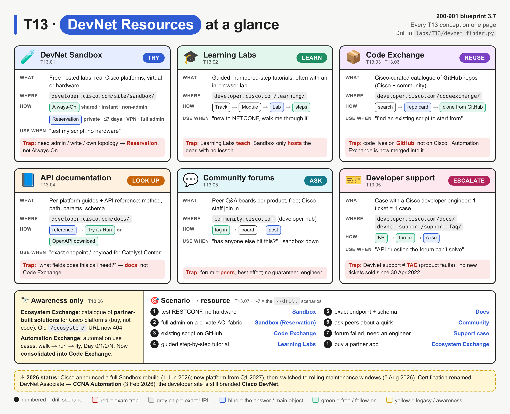
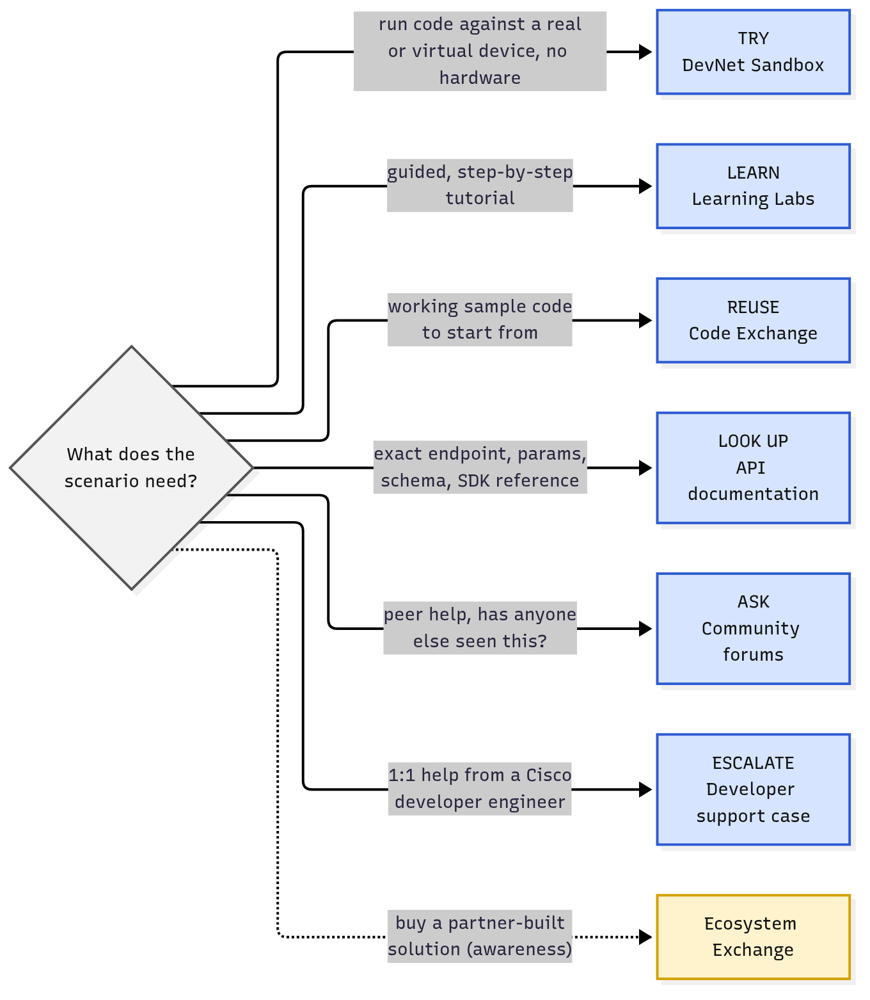
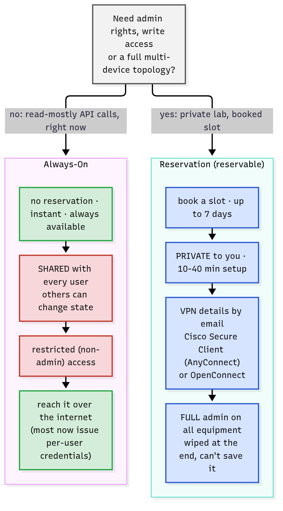
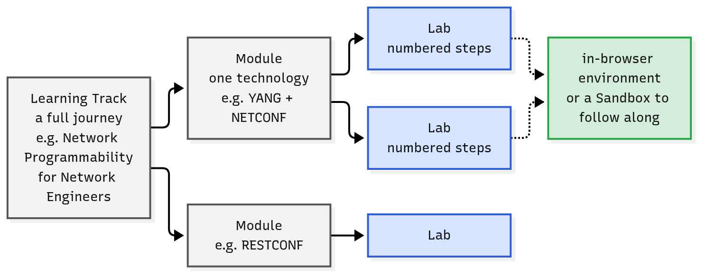
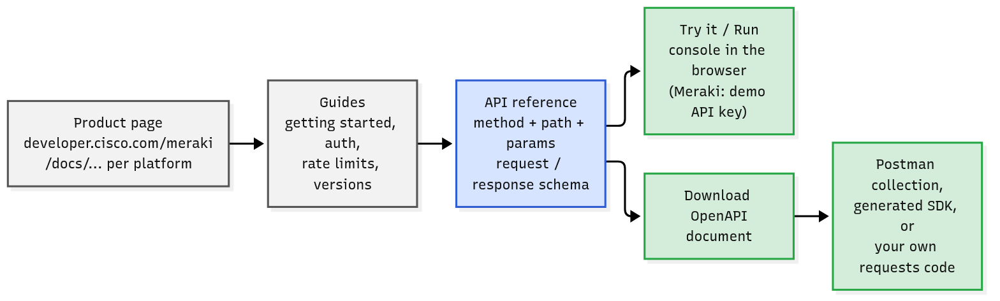
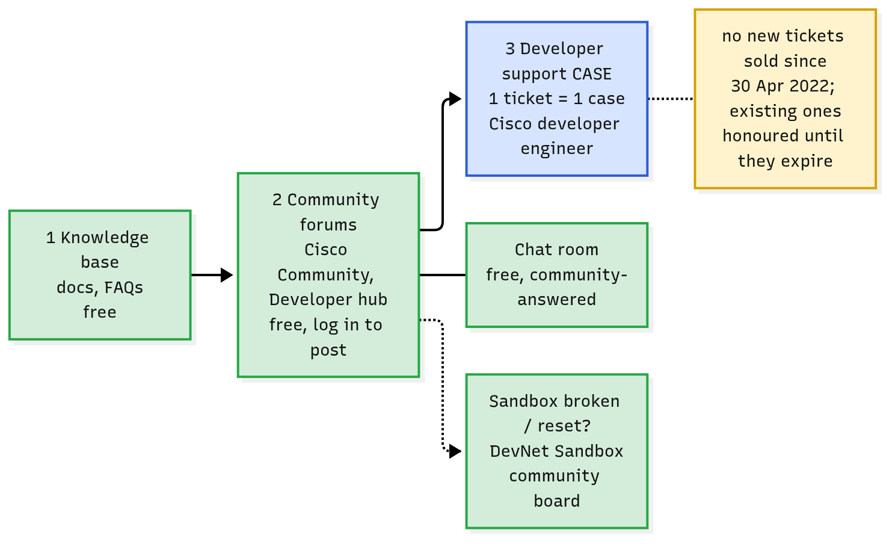

# T13 · DevNet resources: essentials

> Blueprint 3.7 · Full note: [bob/T13-devnet-resources.md](../bob/T13-devnet-resources.md)

## In one picture

*Each card is one resource with the same parts (what, where, how, use when, trap), and the coloured pill is the one verb to remember; the bottom strip maps exam scenarios to the answer.*

## The big idea
- Cisco's developer site, **developer.cisco.com** (still branded Cisco DevNet), offers six free resources, and each one does one job.
- Remember one verb per resource: **Sandbox = TRY, Learning Labs = LEARN, Code Exchange = REUSE, API docs = LOOK UP, Community = ASK, Developer support = ESCALATE.**
- Analogy from your world: Sandbox is the lab rack you borrow, Learning Labs is the guided lab workbook, Code Exchange is the shared script repo, the docs are the command reference, the forum is asking colleagues, and a support case is calling in an expert.
- Exam questions describe a need and ask which resource fits, so match the **verb in the question**, not the product name.

## What you need to know

### 1. Picking the right resource
- Every question boils down to "what does the scenario need?", and each need maps to one resource.

*Read the edge label (the need), then the box (the verb and resource); Ecosystem Exchange is dotted because it is awareness only.*

- The developer.cisco.com home page today has **four main tiles**: Documentation, Learning Labs, Code Exchange and Sandbox. Community and support are linked from elsewhere.
- Everything here is **free** with a Cisco account: Sandboxes, Learning Labs, docs and forums. **Cisco U.** is the separate, mostly paid, official-training platform.

### 2. DevNet Sandbox: TRY things on real Cisco gear
- A **Sandbox** is a free, hosted lab environment, usually built around **one product** (for example IOS XE, NX-OS, APIC, Catalyst Center, Meraki, SD-WAN, CUCM, CML, UCS).
- Sandboxes are built from virtual environments, simulators and real hardware, and you use them to test API calls and scripts, learn a product, train, or run hackathons.
- The product page is `https://developer.cisco.com/site/sandbox/`, and the catalogue is at `https://devnetsandbox.cisco.com/`, where each entry shows an **Always-On** or a **Reserve** button.
- There are two types, and the exam loves the difference:

| | Always-On | Reservation (reservable) |
|---|---|---|
| Booking | None: always ready to go | Reserve a time window, up to **7 days** |
| Setup time | Instant | 10–40 minutes, depending on the sandbox |
| Who else is on it | **Shared** with all users | **Private** to you |
| Rights | Restricted, non-admin ("kick the tyres") | **Full admin** on all equipment |
| Access | Straight over the internet to a public hostname | **VPN**, using Cisco Secure Client (formerly AnyConnect) or OpenConnect |
| Extras | Usually one device or controller | Often a whole topology: network, DNS, dev servers |
| Downsides | Cannot change admin config; others can change the state | You wait for setup, and you **cannot save** the environment when it ends |

*Start with the question at the top; the red boxes are the Always-On limits that push you to a Reservation.*

- Think of Always-On as a shared read-only demo switch anyone can SSH to, and a Reservation as a lab rack booked just for you with the enable password.
- Always-On labs used to publish one shared username and password, but most now issue **per-user credentials** when you launch them (⚠ verify: Cisco says this will roll out to all Always-On labs).
- ⚠ verify: Cisco announced a full Sandbox rebuild on 1 Jun 2026, then on 5 Aug 2026 replaced the planned outage with short maintenance windows, so some behaviour may differ from the docs. The exam still tests the Always-On vs Reservation model.

### 3. Learning Labs: LEARN step by step
- **Learning Labs** are free, self-paced tutorials with numbered steps ("learn by doing"), found in the **Learning Labs Center** at `https://developer.cisco.com/learning/`.
- They are organised as **Learning Track** (a whole journey) → **Modules** (one technology) → **Labs** (the step-by-step pages). An example track is "Network Programmability for Network Engineers" (YANG and NETCONF on IOS XE).
- Many labs run in a preconfigured in-browser environment, or tell you to follow along on a matching Sandbox.
- The site's grouping is called **Learning Tracks**, not "Learning Paths"; "learning paths" is the term Cisco U. uses for its paid training.

*A lab is the smallest unit; tracks hold modules, and modules hold labs.*

### 4. Code Exchange: REUSE other people's code
- **Code Exchange** (`https://developer.cisco.com/codeexchange/`) is a **curated catalogue of GitHub projects** for Cisco platforms: sample code, SDKs, scripts, Ansible and Terraform content, and now MCP servers and AI agents.
- The code itself **stays on GitHub**. Code Exchange only indexes it, tags it by product (Meraki, Catalyst Center, Webex, SD-WAN, IOS XE, NX-OS) and links to it.
- Authors include Cisco teams, partners, open-source communities and individuals. "Curated by Cisco" means Cisco curates the list, **not** that Cisco supports every repo.
- To submit your own repo, it must be relevant to Cisco tech, public on GitHub, under an OSI-approved licence or the Cisco Sample Code License, and have a clear README.
- Use it when the question says "find working sample code to start from" or "share my script with the community".

### 5. API documentation: LOOK UP the exact call
- The per-platform docs live under `https://developer.cisco.com/docs/` (plus product hubs such as `developer.cisco.com/meraki/`). Each has getting-started guides, authentication, rate limits, versions and changelog, SDK docs and the **API reference**.
- The **API reference** has one page per operation, listing the method, path, parameters, request body schema, response codes and example responses. This is where you find "the exact endpoint".
- Interactive extras vary by platform: a **Try it / Run console** sends a request from the browser (the Meraki docs load a demo API key so you can click "Run"), and you can **download the OpenAPI document** to import into Postman or generate an SDK.

*Blue is where "exact endpoint or schema" questions point; green is what you can do from there.*

### 6. Community and developer support: ASK, then ESCALATE
- **Community forums** are the Cisco Community boards on `community.cisco.com` (the developer hub). They are free, answered by peers with Cisco staff joining in, and best effort.
- There is a dedicated **DevNet Sandbox** board for Sandbox outages, resets and access problems, where Cisco says to normally expect a response within 24 hours on business days.
- **DevNet Support** lists four options for developers using Cisco APIs: the **Knowledge Base** (check first), a **Chat Room** (community-answered), the **Forum** (any logged-in member), and **Case support**, where a **ticket** opens a case with a Cisco **developer engineer** (1 ticket = 1 case, open until resolved).
- ⚠ verify: developer support tickets have **not been sold since 30 Apr 2022**, though existing ones are honoured. For the exam, "need one-to-one help from a Cisco engineer on an API" still means a **developer support case**.
- **DevNet support is not TAC.** TAC handles product faults under a service contract; developer support handles questions about **using the APIs**.

*Climb left to right: self-serve first, then peers, then an engineer; Sandbox problems go to the Sandbox community board.*

### 7. Awareness only: Ecosystem Exchange and Automation Exchange
- **DevNet Ecosystem Exchange** is a catalogue of **business solutions built by Cisco partners** on Cisco platforms. You use it to **find or buy** an app, not to get code. (⚠ verify: the old `developer.cisco.com/ecosystem/` URL now returns 404, though product pages still embed it.)
- **DevNet Automation Exchange** (`/network-automation/`) listed automation **use cases**, organised by maturity (**walk → run → fly**) and by lifecycle (**Day 0** install, **Day 1** configure, **Day 2** optimise, **Day N** manage and upgrade). It has now been **consolidated into Code Exchange**.

### 8. Scenario words to answer
| The question says… | Answer |
|---|---|
| test, try, run my script, no hardware, quick read-only call | **Sandbox (Always-On)** |
| admin rights, change config, private, multi-device, for N days, VPN | **Sandbox (Reservation)** |
| step by step, guided, tutorial, new to X, learning track | **Learning Labs** |
| sample code, existing script, GitHub, reuse, share my project | **Code Exchange** |
| exact endpoint, parameters, payload schema, OpenAPI, SDK reference | **API documentation** |
| ask others, peer help, is it just me, sandbox is down | **Community forums** |
| one-to-one Cisco engineer, case, ticket, API question unresolved | **Developer support case** |
| buy or find a partner-built solution | **Ecosystem Exchange** |

## Exam traps (the ones that catch people)
- Any Sandbox looks fine for testing, but if the scenario needs **admin rights, config changes, a private topology or several days**, the answer is a **Reservation** sandbox, not Always-On.
- "Learning Lab" contains the word *lab*, so it looks like Sandbox, but a lab **with lessons** is Learning Labs; a hosted environment with no lessons is Sandbox. Bob's drill script shows this: "follow a Learning Lab" matches Sandbox until you add *guided* or *tutorial*.
- Code Exchange looks like a code host, but it **hosts nothing**: the repos live on GitHub, and Code Exchange is the curated index.
- "Which fields does this call need?" looks like a sample-code question, but the answer is the **API docs**, because sample code shows one way to call an API while the reference lists every parameter.
- A forum and a case both look like "getting help", but the forum is **free peer help, best effort**, while a case uses a ticket to reach a **Cisco developer engineer**; neither is TAC.
- Reservation access looks like plain internet access, but it is through a **VPN** (Cisco Secure Client or OpenConnect); Always-On needs no VPN.
- Ecosystem Exchange and Automation Exchange sound alike, but Ecosystem is **partner solutions to buy**, and Automation is **use cases**, now merged into Code Exchange.

## Quick self-check

Q1. You want to send a few read-only RESTCONF GETs to an IOS XE device in the next five minutes, with no lab gear and no config changes. Which resource?
An Always-On Sandbox, because it is instant, needs no booking and suits read-only calls.

Q2. A team must test a script that changes APIC fabric policy, with full admin rights and no interference, over two days. Which resource?
A Reservation ACI Sandbox, because it is private, gives full admin and can be booked for up to 7 days.

Q3. Match: guided NETCONF tutorial, existing Meraki script, Catalyst Center request schema, peer advice on an odd response.
Learning Labs, Code Exchange, API documentation, Community forums (learn, reuse, look up, ask).

Q4. Name two traits of a Reservation sandbox.
Accessed over a VPN, and full administrative access; it is also private, but it is wiped at the end and cannot be saved.

Q5. A manager wants a ready-made partner-built app that integrates with Webex, to buy rather than build. Which resource?
Ecosystem Exchange, because it lists partner business solutions; Code Exchange is about code.

## Cheat lines to say out loud
- "Try, learn, reuse, look up, ask, escalate."
- "Always-On is shared and instant; Reservation is private, admin, VPN, up to 7 days."
- "Code Exchange points to GitHub; it hosts nothing."
- "A lab with lessons is Learning Labs; a lab with no lessons is Sandbox."
- "Developer support is for APIs; TAC is for broken products."
