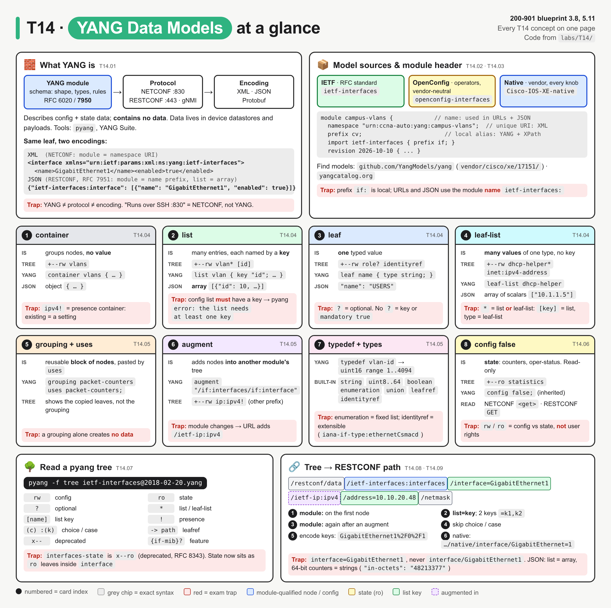
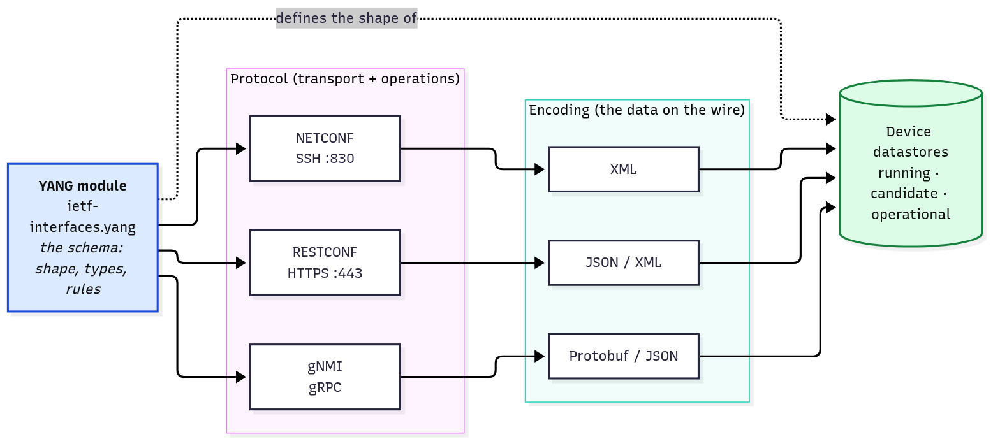
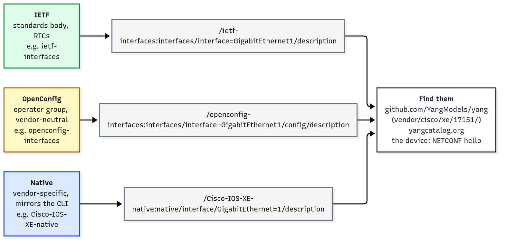
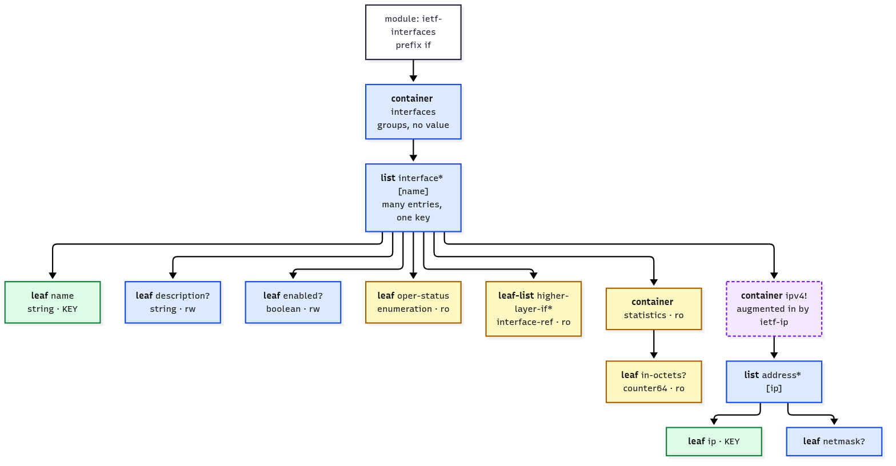
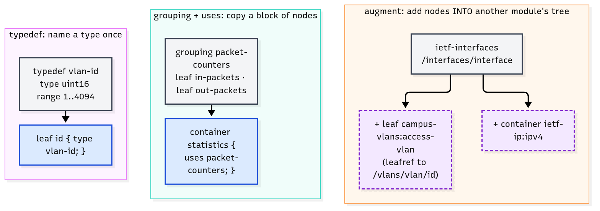
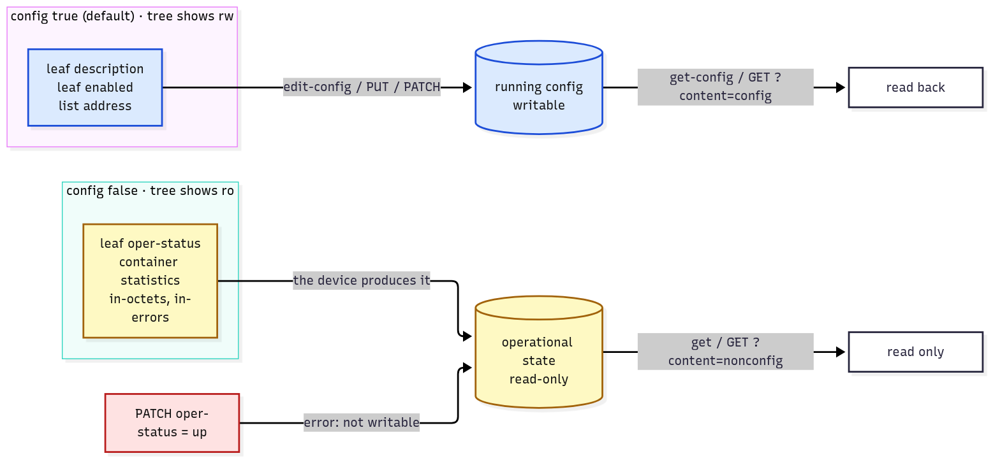
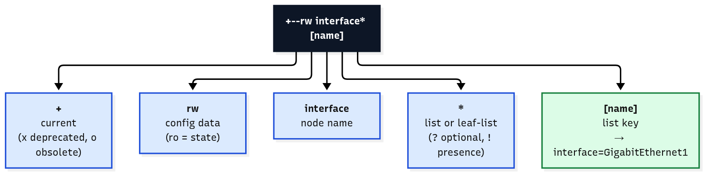
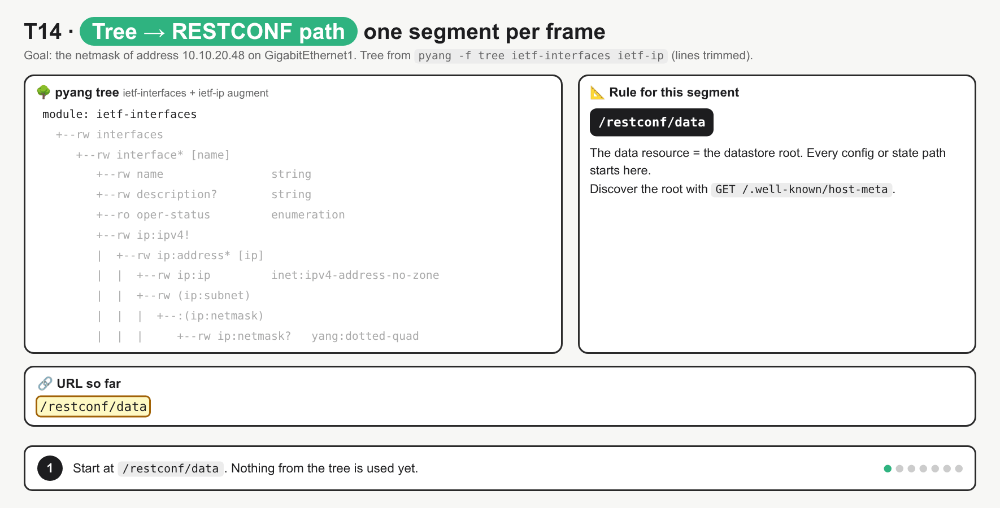

# T14 · YANG data models: essentials

> Blueprint 3.8, 5.11 · Full note: [bob/T14-yang-data-models.md](../bob/T14-yang-data-models.md) · Teach-back 2026-10-18

## In one picture



*Read the top strip first (what YANG is and where models come from), then the six middle cards (node and reuse types), then the bottom strip, which turns a tree into a RESTCONF URL; red boxes are exam traps.*

## The big idea

- YANG is the **blueprint, or blank form template**, for device data. It says which fields exist, what type each field is and which values are allowed, but it holds no actual values.
- The actual values (VLAN 10, the description on Gi1) live on the device, in its **datastore**, or inside a payload you send or receive.
- NETCONF is the **courier** that carries XML filled in to that form over SSH. RESTCONF carries the **same data over a web API** (HTTPS, JSON or XML). gNMI is a third courier.
- On the exam you are asked to **read** YANG, not write it: spot the node types, find the key, tell config from state, and build the RESTCONF URL.

## What you need to know

### 1. What YANG is: model vs protocol vs encoding

- YANG is a **data modelling language**. YANG 1.0 is RFC 6020 (2010), and **YANG 1.1** is RFC 7950 (2016), which current models use (`yang-version 1.1;`). Cisco models are YANG 1.1 from IOS XE 17.10.1 onwards.
- A model defines the **structure** (the tree), the **types** (`uint16`, `boolean`, `ipv4-address`) and the **constraints** (`range "1..4094"`, `mandatory true`, `key`).
- It covers **configuration data** (what you set), **operational state** (what the device reports, such as counters and oper-status), and also RPCs/actions and notifications (awareness level only).
- **YANG describes data; it doesn't contain it.** Think of a database schema versus the rows in the table.
- **YANG is protocol-independent**: one model can be carried by several protocols, each with its own encoding.



*YANG (blue) only defines the shape; the protocol carries the data and the encoding is how it looks on the wire.*

| Layer | Answers | Examples |
|---|---|---|
| **Model** | what the data looks like | YANG module `ietf-interfaces` |
| **Protocol** | how you send and receive it, and which operations exist | NETCONF (SSH :830), RESTCONF (HTTPS :443), gNMI (gRPC) |
| **Encoding** | how the data is written | XML (NETCONF), JSON or XML (RESTCONF), Protobuf/JSON (gNMI) |

- Here is the same interface in both encodings. XML names the module with its **namespace URI** (`xmlns=`), while JSON puts the **module name** in front of the top member.

```xml
<interface xmlns="urn:ietf:params:xml:ns:yang:ietf-interfaces"><name>GigabitEthernet1</name><enabled>true</enabled></interface>
```

```json
{"ietf-interfaces:interface": [{"name": "GigabitEthernet1", "enabled": true}]}
```

- In JSON a list entry is an **array** of objects, even if there is only one entry (RFC 7951). IOS XE often returns a single requested entry as an object instead. ⚠ verify
- Two tools to know by name: **pyang** validates a module and prints its tree, and **Cisco YANG Suite** lets you browse models and build NETCONF/RESTCONF/gNMI requests from them.

### 2. Where models come from: IETF, OpenConfig, Native

- There are three families of models, and they can describe the same setting with three different paths.

| Family | Written by | Scope | Example module | Path to the same `description` |
|---|---|---|---|---|
| **IETF** | IETF working groups, published as RFCs | common features, multi-vendor, slow to change | `ietf-interfaces` | `interfaces/interface=GigabitEthernet1/description` |
| **OpenConfig** | a group of operators (large SPs, cloud/web companies) | vendor-neutral, operational focus, separate `config` and `state` containers | `openconfig-interfaces` | `interfaces/interface=GigabitEthernet1/config/description` |
| **Native** | the vendor | **every** platform feature, mirrors the CLI, changes each release | `Cisco-IOS-XE-native` | `native/interface/GigabitEthernet=1/description` |



*Three families, three paths to one setting; note the native key is `GigabitEthernet=1`, not `GigabitEthernet1`.*

- Use IETF or OpenConfig for multi-vendor code. Use Native when the feature only exists there, which covers most IOS XE features beyond interfaces and IP. IOS XE, IOS XR and NX-OS support all three families.
- Cisco also publishes **operational** native models named `Cisco-IOS-XE-*-oper` (for example `Cisco-IOS-XE-interfaces-oper`). These are all `config false`, so they are read-only state.
- **Where to find models:**
  - **github.com/YangModels/yang** holds IETF models (`standard/ietf/RFC/`) and Cisco models, one folder per release (`vendor/cisco/xe/17151/` for IOS XE 17.15.1).
  - **YANG Catalog** (yangcatalog.org) is searchable metadata, such as which platforms and releases implement a module.
  - **github.com/openconfig/public** holds the OpenConfig models.
  - **The device itself** lists its models in the NETCONF `<hello>` capabilities (T15), or in the `ietf-yang-library` module. ⚠ verify the exact RESTCONF path on IOS XE.

### 3. The module header: name, namespace, prefix

- Every module starts with the same few statements. They are easy marks if you know what each one is for.

| Statement | Example | What it is for |
|---|---|---|
| `module <name>` | `campus-vlans` | the module **name**; RESTCONF URLs and JSON keys use it (`campus-vlans:vlans`) |
| `yang-version` | `1.1` | RFC 7950 syntax |
| `namespace` | `urn:ccna-auto:yang:campus-vlans` | a globally **unique URI**; XML uses it in `xmlns=` |
| `prefix` | `cv` | a **short local nickname** used only inside YANG files and XPath |
| `import` | `ietf-interfaces { prefix if; }` | lets you use another module's types, groupings and nodes through **its** prefix |
| `organization` / `contact` / `description` | `CCNA Automation study group` | documentation only |
| `revision` | `2026-10-10` | the version date; files are often named `module@revision.yang` |

- A simple way to remember the three identifiers: the **name** is for URLs and JSON, the **namespace** is for XML, and the **prefix** is for inside YANG and XPath.
- `include` pulls in a **submodule** (a piece of the same module), while `import` uses a **different** module. Cisco-IOS-XE-native is split into many files this way.

### 4. Node types: container, list, leaf, leaf-list

- There are four data nodes. If you map them to the CLI you already know, they click quickly.

| Node | Holds | CLI analogy | Tree marker | JSON shape |
|---|---|---|---|---|
| **container** | other nodes, **no value** of its own | a config section (`interfaces`) | `+--rw vlans` | object `{…}` |
| **list** | many **entries**, each picked out by a **key** | repeating stanzas (each `interface Gi…` block) | `vlan* [id]` | **array** of objects |
| **leaf** | **one** typed value | one setting (`description …`) | `name   string` | `"name": "USERS"` |
| **leaf-list** | **many values** of one type, no key | a repeatable line (`ip helper-address` ×2) | `dhcp-helper*   inet:ipv4-address` | array of plain values |



*Green boxes are list keys, blue is config (rw), yellow is state (ro), and dashed purple nodes are augmented in from ietf-ip.*

- **Key rules:** a config list **must** have a `key` (pyang errors without one). Key leaves are always mandatory. A list can have **several** keys: `key "name vrf";` shows as `[name vrf]` in the tree and `list=Gi1,blue` in the URL.
- Other things you may see in a tree, for reading only:
  - **choice / case** means exactly one branch exists (for example `prefix-length` **or** `netmask`). They are schema-only and never appear in data or URLs.
  - A **presence container** (`!`) means the container's existence is itself the setting (`ipv4!` means "IPv4 is configured").
  - **rpc / action** (`-x`) and **notification** (`-n`) are operations and events.

### 5. Reuse and types: typedef, grouping, augment, identity

- These statements let model writers reuse things instead of repeating them.

| Construct | What it does | Example |
|---|---|---|
| **typedef** | names a custom type once so many leaves can reuse it | `typedef vlan-id { type uint16 { range "1..4094"; } }` |
| **grouping** + **uses** | defines a block of nodes; `uses` pastes a copy where it is called | `grouping packet-counters` → `uses packet-counters;` |
| **augment** | inserts nodes into **another module's** tree without editing it | `augment "/if:interfaces/if:interface" { leaf access-vlan … }` |
| **identity** | an extensible named value with a base and derived identities | `identity voice { base vlan-role; }` |



*typedef reuses a type, grouping reuses a block of nodes, augment adds nodes into someone else's tree (purple).*

- A grouping on its own creates **no data**; only `uses` does.
- `augment` is how `ietf-ip` adds `ipv4`/`ipv6` into `ietf-interfaces` without changing it.
- **Built-in types to recognise:**

| Type | Holds | Example |
|---|---|---|
| `string` | text, with optional `length`/`pattern` | `name` (`length "1..32"`) |
| `int8..64`, `uint8..64` | signed / unsigned integers, optional `range` | `vlan-id` = `uint16 range 1..4094` |
| `decimal64` | fixed-point decimal | - |
| `boolean` | `true` / `false` | `enabled` |
| `enumeration` | one of a **fixed** list of names | `admin-state`: `active` / `suspend` |
| `identityref` | one identity derived from a base; **extensible** by other modules | interface `type` = `iana-if-type:ethernetCsmacd` |
| `union` | any one of several types | `gateway`: an IPv4 address **or** `none` |
| `leafref` | must equal the value of another leaf (a pointer) | `access-vlan` → `/vlans/vlan/id` |
| `empty` | present or absent, no value | IOS XE `shutdown?   empty` |

- **enumeration vs identityref:** an enumeration is closed, because only the defining module can add values. An identityref is open, because any module can derive new identities, which is why interface types are identities.

### 6. Config vs state

- **config true** (shown `rw`) is **configuration** you can create, change or delete. You write it with NETCONF `<edit-config>` or RESTCONF `PUT`/`PATCH`/`POST`/`DELETE`.
- **config false** (shown `ro`) is **operational state** the device produces, such as `oper-status`, `speed` and counters. You can only read it, with NETCONF `<get>` (not `<get-config>`) or RESTCONF `GET`.
- `config true` is the **default**, so most nodes never say it. It is also **inherited**: put `config false` on a container and everything under it becomes state.



*Blue is config you write, yellow is state the device produces, and a write to state fails (red).*

- RFC 8343 (2018) moved interface state into the same `interfaces/interface` list as `config false` leaves. The old separate `interfaces-state` tree is **deprecated** (pyang shows it as `x--ro`). OpenConfig instead splits each entry into `config` (rw) and `state` (ro) containers.
- `enabled` (rw) is what you configure, i.e. `shutdown` / `no shutdown`. `admin-status` and `oper-status` (ro) are what the device reports back.
- RESTCONF can filter with `?content=config` (config only), `?content=nonconfig` (state only) or `?content=all` (the default, both).

### 7. Reading a pyang tree and building the RESTCONF URL

- `pyang -f tree <module>.yang` prints the tree. Add `-p <dir>` for the import search path, `--tree-depth N` to collapse deep levels, and `--tree-path /a/b` to print one subtree.



*Read a tree line left to right: status, flags, name, options, key.*

| Symbol | Meaning |
|---|---|
| `+` / `x` / `o` | current / **deprecated** / obsolete |
| `rw` / `ro` | config / state |
| `?` | optional |
| `*` | list **or** leaf-list (`[key]` means list; a type means leaf-list) |
| `[name]` | the list key |
| `!` | presence container |
| `(subnet)` / `:(netmask)` | choice / case |
| `-> /vlans/vlan/id` | leafref and its target |
| `{if-mib}?` | only exists if the device supports that feature |
| `prefix:name` | node augmented in from another module |

```
+--rw vlans
   +--rw vlan* [id]
      +--rw id             vlan-id
      +--rw name           string
      +--rw dhcp-helper*   inet:ipv4-address
      +--ro statistics
```

- Reading that: `vlans` is a container, `vlan* [id]` is a list keyed by `id`, `name` has no `?` because it is mandatory, `dhcp-helper*` is a leaf-list, and `statistics` is read-only state.
- **URL pattern** (RFC 8040): `https://<host>/restconf/data/<module>:<top-node>/<child>/<list>=<key>/<leaf>`



*Watch the URL grow one segment per frame, including the module change at `ietf-ip:ipv4` and percent-encoding at the end.*

- The four rules for building the path:
  1. Keep only data nodes; drop `choice` and `case`.
  2. Write `module-name:node` on the **first** node and again wherever the module **changes** (an augment). Otherwise write the bare name.
  3. A list becomes `list=key`, and several keys become `list=k1,k2` in the order of the `key` statement.
  4. **Percent-encode** key values: `/` becomes `%2F` and a comma inside a key becomes `%2C`.

| Target | URL |
|---|---|
| IETF description | `/restconf/data/ietf-interfaces:interfaces/interface=GigabitEthernet1/description` |
| Key with `/` | `…/interface=GigabitEthernet1%2F0%2F1/description` |
| Augmented ietf-ip netmask | `…/interface=GigabitEthernet1/ietf-ip:ipv4/address=10.10.20.48/netmask` |
| Native hostname | `/restconf/data/Cisco-IOS-XE-native:native/hostname` |
| Native interface | `/restconf/data/Cisco-IOS-XE-native:native/interface/GigabitEthernet=1/description` |
| OpenConfig | `/restconf/data/openconfig-interfaces:interfaces/interface=GigabitEthernet1/config/description` |

- Stop the path early to get a bigger chunk: `…/interface=GigabitEthernet1` returns the whole entry.
- In NETCONF the same location is an XML **subtree filter**, with the module given by `xmlns` instead of a URL prefix (see T15).
- **Reading a JSON reply:** the `module:` prefix appears at the top and on augmented members (`"ietf-ip:ipv4"`). Lists are arrays. 64-bit numbers arrive as **strings** (`"in-octets": "48213377"`), while 32-bit numbers are plain numbers (`"in-errors": 0`). An identityref value looks like `"iana-if-type:ethernetCsmacd"`.

## Exam traps (the ones that catch people)

- Looks like the URL should use the prefix `if:interfaces`, but it's actually the module **name** `ietf-interfaces:interfaces`, because only the tree and XPath use prefixes (XML uses the namespace URI).
- Looks like the key is its own segment (`interface/GigabitEthernet1`), but it's actually `interface=GigabitEthernet1`, because RESTCONF writes list keys after `=`.
- Looks like the native path should say `GigabitEthernet1`, but it's actually `GigabitEthernet=1`, because in the native model the list is the interface type and the key is just the number.
- Looks like every segment needs `module:`, but it's actually only the first node and wherever an augment changes the module (`/ietf-ip:ipv4`).
- Looks like `rw`/`ro` are user permissions, but they're actually config vs state from the model, so a `PATCH` to a counter fails no matter who you are.
- Looks like a `*` always means list, but it's actually list **or** leaf-list: `[key]` means list, a type with no brackets means leaf-list.
- Looks like grouping and augment are the same, but a grouping is copied in with `uses` inside your own design, while augment injects into **someone else's** tree from outside.
- Looks like choice/case names belong in the URL, but they never appear in URLs or payloads; only the leaf inside the chosen case does.

## Quick self-check

<details><summary>Q1. Which URL gets the description of GigabitEthernet2 from ietf-interfaces?</summary>

`/restconf/data/ietf-interfaces:interfaces/interface=GigabitEthernet2/description`. Module name on the first node, key after `=`.
</details>

<details><summary>Q2. In `+--rw dhcp-helper*   inet:ipv4-address`, what kind of node is dhcp-helper?</summary>

A **leaf-list**. It has `*` and a type but no `[key]`.
</details>

<details><summary>Q3. Which statement adds nodes into a different module's tree without editing it?</summary>

`augment`. `import` only makes definitions visible, and `uses` pastes a grouping.
</details>

<details><summary>Q4. A PATCH to `…/statistics/in-errors` is rejected. Why?</summary>

`statistics` is `config false`, so `in-errors` is read-only state, and that is inherited by everything under it.
</details>

<details><summary>Q5. A list has `key "vrf prefix"`. What segment selects 10.0.0.0/8 in VRF blue?</summary>

`route=blue,10.0.0.0%2F8`. Keys go in key-statement order, comma-separated, with `/` percent-encoded.
</details>

## Cheat lines to say out loud

- "YANG is the form, NETCONF is the courier, RESTCONF is the same form over a web API."
- "Container groups, list repeats with a key, leaf holds one value, leaf-list holds many."
- "Name in the URL, namespace in the XML, prefix only inside YANG."
- "rw is config, ro is state, and config false flows down to the children."
- "Module on the first node and on every change; list equals key; encode the slash."
