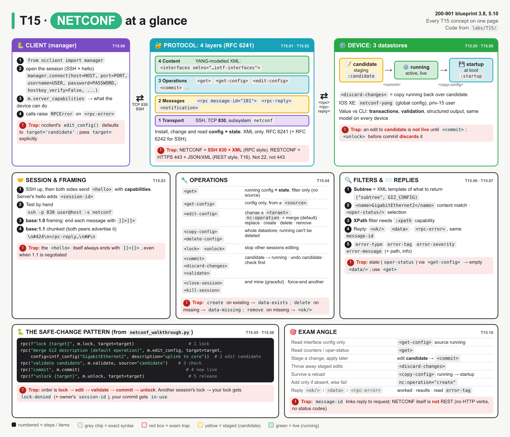
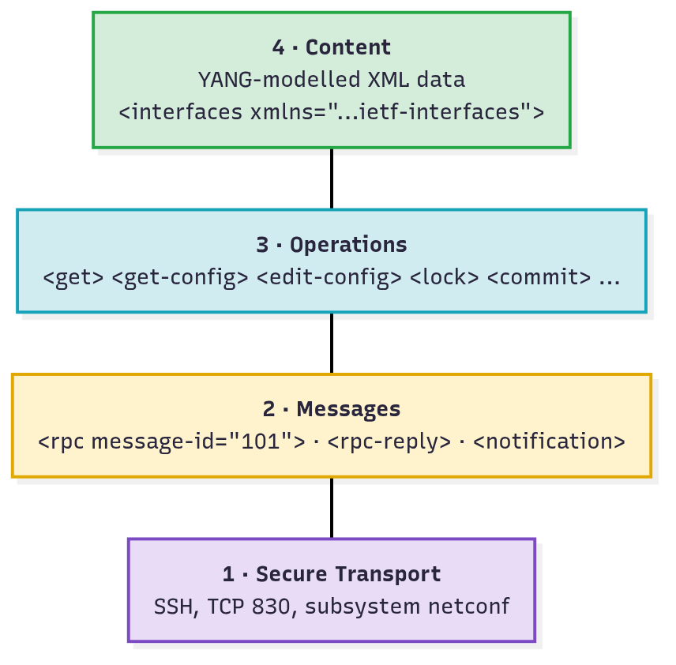
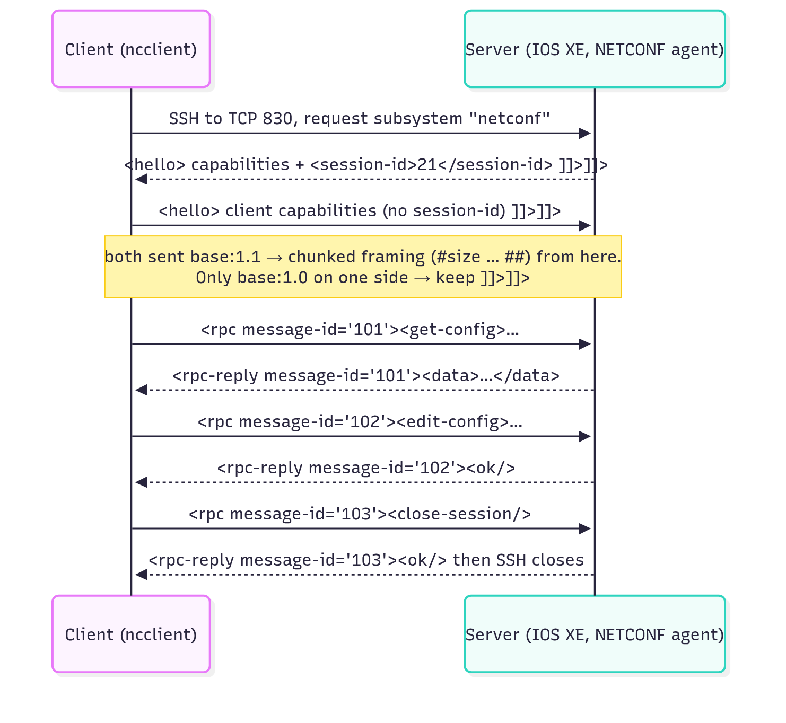
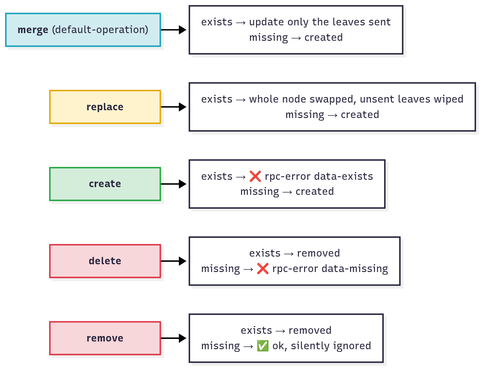
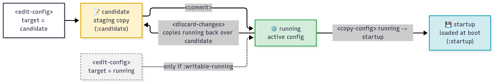
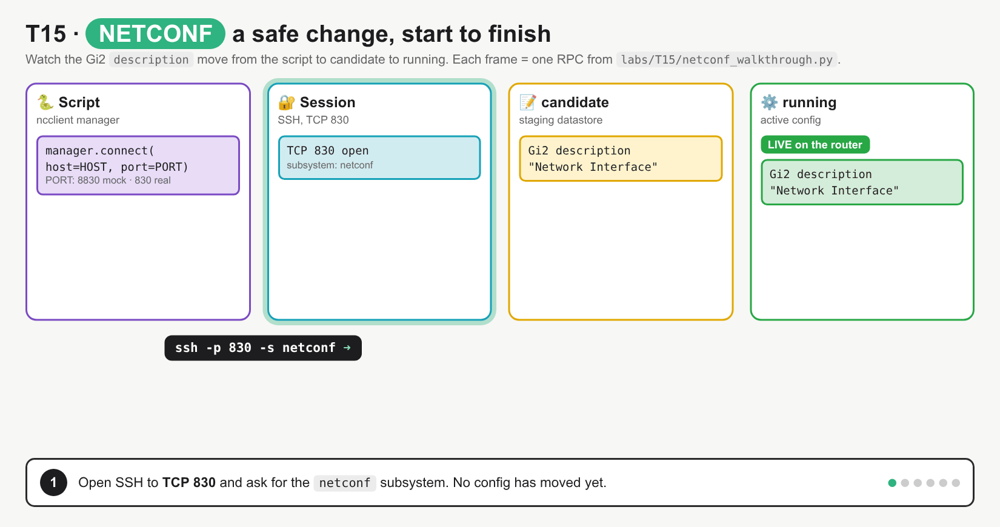
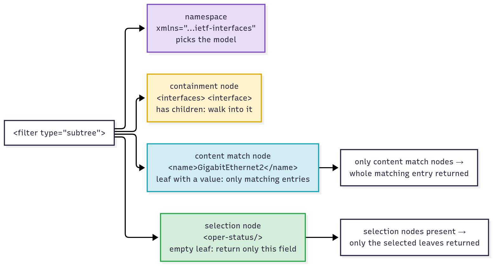

# T15 · NETCONF: essentials

> Blueprint 3.8, 5.10 · Full note: [bob/T15-netconf.md](../bob/T15-netconf.md)

## In one picture



*Read the top row left to right (your script → SSH 830 → the device's datastores), then the panels below for session, operations, filters/replies and exam angle; red boxes are exam traps.*

## The big idea

- NETCONF is a way for a script to read and change a device's configuration using structured XML instead of typing CLI lines. It is defined in **RFC 6241**.
- Think of YANG (T14) as the blank form template, and NETCONF as the courier: it carries the filled-in form to the device over SSH on **TCP 830**, and brings back a signed receipt (`<ok/>`), the data you asked for (`<data>`), or a rejection slip (`<rpc-error>`).
- It matters on the exam because questions ask you to pick the right operation or datastore for a task, and to read a reply. Port 830, SSH and XML are guaranteed marks.

## What you need to know

### 1. What NETCONF is and how it is layered

- NETCONF lets a client **install, change and read** configuration, and **read** operational state. It is **model-driven**, meaning the data follows a YANG model.
- Your script (or ncclient, Ansible, NSO) is the **client**, and the agent on the device is the **server**.
- The encoding is **XML only**, and the transport is **SSH on TCP port 830** using the SSH **subsystem `netconf`** (RFC 6242).
- It is **RPC style, not REST**. Every request is an `<rpc>` with one operation inside, so there are no HTTP verbs, URLs or status codes. Those belong to RESTCONF (T16).

| | NETCONF | RESTCONF (T16) | CLI over SSH |
|---|---|---|---|
| Transport / port | SSH, **830** | HTTPS, 443 | SSH, 22 |
| Encoding | **XML** | XML or JSON | free text |
| Style | RPC (`<rpc>` + operation) | REST (GET/POST/PUT/PATCH/DELETE) | screen-scraping |
| Datastores / candidate / lock | yes | running only, no lock | n/a |

- RFC 6241 splits NETCONF into **four layers**, like an envelope inside an envelope. Exam questions show an XML element and ask which layer it belongs to.



*Bottom up: SSH carries messages, a message wraps one operation, and the operation carries the YANG-shaped content.*

| Layer | What lives there |
|---|---|
| 4 · **Content** | the actual config/state data, shaped by a YANG model (e.g. `<interfaces xmlns="…ietf-interfaces">`) |
| 3 · **Operations** | what to do: `<get>`, `<get-config>`, `<edit-config>`, `<lock>`, `<commit>` … |
| 2 · **Messages** | the envelope: `<rpc>`, `<rpc-reply>`, `<notification>` (event push, RFC 5277) |
| 1 · **Secure Transport** | SSH on TCP 830 (TLS is also allowed by the RFC, but SSH is mandatory and is what the exam means) |

### 2. Opening a session: hello, capabilities and framing

- After SSH connects to port 830 and asks for the `netconf` subsystem, **both sides send a `<hello>` at the same time**, each listing its **capabilities**.
- Capabilities are URIs that say what the side supports: base protocol versions (`base:1.0`, `base:1.1`), optional features (`:candidate`, `:startup`, `:validate`, `:xpath`, `:writable-running`, `:rollback-on-error`, `:confirmed-commit`), and the supported **YANG models**.
- Only the **server's** hello includes a `<session-id>`. The client's hello has none.
- On IOS XE 17.x, YANG 1.1 modules are listed in `ietf-yang-library` rather than all in `<hello>`. ⚠ verify per release.



*Hello exchange first, then numbered rpc / rpc-reply pairs, then close-session.*

- You can test it by hand with no Python. The server's hello prints straight away:

```bash
ssh -p 830 admin@10.10.20.48 -s netconf
```

- **Framing** is how each side marks where one XML message ends on the SSH stream:

| | base:1.0 | base:1.1 (chunked) |
|---|---|---|
| Used when | either side only offers base:1.0 | **both** hellos advertise base:1.1 |
| Format | message then `]]>]]>` | `\n#<bytes>\n<data>` … then `\n##\n` |
| The `<hello>` itself | ends with `]]>]]>` | **still** ends with `]]>]]>` |

### 3. Operations: picking the right verb

- Each operation is an XML element inside `<rpc>`. Read operations take a **`source`**, and write operations take a **`target`**.

| Operation | What it does in plain words |
|---|---|
| `<get>` | returns running config **and** operational state (counters, oper-status); takes a filter but **no source** |
| `<get-config>` | returns config only, from one datastore named in `<source>` |
| `<edit-config>` | changes a `<target>` datastore |
| `<copy-config>` | copies a whole datastore onto another (e.g. running → startup) |
| `<delete-config>` | deletes a whole datastore; **running cannot be deleted** |
| `<lock>` / `<unlock>` | stops other sessions changing a datastore, then releases it |
| `<commit>` | makes running equal to candidate |
| `<discard-changes>` | resets candidate back to running |
| `<validate>` | checks a datastore is valid without applying it |
| `<close-session>` | ends **my own** session gracefully and releases my locks |
| `<kill-session>` | force-ends **another** session by `session-id` and frees its locks |

- Counters and oper-status live **only** in `<get>`. Asking `<get-config>` for state returns an empty `<data/>`.
- `<edit-config>` takes an **`operation` attribute** on the element you want to act on, written as `nc:operation="create"` with `xmlns:nc="urn:ietf:params:xml:ns:netconf:base:1.0"`.



*Same five verbs, two cases (node exists / node absent). Only create and delete can fail, and they fail in opposite cases.*

| operation | If the node exists | If the node is absent |
|---|---|---|
| **merge** (default) | updates only the leaves you sent | creates it |
| **replace** | replaces it entirely; leaves you didn't send are gone | creates it |
| **create** | error `data-exists` | creates it |
| **delete** | deletes it | error `data-missing` |
| **remove** | deletes it | silently `<ok/>` |

- **`default-operation`** applies to elements with no `operation` attribute: `merge` (default), `replace`, or `none`.
- **`error-option`** is `stop-on-error` (default), `continue-on-error` or `rollback-on-error`. **`test-option`** is `test-then-set` (default), `set` or `test-only`.

### 4. Datastores and the safe change

- A **datastore** is a complete copy of the configuration. There are three to know:

| Datastore | Plain meaning | Needs capability | How you write it |
|---|---|---|---|
| **running** | the live config, always exists | `:writable-running` to edit it directly | `<edit-config>` (if writable) or `<commit>` |
| **candidate** | a scratch copy; changes do nothing until committed | `:candidate` | `<edit-config>`, then `<commit>` |
| **startup** | the config loaded at boot | `:startup` | `<copy-config>` running → startup |



*Edits land in candidate (yellow); only commit makes them live in running (green); discard-changes copies running back over candidate; saving to startup is a separate copy-config.*

- The candidate is **shared by all sessions**, so you lock it first. The safe order is **lock → edit-config candidate → validate → commit → unlock**.
- **`<unlock>` on candidate, or the session dying, discards outstanding candidate changes.** That is why unlock comes **after** commit.
- Changes to running are **not** saved to startup automatically. You must copy running → startup (IOS XE also has its own `cisco-ia:save-config` RPC).



*SSH :830 → hello → lock → edit-config candidate (running unchanged) → commit (now live) → unlock. An `<ok/>` on candidate does not mean live.*

- If someone else holds the lock, your `<lock>` gets **`lock-denied`** with the owner's `<session-id>` in `error-info`; a `<commit>` while another session holds the lock gets **`in-use`**.
- On IOS XE, the default is running-only with `:writable-running`. Adding `netconf-yang feature candidate-datastore` adds candidate **and removes** `:writable-running`, so every change must then go through candidate + commit.
- **Confirmed commit** (`<commit><confirmed/>`, default 600 s timeout) automatically rolls back if a second confirming `<commit>` doesn't arrive in time. ⚠ verify per release.

### 5. Filters and replies: asking for less, reading the answer

- With no filter, `<get>` and `<get-config>` return **everything**. A filter trims the reply down.
- A **subtree filter** (the default) is an **XML template** shaped like the data, containing only the parts you want. It is like a "fill in only these boxes" form.



*The namespace picks the model, containment nodes walk down, content-match nodes pick list entries, selection nodes pick fields.*

- `<interfaces>` and `<interface>` are **containment** nodes. `<name>GigabitEthernet2</name>` is a **content match** that picks one entry, and empty tags like `<oper-status/>` are **selection** nodes that pick only those leaves.
- An **XPath filter** (`type="xpath"`) needs the **`:xpath`** capability. (⚠ verify ncclient namespace handling on the device.)

```xml
<rpc message-id="101" xmlns="urn:ietf:params:xml:ns:netconf:base:1.0">
  <get-config>
    <source><running/></source>
    <filter type="subtree">
      <interfaces xmlns="urn:ietf:params:xml:ns:yang:ietf-interfaces">
        <interface><name>GigabitEthernet2</name></interface>
      </interfaces>
    </filter>
  </get-config>
</rpc>
```

*This asks: "from running, give me the whole Gi2 entry of the ietf-interfaces model".*

- Every `<rpc>` gets one `<rpc-reply>` with the **same `message-id`**, which is how you match a reply to its request.

- An `<rpc-error>` has these fields:
  - **`error-type`** names the failing layer: `transport`, `rpc` (messages), `protocol` (operations) or `application` (content).
  - **`error-tag`** names the condition. Know `in-use`, `invalid-value`, `lock-denied`, `data-exists`, `data-missing`, `access-denied`, `operation-not-supported`, `operation-failed`, `missing-element`, `unknown-element`, `malformed-message`.
  - **`error-severity`** is `error` or `warning`; **`error-message`** is human text. Optional extras are `error-path` (XPath to the bad node) and `error-info` (e.g. `<session-id>`).
- To read any reply (blueprint 5.10): find the reply type first (`<ok/>` / `<data>` / `<rpc-error>`), then the YANG namespace (which model), then the leaves (`<name>`, `<enabled>`, `<oper-status>`).

### 6. Python ncclient: the exam-minimum shape

- **ncclient** is the Python library that does the SSH, the subsystem request and the hello for you. `manager.connect()` returns a `Manager` object, usually called `m`.

```python
from ncclient import manager

with manager.connect(host="10.0.0.1", port=830, username="u", password="p",
                     hostkey_verify=False) as m:
    reply = m.get_config(source="running", filter=("subtree", filt))
    m.edit_config(target="running", config=cfg)
```

*Connect on 830, read running config through a subtree filter, then push a change; `with` closes the session at the end.*

- `hostkey_verify=False` skips checking the device's SSH host key (lab only). `filt` and `cfg` are XML strings; `cfg` must be a `<config>` element.
- `target="running"` only works if the device has `:writable-running`.

| ncclient method | NETCONF operation |
|---|---|
| `m.get(filter=...)` | `<get>` |
| `m.get_config(source="running", filter=("subtree", f))` | `<get-config>` |
| `m.edit_config(target="candidate", config=xml)` | `<edit-config>` |
| `m.lock(target=...)` / `m.unlock(target=...)` | `<lock>` / `<unlock>` |
| `m.commit()`, `m.discard_changes()`, `m.validate(source="candidate")` | `<commit>`, `<discard-changes>`, `<validate>` |
| `m.copy_config(source="running", target="startup")` | `<copy-config>` |
| `m.close_session()`, `m.kill_session(session_id)` | `<close-session>`, `<kill-session>` |

- `m.server_capabilities` lists the capabilities, so `":candidate" in m.server_capabilities` tells you whether candidate exists.
- On a reply, `reply.ok` is True on `<ok/>`, and `reply.data_xml` / `reply.data` hold the result of a get. An `<rpc-error>` **raises** `RPCError` by default.
- Gotcha: ncclient's `edit_config()` **defaults to `target='candidate'`**, so always pass `target=` explicitly.

### 7. Turning it on, and why it beats CLI

- On IOS XE, NETCONF is enabled with **`netconf-yang`** in global config, and needs a **privilege 15** user:

```text
configure terminal
 username netconf-admin privilege 15 secret Str0ngPass!
 aaa new-model
 aaa authentication login default local
 aaa authorization exec default local
 netconf-yang
end
show netconf-yang sessions
```

- The processes can take up to about 90 s to start. If `aaa new-model` is configured, AAA authentication **and** authorization must be set up too.

| CLI screen-scraping | NETCONF |
|---|---|
| a typo half-applies a change | **transactions**: an edit/commit applies fully or not at all |
| problems found only as each line runs | **validation** against the YANG model before applying |
| free text that breaks when output changes | **structured** XML that parses straight into code |
| different syntax per vendor and platform | same model and operations everywhere → **network-wide consistency**, usually driven by an orchestrator such as NSO |


## Exam traps (the ones that catch people)

- Looks like SSH so port 22, but it's actually **830**, because NETCONF runs as its own SSH subsystem. RESTCONF is HTTPS 443; plain CLI SSH is 22.
- Looks like `<get-config>` can read counters, but it's actually `<get>`, because state data only appears in `<get>`. `<get-config>` for counters returns an empty `<data/>`.
- Looks like an `<ok/>` on candidate means it's live, but it's actually only staged, because nothing changes until `<commit>`.
- Looks like unlock-then-commit is fine, but it's actually data loss, because `<unlock>` (or a dropped session) discards uncommitted candidate changes.
- Looks like `<discard-changes>` rolls back running, but it actually resets **candidate** from running and never touches running.
- Looks like create and merge do the same thing, but create fails with `data-exists` if the node is there, while merge just updates.
- Looks like delete and remove are the same, but delete on missing data gives `data-missing`, while remove gives `<ok/>`.
- Looks like `<close-session>` can free a hung colleague's lock, but it actually ends only your own session; use `<kill-session>` with their session-id.

## Quick self-check

<details><summary>Q1. Which operation returns the input-octet counters of Gi2?</summary>

`<get>` with a subtree filter. Counters are operational state, which `<get-config>` never returns.
</details>

<details><summary>Q2. Put in order: commit, edit-config candidate, unlock, lock, validate.</summary>

lock → edit-config → validate → commit → unlock. Unlocking before commit would discard the edits.
</details>

<details><summary>Q3. A reply has error-type protocol, error-tag lock-denied and error-info session-id 34. What happened?</summary>

Session 34 already holds the lock on that datastore. Bad credentials would fail at SSH before any rpc-reply.
</details>

<details><summary>Q4. Which edit-config operation adds Loopback100 only if absent, and errors if it exists?</summary>

`create`. It returns `data-exists` when the node is already present.
</details>

<details><summary>Q5. Which two describe NETCONF transport: SSH netconf subsystem, TCP 443, TCP 830, JSON by default, HTTP status codes?</summary>

SSH netconf subsystem and TCP 830. Port 443, JSON and HTTP status codes describe RESTCONF.
</details>

## Cheat lines to say out loud

- "NETCONF is RPC over SSH 830, XML only: four layers, transport, messages, operations, content."
- "`get` gets state, `get-config` needs a source and gives config only."
- "Lock, edit, validate, commit, unlock. Unlock early and you lose it."
- "Create fails if it's there, delete fails if it's not, remove never complains."
- "Read a reply in three steps: ok, data or error; which namespace; which leaves."
