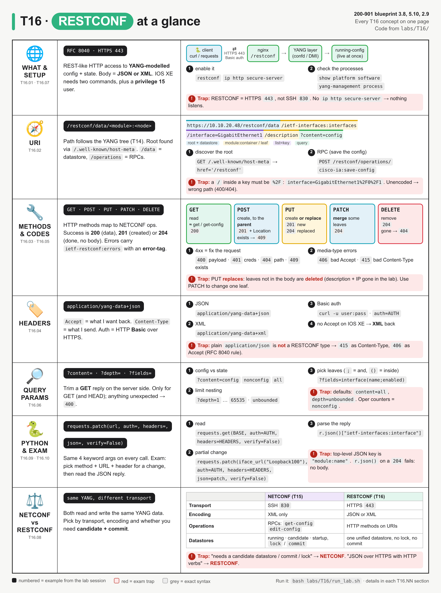
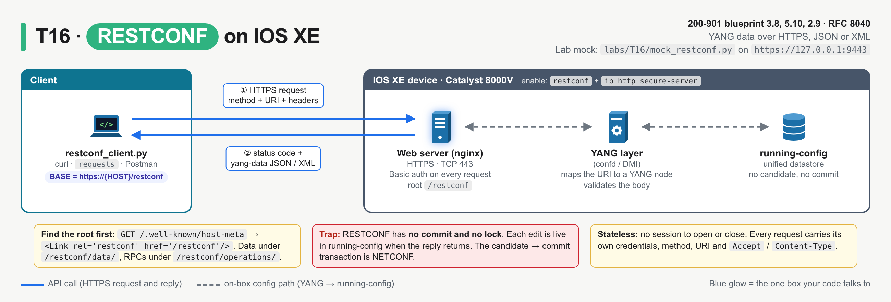
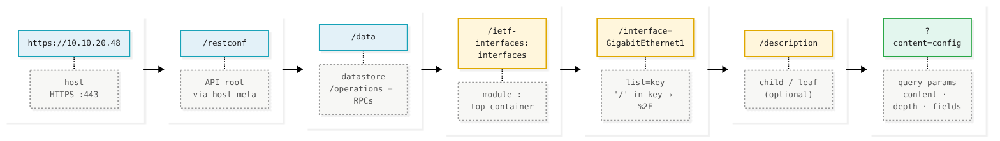
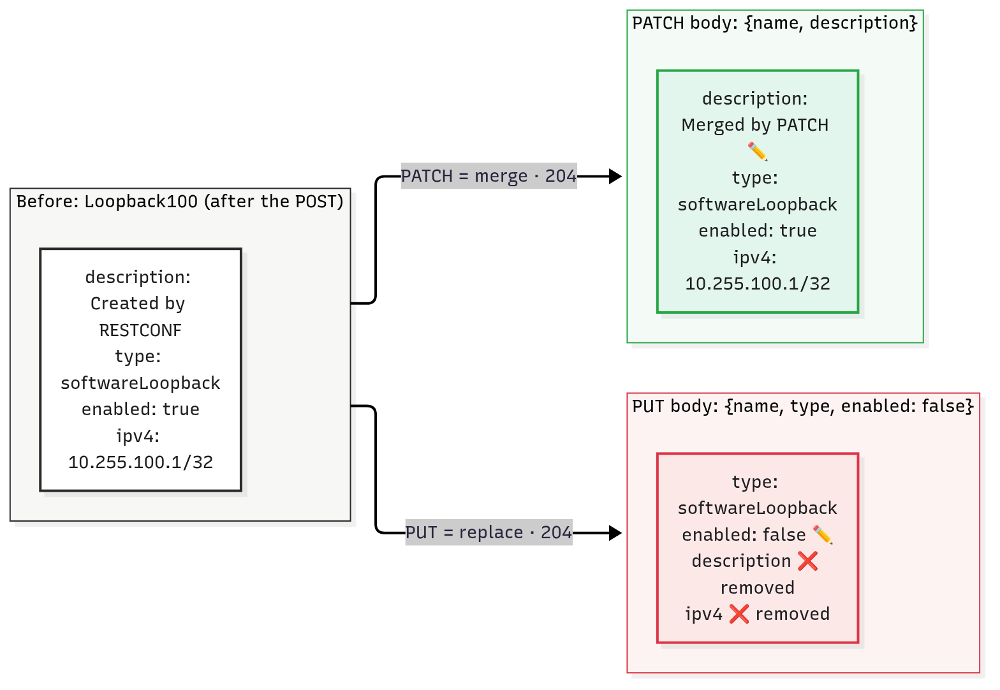
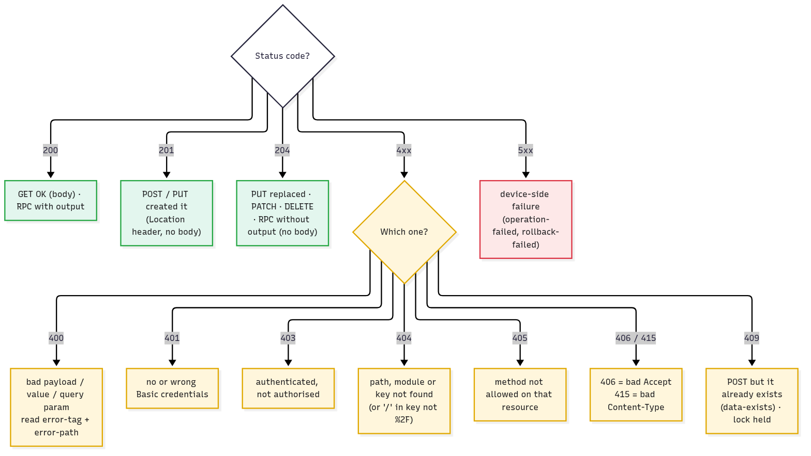

# T16 · RESTCONF: essentials

> Blueprint 3.8, 5.10, 2.9 · Full note: [bob/T16-restconf.md](../bob/T16-restconf.md)

## In one picture



*Read it row by row: each row is one concept group, the numbered items are calls from the lab session, red boxes are exam traps, and the bottom row is the NETCONF vs RESTCONF table.*

## The big idea

- RESTCONF lets you read and change a router's config by sending ordinary web requests, the same kind a browser or any REST API uses.
- Think of YANG as the blueprint (the form template), NETCONF as the courier with a locked briefcase over SSH, and RESTCONF as the same form filled in over a web API.
- Each web address (URI) points at one spot in the YANG tree, and the HTTP method (GET, POST, PUT, PATCH, DELETE) says what to do with it.
- On the exam you must pick the right method, URI and headers for a change, and read the JSON reply or error that comes back.

## What you need to know

### 1. What RESTCONF is

- **RESTCONF** is defined in **RFC 8040**, and it gives REST-like access to data described by **YANG** models (T14).
- The RFC describes it as a subset of NETCONF functionality, carried over HTTP instead of SSH.
- It runs over **HTTPS**, so the default port is TCP **443**.
- The data can be encoded as **JSON or XML**; a server must support at least one, and IOS XE supports both.
- It is **stateless**: every request stands alone and carries its own username and password, so there is no session to open or close (NETCONF has one, see T15).



*The client talks HTTPS to nginx on the device, the request passes through the YANG layer into the running config, and the reply comes back as a status code plus yang-data JSON or XML.*

### 2. Building the URL (the address of the data)

- To find the API root, the client can send `GET /.well-known/host-meta`, which returns `<Link rel='restconf' href='/restconf'/>`; this is called **root discovery**.
- The root is almost always `/restconf`, although RFC 8040 allows another path such as `/top/restconf`.
- Under the root there are three resources worth knowing:

| Resource | What it holds | Example |
|---|---|---|
| `/restconf/data` | the **datastore**: config and state data, addressed by YANG path | `/restconf/data/ietf-interfaces:interfaces` |
| `/restconf/operations` | YANG **RPCs** (actions) you run with POST | `POST /restconf/operations/cisco-ia:save-config` |
| `/restconf/yang-library-version` | the revision of the `ietf-yang-library` module | `2016-06-21` in the lab reply |

- A data URL follows the YANG tree in this shape:

```
/restconf/data/<module>:<container>/<list>=<key>/<leaf>
/restconf/data/ietf-interfaces:interfaces/interface=GigabitEthernet2/description
```

*The first part names the module and top container, then the list entry by its key, then one leaf if you only want one value.*



*Blue is the fixed root and datastore, yellow is the YANG path, and green is the query parameters.*

- Only the first node needs the **module prefix** (`ietf-interfaces:interfaces`); children from the same module have no prefix, but a node from a different module needs its own, such as `ietf-ip:ipv4`.
- A **list entry** is written `list=key`, for example `interface=GigabitEthernet1`, and a list with several keys separates them with commas: `list=key1,key2`.
- Special characters inside a key must be **percent-encoded**, so the `/` in `GigabitEthernet1/0/1` becomes `%2F`: `interface=GigabitEthernet1%2F0%2F1`.
- If you forget to encode it, the device reads `GigabitEthernet1` followed by an unknown child `0/1` and returns `400`.
- You build the path by reading the YANG tree, for example with `pyang -f tree ietf-interfaces.yang`, which shows `interfaces` → `interface* [name]` → `description`.

### 3. HTTP methods (what you want to do)

| Method | Plain meaning | Point the URL at | NETCONF equivalent | Success code |
|---|---|---|---|---|
| **GET** | read | any data resource | `<get-config>`, `<get>` | `200` + body |
| **POST** | create a new child (fails if it exists); also runs an RPC | the **parent** (`.../interfaces`) or `/operations/<rpc>` | `<edit-config>` `operation="create"` | `201` + `Location` |
| **PUT** | create **or replace** completely | the resource itself (`.../interface=Loopback100`) | `<edit-config>` create/replace | `201` new, `204` replaced |
| **PATCH** | **merge** in only the fields you send | the resource itself | `<edit-config>` `operation="merge"` | `204` (or `200` with a body) |
| **DELETE** | remove | the resource itself | `<edit-config>` `operation="delete"` | `204` |

- With POST you name the **parent** and put the key in the body, while with PUT you name the new resource in the URL and the key in the body must match it.
- **PUT vs PATCH** is the one to remember: PATCH changes only what you send, but PUT replaces the whole entry, so any leaf you leave out is **deleted**.
- In the lab, a PATCH of just `name` and `description` kept the IP address, but a PUT of `name`, `type` and `enabled` wiped the description and the IP.



*Same starting loopback: PATCH merges so untouched leaves stay, and PUT replaces so every leaf not in the body is removed.*

- Edits are **live immediately**: there is no candidate and no commit, and on IOS XE they land in the **running-config** only.
- To make changes survive a reload, call the `cisco-ia:save-config` RPC with POST, which is the same as `copy running-config startup-config`. ⚠ verify the RPC reply text on a real device.

### 4. Headers and login

| Header | Plain meaning | Value |
|---|---|---|
| `Accept` | the format I **want back** | `application/yang-data+json` |
| `Content-Type` | the format of the body I am **sending** | `application/yang-data+json` |
| `Authorization` | my credentials | `Basic <base64 user:pass>` |

- The RESTCONF **media types** are `application/yang-data+json` and `application/yang-data+xml`, not plain `application/json` or `application/xml`.
- Per the RFC, an unsupported Content-Type returns `415 Unsupported Media Type`, and an unsupported Accept returns `406 Not Acceptable`. ⚠ verify how IOS XE reacts to plain `application/json`.
- If you send no Accept header, the server chooses the format, and IOS XE answered in **XML** in the lab and on the real sandbox, so always send Accept.
- A GET only needs Accept, while POST, PUT and PATCH need both headers because they carry a body.
- Login uses **HTTP Basic** authentication over HTTPS; base64 is only encoding, not encryption, so TLS is what protects the password.
- IOS XE only accepts users with **privilege level 15**, either local or via AAA/TACACS+/RADIUS.
- Devices usually have self-signed certificates, so lab scripts use `verify=False` in Python (or `-k` in curl); without it, `requests` raises `SSLError`.
- You only need to recognise the name **YANG Patch** (RFC 8072, `application/yang-patch+json`), which is for ordered multi-edit changes.

### 5. Reading replies and errors

| Code | When | Lab example |
|---|---|---|
| `200 OK` | GET with data, or an RPC with output | GET Gi1; `save-config` |
| `201 Created` | POST or PUT created something (POST adds `Location`, **no body**) | POST Loopback100 |
| `204 No Content` | PUT replaced, PATCH merged, DELETE removed | PATCH, DELETE |
| `400 Bad Request` | bad body, wrong value type, unknown query parameter | `"enabled": "yes"` |
| `401 Unauthorized` | missing or wrong credentials | GET without `auth=` |
| `403 Forbidden` | logged in but not allowed | |
| `404 Not Found` | path, module or key doesn't exist | second DELETE |
| `405` | method not allowed on that resource | |
| `406` / `415` | wrong Accept / wrong Content-Type | plain `application/json` |
| `409 Conflict` | POST on something that exists (`data-exists`), or a NETCONF lock is held | second POST of Loopback100 |
| `5xx` | the device itself failed | |



*Green means success (only 200 has a body), yellow means fix your request, and red means the device failed.*

- Every error comes back as an **`ietf-restconf:errors`** body containing a list of errors, each with `error-type`, `error-tag`, and optionally `error-path` and `error-message`.
- Read the error in this order: the **error-tag** says what kind of problem, the **error-path** says which node, and the **error-message** says why in words.
- For example, `400` + `invalid-value` + `.../enabled` means you sent the wrong data type for `enabled`.
- Useful mappings from RFC 8040: `invalid-value` → 400/404/406, `access-denied` → 401/403, `data-exists` / `in-use` / `lock-denied` → 409.

### 6. Query parameters (trimming what comes back)

| Parameter | Values | Default | Effect |
|---|---|---|---|
| `content` | `config`, `nonconfig`, `all` | `all` | config only, state only (counters, oper-status), or both |
| `depth` | `1`–`65535` or `unbounded` | `unbounded` | stop returning nodes deeper than N levels |
| `fields` | e.g. `interface(name;enabled)` | all | return only the named fields |

- These parameters are only allowed on GET, they are case-sensitive, each can appear only once, and an unexpected one returns `400`.
- The Cisco guide shows `fields` and `depth` on IOS XE. ⚠ verify `content=` on your IOS XE version.
- Older IOS XE releases keep interface state in `ietf-interfaces:interfaces-state` or `Cisco-IOS-XE-interfaces-oper`, not inside `interfaces`. ⚠ verify.

### 7. Device setup, NETCONF comparison and Python

- The minimum IOS XE config (16.6 or later) needs both `restconf` and `ip http secure-server`, plus a privilege 15 user:

```
username admin privilege 15 secret <password>
ip http secure-server
ip http authentication local
restconf
```

- `ip http authentication local` is in Cisco's sample config but not listed as a step. ⚠ verify whether it's needed on your release.
- You can check it with `show platform software yang-management process`, which should show `nginx`, `confd` and the other processes running.
- NETCONF is a separate feature (`netconf-yang`, port 830), and you can enable one, the other, or both.

| | NETCONF (T15) | RESTCONF (T16) |
|---|---|---|
| RFC | 6241 | 8040 |
| Transport / port | SSH **830** | HTTPS **443** |
| Encoding | **XML only** | **JSON or XML** |
| Style | RPCs: `get`, `get-config`, `edit-config`, `lock`, `commit` | HTTP methods on URLs |
| Datastores | running, candidate, startup | one **unified** datastore |
| Transactions | lock, edit candidate, validate, commit | each request on its own; **no lock, no commit** |
| Session | stateful SSH session | stateless |
| Typical client | `ncclient` | `requests`, curl, Postman |

- "Unified datastore" means RESTCONF hides the datastore names: edits go straight into running, or, if the server only has a candidate, it **auto-commits** after every edit.
- RESTCONF can't take locks, so if a NETCONF client holds a lock, a RESTCONF edit fails with `409`.
- In Python, every call uses the same four arguments:

```python
r = requests.patch(url, auth=(user, pw), headers=HEADERS, json=body, verify=False)
```

*`auth=` builds the Basic login header, `headers=` sets the yang-data media types, `json=` turns a Python dict into the body, and `verify=False` skips the self-signed certificate check.*

- `json=` on its own sets `Content-Type: application/json`, so your `HEADERS` dict must override it with the yang-data type.
- Check `r.status_code` before calling `r.json()`, because `201` and `204` have **no body** and an error body won't have the keys you expect (you get a `KeyError`).
- When reading a JSON reply: the top key is `"module:node"` (`"ietf-interfaces:interface"`), a node from another module keeps its prefix (`"ietf-ip:ipv4"`), a YANG list is a JSON array (`"address": [ {...} ]`) even with one entry, and booleans are `true`/`false`, not strings.
- So the IP of Gi1 is `r.json()["ietf-interfaces:interface"]["ietf-ip:ipv4"]["address"][0]["ip"]`.
- ⚠ verify: IOS XE returns a single list entry as a JSON object, while the RFC examples use a one-item array.

## Exam traps (the ones that catch people)

- It looks like PUT and PATCH both "update", but PUT replaces the whole entry and deletes any leaf you left out, while PATCH merges; both return `204`, so the code won't tell you which happened.
- It looks like you'd POST to the new interface's URL, but POST targets the **parent** (`.../interfaces`), and POSTing something that already exists gives `409`.
- It looks like `application/json` should work for JSON, but RESTCONF needs `application/yang-data+json` (RFC rule: `415` as Content-Type, `406` as Accept).
- It looks like PUT always means `204`, but PUT returns `201` when it created the resource and `204` when it replaced one.
- It looks like you need a commit after a change, but RESTCONF has no candidate, no commit and no lock; edits are live in running at once, and only `cisco-ia:save-config` writes startup.
- It looks like `interface=GigabitEthernet1/0/1` is a fine URL, but the raw `/` splits the path, so encode it as `%2F`.
- It looks like every node needs the module prefix, but only the first node and any node from a different module do.
- It looks like `restconf` alone turns it on, but you also need `ip http secure-server` and a privilege 15 user.

## Quick self-check

<details><summary>Q1. You want to add Loopback200 without touching other interfaces. Which method and URL?</summary>`POST /restconf/data/ietf-interfaces:interfaces` with the loopback in the body, because POST to the parent creates a child; a PUT on the container would replace every interface.</details>

<details><summary>Q2. What goes in Accept and Content-Type for a JSON PATCH?</summary>Both `application/yang-data+json`, because plain `application/json` is not a RESTCONF media type.</details>

<details><summary>Q3. A PUT with only name, type and enabled returns 204. What happened to the old description and IP?</summary>They were removed, because PUT replaces the resource and 204 means an existing one was replaced.</details>

<details><summary>Q4. You get 409 with error-tag `data-exists`. Which method most likely caused it?</summary>POST, because only a create fails when the resource already exists.</details>

<details><summary>Q5. Give three differences between RESTCONF and NETCONF.</summary>HTTPS 443 vs SSH 830; JSON or XML vs XML only; unified datastore with no lock or commit vs running/candidate/startup with lock and commit.</details>

## Cheat lines to say out loud

- "RESTCONF is YANG over HTTPS 443, in JSON or XML, using web verbs on URLs."
- "POST to the parent, PUT replaces, PATCH merges, and PUT eats the leaves you forget."
- "yang-data plus json, both headers, every time."
- "No lock, no commit, live in running; save-config to keep it."
- "Slash in a key? Percent 2F."
