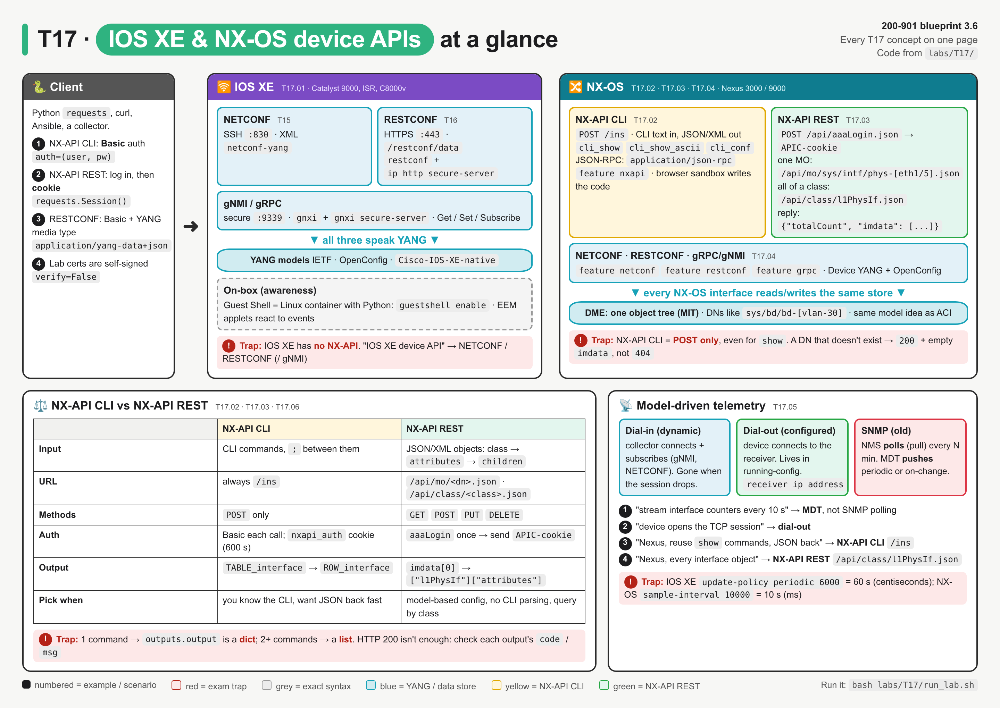
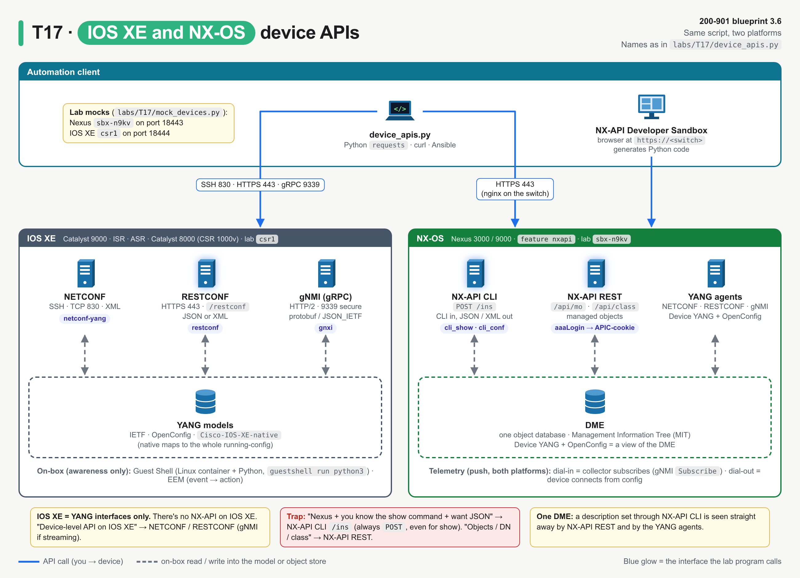
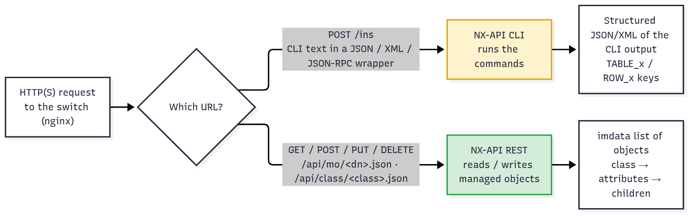
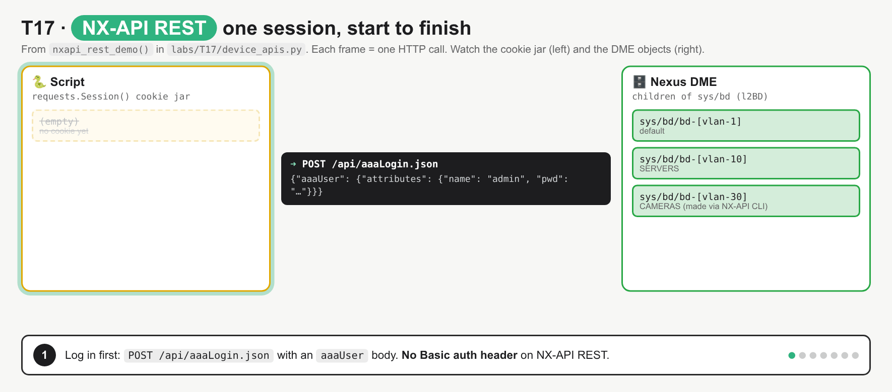
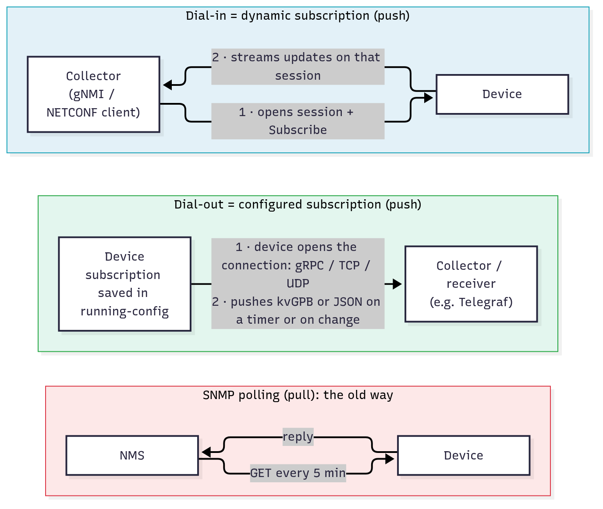

# T17 · IOS XE and NX-OS device-level APIs: essentials

> Blueprint 3.6 · Full note: [bob/T17-iosxe-nxos-device-apis.md](../bob/T17-iosxe-nxos-device-apis.md) · Teach-back 2026-10-18

## In one picture



*Read it left to right: the client on the left, then IOS XE with its YANG interfaces, then NX-OS where NX-API CLI, NX-API REST and the YANG agents all sit on one database (the DME); red boxes are exam traps.*

## The big idea

- A device-level API is a way for a script to talk to one switch or router directly, instead of a person typing into the CLI.
- IOS XE only speaks the **YANG** family: NETCONF, RESTCONF and gNMI. Nexus (NX-OS) speaks those too, and adds two Cisco-only web APIs called **NX-API CLI** and **NX-API REST**.
- Analogy: NX-API CLI is like passing your usual show command through a hatch and getting the answer back on a neat form (JSON) instead of a printed screen. NX-API REST is like walking straight into the switch's filing cabinet and pulling out one labelled folder (an object) or every folder of one type.
- On the exam, most questions are "which API, which URL, which method" for a given platform and task. Get the platform first, then the task.

## What you need to know

### 1. IOS XE: everything ends in YANG

- IOS XE (Catalyst 9000, ISR 1000/4000, ASR 1000, Catalyst 8000 / CSR 1000v) is **model-driven**, which means all its device APIs carry data defined by **YANG** models (see T14).
- There is **no NX-API on IOS XE**. If an IOS XE question shows `/ins` or `aaaLogin`, those options are distractors.

| Interface | Transport / port | Encoding | Enable (global config) |
|---|---|---|---|
| NETCONF | SSH, TCP **830** | XML | `netconf-yang` |
| RESTCONF | HTTPS, TCP **443**, root `/restconf` | JSON or XML (`application/yang-data+json`) | `restconf` + `ip http secure-server` |
| gNMI (gRPC) | HTTP/2, secure port **9339** by default (insecure 50052) | protobuf or JSON_IETF | `gnxi` + `gnxi secure-server` |

- There are three families of YANG models: **IETF** (for example `ietf-interfaces`), **OpenConfig** (vendor-neutral), and **native** (`Cisco-IOS-XE-native`, which maps to the whole running-config).
- A RESTCONF reply has a top key shaped like `"ietf-interfaces:interface"`, which is module name, colon, node name. That pattern is the fingerprint of YANG data.
- **gNMI** stands for gRPC Network Management Interface and has four calls: `Capabilities`, `Get`, `Set` and `Subscribe`. `Subscribe` is how a collector asks for streaming telemetry.
- Awareness only: **Guest Shell** is a small Linux container on the router with Python inside (`iox`, then `guestshell enable`, then `guestshell run python3`, and `from cli import cli, configure` runs IOS commands). **EEM** (Embedded Event Manager) runs an action such as a CLI command, syslog message or Python script when an event happens, like an interface going down.
- Exam line: "device-level API on IOS XE" means **NETCONF / RESTCONF**, plus gNMI if streaming is mentioned.



*Same job, two platforms: on IOS XE every path ends in YANG; on NX-OS all three API types read and write the same DME.*

### 2. NX-API CLI: your show commands, returned as JSON

- **NX-API** is the web (HTTP/HTTPS) interface on Nexus 3000/9000, served by an nginx web server on the switch. You turn it on with `feature nxapi`.
- **NX-API CLI** takes ordinary **CLI commands** in the body of a `POST` to **`/ins`**, and returns the output as structured JSON or XML instead of screen text.
- It is **always a POST**, even for `show` commands. A `GET /ins` is wrong (the lab mock returns `405`).
- HTTPS on 443 is the default and HTTP is off. ⚠ verify: the 10.5(x) guide says that from 9.2(1) NX-API is "enabled by default on HTTPS port 443"; for the exam, the enable command is `feature nxapi`.
- **Auth:** you send HTTP **Basic** auth on the request. The first reply sets a session cookie called **`nxapi_auth`**, which lasts **600 seconds**, so later calls can reuse it.
- The message format is chosen by the `Content-Type` header, and all three go to the same `/ins`:

| Format | `Content-Type` | Body shape |
|---|---|---|
| JSON (ins_api) | `application/json` | `{"ins_api": {"version", "type", "chunk", "sid", "input", "output_format"}}` |
| XML | `application/xml` | `<ins_api><type>…</type><input>…</input>…</ins_api>` |
| JSON-RPC 2.0 | `application/json-rpc` | a list of `{"jsonrpc": "2.0", "method": "cli", "params": {"cmd": …, "version": 1}, "id": n}` |

- The **command type** tells the switch what kind of command you are sending and what output you want:

| ins_api `type` | JSON-RPC `method` | Use | What comes back |
|---|---|---|---|
| `cli_show` | `cli` | show commands | **structured** data (`body` is a dictionary) |
| `cli_show_ascii` | `cli_ascii` | show commands | **raw text** as on screen (`body` is a string) |
| `cli_conf` | `cli` (config lines) | configuration | `msg: Success` |
| `bash` | n/a | Linux bash on the switch (needs `feature bash-shell`) | text |
| n/a | `cli_array` | show commands | like `cli`, but the body is always a list |

- This is the ins_api JSON body for one show command:
  ```json
  {"ins_api": {"version": "1.0", "type": "cli_show", "chunk": "0", "sid": "1",
               "input": "show version", "output_format": "json"}}
  ```
- To send several commands in ins_api, put them in one `input` string separated by **space-semicolon**, as in `"show version ;show interface brief"`. In JSON-RPC, each command is its own object with its own `id`.
- Structured output uses **`TABLE_<x>` → `ROW_<x>`** keys, for example `body["TABLE_interface"]["ROW_interface"]`.
- The reply lives in `ins_api.outputs.output`. One command gives a single dictionary, but two or more give a **list**, so code that reads `["output"]["body"]` breaks when you add a second command.
- `cli_conf` returns **one** output for all its lines, because config lines need context (`interface …` then `description …`).
- Errors are reported **inside each output** (`code: 400`, `msg: "Input CLI command error"` for a typo), so check those fields as well as the HTTP status.
- **NX-API Developer Sandbox:** after `feature nxapi`, browse to `https://<switch>`, type a CLI command, pick a format, and it shows the request and reply and **generates Python code**. It can also convert CLI into an NX-API REST payload. ⚠ verify: some newer releases also need `nxapi sandbox` to turn the page on.



*One web server on the switch, two APIs: the URL decides which one, `/ins` for CLI or `/api/mo` and `/api/class` for objects.*

### 3. NX-API REST: the switch as a tree of objects

- NX-OS keeps all its config and state in the **DME** (Data Management Engine). The DME is a tree called the **Management Information Tree (MIT)**, made of **managed objects (MOs)**. This is the same idea as ACI's APIC (T19), so the URLs, JSON shape and even the cookie name match.
- Every object has a **class**, which is its type (`l1PhysIf` = physical interface, `l2BD` = VLAN/bridge domain, `topSystem` = the root), and a **DN** (distinguished name), which is its unique path from the root `sys`.
- A DN is built as parent DN + `/` + relative name: `sys` → `sys/intf` → `sys/intf/phys-[eth1/5]`. Note that the DME uses lower-case `eth1/5`, not `Ethernet1/5`.
- **Log in first** with `POST /api/aaaLogin.json` and this body:
  ```json
  {"aaaUser": {"attributes": {"name": "admin", "pwd": "<password>"}}}
  ```
- The token comes back in `imdata[0]["aaaLogin"]["attributes"]["token"]` **and** as a cookie named **`APIC-cookie`**. Every later call sends that cookie, not a Basic header. It times out (`refreshTimeoutSeconds` 600); renew with `POST /api/aaaRefresh.json` or end with `/api/aaaLogout.json`.
- In Python, `requests.Session()` stores the cookie automatically. A plain `requests.get()` without it gets **403**.
- The URL shape is `https://switch/api/{mo|class}/{dn|class}.{json|xml}[?options]`:

| URL | What you get |
|---|---|
| `GET /api/mo/sys/intf/phys-[eth1/5].json` | **one** object, picked by its DN |
| `GET /api/class/l1PhysIf.json` | **every** object of that class, wherever it is in the tree |
| `GET /api/mo/sys/bd.json?query-target=children` | the objects directly under that DN (`subtree` goes deeper) |
| `?rsp-subtree=full` | an object with all its children |
| `?query-target-filter=eq(l1PhysIf.adminSt,"up")` | only matching objects |

- The reply always looks like `{"totalCount": "1", "imdata": [{"<class>": {"attributes": {…}}}]}`, so you read it as `imdata[0]["l1PhysIf"]["attributes"]["descr"]`.
- **Writing:** a `POST` to a DN with the object in the body creates it or merges into it (for example an `l2BD` child posted to `/api/mo/sys/bd.json` creates VLAN 40). `DELETE /api/mo/sys/bd/bd-[vlan-40].json` removes it. The methods are `POST`, `GET`, `PUT` and `DELETE`.
- **A missing object is not a 404.** It comes back as `200` with `totalCount "0"` and an empty `imdata []`, so check `totalCount`.
- With curl, a DN containing brackets needs `--globoff`, or curl treats `[eth1/5]` as a URL range.
- **Visore** (`https://<switch>/visore.html`) is a browser viewer for finding DNs and classes (awareness). ⚠ verify the path on your release.



*One call per frame: login gives the `APIC-cookie`, writes go to a DN, a deleted object returns `200` with zero results, and a call without the cookie gets `403`.*

### 4. One database underneath, plus the YANG agents on Nexus

- Because both Nexus APIs read and write the same DME, a description set through NX-API CLI is visible straight away through NX-API REST.
- NX-OS also runs the standard YANG agents, so the same tools work on Nexus and IOS XE:

| Agent | Transport | Encoding | Enable ⚠ verify |
|---|---|---|---|
| NETCONF | SSH (port 830) | XML | `feature netconf` |
| RESTCONF | HTTP(S) | XML or JSON | `feature restconf` |
| gRPC / gNMI | HTTP/2 | Google protobuf | `feature grpc` |

- NX-OS has two YANG model families: **Device YANG** (`Cisco-NX-OS-device`, a YANG view of the DME, so its paths look like `System/intf-items/phys-items/…`) and **OpenConfig** (vendor-neutral, good when one script must work across vendors).
- Cisco's wording: the Device and OpenConfig YANG are "the wrapping representation of the DME database", so every Nexus interface sees the same config.

### 5. Telemetry: the device pushes instead of being polled

- With **SNMP polling (pull)**, the NMS asks every few minutes, so data is coarse, spikes between polls are missed, and polling costs CPU.
- With **model-driven telemetry (push)**, the device streams YANG-modelled data on a timer (**periodic**) or the moment something changes (**on-change**). Encodings are kvGPB or JSON, over gRPC, gNMI, NETCONF, or (NX-OS) also HTTP/UDP.
- The key question is **who opens the connection**:

| | Dial-in | Dial-out |
|---|---|---|
| Other name | **dynamic** subscription | **configured** subscription |
| Who connects | the collector connects to the device (gNMI `Subscribe`, NETCONF `establish-subscription`) | the device connects to the receiver |
| In running-config? | no | yes |
| After a reload | gone, the collector must resubscribe | the device reconnects by itself |

- Watch the units: IOS XE `update-policy periodic 6000` is in **centiseconds** (6000 = 60 s), while NX-OS `sample-interval 10000` is in **milliseconds** (10000 = 10 s). On NX-OS the sensor `path` is a DME DN, such as `sys/intf`.



*Blue is dial-in (collector starts it), green is dial-out (device starts it from config), red is the old SNMP pull model.*

### 6. Picking the right interface

| | NX-API CLI | NX-API REST |
|---|---|---|
| Input | CLI commands (`" ;"` between them) | objects, by DN or class |
| Endpoint | `/ins` | `/api/mo/<dn>.json`, `/api/class/<class>.json` |
| HTTP methods | `POST` only | `GET`, `POST`, `PUT`, `DELETE` |
| Auth | Basic (+ `nxapi_auth` cookie, 600 s) | `POST /api/aaaLogin.json` → `APIC-cookie` |
| Output | structured CLI (`TABLE_x`/`ROW_x`) or raw text | object tree (`imdata` → class → `attributes`) |
| Learning curve | low, because you already know the CLI | higher, because you need the model and DNs |
| Good for | reusing known show commands with structured output | model-based config, "all objects of type X", no CLI parsing |

| Platform | Primary device-level API | Format |
|---|---|---|
| IOS XE | NETCONF, RESTCONF (+ gNMI) | XML / JSON (YANG) |
| NX-OS | NX-API CLI, NX-API REST (+ NETCONF, RESTCONF, gNMI) | JSON / XML |
| IOS XR | NETCONF, gRPC/gNMI (YANG) | XML / protobuf |

## Exam traps (the ones that catch people)

- An IOS XE question lists `/ins` or `aaaLogin` as options, which looks plausible, but NX-API is Nexus-only, so the answer is NETCONF or RESTCONF.
- A "read-only show command" looks like it should be a `GET`, but NX-API CLI is **always `POST` to `/ins`**.
- `cli_show` looks right for any show command, but commands with no structured output, like `show running-config`, need **`cli_show_ascii`** to get raw text.
- Both APIs use a cookie, but NX-API CLI's is **`nxapi_auth`** (after Basic auth) while NX-API REST's is **`APIC-cookie`** (after `aaaLogin`). `X-Auth-Token` belongs to Catalyst Center (DNA Center), not Nexus.
- `/api/mo/...` and `/api/class/...` look interchangeable, but **mo + DN returns one object** and **class + class name returns every object of that type**.
- A deleted or missing object looks like it should give `404`, but NX-API REST returns **`200` with `totalCount "0"`** and an empty `imdata`.
- JSON-RPC looks like it should use `cli_show`, but its methods are **`cli`** and **`cli_ascii`**, and its `Content-Type` is `application/json-rpc`.
- "Survives a reload and is visible in running-config" sounds like any subscription, but only **dial-out (configured)** does that; dial-in dies with the session.

## Quick self-check

<details><summary>Q1. You need `show interface brief` as JSON from 40 Nexus switches, and you know the CLI well. Which API, method and URL?</summary>NX-API CLI, `POST /ins` with `type` `cli_show`. It turns a known CLI command into structured JSON with the least learning.</details>

<details><summary>Q2. After a successful `aaaLogin`, what carries authentication on later NX-API REST calls?</summary>The `APIC-cookie` cookie. NX-API REST uses a login token sent as a cookie, not a Basic header on every call.</details>

<details><summary>Q3. What does `GET /api/class/l1PhysIf.json` return?</summary>Every physical-interface object on the switch. A class URL returns all objects of that class; an mo URL with a DN returns one.</details>

<details><summary>Q4. A script sends `"show version ;show interface brief"` and reads `["outputs"]["output"]["body"]`. What goes wrong?</summary>It fails, because two commands make `output` a list, so you must index it first, like `["output"][1]["body"]`.</details>

<details><summary>Q5. Routers must stream counters every 10 s, reconnect by themselves after a reload, and show the subscription in running-config. Which option?</summary>A configured (dial-out) telemetry subscription. It lives in running-config and the device opens the connection, unlike dynamic dial-in.</details>

## Cheat lines to say out loud

- "IOS XE speaks YANG only: NETCONF on 830, RESTCONF on 443, gNMI on 9339. NX-API is Nexus-only."
- "NX-API CLI: CLI in, JSON out, always POST to slash-ins."
- "NX-API REST: log in with aaaLogin, carry the APIC-cookie; mo is one object, class is all of them."
- "Missing object? 200 with totalCount zero, not 404."
- "Telemetry pushes, SNMP pulls; dial-in the collector calls, dial-out the device calls."
