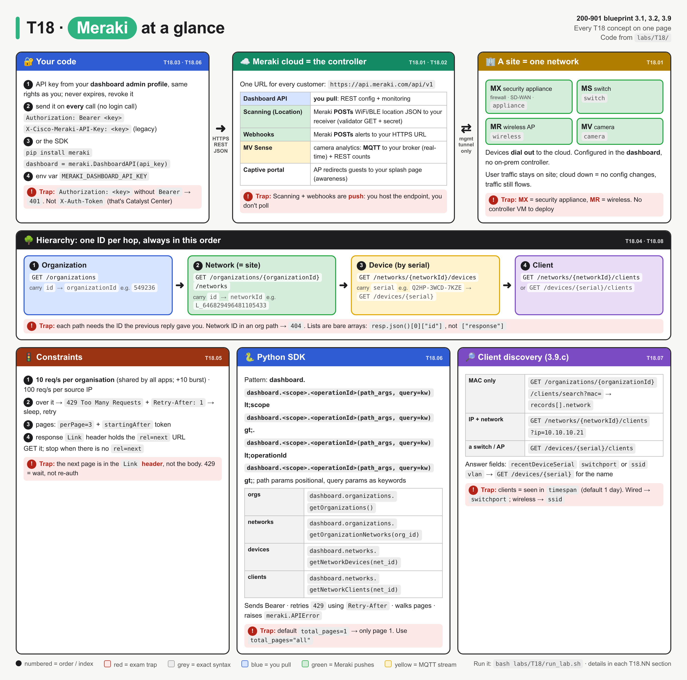
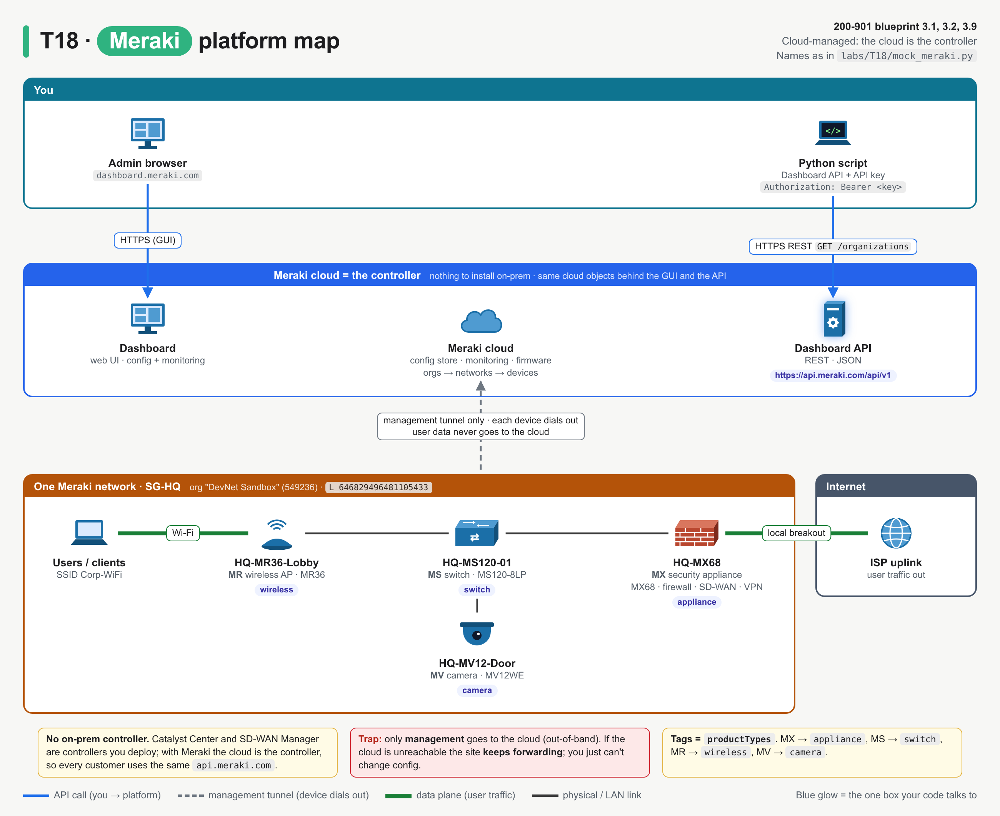
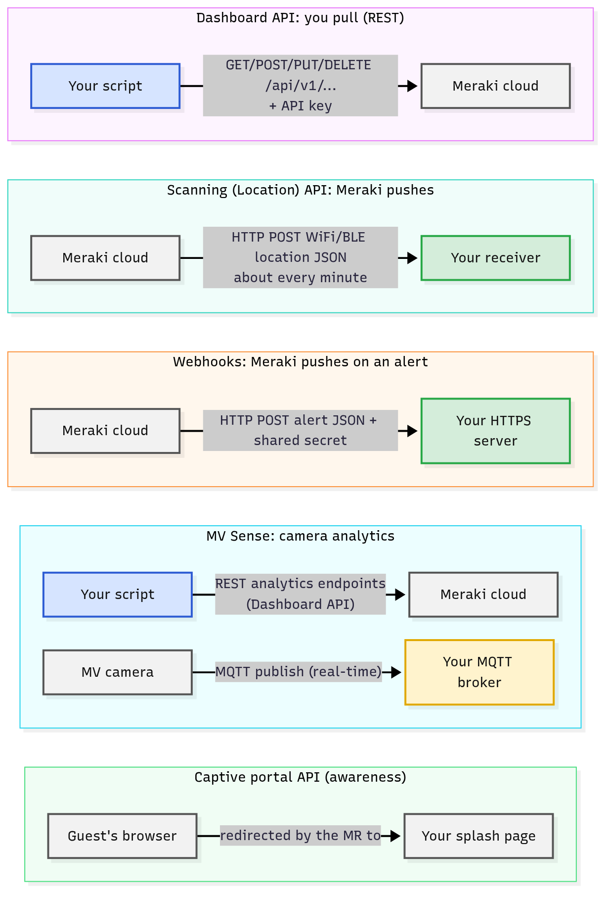
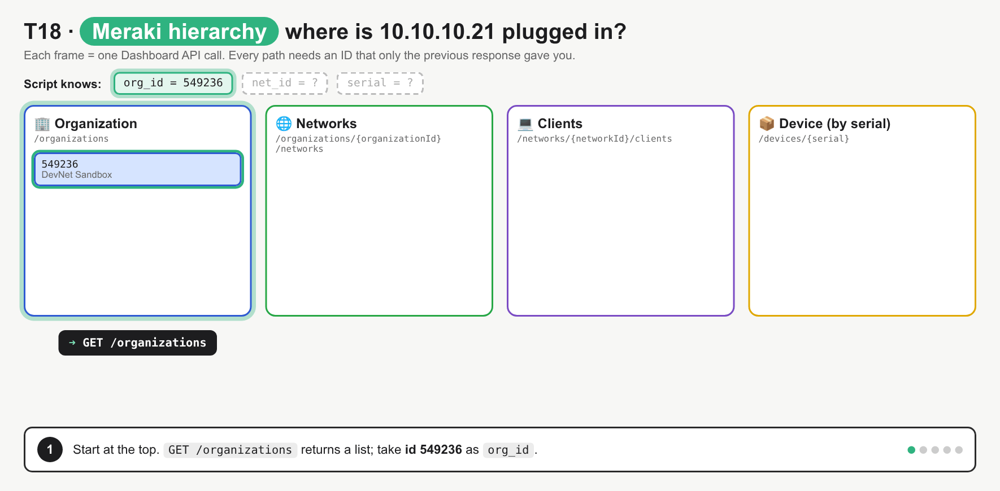
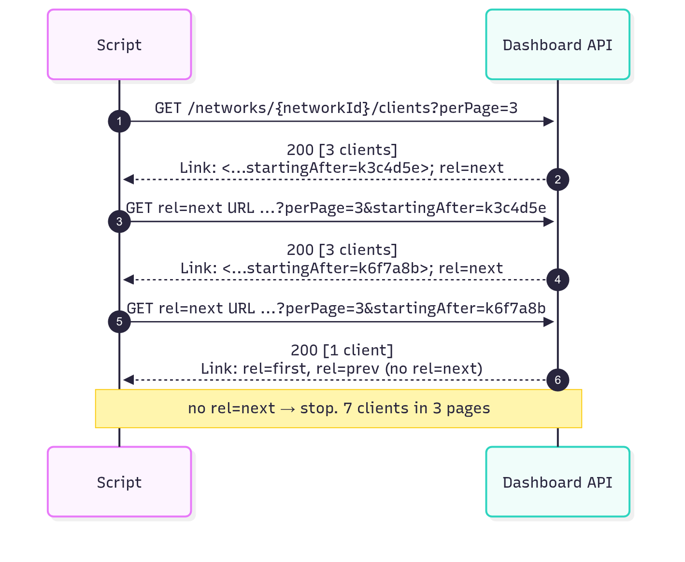

# T18 · Meraki: essentials

> Blueprint 3.1, 3.2, 3.9 · Full note: [bob/T18-meraki.md](../bob/T18-meraki.md)

## In one picture



*Read it left to right like traffic: your script (left) talks to the Meraki cloud (middle), which manages the devices and sees the clients (right); red boxes are exam traps.*

## The big idea

- Meraki is networking where the controller is the cloud itself, so every customer uses the same API address and there is nothing on-prem to log in to.
- Think of the Dashboard API as a set of nested folders: you open the organisation folder, then the network folder inside it, then the device or client you want, and each folder tells you the name of the next one.
- You prove who you are with a static API key in a header on every request, with no login step first.
- On the exam you will be asked to order the calls, fill in the auth header or SDK code, and handle the two speed bumps: rate limiting (`429`) and pagination (the `Link` header).

## What you need to know

### 1. The platform: cloud-managed, no controller to install

- Every Meraki device dials out to the Meraki cloud over the internet when you plug it in and pulls its config from there, so this is called **cloud-managed networking**.
- There is **no on-prem controller**. Catalyst Center (DNA Center) and SD-WAN Manager (vManage) are controllers you deploy (or Cisco hosts for you), but with Meraki the cloud is the controller.
- The **Dashboard** (`dashboard.meraki.com`) is the web UI, and the **Dashboard API** drives the same cloud objects with code: anything you click is something you can GET or PUT.
- Management is **out-of-band**: only management traffic goes to the cloud. If the cloud is unreachable, user traffic keeps flowing on site; you just can't change config.

| Line | What it is | `productTypes` value |
|---|---|---|
| **MX** | security appliance: firewall, SD-WAN, VPN, edge routing | `appliance` |
| **MS** | access/aggregation switch | `switch` |
| **MR** | wireless access point | `wireless` |
| **MV** | smart security camera with on-camera analytics | `camera` |
| MG / MT / SM (awareness only) | cellular gateway / sensors / endpoint management | `cellularGateway`, `sensor`, `systemsManager` |



*Blue is the API path your script uses, grey dashed is each device's management tunnel to the cloud, and thick green is user traffic, which stays on site and leaves through the MX.*

### 2. The API family: who calls whom

- Meraki has one main API you call and several "data out" APIs that call you, and the exam tests the **direction**.
- **Pull** means your script calls Meraki; **push** means Meraki sends an HTTPS `POST` to a server you host, which is why push APIs are described as "webhook-style".

| API | Direction | Transport / format | Use it for |
|---|---|---|---|
| **Dashboard API** | you → Meraki (pull) | REST over HTTPS, JSON, base `https://api.meraki.com/api/v1` | config and monitoring: orgs, networks, devices, clients, SSIDs, VLANs |
| **Scanning API** (now the **Location API**, v3) | Meraki → your receiver (push) | HTTPS `POST` of JSON | Wi-Fi and BLE device location, footfall analytics |
| **Webhooks** | Meraki → your receiver (push) | HTTPS `POST` of a JSON alert, with a shared secret | react to alerts (device down, settings changed) instead of polling |
| **MV Sense** | camera → your MQTT broker, or you → Meraki REST | **MQTT** for real-time detections; **REST** (part of the Dashboard API) for people/vehicle counts | use the camera as a sensor |
| **Captive portal (ExCaP)** | AP redirects the guest's browser → your splash page | HTTP redirect with query parameters | custom guest Wi-Fi sign-on pages (awareness only) |



*Blue is you calling Meraki (pull), green is Meraki calling your server (push), and yellow is the camera streaming to your MQTT broker.*

- **Scanning API handshake:** Meraki first sends a GET to your URL, and you answer with the **validator** string from the dashboard to prove the URL is yours. After that Meraki POSTs JSON that includes your **secret**, so you can check the sender. Data is batched about once a minute per AP.
- **Webhooks:** you add an **HTTP server** in the dashboard with an HTTPS URL on a public server with a valid certificate and an optional **shared secret**. Each alert POST carries `sharedSecret`, `sentAt` and `version`, and your receiver drops it if the secret doesn't match.
- **MV Sense MQTT:** you configure a broker (for example Mosquitto) on the camera in the dashboard, and the camera *publishes* to topics on it. **MQTT** is a lightweight publish/subscribe protocol over TCP, built for IoT.
- **Captive portal** has two methods. **Click-through** is simple (branding, terms of service): your page redirects the guest to `base_grant_url`. **Sign-on** adds authentication: your page POSTs `username` and `password` to `login_url`.

### 3. Authentication: a static key in a header

- You generate the key in the dashboard against **your own admin profile**. Current docs put it under Organization > API & Webhooks > API keys and access; older dashboards and most exam material say My Profile > API access ⚠ verify the menu path.
- The key is a 40-character hex string shown **once**. Keys don't expire; you revoke them. Each admin can have at most 2 keys.
- The key belongs to the **admin user, not to an org**: it can do whatever that admin's role can do, in every org they administer. A read-only admin gets a read-only key.
- REST is stateless, so you send the key on **every request**. There is **no login call** first, unlike Catalyst Center (`POST /auth/token`) or ACI (`aaaLogin`).

| Header | Status |
|---|---|
| `Authorization: Bearer <key>` | the documented v1 standard, and what the SDK sends |
| `X-Cisco-Meraki-API-Key: <key>` | the original header, still in most exam material and older scripts ⚠ verify it is still accepted on the live v1 API |

```python
session.headers.update({"Authorization": f"Bearer {API_KEY}", "Accept": "application/json"})
```

*This sets the auth header once on a `requests` session so every call reuses it.*

- A wrong or missing header returns **`401 Unauthorized`** with `{"errors": ["Invalid API key"]}`. A correct key in a made-up header name like `X-API-Key` still gets `401`.
- Store the key in the environment variable **`MERAKI_DASHBOARD_API_KEY`**, which the SDK reads by itself, never in the script.

### 4. The hierarchy: walk the tree, one ID per hop

- **Organization** is the customer or tenant with its licences and admins, and one API key can see several orgs.
- **Network** is usually one **site**, grouping the MX, MS, MR and MV boxes there. Network IDs look like `L_646829496481105433` or `N_…`.
- **Device** is one box, identified by its **serial** (for example `Q2HP-3WCD-7KZE`), not by name or IP.
- **Client** is an end host (laptop, phone, printer) seen by a network's devices.
- Each call needs an ID from the previous response, so you can't start at the clients call: you don't know the `networkId` until you've listed the org's networks.

| Order | Call (all `GET`, base `https://api.meraki.com/api/v1`) | What you carry to the next call |
|---|---|---|
| 1 | `/organizations` | `id` → `organizationId` |
| 2 | `/organizations/{organizationId}/networks` | `id` → `networkId` |
| 3 | `/networks/{networkId}/devices` | `serial` |
| 4 | `/networks/{networkId}/clients` or `/devices/{serial}/clients` | `recentDeviceSerial`, `switchport`, `ssid`, `vlan` |



*One call per frame: watch the "Script knows" chips fill in, because every path uses an ID the previous reply just returned.*

- The docs name the path parameters `{organizationId}`, `{networkId}` and `{serial}`; the blueprint shorthand `{orgId}` means the same thing.
- Org-level shortcuts exist (for example `GET /organizations/{organizationId}/devices`), but the exam still expects the org → network → device order.
- Meraki list endpoints return a **bare JSON array**, so you parse with `resp.json()[0]["id"]`, not `["response"]` (that wrapper is Catalyst Center).

### 5. The two speed bumps: rate limits and pagination

**Rate limit**

- The limit is **10 requests per second per organisation**, shared by every app and key that hits that org, with an extra 10 allowed as a burst in the first second. There is also a cap of **100 requests per second per source IP** across all orgs ⚠ verify, these numbers have changed before.
- Going over returns **`429 Too Many Requests`** plus a **`Retry-After`** header (seconds to wait) and the body `{"errors": ["API rate limit exceeded for organization"]}`.
- The fix is to sleep for `Retry-After` seconds and retry, backing off if it keeps happening. It is not a reason to re-authenticate.

**Pagination**

- List endpoints return **one page** at a time, and you set the size with **`perPage`** (for network clients the range is 3–5000, default 10).
- The next page's address is in the response's **`Link` header** (RFC 5988), not in the JSON body. It can hold `rel=first`, `rel=prev`, `rel=next` and `rel=last`, and each URL already carries `perPage` and a `startingAfter` or `endingBefore` token.
- The loop is: GET, read `rel=next`, GET that URL, and stop when there is no `rel=next`. Don't build `startingAfter` yourself, because the server sets those tokens.



*Seven clients at `perPage=3` makes three pages, and the last page has no `rel=next`, which is the stop condition.*

```python
while "next" in resp.links:
    resp = meraki_get(resp.links["next"]["url"])
```

*`requests` parses the `Link` header into `resp.links`, so this keeps fetching until the last page.*

- Forgetting to paginate causes no error at all; the list just comes back short.

### 6. The Python SDK: the same walk with less code

- Install it with `pip install meraki`, then create one session with `dashboard = meraki.DashboardAPI(api_key)`. If you leave out the key, it reads `MERAKI_DASHBOARD_API_KEY` from the environment.
- The call pattern is **`dashboard.<scope>.<operationId>(...)`**: the scope is the first part of the REST path, and the method name is the docs' operation ID in camelCase.
- Path parameters are **positional** arguments, and query parameters are **keyword** arguments, for example `getNetworkClients(net_id, timespan=86400, perPage=3)`.

| REST call | SDK method |
|---|---|
| `GET /organizations` | `dashboard.organizations.getOrganizations()` |
| `GET /organizations/{organizationId}/networks` | `dashboard.organizations.getOrganizationNetworks(org_id)` |
| `GET /networks/{networkId}/devices` | `dashboard.networks.getNetworkDevices(net_id)` |
| `GET /networks/{networkId}/clients` | `dashboard.networks.getNetworkClients(net_id)` |
| `GET /devices/{serial}` | `dashboard.devices.getDevice(serial)` |

- The SDK sends `Authorization: Bearer <key>` for you, and on a `429` it sleeps `Retry-After` seconds and retries (`wait_on_rate_limit=True`, up to `maximum_retries`). It also retries 5xx errors.
- Other 4xx errors become a Python exception, **`meraki.APIError`**, with `.status`, `.reason` and `.message`, rather than a return value.
- The big trap: the SDK only follows the `Link` header if you ask for more than one page with **`total_pages="all"`** (or `-1`). The default is `total_pages=1`, so you silently get page 1 only.

```python
networks = dashboard.organizations.getOrganizationNetworks(org_id, total_pages="all")
```

*Without `total_pages="all"`, an org with 5 networks at `perPage=3` returns only 3.*

### 7. Client discovery (3.9.c): "where is this host plugged in?"

- You choose the call by what you already know about the host.

| You know | Call | Answer is in |
|---|---|---|
| MAC only, not the network | `GET /organizations/{organizationId}/clients/search?mac=…` | `records[].network.name`, `ip`, `vlan`, `switchport` / `ssid` |
| IP (or MAC) and the network | `GET /networks/{networkId}/clients?ip=10.10.10.21` (also `mac=`, `vlan=`) | `recentDeviceSerial`, `recentDeviceName`, `switchport` or `ssid`, `vlan` |
| one client's ID, MAC or IP | `GET /networks/{networkId}/clients/{clientId}` | same fields, one object |
| the switch or AP | `GET /devices/{serial}/clients` | each client's `mac`, `ip`, `vlan`, `switchport` |

- To turn a serial into a friendly name, feed `recentDeviceSerial` into `GET /devices/{serial}`, which returns the switch's `name` and `model`.
- A **wired** client has `switchport` set and `ssid` null; a **wireless** client is the reverse (`recentDeviceConnection` says `Wired` or `Wireless`).
- Network clients are only those seen in the **`timespan`** window (default 1 day, maximum 31 days), so a host that was offline last month won't appear.

## Exam traps (the ones that catch people)

- Looks like Meraki needs a login call first, but it doesn't: the static API key goes straight into `Authorization: Bearer <key>` or `X-Cisco-Meraki-API-Key: <key>`, not `X-Auth-Token` (Catalyst Center) and not a cookie (ACI).
- Looks like `Authorization: <key>` should work, but it returns `401` because the word `Bearer ` is part of the header value.
- Looks like the API key belongs to an org, but it belongs to an **admin user** and carries that admin's permissions across all their orgs.
- Looks like the rate limit is per key or per script, but it is **per organisation** (10/s, shared by every app on that org), with a separate 100/s per source IP cap.
- Looks like a `429` means re-authenticate, but it means read the `Retry-After` header, sleep that many seconds, and retry.
- Looks like the SDK fetches everything, but `total_pages` defaults to 1, so you need `total_pages="all"` to get every page.
- Looks like Scanning and webhooks are APIs you poll, but they are **push**: Meraki POSTs to your server. MV Sense real-time is **MQTT**; MV Sense historical counts are REST.
- Looks like a 404 means the endpoint is wrong, but often it is an ID of the wrong type, such as a network ID where an org ID belongs.

## Quick self-check

<details><summary>Q1. A script knows only the org name and must list clients on one branch switch. What is the call order?</summary>

`GET /organizations` → `/organizations/{organizationId}/networks` → `/networks/{networkId}/devices` → `/devices/{serial}/clients`. Each call needs the ID returned by the one before it.
</details>

<details><summary>Q2. A job makes 40 calls per second against one org. What response does it get, and what should it do?</summary>

`429 Too Many Requests`; wait the `Retry-After` seconds and retry. The limit is about 10 requests/s per organisation, and the key is fine.
</details>

<details><summary>Q3. `getOrganizationNetworks(org_id, perPage=3)` returns 3 networks, but the org has 5. What's the fix?</summary>

Add `total_pages="all"` (or `-1`). The SDK defaults to `total_pages=1`, so it returns only the first page.
</details>

<details><summary>Q4. Which two Meraki APIs push data to a server you host?</summary>

The Scanning (Location) API and webhooks. Both are HTTPS POSTs from the Meraki cloud to your URL; the Dashboard API and MV Sense REST are calls you make.
</details>

<details><summary>Q5. You know a laptop's MAC but not which of 200 networks it's in. Which single call finds it?</summary>

`GET /organizations/{organizationId}/clients/search?mac=…`. It searches the whole org and returns `records[]` with the network the client was seen on.
</details>

## Cheat lines to say out loud

- "The cloud is the controller: one URL for everyone, `api.meraki.com/api/v1`, and user traffic never goes through it."
- "Org, network, device by serial, client: every hop hands you the next ID."
- "Key in the header, every time: `Authorization: Bearer`, no login call."
- "Ten a second per org, then 429: read Retry-After and try again."
- "Next page lives in the Link header, and the SDK only follows it if you say `total_pages="all"`."
