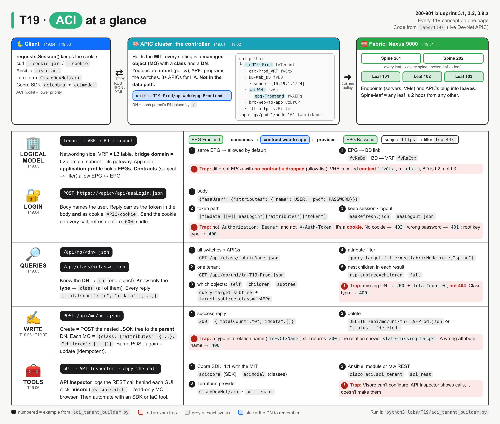
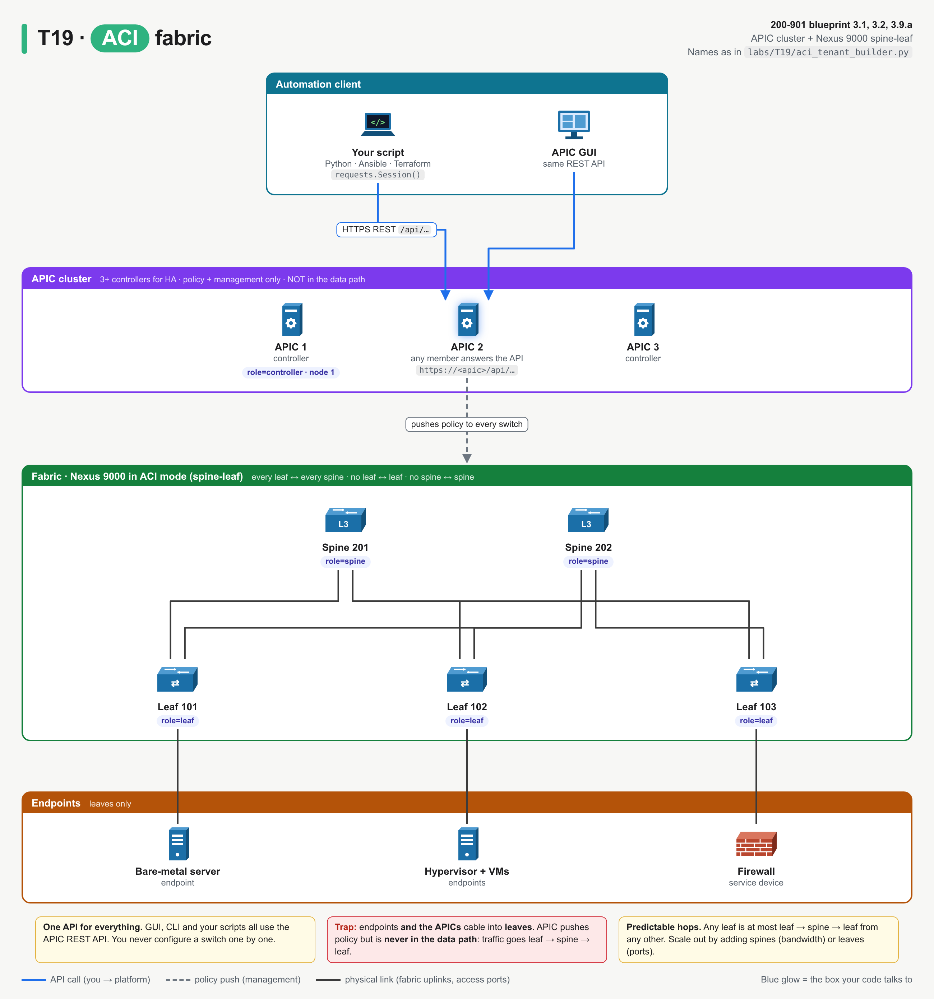
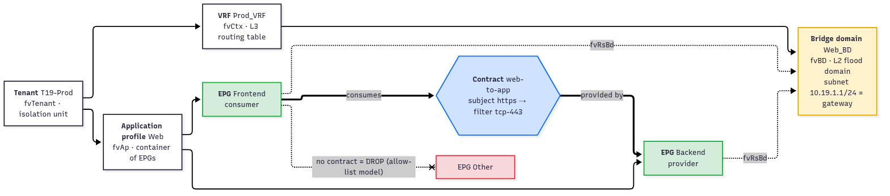
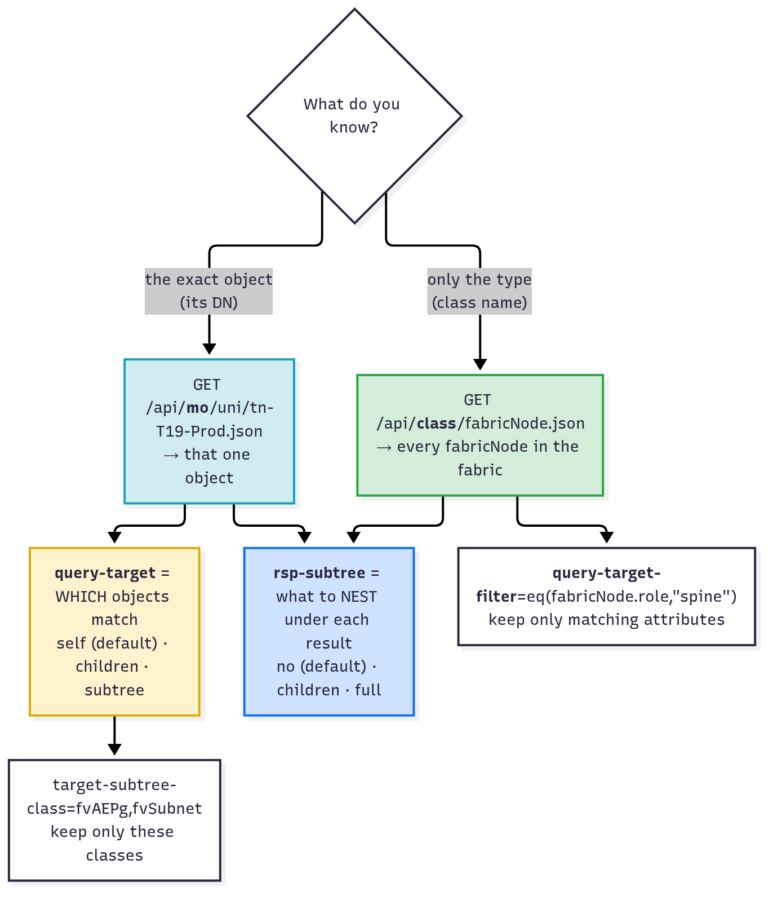

# T19 · ACI: essentials

> Blueprint 3.1, 3.2, 3.9.a · Full note: [bob/T19-aci.md](../bob/T19-aci.md) · Teach-back 2026-10-18

## In one picture



*The top band is the system map (your script talks to APIC, APIC holds the object tree, APIC programs the spine-leaf fabric); each row below is one concept group, and the red boxes are exam traps.*

## The big idea

- ACI is Cisco's software-defined network for the data centre: instead of configuring every switch, you tell one controller (APIC) what the application needs, and APIC programs all the switches for you.
- Think of APIC as an architect's master plan: everything in the building (every tenant, VRF, EPG, even every physical switch) is an entry in one big filing tree, and you read or change that tree over a REST API.
- On the exam you must build the login call, build a class or DN query, map ACI words (tenant, BD, EPG, contract) to networking words you already know, and fill in blanks in Python `requests` code.

## What you need to know

### 1. What ACI is: a controller plus a spine-leaf fabric

- **ACI** stands for **Application Centric Infrastructure**, and it is Cisco's **SDN** (software-defined networking) solution for the **data centre**.
- It has two parts, the controller and the switches:
  - The **APIC** (Application Policy Infrastructure Controller) is a **cluster** of controllers, normally 3 or more for redundancy, that holds all the configuration and exposes the REST API.
  - The **fabric** is Nexus 9000 switches running in **ACI mode** (not standalone NX-OS), cabled as **spine-leaf**.
- The GUI, the CLI and your scripts all use the same REST API on the APIC, so anything you can click you can also script.
- Spine-leaf has strict cabling rules that the exam likes to test:
  - Every leaf connects to every spine, but leaves never connect to leaves and spines never connect to spines.
  - Endpoints (servers, VMs, firewalls) and the APICs plug into **leaves**, never into spines.
  - Any leaf is therefore at most leaf → spine → leaf away from any other, which gives predictable latency, and you scale out by adding spines.
- The APIC is **not in the data path**: it pushes policy to the switches, but traffic never flows through it.



*Scripts and the GUI both talk REST to the APIC; APIC pushes policy down, but traffic goes leaf → spine → leaf and never through the APIC.*

- The **policy model** (intent-based) means you describe what the application needs, for example "these servers form a group, and this group may talk to that group on TCP 443", and APIC turns it into VLANs/VXLAN, ACL entries and routes on the right leaves.
- Where ACI sits among the Cisco platforms (blueprint 3.2):

| Platform | Domain |
|---|---|
| Meraki | cloud-managed campus/branch |
| Catalyst Center (DNA Center) | on-prem campus controller |
| Catalyst SD-WAN | WAN |
| **ACI** | **data centre** |
| NSO | multi-vendor orchestration |

### 2. The object model: everything is an object in one tree

- APIC stores everything, both configuration and live state, as objects in a single tree called the **Management Information Tree (MIT)**.
- Each node in the tree is a **managed object (MO)**, and every MO has three identifiers:
  - A **class** is its type, such as `fvTenant`, `fvAEPg` or `fabricNode`; the prefix tells you the package (`fv` = tenant objects, `vz` = contracts and filters, `fabric` = physical fabric, `aaa` = users and login).
  - An **RN** (relative name) is its name under its parent, such as `tn-Prod` or `epg-Frontend`; each class has a fixed RN prefix (`tn-`, `ap-`, `epg-`, `BD-`, `ctx-`, `brc-`, `flt-`).
  - A **DN** (distinguished name) is every RN from the root down, joined by `/`, and it is unique in the whole fabric.
- An analogy: the DN is like a full file path on a disk, and the RN is just the file name in its folder.
- Reading the example DN `uni/tn-Prod/ap-Web/epg-Frontend` left to right gives policy universe → tenant `Prod` → application profile `Web` → EPG `Frontend`.
- The root has two big branches:
  - `uni` (class `polUni`) is the **policy** universe, where all tenants live.
  - `topology` is the **physical** fabric, so `topology/pod-1/node-101` is a `fabricNode`.
- Square brackets wrap RN values that contain `/` or `.`, for example `uni/tn-T19-Prod/BD-Web_BD/subnet-[10.19.1.1/24]`.
- In JSON every MO has the same shape, the class name as the single key with `attributes` (and optionally `children`) inside, so one parser works for every class:

```json
{"fvTenant": {"attributes": {"dn": "uni/tn-T19-Prod", "name": "T19-Prod"}, "children": [ ... ]}}
```

### 3. Logical constructs: tenant, VRF, BD, EPG, contract

- The logical model has two chains that meet at the EPG:
  - The **network chain** is tenant → VRF → bridge domain → subnet.
  - The **app chain** is tenant → application profile → EPG.
  - An EPG joins the two chains by pointing at one bridge domain.

| Construct | Class | RN | What it means in networking terms |
|---|---|---|---|
| **Tenant** | `fvTenant` | `tn-` | an administrative/isolation unit (customer, business unit, environment) |
| **VRF** (also called **context**) | `fvCtx` | `ctx-` | an L3 routing table |
| **Bridge domain (BD)** | `fvBD` | `BD-` | an L2 forwarding/flood domain, tied to one VRF |
| **Subnet** | `fvSubnet` | `subnet-[ip]` | the gateway IP on the BD (an anycast SVI on every leaf) |
| **Application profile** | `fvAp` | `ap-` | a container that groups the EPGs of one app |
| **EPG** (endpoint group) | `fvAEPg` | `epg-` | a set of endpoints with the same policy, tied to one BD |
| **Filter** | `vzFilter` + `vzEntry` | `flt-` | an L2–L4 match, like an ACL line |
| **Contract** | `vzBrCP` + `vzSubj` | `brc-` | the rule that allows EPG ↔ EPG traffic; a subject points at filters |

- A contract has two sides: one EPG **provides** it (the server side, `fvRsProv`) and the other **consumes** it (the client side, `fvRsCons`), and the structure is contract → **subject** → **filter** → entries.
- ACI uses an **allow-list model**: endpoints in the same EPG talk freely, but endpoints in different EPGs cannot talk at all until a contract allows it, which is the opposite of a normal VLAN where everything can talk by default.
- **Relation objects** (`fvRs…`, `vzRs…`) link objects by name; for example `fvRsBd` with `tnFvBDName: "Web_BD"` is how an EPG says "my bridge domain is Web_BD".



*Left is the network chain, right is the app chain; the green arrows through the contract are the only permitted EPG-to-EPG traffic, and the EPG with no contract is dropped (red).*

### 4. Logging in to the REST API

- Logging in is a POST of a small JSON body, and the login body is itself an MO of class `aaaUser`:

```text
POST https://<apic>/api/aaaLogin.json
{"aaaUser": {"attributes": {"name": "admin", "pwd": "..."}}}
```

- The `.json` suffix on the URL picks the encoding, and you use `.xml` instead for XML.
- The reply is `200`, and the token sits at `["imdata"][0]["aaaLogin"]["attributes"]["token"]`.
- The same token also arrives as a `Set-Cookie` header with the cookie name **`APIC-cookie`**, and every later call sends `Cookie: APIC-cookie=<token>`.
- A Python `requests.Session()` stores that cookie and sends it on every later call automatically, so you don't have to handle it yourself.
- The session times out when idle: `refreshTimeoutSeconds` was `600` on the sandbox (⚠ verify: configurable per APIC), you keep it alive with `GET /api/aaaRefresh.json`, and you end it with `POST /api/aaaLogout.json`.
- ⚠ verify: the cookie is set as `APIC-cookie`, but the 403 error text spells it `APIC-Cookie`; cookie names are case-sensitive, so use `APIC-cookie`.
- Errors seen live: no cookie gives `403`, a wrong password gives `401`, and a wrong root key such as `aaaUsers` gives `400`.

| Platform | How you get a token | How you send it |
|---|---|---|
| **ACI APIC** | `POST /api/aaaLogin.json` with a JSON body | cookie `APIC-cookie` |
| Catalyst Center (DNA Center) | `POST /dna/system/api/v1/auth/token` with Basic auth | header `X-Auth-Token` |
| Meraki | API key from the dashboard | header `Authorization: Bearer <key>` |

### 5. Queries: `mo` by DN, `class` by type

- There are two kinds of query, and you pick one based on what you know:

| You know | URL | What comes back |
|---|---|---|
| the **DN** of one object | `GET /api/mo/<dn>.json` | that one object (`totalCount` 1, or 0 if it doesn't exist) |
| only the **class** | `GET /api/class/<class>.json` | every object of that class, anywhere in the tree |

- For example, `GET /api/class/fabricNode.json` returned 4 nodes on the sandbox: two with `role=leaf`, one `role=spine` and one `role=controller` (the APIC itself).
- Every reply has the same envelope: `{"totalCount": "<n as a string>", "imdata": [ MO, MO, … ]}`.
- Query options go in the URL's query string:

| Option | What it controls | Values |
|---|---|---|
| `query-target` | **which** objects are returned, relative to the DN | `self` (default), `children`, `subtree` |
| `target-subtree-class` | keep only these classes (used with `children`/`subtree`) | comma-separated class names |
| `query-target-filter` | keep only objects whose **attributes** match | `eq(class.attr,"value")`, also `ne`, `lt`, `gt`, `wcard`, `and(...)`, `or(...)` |
| `rsp-subtree` | what is **nested** inside each returned object | `no` (default), `children`, `full` |
| `rsp-subtree-class` | which nested classes to include | class names |

- A filtered class query looks like this, with `class.attribute` and a quoted value inside `eq(...)`:

```text
GET https://<apic>/api/class/fabricNode.json?query-target-filter=eq(fabricNode.role,"spine")
```

- The difference that gets tested: `query-target=children` returns the children **as the results** (8 separate items for the test tenant), while `rsp-subtree=children` returns **the object itself** with its children nested inside a `"children"` list (1 item).
- A DN that doesn't exist is not an HTTP error: you get `200` with `totalCount` 0, so always check `totalCount` and not just the status code.
- Creating uses POST: you POST the whole nested tree to the **parent** DN (`/api/mo/uni.json` for a tenant), and the reply is `200` with an empty `imdata`, not `201`.
- Deleting is `DELETE /api/mo/<dn>.json`, or a POST of the object with `"status": "deleted"`.



*If you know the DN use `mo`, if you know the class use `class`; `query-target` changes which objects come back and `rsp-subtree` changes how much of each one comes back.*

### 6. Tools around the API

- Two built-in APIC tools help you **find** the right call:
  - **API Inspector** (GUI user menu → *Show API Inspector*) logs every REST call the GUI makes, with method, URL, payload and response, so you can click "create tenant" and copy the POST into your script; it shows calls but never sends them.
  - **Visore** (the Managed Object Browser, "Object Store Browser" in the GUI) at `https://<apic>/visore.html` is a **read-only** browser for the MIT where you type a class or DN and click through parents and children; it cannot change configuration.
- Several tools **automate** the calls, and they all end up hitting the same `/api/mo` and `/api/class` endpoints:

| Tool | What it is |
|---|---|
| `requests` / curl | raw REST calls |
| **Cobra SDK** | Cisco's official Python SDK with one Python class per MIT class; it is two packages, **`acicobra`** (session and requests) and **`acimodel`** (the generated model classes), downloaded from your APIC at `https://<apic>/cobra/_downloads/` (⚠ verify: example not run) |
| **ACI Toolkit** | an older, simpler object library (`Tenant`, `EPG`, `Contract`) that covers less; lower priority |
| **Ansible** | the `cisco.aci` collection, with one module per object plus `aci_rest` for any REST path |
| **Terraform** | the `CiscoDevNet/aci` provider with resources such as `aci_tenant` and `aci_vrf` (⚠ verify: example not run) |

- Cobra maps 1:1 to the MIT so it can do everything but you need the class names, while the Toolkit hides the classes behind simpler objects but covers less.

### 7. Exam angle: completing Python code

- The blanks in "complete the code" questions usually sit on these lines:

```python
session = requests.Session()                                   # keeps the APIC-cookie
session.post(f"{BASE}/aaaLogin.json", json=body, verify=False)  # log in
token = resp.json()["imdata"][0]["aaaLogin"]["attributes"]["token"]
data = session.get(f"{BASE}/class/fabricNode.json", verify=False).json()
for mo in data["imdata"]: print(mo["fabricNode"]["attributes"]["name"])
```

- If the code does not use a session, it must send the cookie itself, like this: `requests.get(url, cookies={"APIC-cookie": token}, verify=False)`.

## Exam traps (the ones that catch people)

- It looks like a token should go in an `Authorization` header, but APIC actually expects it as the **`APIC-cookie`** cookie; `Bearer` is Meraki/Webex and `X-Auth-Token` is Catalyst Center, and no cookie gives `403`.
- It looks like `requests.get()` after a login should work, but it actually fails with `403` because a bare request carries no cookie, while a `requests.Session()` replays it automatically.
- It looks like `/api/mo/fabricNode.json` should list nodes, but it actually returns `400` because `mo` needs a DN; to list every object of a type you need `/api/class/fabricNode.json`.
- It looks like a missing tenant should give `404`, but it actually gives `200` with `totalCount` 0, whereas a misspelt **class** gives `400` "unresolved class".
- It looks like creating something should return `201`, but APIC actually returns `200` with an empty `imdata`, because POST to the parent DN both creates and updates.
- It looks like a typo in a relation name such as `tnFvCtxName: "Prod-VRF"` should fail, but it actually returns `200` and the relation's `state` becomes `missing-target`; an unknown **attribute** name, by contrast, returns `400`.
- It looks like two EPGs in the same BD should talk, but they actually can't without a contract, because ACI is an allow-list (only traffic inside one EPG is free).
- It looks like Visore could fix config, but it is actually read-only; and API Inspector only shows the GUI's calls, it doesn't send any.

## Quick self-check

<details><summary>Q1. What URL and body do you use to log in to APIC, and where does the token travel on later calls?</summary>

`POST https://<apic>/api/aaaLogin.json` with `{"aaaUser": {"attributes": {"name": "...", "pwd": "..."}}}`; the token comes back in the body and as the `APIC-cookie` cookie, which later calls send. That cookie is why a `requests.Session()` works and a bare `requests.get()` gets `403`.
</details>

<details><summary>Q2. Which URL returns every leaf and spine in the fabric: <code>/api/mo/fabricNode.json</code> or <code>/api/class/fabricNode.json</code>?</summary>

`/api/class/fabricNode.json`, because you know the type, not one DN; the `mo` version returns `400`.
</details>

<details><summary>Q3. EPGs Web and DB are in the same VRF and BD but traffic on TCP 1433 is dropped. What's missing?</summary>

A contract with a TCP 1433 filter, provided by DB (the server side) and consumed by Web (the client side), because different EPGs need a contract even in the same BD.
</details>

<details><summary>Q4. What is the difference between <code>?query-target=children</code> and <code>?rsp-subtree=children</code> on a tenant DN?</summary>

`query-target=children` returns the children instead of the tenant, as separate results; `rsp-subtree=children` returns the tenant itself with its children nested in a `children` list.
</details>

<details><summary>Q5. Map these to traditional networking: VRF, bridge domain, subnet on the BD, filter.</summary>

VRF = L3 routing table, bridge domain = L2 flood domain, subnet on the BD = default gateway (SVI), filter = ACL entry.
</details>

## Cheat lines to say out loud

- "APIC holds the policy, the spine-leaf fabric forwards, and APIC is never in the data path."
- "Everything is an MO in the MIT: class is the type, DN is the full path, like `uni/tn-Prod/ap-Web/epg-Frontend`."
- "Login is POST `aaaLogin.json`, and the token rides in the `APIC-cookie`, not a header."
- "`mo` plus a DN gets one object; `class` plus a class name gets them all."
- "No contract, no traffic: provider serves, consumer calls, and missing objects return 200 with totalCount 0."
