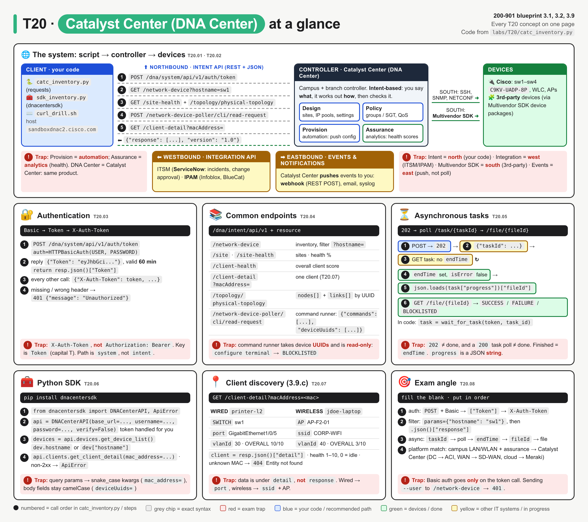
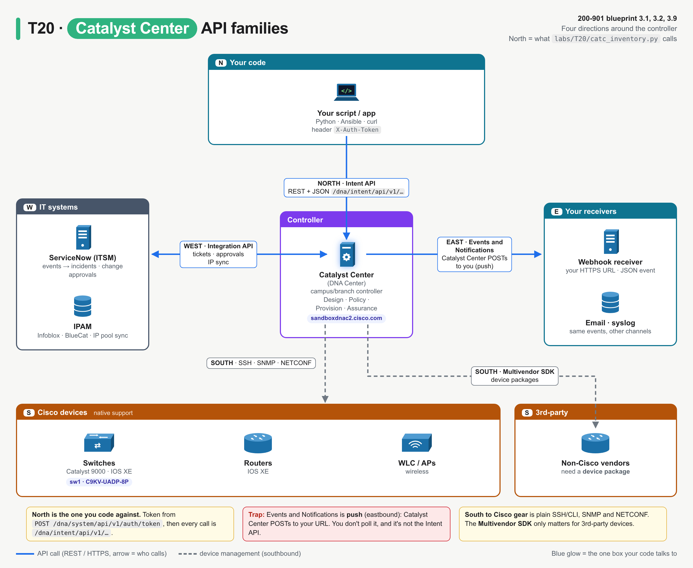
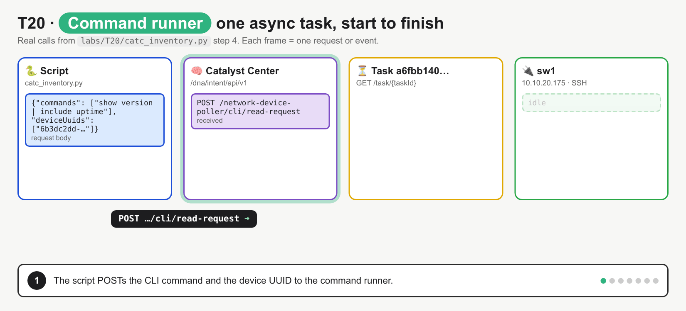

# T20 · Catalyst Center (DNA Center): essentials

> Blueprint 3.1, 3.2, 3.9 · Full note: [bob/T20-catalyst-center-dna-center.md](../bob/T20-catalyst-center-dna-center.md)

## In one picture



*Read it left to right (your script, then Catalyst Center, then the devices); the numbered circles are the API calls in order, and the red boxes are the exam traps.*

## The big idea

- Catalyst Center is the controller for the campus and branch network: you tell it what you want, and it works out the device config, pushes it, and then checks the result.
- Think of it as a building manager: you ask the manager ("give guests internet only") instead of walking to every switch yourself, and your script talks only to the manager.
- On the exam you mostly need the API side: a two-step login (Basic auth for a token, then the token in a custom header), the `/dna/intent/api/v1/` URL shape, and the "202 then poll the task" pattern for slow jobs.

## What you need to know

### 1. What the platform is and what it does

- Catalyst Center manages Catalyst switches, wireless LAN controllers and APs, and ISR/Catalyst edge routers in the **enterprise campus and branch**.
- It was called **DNA Center** until the rename; the API paths still start with `/dna/` and the Python SDK is still called `dnacentersdk` (rename year 2023 ⚠ verify).
- It is a **controller**, not a device: an appliance (physical or virtual) whose REST API your script calls, while it talks to the devices itself.
- The working model is **intent-based networking (IBN)**: you say *what* you want, it decides *how* (VLANs, ACLs, SGTs), pushes it, and then verifies it.
- The four GUI sections form that loop:

| Function | What it does in plain words | Example |
|---|---|---|
| **Design** | Models the network: site hierarchy (area, building, floor), IP pools, global settings like AAA, DNS, NTP, syslog, golden images | Create "Global/SJC/Floor-2" |
| **Policy** | Decides who can talk to whom: group-based access (SGTs with ISE), QoS, app policy | "Guests reach the internet only" |
| **Provision** | The **automation** side: onboard devices (PnP), push config and templates, upgrade software (SWIM) | Assign sw1 to a site |
| **Assurance** | The **analytics** side: health scores for network, devices and clients, issues and root cause | `site-health`, `client-detail` |

- **SD-Access** is the campus fabric built by Catalyst Center plus ISE; you only need the name.
- Platform matching: campus LAN/WLAN with intent and assurance means Catalyst Center; data centre fabric means ACI; WAN overlay means SD-WAN Manager; cloud-managed means Meraki.

### 2. The four API families (think of a compass)



*Catalyst Center sits in the middle; north is what your script calls, west and east are other IT systems, south is the devices.*

| Family | Direction | Who calls whom | Used for |
|---|---|---|---|
| **Intent API** | **Northbound** | Your app calls Catalyst Center (REST, JSON, HTTPS) | Inventory, health, command runner, client detail |
| **Integration API** | **Westbound** | Catalyst Center and IT systems talk to each other | **ITSM** such as ServiceNow (events become incidents, change approvals), **IPAM** such as Infoblox or BlueCat |
| **Multivendor SDK** | **Southbound** | Catalyst Center manages **third-party** devices | Device packages that teach it non-Cisco gear |
| **Events and Notifications** | **Eastbound** | Catalyst Center **pushes** to you | Webhook (REST POST), email or syslog (other channels ⚠ verify) |

- The Intent API is the one you write code against; it is called "intent" because you ask for an outcome rather than scripting CLI device by device.
- Events and Notifications is **push, not poll**: Catalyst Center sends a JSON event to your webhook URL when something happens.
- For Cisco devices Catalyst Center itself uses SSH/CLI, SNMP and NETCONF southbound; the Multivendor SDK only matters for non-Cisco devices.

### 3. Logging in: Basic auth once, then a token header

- Step one is the only call that sends a username and password: a **POST** with **HTTP Basic auth** to the token URL.

```
POST https://<host>/dna/system/api/v1/auth/token      (Basic auth)
-> {"Token": "eyJhbGci..."}
```

- Note the path says **`system`**, not `intent`, and the method is POST; very old releases used `/api/system/v1/auth/token`.
- The reply key is **`Token` with a capital T**, so `resp.json()["token"]` fails with a `KeyError`.
- Every other call sends the token in the custom header **`X-Auth-Token: <token>`**, not `Authorization: Bearer`.
- A missing or wrong header gives `401 {"message": "Unauthorized"}`; a wrong password on the token call gives a `401` with an empty body.
- The token lasts **60 minutes**; after that you get `401` and must ask for a new one (the SDK does that for you).
- Scripts use `verify=False` because the sandbox has a self-signed certificate.

### 4. The URL shape and the common endpoints

- Every Intent endpoint is `https://<host>` + **`/dna/intent/api/v1`** + the resource name.
- Most replies wrap the data the same way: `{"response": <data>, "version": "1.0"}`, so code reads `.json()["response"]`.

| Endpoint (after `/dna/intent/api/v1`) | Method | What it gives you |
|---|---|---|
| `/network-device` | GET | Device inventory: `hostname`, `managementIpAddress`, `platformId`, `softwareVersion`, `role`, `reachabilityStatus`, `id` (UUID) |
| `/network-device?hostname=sw1` | GET | The same list filtered by query parameters (`hostname`, `platformId`, `family`, `serialNumber`, ...) |
| `/network-device/{id}`, `/network-device/count` | GET | One device, or a count like `{"response": 4}` |
| `/site`, `/site-health` | GET | The site hierarchy, and health per site (`networkHealthAverage`) |
| `/client-health` | GET | One overall client health score, split wired and wireless |
| `/client-detail?macAddress=<mac>` | GET | Where one client connects and how healthy it is |
| `/topology/physical-topology` | GET | `nodes[]` and `links[]`, with links naming devices by UUID |
| `/network-device-poller/cli/read-request` | POST | The **command runner**: returns `202` and a `taskId` |
| `/task/{taskId}`, `/file/{fileId}` | GET | Task status, and the result file |

- The command runner body is `{"commands": [...], "deviceUuids": [...]}`, so it needs device **UUIDs** from `/network-device`, not IPs or hostnames.
- The command runner is **read-only**: `show` commands work, and `configure terminal` comes back under `BLOCKLISTED`.
- MAC addresses in a query string get URL-encoded (`:` becomes `%3A`); `requests` does this when you pass `params=`.

### 5. Slow jobs are asynchronous: 202, poll, then fetch the file

- Jobs that touch devices (command runner, provisioning, discovery, templates, image upgrade) can take minutes, so Catalyst Center answers at once with **`202 Accepted`** and a **task ID**, then works in the background.
- It is like a dry-cleaning ticket: the `202` is the ticket, not your shirt, and you keep checking until the order is ready.



*POST gives 202 and a taskId, the first poll shows no endTime (still running), the second poll has endTime and a fileId, and only then do you GET the file.*

- You poll `GET /dna/intent/api/v1/task/{taskId}` and watch three fields:

| Field | Meaning |
|---|---|
| `isError` | `true` means the task failed (read `failureReason`) |
| `endTime` | Only present once the task has **finished** |
| `progress` | Free text while running; for the command runner it ends as a **JSON string** like `{"fileId": "..."}` |

- Because `progress` is a string, you must `json.loads(task["progress"])["fileId"]` before you can read the file ID.
- The CLI output itself lives in `GET /file/{fileId}`, grouped as `SUCCESS`, `FAILURE` and `BLOCKLISTED`.
- Sleep between polls and give up after a set number of tries; never poll in a tight loop.
- Newer releases also have `GET /tasks/{id}` returning `"status": "SUCCESS"`, and the API reference marks `/task/{taskId}` as "Sunset"; the exam is assumed to still test `isError`/`endTime`/`progress` ⚠ verify.

### 6. The Python SDK does the login for you

- Install with `pip install dnacentersdk` and import `from dnacentersdk import DNACenterAPI`.

```python
api = DNACenterAPI(base_url="https://host", username="u", password="p", verify=False)
devices = api.devices.get_device_list(hostname="sw1")
```

- The SDK gets the token, adds `X-Auth-Token`, and fetches a new token once automatically on a `401`.
- Method names are the API area plus the action: `api.devices.*`, `api.clients.*`, `api.command_runner.*`, `api.task.*`, `api.sites.*`, `api.topology.*`.
- **Query parameters become snake_case** keyword arguments (`platform_id=`, `mac_address=`, `task_id=`), but **body fields keep their camelCase** JSON names (`deviceUuids=`).
- Results allow dot access (`dev.hostname`) as well as `dev["hostname"]`, and any non-2xx reply raises `ApiError`.
- With no arguments, `DNACenterAPI()` reads `DNA_CENTER_BASE_URL`, `DNA_CENTER_USERNAME`, `DNA_CENTER_PASSWORD` and similar environment variables.
- You still have to poll async tasks yourself, even with the SDK.

### 7. Finding a client by MAC (blueprint 3.9.c)

- This answers "where is this laptop or printer plugged in?" when you only know its **MAC address**.

```
GET /dna/intent/api/v1/client-detail?macAddress=00:1e:13:a5:b9:40
```

- The reply has **no `response` wrapper**; its top-level keys are **`detail`**, `connectionInfo` and `topology`, so you read `resp.json()["detail"]`.

| `detail` field | Wired client | Wireless client |
|---|---|---|
| `hostType` | `WIRED` | `WIRELESS` |
| `connectedDevice[0].type` | `SWITCH` | `AP` |
| `port` | `GigabitEthernet1/0/5` | `None` |
| `ssid` | `None` | `CORP-WIFI` |
| `vlanId`, `healthScore[]` | Present | Present |

- Health scores run from 1 to 10, and 0 means an idle client.
- An unknown MAC returns `404` with "Entity not found".
- Do not confuse it with `network-device?macAddress=`, which looks up a *network device's* MAC, or with `client-health`, which is only an overall summary.

## Exam traps (the ones that catch people)

- It looks like a normal bearer token, but the header is actually **`X-Auth-Token`**, because Catalyst Center uses its own custom header (Meraki uses `Authorization: Bearer`, ACI uses an `APIC-cookie`).
- It looks like you send credentials on every call, but **Basic auth goes only on the token call**; sending `--user` to `/network-device` gives `401`.
- The token URL looks like it should be under `intent`, but it is **`POST /dna/system/api/v1/auth/token`**, and the reply key is **`Token`** with a capital T.
- A `202` looks like success, but it only means **queued**; even a `200` from the task poll is not "done" until **`endTime`** is present.
- `progress` looks like an object, but it is a **JSON string**, so `task["progress"]["fileId"]` gives a `TypeError` until you `json.loads()` it.
- The command runner looks like a general CLI tool, but it is **read-only** and takes **`deviceUuids`**, not IPs or hostnames.
- `client-detail` looks like every other endpoint, but its data is under **`detail`**, not `response`.
- The SDK looks like it uses one naming style, but query parameters are **snake_case** (`mac_address=`) while body fields stay **camelCase** (`deviceUuids=`).

## Quick self-check

<details><summary>Q1. Which request gets you a Catalyst Center token?</summary>

`POST /dna/system/api/v1/auth/token` with HTTP Basic auth; it is the only call that sends the username and password, and the reply is `{"Token": "..."}`.
</details>

<details><summary>Q2. Which header carries the token on every other call?</summary>

`X-Auth-Token`; without it the call returns `401 Unauthorized`.
</details>

<details><summary>Q3. After the command runner returns 202 with a taskId, what are the next steps in order?</summary>

Poll `GET /task/{taskId}` until `endTime` is present, check `isError` is false, run `json.loads(progress)["fileId"]`, then `GET /file/{fileId}`; the 202 body never holds the output.
</details>

<details><summary>Q4. Which API family sends a JSON event to your URL when a device goes unreachable?</summary>

Events and Notifications (eastbound), because it pushes events by webhook, email or syslog.
</details>

<details><summary>Q5. What REST call does api.devices.get_device_list(platform_id="C9300-48U") send?</summary>

`GET /dna/intent/api/v1/network-device?platformId=C9300-48U` with `X-Auth-Token`, because the SDK maps the snake_case kwarg to the query parameter and handles the token.
</details>

## Cheat lines to say out loud

- "Basic once, Token with a capital T, then X-Auth-Token forever (well, 60 minutes)."
- "System for the token, intent for everything else."
- "202 is a ticket, not the shirt: poll until endTime, json.loads the progress, then fetch the file."
- "Compass: north is my code, west is ServiceNow and IPAM, south is third-party gear, east pushes to me."
- "Provision automates, Assurance measures; client-detail lives in detail."
