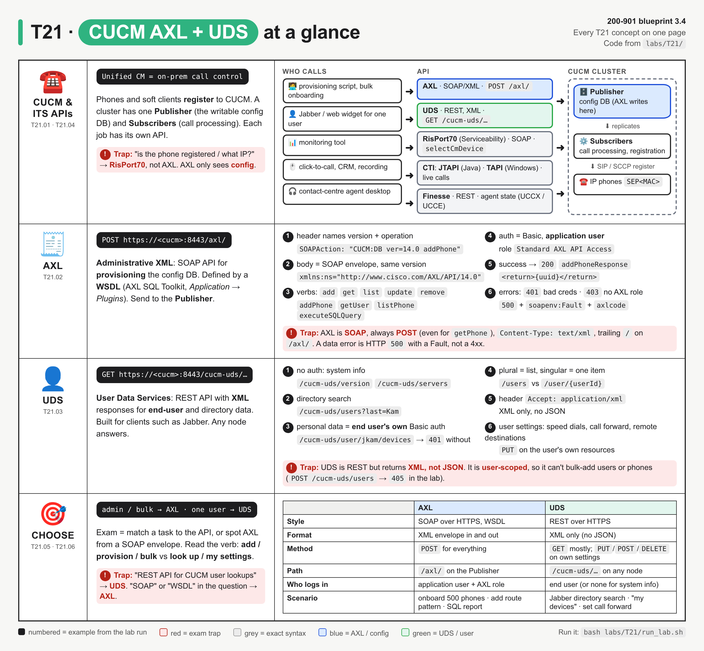
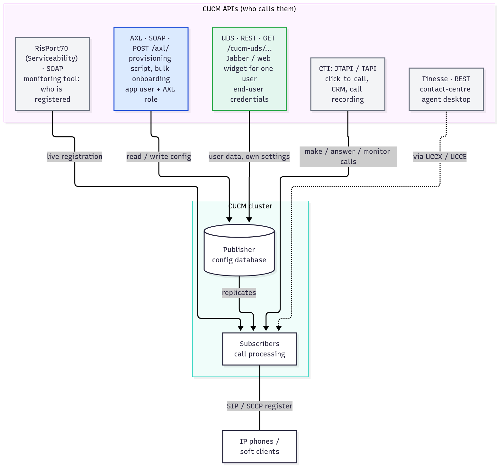
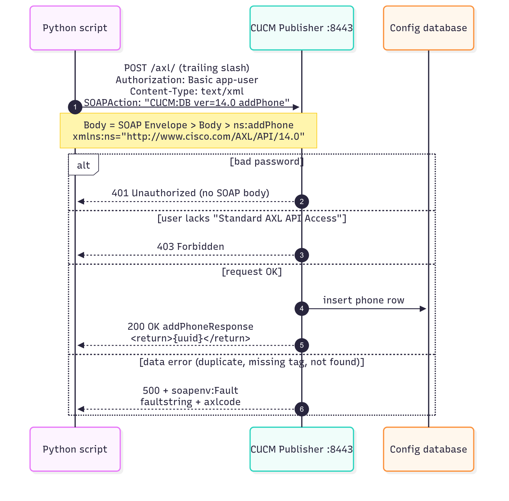
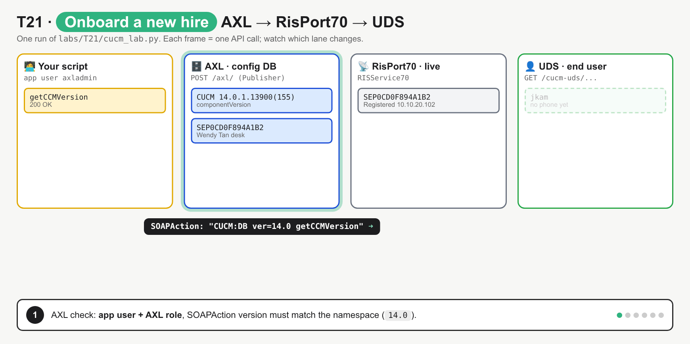

# T21 · Collaboration: CUCM AXL + UDS: essentials

> Blueprint 3.4 · Full note: [bob/T21-collaboration-cucm-axl-uds.md](../bob/T21-collaboration-cucm-axl-uds.md)

## In one picture

*The top row shows who calls which API and what it touches in the cluster; the middle rows give exact AXL and UDS syntax; the bottom row is the AXL vs UDS decision table.*

## The big idea

- CUCM is the on-prem phone system's brain, and it has several APIs, each with exactly one job.
- Think of a hotel: **AXL** is the back-office system where staff create rooms and guest records in bulk, **UDS** is the guest's own app showing "my room, my settings", and **RisPort70** is the front desk screen that shows who is actually checked in right now.
- The exam mostly asks you to match a task to the right API, and to recognise AXL as SOAP/XML on sight.

## What you need to know

### 1. CUCM in plain words

- **CUCM** (Cisco Unified Communications Manager, also Unified CM, older name CallManager) is the **on-prem call-control server** for an enterprise phone system.
- IP phones and Jabber soft clients **register** to it over SIP or SCCP, and it routes calls using the dial plan (directory numbers, route patterns, partitions, calling search spaces).
- Its cloud counterpart is Webex Calling, which is configured through Webex APIs instead.
- A CUCM cluster has different node roles, and that decides where each API call goes:

| Node | Job | API angle |
|---|---|---|
| **Publisher** (one per cluster) | Holds the only **writable** copy of the config database | Send **AXL** here |
| **Subscribers** | Process calls; phones register here | **RisPort70** reports their live state |
| Any node | Runs UDS on Tomcat port `8443` | **UDS** answers on any node |

- A phone's device name is `SEP` plus its MAC address, for example `SEP001122334455`.
- **Config is not live state:** the database says what *should* exist (phone, line 2001, owner jkam), while registration says what *is* happening (the phone booted and has an IP).

*AXL lands on the Publisher (the writable database), UDS, RisPort70 and CTI land on Subscribers, and only RisPort70 and CTI deal with live phones and calls.*

### 2. AXL: the admin and bulk-provisioning API (SOAP)

- **AXL** (Administrative XML Web Service) lets you create, read, update and delete objects in the CUCM config database: phones, lines, users, device pools, route patterns, partitions, CSSs and gateways.
- Cisco describes it as a provisioning and configuration API, **not a real-time API**, and it is what bulk onboarding, migrations and config reports use.
- **SOAP in one minute:** every request is an XML **Envelope** holding a **Body**, and the Body holds one element named after the operation, such as `<ns:addPhone>`.
- The contract is a **WSDL** file (Web Services Description Language), which lists every operation and its request and response schema.
- You get the WSDL from CUCM Administration under **Application → Plugins** by downloading the **AXL SQL Toolkit**, which contains `AXLAPI.wsdl` and its XSD files.
- The exact HTTP request shape is a favourite exam blank:

| Part | Value |
|---|---|
| Method | Always **`POST`**, even for reads like `getPhone` or `listPhone` |
| URL | `https://<cucm>:8443/axl/` on the **Publisher**, with the **trailing slash** |
| `Content-Type` | `text/xml` |
| `SOAPAction` | `"CUCM:DB ver=14.0 addPhone"`, including the double quotes |
| Namespace | `xmlns:ns="http://www.cisco.com/AXL/API/14.0"`, the **same version** as `SOAPAction` |
| Auth | HTTP Basic as an **application user** with the **Standard AXL API Access** role |
| TLS | CUCM's default Tomcat cert is self-signed, so labs use `verify=False` |

- Operations are named **verb + object**, and the reply element is the request name plus `Response` (`addPhone` gives `addPhoneResponse`):

| Verb | Examples | Returns |
|---|---|---|
| `add` | `addLine`, `addPhone` | The new object's UUID |
| `get` | `getPhone`, `getUser`, `getCCMVersion` | The full object |
| `list` | `listPhone` with `<searchCriteria><name>SEP%</name>` | Many objects, only the `returnedTags` you asked for (`%` is the wildcard) |
| `update` | `updateUser` (for example to associate a phone) | The UUID |
| `remove` | `removePhone` | The UUID |
| Others | `applyPhone`, `resetPhone`, `restartPhone`, `executeSQLQuery`, `executeSQLUpdate` | |

- **`executeSQLQuery`** sends raw SQL to the CUCM database (for example `select name, description from device where tkclass = 1`); it is powerful for reports but **not version-stable**, and `executeSQLUpdate` does writes.
- Users, roles and permissions are admin data, so a question about a CUCM API for **access permissions** points to **AXL**, the SOAP admin API (⚠ from Beedy's practice-exam review, gap G21: check the AXL vs UDS split makes this explicit).
- Older scripts keep working after an upgrade because CUCM accepts the current schema plus a few older ones (exact range per release ⚠ verify).

### 3. Reading AXL errors

- AXL errors split into two kinds: login problems come back as plain HTTP codes, and data problems come back as a SOAP Fault.

*One POST, four possible endings: auth problems are bare HTTP codes, data problems are a 500 with a SOAP Fault in the body.*

| What went wrong | HTTP | Body |
|---|---|---|
| Wrong password | `401 Unauthorized` | No SOAP |
| Valid user but no AXL role | `403 Forbidden` (⚠ verify on a real CUCM) | No SOAP |
| Data problem: duplicate, missing mandatory tag, not found, bad SQL | `500 Internal Server Error` | `soapenv:Fault` with `faultstring` and `axlcode` |
| Too many writes queued | `503 Service Unavailable` | Retry after a few seconds |
| Query result over 8 MB | Fault "Query request too large" | Split the query |

- Because faults arrive as `500`, you must read the `faultstring` instead of just checking whether the call was "ok".
- AXL throttles writes based on the database queue, so wait for each response before sending the next request.

### 4. UDS: the end-user API (REST, XML only)

- **UDS** (User Data Services) is a **REST** API that gives authenticated access to **one user's own data** (devices, speed dials, remote destinations, credentials) plus directory search, and it runs on every CUCM node.
- It is built for user-facing apps: Jabber uses it for directory search and service discovery, and a self-service portal uses it for "my phones" or call-forward-all.
- It is REST, but responses are **XML only** (no JSON), so you send `Accept: application/xml`.
- The base URL is `https://<cucm>:8443/cucm-uds/`:

| Resource | Auth needed | Returns |
|---|---|---|
| `GET /cucm-uds/version` | None | Version info |
| `GET /cucm-uds/servers` | None | The cluster nodes |
| `GET /cucm-uds/users?last=Kam` | None in the lab (configurable, see below) | Directory search results |
| `GET /cucm-uds/user/jkam/devices` | **The end user jkam's own** Basic auth | His phones |
| `POST /cucm-uds/users` | | `405` in the lab: you cannot create users through UDS |

- A **plural** resource (`users`, `devices`) returns a list, while a **singular** one (`user/{userId}`) drills into one item.
- System info needs no auth, but personal resources need the **end user's own** username and password (or an SSO token); in the lab even the AXL admin gets `401` on jkam's devices.
- Whether `/users` directory search needs auth is configurable and shown as `usersResourceAuthEnabled` in `/version` (⚠ verify).
- UDS is **read-mostly**: users can change their own settings with `PUT`/`POST`/`DELETE`, but there is no admin bulk provisioning (that is AXL).
- UDS status codes: `200` OK, `201` created, `204` deleted, `401` not authenticated, `404` not found, `405` method not allowed, `409` duplicate, `503` overloaded.

### 5. The other UC APIs (awareness only)

- Know which API answers which question:

| API | Style | Question it answers |
|---|---|---|
| **RisPort70** (Serviceability XML) | SOAP, `/realtimeservice2/services/RISService70` | "Is phone X **registered right now**, on which node, with which IP?" (`selectCmDevice`) |
| Other Serviceability XML | SOAP | PerfMon counters, start/stop services, log collection, CDR on demand |
| **CTI: JTAPI** | Java library | **Real-time call control**: make, answer, transfer, monitor calls |
| **CTI: TAPI** | Windows TAPI via Cisco TSP | The same, for Windows apps |
| **Finesse** | REST, XML | **Contact-centre agent** desktop: Ready/Not Ready, reason codes, queues (UCCX/UCCE) |

- In the lab, `addPhone` returned `200`, but RisPort70 still did not find the new phone until it booted; AXL cannot tell you registration status.
- RisPort70 is SOAP too and uses an application user, like AXL.

*Order: addLine and addPhone, updateUser, RisPort70 shows the phone missing, the phone boots and shows Registered, then UDS lists it with jkam's own credentials.*

### 6. Choosing AXL vs UDS

- The rule is simple: admin or bulk provisioning means **AXL**, and user-facing lookups or "my settings" means **UDS**.

| | AXL | UDS |
|---|---|---|
| Purpose | Provision and configure the whole system | One user's data and directory search |
| Style | SOAP over HTTPS, defined by a WSDL | REST over HTTPS |
| Format | XML envelope in and out | XML responses only |
| Method | `POST` for everything | Mostly `GET` |
| URL | `https://<cucm>:8443/axl/` on the Publisher | `https://<cucm>:8443/cucm-uds/...` on any node |
| Credentials | **Application user** with Standard AXL API Access | **End user's** own (none for system info) |
| Typical caller | Provisioning script, migration, reporting | Jabber, web widget, self-service portal |

- You can spot AXL from any one clue: `soapenv:Envelope`, the `http://www.cisco.com/AXL/API/...` namespace, a `SOAPAction: "CUCM:DB ver=..."` header, `POST .../axl/`, or names like `addPhone`.
- You can spot UDS from `/cucm-uds/` in the URL, a `GET`, and resources like `users` or `user/{id}/devices`.
- Scenario answers: 300 phones from a CSV is AXL; a phone report is AXL `listPhone` or `executeSQLQuery`; Jabber directory search is UDS; unregistered-phone dashboard is RisPort70; click-to-dial or call recording is JTAPI/TAPI; agent Ready/Not Ready is Finesse.

## Exam traps (the ones that catch people)

- AXL looks like it might be REST, but it is actually **SOAP**: every call is a `POST` to the same `/axl/` URL, and the operation lives in the body and the `SOAPAction` header.
- UDS looks like a modern REST API that would return JSON, but it actually returns **XML only**.
- It looks like an admin account should read anything, but UDS personal data needs the **end user's own** credentials, while AXL needs an **application user** with the AXL role.
- `401` and `403` on AXL look alike, but `401` means wrong password and `403` means a valid user missing **Standard AXL API Access**, so retyping the password will not help.
- A `500` looks like the server crashed, but on AXL it is usually a **SOAP Fault** for a data problem such as a duplicate name, so read the `faultstring`.
- The `SOAPAction` header looks like a free-form label, but its version must **match the namespace version** (`ver=14.0` with `/AXL/API/14.0`), and the value includes the quotes.
- A `200` from `addPhone` looks like the phone is online, but AXL only knows config; "is it registered and what IP?" is **RisPort70**.
- AXL looks like it could handle calls, but live calls are **CTI (JTAPI/TAPI)** and agent state is **Finesse**.

## Quick self-check

Q1. You must create 400 phones and lines from a spreadsheet. Which API?

AXL, because bulk changes to the CUCM config database are its job (`addLine`, `addPhone`).

Q2. Fill the blanks: requests.____("https://cucm-pub:8443/____", data=envelope, ...) for getPhone.

`post` and `axl/`; AXL is SOAP, so even a read is a POST of an XML envelope to `/axl/` with the trailing slash.

Q3. An AXL script gets 403 on every call and the password is right. What is the fix?

Give the application user the Standard AXL API Access role; the credentials are accepted (otherwise 401) but the account is not authorised.

Q4. After addPhone succeeds, how do you check if the phone is online and its IP?

RisPort70 `selectCmDevice`, because AXL only reads configuration and not live registration.

Q5. An employee portal shows each user their own phones using their own login. Which API and URL prefix?

UDS at `/cucm-uds/`, for example `/cucm-uds/user/{userId}/devices` with the end user's credentials.

## Cheat lines to say out loud

- "AXL is the admin's SOAP: POST everything to slash-axl-slash on the Publisher."
- "UDS is the user's REST, but it still speaks XML."
- "SOAPAction version equals namespace version, quotes included."
- "401 wrong password, 403 missing AXL role, 500 read the fault."
- "Config is not registration: AXL says it exists, RisPort says it's alive."
