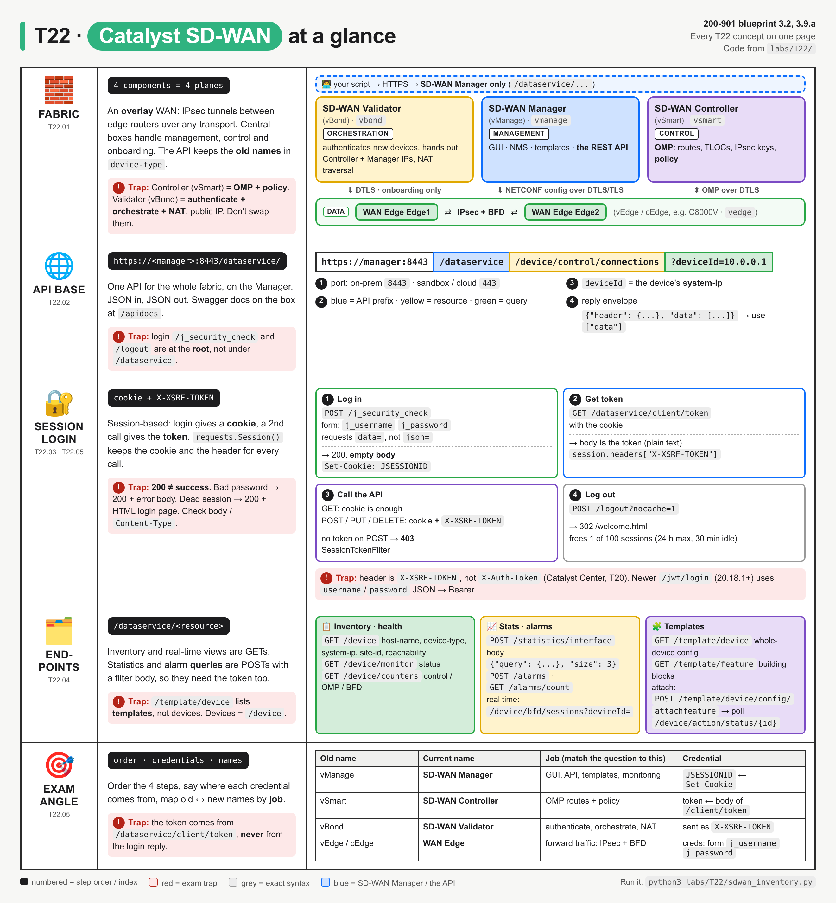
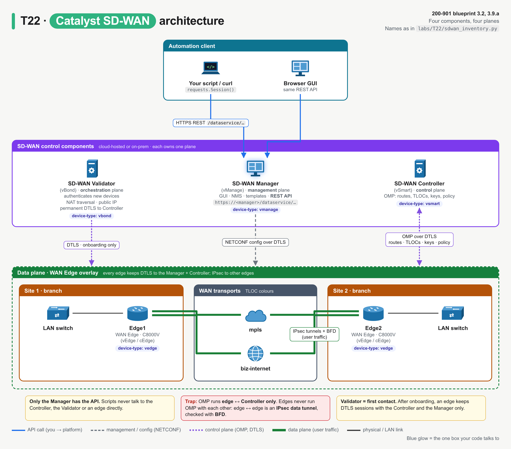
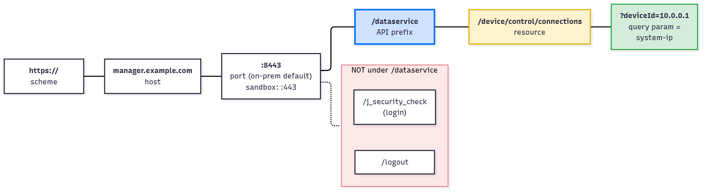
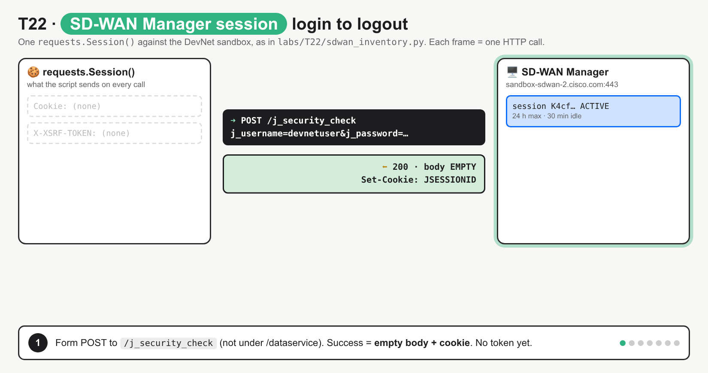
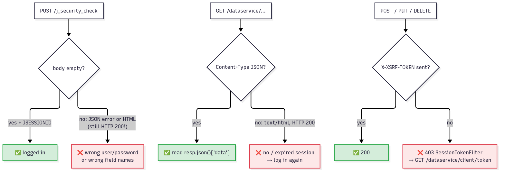

# T22 · Catalyst SD-WAN: essentials

> Blueprint 3.2, 3.9.a · Full note: [bob/T22-catalyst-sd-wan.md](../bob/T22-catalyst-sd-wan.md)

## In one picture



*The top panel is the fabric (four components, old names in brackets, one plane each), the middle panels are the API (base URL, numbered login steps, endpoints), and the red boxes are exam traps.*

## The big idea

- Catalyst SD-WAN builds the WAN as an **overlay** of IPsec tunnels across any transport, with central components deciding routing and policy so you do not configure each branch router by hand.
- Only one component, **SD-WAN Manager (vManage)**, has the REST API, so your script always talks to it and never to the routers directly.
- Login works like a club: you sign in at the door and get a wristband (the **`JSESSIONID` cookie**), then you collect a separate stamp (the **XSRF token**) that you must show whenever you want to change anything.
- The exam loves the login order, the cookie plus XSRF token, the old-to-new component names, and the fact that **HTTP 200 does not always mean success** here.

## What you need to know

### 1. The four components and their planes

- Cisco's product is **Catalyst SD-WAN** (formerly Viptela / Cisco SD-WAN), and each of its four components owns one plane:

| Current name | Old name | Plane | What it does in plain words |
|---|---|---|---|
| **SD-WAN Manager** | vManage | **Management** | The GUI, NMS, templates, monitoring, and **the only REST API** |
| **SD-WAN Controller** | vSmart | **Control** | Runs **OMP** (Overlay Management Protocol) with every edge to hand out routes, TLOCs, IPsec keys and **policy** |
| **SD-WAN Validator** | vBond | **Orchestration** | The **first contact** for a new device: **authenticates** it, tells it where the Controllers and Manager are, helps with NAT traversal; needs a public IP |
| **WAN Edge** | vEdge / cEdge | **Data** | The branch or DC routers (for example C8000V) that forward user traffic over IPsec tunnels and check them with **BFD** |



*Your script talks only to the Manager; the Manager configures edges with NETCONF, the Controller runs OMP with them, and the Validator is only involved at onboarding.*

- The rename to Manager / Controller / Validator came with release 20.12.
- The API still uses the **old names**: the `device-type` field says `vmanage`, `vsmart`, `vbond` or `vedge`, and IOS XE routers (called cEdge in older docs) still show up as `vedge`.
- A new edge first contacts the Validator, which authenticates it and gives it the Controller and Manager addresses; after that it keeps DTLS control sessions only with the Controller and Manager (the transient Validator link is from sandbox observation ⚠ verify).
- **OMP** runs only between edges and the Controller; edges never run OMP with each other, and edge-to-edge links are IPsec data tunnels monitored by BFD.

### 2. The API base URL

- There is **one API endpoint for the whole fabric**, SD-WAN Manager, which collects data from the other components and exposes it over REST.
- The base URL is:

```
https://<manager>:8443/dataservice/
```

- `8443` is the usual on-prem HTTPS port, while the DevNet sandbox and cloud-hosted Managers answer on `443` (⚠ verify).
- Payloads are JSON, and most GETs return `{"header": {...}, "data": [...]}`, where `header` describes columns for the GUI and your actual data is under **`data`**.
- **Login and logout are not under `/dataservice`**: they sit at the root as `/j_security_check` and `/logout`.



*`/dataservice` is the prefix for every resource, but the login and logout URLs sit at the root.*

- Forgetting `/dataservice` on a resource call gives a `404`, for example on `/client/token`.
- Interactive Swagger docs live on the Manager at `https://<manager>/apidocs` (⚠ verify the path per version).

### 3. Logging in: cookie first, then the XSRF token

- Classic SD-WAN Manager auth is **session-based** (a cookie), not a bearer token like Catalyst Center or Meraki.



*Login gives a cookie only, you GET the token, GETs work, a POST without the token gets 403, with it gets 200, and after logout a GET returns an HTML login page with 200.*

- **Step 1, log in:** POST a **form** (not JSON) to `/j_security_check` with the exact field names **`j_username`** and **`j_password`**.

```python
session = requests.Session()
session.post(f"{BASE}/j_security_check", data={"j_username": USER, "j_password": PASSWORD})
```

- `data=` sends `application/x-www-form-urlencoded`, which is what the endpoint expects, while `json=` fails.
- Success is `200` with an **empty body** and a `Set-Cookie: JSESSIONID=...` header.
- A failed login is **also `200`**, but with a body (a JSON "Login Error" on the 20.18 sandbox, an HTML login page in older releases per the docs), so you must check that the body is empty.
- **Step 2, get the token:** `GET /dataservice/client/token` with the cookie, and the **plain-text body is the token** (read `resp.text`, not `.json()`).
- **Step 3, make calls:** send the cookie plus the **`X-XSRF-TOKEN`** header; GETs need only the cookie, but **POST/PUT/DELETE need both**, and Cisco recommends sending the token on every request.
- A POST without the token gives `403` with "SessionTokenFilter: Token provided via HTTP Header does not match the token generated by the server".
- XSRF protection was added in release 19.2; before that the cookie alone was enough.
- **Step 4, log out:** `POST /logout` (optionally `?nocache=<random>`) returns `302` to `/welcome.html` and kills the session on the server.
- Logging out matters because the Manager allows **100 concurrent sessions** and then evicts the least-recently-used one; sessions last 24 hours at most with a 30-minute idle timeout.
- **`requests.Session()`** keeps the `JSESSIONID` cookie and any headers you set (`session.headers["X-XSRF-TOKEN"] = token`) on every call, whereas plain `requests.get()` forgets the cookie.
- curl does the same with a cookie jar: `-c jar` saves the cookie on login and `-b jar` sends it back.
- A newer option, `POST /jwt/login` with a JSON username and password returning a JWT for `Authorization: Bearer`, exists from 20.18.1 (⚠ verify), but the exam uses the classic session flow.

| Item | Comes from | Sent as | Needed on |
|---|---|---|---|
| Username / password | You | Form fields `j_username`, `j_password` | Login only |
| `JSESSIONID` | `Set-Cookie` on the login reply | `Cookie:` header (the Session does it) | Every call |
| XSRF token | Body of `GET /dataservice/client/token` | `X-XSRF-TOKEN:` header | POST / PUT / DELETE (recommended on all) |

### 4. When 200 does not mean success



*Two of the three failure cases still return HTTP 200, so you must check the body and Content-Type.*

| Symptom | Cause | Fix |
|---|---|---|
| Login returns `200` with an error body | Wrong credentials or wrong field names | Fix the credentials or use `j_username`/`j_password` |
| GET returns `200` but `Content-Type: text/html` | Session missing or expired, so you got the login page | Log in again |
| POST returns `403 SessionTokenFilter` | Missing or stale `X-XSRF-TOKEN` | Fetch `/dataservice/client/token` |
| `GET /client/token` returns `404` | Missing `/dataservice` prefix | Add `/dataservice` |

### 5. The common endpoints

- Everything hangs off `/dataservice`:

| Endpoint | Method | What it gives you |
|---|---|---|
| `/dataservice/device` | GET | **Inventory** of every Manager, Controller, Validator and edge: `host-name`, `device-type`, `system-ip`, `site-id`, `reachability`, `version`, `uuid` |
| `/dataservice/device/monitor` | GET | Status per device (for example `normal`) |
| `/dataservice/device/counters` | GET | Control connections up vs expected, OMP peers, BFD sessions |
| `/dataservice/device/control/connections?deviceId=` | GET | **Real-time** DTLS control connections of one device |
| `/dataservice/device/omp/peers?deviceId=`, `/device/bfd/sessions?deviceId=` | GET | Real-time OMP peers and BFD sessions |
| `/dataservice/statistics/interface` | **POST** with a query body | Interface stats from the Manager's stored history |
| `/dataservice/alarms` | **POST** with a query body (also GET) | Alarms matching a filter |
| `/dataservice/alarms/count` | GET | `{"count": ..., "cleared_count": ...}` |
| `/dataservice/template/device` | GET | **Device templates** |
| `/dataservice/template/feature` | GET | **Feature templates** |

- **`deviceId` is the device's system IP** (for example `10.0.0.1`), while `uuid` is the chassis or serial-style ID used for template attachment.
- **Real-time** `/device/...` calls ask one device right now through the Manager, while **`/statistics/...`** reads history the Manager already collected, filtered with a JSON query body.
- A statistics or alarms query POST changes nothing, but it is still a POST, so it **still needs the XSRF token**.
- A **device template** is the full config for a device type, built from **feature templates** (building blocks such as VPN, interface, OMP, system).
- Attaching a template is a POST to `/dataservice/template/device/config/attachfeature` (or `/attachcli`), which returns an action `id` you poll at `/dataservice/device/action/status/{id}`, so it is **asynchronous**.
- Newer releases add configuration groups (UX 2.0, `/v1/config-group`), but the blueprint names templates (⚠ verify which the exam expects).

## Exam traps (the ones that catch people)

- It looks like the login reply should hold the token, but it only gives the **cookie**; the XSRF token comes from a second call, `GET /dataservice/client/token`.
- It looks like a JSON login, but it is a **form** POST with exact field names `j_username` and `j_password` (`username`/`password` belong to the newer `/jwt/login`).
- Login looks like it should be under `/dataservice`, but **`/j_security_check` and `/logout` sit at the root**.
- A `200` looks like success, but a bad password gives 200 with an error body and a dead session gives 200 with an HTML login page, so check the body and `Content-Type`.
- A `403` on a POST while GETs work looks like a login problem, but it is a **missing `X-XSRF-TOKEN`**, fixed by fetching the token, not by logging in again.
- The header looks like Catalyst Center's, but it is **`X-XSRF-TOKEN`**, not `X-Auth-Token` and not `Authorization: Bearer`.
- It looks like you could call an edge or the Controller for stats, but **only SD-WAN Manager has the API**.
- The Controller and Validator look similar, but the **Controller (vSmart) runs OMP and policy** while the **Validator (vBond) authenticates and orchestrates** new devices.

## Quick self-check

<details><summary>Q1. Put these in order: GET /dataservice/client/token, POST /logout, POST /j_security_check, GET /dataservice/device with X-XSRF-TOKEN.</summary>

`POST /j_security_check`, then `GET /dataservice/client/token`, then `GET /dataservice/device` with the token, then `POST /logout`; the token call needs the cookie from login.
</details>

<details><summary>Q2. Which component authenticates a new WAN Edge and tells it where the controllers are?</summary>

SD-WAN Validator (vBond), because orchestration and first-contact authentication is its job.
</details>

<details><summary>Q3. GETs work but POST /dataservice/alarms returns 403 SessionTokenFilter. What is missing?</summary>

The `X-XSRF-TOKEN` header from `/dataservice/client/token`; the working GETs prove the cookie is fine.
</details>

<details><summary>Q4. A GET to /dataservice/device returns 200 but Content-Type is text/html and .json() fails. Why?</summary>

The session cookie is missing or expired, so the Manager sent its HTML login page with a 200 instead of a 401.
</details>

<details><summary>Q5. Which protocol does the SD-WAN Controller use to send routes and policy to edges?</summary>

OMP (Overlay Management Protocol); BFD checks the IPsec data tunnels and NETCONF is how the Manager pushes config.
</details>

## Cheat lines to say out loud

- "Manager manages and has the API, Controller controls with OMP, Validator validates newcomers, Edge carries the traffic."
- "j_security_check for the cookie, client/token for the stamp, X-XSRF-TOKEN on every change."
- "Login and logout live at the root; everything else lives in dataservice."
- "On SD-WAN, 200 can still be a failure: read the body."
- "GET needs the cookie, POST needs cookie plus token."
