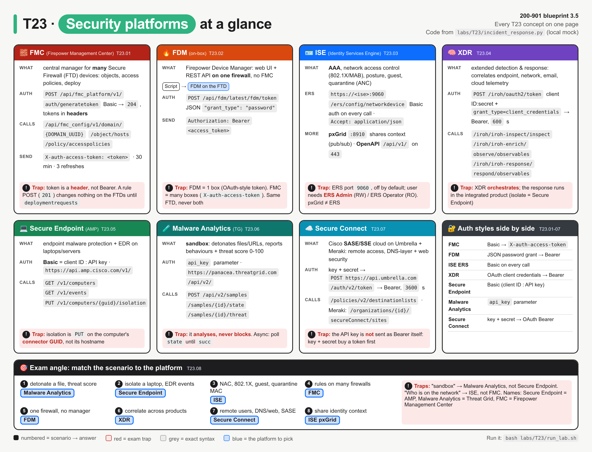
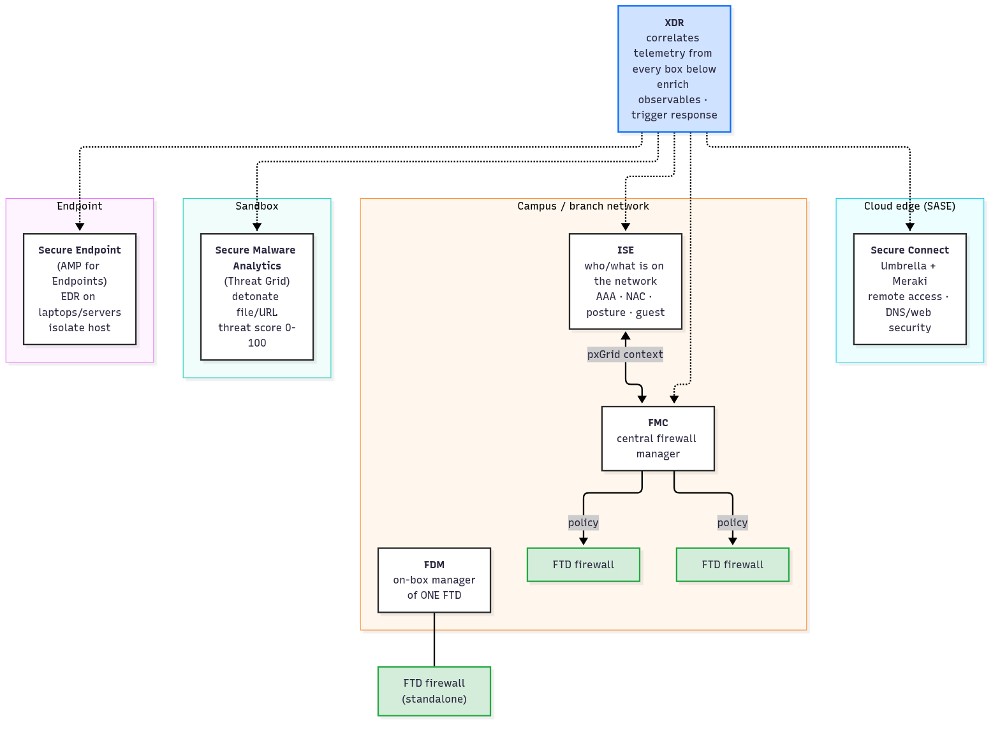
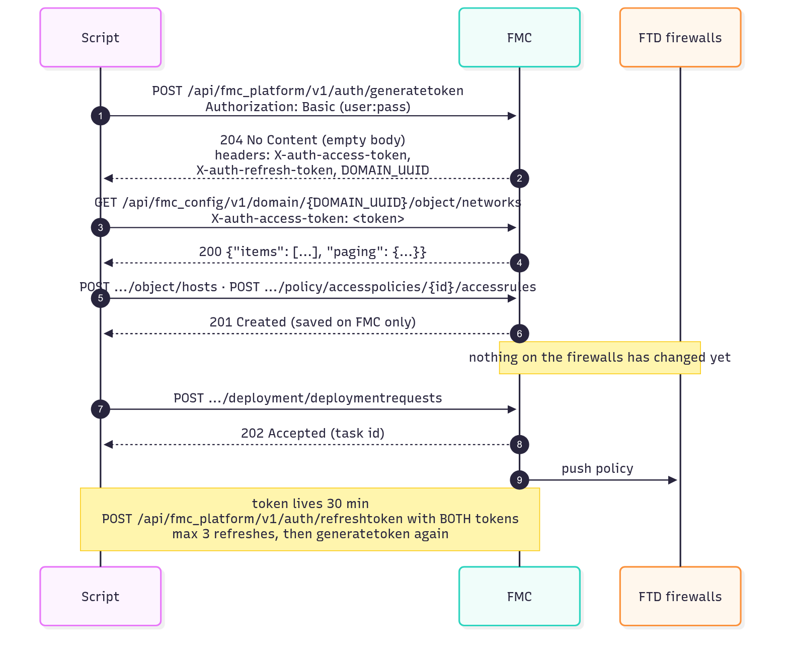
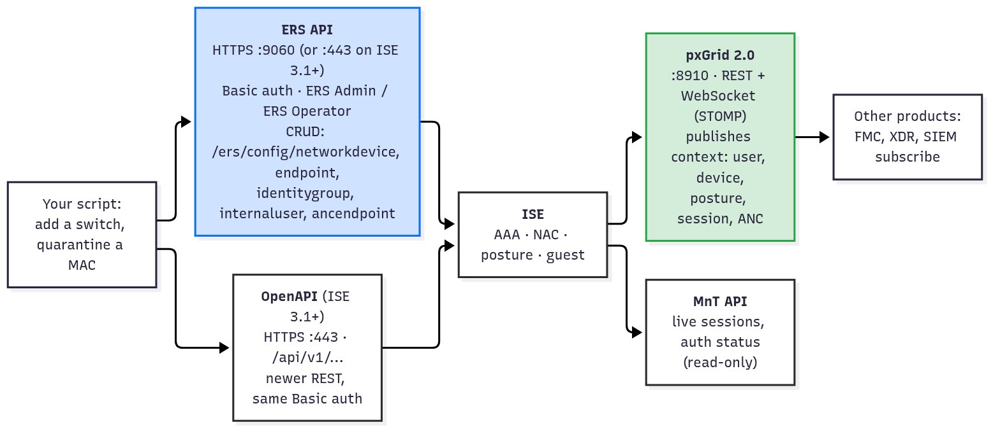
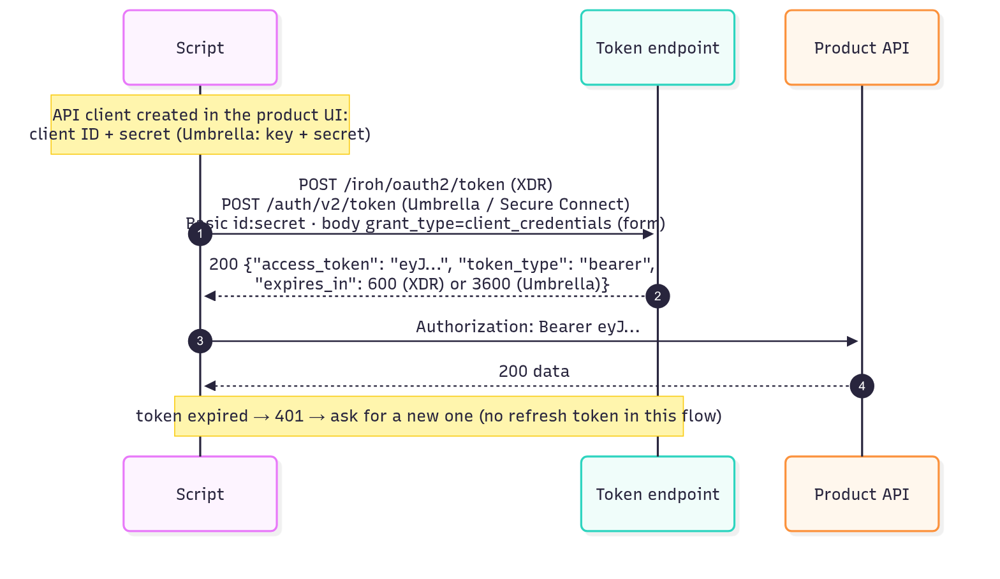
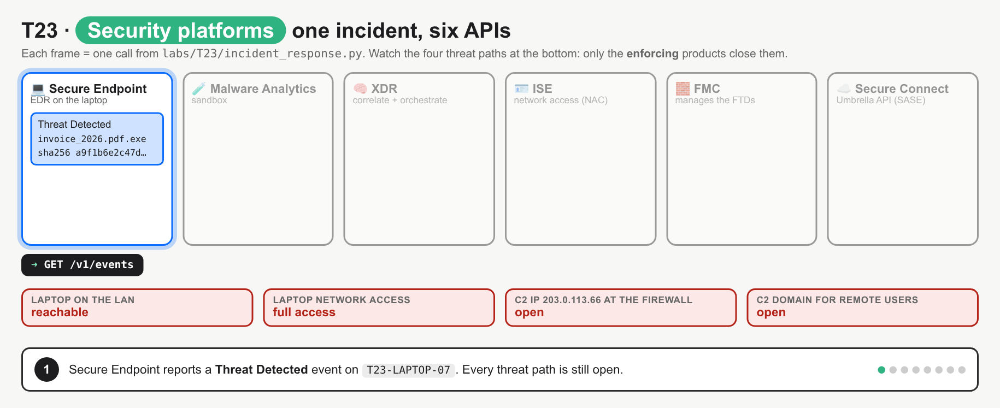
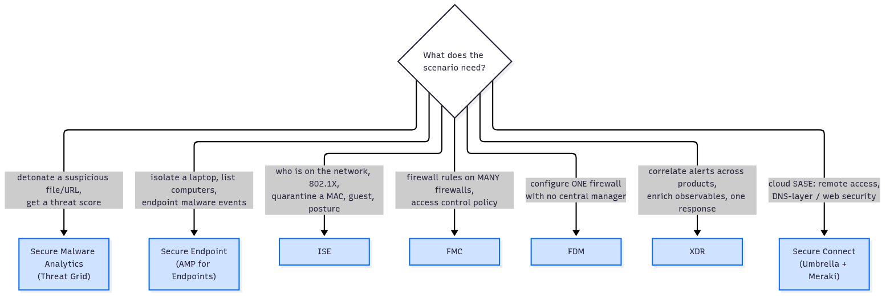

# T23 · Security platforms: essentials

> Blueprint 3.5 · Full note: [bob/T23-security-platforms.md](../bob/T23-security-platforms.md) · Teach-back 2026-10-25

## In one picture

*Read one card per product (what it does, how it authenticates, its key calls, its trap), then use the bottom strip to map an exam scenario to the right product.*

## The big idea

- Cisco sells a family of security products, and each one has one job: some products **watch and analyse**, and others **enforce** (actually block something).
- Think of it like a hospital: the lab (Malware Analytics) runs the tests, the senior doctor (XDR) pulls all the results together and decides, but only the nurses and security guards (Secure Endpoint, ISE, the firewalls, Umbrella) physically do something to the patient.
- The exam asks two kinds of questions: "which product fits this scenario?" and "where does the token or password go in this API call?".
- Every product authenticates slightly differently, so most of the marks come from remembering the auth style of each one.

## What you need to know

### 1. Which product does which job

- Each product does one main job, and the exam usually gives you a keyword from that job and asks you to pick the product.

| Product (old name) | What it does, in one plain sentence | Enforces or analyses? |
|---|---|---|
| **Secure Firewall Management Center** (FMC, Firepower Management Center) | It is the central manager that builds firewall policy once and pushes it to many firewalls. | Manages; the firewalls enforce |
| **FDM** (Firepower Device Manager) | It is a small manager built into one firewall, for a site with no FMC. | Manages one firewall |
| **ISE** (Identity Services Engine) | It decides who and what is allowed on the network (the RADIUS/TACACS+ server behind 802.1X and MAB). | Enforces at the switch/WLC |
| **Secure Endpoint** (AMP for Endpoints) | It is an agent on laptops and servers that stops malware and can isolate the machine. | Enforces on the host |
| **Secure Malware Analytics** (Threat Grid) | It is a sandbox that runs a suspicious file in a safe VM and gives it a threat score from 0 to 100. | Analyses only |
| **XDR** (was SecureX / Threat Response) | It pulls alerts from all the other products into one incident and lets you trigger a response from one place. | Correlates and orchestrates only |
| **Secure Connect** (built on Umbrella + Meraki) | It is Cisco's cloud security service (**SASE**) for remote users, with DNS-layer and web security. | Enforces in the cloud |

- The most important idea is that **the analysers never block anything**: Malware Analytics only scores files and XDR only correlates and calls other products.
- The actual block always happens in an enforcing product: Secure Endpoint isolates the laptop, ISE quarantines the MAC, FMC pushes a block rule to the firewalls, and Umbrella/Secure Connect blocks the domain.

*XDR sits on top and reads from everything; the grey dashed arrows at the bottom are the products that actually enforce.*

### 2. FMC and FDM: managing firewalls

- FMC is the **central manager** for Secure Firewall Threat Defense (**FTD**) devices; you build objects, access policies, NAT and VPN on FMC, and it deploys them to every firewall it manages.
- Like APIC in ACI, FMC is not in the traffic path; it stores the policy and pushes it out.
- **Getting a token on FMC** is unusual, and the exam loves it:
  - You send `POST /api/fmc_platform/v1/auth/generatetoken` with **Basic auth** (username and password) and no body.
  - The reply is **`204 No Content`**, which means the body is empty, so the token is in the **response headers**, not the body.
  - The headers you get back are `X-auth-access-token` (use on every call), `X-auth-refresh-token` (only for refreshing) and `DOMAIN_UUID` (goes into every config URL).
  - On every later call you send the token in a header called **`X-auth-access-token`**, not `Authorization: Bearer`.
- The token lasts **30 minutes**, and you can refresh it **3 times** with `POST /api/fmc_platform/v1/auth/refreshtoken` (sending both tokens); after that you must call `generatetoken` again. ⚠ verify (lifetime and refresh count depend on FMC version)
- FMC splits its API into two path families, and only the config family has the domain in the path:

| Path prefix | What lives there |
|---|---|
| `/api/fmc_platform/v1/` | Platform services such as login and token refresh (no domain in the path). |
| `/api/fmc_config/v1/domain/{DOMAIN_UUID}/` | Configuration such as `/object/hosts`, `/object/networks`, `/policy/accesspolicies`, `/deployment/deploymentrequests`. |

- **Saved is not the same as deployed**: creating a rule returns `201`, but the firewalls keep passing traffic until you send `POST .../deployment/deploymentrequests`, which returns `202` and starts a deploy task.
- FMC lists are paged with `offset` and `limit`, and adding `expanded=true` gives full objects instead of just names and IDs.
- FMC allows about 120 requests per minute and 10 connections per source IP, and going over gives `429`. ⚠ verify
- **FDM** is the on-box manager for **one** FTD with no FMC; a firewall is managed by FDM or by FMC, never both.
  - You log in with `POST /api/fdm/latest/fdm/token` and a **JSON** body containing `"grant_type": "password"`, username and password.
  - The token comes back in the JSON body, and you send it as a normal `Authorization: Bearer <token>`.
  - Like FMC, an FDM change is staged until you deploy it.

*The tokens arrive in headers on a 204; changes return 201 but stay on FMC until the deploy request pushes them out.*

| | FMC | FDM |
|---|---|---|
| Manages | Many firewalls | The one firewall it runs on |
| Token call | `generatetoken` with Basic auth | `/fdm/token` with a JSON password grant |
| Token arrives in | Response **headers** (204, empty body) | JSON **body** |
| Send it as | `X-auth-access-token: <token>` | `Authorization: Bearer <token>` |

### 3. ISE: who is on the network

- ISE answers "who and what is on the network, and what may it reach?", which Bob already knows as the RADIUS/TACACS+ server behind 802.1X and MAB.
- Its jobs are **AAA** (RADIUS for network access, TACACS+ for device admin), **NAC** (802.1X/MAB, result is a VLAN, dACL or SGT), **posture** (is the laptop patched?), **guest** portals, and **ANC** (Adaptive Network Control, which quarantines an endpoint on demand).
- ISE has several APIs, and the exam mostly names **ERS** (External RESTful Services):
  - ERS is the classic create/read/update/delete config API at `https://<ise>:9060/ers/config/<resource>`. ⚠ verify (9060 is the classic port; ISE 3.1+ also serves ERS on 443)
  - ERS uses **Basic auth on every call**, so there is no token step at all.
  - The API user must be in the **ERS Admin** group (read/write) or **ERS Operator** group (read-only).
  - ERS is **off by default** and has to be enabled in the ISE settings first.
  - You must send `Accept: application/json`, otherwise ERS answers in XML and your JSON parsing fails.
  - Resources include `networkdevice` (switches, WLCs), `endpoint` (MACs), `identitygroup`, `internaluser` and `ancendpoint`.
  - Quarantining a MAC is `PUT /ers/config/ancendpoint/apply` with the MAC and the policy name, which returns `204`. ⚠ verify
- **pxGrid** (Platform Exchange Grid) is different: it is not for changing config, it is for **sharing live context** (user, device, posture, SGT) with other products that subscribe to it, for example so FMC can write rules by user instead of IP.
  - pxGrid 2.0 uses REST plus WebSocket on port **8910**.
- **OpenAPI** is the newer ISE REST API at `/api/v1/...` on port 443 (ISE 3.1+), with the same Basic auth.

*Blue ERS is the CRUD API the exam names; green pxGrid pushes context out to other products.*

### 4. XDR and Secure Connect: the OAuth pair

- **XDR** (eXtended Detection and Response) pulls telemetry from endpoint, network, email and cloud products, joins it into one incident, and lets you respond from one place.
- Both XDR and Secure Connect use **OAuth 2.0 client credentials**, which works like swapping a long-term ID card for a short-term visitor badge:
  1. You create an API client in the product and get a **client ID and secret**.
  2. You POST them as Basic auth to the token URL with a **form** body `grant_type=client_credentials` (not JSON, or you get `400`).
  3. You get back a short-lived token and send it as `Authorization: Bearer <token>`.
  4. There is no refresh token, so you just ask for a new one when it expires.
- The XDR token URL is `/iroh/oauth2/token` and the token lasts **600 seconds** (10 minutes). ⚠ verify
- XDR works with **observables** (indicators like a SHA-256 hash, IP, domain or URL):
  - `POST /iroh/iroh-inspect/inspect` finds observables in free text.
  - `POST /iroh/iroh-enrich/observe/observables` asks every integrated product what it knows about them.
  - `POST /iroh/iroh-response/respond/observables` lists the response actions, and when you trigger one it runs **in the integrated product**, not in XDR.
- **Secure Connect** is Cisco's turnkey **SASE** (cloud networking plus security) built on Umbrella and the Meraki dashboard: remote access for users, site tunnels, and **DNS-layer security** that blocks a bad domain before the connection even starts.
  - Its API uses an Umbrella key and secret: `POST https://api.umbrella.com/auth/v2/token` gives a Bearer token that lasts **3600 seconds** (1 hour).
  - Example call: `POST /policies/v2/destinationlists/{id}/destinations` adds a domain to a block list.
  - The API surface is still moving (the Meraki Secure Connect endpoints are BETA, and Cisco Secure Access uses the same model). ⚠ verify

*Same flow on both: the ID and secret only touch the token call, and only the short-lived Bearer token goes to the API.*

### 5. Secure Endpoint and Malware Analytics: the host and the sandbox

- **Secure Endpoint** (AMP for Endpoints) is an agent, called a **connector**, on Windows, macOS, Linux and mobile that prevents malware and records activity (**EDR**).
  - The v1 API is at `https://api.amp.cisco.com/v1/` and uses **Basic auth where the client ID is the username and the API key is the password**.
  - `GET /v1/computers?hostname=...` finds the machine and its `connector_guid`, and `GET /v1/events` shows detections like "Threat Detected".
  - `PUT /v1/computers/{connector_guid}/isolation` isolates the machine (by GUID, not hostname), and `DELETE` on the same URL stops isolation.
  - The newer v3 API uses an OAuth Bearer token instead.
- **Secure Malware Analytics** (Threat Grid) is a **sandbox** that runs ("detonates") a file or URL in a watched VM and reports what it did.
  - The output is **behavioural indicators**, observables, and a **threat score from 0 to 100**.
  - It authenticates with an **`api_key`** sent as a parameter or form field, at `https://panacea.threatgrid.com/api/v2/`.
  - Analysis is **asynchronous**: you submit with `POST /api/v2/samples`, poll `GET /api/v2/samples/{id}/state` until it says `succ`, then read `GET /api/v2/samples/{id}/threat`. ⚠ verify (response field names)
  - A score of 95 blocks nothing on its own; another product has to act on it.

*Watch the incident flow: detect, score, enrich, then four separate enforcing products do the blocking.*

### 6. Exam angle: scenario to product, and where the token goes

*Find the keyword in the question, then follow it to the product.*

| Keyword in the question | Pick this | Auth to remember |
|---|---|---|
| detonate, sandbox, threat score, behavioural indicators | Secure Malware Analytics | `api_key` parameter |
| isolate a host, endpoint malware, connector, EDR | Secure Endpoint | Basic, client ID : API key |
| 802.1X, MAB, NAC, guest, posture, quarantine a MAC | ISE (ERS) | Basic on every call, port 9060 |
| share user/device context with other products | ISE pxGrid | REST + WebSocket, port 8910 |
| access policy on many firewalls, deploy | FMC | `X-auth-access-token` header |
| one firewall, no central manager | FDM | password grant, then Bearer |
| correlate across endpoint, network, email, cloud | XDR | OAuth client credentials, then Bearer |
| remote workers, SASE, DNS-layer security | Secure Connect (Umbrella + Meraki) | key + secret, then Bearer |

- Old names still appear in questions, so map them: AMP is Secure Endpoint, Threat Grid is Secure Malware Analytics, Firepower Management Center is FMC, and SecureX is XDR.
- Code questions usually test where the credential goes: FMC reads the token from a response header and sends `X-auth-access-token`; anything OAuth sends `Authorization: Bearer`; ISE ERS and Secure Endpoint send `auth=(user, key)` on every call.

## Exam traps (the ones that catch people)

- It looks like the FMC token should be in the JSON body, but it is actually in the **response headers** because `generatetoken` returns `204` with an empty body, so `resp.json()` crashes.
- It looks like FMC should take `Authorization: Bearer`, but it actually wants **`X-auth-access-token`**, and `X-Auth-Token` is the Catalyst Center header, not FMC.
- It looks like an FMC rule is live after the `201`, but it actually does nothing on the firewalls until you send the **deployment request** (`202`).
- It looks like ISE ERS needs a token step, but it actually uses **Basic auth on every call**, on port 9060, with the user in ERS Admin or ERS Operator, and it is off until you enable it.
- It looks like ERS and pxGrid are two names for the same API, but ERS is **config CRUD** while pxGrid is **publish/subscribe context sharing** on port 8910.
- It looks like Malware Analytics or XDR blocked the threat, but they actually only **analyse or orchestrate**; the block runs in Secure Endpoint, ISE, FMC or Umbrella.
- It looks like an OAuth token request should be JSON, but it is actually a **form body** (`grant_type=client_credentials`), and sending JSON returns `400`.
- It looks like "sandbox" means Secure Endpoint because both deal with malware, but sandbox always means **Secure Malware Analytics**.

## Quick self-check

Q1. A script calls FMC generatetoken and gets 204. Where is the token, and which header carries it on the next call?
The token is in the response headers (`resp.headers["X-auth-access-token"]`), and you send it back in the `X-auth-access-token` request header. A 204 has no body, so there is nothing to parse.

Q2. An analyst wants to run an unknown attachment in an isolated VM and get a threat score. Which product?
Secure Malware Analytics (Threat Grid), because detonating a file and scoring it is the sandbox's job.

Q3. Which two statements about ISE ERS are true: (A) it uses port 9060, (B) you call a token endpoint first, (C) the user must be in ERS Admin or ERS Operator, (D) it pushes events over WebSocket?
A and C. ERS uses Basic auth on every call with no token, and pushing events over WebSocket is pxGrid.

Q4. A branch FTD is not registered to any FMC. Which API and token style manages it?
FDM (the FTD REST API): POST a JSON password grant to `/api/fdm/latest/fdm/token`, then send `Authorization: Bearer`. FDM is the on-box manager for one firewall.

Q5. A script sends `json={"grant_type": "client_credentials"}` to the XDR token URL and gets 400. Why?
The OAuth token endpoint expects a form-encoded body, so it should use `data=` instead of `json=`.

## Cheat lines to say out loud

- "Analysers analyse, enforcers enforce: Malware Analytics scores, XDR orchestrates, and the block happens somewhere else."
- "FMC: Basic in, 204 back, token in the headers, send X-auth-access-token, and nothing is live until you deploy."
- "ISE ERS: 9060, Basic every time, ERS Admin, Accept JSON; pxGrid shares, ERS configures."
- "OAuth pair: XDR 600 seconds, Umbrella 3600 seconds, form body in, Bearer out."
- "Secure Endpoint: client ID as username, API key as password, isolate by connector GUID."
