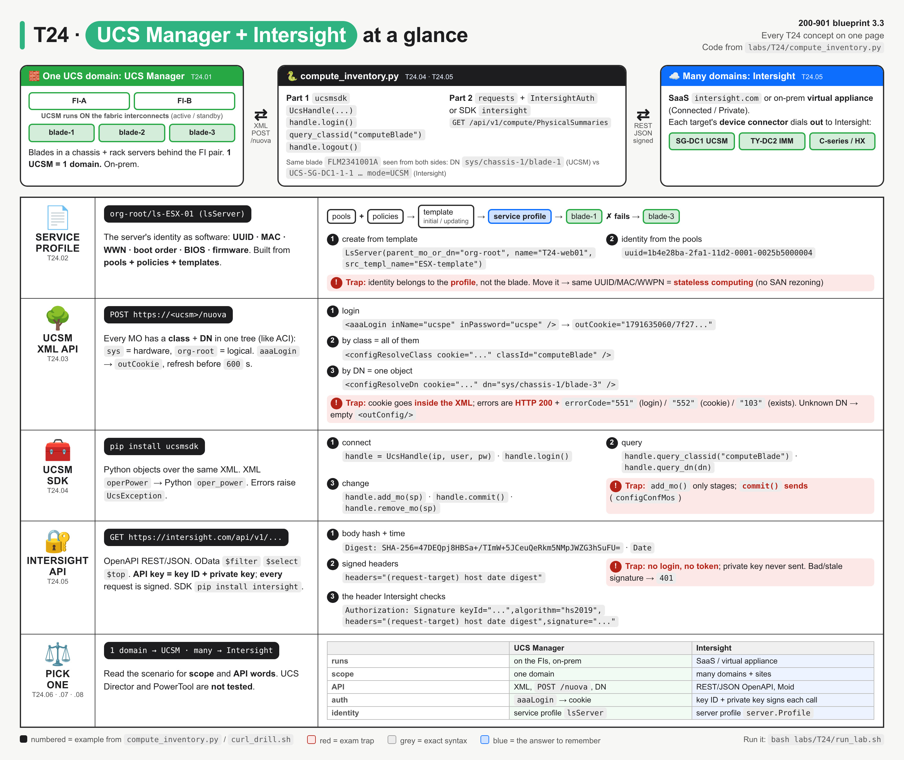
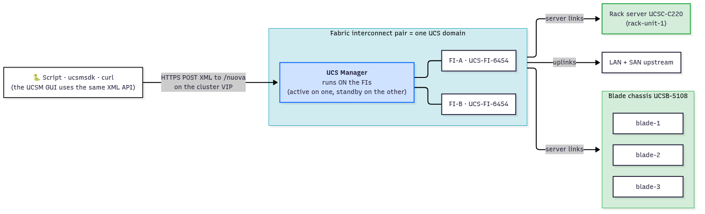
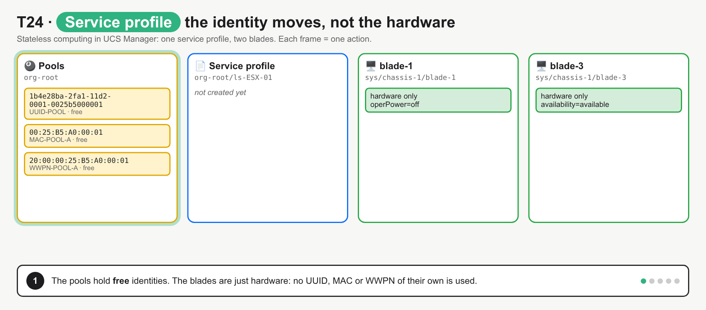
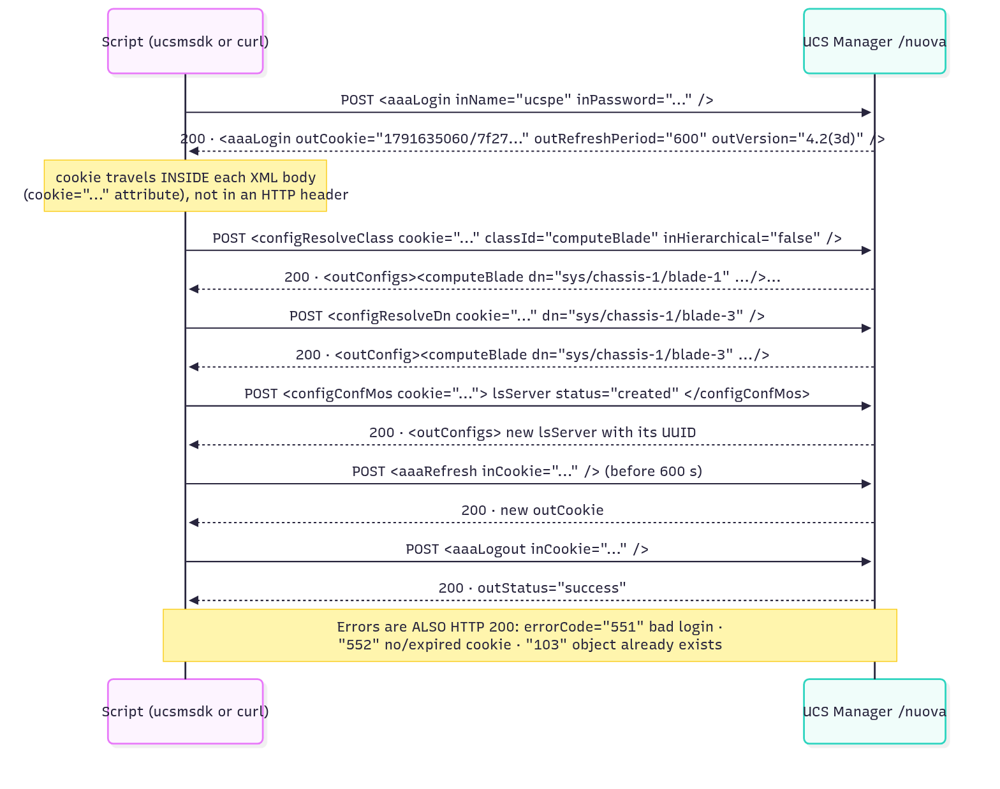
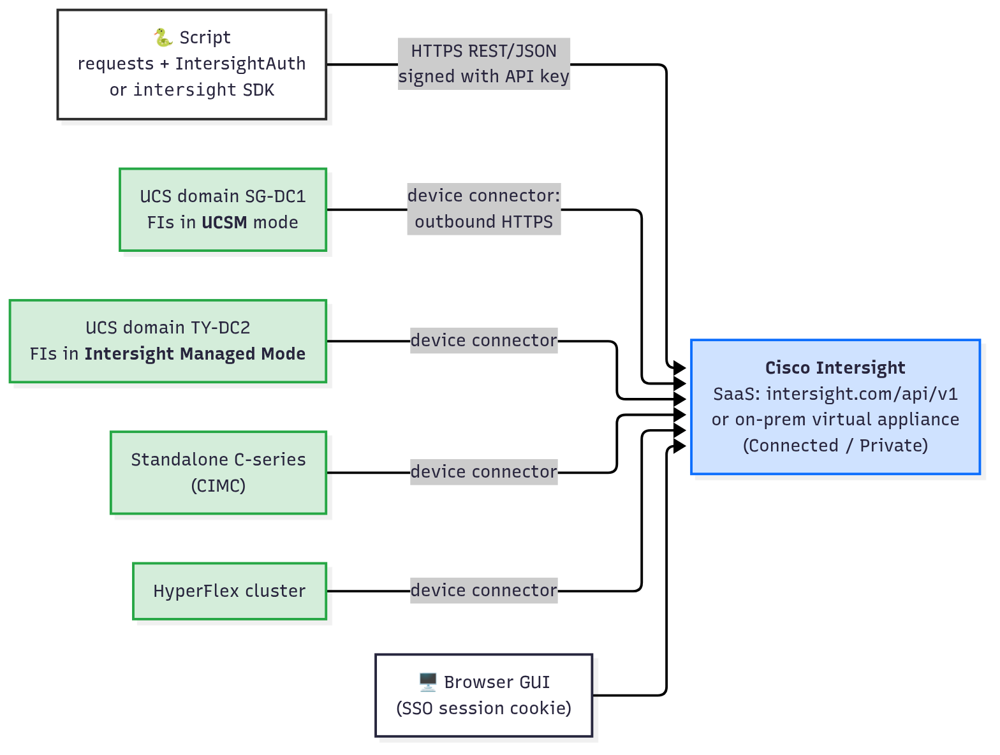
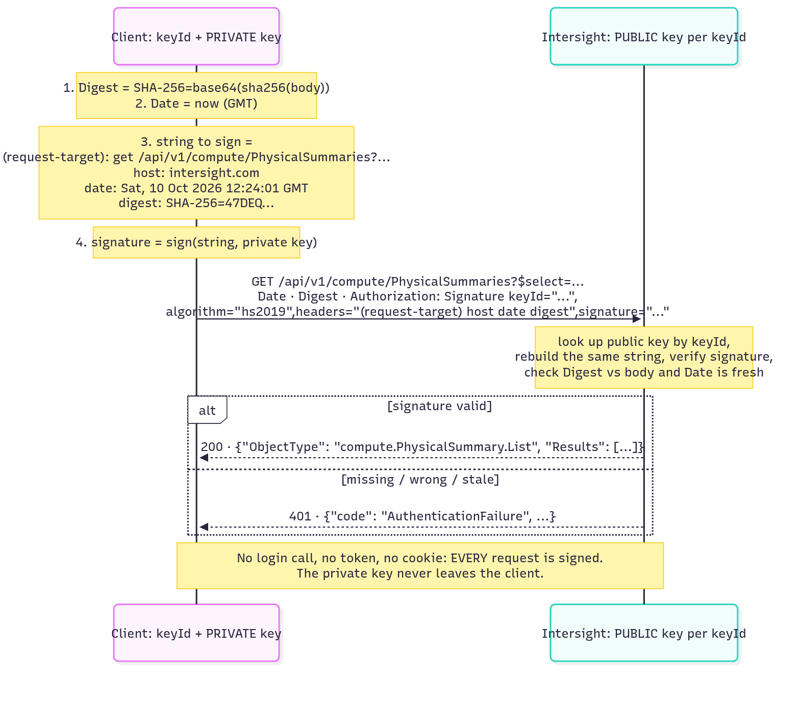
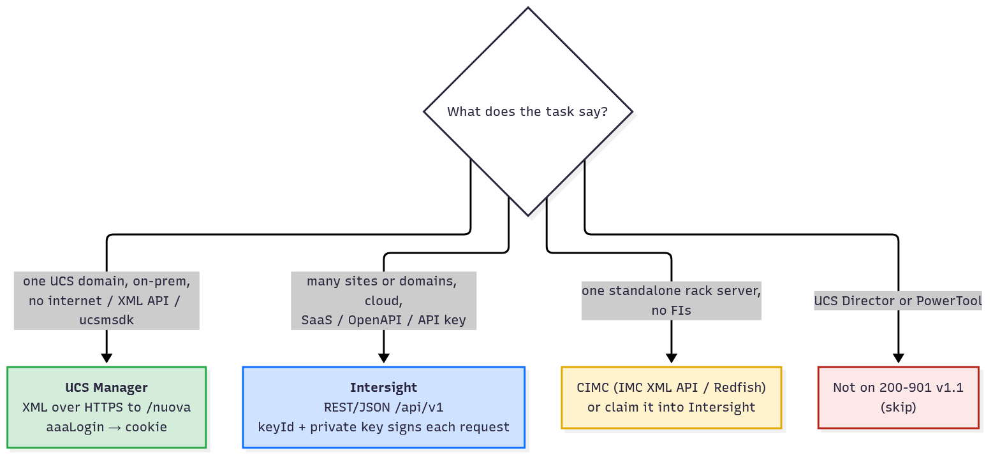

# T24 · Compute: UCS Manager + Intersight: essentials

> Blueprint 3.3 · Full note: [bob/T24-compute-ucs-manager-intersight.md](../bob/T24-compute-ucs-manager-intersight.md)

## In one picture



*Read the top strip as "one domain on the left (UCS Manager), many domains on the right (Intersight)", then each row below is one concept with its exam trap in red.*

## The big idea

- Cisco UCS servers can be managed in two ways: **UCS Manager** looks after one data centre's servers from inside the fabric interconnects, and **Intersight** looks after many data centres from the cloud.
- Think of UCS Manager as the building manager of one office block, and Intersight as head office that can see every building at once.
- The other big idea is the **service profile**: the server's identity (UUID, MAC, WWN, boot order) lives in software, so you can move it from a dead blade to a spare one, like moving a SIM card to a new phone.
- On the exam you need to pick UCSM or Intersight from the scenario, know what a service profile is for, and recognise the two very different auth styles (a login cookie vs a signed request).

## What you need to know

### 1. UCS and UCS Manager: one domain, managed from the fabric interconnects

- **UCS** (Unified Computing System) is Cisco's server platform, built as one managed system instead of a pile of separate servers.
- The heart of it is a **pair of fabric interconnects** (**FI-A** and **FI-B**), which are switches that carry every server's LAN traffic, SAN traffic and management.
- The servers behind them are **B-series blades** in a chassis, **C-series rack servers**, and X-series modules, and they have no per-server config of their own.
- One FI pair plus everything connected to it is called a **UCS domain**.
- **UCS Manager (UCSM)** is software that runs **on the fabric interconnects themselves** (active on one, standby on the other, reached on a cluster virtual IP), not on a separate server.
- **One UCSM manages one domain**, so ten data centres with ten FI pairs means ten separate UCS Managers.
- The UCSM GUI, its CLI and every script all use the same **XML API** underneath.



*UCS Manager lives on the FI pair; scripts POST XML to `/nuova` on the cluster VIP, and every server below the FIs is managed by that one UCSM.*

### 2. Service profiles: the server's identity as software

- A **service profile** is a software definition of everything that makes a server "that server", stored as class `lsServer` with a name like `org-root/ls-ESX-01`.
- It holds the server's **identity and settings**:

| Part of the identity | Where it comes from |
|---|---|
| **UUID** (used by OS licences and hypervisors) | a UUID pool |
| **MAC** address for each virtual NIC | a MAC pool (prefix `00:25:B5`) |
| **WWNN / WWPN** for each virtual HBA (the Fibre Channel SAN identity) | a WWN pool (prefix `20:00:00:25:B5`) |
| **Boot order** | a boot policy |
| **Firmware** version | a host firmware policy |
| **BIOS** settings | a BIOS policy |

- Service profiles are built from three building blocks:
  - **Pools** are ranges of identities to hand out (UUID, MAC, WWNN, WWPN, IP).
  - **Policies** are reusable settings (boot, BIOS, firmware, maintenance, local disk).
  - **Templates** are service profiles with the pools and policies already filled in, used to stamp out many profiles.
- There are two kinds of template: an **initial template** copies its settings once and later edits don't flow down, while an **updating template** pushes later edits to every profile bound to it.
- **Stateless computing** means the blade itself holds no identity: associate a profile and the blade boots *as* that server, and if the blade dies you move the profile to a spare.
- Because the spare gets the same UUID, MACs and WWPNs, SAN zoning, LUN masking, DHCP reservations and licences all keep working with **no changes**.
- Intersight has the same idea under a new name: a **server profile** (`server/Profiles`).



*Watch blade-1 fail and the same profile move to blade-3 with the same UUID, MAC and WWPN: the identity belongs to the profile, not the hardware.*

### 3. The UCSM XML API: one URL, XML methods, cookie in the body

- Everything in UCSM is a **managed object (MO)** in one tree called the **Management Information Tree (MIT)**, the same idea Bob will know from ACI.
- Each object has a **class** (its type, such as `computeBlade`) and a **DN** (distinguished name, its unique path built from relative names joined by `/`, for example `sys/chassis-1/blade-1`).
- The tree has two big branches: **`sys`** holds physical hardware and **`org-root`** holds logical things like service profiles, pools and policies.
- Every API call is an **HTTP POST of an XML document to one URL**, `https://<ucsm-vip>/nuova`, and the XML root element (not the URL) says which method you are calling.
- **Logging in:** you send `aaaLogin` with username and password and get back an **`outCookie`** plus `outRefreshPeriod="600"` (seconds).
- On every later call the cookie goes **inside the XML body** as a `cookie="..."` attribute, not in an HTTP header; `aaaRefresh` renews it and `aaaLogout` ends it.

```xml
<aaaLogin inName="ucspe" inPassword="ucspe" />
<configResolveClass cookie="..." classId="computeBlade" inHierarchical="false" />
<configResolveDn cookie="..." dn="sys/chassis-1/blade-3" inHierarchical="false" />
```

*Line 1 logs in; line 2 asks for every blade; line 3 asks for one blade by its DN.*

| Method | Use it when you know... |
|---|---|
| `configResolveClass` | the **class**, and you want **every** object of that type |
| `configResolveDn` | the exact **DN**, and you want **one** object |
| `configResolveDns` | several DNs at once |
| `configResolveChildren` / `configResolveParent` | a DN, and you want its children or parent |
| `configConfMo` / `configConfMos` | you want to create, change or delete something |

- Adding `inHierarchical="true"` returns the object **plus all its children**.
- **Errors come back as HTTP 200**, with the real error inside the XML: `errorCode="551"` means bad login, `552` means no or expired cookie (⚠ verify the code on real UCSM), and `103` means the object already exists.
- Asking for a DN that doesn't exist is **not an error**: you get a success with an empty `<outConfig/>`.



*One URL, many XML methods: log in once, carry the cookie in every body, refresh before 600 s, log out, and note that error replies are HTTP 200 too.*

### 4. The UCSM Python SDK (`ucsmsdk`)

- **`ucsmsdk`** is Cisco's Python SDK for UCS Manager (`pip install ucsmsdk`); it builds the same XML for you and turns the replies into Python objects.

```python
from ucsmsdk.ucshandle import UcsHandle
handle = UcsHandle("10.10.20.40", "admin", "password")   # just stores the details, HTTPS 443 by default
handle.login()                                           # sends aaaLogin, keeps the cookie
for blade in handle.query_classid("computeBlade"):       # sends configResolveClass
    print(blade.dn, blade.serial)
handle.logout()                                          # sends aaaLogout
```

*This is the exact sequence the exam likes to show with a blank in it.*

- `handle.query_dn("org-root/ls-ESX-01")` asks for one object by DN (it sends `configResolveDns`) and returns `None` if it is missing; with `hierarchy=True` it returns a **list** of the object and its children.
- To make changes you call `handle.add_mo(mo)` or `handle.remove_mo(mo)`, but these **only stage the change locally**; nothing is sent until `handle.commit()`, which sends one `configConfMos`.
- XML attribute names become Python-style names, so `operPower` becomes `blade.oper_power` and `assignedToDn` becomes `assigned_to_dn`.
- You can filter on the server side with `filter_str='(oper_power, "off", type="eq")'`.
- Errors become Python exceptions (`UcsException` with `.error_code` and `.error_descr`).

### 5. Intersight: the cloud manager with signed requests

- **Cisco Intersight** is a cloud management platform for many UCS domains and sites at once, available as **SaaS** at `https://intersight.com` or as an on-prem **Intersight Virtual Appliance** (Connected or Private/air-gapped).
- It manages UCS domains (FIs in UCSM mode or **Intersight Managed Mode, IMM**), standalone C-series servers, HyperFlex clusters and more.
- Each managed device runs a **device connector** that opens an **outbound** HTTPS connection to Intersight and is then **claimed** into your account, so Intersight never needs inbound access to the data centre.



*Many domains dial out to one Intersight, and your script talks only to Intersight, never to each domain.*

- The API is **REST/JSON described by an OpenAPI spec**, with base URL `https://intersight.com/api/v1/` and resources named like `compute/PhysicalSummaries` (every server) or `server/Profiles`.
- Every object has a **`Moid`** (managed object ID) instead of a DN.
- Queries use **OData** options such as `$filter=OperPowerState eq 'off'`, `$select=Name,Serial`, `$orderby=Name`, `$top` (default 100, max 1000) and `$skip`.
- **Auth is an API key that signs every request**, which works like signing each letter with your own pen instead of showing an ID card at the door:
  - You generate an API key in the GUI and get a **key ID** and a **secret key** (a PEM private key, often saved as `SecretKey.txt`), shown only once; Intersight keeps only the public key.
  - For every request the client hashes the body into a **`Digest`** header, sets a **`Date`** header, signs `(request-target) host date digest` with the private key, and sends `Authorization: Signature keyId="...",algorithm="...",headers="...",signature="..."`.
  - Intersight checks the signature with the stored public key, and a missing, wrong or stale signature gets **`401`**.
  - There is **no login call and no token**, and the private key **never leaves the client**.
  - The current default is a v3 elliptic-curve key (`hs2019`); older v2 keys are RSA (`rsa-sha256`). ⚠ verify (key formats)
- The Intersight Python SDK is installed with `pip install intersight`.



*No login call: every request carries its own Digest, Date and signature, and the server verifies them with the public key for that keyId.*

### 6. UCSM vs Intersight, and what is not tested

| | **UCS Manager** | **Intersight** |
|---|---|---|
| Where it runs | On the fabric interconnects (on-prem) | SaaS at intersight.com, or an on-prem virtual appliance |
| Scope | One UCS domain | Many domains, sites and server types |
| API style | XML, every call is `POST /nuova` | REST/JSON, OpenAPI, normal HTTP methods on `/api/v1/` |
| Object naming | DN plus class | Moid plus ObjectType |
| Querying | `configResolveClass` / `configResolveDn` | `GET` with OData `$filter`, `$select`, `$top` |
| Auth | `aaaLogin` gives a session cookie, carried inside the XML | API key ID plus private key, every request signed |
| Errors | HTTP 200 with `errorCode` in the XML | Normal HTTP codes such as `401` and `404` |
| Python SDK | `ucsmsdk` | `intersight` |
| Identity object | Service profile (`lsServer`) | Server profile (`server.Profile`) |

- **UCS Director** and **UCS PowerTool** (PowerShell) are not in blueprint item 3.3, so skip them; if they appear as a distractor, the answer is still UCSM or Intersight.



*Read the scenario for scope (one domain or many) and the API words (XML and cookie, or OpenAPI and API key).*

## Exam traps (the ones that catch people)

- It looks like UCS Manager needs its own server or VM, but it actually **runs on the fabric interconnects**, and one UCSM covers only one domain.
- It looks like the UCSM API has a URL per resource like ACI, but it actually uses **one URL, `POST /nuova`**, and the XML root element is the method.
- It looks like the UCSM cookie goes in an HTTP header, but it actually goes **inside the XML body** as `cookie="..."` (not a `Cookie:` header like ACI, and not `X-Auth-Token` like Catalyst Center).
- It looks like HTTP 200 means success, but UCSM returns **200 even for errors**, so you must read `errorCode` (551 bad login, 552 no cookie, 103 already exists).
- It looks like `add_mo()` creates the object, but it only **stages** it; nothing reaches UCSM until `commit()`.
- It looks like Intersight should have a login call that returns a token, but it actually has **no login and no token**: every request is signed, and sending the secret key in a header is always wrong.
- It looks like the identity belongs to the blade, but it actually belongs to the **service profile**, which is why moving the profile keeps SAN and network config unchanged.

## Quick self-check

<details><summary>Q1. One script must report firmware on every UCS server across 14 data centres, each with its own FI pair. UCSM or Intersight?</summary>Intersight, because it manages many UCS domains from one API, while each UCSM only sees its own domain.</details>

<details><summary>Q2. A blade fails, its service profile moves to a spare, and the server boots from the same SAN LUN with no zoning changes. Why?</summary>The WWPN belongs to the service profile, not the blade, so the spare presents the same SAN identity. This is stateless computing.</details>

<details><summary>Q3. A UCSM login returns HTTP 200 with `errorCode="551"`. Did it work?</summary>No. UCSM reports errors inside the XML with HTTP 200, and 551 means authentication failed.</details>

<details><summary>Q4. Fill the blanks: `handle = UcsHandle(ip, user, pw)`, `handle.____()`, `handle.____("computeBlade")`, `handle.logout()`.</summary>`login` and `query_classid`. `login()` sends aaaLogin, and `query_classid()` sends configResolveClass to return every blade.</details>

<details><summary>Q5. How does a script authenticate to the Intersight API with an API key?</summary>It signs every request with its private key (Digest, Date and an `Authorization: Signature keyId=...` header), and Intersight verifies it with the stored public key. There is no login call or bearer token.</details>

## Cheat lines to say out loud

- "One domain, UCS Manager on the FIs; many domains, Intersight in the cloud."
- "The identity lives in the profile, not the blade: move the profile, keep the UUID, MAC and WWPN."
- "UCSM: POST XML to /nuova, cookie in the body, errors are 200."
- "add_mo stages, commit sends."
- "Intersight: no login, no token, sign every request, the private key never leaves home."
