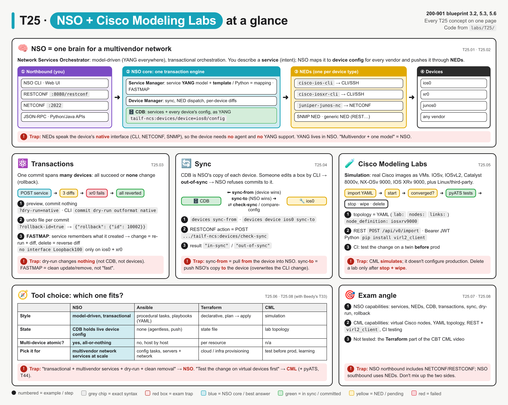
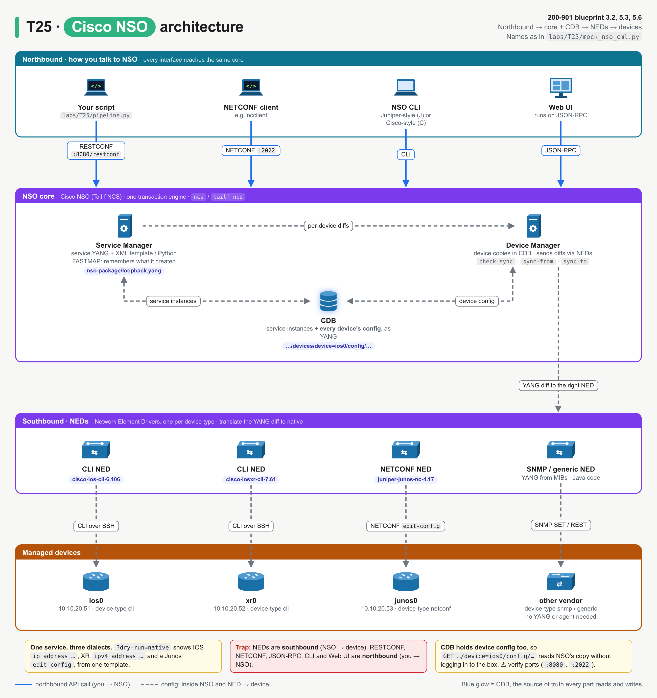
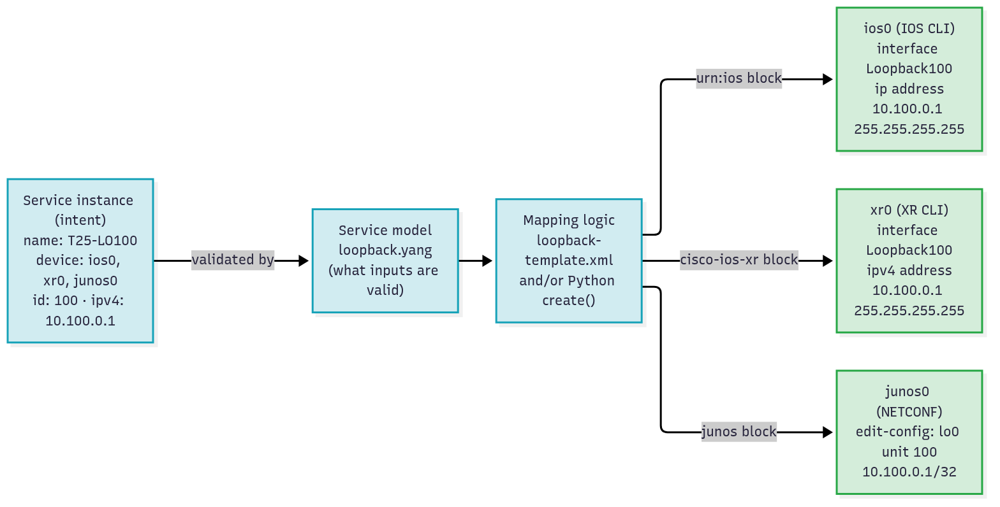
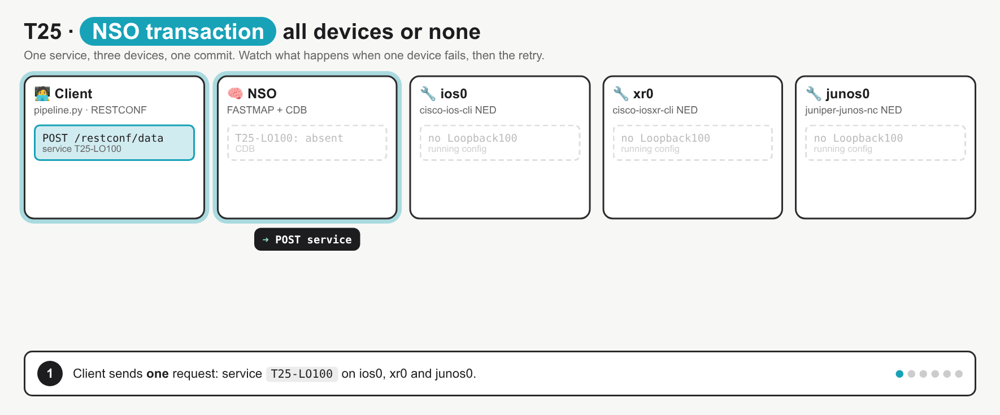
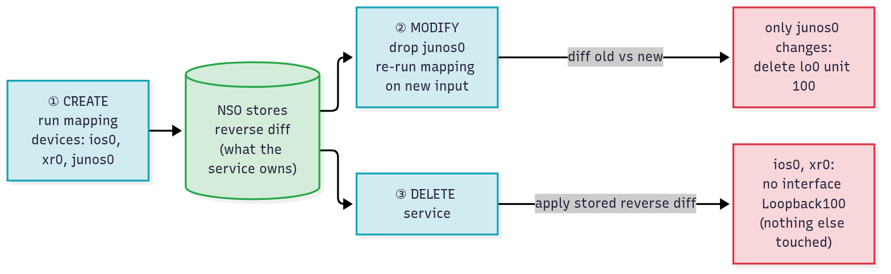
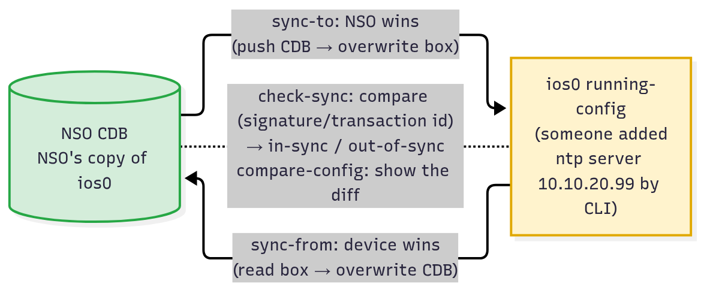
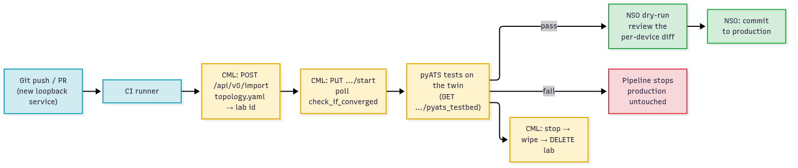
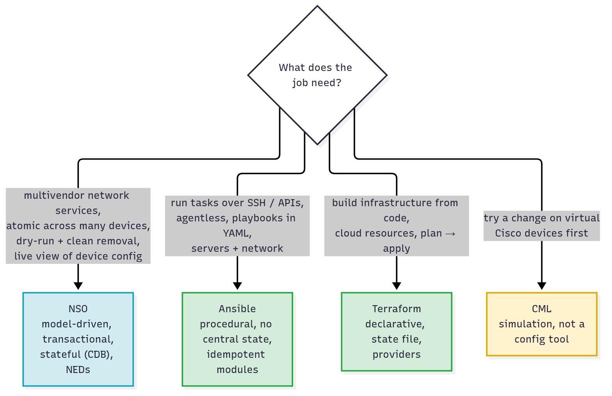

# T25 · NSO + Cisco Modeling Labs: essentials

> Blueprint 3.2, 5.3, 5.6 · Full note: [bob/T25-nso-cisco-modeling-labs.md](../bob/T25-nso-cisco-modeling-labs.md) · Teach-back 2026-10-25

## In one picture



*Read the top panel left to right (you, then the NSO core, then the NEDs, then the devices), then the panels below cover transactions, sync, CML, tool choice and the exam angle.*

## The big idea

- **NSO** (Network Services Orchestrator) is one brain that configures a whole multivendor network: you describe the **service** you want, and NSO works out and pushes the right config to every Cisco, Juniper or other box in one all-or-nothing step.
- **CML** (Cisco Modeling Labs) is a different thing entirely: a simulator that runs virtual Cisco routers and switches so you can test a change before it touches production.
- Think of CML as the flight simulator and NSO as the autopilot on the real plane: you practise in one, then fly with the other.
- The exam asks what each tool can do, which one fits a scenario (NSO vs Ansible vs Terraform vs CML), and a few exact words such as `sync-from`, `sync-to`, `dry-run` and FASTMAP.

## What you need to know

### 1. What NSO is

- **Cisco NSO** was originally **Tail-f NCS**, which is why the CLI command is `ncs` and the YANG prefix is `tailf-ncs`.
- NSO sits **above** the network and configures devices from many vendors through one model.
- **Model-driven** means everything inside NSO, both the services you define and each device's configuration, is described in **YANG**, so you read and write the network like a database.
- **Orchestration** means you ask for a **service** ("loopback 100 on these three routers") rather than typing individual CLI lines, and NSO works out the per-device config.
- **Multivendor** means one NSO can drive Cisco IOS, IOS XR and Juniper Junos side by side.
- Typical users are service providers and large enterprises provisioning L2/L3 VPNs, ACLs, VRFs and loopbacks across thousands of boxes.
- The key difference from Meraki, ACI, Catalyst Center and SD-WAN Manager is that those each manage **their own** product family, while NSO manages **any** vendor.

### 2. NSO architecture: northbound, core, NEDs, devices



*Every northbound interface reaches the same core; the Service Manager and Device Manager share the CDB; each device type gets its own NED.*

| Part | What it does, in plain words |
|---|---|
| **Service model** (YANG) | It defines the inputs of a service and their types, such as name, devices, ID and IP address. |
| **Mapping** (XML template and/or Python) | It turns those service inputs into device config; Python is used when you need logic like IP allocation or loops. |
| **Service Manager** | It runs the mapping and remembers what each service owns (FASTMAP). |
| **Device Manager** | It keeps a copy of each device's config, runs the sync actions and sends the changes through the NEDs. |
| **CDB** (configuration database) | It is NSO's database holding the service instances **and every device's config**, as YANG. |
| **NED** (Network Element Driver) | It translates NSO's change into the device's native language. |

- There are four kinds of NED:
  - A **CLI NED** renders CLI commands over SSH (for example IOS and IOS XR).
  - A **NETCONF NED** sends a NETCONF `edit-config` RPC (for example Junos).
  - An **SNMP NED** sends SNMP SET requests, with YANG generated from the MIBs.
  - A **generic NED** is Java code for anything else, such as REST or proprietary APIs.
- Because the NED does the translation, the **device needs no YANG and no agent**; a plain CLI box is fine.
- **Northbound** interfaces are how people and tools talk **to** NSO: the NSO CLI, the Web UI, **RESTCONF**, **NETCONF**, **JSON-RPC** (used by the Web UI), plus Python and Java APIs.
- NSO RESTCONF uses HTTP Basic auth and `application/yang-data+json`, and the docs' examples use port `:8080`, with NETCONF northbound on `:2022` in local installs. ⚠ verify the ports
- **Southbound** is the NEDs (NSO to the device), so don't mix up the two directions.



*One service instance and one template produce three different outputs, because NSO applies only the template block that matches each device's NED.*

### 3. Transactions, dry-run and rollback

- A **network-wide transaction** means one commit is one unit of work across **all** the devices it touches: either every device and the CDB change, or **none** of them do.
- If one device fails, NSO undoes the change on the devices that already succeeded, so nothing is left half-done.



*Watch xr0 fail and NSO revert ios0 and junos0 too, which fixes the misconception that "the devices that worked keep the change".*

- A **dry-run** validates and shows the change but **commits nothing**, so the CDB and the devices are untouched.

```
commit dry-run outformat native          (NSO CLI)
POST /restconf/data?dry-run=native       (RESTCONF)
```

*Both show the exact commands or RPC each NED would send to each device, without committing.*

- The dry-run output formats are `cli` (NSO's own diff), `xml`, `native` (the exact device commands) and `cli-c` (a Cisco-style diff).
- In the lab, one service gave three native dialects: IOS got `ip address ...`, IOS XR got `ipv4 address ...`, and Junos got an `edit-config` RPC.
- **Rollback:** each commit can write a rollback file, and RESTCONF `?rollback-id=true` returns its ID so you can undo it later with the `apply-rollback-file` action. ⚠ verify (CLI rollback syntax)

### 4. FASTMAP: clean changes and clean deletes

- **FASTMAP** is not about speed; it means the service **remembers exactly what it created**, like a builder keeping a list of every brick they laid so they can remove only those bricks later.
- On **create**, NSO runs the mapping and stores the **reverse diff** (exactly what this service added).
- On **modify**, NSO re-runs the mapping with the new inputs and sends **only the difference**; in the lab, removing `junos0` from the service sent a delete only to junos0 and left ios0 and xr0 untouched.
- On **delete**, NSO applies the stored reverse diff, so `no interface Loopback100` goes to ios0 and xr0 and nothing else is touched.
- Because of FASTMAP, you only write the **create** logic, and NSO works out update and delete for you.
- Related service actions are `re-deploy` (re-run the mapping), `un-deploy` (remove the config but keep the service), and `get-modifications` (show what the service changed).



*The stored reverse diff is why modify and delete touch only what the service owns.*

### 5. Sync: when the device and NSO disagree

- The CDB is NSO's copy of each device's config, so if someone changes a box by hand on the CLI, the device becomes **out of sync** and NSO refuses commits that touch it by default.

| Action | Direction | Who wins | Use it when |
|---|---|---|---|
| `sync-from` | device to CDB | **the device** | you first onboard a device, or you want to keep a hand-made CLI change |
| `sync-to` | CDB to device | **NSO** | you want to undo a hand-made change and put NSO's config back |
| `check-sync` | compare only | nobody | you want a quick in-sync / out-of-sync answer |
| `compare-config` | compare only | nobody | you want to see the actual diff |

- On the CLI these look like `devices sync-from`, `devices device ios0 sync-from`, `devices device ios0 sync-to` and `devices check-sync`.
- In RESTCONF an **action** is a `POST` on the action's path with no body, for example `POST /restconf/data/tailf-ncs:devices/device=ios0/sync-from`.
- The `no-out-of-sync-check` commit flag can override the block, but it is not the normal exam answer.



*The two arrows point in opposite directions, and the dotted check-sync line only compares.*

### 6. Cisco Modeling Labs (CML)

- **CML** (formerly **VIRL**) runs on a server or VM on-premises and simulates networks with **real Cisco images** running as virtual machines.
- Reference images include **IOSv**, **IOSvL2**, **CSR 1000v / Catalyst 8000v**, **NX-OSv 9000**, **IOS XRv 9000** and **Catalyst 9000v**, plus Linux and third-party nodes. ⚠ verify the list per CML version
- Editions are **Free** (5 running nodes), **Personal** (20), **Personal Plus** (40), and **Enterprise / Education** (multi-user).
- A lab **topology is a YAML file** with three parts: `lab:` (title and version), `nodes:` (each node's `node_definition` such as `iosv` or `iosxrv9000`, plus its day-0 config and interfaces), and `links:`; because it is a file, it can live in Git.
- The REST API base is `https://<cml>/api/v0`, and you log in with `POST /api/v0/authenticate`, which returns a JWT you send as `Authorization: Bearer <jwt>`.

| Step | API call |
|---|---|
| Log in | `POST /api/v0/authenticate` with username and password |
| Create the lab from YAML | `POST /api/v0/import?title=...` |
| Boot it | `PUT /api/v0/labs/{id}/start`, then poll `GET .../check_if_converged` until `true` |
| Get a pyATS testbed | `GET .../pyats_testbed` |
| Tear it down | `PUT .../stop`, then `PUT .../wipe`, then `DELETE /api/v0/labs/{id}` |

- The teardown order matters: you must **stop, then wipe, then delete**, because deleting a running lab fails.
- The Python library is **`virl2_client`** (`pip install virl2_client`), which wraps the same API; its version should match the CML controller version.
- In **CI pipelines** (blueprint 5.3), CML is a throwaway twin: build the lab, apply the change, run pyATS tests, delete the lab, and only a passing run moves on to NSO for production.



*The CML stage is disposable; a failing test stops the pipeline before production is touched.*

### 7. Tool choice: NSO vs Ansible vs Terraform vs CML

| | **NSO** | **Ansible** | **Terraform** | **CML** |
|---|---|---|---|---|
| Style | Model-driven (YANG) services | Procedural tasks in YAML playbooks | Declarative resources (HCL) | Simulation |
| Multi-device all-or-nothing? | **Yes**, with rollback | No, host by host | No, per resource | Not applicable |
| State | CDB holds live device config | None (agentless push) | State file | Lab topology |
| Preview | `commit dry-run` | `--check --diff` | `terraform plan` | Not applicable |
| Pick it for | Multivendor network services at scale | Config tasks across servers and network | Cloud and infra provisioning | Testing before production, learning |

- The tools can work together (Ansible has NSO modules, and a pipeline can call NSO RESTCONF), and the exam asks which one **fits**, not which is best.
- The Terraform part of the CBT CML video is low priority here; Terraform belongs to Beedy's T33.



*Match the wording of the job to the box; CML is a test environment, not a config tool.*

## Exam traps (the ones that catch people)

- It looks like `sync-from` and `sync-to` are interchangeable, but `sync-from` pulls **from** the device (the device wins) while `sync-to` pushes **to** the device (NSO wins and overwrites the CLI change).
- It looks like a dry-run applies something small, but it actually **commits nothing**, not to the CDB and not to the devices.
- It looks like the devices that succeeded keep the change when one fails, but NSO transactions are **all-or-nothing**, so none of them keep it.
- It looks like FASTMAP means "fast", but it actually means the service remembers what it created so modify and delete touch only that config.
- It looks like RESTCONF and NETCONF on NSO talk to the devices, but those are **northbound** (you to NSO); the NEDs are the **southbound** side.
- It looks like a device must support YANG or NETCONF to be managed by NSO, but a **CLI NED** is enough.
- It looks like CML configures networks because it runs Cisco images, but CML only **simulates** for testing; NSO configures real networks.
- It looks like "transactional multivendor service rollout" could be Ansible, but the exam answer is **NSO**; "test on virtual devices first" is **CML** (plus pyATS).

## Quick self-check

<details><summary>Q1. A VRF must go to 30 Cisco and Juniper routers, and if any one rejects it, none may keep it. Which tool?</summary>NSO, because it runs one network-wide, all-or-nothing transaction across vendors through NEDs.</details>

<details><summary>Q2. An operator changed `ntp server` on ios0 by CLI, NSO now refuses commits to it, and the team wants to keep the change. Which command?</summary>`devices device ios0 sync-from`, because it pulls the device config into the CDB so the device wins.</details>

<details><summary>Q3. Which NSO component turns a change into the CLI commands or NETCONF RPC for one device type?</summary>The NED (Network Element Driver), which is the southbound translator for each device type.</details>

<details><summary>Q4. Complete `POST /restconf/data?______` so NSO shows the exact per-device commands without committing.</summary>`dry-run=native`, which returns the native output each NED would send and commits nothing.</details>

<details><summary>Q5. In what order do you tear down a CML lab?</summary>Stop, then wipe, then delete, because CML refuses to delete a lab that is still running or not wiped.</details>

## Cheat lines to say out loud

- "NSO: describe the service, NEDs speak each vendor's language, one commit, all or nothing."
- "Sync-from, the device wins; sync-to, NSO wins."
- "Dry-run native shows the real commands and commits nothing."
- "FASTMAP isn't fast, it's memory: write create, get modify and delete for free."
- "CML is the flight simulator: YAML topology, /api/v0 with a Bearer JWT, virl2_client, stop-wipe-delete."
