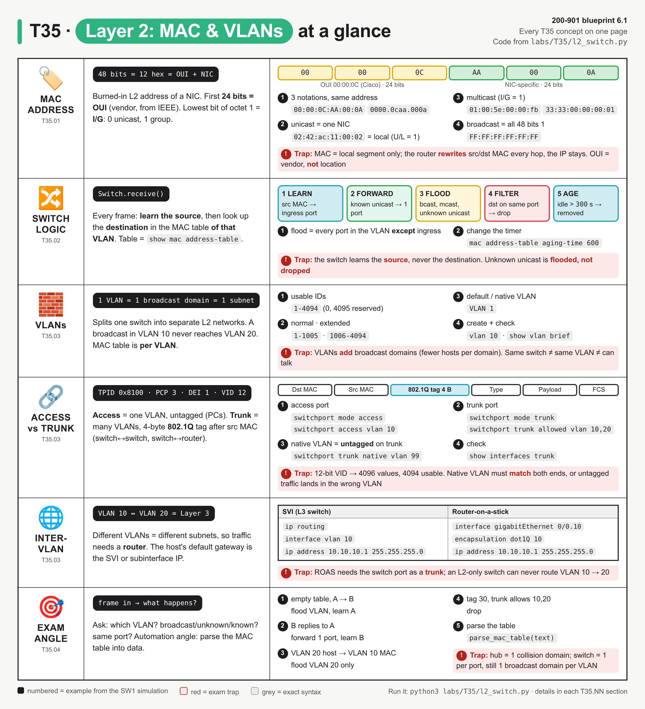
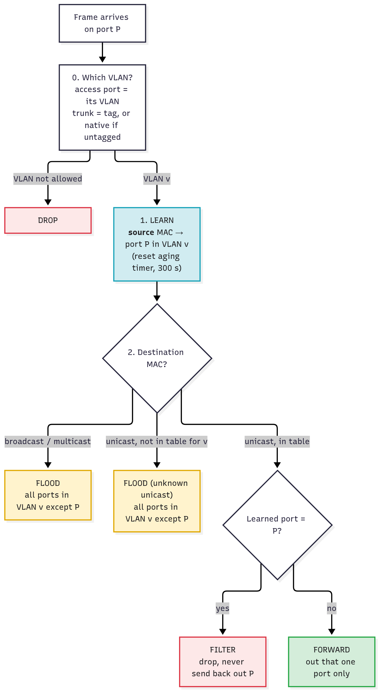
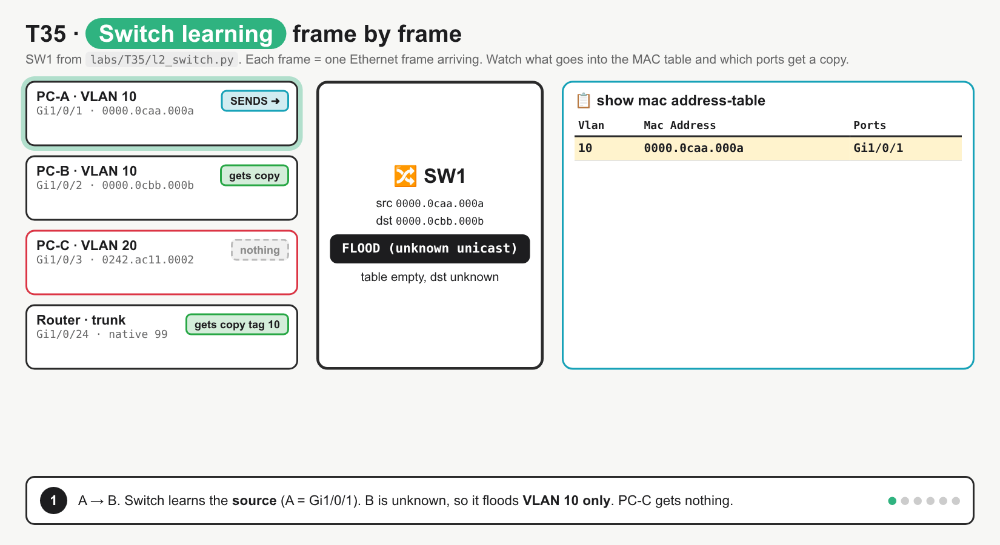
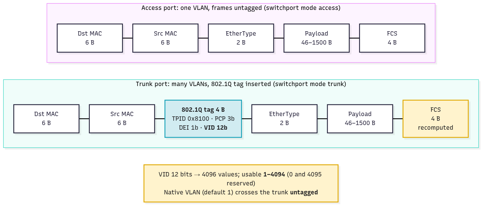

# T35 · Layer 2: MAC, VLANs: essentials

> Blueprint 6.1 · Full note: [bob/T35-layer-2-mac-vlans.md](../bob/T35-layer-2-mac-vlans.md)

## In one picture

*Read each row as one concept group (MAC anatomy, switch logic, VLANs, access vs trunk, inter-VLAN routing), with the numbered examples taken from the SW1 lab and the red boxes marking exam traps.*

## The big idea

- Almost every T35 question comes down to one thing: "a frame arrives on port X, so what does the switch do?"
- The switch **learns** from the **source** MAC, then **forwards, floods or filters** based on the **destination** MAC, and it does all of this inside a single **VLAN**.
- A VLAN is one broadcast domain and one subnet, so getting from one VLAN to another always needs a Layer 3 device.
- For Beedy: a VLAN is like a separate Docker bridge network on the same host. Containers on different bridges cannot talk unless something routes between them.

## What you need to know

### 1. MAC addresses (T35.01)

- A **MAC address** is **48 bits**, which is 6 octets or 12 hex digits, and it is written in three common notations: `00:00:0C:AA:00:0A` (IEEE/Linux), `00-00-0C-AA-00-0A` (Windows) and `0000.0caa.000a` (Cisco IOS).
- The **first 24 bits are the OUI** (Organizationally Unique Identifier), which the IEEE assigns to a vendor; `00:00:0C` is Cisco. The last 24 bits are assigned by the vendor to the individual NIC.
- The OUI identifies the **manufacturer**, never the location or the VLAN.
- The **I/G bit** (the lowest bit of the first octet) says whether the address is unicast (`0`) or a group/multicast address (`1`).
- The **U/L bit** (the second-lowest bit) says whether the address is burned in (`0`, universal) or set by software (`1`, local). Docker's `02:42:…` range is unicast but locally administered.

| Type | How to spot it | Example | What the switch does |
|---|---|---|---|
| **Unicast** | I/G bit = 0 | `0000.0caa.000a` | forward if known, flood if unknown |
| **Multicast** | I/G bit = 1 | `01:00:5E:…` (IPv4), `33:33:…` (IPv6) | flood in the VLAN (unless IGMP/MLD snooping prunes it) |
| **Broadcast** | all 48 bits = 1 | `FF:FF:FF:FF:FF:FF` | always flood in the VLAN |

- A **source MAC is always unicast**; multicast and broadcast only ever appear as the destination.
- MACs only matter on one L2 segment: a router rewrites the MACs at every hop while the IP addresses stay the same end to end (see T36).

### 2. How a switch handles a frame (T35.02)

*Every frame goes through the same steps: pick the VLAN, learn the source, then one of four outcomes for the destination.*

| Action | When it happens |
|---|---|
| **Learn** | on every frame, the switch records `(VLAN, source MAC) → ingress port` and refreshes the timestamp |
| **Forward** | the destination is unicast and already in the table for that VLAN, so it goes out one port |
| **Flood** | the destination is broadcast, multicast or **unknown unicast**, so it goes out every port in the VLAN except the ingress port |
| **Filter** | the destination was learned on the **same port** the frame arrived on, so the frame is dropped |
| **Age** | an entry not refreshed for longer than the aging time is removed |

- The first frame between two new hosts is flooded because the destination is unknown; the reply teaches the switch where that host lives, so later frames are forwarded.
- **Flood is not the same as broadcast**: flooding is the switch's action, broadcast is a type of destination address, and an unknown unicast gets flooded too.
- The Cisco default **aging time is 300 seconds**, set with `mac address-table aging-time <0 | 10-1000000> [vlan <id>]` (`0` disables aging), and **static entries never age**.
- If a known MAC appears as a source on a different port, the entry simply moves to the new port.
- Each **switch port is its own collision domain**, each **VLAN is one broadcast domain**, and a **hub** is one shared collision domain for all its ports.

*Six frames: flood, forward, forward, ARP broadcast flood, a VLAN 20 host flooding only VLAN 20, then aging.*

### 3. VLANs, access ports and trunks (T35.03)

- A **VLAN** is a separate L2 broadcast domain on the same physical switch, and in practice it is also one IP subnet.
- The MAC table is keyed by **(VLAN, MAC)**, so a MAC known in VLAN 10 is still unknown to a frame in VLAN 20; the switch floods VLAN 20 and never jumps across.
- VLANs are used to shrink broadcast domains, to segment traffic (voice, cameras, guests) and to group devices by function rather than location.

| Range | IDs | Notes |
|---|---|---|
| Reserved | 0, 4095 | not usable (802.1Q) |
| Normal | 1–1005 | VLAN 1 is the default VLAN and default native VLAN; 1002–1005 are reserved legacy (⚠ verify) |
| Extended | 1006–4094 | ⚠ verify the VTP-mode requirements on your platform |

| | Access port | Trunk port |
|---|---|---|
| VLANs | exactly one | many (the allowed list) |
| Frames | untagged | 802.1Q tagged, except the native VLAN |
| Connects | end hosts (PC, printer, AP in local mode) | switch to switch, switch to router, switch to hypervisor |
| IOS XE | `switchport mode access` + `switchport access vlan 10` | `switchport mode trunk` + `switchport trunk allowed vlan 10,20` |

*The 4-byte 802.1Q tag sits between the source MAC and the EtherType, and the FCS is recomputed because the frame changed.*

- The **802.1Q tag is 4 bytes**: TPID `0x8100` (16 bits), PCP (3 bits, priority), DEI (1 bit) and the **VID (12 bits)**.
- 12 bits give 4096 values, and with 0 and 4095 reserved, **1–4094** are usable.
- The **native VLAN** is the one VLAN a trunk carries **untagged**; the default is VLAN 1 and it is changed with `switchport trunk native vlan 99`.
- A **native VLAN mismatch** (99 on one end, 1 on the other) puts untagged frames into a different VLAN on each side, and CDP reports it.
- A frame tagged with a VLAN that is not on the trunk's **allowed list** is dropped.
- To check the setup, use `show vlan brief` (access ports per VLAN, trunks not listed), `show interfaces trunk` and `show mac address-table vlan 10`.

### 4. Inter-VLAN routing needs Layer 3 (T35.03)

| | SVI | Router-on-a-stick (ROAS) |
|---|---|---|
| Where | inside a multilayer (L3) switch | an external router on one physical link |
| Config | `ip routing` · `interface vlan 10` · `ip address 10.10.10.1 255.255.255.0` | `interface gigabitEthernet 0/0.10` · `encapsulation dot1Q 10` · `ip address 10.10.10.1 255.255.255.0` |
| Switch side | nothing extra | the port facing the router must be a **trunk** |
| Trade-off | wire speed, no extra box | cheap, but every inter-VLAN packet crosses the one link twice |

- Both options give each VLAN a **default gateway** IP; on ROAS, the native VLAN subinterface uses `encapsulation dot1Q 99 native`.

### 5. Exam angle and automation (T35.04)

- To answer "what does the switch do?", ask four questions in this order: which VLAN, learn the source, is the destination broadcast/multicast/unknown (flood), and if known, is it the same port (filter) or another port (forward).
- In automation you rarely read the MAC table by eye; you parse `show mac address-table` with a regex, or skip parsing by using NETCONF/RESTCONF or pyATS/Genie, which return structured data.

## Exam traps (the ones that catch people)

- The switch **learns from the source** MAC and **forwards on the destination** MAC; it never learns the destination.
- **Unknown unicast is flooded, not dropped**; only a destination on the ingress port is filtered.
- A flood stays inside **one VLAN** and never goes back out the port it came in on.
- The **MAC table is per VLAN**, so the same MAC in two VLANs is two entries, and knowing it in VLAN 10 does not help VLAN 20.
- The **VLAN ID is 12 bits** (1–4094 usable), but the **whole tag is 4 bytes** with TPID `0x8100`.
- The **native VLAN is untagged** and defaults to **VLAN 1**, and both trunk ends must agree.
- **VLAN-to-VLAN traffic needs Layer 3** (SVI or ROAS), whatever the MAC table says, and the ROAS router port must be a trunk.
- **More VLANs means more, smaller broadcast domains**; aging defaults to 300 s and static entries never age.

## Quick self-check

Q1. The MAC table is empty and host A (Gi1/0/1, VLAN 10) sends a unicast to host B (VLAN 10). What two things happen?
The switch learns A's MAC on Gi1/0/1, and it floods the frame out every VLAN 10 port except Gi1/0/1. B is only learned when B sends something.

Q2. Which part of 00:1B:54:3A:7F:10 identifies the manufacturer?
`00:1B:54`, because the OUI is the first 24 bits (three octets).

Q3. Both 0000.0caa.000a and 0000.0cdd.000d are learned on Gi1/0/1, and a frame from one to the other arrives on Gi1/0/1. What does the switch do?
It filters (drops) the frame, because the destination is on the same port it came in on and the other device has already received it.

Q4. An untagged frame arrives on a trunk configured with `switchport trunk native vlan 99`. Which VLAN is it placed in?
VLAN 99, because untagged frames on a trunk belong to the native VLAN; VLAN 1 is only the default.

Q5. Which line completes a router-on-a-stick subinterface for VLAN 20?
`encapsulation dot1Q 20`, which ties subinterface Gi0/0.20 to tag 20; the switch port facing the router must be a trunk allowing VLAN 20.

## Cheat lines to say out loud

- "Learn the source, forward on the destination."
- "Unknown? Flood the VLAN, never the ingress port. Same port? Filter."
- "One VLAN, one broadcast domain, one subnet. Crossing VLANs needs a router."
- "Twelve-bit VID, four-byte tag, 1 to 4094. Native goes naked (untagged), default VLAN 1."
- "OUI is the first half: vendor, not location."
