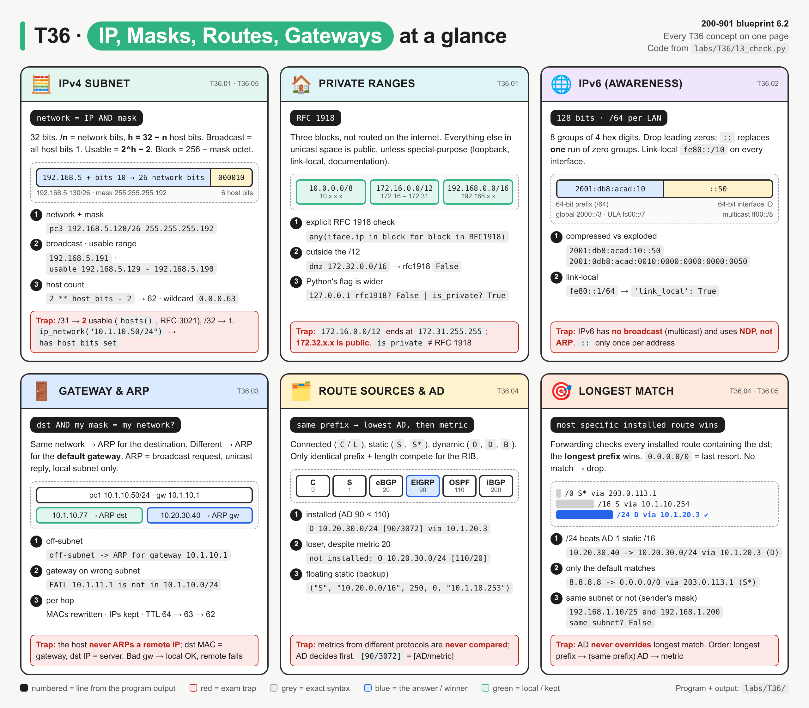
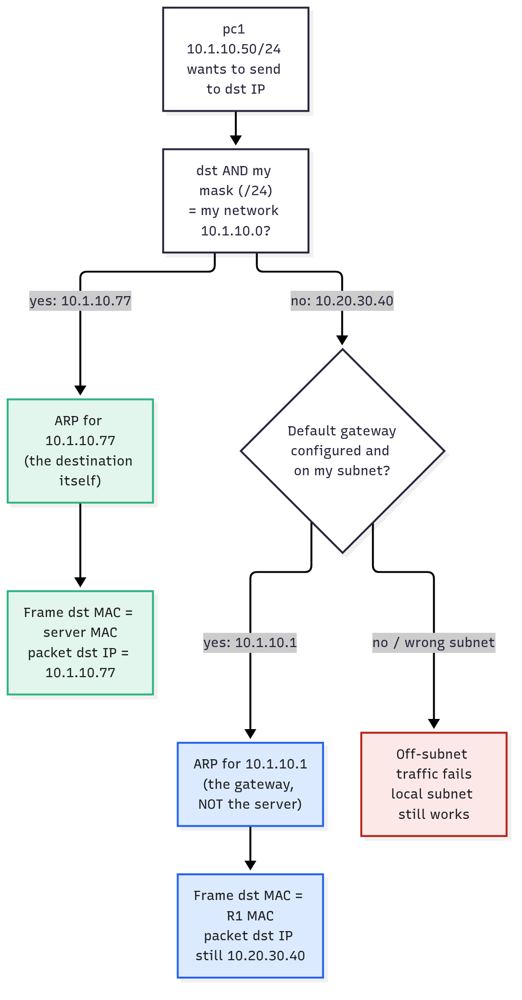
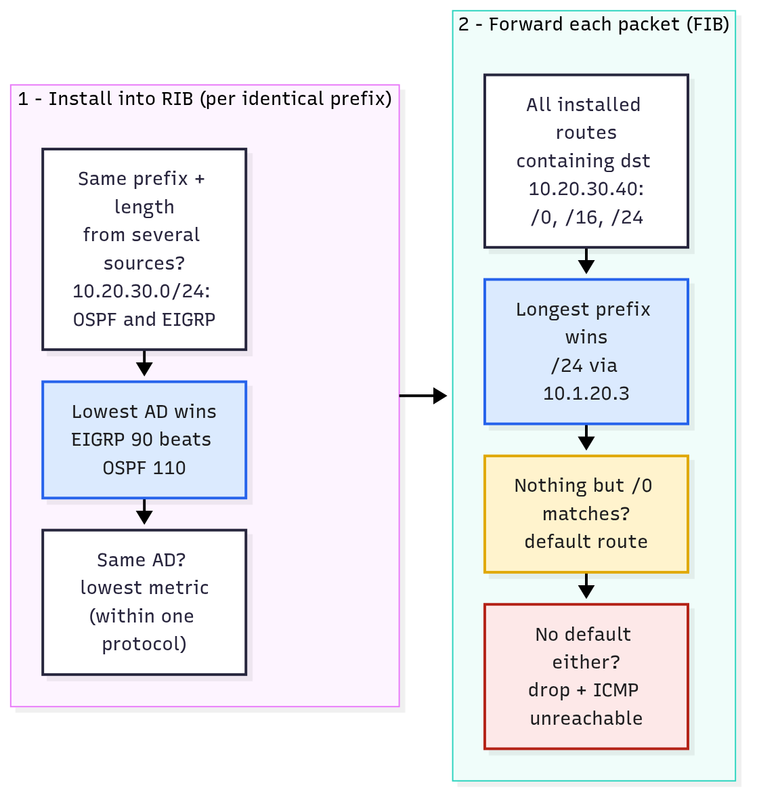

# T36 · Layer 3: IP, masks, routes, gateways: essentials

> Blueprint 6.2 · Full note: [bob/T36-layer-3-ip-masks-routes-gateways.md](../bob/T36-layer-3-ip-masks-routes-gateways.md)

## In one picture

*Each card has the same parts: the rule (black pill), a mini diagram, numbered examples from `labs/T36/l3_check.py`, and a red exam trap.*

## The big idea

- Layer 3 questions ask three things: what are this subnet's facts, are these two hosts on the same subnet, and which route does the router use.
- A **host** decides with its own mask whether to deliver locally or hand the packet to its **default gateway**, and a **router** decides with **longest prefix match**.
- The exam loves the trap where **administrative distance** is wrongly used to override a more specific route.
- For Beedy: the routing table works like AWS VPC route tables, where the most specific CIDR wins and `0.0.0.0/0` is the catch-all.

## What you need to know

### 1. IPv4 addressing and subnet maths (T36.01)

- An IPv4 address is **32 bits** in 4 octets, and `/n` means the first n bits are network and the remaining `h = 32 − n` bits are host.

| Fact | Rule | Example `192.168.5.130/26` |
|---|---|---|
| Mask | n ones, then zeros | `255.255.255.192` |
| Wildcard (ACLs/OSPF) | 255 − mask per octet | `0.0.0.63` |
| Network | IP AND mask (host bits all 0) | `192.168.5.128` |
| Broadcast | host bits all 1 | `192.168.5.191` |
| Usable hosts | 2^h − 2 | 62 (`.129`–`.190`) |

- The **block-size shortcut** is 256 minus the mask in the interesting octet: /26 gives 256 − 192 = 64, so the networks are .0, .64, .128 and .192, and the broadcast is the next block minus 1.
- Know these cold: /24 = .0, /25 = .128, /26 = .192, /27 = .224, /28 = .240, /29 = .248, /30 = .252, /31 = .254, /32 = .255.
- A **/30** has 2 usable hosts (classic point-to-point), a **/31** also has **2** usable (RFC 3021 lets point-to-point links use both), and a **/32** is a single host (loopbacks, the `L` local route).
- The **RFC 1918** private ranges are `10.0.0.0/8`, `172.16.0.0/12` (which ends at **172.31.255.255**) and `192.168.0.0/16`, so `172.32.x.x` is public.
- Borrowing b bits gives 2^b subnets: a /24 split into /26 gives 4 subnets of 62 hosts each.
- In Python, `ipaddress.ip_network("10.1.10.50/24")` raises `has host bits set`; use `ip_interface()` or `strict=False`, and note that `is_private` is wider than RFC 1918 (`127.0.0.1` is private but not RFC 1918).

### 2. IPv6 awareness (T36.02)

- An IPv6 address is **128 bits**, written as 8 groups of 4 hex digits; you compress it by dropping leading zeros and replacing **one** run of zero groups with `::` (only once per address).
- The standard LAN subnet is a **/64**: a 64-bit prefix plus a 64-bit interface ID.

| Prefix | Type | IPv4 analogy |
|---|---|---|
| `fe80::/10` | link-local, on every IPv6 interface, never routed | 169.254/16 |
| `2000::/3` | global unicast | public |
| `fc00::/7` | unique local | RFC 1918 (roughly) |
| `ff00::/8` | multicast | broadcast (IPv6 has **no** broadcast) |
| `::1/128` | loopback | 127.0.0.1 |
| `2001:db8::/32` | documentation | 203.0.113.0/24 |

- IPv6 replaces ARP with **NDP** (ICMPv6 Neighbor Solicitation/Advertisement), and the default gateway is usually the router's **link-local** address learned from Router Advertisements.

### 3. Default gateway and ARP (T36.03)

*Green is local delivery, blue is the off-subnet answer the exam wants (ARP for the gateway), and red is what a missing or wrong gateway breaks.*

- The host applies **its own mask** to the destination: if it is on the same network, the host ARPs for the destination; if not, it ARPs for the **default gateway**.
- The **default gateway** must be **inside the host's own subnet** and must not be the network or broadcast address (/31 is exempt).
- The symptom of a wrong or missing gateway is that **local pings work but anything off-subnet fails**.
- **ARP** (RFC 826) maps IPv4 to MAC **only on the local subnet**: the request is a broadcast to `ffff.ffff.ffff` and the reply is unicast, and the result is cached (`show ip arp`, `ip neigh show`).
- At every hop the **MACs are rewritten but the IPs stay the same** (assuming no NAT), and TTL drops by 1.

| Hop | dst MAC | src IP | dst IP | TTL |
|---|---|---|---|---|
| pc1 → R1 | R1 Gi0/1 | 10.1.10.50 | 10.20.30.40 | 64 |
| R1 → R2 | R2 Gi0/0 | 10.1.10.50 | 10.20.30.40 | 63 |
| R2 → server | server | 10.1.10.50 | 10.20.30.40 | 62 |

### 4. The routing table (T36.04)

| Code | Source | Default AD |
|---|---|---|
| `C` / `L` | connected network / local /32 | 0 |
| `S` / `S*` | static / static default | 1 |
| `B` | eBGP / iBGP | 20 / 200 |
| `D` / `D EX` | EIGRP internal / external | 90 / 170 |
| `O` | OSPF | 110 |
| `R` | RIP | 120 |

- Route selection is **two separate steps**:
  1. **Installation:** only routes for the **identical prefix and length** compete; the lowest AD wins, then the lowest metric. Metrics from different protocols are never compared.
  2. **Forwarding:** among the installed routes that contain the destination, the **longest prefix wins**, and AD is not consulted at all.
- A **floating static** is a static route with a higher AD (for example `ip route 10.20.0.0 255.255.0.0 10.1.10.253 250`) that only installs if the primary route disappears.
- The **default route** `0.0.0.0/0` matches everything, so it only wins when nothing longer matches; with no default and no match, the packet is dropped with an ICMP unreachable.
- In `show ip route`, `[90/3072]` means `[AD/metric]`.

*The left box picks among identical prefixes and the right box picks among different prefix lengths.*

### 5. Exam angle (T36.05)

- For subnet maths (about 20 s each): find the interesting octet, work out the block size, take the network as the multiple of the block at or below the IP, and the broadcast as the next network minus 1.
- For "same subnet or not", apply the **sender's** mask to both IPs; `192.168.1.10/25` and `192.168.1.200` are on different subnets because /25 splits at .128.
- For "which route", check longest prefix first, then AD (identical prefixes only), then metric.

## Exam traps (the ones that catch people)

- **AD only compares identical prefixes**, so a /24 learned by OSPF (AD 110) beats a /16 static (AD 1) for a destination inside the /24.
- **Metrics across protocols are not comparable**: OSPF cost 20 against EIGRP 3072 is decided by AD, so EIGRP (90) wins.
- The **host ARPs for the gateway**, not the remote IP; the frame's dst MAC is the gateway, the dst IP is still the server.
- **172.16.0.0/12 ends at 172.31.255.255**, so 172.32.x.x is public.
- Usable hosts are **2^h − 2**, except **/31 = 2** and **/32 = 1**; a /30 gives 2.
- A gateway on another subnet (`10.1.10.60/24` with gw `10.1.11.1`) means local works but remote fails.
- The **wildcard is not the mask**: /26 is mask `255.255.255.192` and wildcard `0.0.0.63`.
- **IPv6 has no broadcast**, uses NDP instead of ARP, allows `::` only once, and link-local is `fe80::/10`.

## Quick self-check

Q1. What are the network and broadcast addresses of 172.16.45.200/20?
172.16.32.0 and 172.16.47.255. A /20 is mask 255.255.240.0, so the block is 16 in the third octet, and 32–47 contains 45.

Q2. Host A is 192.168.10.100/27. Is 192.168.10.97 a usable host on the same subnet?
Yes. A /27 has a block of 32, so the subnet is .96–.127 with .96 as the network and .127 as the broadcast.

Q3. R1 has O 10.0.0.0/8 [110/30], S 10.10.0.0/16 [1/0], D 10.10.10.0/24 [90/2816] and S* 0.0.0.0/0. Which route does it use for 10.10.10.5?
The EIGRP /24, because all four match and the longest prefix wins; AD does not override longest match.

Q4. 10.50.0.0/16 is learned from OSPF, eBGP and a static with distance 200. Which one is installed?
eBGP, because the prefix is identical so AD decides: eBGP 20 beats OSPF 110 and the static 200.

Q5. A PC is 10.1.10.60/24 with gateway 10.1.11.1. It reaches a printer on 10.1.10.20 but not a server on 10.20.30.40. Why?
The default gateway is not on the PC's own subnet, so local delivery works but every off-subnet packet fails.

## Cheat lines to say out loud

- "Longest match forwards; AD only breaks ties between identical prefixes."
- "Off-subnet? ARP for the gateway. IP stays, MAC changes every hop."
- "256 minus the mask is the block size."
- "172.16 to 172.31, not 172.32."
- "Slash 31 gives two, slash 32 gives one, everything else is 2 to the h minus 2."
