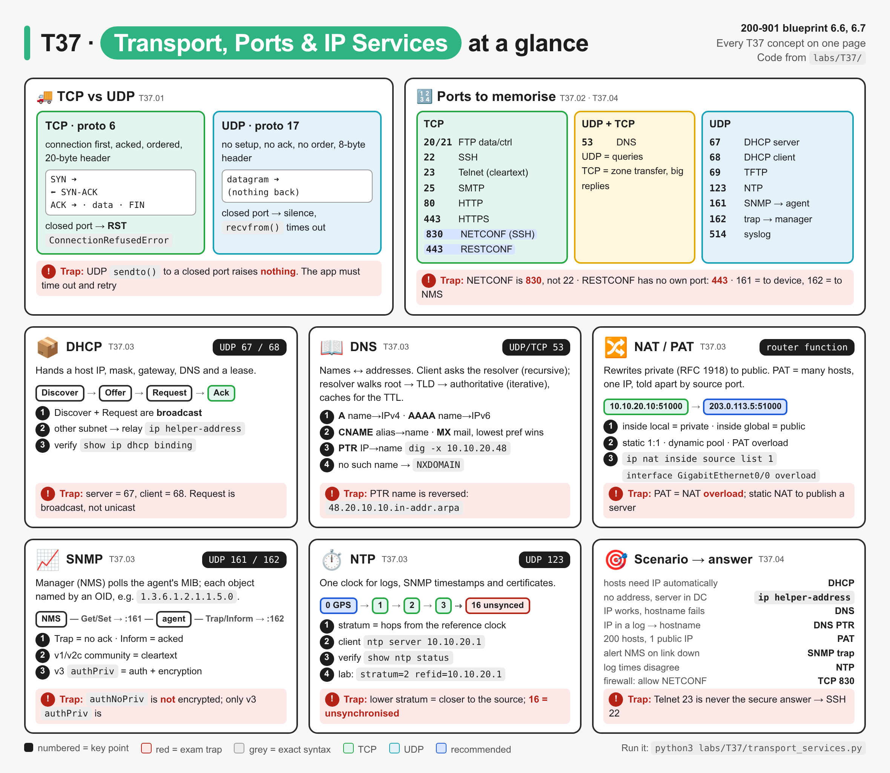
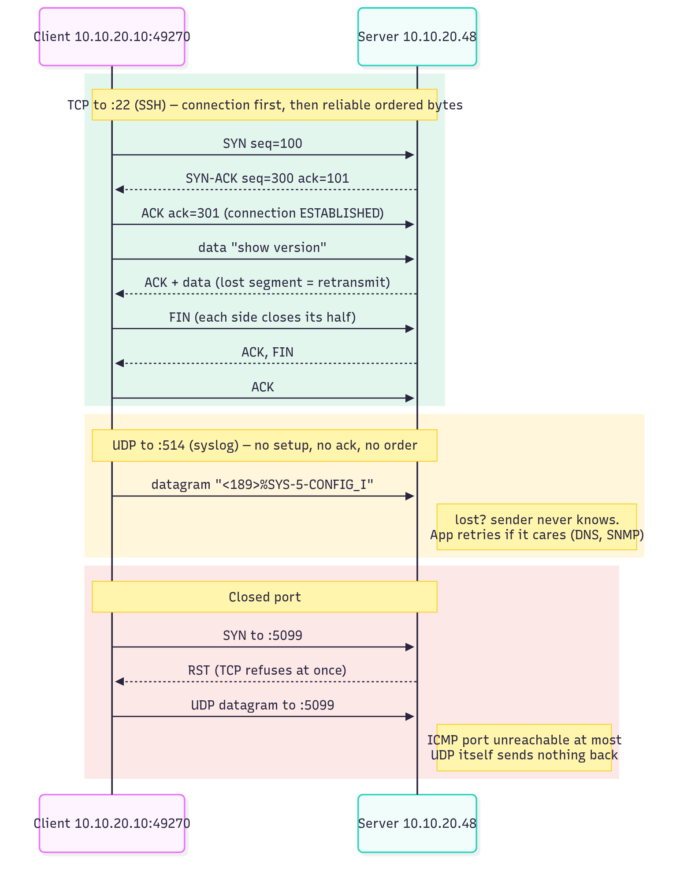
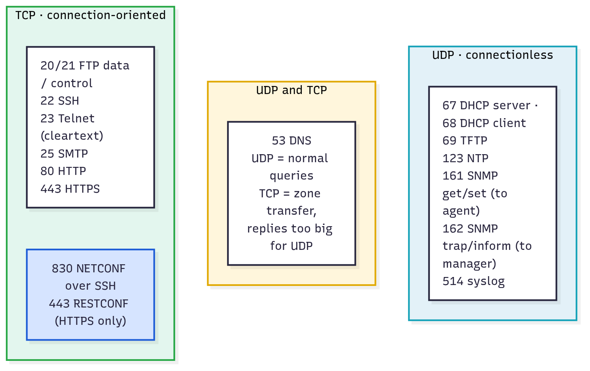
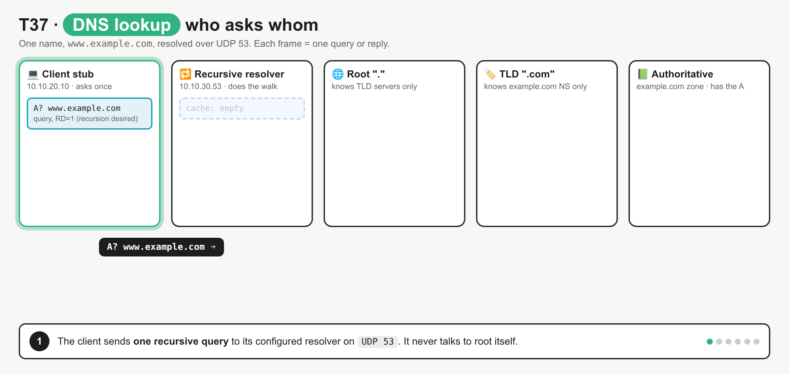

# T37 · Transport, ports, IP services: essentials

> Blueprint 6.6, 6.7 · Full note: [bob/T37-transport-ports-ip-services.md](../bob/T37-transport-ports-ip-services.md) · Teach-back 2026-10-25

## In one picture



*The top strip is TCP vs UDP and the port board; each card is one IP service with its job, port, key terms and verify command; red boxes are exam traps.*

## The big idea

- This is your home turf, so the goal is speed: know every exam port and its transport cold, and know which service solves which scenario.
- TCP is a phone call (you dial, the other side picks up, and you both confirm what was said), while UDP is a postcard (you drop it in the box and hope it arrives).
- The exam catches people on near-misses: 161 vs 162, 67 vs 68, 22 vs 830, and RESTCONF having no port of its own.

## What you need to know

### 1. TCP vs UDP

| | TCP | UDP |
|---|---|---|
| IP protocol number | 6 | 17 |
| Setup | **3-way handshake**: SYN, SYN-ACK, ACK | None: just send |
| Reliability | Acks and retransmits lost segments | None; the app retries if it cares |
| Order | Sequence numbers give an in-order byte stream | Each datagram stands alone and may arrive out of order |
| Flow control | Sliding window | None |
| Header | 20 bytes minimum | 8 bytes (src port, dst port, length, checksum) |
| Closed port | Replies **RST** at once (`ConnectionRefusedError`) | **Silence** (at most an ICMP port unreachable); the app times out |
| Exam examples | SSH, Telnet, HTTP(S), NETCONF, RESTCONF, SMTP, FTP | DNS queries, DHCP, TFTP, NTP, SNMP, syslog |

- UDP suits one small question and answer (DNS, NTP, SNMP get) or fire-and-forget messages (syslog, traps), where a handshake would cost more than the data.
- TCP suits config pushes and API calls, which must arrive complete and in order, so SSH, NETCONF and HTTPS all ride on TCP.
- A connection is identified by the **5-tuple** (source IP, source port, destination IP, destination port, protocol), and the client's source port is **ephemeral** (IANA 49152–65535; Linux defaults to 32768–60999).
- Sending UDP to a closed port does not raise an error: `sendto()` still returns the byte count, and the only symptom is no reply.
- TCP closes with a FIN from each side, or aborts with RST.



*Green is TCP (three packets before data, then every segment acked), yellow is UDP (one datagram, no reply), red is a closed port (TCP sends RST, UDP stays silent).*

### 2. Ports to memorise

| Port | Transport | Protocol | Remember it as |
|---|---|---|---|
| 20 / 21 | TCP | FTP data / control | 21 carries the commands, 20 carries the file |
| 22 | TCP | SSH (also SCP, SFTP) | Encrypted CLI |
| 23 | TCP | Telnet | **Cleartext** CLI, never the "secure" answer |
| 25 | TCP | SMTP | Sending mail |
| 53 | **UDP + TCP** | DNS | UDP for queries, TCP for zone transfers and big replies |
| 67 / 68 | UDP | DHCP server / client | Server listens on 67, client on 68 |
| 69 | UDP | TFTP | No auth; copies IOS images and configs |
| 80 | TCP | HTTP | Cleartext web and API |
| 123 | UDP | NTP | Time |
| 161 | UDP | SNMP get/set | Sent **to the agent** (the device) |
| 162 | UDP | SNMP trap/inform | Sent **to the manager** (the NMS) |
| 443 | TCP | HTTPS **and RESTCONF** | RESTCONF must use TLS, default 443 |
| 514 | UDP | Syslog | Device to collector (syslog over TLS is TCP 6514) |
| 830 | TCP | NETCONF over SSH | The `netconf` SSH subsystem on 830, not 22 |

- The model-driven pair is the favourite: **NETCONF is SSH on TCP 830** (RFC 6242) and **RESTCONF is HTTPS on TCP 443** (RFC 8040, plain HTTP not allowed).
- 830 is often missing from `/etc/services`, so you have to know it yourself.



*Left column is TCP only, the middle is DNS on both, the right is UDP only; blue marks the two model-driven APIs.*

### 3. DHCP and DNS

- **DHCP** gives a host with no address its IP, mask, default gateway, DNS servers and lease time.
- The sequence is **DORA**: **Discover** (client broadcasts from `0.0.0.0:68` to `255.255.255.255:67`), **Offer** (server proposes an address), **Request** (client **broadcasts** its choice so other servers know they lost), **Ack** (server commits the lease); a **NAK** means start over.
- Broadcasts do not cross routers, so a server on another subnet needs a relay on the client-facing interface: **`ip helper-address <server>`**, which forwards the broadcast as unicast and fills in `giaddr` so the server picks the right pool.
- At 50% of the lease (T1) the client unicasts a Request to renew with the same server.
- **DNS** maps names and addresses, using these record types:

| Record | Maps | Example |
|---|---|---|
| **A** | Name to IPv4 | `csr1.lab.example A 10.10.20.48` |
| **AAAA** | Name to IPv6 | `csr1.lab.example AAAA 2001:db8:10::48` |
| **CNAME** | Alias to canonical **name** | `www.lab.example CNAME csr1.lab.example` |
| **PTR** | IP to name (reverse lookup) | `48.20.10.10.in-addr.arpa PTR csr1.lab.example` |
| **MX** | Domain to mail server, **lower** preference wins | `lab.example MX 10 mail.lab.example` |

- The client sends one **recursive** query to its resolver, and the resolver does **iterative** queries (root, then TLD, then authoritative) and caches the answer for its **TTL**.
- PTR names reverse the octets under `in-addr.arpa`, and `dig -x 10.10.20.48` builds that name for you.
- An A query for an alias returns the CNAME and then the target's A record in one reply.
- `NXDOMAIN` (rcode 3) means the name does not exist, while a name with no record of that type returns `NOERROR` with zero answers.
- DNS uses TCP 53 for zone transfers (AXFR) and for replies too big for UDP (classic 512-byte limit, signalled by the TC bit).



*The client asks the resolver once, the resolver walks root, TLD and authoritative, then caches the answer for the next client; the client never walks the tree itself, and the root does not know the IP.*

### 4. NAT and PAT

- NAT is a router function with no port of its own, and it rewrites RFC 1918 private addresses (`10.0.0.0/8`, `172.16.0.0/12`, `192.168.0.0/16`) at the edge.

| Cisco term | Meaning |
|---|---|
| **Inside local** | The inside host's real (private) address |
| **Inside global** | The inside host as the outside sees it (public) |
| **Outside global** | The outside host's real address |
| **Outside local** | The outside host as the inside sees it (usually equals outside global) (⚠ verify) |

- **Static NAT** maps one private address to one fixed public address, used to publish an inside server.
- **Dynamic NAT** maps private addresses to the next free address from a public pool, and runs out when the pool does.
- **PAT (NAT overload)** maps many private addresses to **one** public IP, told apart by **source port**, using the keyword `overload`.

```
ip nat inside source list 1 interface GigabitEthernet0/0 overload
```

- A device behind NAT cannot be reached from outside without static NAT or port forwarding, which is why controllers often use device-initiated outbound connections.

### 5. SNMP and NTP

- In **SNMP**, the **manager** (NMS) polls and the **agent** (software on the device) answers and sends notifications.
- The **MIB** is the agent's tree of objects, and an **OID** is the dotted number naming one object (for example `1.3.6.1.2.1.1.5.0` is sysName).
- `Get`, `GetNext`, `GetBulk` (v2c and later) and `Set` go **to the agent on UDP 161**, while **Trap** (never acked) and **Inform** (acked and resent) go **to the manager on UDP 162**.

| Version | Security | Exam keyword |
|---|---|---|
| v1 | Community string in **cleartext** | Oldest, no GetBulk |
| v2c | Community string in **cleartext** | Adds GetBulk and Inform |
| v3 | **Users** with levels `noAuthNoPriv`, `authNoPriv`, `authPriv` | The only version with **authentication and encryption** |

- `authNoPriv` is authenticated but not encrypted, and only **`authPriv`** gives both.
- **NTP** (UDP 123) keeps one clock across the network, which matters because syslog and SNMP timestamps, TLS certificates (so HTTPS and RESTCONF), and Kerberos all break or mislead with a wrong clock.
- **Stratum** is the distance from a reference clock: 0 is the clock itself (GPS or atomic, not on the network), 1 is a server wired to it, 2 syncs from a stratum 1, and **16 means unsynchronised**.
- A lower stratum means closer to the source (more authoritative), not faster.
- The refid is a clock code like `GPS` for stratum 1, and the upstream server's IPv4 address for stratum 2 and above.
- Verify commands to recognise: `show ip dhcp binding`, `show ip nat translations`, `show ntp status`, `show ntp associations`, `show snmp user`, `show logging` (IOS XE config not run on a device ⚠ verify).

### 6. Scenario to answer

| Scenario wording | Answer |
|---|---|
| New hosts must get IP, gateway and DNS automatically | DHCP |
| VLAN 20 hosts get no address and the DHCP server is in the data centre | Missing `ip helper-address` |
| Script reaches `10.10.20.48` but not `csr1.lab.example` | DNS (A record or resolver) |
| Find the hostname for an IP in a log | DNS PTR |
| 200 inside hosts share one public IP | PAT / NAT overload |
| Publish an inside web server on a fixed public IP | Static NAT |
| Alert the NMS when an interface goes down | SNMP trap (inform if it must be acked) |
| Collect counters every 5 minutes, securely | SNMPv3 `authPriv` (or model-driven telemetry) |
| Log timestamps from two routers disagree | NTP |
| Firewall must allow NETCONF | TCP 830 |
| Copy an IOS image with no authentication | TFTP UDP 69 |

## Exam traps (the ones that catch people)

- 161 and 162 look interchangeable, but **161 is requests to the agent** (device) and **162 is traps and informs to the manager** (NMS).
- A trap looks like a reliable alert, but it is never acknowledged; when delivery must be confirmed, the answer is an **inform**.
- A long v2c community string looks secure, but v1 and v2c send it in **cleartext**; only **SNMPv3 `authPriv`** authenticates and encrypts.
- NETCONF looks like it should use SSH's port 22, but it runs on **TCP 830**, and RESTCONF has no port of its own because it is **HTTPS 443**.
- DNS looks like a UDP-only service, but it uses **TCP 53** too, for zone transfers and large replies.
- The DHCP Request looks like it should be unicast, but it is **broadcast** so other servers see the choice; and the server is 67, the client 68.
- PTR looks like an A record backwards, and it is: IP to name under `in-addr.arpa` with the **octets reversed**, while a CNAME always points to a name, never an IP.
- Stratum 16 looks like "very far away", but it actually means **unsynchronised**.

## Quick self-check

<details><summary>Q1. Which two firewall rules allow NETCONF and RESTCONF?</summary>

TCP 830 and TCP 443; NETCONF is SSH on 830 and RESTCONF is HTTPS on 443.
</details>

<details><summary>Q2. A router must notify the NMS of a link down and know it was received. Which message and port?</summary>

An SNMP inform to UDP 162; informs are acked and resent, while traps are not.
</details>

<details><summary>Q3. Put the DHCP messages in order and name the two the client broadcasts.</summary>

Discover, Offer, Request, Ack; the client broadcasts Discover and Request.
</details>

<details><summary>Q4. Complete it: ip nat inside source list 1 interface Gi0/0 ________ so 150 users share one public IP.</summary>

`overload`, which turns on PAT so hosts are told apart by source port.
</details>

<details><summary>Q5. A script sends UDP to a closed port. What does it see?</summary>

The send succeeds and returns the byte count, then the receive times out; only TCP replies with an immediate RST.
</details>

## Cheat lines to say out loud

- "TCP is a phone call, UDP is a postcard: closed TCP slams the door with RST, closed UDP just ignores you."
- "161 asks the device, 162 tells the manager."
- "NETCONF 830 over SSH, RESTCONF 443 over HTTPS."
- "DORA, and the R is a broadcast; across subnets, ip helper-address."
- "Lower stratum is closer to the clock, 16 is lost; only SNMPv3 authPriv is properly secure."
