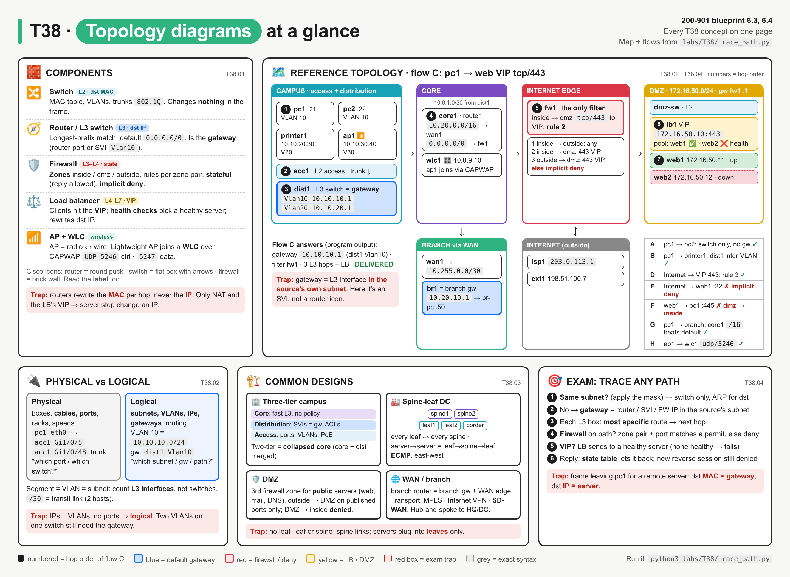
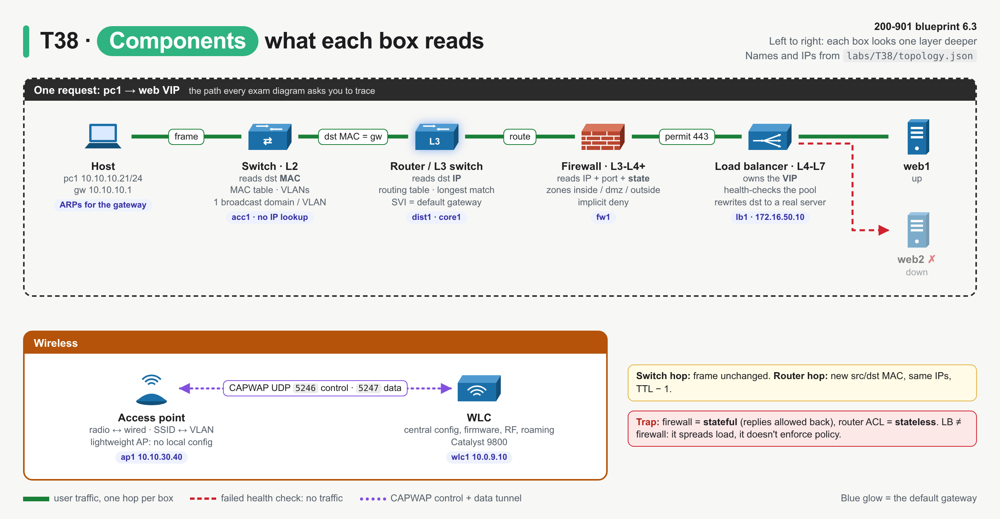
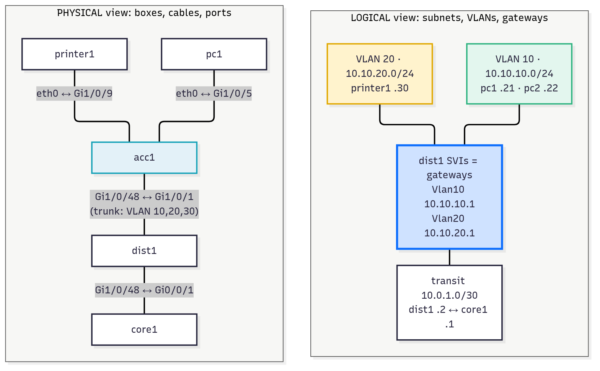
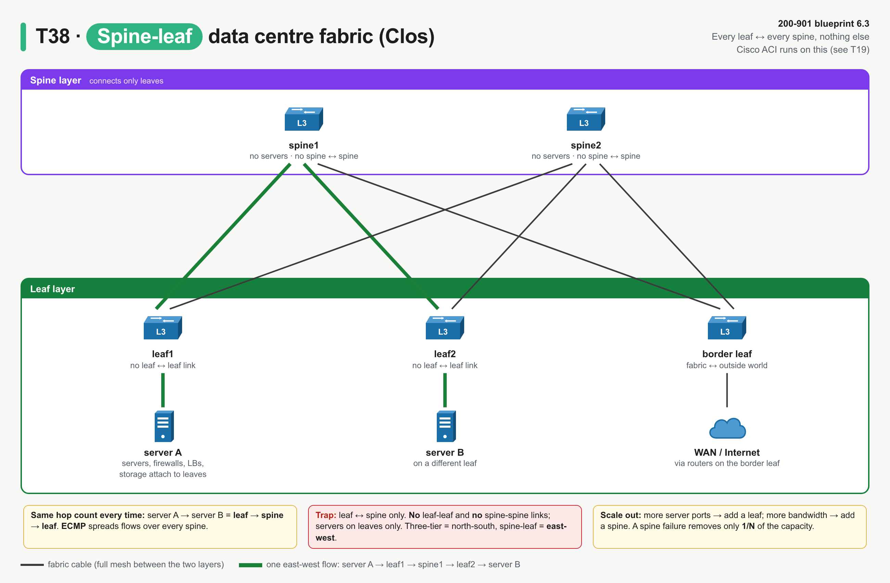
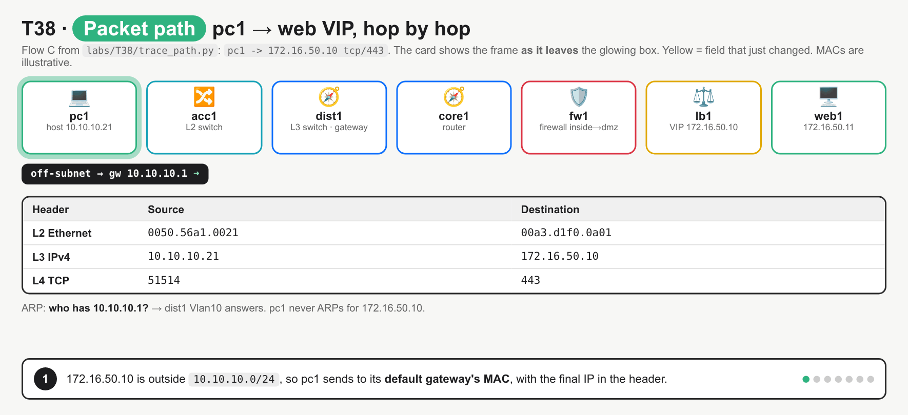

# T38 · Topology diagrams + components: essentials

> Blueprint 6.3, 6.4 · Full note: [bob/T38-topology-diagrams-components.md](../bob/T38-topology-diagrams-components.md)

## In one picture

*Read it as components first (what each box reads and decides), then diagram types and designs, then the trace-the-path checklist; red boxes are exam traps.*

## The big idea

- Each network box reads one header deeper than the last: a switch reads the **MAC**, a router reads the **IP**, a firewall adds **port and state**, and a load balancer owns a **VIP**.
- Topology questions show an exhibit and ask where the gateway is, which device filters, and what path the traffic takes.
- If you can name each component's job and recognise the four standard designs (three-tier, spine-leaf, DMZ, WAN/branch), you can answer any "refer to the exhibit" question.
- For Beedy: a load balancer here is the same idea as an AWS ALB with a target group and health checks, and the DMZ is like a public subnet behind security groups.

## What you need to know

### 1. Components and what each one decides (T38.01)

*Read left to right: each box looks one layer deeper into the packet, the blue glow marks the default gateway, and the red dashed line shows the LB skipping a failed server.*

| Component | Layer | Decides on | Key feature |
|---|---|---|---|
| **Switch** | L2 | dst **MAC** | MAC table, VLANs, 802.1Q trunks |
| **Router** | L3 | dst **IP** | routing table, longest prefix match, default route; separates broadcast domains |
| **L3 (multilayer) switch** | L2 + L3 | both | **SVIs** (`interface Vlan10`) are the gateway for each VLAN |
| **Firewall** | L3–L4 (+ L7 for NGFW) | IP, protocol, **port**, **state** | **zones**, rules per zone pair, first match, **implicit deny** |
| **Load balancer** | L4–L7 | dst = **VIP** | server pool, **health checks**, algorithm; rewrites dst IP |
| **Wireless AP** | L1–L2 | radio ↔ Ethernet | bridges Wi-Fi clients onto the wire; SSID ↔ VLAN |
| **WLC** | mgmt / control | AP config, RF, roaming | lightweight APs join over **CAPWAP** |

- A **switch** forwards frames by destination MAC, floods unknown or broadcast frames within the VLAN only, and changes nothing in the frame.
- A **router** interface or an **SVI** is the default gateway for hosts on that subnet.
- A **stateful firewall** records each permitted session so the reply comes back without a reverse rule, while a plain router ACL is **stateless** and needs both directions.
- Each firewall interface belongs to **one zone**, policy is written per **zone pair** (for example inside → dmz tcp/443), and anything that matches no rule hits the **implicit deny**.
- A **load balancer** owns the **VIP** that clients connect to, health-checks each pool member, sends traffic only to healthy servers, and rewrites the destination to the chosen real server (more in T41).
- An **autonomous AP** is configured one by one, while a **lightweight AP** has no local config and joins a **WLC**, which pushes config, firmware, RF and roaming settings.
- The AP-to-WLC tunnel is **CAPWAP** on UDP **5246** (control, DTLS-encrypted) and **5247** (data), and because it is routed IP, the AP and WLC can be several L3 hops apart.
- Catalyst 9800 is the current Cisco WLC platform, while Meraki APs are cloud-managed instead.
- Cisco's icon set draws a router as a round puck with arrows, a switch as a flat box with arrows, a multilayer switch as a switch box with a router mark, and a firewall as a brick wall; the exam labels devices too. ⚠ verify
- In a **star topology** the central component is the **switch** (or a hub), with every device cabled to it. ⚠ verify (from Beedy's exam-sim review; the full note does not yet name it in the topology section)

### 2. Reading a diagram: physical vs logical (T38.02)

*The same network twice: the physical one shows which port is cabled where, and the logical one hides cables and shows subnets and the gateway (blue).*

| | Physical topology | Logical topology |
|---|---|---|
| Shows | devices, cables, **ports** (`Gi1/0/5`), racks, link speeds, trunks | **subnets**, **VLANs**, IP addresses, **gateways**, routing / traffic flow |
| Answers | "which port, cable or switch is pc1 on?" | "which subnet, which gateway, which path?" |
| Changes when | you re-cable | you re-address or re-VLAN |

- A **segment** is one L2 broadcast domain, which is one VLAN and one IP subnet, so you count segments by counting **L3 interfaces**, not switches.
- The **gateway** is the L3 interface that sits **inside that segment** (for example `10.10.10.0/24 → dist1 Vlan10`, or `172.16.50.0/24 → fw1 dmz`).
- A **/30** on a diagram is a point-to-point **transit** link with 2 usable hosts.
- Two hosts in different VLANs on the **same switch** still need the gateway to talk.

### 3. Common designs (T38.03)

| Layer (three-tier campus) | Job |
|---|---|
| **Access** | end devices plug in: access ports, VLANs, PoE, port security |
| **Distribution** | aggregates access switches; the **L2/L3 boundary** where SVIs are the default gateways, plus ACL/QoS policy and summarisation |
| **Core** | high-speed L3 backbone between distribution blocks, DC, WAN and Internet edge; redundant, no heavy policy |

- **Two-tier = collapsed core**, where core and distribution are merged into one pair of switches, which Cisco recommends for small sites.
- Hierarchy gives fault isolation, predictable paths, and lets you add an access block without touching the core.

*Full mesh between the two layers only: server A to server B always crosses leaf → spine → leaf.*

- In **spine-leaf**, every leaf connects to every spine, leaves never connect to each other, and spines never connect to each other.
- Servers, firewalls, LBs and routers connect to **leaves** only, and a **border leaf** connects the fabric to the WAN/Internet.
- Server-to-server traffic is always **leaf → spine → leaf**, with equal hop count and **ECMP** across all spines.
- Spine-leaf is built for **east-west** traffic (server ↔ server), while three-tier suits **north-south** (users ↔ servers); you add a leaf for ports and a spine for bandwidth, and Cisco ACI runs on it.
- A **DMZ** is a third firewall zone for servers the Internet must reach (web, mail, DNS, reverse proxy): outside → DMZ is allowed only on published ports, DMZ → inside is denied, and inside → DMZ and inside → outside are permitted.
- A **branch** usually has a router that is both the branch gateway and the WAN edge, plus an access switch; the WAN transport is MPLS/leased line, Internet + IPsec VPN, or **SD-WAN**, often in a **hub-and-spoke** layout.

### 4. Exam angle: trace the path (T38.04)

*Watch the header card: switches change nothing, each router rewrites only the MACs, and only the load balancer changes an IP.*

1. **Same subnet?** Apply the source's mask to the destination; if yes, only a switch is involved and there is no gateway.
2. **Gateway** is the router, SVI or firewall interface **in the source's subnet**, and it must actually exist there.
3. **Path** follows each L3 box's most specific route; count L3 hops (routers, L3 switches, firewalls), not switches.
4. **Filter** is any firewall on the path (or a router ACL); name the zone pair and check the port, and anything not listed is denied.
5. **VIP?** The LB picks a **healthy** server, and if none are healthy the request fails at the LB even though the firewall permitted it.
6. **Return traffic** is let back automatically by a stateful firewall, but that does not let the server open a new session the other way.

## Exam traps (the ones that catch people)

- A **switch is not an L3 hop**; a router rewrites **src/dst MAC** each hop while **src/dst IP stay the same**, and IPs only change through **NAT** or the **LB VIP** rewrite.
- A frame leaving a host for a remote server has **dst MAC = gateway** and **dst IP = server**.
- The **gateway isn't always a router icon**: in a campus it's usually an **SVI on the distribution switch**, and in a DMZ it's the **firewall's** DMZ interface.
- **Firewall = stateful, zone-based, implicit deny; router ACL = stateless**. The device inspecting Internet ↔ DMZ traffic is the firewall.
- **LB is not a firewall**: clients target the **VIP**, a failed health check removes a server, and the LB spreads load rather than enforcing policy.
- **Spine-leaf has no leaf-leaf or spine-spine links**, and server-to-server is always leaf-spine-leaf.
- **Collapsed core = two-tier**, not "no core needed".
- A diagram with IP subnets and no port numbers is **logical**; ports, cables and racks are **physical**.
- Blocking **UDP 5246/5247** stops lightweight APs joining the WLC.

## Quick self-check

Q1. pc1 (10.10.10.21/24, VLAN 10) sends to a printer at 10.10.20.30 on the same access switch. Which device is the gateway?
The SVI `Vlan10` on the distribution (L3) switch. Different VLANs are different subnets, so even on the same switch the traffic must be routed.

Q2. An Internet host tries SSH straight to a DMZ web server, and the only outside → dmz rule permits tcp/443 to the VIP. What happens?
It is blocked by the firewall's implicit deny, because no rule matches tcp/22 to the server's real IP.

Q3. In a spine-leaf fabric, how many hops does server-to-server traffic between two leaves take?
Leaf → spine → leaf, always the same, because leaves only connect to spines and never to each other.

Q4. As a packet crosses three routers, which header fields change?
The source and destination MAC are rewritten at each hop and the TTL drops; the IP addresses stay the same unless NAT or a load balancer rewrites them.

Q5. A diagram shows subnets, VLAN IDs and gateway IPs but no port numbers. Is it physical or logical?
Logical, because it shows addressing and routing rather than cables and ports.

## Cheat lines to say out loud

- "Switch reads MAC, router reads IP, firewall reads port and state, LB owns the VIP."
- "Find the gateway in the source's own subnet first."
- "MACs change every hop, IPs only change at NAT or the VIP."
- "Every leaf to every spine, never sideways."
- "Firewall remembers (stateful), ACL forgets (stateless)."
