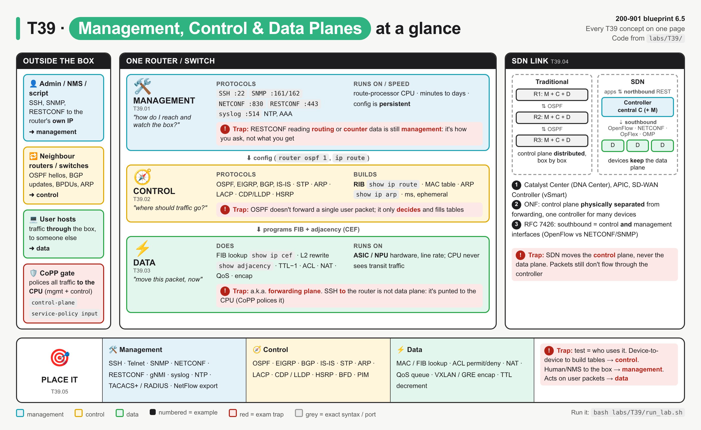
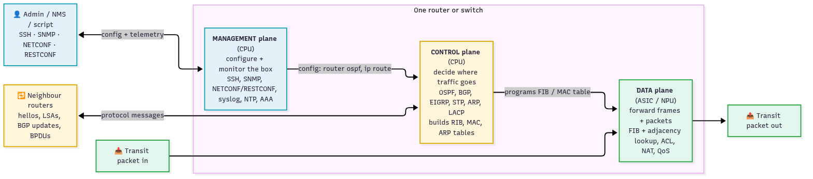
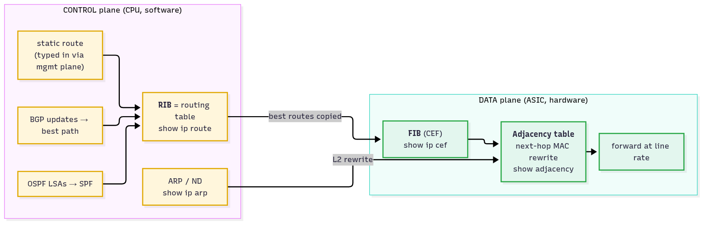
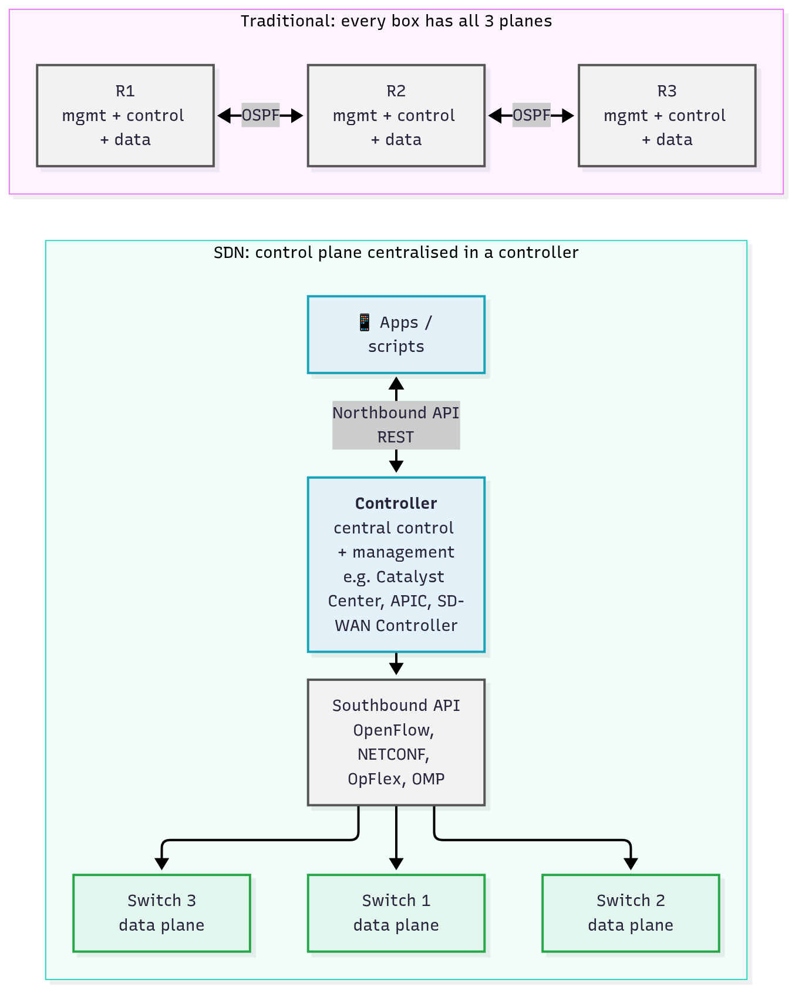

# T39 · Management, control, data planes: essentials

> Blueprint 6.5 · Full note: [bob/T39-management-control-data-planes.md](../bob/T39-management-control-data-planes.md) · Teach-back 2026-10-11

## In one picture

*Read it top to bottom: the management plane configures the box, the control plane decides the paths, and the data plane moves the user's packets; red boxes are exam traps.*

## The big idea

- Every network device does three jobs: you **manage** it (configure and monitor), it **decides** paths with its neighbours (control), and it **forwards** user packets (data).
- Config and decisions flow down: management configures the control plane, the control plane builds the RIB, CEF copies it into the FIB, and the data plane forwards at line rate.
- The exam asks you to place a protocol or function in the right plane, and to know that **SDN centralises the control plane** while devices keep the data plane.
- For Beedy: it is like Kubernetes, where `kubectl`/API is management, the scheduler and controllers are control, and the pods actually serving traffic are data.

## What you need to know

### 1. Management plane: reach and watch the box (T39.01)

*Grey is management, purple is control, green is data, and only the green path carries user packets.*

- The **management plane** is how you access, configure, monitor and maintain the device. It runs in software on the route-processor CPU, and the config it writes is **persistent** once saved.

| Protocol | Port | Use |
|---|---|---|
| SSH | TCP 22 | CLI |
| Telnet | TCP 23 | CLI in clear text (the "insecure" exam choice) |
| SNMP | UDP 161 (poll), UDP 162 (trap) | MIB reads/writes, traps |
| NETCONF | TCP 830 (over SSH) | YANG config/state in XML |
| RESTCONF | TCP 443 (HTTPS) | YANG over REST, JSON/XML |
| gNMI | TCP 9339 on IOS XE ⚠ verify | streaming telemetry |
| syslog | UDP 514 | event logs to a server |
| NTP | UDP 123 | clock (logs and certs depend on it) |
| TACACS+ / RADIUS | TCP 49 / UDP 1812-1813 | device AAA (who logs in, what they run) |
| Controller APIs | HTTPS 443 | e.g. Catalyst Center (DNA Center) REST |

- Typing `router ospf 1` or a static route over SSH (or pushing it via NETCONF) is a **management-plane action**; the OSPF process and the route it creates then live in the control plane.
- NetFlow **collects** records about data-plane traffic, but **exporting** them to a collector is management.
- **Out-of-band management** uses a dedicated mgmt port/VRF (for example `GigabitEthernet0/0` in `Mgmt-intf` on many IOS XE boxes) so you can still reach the device when the data network is down. ⚠ verify the interface name per platform.

### 2. Control plane: decide the paths (T39.02)

- The **control plane** is where devices exchange protocol messages with **each other** and build the tables the data plane uses. It runs on the CPU, reacts in milliseconds, and its state is **ephemeral** (rebuilt after a reload, not saved in the config).

| Protocol | Builds |
|---|---|
| OSPF, EIGRP, IS-IS, BGP, RIP | RIB (`show ip route`) |
| Static route | RIB (typed via management, but the route lives here) |
| ARP (IPv4), ND (IPv6) | ARP / neighbour table → adjacency rewrite |
| STP / RSTP | port forwarding/blocking state (loop-free) |
| MAC learning | MAC address table (which the data plane then uses) |
| LACP, PAgP | which links join an EtherChannel |
| CDP, LLDP | neighbour table (often listed under control) |
| HSRP, VRRP, GLBP | who owns the virtual gateway IP |
| BFD / PIM, IGMP | fast failure detection / multicast tree |

*The RIB never forwards anything: CEF copies the best routes into the FIB, and ARP supplies the L2 rewrite.*

- The **RIB** is the routing table built by the control plane, and the **FIB** (Cisco CEF) is a mirror of its best routes, structured for fast forwarding and held in the data plane.
- The **adjacency table** holds each next hop's outbound interface and MAC header rewrite, filled from ARP.

### 3. Data plane: forward the packets (T39.03)

- The **data plane** (also called the **forwarding plane**) moves each frame or packet from ingress to egress port using the control plane's tables. It runs in hardware (ASICs on switches, NPUs/QFPs on routers) at line rate with no CPU involved.
- Its per-packet work is the MAC table lookup at L2, and at L3 the FIB longest-prefix match (`show ip cef`) plus the adjacency rewrite (`show adjacency`): new MACs, TTL − 1, new checksum.
- Features applied in the forwarding path are also data plane: **ACL permit/deny, NAT translation, QoS** marking/policing/queuing, **VXLAN/GRE/IPsec** encapsulation and uRPF.

| Kind of traffic | Example | Handled by |
|---|---|---|
| **Transit** | a user's HTTPS to a server behind the router | data plane, hardware |
| **Receive** (to the device's own IP) | OSPF hello, BGP, SSH, SNMP | punted to the CPU → control or management plane |
| **Exception** | TTL expiring, IP options, next hop needs ARP (glean) | punted to the CPU, slow path |

- **CoPP (Control Plane Policing)** is a QoS policy on the CPU-bound path that stops a flood of punted packets from starving OSPF or SSH, so it protects **both** control and management planes.
- CoPP is configured under `control-plane` with `service-policy input <policy-map-name>`, checked with `show policy-map control-plane`, and Catalyst 9000 ships a default `system-cpp-policy`.

### 4. SDN: centralise the control plane (T39.04)

*Left, every router decides for itself; right, one controller decides and the switches only forward, and user packets never pass through the controller.*

- **SDN** is the physical separation of the control plane from the forwarding plane, with one control plane controlling several devices.

| Interface | Between | Examples |
|---|---|---|
| **Northbound** | apps/scripts ↔ controller | REST APIs (Catalyst Center Intent API, APIC REST, SD-WAN Manager (vManage) REST) |
| **Southbound** | controller ↔ devices | OpenFlow, NETCONF/RESTCONF, SNMP, CLI/SSH, OpFlex (ACI), OMP (SD-WAN) |
| **East-west** | controller ↔ controller | clustering, BGP between domains |

- The commonly taught Cisco split (⚠ verify against T19/T20/T22) is:
  - **SD-WAN:** SD-WAN Controller (vSmart) is the central control plane (OMP), SD-WAN Manager (vManage) is management, SD-WAN Validator (vBond) handles onboarding, and WAN Edge routers are the data plane.
  - **ACI:** APIC is the policy/management controller and is **not** in the data path, while fabric switches still run local IS-IS, COOP and MP-BGP.
  - **Catalyst Center (DNA Center):** a management/automation controller, where devices keep both their control and data planes.
- The benefits the exam names are one place to configure many devices, a network-wide view, and programmability via the northbound API.

### 5. Exam angle: place it in a plane (T39.05)

| Management | Control | Data |
|---|---|---|
| SSH, Telnet, console | OSPF, EIGRP, IS-IS, RIP | MAC table lookup / L2 switching |
| SNMP, syslog | BGP | FIB lookup (CEF) / routing a packet |
| NETCONF, RESTCONF, gNMI, NX-API | STP / RSTP | ACL permit/deny |
| NTP | ARP / ND | NAT translation |
| TACACS+, RADIUS | LACP / PAgP | QoS marking, policing, queuing |
| NetFlow / IPFIX **export** | CDP, LLDP | VXLAN, GRE, IPsec encap/decap |
| HTTPS GUI, controller REST APIs | HSRP / VRRP, BFD, PIM | TTL decrement, checksum rewrite |

- Ask the data question first: if it touches user packets in flight, it is the data plane, whatever else it does.
- A RESTCONF GET of `ietf-routing:routing-state` uses the **management** transport to read **control**-plane results.

## Exam traps (the ones that catch people)

- **Transport is not content**: NETCONF, RESTCONF or SNMP reading routes or counters is still **management** plane traffic.
- **ARP and STP are control plane** even though they are "Layer 2", because they build tables rather than forward user frames.
- **Static routes** are typed through management, live in the RIB (control) and forward via the FIB (data).
- **SSH to the router's own IP** is management (punted to the CPU), while SSH **passing through** the router is data plane.
- **OSPF and BGP never forward packets**; if the question says "forwards", the answer is the data plane.
- **SDN moves the control plane, not the data plane**, so user packets never flow through Catalyst Center, APIC or the SD-WAN Controller.
- **Northbound = apps → controller (REST); southbound = controller → devices** (OpenFlow, NETCONF, OpFlex, OMP).
- **CoPP protects the CPU** (control + management) and is configured under `control-plane`, not on an interface; **RIB** = `show ip route` (control), **FIB** = `show ip cef` (data).

## Quick self-check

Q1. An attacker floods a router with SSH SYNs and its OSPF neighbours drop. What feature prevents this?
CoPP, because the CPU-bound traffic starved the control plane, and CoPP rate-limits what is punted to the CPU.

Q2. Which plane does ARP belong to?
The control plane, because it builds the ARP/adjacency table that the data plane uses for the MAC rewrite.

Q3. A script uses RESTCONF to read the routing table. Which plane is the RESTCONF traffic in?
Management. The transport is management even though the data it returns is the control plane's result.

Q4. Which plane does an SDN controller take over from the devices?
The control plane (often with management too), but not the data plane, which stays on the devices.

Q5. Which plane applies an ACL permit/deny and a NAT translation to a transit packet?
The data plane, because both act on user packets in flight in the hardware forwarding path.

## Cheat lines to say out loud

- "Management configures, control decides, data forwards."
- "Transit traffic stays in hardware; traffic to me goes to the CPU."
- "Judge the job, not the data: RESTCONF reading routes is still management."
- "ARP and STP build tables, so they're control."
- "SDN takes the brain (control), the muscle (data) stays on the box."
