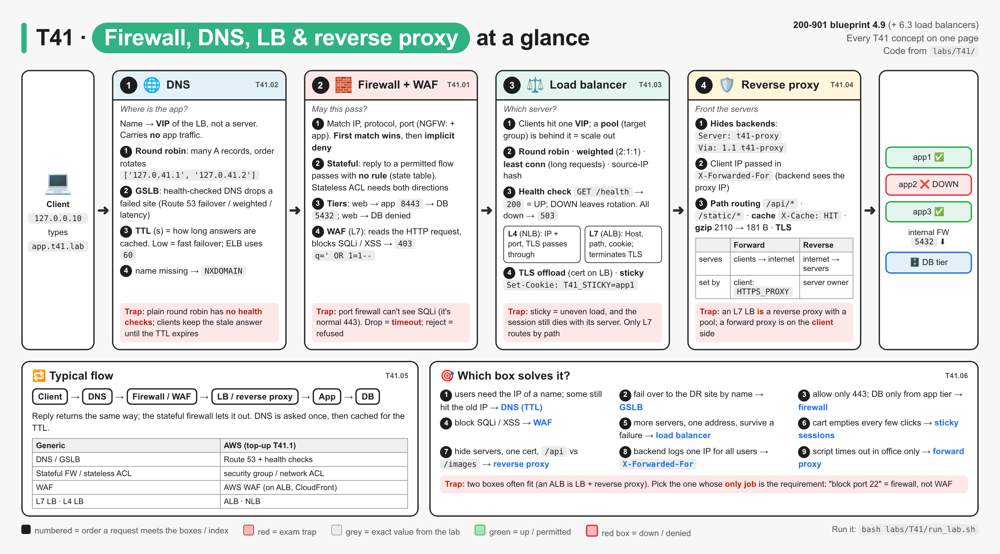
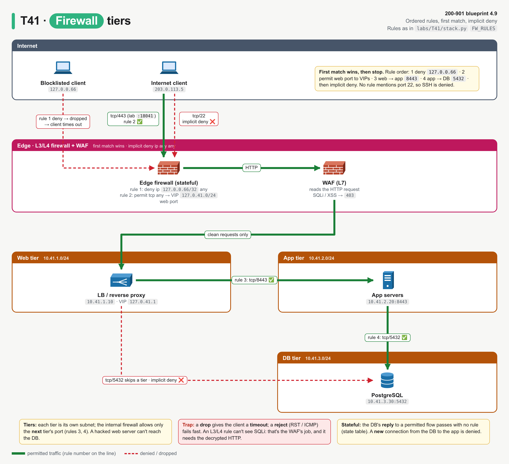
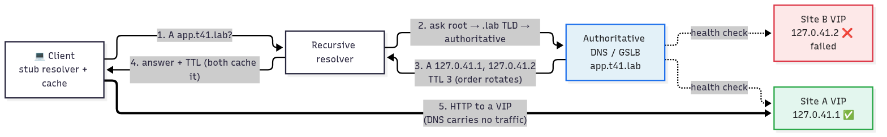
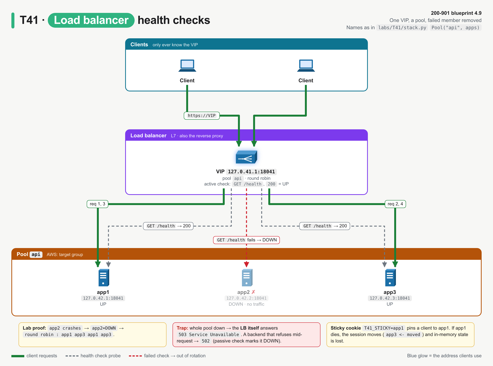
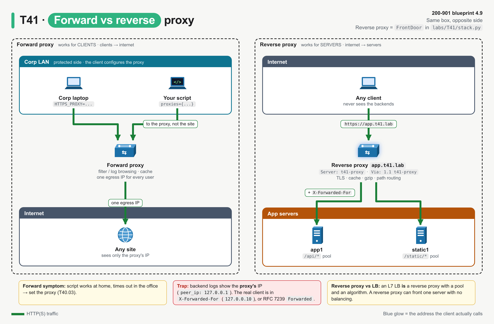
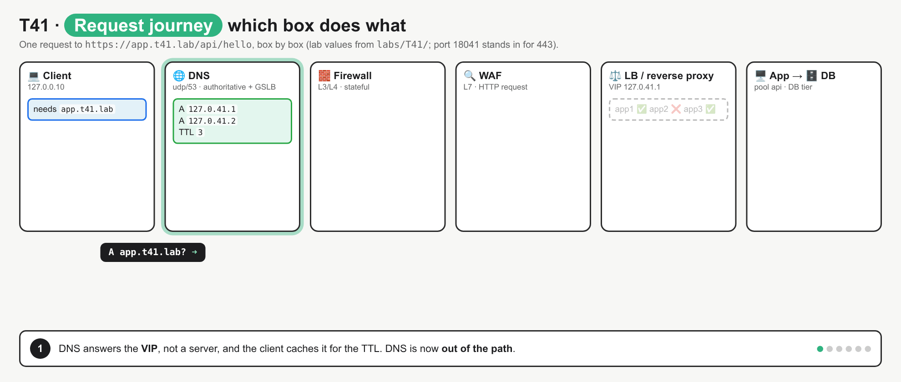

# T41 · Firewall, DNS, LB, reverse proxy: essentials

> Blueprint 4.9 · Full note: [bob/T41-firewall-dns-lb-reverse-proxy.md](../bob/T41-firewall-dns-lb-reverse-proxy.md)

## In one picture

*Read it left to right like a single request; each zone is one box from blueprint 4.9, the numbered circles are the order a request meets them, and the bottom strip is the "which box solves it?" picker.*

## The big idea
Every app deployment puts the same four boxes in front of the servers, and **each box answers exactly one question**: DNS says *where* the app is, the firewall says *whether* a packet may pass, the load balancer says *which* server gets the request, and the reverse proxy *fronts* the servers so clients never see them. Think of a hotel: DNS is the address on the map, the firewall is the security guard at the gate, the load balancer is the front desk handing out rooms, and the reverse proxy is the concierge who speaks for the staff. This is CBT-uncovered (blueprint 4.9), and the exam asks you to pick the right box for a scenario, so knowing each box's single job is the whole game.

## What you need to know

### 1. Firewall: may this packet pass?
- A **firewall** checks traffic against an ordered rule list that matches source/destination IP, protocol (TCP/UDP/ICMP) and destination port.
- **First match wins**, and then it stops checking; if nothing matches, the **implicit deny** at the end (`ip any any`) drops it. You already know this from ACLs.
- A **next-generation firewall (NGFW)**, such as Cisco Secure Firewall Threat Defense managed by Secure Firewall Management Center (FMC), can also match the **application** (for example "allow Webex, block BitTorrent") and adds IPS and URL filtering.

| Type | Looks at | Remembers flows? | Example |
|---|---|---|---|
| Packet filter (**stateless** ACL) | each packet's L3/L4 header | no, so return traffic needs its own rule | router ACL, AWS network ACL |
| **Stateful** firewall | L3/L4 plus connection state | yes, replies to a permitted flow pass automatically | Cisco ASA / Secure Firewall, AWS security group |
| NGFW | plus application, user, IPS, URL reputation | yes | Cisco Secure Firewall (FTD) |
| **WAF** (web application firewall) | the **HTTP request** itself (L7): path, query, headers, body | per request | AWS WAF on an ALB |

- **Stateful** in practice: the app opens a connection to the DB on 5432 (permitted by a rule), and the DB's **reply** passes with **no rule**, because it matches the state table. But if the DB tries to open a **new** connection back to the app, that is not a reply, so it hits the implicit deny.
- **Tier segmentation** puts web, app and DB tiers in separate subnets with a firewall between them that only allows the next hop's port (web → app 8443, app → DB 5432). A hacked web server then cannot reach the database directly.
- **Drop vs reject**: a **drop** silently discards the packet, so the client waits and gets a **timeout**; a **reject** answers with a TCP RST or ICMP unreachable, so the client gets an immediate "refused / unreachable" error.

*Green lines are permitted (with the rule number), red dashed lines are denied; the WAF sits at the edge next to the L3/L4 firewall.*

### 2. WAF: is this HTTP request an attack?
- A **WAF** is an L7 firewall for web apps: it reads the decoded HTTP request and blocks attack patterns like **SQL injection** (`' OR 1=1--`) and **cross-site scripting** (`<script>`).
- It typically blocks with **`403 Forbidden`**, which is AWS WAF's default block response (other WAFs may differ ⚠ verify).
- An L3/L4 firewall **cannot** catch these attacks, because both look like a normal permitted TCP connection to port 443.
- The WAF has to see plain HTTP, so it sits where TLS is decrypted: on or behind the load balancer / reverse proxy, or as a cloud service in front.

### 3. DNS: where is the app?
- **DNS** turns the app's name into an IP, and that IP is normally the **VIP of a load balancer**, not a single server.
- DNS carries **no app traffic**: once the client has the IP, DNS is out of the path until the cached answer expires.
- If `curl https://app...` says "Could not resolve host" but `curl https://<IP>` works, the problem is DNS.
- **DNS round robin** means one name has several A records and the server **rotates the order** on each query; clients usually take the first. It spreads load but has **no health checks** and no idea whether a server is busy or dead.
- **GSLB** (global server load balancing) is DNS that **health-checks** each site and only hands out healthy, nearby or weighted answers. AWS Route 53 does this with routing policies: failover, weighted, latency, geolocation and multivalue.
- **TTL** is how many **seconds** resolvers and clients may **cache** an answer. A low TTL (for example 60 s, which AWS uses for ELB names) gives fast failover but more queries; a high TTL (hours) gives fewer queries but slow changes.
- Before a planned IP change, lower the TTL a day ahead, then change the record.
- **NXDOMAIN** means the name doesn't exist.

*DNS only answers "where"; the HTTP request goes straight to the VIP and doesn't touch DNS again until the TTL runs out.*

### 4. Load balancer: which server gets this request?
- Clients connect to one **VIP** (virtual IP), and behind it sits a **pool** (AWS: target group) of real servers. Adding servers to the pool is **scale-out** with no client change.

| Algorithm | Picks | Use when |
|---|---|---|
| **Round robin** (default in NGINX and AWS ALB) | the next server in turn | servers equal, requests similar |
| **Weighted** | servers in proportion to their weight (2:1:1 gave app1 4 of 8 in the lab) | servers of different sizes |
| **Least connections** | the server with the fewest open requests | requests of very different lengths |
| Source-IP hash | a hash of the client IP | crude persistence without cookies |

- **Health checks** let the LB remove failed servers. An **active** check probes each server on a timer (for example `GET /health`, 200 = UP); a **passive** check notices real requests failing.
- If every server in the pool is down, the LB itself answers **`503 Service Unavailable`**.
- **L4 vs L7** decides what the box can see:

| | L4 LB | L7 LB |
|---|---|---|
| Sees | IP, protocol, port | the HTTP request: Host, path, headers, cookies |
| TLS | passes it through, still encrypted | **terminates** it (needs the certificate) |
| Can do | spread TCP/UDP flows | path/host routing, sticky cookies, header insertion, WAF |
| AWS | **NLB** | **ALB** |

- **TLS offload (termination)** means the LB holds the certificate and decrypts, so backends get plain HTTP. That saves backend CPU, gives one place to renew certificates, and lets the LB (and a WAF) read L7. Variants are **TLS passthrough** (L4, the backend decrypts) and **re-encryption / TLS bridging** (decrypt, inspect, encrypt again).
- **Session persistence (sticky sessions)** keeps one client on one server, for apps that store session state in server memory. At L7 the LB sets a cookie; at L4 it hashes the client IP.
- The cost of stickiness is uneven load, and the session is still lost if that server dies; the better design is stateless apps with a shared session store.

*The health check takes app2 out of the pool, so round robin continues over app1 and app3 while clients keep using the same VIP.*

### 5. Reverse proxy: front the servers
- A **reverse proxy** sits in front of servers and **acts as the server** to the client, passing requests on to one or more real backends. The client never knows the backends exist.

| Feature | What it means |
|---|---|
| **Hides backends** | the client only sees the proxy's IP and headers (backend `Server` header removed, `Via` added) |
| Passes the client IP on | the backend sees the proxy's IP, so the real client IP goes in **`X-Forwarded-For`** (or `Forwarded`) |
| **Path-based routing** | `/api/*` goes to the app pool, `/static/*` to the static pool |
| **Caching** | stores responses that allow it (`Cache-Control: max-age=60`), so the backend isn't asked again |
| **Compression** | gzip when the client sends `Accept-Encoding: gzip` (lab: 2110 → 181 bytes) |
| **TLS termination** | holds the certificate, same as TLS offload |

- A reverse proxy and an L7 load balancer overlap heavily: an **L7 LB is a reverse proxy with a pool and an algorithm**, and NGINX, HAProxy, F5 BIG-IP and AWS ALB all do both.
- **Forward vs reverse proxy** is about whose side it is on:

| | Forward proxy | Reverse proxy |
|---|---|---|
| Works for | **clients** (inside users) | **servers** (the app) |
| Direction | clients → internet | internet → servers |
| Who configures it | the client (`HTTPS_PROXY`, browser setting) | the server owner; clients don't know |
| Exam symptom | script works at home, times out in the office → set the proxy (T40) | backend logs show the proxy's IP → read `X-Forwarded-For` |

*Same kind of box, opposite side: a forward proxy speaks for clients, a reverse proxy speaks for servers.*

### 6. The typical flow and the AWS mapping
- A request travels **client → DNS → firewall/WAF → load balancer / reverse proxy → app servers → database**, and the reply comes back the same way through the stateful firewall's state table.

*DNS never carries the request, the firewall never reads the URL, and only the L7 box picks the server by path.*

| Generic / Cisco wording | AWS |
|---|---|
| DNS, GSLB | Route 53 (routing policies + health checks) |
| Stateful firewall / stateless ACL | security group / network ACL |
| WAF | AWS WAF (on ALB, CloudFront, API Gateway) |
| L7 LB / reverse proxy | Application Load Balancer (ALB) |
| L4 LB | Network Load Balancer (NLB) |

### 7. Exam angle: pick the box from the verb

| Scenario says… | Answer |
|---|---|
| "users reach the app by name"; "app moved, some users still hit the old IP" | **DNS** (old answer cached until **TTL** expires) |
| "fail over to the DR site automatically" | **GSLB / DNS failover** |
| "only allow HTTPS from the internet"; "DB reachable only from the app tier" | **Firewall** (rules, implicit deny, segmentation) |
| "block SQL injection / XSS" | **WAF** |
| "add servers behind one address"; "keep working if one server dies" | **Load balancer** (VIP + pool + health checks) |
| "shopping cart empties every few clicks" | enable **session persistence** (or a shared session store) |
| "hide internal servers"; "one place for certificates"; "send `/api` and `/images` to different servers" | **Reverse proxy** (or L7 LB) |
| "backend logs show every request from the same IP" | they see the proxy/LB; read **`X-Forwarded-For`** |

## Exam traps (the ones that catch people)
- It looks like the reply from the database needs its own rule, but on a **stateful** firewall the state table allows it; only a **stateless** ACL needs a rule in each direction.
- It looks like a specific deny will block the bad host, but if a broad permit sits **above** it, first match wins and the deny never fires.
- It looks like a port firewall can stop SQL injection, but both good and bad requests are just TCP 443 to it; only a **WAF** reading decrypted HTTP can block it.
- It looks like DNS round robin is load balancing, but it has **no health checks** and cached answers ignore changes until the **TTL** expires; GSLB is what adds health checks to DNS.
- It looks like TTL controls routing, but it only controls **caching** (in seconds); "the change hasn't taken effect for some users" is a TTL/cache answer.
- It looks like any load balancer can route by URL path or use a sticky cookie, but only an **L7** LB (ALB) can; an L4 LB (NLB) sees only IP and port and can pass TLS through untouched.
- It looks like forward and reverse proxies are the same thing, but forward is on the **client** side (configured by clients with `HTTPS_PROXY`) and reverse is on the **server** side (invisible to clients).
- It looks like any LB error means "server down", but `502` = bad/no valid reply from a backend, `503` = no healthy backend or overloaded, and `504` = backend didn't answer in time.

## Quick self-check

Q1. Three identical web servers must sit behind one URL and keep working if one fails. Which component?
A load balancer with health checks: one VIP, a pool for scale-out, and health checks that remove the failed server. DNS round robin has no health checks.

Q2. A stateful firewall permits app → DB on 5432 and ends with deny ip any any. What happens to the DB's reply packets?
They are permitted, because they match the connection in the state table. A stateless ACL would need a return rule.

Q3. The edge firewall permits only TCP 443, yet `?q=' OR 1=1--` requests reach the app. What do you add?
A web application firewall. The attack is inside a normal HTTPS request, so only L7 inspection can catch it.

Q4. An A record changed an hour ago, but some users still reach the old IP. The TTL is 86400. Why?
Resolvers and clients may cache the old answer for up to 24 hours (86400 s). Lower the TTL well before a planned change.

Q5. Carts empty every few clicks behind a round-robin LB, and carts live in each server's memory. Quickest LB fix?
Enable session persistence (sticky sessions), so one user stays on one server. Long term, use a shared session store.

## Cheat lines to say out loud
- "DNS = where, firewall = may it pass, LB = which server, reverse proxy = front the servers."
- "L4 sees IP and port; L7 reads the URL. Path routing, cookies and WAF need L7."
- "Stateful remembers the flow, so replies need no rule. Drop = timeout, reject = refused."
- "Round robin DNS has no health checks; TTL is caching, in seconds."
- "Forward proxy speaks for clients, reverse proxy speaks for servers."
