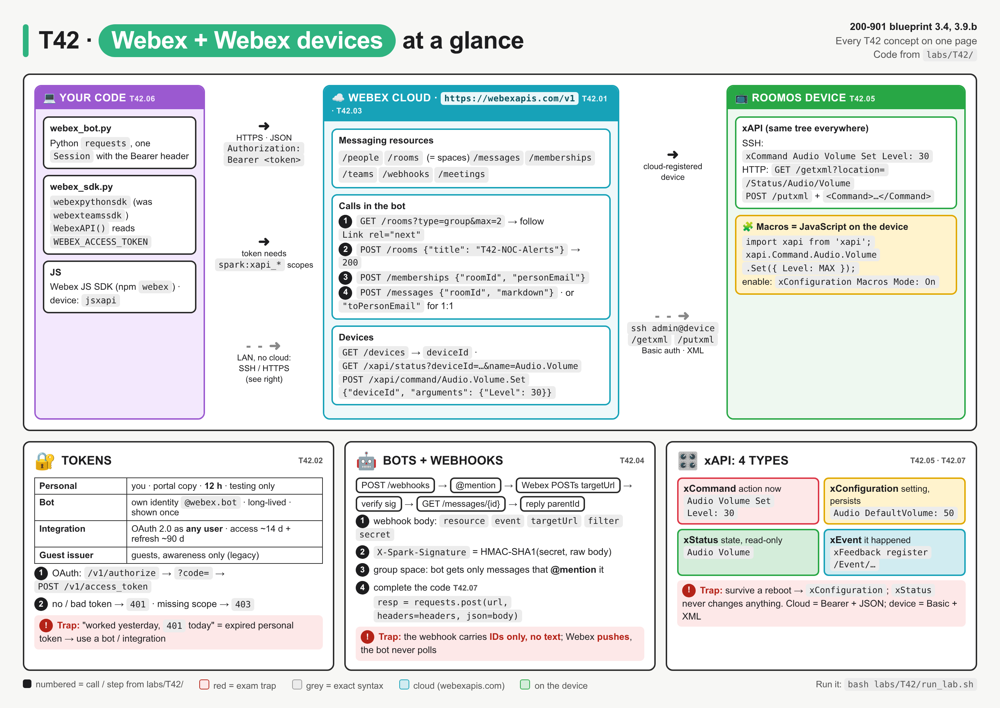
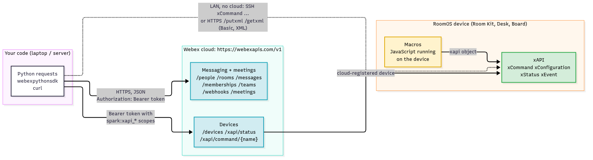
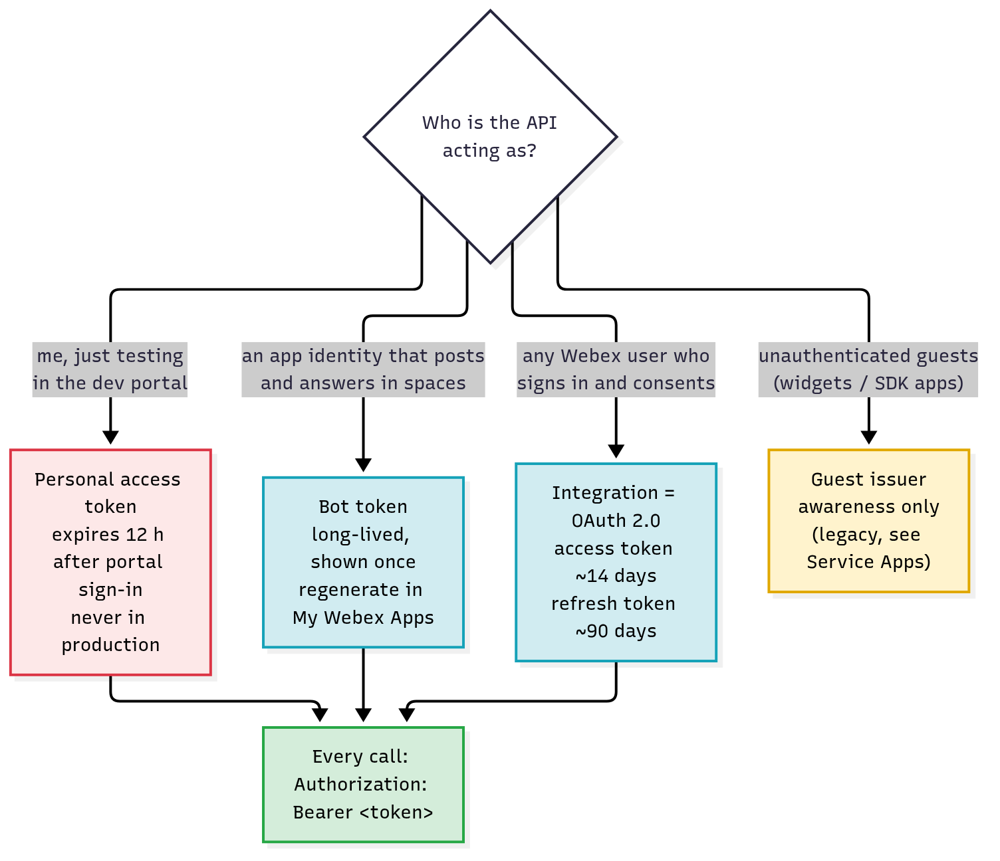
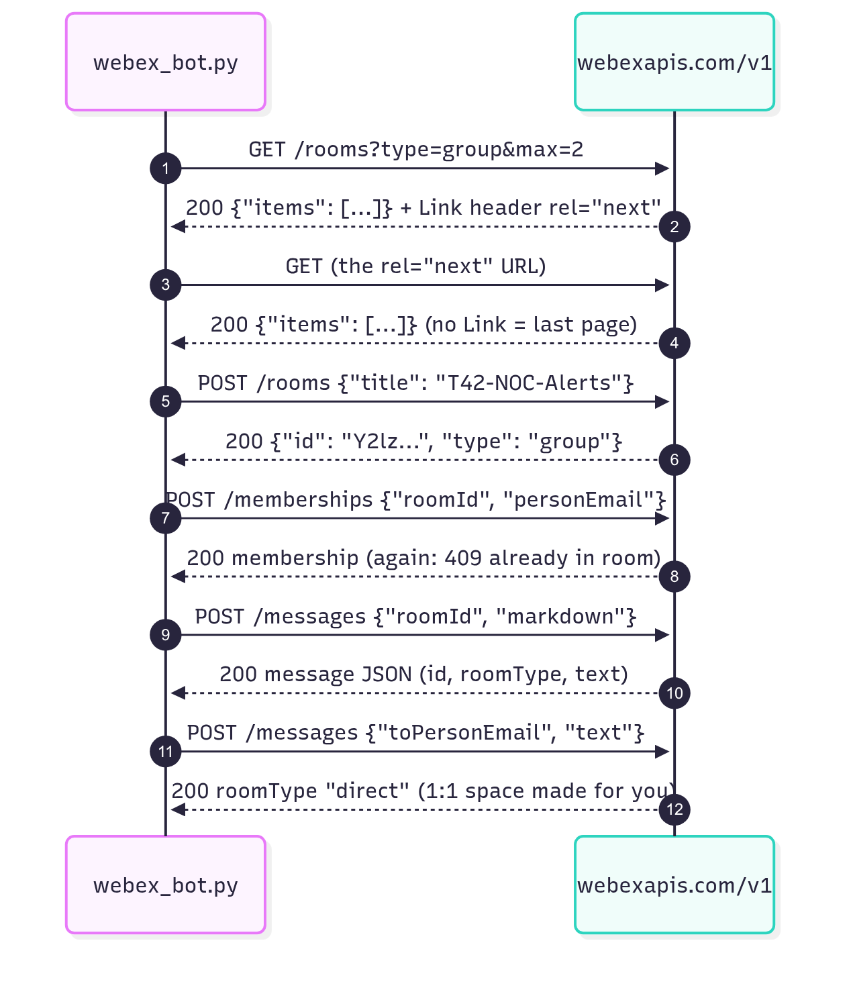
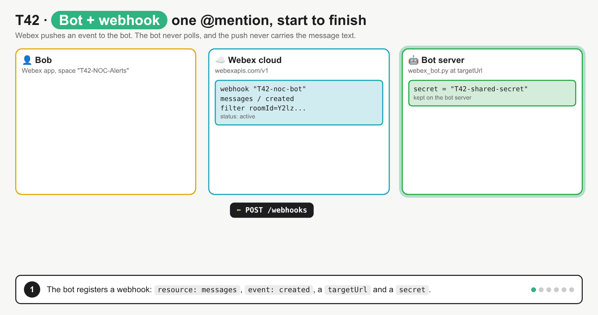
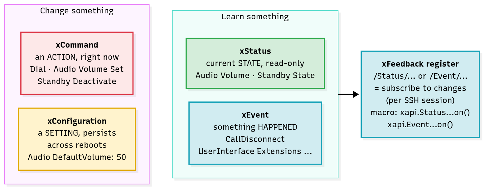
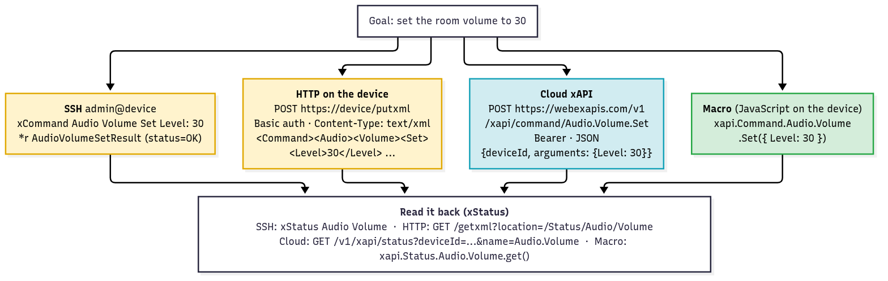

# T42 · Webex + Webex devices: essentials

> Blueprint 3.4, 3.9.b · Full note: [bob/T42-webex-webex-devices.md](../bob/T42-webex-webex-devices.md)

## In one picture

*Read the zones left to right as your code, the Webex cloud and the RoomOS video device; grey chips are exact syntax you should memorise, and red boxes are exam traps.*

## The big idea
Webex is Cisco's cloud collaboration suite (messaging spaces, meetings, calling and video devices), and one REST API covers all of it. For messaging, your script talks to the Webex **cloud** with a token in the header, a bit like logging in to a controller and then sending commands. For video devices, there is a separate API called the **xAPI** that lives on the device itself, and it feels a lot like a CLI with four kinds of commands. On the exam you'll be asked to complete a short "post a message" script, pick the right type of token, and recognise which kind of xAPI line you're looking at.

## What you need to know

### 1. The Webex REST API: one base URL, plural nouns
- Every call goes to the base URL **`https://webexapis.com/v1`**, followed by a resource name such as `/rooms` or `/messages`.
- The old base `https://api.ciscospark.com/v1` dates from the "Cisco Spark" days. That is also why every Webex ID starts with `Y2lzY29zcGFyazovL`: it's base64 of `ciscospark://us/ROOM/<uuid>`.

| Resource | What it is |
|---|---|
| `/people` | users and bots; `/people/me` returns whoever owns the token |
| `/rooms` | **spaces** (the app says "spaces", the API still says "rooms"); `type` is `group` or `direct` (1:1) |
| `/memberships` | who is in which room (person + room + `isModerator`) |
| `/messages` | posts in a room: `text`, `markdown`, `files`, threaded with `parentId` |
| `/teams` | a group of rooms |
| `/webhooks` | "POST to my URL when X happens" |
| `/meetings` | schedule and list Webex meetings |
| `/devices`, `/xapi/...` | RoomOS video devices and their cloud xAPI |

- Lists come back wrapped as `{"items": [...]}`. To get more than one page, set `max` for the page size and follow the **`Link` header** with `rel="next"` until there isn't one.
- **Creating something returns `200`, not `201`** on Webex ⚠ verify (from the API reference examples), and deleting returns `204`.


*Your code reaches messaging and devices through one cloud base URL with a Bearer token (blue); the grey dashed path goes straight to the device on the LAN with no cloud involved.*

### 2. Tokens: who is the API acting as?
- Every request carries the header **`Authorization: Bearer <token>`**. A wrong or missing token gives `401`, and so does forgetting the word `Bearer `.
- The token **is** the identity: `GET /people/me` tells you who owns it, and a bot token comes back with `"type": "bot"`.
- Pick the token type by **who the API is acting as**:

| Token | Where you get it | Acts as | Lifetime | Use for |
|---|---|---|---|---|
| **Personal access token** | copy it from developer.webex.com after sign-in | **you** | **12 h** after you sign in to the portal ⚠ verify | testing only |
| **Bot token** | create a bot in My Webex Apps; shown **once** | the bot (`name@webex.bot`) | long-lived (a Cisco Live lab quotes 100 years ⚠ verify); regenerate if lost | notifications, ChatOps alerts |
| **Integration** (OAuth 2.0) | register an integration → client ID + secret → authorization-code grant | **any user** who signs in and approves | access ~**14 days**, refresh ~**90 days** ⚠ verify | apps that act on behalf of users |
| **Guest issuer** | legacy issuer ID + secret that makes guest JWTs | a temporary guest | short | awareness only; Cisco now points guests to Service Apps ⚠ verify |

- **Scopes** limit what a token is allowed to do, for example `spark:messages_write`, `spark:rooms_read`, `spark:xapi_statuses`, `spark:xapi_commands`. A token with a missing scope gets **`403`**, not `401`.
- The **integration flow** works like this: your app redirects the user to `/v1/authorize`, the user signs in to Webex and approves, Webex redirects back with a one-time `code`, and your app swaps that code (with its client secret) at `/v1/access_token` for a real token.
- A **Service App** is a newer machine account that an org admin authorises, useful for unattended automation that shouldn't depend on one user. Awareness only.


*Choose by who the API acts as; all real token types go in the same `Authorization: Bearer` header.*

### 3. The calls you must know: rooms, memberships, messages
- **List rooms** with `GET /rooms`. It only returns rooms that **this token** is a member of.
- **Create a room** with `POST /rooms` and the body `{"title": "T42-NOC-Alerts"}`. The creator becomes a member automatically, and the reply contains the new room `id`.
- **Add a person** with `POST /memberships` and `{"roomId": ..., "personEmail": "bob@example.com"}`. Adding the same person twice returns `409`.
- **Post a message** with `POST /messages`. The body needs two things:
  1. **Where it goes:** either `roomId` (a space) **or** `toPersonEmail` / `toPersonId` (a 1:1 chat). With `toPersonEmail`, Webex finds or creates the 1:1 space for you, so you never `POST /rooms` for a direct chat.
  2. **What it says:** at least one of `text`, `markdown` or `files` (a list holding **one** public URL). If none are present, you get `400`.
- Add an optional `parentId` to reply inside a thread.
- Too many calls give **`429 Too Many Requests`** with a **`Retry-After`** header (seconds to wait). Webex doesn't publish one fixed limit.

This is the exam's favourite "complete the code" script. Read it line by line:

```python
import requests

url = "https://webexapis.com/v1/messages"                 # base URL + the messages resource
headers = {"Authorization": "Bearer " + token,             # "Bearer " + token, with the space
           "Content-Type": "application/json"}             # the body is JSON
body = {"roomId": room_id, "markdown": "**Link down**"}    # where (roomId) + what (markdown)
resp = requests.post(url, headers=headers, json=body)      # POST creates the message
print(resp.status_code, resp.json()["id"])                 # 200 + the new message id
```
*In plain words: send a POST to the messages endpoint with my token, telling it which space and what text, then print the status code and the new message's ID.*


*The usual order is list, create, add, post; the 1:1 message needs no room at all.*

### 4. Bots and webhooks: Webex pushes, the bot doesn't poll
- A **bot** is its own Webex identity (email ending `@webex.bot`, its own token) that shows up in spaces like a person, and it keeps working if the person who created it leaves the company.
- In **group spaces** a bot only sees messages that **@mention** it; in 1:1 spaces it sees everything.
- A bot learns about new messages through a **webhook**: you register it once with `POST /webhooks`, and from then on Webex **POSTs to the bot's `targetUrl`** whenever the event happens. Think of it like an SNMP trap instead of polling.
- Webhook fields are `name`, `targetUrl` (must be reachable from the internet), `resource` (for example `messages`), `event` (for example `created`), `filter` (for example `roomId=...`) and `secret`.
- The key fact: **the webhook body carries IDs only, never the message text**. The bot must call `GET /messages/{data.id}` with its own token to read what was typed.
- If you set a `secret`, Webex signs every POST with HMAC-SHA1 of the body and puts it in the **`X-Spark-Signature`** header. The bot recomputes it and ignores anything that doesn't match.
- The whole bot pattern is: verify signature → read `data.id` → `GET /messages/{id}` → decide → `POST /messages` (with `parentId` to reply in a thread).
- Interactive buttons and forms are **Adaptive Cards**. Awareness only.


*Register webhook → someone @mentions the bot → Webex POSTs IDs to targetUrl → bot checks the signature → bot GETs the message text → bot replies in a thread.*

### 5. Webex devices and the xAPI: four kinds of command
- **RoomOS** is the operating system on Cisco collaboration devices (Room Kit, Room Bar, Desk Pro, Board), and the **xAPI** is its API. It feels like a CLI, and the same command tree works over every access method.
- There are **four xAPI types**, and the exam shows you a line and asks which one it is:

| Type | What it is | Example | Router analogy |
|---|---|---|---|
| `xCommand` | an **action**, done now (dial, set volume, wake up) | `xCommand Audio Volume Set Level: 30` | an exec command like `clear counters` |
| `xConfiguration` | a **setting** that **survives a reboot** | `xConfiguration Audio DefaultVolume: 50` | a line in the running/startup config |
| `xStatus` | the current **state**, **read-only** | `xStatus Audio Volume` | a `show` command |
| `xEvent` | something **happened** (call ended, button pressed) | `xFeedback register /Event/CallDisconnect` | a syslog message or trap |

- **`xFeedback register <path>`** subscribes your SSH session to changes under `/Status/...`, `/Configuration/...` or `/Event/...`. Cisco's docs say never register for all of `/Status`.
- Over SSH the replies start with a prefix: `*r` for a command result, `*c` for configuration, `*s` for status, and `*e` for events ⚠ verify.


*Left side changes the device; right side is what you read or get told about.*

### 6. Four ways to reach the xAPI
- You can reach the same xAPI four ways, and the exam may show a URL and ask which one it is:

| Method | Address | Auth | Format | Read volume | Set volume to 30 |
|---|---|---|---|---|---|
| **SSH** | `ssh admin@<device>` | local device user | text | `xStatus Audio Volume` | `xCommand Audio Volume Set Level: 30` |
| **HTTP(S) on the device** | `https://<device>/getxml`, `/putxml` | **Basic** (local user) | **XML**, `Content-Type: text/xml` | `GET /getxml?location=/Status/Audio/Volume` | `POST /putxml` with `<Command>...</Command>` |
| **Cloud xAPI** | `https://webexapis.com/v1/xapi/...` | **Bearer** token with xAPI scopes | **JSON** | `GET /xapi/status?deviceId=...&name=Audio.Volume` | `POST /xapi/command/Audio.Volume.Set` with `{"deviceId", "arguments": {"Level": 30}}` |
| **Macro** | runs **on the device** | none (local `xapi` object) | JavaScript | `xapi.Status.Audio.Volume.get()` | `xapi.Command.Audio.Volume.Set({ Level: 30 })` |

- **Cloud path naming** is just the SSH words joined with dots: `xCommand Audio Volume Set` becomes `/xapi/command/Audio.Volume.Set`. The `deviceId` comes from `GET /devices`. Cloud configuration changes go through a separate Device Configurations API, not `/xapi` ⚠ verify.
- On-device HTTP maps the path into **nested XML tags**: `xCommand Audio Volume Set Level: 70` becomes `<Command><Audio><Volume><Set><Level>70</Level></Set></Volume></Audio></Command>`.
- **Macros** are JavaScript programs that run **on the device itself** in a sandbox. You enable them with `xConfiguration Macros Mode: On` and write them in the device's Macro Editor. They automate the room (react to buttons, cap the volume, post to a webhook).


*SSH and HTTP talk to the device directly on the LAN; the cloud xAPI goes through webexapis.com and needs the device to be cloud-registered; a macro runs on the device.*

### 7. SDKs (awareness only)
- The Python SDK is **`webexpythonsdk`**, which was called **`webexteamssdk`** before "Webex Teams" became "Webex".
- You create it with `WebexAPI(access_token=...)`, or with no argument it reads the **`WEBEX_ACCESS_TOKEN`** environment variable.
- Resources become attributes such as `api.messages.create(roomId=..., markdown=...)` and `api.rooms.list()`. The `.list()` call follows paging for you, it waits on `429` by default, and errors raise `ApiError` instead of returning a status code.
- The **Webex JS SDK** (npm package `webex`) is for browser and Node apps. Device control from JavaScript uses macros or `jsxapi`, not this SDK.

## Exam traps (the ones that catch people)
- It looks like the base URL could be `api.webex.com` or `/api/v1`, but it's actually **`https://webexapis.com/v1`** (`api.ciscospark.com` is the legacy name).
- It looks like any auth header will do, but Webex wants **`Authorization: Bearer <token>`**, not `X-Auth-Token` (Catalyst Center), not the Meraki header, and not Basic.
- It looks like a 1:1 message needs a room first, but you just `POST /messages` with **`toPersonEmail`**; `POST /rooms` always makes a group room.
- It looks like the script "broke overnight" with a `401`, but a **personal access token expires after 12 h**; production code should use a bot or an integration.
- It looks like a bot and an integration are the same, but a **bot acts as itself** (`@webex.bot`, long-lived token) while an **integration acts as the user** who approved it (OAuth, ~14-day access + ~90-day refresh).
- It looks like the webhook body contains the message, but it carries **IDs only**; the bot must `GET /messages/{data.id}`.
- It looks like `xStatus` could change the volume, but `xStatus` only **reads**; a change "that must survive a reboot" is **`xConfiguration`**, and a one-off action is **`xCommand`**.
- It looks like macros are a cloud or Python feature, but they are **JavaScript running on the device**.

## Quick self-check
<details><summary>Q1. Fill the blanks: url = "https://webexapis.com/v1/____"; headers = {"Authorization": "____ " + token}; json={"____": room_id, "markdown": "..."}</summary>`messages`, `Bearer`, `roomId`. A 1:1 message would use `toPersonEmail` instead of `roomId`.</details>

<details><summary>Q2. A nightly job must post as "NOC Bot" for years without anyone renewing a token. Which token?</summary>A bot token: it's its own identity and long-lived. A personal token dies after 12 h, and an integration acts as a user and needs refreshing.</details>

<details><summary>Q3. A Room Kit must start every boot at volume 40. Which xAPI line?</summary>`xConfiguration Audio DefaultVolume: 40`. Configurations persist across reboots; `xCommand ... Set` is a one-off action.</details>

<details><summary>Q4. A bot's webhook receives {"resource": "messages", "event": "created", "data": {"id": "...", "roomId": "..."}}. How does it read the text?</summary>It calls `GET /v1/messages/{data.id}` with its own bot token, because the webhook carries IDs only.</details>

<details><summary>Q5. Which request reads the volume directly from the device without the cloud?</summary>`GET https://<device-ip>/getxml?location=/Status/Audio/Volume` with Basic auth. `webexapis.com/v1/xapi/...` goes through the cloud.</details>

## Cheat lines to say out loud
- "webexapis dot com slash v1, Authorization Bearer, every call."
- "Personal 12 hours, bot forever, integration acts as the user."
- "Message = where (roomId or toPersonEmail) + what (text, markdown or files)."
- "Webhook brings the ID, the bot fetches the text."
- "Command does, Configuration remembers, Status shows, Event tells."
