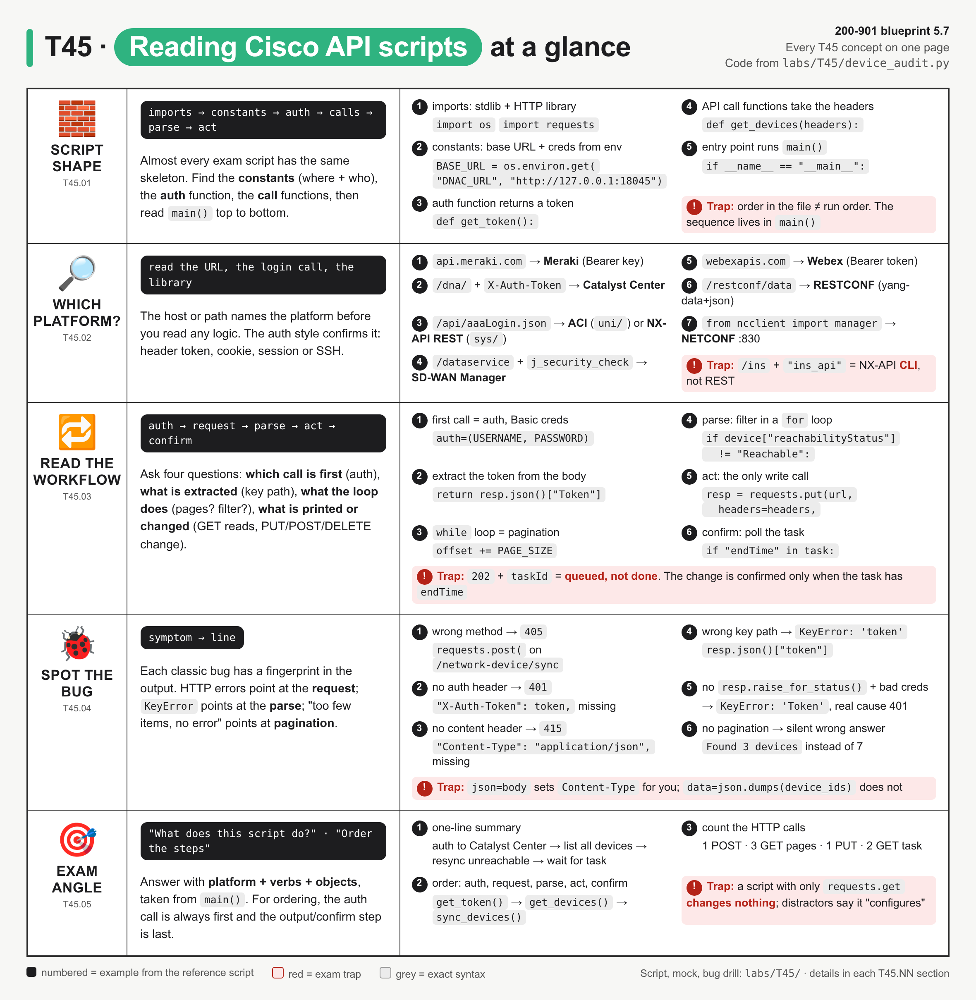
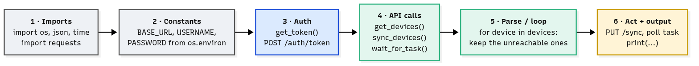
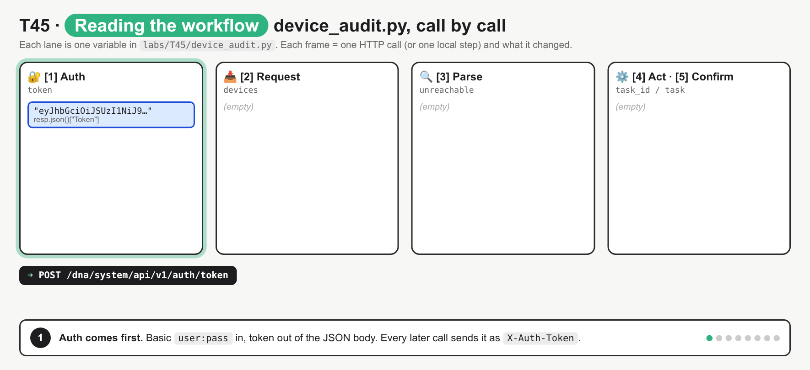
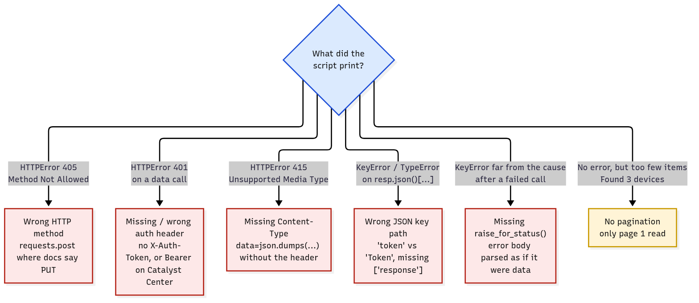

# T45 · Reading Python scripts using Cisco APIs: essentials

> Blueprint 5.7 · Full note: [bob/T45-reading-python-scripts-using-cisco-apis.md](../bob/T45-reading-python-scripts-using-cisco-apis.md) · Teach-back 2026-11-01

## In one picture

*Read it row by row: the script skeleton, the URL fingerprints that name the platform, the call-by-call workflow, and the symptom → bug table; red boxes are exam traps.*

## The big idea
You don't need to be able to write these scripts from scratch; you need to **read** a 15–40 line exhibit with no comments and say what it does. Almost every Cisco API script has the same shape, like a change runbook: log in, pull the data, filter it, make a change, then confirm. Once you know that skeleton, each line just drops into a slot instead of being read word by word. The exam asks "what does this script do?", "put the steps in order", "which line does X?" and "why did it fail?".

## What you need to know

### 1. The skeleton: every script has the same six layers
- Bob's reference script `device_audit.py` logs in to Catalyst Center (DNA Center), lists every device page by page, finds the unreachable ones, asks Catalyst Center to resync them, and waits for the task to finish.


*Six layers left to right: grey is setup, blue is auth, green is reading and parsing, yellow is the part that changes something.*

| Layer | What it looks like | What it tells you |
|---|---|---|
| **1. Imports** | `import requests`, `from ncclient import manager`, `import meraki` | `requests` = a REST API; `ncclient` = NETCONF over SSH; an SDK import names the platform outright |
| **2. Constants** | `BASE_URL = os.environ.get("DNAC_URL", ...)` in UPPER_CASE | *where* (scheme, host, port) and *who* (credentials, read from environment variables) |
| **3. Auth function** | `get_token()` POSTing to `/auth/token` with `auth=(USERNAME, PASSWORD)` | one call that turns credentials into a reusable token or cookie |
| **4. API call functions** | `get_devices(headers)`, `sync_devices(...)` | one function per endpoint: build URL, send one method, check status, return the useful JSON |
| **5. Parse / loop** | `for device in devices:` + `if ...:` | walks the list, picks fields, filters |
| **6. Act + output** | `requests.put(...)`, `print(...)` | the change and the report; no act layer means the script is just a **report** |

- `os.environ.get("X", default)` returns the default if the variable isn't set, while `os.environ["X"]` raises `KeyError` instead.
- `verify=False` skips the TLS certificate check (common with lab boxes that have self-signed certs) and makes `requests` print an `InsecureRequestWarning`.
- `if __name__ == "__main__": main()` means "run `main()` when this file is executed directly". **`main()` decides the run order**, not the order functions are written in the file.

### 2. Name the platform from the URL first
- Before reading any logic, look at the **URL** (host, then path), then the **login call**, then the **header** that carries the credential. Two of the three nearly always agree.

| Fingerprint in the script | Platform | Auth you'll see | Where the data sits |
|---|---|---|---|
| `https://api.meraki.com/api/v1/...` | **Meraki Dashboard** | `Authorization: Bearer <API key>` | plain JSON list or dict |
| `/dna/system/api/v1/auth/token`, `/dna/intent/api/v1/...` | **Catalyst Center (DNA Center)** | POST Basic → `{"Token": ...}` → header **`X-Auth-Token`** | `{"response": [...]}` |
| `/api/aaaLogin.json` + `uni/`, `fvTenant` | **ACI (APIC)** | POST `aaaUser` JSON → cookie `APIC-cookie` | `{"imdata": [...]}` |
| `/api/aaaLogin.json` + `sys/`, `/api/mo/sys/...` | **NX-API REST** (Nexus) | same `aaaLogin` → session cookie | `imdata` → class → `attributes` |
| `/ins` + `"ins_api"` | **NX-API CLI** (Nexus) | HTTP Basic | `ins_api` → `outputs` → `output` → `body` |
| `/j_security_check`, `/dataservice/...` | **Catalyst SD-WAN Manager (vManage)** | form login → `JSESSIONID` cookie, plus `X-XSRF-TOKEN` | `{"data": [...]}` |
| `https://webexapis.com/v1/...` | **Webex** | `Authorization: Bearer <token>` | `{"items": [...]}` for lists ⚠ verify |
| `/restconf/data/<module>:<container>` | **RESTCONF** on IOS XE / NX-OS | HTTP Basic, `Accept: application/yang-data+json` | `{"ietf-interfaces:interfaces": {...}}` |
| `from ncclient import manager`, `port=830` | **NETCONF** | SSH username/password | XML (`reply.data_xml`) |

- **Close calls:** `/api/aaaLogin.json` alone doesn't decide it, so look at the object path: `uni/...` is ACI and `sys/...` is Nexus NX-API REST.
- `/ins` is NX-API **CLI** (show commands wrapped in JSON), whereas `/api/mo/...` is NX-API **REST**.
- A Bearer header alone doesn't pick the platform, because Meraki and Webex both use it, so fall back to the host name.
- `/restconf/` talks to **one device**, while `/dna/` and `/dataservice` are **controller** APIs that manage many devices.

### 3. Read the workflow: auth → request → parse → act → confirm
- Answer four questions in this order, and you have the whole script.


*Auth → page 1 → page 2 → page 3 (short page, stop) → filter → PUT sync (202) → poll the task → done; one GET does not return the whole inventory, and a 202 does not mean the change is finished.*

1. **Which call happens first?** Nearly always the **auth** call. In `main()`, `token = get_token()` runs before anything else, and the token goes into a `headers` dict that **every** later call sends.
2. **What data is extracted?** Follow the key path after `.json()`. `resp.json()["Token"]` is the token string; `resp.json()["response"]` is the list of devices; `device["hostname"]` and `device["reachabilityStatus"]` are the fields printed or tested.
3. **What does each loop do?** There are three common loop shapes:
   - `while True:` + `offset += PAGE_SIZE` + "stop when a page comes back short" is **pagination** (reading page after page).
   - `for device in devices:` + `if ...:` + `.append(...)` is a **filter**, done locally with no API calls.
   - `for _ in range(10):` + `time.sleep(1)` + "stop when `endTime` appears" is **polling** a task.
4. **What gets printed or changed?** Only **PUT, POST, PATCH or DELETE** change anything (the login POST doesn't count). A script with only GETs is a **report**.

- Catalyst Center's `offset` is **1-based**, so pages start at 1, 4, 7 with `limit=3`, or 1, 501, 1001 with the real maximum `limit=500`.
- A **`202 Accepted`** with a `taskId` means the job is **queued, not done**. The script only knows it worked after polling `GET /dna/intent/api/v1/task/{taskId}` until `endTime` appears.

How to read the arguments of a `requests` call (this is what the exam tests on syntax):

```python
resp = requests.put(url, headers=headers, params={"forceSync": "false"},
                    data=json.dumps(device_ids), verify=False, timeout=10)
```
*In plain words: send a PUT (a change) to this URL, with my token in the headers, `?forceSync=false` added to the URL, the device IDs as a hand-built JSON body, no certificate check, and give up after 10 seconds.*

| Argument | What it does |
|---|---|
| `params=` | builds the **query string** (`?offset=1&limit=3`) |
| `data=` | sends a raw body string, so you must add the `Content-Type` header yourself |
| `json=` | turns a Python dict into JSON **and** sets `Content-Type: application/json` for you |
| `auth=(u, p)` | adds an HTTP **Basic** auth header |
| `headers=` | custom headers, such as the token |
| `timeout=10` | give up after 10 s instead of hanging forever |

And the classic way to loop over the result:

```python
for device in resp.json()["response"]:
    print(device["hostname"], device["reachabilityStatus"])
```
*In plain words: turn the reply into Python data, go into the `"response"` list, and print two fields from each device.*

### 4. Spot the bug from the symptom
- Bob planted each bug, one at a time, in a copy of the script and ran it; these are the real symptoms.

| Bug | Symptom | Why |
|---|---|---|
| **Wrong HTTP method** (POST instead of PUT on `/sync`) | `405 Method Not Allowed` | the URL exists, but not with that method |
| **Missing auth header** (`X-Auth-Token` line deleted) | `401 Unauthorized` on the **first GET** | login worked, but the token never went out |
| **Missing `Content-Type`** with `data=json.dumps(...)` | `415 Unsupported Media Type` on the PUT | the body went out as an untyped string; GETs still work because they have no body |
| **Wrong JSON key** (`["token"]` instead of `["Token"]`) | `KeyError: 'token'` | JSON keys are case-sensitive |
| **Missing `raise_for_status()`** with a wrong password | `KeyError: 'Token'` (with it: a clear `HTTPError: 401`) | the 401 error body has no `Token` key, so it fails one line later with a misleading message |
| **No pagination** | `Found 3 devices`, "All devices reachable", **no error** | the unreachable devices were on pages 2 and 3; this is the worst bug because it looks fine |


*Start from what the script printed: red means it crashes with a clue, yellow means no error and a wrong answer.*

- **`raise_for_status()`** raises an `HTTPError` for any 4xx/5xx and does nothing for 2xx/3xx. Without it, `requests` hands you the error response as if it had worked, and the script only notices later when it reads the body.
- Other bugs the exam likes: a URL joined without a slash (`BASE_URL + "dna/..."`), the wrong base path for the platform, the token sent the wrong way (`Bearer` to Catalyst Center or `X-Auth-Token` to Meraki), calling `.json()` on a `204` (no body, so `JSONDecodeError`), indexing a list like a dict (`["response"]["hostname"]` gives a `TypeError`), and an unused loop variable (`for device in devices: print(devices["hostname"])`).

### 5. Exam angle: how to answer each question type
- **"What does this script do?"** Build the answer as **platform + verbs + objects + filter**, all taken from `main()`. For `device_audit.py`: `/dna/` = Catalyst Center; GET then PUT; `network-device`, `sync`, `task`; filter `reachabilityStatus != "Reachable"` → "Authenticates to Catalyst Center, gets all devices, resyncs the unreachable ones and waits for the task to finish."
- The wrong answers are usually built from a **wrong platform**, a **wrong verb** ("configures" for a GET-only script), a **wrong scope** ("all devices" when there's an `if` filter) or a **wrong output** ("writes a file" when it only prints).
- **"Put the steps in order":** import and set constants → authenticate and get the token → build headers with the token → GET the data (page by page) → parse/filter → act (PUT/POST/DELETE) → confirm/print. Auth is never after a data call.
- **"Which line…?":** be ready to point at the line that sends the credentials (`auth=(USERNAME, PASSWORD)`), extracts the token (`["Token"]`), reads more than one page (`offset += PAGE_SIZE`) and makes a change (`requests.put`).
- **Fill-in-the-blank** is usually the method (`requests.put`), the header name (`X-Auth-Token`), the key (`"response"`) or `raise_for_status`.

## Exam traps (the ones that catch people)
- It looks like functions run in the order they're written, but **`main()` decides the run order**; `sync_devices` is defined before `main` and still runs after `get_devices`.
- It looks like a script with lots of loops "configures" something, but if it only uses GET (plus the login POST), it's a **report** that changes nothing.
- It looks like `POST /auth/token` or `/api/aaaLogin.json` "creates" something, but it only creates a **session**, not a network object.
- It looks like `202` means the change is done, but `202` + `taskId` means **queued**; only polling the task confirms it.
- It looks like every Cisco API uses `Authorization: Bearer`, but **Catalyst Center uses `X-Auth-Token`**, and ACI and SD-WAN Manager use **cookies**.
- It looks like `["token"]` and `["Token"]` are the same, but JSON keys are **case-sensitive**, and Catalyst Center's key is `"Token"` with a capital T.
- It looks like a `KeyError` is a key-path bug, but it can also be a **missing `raise_for_status()`**; check the HTTP status of the call before it.
- It looks like a script that returns exactly 500 items with no error is fine, but that's a hint of **missing pagination** (500 is Catalyst Center's page limit).

## Quick self-check
<details><summary>Q1. A script POSTs to /dna/system/api/v1/auth/token, GETs /dna/intent/api/v1/network-device with X-Auth-Token, and prints hostname and version for devices where softwareVersion != "17.9.4a". What does it do?</summary>It prints the hostname and version of Catalyst Center devices not on 17.9.4a. There's only a GET, so nothing is upgraded, and the `if` filters it.</details>

<details><summary>Q2. Login to Catalyst Center works, but the first GET returns 401. Headers are {"Authorization": f"Bearer {token}"}. Fix?</summary>Use the header `X-Auth-Token: <token>`. Bearer is the Meraki/Webex style.</details>

<details><summary>Q3. A pagination loop sets offset = 1, GETs with limit 500, and breaks on a short page. What line is missing at the end of the loop?</summary>`offset += 500`. Without it the loop asks for page 1 forever; Catalyst Center's offset is 1-based.</details>

<details><summary>Q4. Which fingerprint means Catalyst SD-WAN Manager?</summary>`POST /j_security_check` then `GET /dataservice/...`. `aaaLogin` is ACI or NX-API REST; `/restconf/data` is RESTCONF on a device.</details>

<details><summary>Q5. A script sends POST to /network-device/sync, but the API doc says PUT. What response comes back?</summary>`405 Method Not Allowed`. The path exists, just not with that method.</details>

## Cheat lines to say out loud
- "Auth, request, parse, act, confirm. Read `main()`, not the file order."
- "URL first: meraki = Meraki, `/dna/` = Catalyst Center, `aaaLogin` = ACI or Nexus, `/dataservice` = SD-WAN, webexapis = Webex."
- "`while` around a GET = pages; `for` with an `if` = filter; `sleep` in a loop = polling."
- "405 method, 401 auth header, 415 Content-Type, KeyError = key path or no raise_for_status."
- "202 is queued, not done. No error and too few devices = no pagination."
