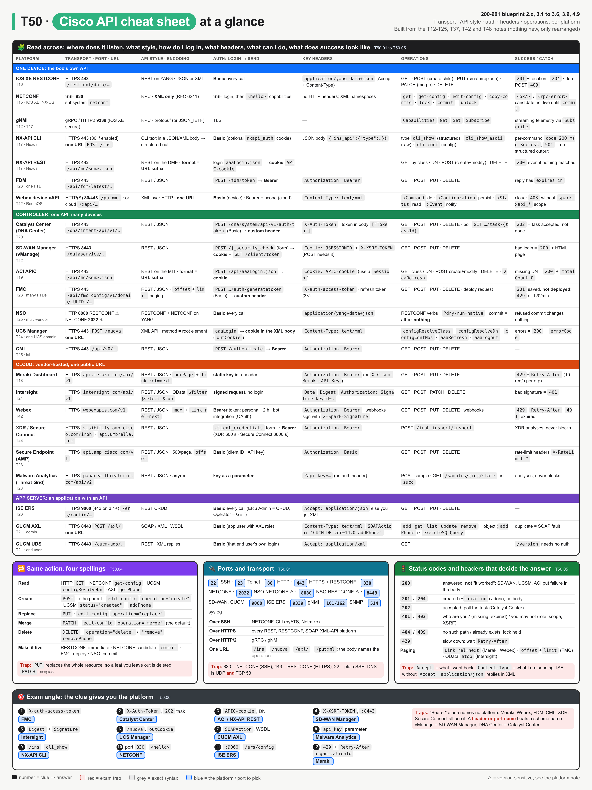
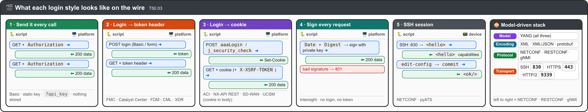

# T50 · API cheat sheet: transport, style, auth, headers, operations: essentials

> Blueprint 2.x, 3.1-3.6, 3.9, 4.9: how every Cisco API in the course is reached, logged in to and called · Full note: [bob/T50-api-cheatsheet-transport-auth-operations.md](../bob/T50-api-cheatsheet-transport-auth-operations.md)

## In one picture

*Read a row left to right: where it listens, what style, how you log in, which headers, which operations, what success looks like. Bands: blue = one device, green = controller, orange = cloud, purple = app server. Red = exam trap, grey = exact syntax, blue chips = the answer.*

## 🧭 The big idea

*Ask these six, in this order, about any platform.*

Every Cisco API question is the same six questions asked about a different product. Learn the questions, then the table is just lookup.

| # | Question | Answer set | Analogy |
|---|---|---|---|
| 1 | 🚪 **Transport**: how do I reach it? | SSH `:830` · HTTPS `:443` · `:8443` · `:9060` · gRPC `:9339` | the building's door |
| 2 | 🧱 **Style**: how is a request shaped? | REST/JSON · RESTCONF · NETCONF · SOAP · XML-over-HTTP · CLI-in-JSON · gRPC | the language spoken inside |
| 3 | 🔐 **Auth**: how do I prove who I am? | Basic every call · static key · login → token header · login → cookie · signed · key in URL · SSH | ID card, visitor badge, wristband, signature |
| 4 | 🏷️ **Headers**: what do I attach? | `Accept` / `Content-Type` + the auth header | the label on the envelope |
| 5 | 🛠️ **Operations**: what can I do? | HTTP verbs · NETCONF RPCs · `configResolve*` · `add/get/list/update/remove` · `xCommand/xStatus` | the buttons on the counter |
| 6 | ✅ **Success**: how do I know it worked? | `200` is not proof; `201`/`202`/`<ok/>` are not live | the receipt vs the delivery |

> 💡 The auth **header name** identifies the platform far more reliably than the auth **scheme**. "Bearer" is six platforms; `X-auth-access-token` is one.

## 🟥 Must know

### 🚪 1. Ports and URLs
| Port / URL | What | Cue |
|---|---|---|
| 🔌 TCP `830` over SSH, subsystem `netconf` | NETCONF | "XML, `<hello>`, candidate/commit" |
| 🔒 TCP `443` | RESTCONF, most REST APIs, UCSM, APIC, Catalyst Center | the default for HTTPS |
| 🔢 TCP `8443` | SD-WAN Manager (`/dataservice`), CUCM (`/axl/`, `/cucm-uds/`) | non-standard HTTPS |
| 🛡️ TCP `9060` (443 on ISE 3.1+) | ISE ERS | "NAC / quarantine" |
| 💻 TCP `22` | plain SSH CLI (pyATS, Netmiko) | not NETCONF |
| 🎯 `/ins` · `/nuova` · `/axl/` · `/putxml` | NX-API CLI · UCSM · CUCM AXL · Webex device xAPI | **one URL**; the body names the operation |

### 🔐 2. The seven login styles

*Blue arrow = what you send, green arrow = what comes back. Only styles 2 and 3 store something between calls.*

| Style | Platforms | You send | Stored? |
|---|---|---|---|
| 🟢 1 · Basic every call | IOS XE RESTCONF, NX-API CLI, NSO, ISE ERS, Secure Endpoint, CUCM, xAPI | `Authorization: Basic` | nothing |
| 🔵 2 · Static key | Meraki, Webex | `Authorization: Bearer <key>` | nothing |
| 🟠 3 · Login → token header | FMC `X-auth-access-token`, Catalyst Center `X-Auth-Token`; FDM, CML, XDR, Secure Connect use `Bearer` | token header | token |
| 🟣 4 · Login → cookie 🍪 | ACI / NX-API REST `APIC-cookie`; SD-WAN `JSESSIONID` + `X-XSRF-TOKEN`; UCSM cookie in the **XML body** | cookie | cookie → use `Session()` |
| 🔏 5 · Sign every request | Intersight: `Date`, `Digest`, `Authorization: Signature` | signature | nothing |
| 🟡 6 · Key as parameter | Malware Analytics `?api_key=` | query string | nothing |
| ⚫ 7 · Not HTTP 🔌 | NETCONF, pyATS | SSH session | session |

### 🛠️ 3. The same action in four spellings
| Action | HTTP / RESTCONF | NETCONF | UCSM | AXL |
|---|---|---|---|---|
| 👀 Read | `GET` | `get-config` / `get` | `configResolveDn` / `Class` | `getPhone` / `listPhone` |
| ➕ Create | `POST` to the parent | `edit-config` `operation="create"` | `status="created"` | `addPhone` |
| 🔁 Replace | `PUT` | `operation="replace"` | n/a | `updatePhone` |
| 🧩 Merge | `PATCH` | `operation="merge"` (default) | `configConfMos` | `updatePhone` |
| 🗑️ Delete | `DELETE` | `operation="delete"` / `"remove"` | `status="deleted"` | `removePhone` |
| 🚀 Live? | immediately | after `commit` (candidate) | immediately | immediately |

### ✅ 4. What the status code really means
| You see | It means | Next step |
|---|---|---|
| 🟡 `200` + failure in body | SD-WAN (bad login = HTML page), UCSM (`errorCode`), ACI (`totalCount 0`) | read the body |
| 🟢 `201` | FMC saved, **not deployed** | deployment request |
| ⏳ `202` | Catalyst Center task accepted | poll `/task/{taskId}` |
| 🟢 `204` | RESTCONF done, no body | none |
| 🔴 `401` / `403` | not authenticated / not allowed (role, scope, missing XSRF) | new credential / different role |
| ⚠️ `409` | already exists, or lock held | PATCH instead / wait |
| 🐢 `429` | rate limit | wait `Retry-After` |

## ⚠️ Exam traps
| ❌ Looks like… | ✅ Actually… |
|---|---|
| 🎫 "It's a token, so it's `Bearer`" | FMC and Catalyst Center use custom headers; Bearer is Meraki, Webex, FDM, CML, XDR, Secure Connect |
| 🔌 "NETCONF is on 443" | NETCONF is SSH `830`; RESTCONF is HTTPS `443` |
| ✏️ "PUT updates one field" | `PUT` replaces the whole resource; use `PATCH` to merge |
| 🎭 "`200` means it worked" | SD-WAN, UCSM and ACI report failure inside a `200` |
| 📝 "`edit-config` returned `<ok/>`, so it's live" | candidate needs `<commit>` |
| 📄 "ISE returns JSON by default" | without `Accept: application/json` it answers XML |
| 🔍 "XDR / Malware Analytics will block it" | they analyse; Secure Endpoint, ISE or FMC enforce |
| 🔑 "Secure Endpoint and Secure Connect auth the same way" | Endpoint = Basic (client ID : key); Connect = key + secret → Bearer |

<b>🟨 Should know (second pass)</b>

- **Paging:** `Link rel=next` (Meraki, Webex) · `offset` + `limit` (FMC, Secure Endpoint) · OData `$top`/`$skip` (Intersight).
- **Lifetimes:** FMC 30 min (3 refreshes) · Catalyst Center 60 min · XDR 600 s · Secure Connect 3600 s · Webex personal 12 h · ACI/UCSM cookies ~600 s ⚠.
- **Naming a thing:** DN + class (ACI, UCSM, NX-API REST) · YANG path (RESTCONF, NETCONF) · UUID/ID (everything else).
- **Rate limits:** Meraki 10 req/s per org · FMC 120/min, 10 connections ⚠.
- **NX-API CLI types:** `cli_show` (structured) · `cli_show_ascii` (raw) · `cli_conf` (config).
- **xAPI:** `xCommand` do · `xConfiguration` persist · `xStatus` read · `xEvent` notify.

> 📚 **Recognise only, details in the full note:** gNMI (`Capabilities/Get/Set/Subscribe`, `:9339`), NSO ports (`:8080` RESTCONF, `:2022` NETCONF ⚠), CML and FDM verb lists.

## ✍️ Quick self-check

Q1. A request carries <code>X-auth-access-token</code>. Which platform, and what must you do after a successful <code>POST</code>?
FMC. A <code>201</code> only saves the object; a deployment request pushes it to the firewalls.

Q2. Which port does a firewall rule need for NETCONF, and which for RESTCONF?
TCP 830 (SSH) for NETCONF, TCP 443 (HTTPS) for RESTCONF.

Q3. A script logs in to SD-WAN Manager, gets <code>200</code>, then every call returns an HTML page. Why?
A failed login returns <code>200</code> with the HTML login page. Success is a <code>JSESSIONID</code> cookie; POSTs also need <code>X-XSRF-TOKEN</code> from <code>GET /dataservice/client/token</code>.

Q4. Same <code>PUT</code> to a RESTCONF interface omits <code>description</code>. What happens to the existing description?
It is deleted, because <code>PUT</code> replaces the whole resource. <code>PATCH</code> would merge.

Q5. Which four APIs use one URL for every operation?
NX-API CLI <code>/ins</code>, UCSM <code>/nuova</code>, CUCM AXL <code>/axl/</code>, Webex device xAPI <code>/putxml</code>.

Q6. Which credential is a query parameter, and which is signed per request?
Malware Analytics <code>?api_key=</code>; Intersight signs <code>Date</code>, <code>Digest</code>, <code>Authorization: Signature</code>.

Q7. A Webex script worked yesterday and gets <code>401</code> today. Why, and what fixes it?
A personal token lasts 12 h. Use a bot token or an integration.

## 🗣️ Say it out loud
- "Every API is six questions: transport, style, auth, headers, operations, success."
- "The header name names the platform; Bearer names six."
- "830 is NETCONF over SSH, 443 is RESTCONF over HTTPS."
- "`200` means answered, not worked; `201`, `202` and candidate `<ok/>` mean accepted, not live."
